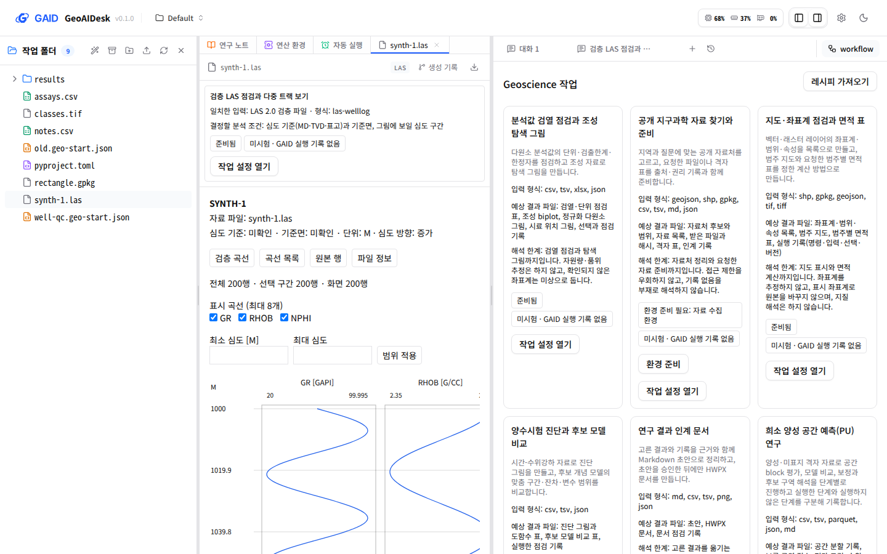
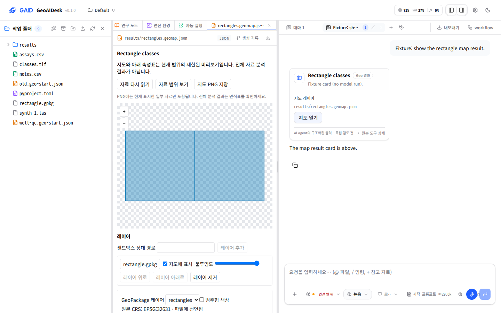
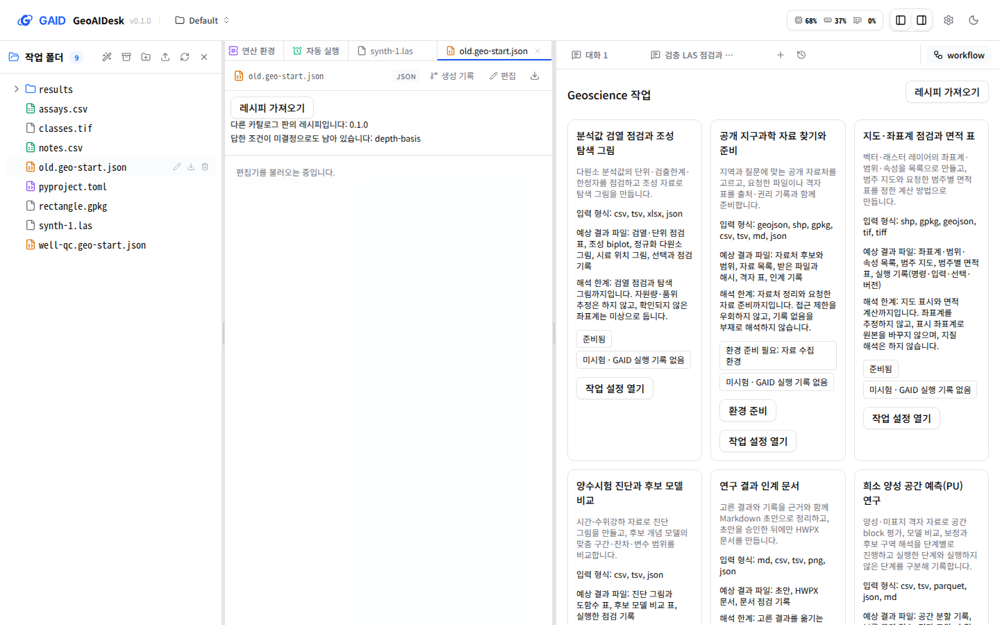
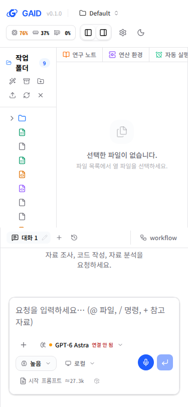

# 한국어 작업 공간: 자료에 맞는 작업 제안, 작업 초안, 결과 카드

## 0. 한눈에

| | |
|---|---|
| 요청 | 파일, 작업, 모델 설정, 결과를 연결하고 한국어를 기본으로 하는 작업 화면을 만듭니다(WP07). |
| 결론 | 검층 파일이나 원소 분석값 표를 열면 맞는 작업이 최대 세 개 제안됩니다. 작업 설정에서 입력과 분석 조건을 고르면 새 채팅에 초안이 열리고, 결과 카드에서 지도를 엽니다. 스킬이나 환경이 빠진 작업은 준비됨으로 표시하지 않습니다. 주요 화면, 로고, 언어 설정을 한국어 우선으로 바꿨습니다. |
| 믿을 수 있는 정도 | 실제 카탈로그 0.2.0과 합성 자료로 앱 화면에서 확인했습니다. 모델 호출은 하지 않았습니다. 결과 카드는 모델 없이 만든 고정 대화로 확인했습니다. 사람이 직접 해 보는 사용성 확인은 하지 않았습니다. |
| 결정할 일 | 없음 |

## 1. 요청한 것

> "2번 GeoAIDesk(약칭 GAID), 나머지는 권장방식으로 하자." / "구현 시작하자." — 2026-10-11 요청

작업자 구성 지시: "현재 수행중인 작업까지만 astra fast로 작업 후 다시 기존대로 opus 5.5 오케스트레이터에 gpt 6.1 sol high 워커로 작업하는 방식으로 진행하자."

완료 기준(계획서 WP07): 연구자가 자료를 열고, 관련 작업을 보고, 맞는 작업 묶음을 시작하고, 결과를 엽니다. 빠진 스킬이나 환경은 준비됨으로 표시하지 않습니다. 새 채팅이나 작업 묶음으로 옮겨도 작성 중인 초안이 남습니다. 주요 화면의 한국어, 키보드 조작, 좁은 화면, 실제 화면 확인을 기록합니다.

## 2. 수행한 것

1. 화면 문구를 한국어·영어 문구 목록으로 옮기고, 승인된 GAID 문구 규칙 검사기를 앱 점검에 넣었습니다. 주요 화면(프로젝트 선택, 파일 목록, 파일 보기, 채팅, 모델 연결, 설정, 결과 카드)을 한국어로 바꾸고 GAID 로고, 아이콘, 언어 설정을 넣었습니다.
2. 카탈로그의 workflow 일곱 개를 프로젝트 기준 준비 상태와 함께 보여 줍니다. 스킬 설치·사용 여부, 실행 환경, GAID 실행 기록을 따로 판정합니다. 꺼진 스킬은 켤 수 있고, 빠진 환경은 사용자가 눌러야만 준비합니다.
3. 열린 파일의 형식과 내용(예: 원소 열, 범주 필드가 있는 폴리곤)으로 맞는 작업을 최대 세 개 제안합니다. 흔한 표 형식은 내용 단서가 있을 때만 제안합니다.
4. 작업 설정에서 입력 파일과 분석 조건을 고르면 새 채팅 탭에 초안을 만듭니다. 메시지는 보내지 않습니다. 그 채팅은 해당 작업의 스킬만 모델에 보여 주는 상태로 시작합니다. 작업 레시피 파일은 검사한 뒤 설정 화면에 채웁니다.
5. 결과 카드에 지도·Depth track·검증 곡선 결과를 가리키는 종류를 추가하고, 카드 버튼으로 해당 보기 화면을 엽니다. 대화에서 재사용 스킬 초안을 만드는 단추도 넣었습니다.

## 3. 결과

그림 1. 합성 검층 파일을 열었을 때의 실제 앱 화면입니다. 볼 것: 파일 위에 검층 QC 작업이 준비됨과 미시험(GAID 실행 기록 없음) 표시를 따로 달고 제안됩니다. 오른쪽 새 채팅 탭에는 파일과 스킬이 붙은 작업 초안이 전송되지 않은 채 들어 있습니다.

그림 2. 작업 목록입니다. 볼 것: 각 작업에 입력 형식, 예상 결과 파일, 해석 한계가 있습니다. 공개 자료 준비 작업은 선택 환경이 없어 "환경 준비 필요"와 준비 단추를 보여 줍니다.

그림 3. 모델 없이 만든 고정 대화의 지도 결과 카드와, 카드의 "지도 열기"로 연 지도 보기입니다. 볼 것: 카드는 결과 파일을 가리키기만 하고, 지도 화면은 제한된 미리보기임을 밝힙니다.

| 완료 기준 | 결과 | 근거 |
|---|---|---|
| 자료를 열면 관련 작업이 보임 | 충족 | 그림 1. 검층 파일 → 검층 QC, 원소 분석값 표 → 지화학 조성 탐색(근거 열 표시), 폴리곤 자료·GeoTIFF → 지도·좌표계, 단서 없는 표 → 제안 없음 |
| 맞는 작업 묶음 시작 | 충족 | 그림 1. 새 탭에 초안, 입력 파일, 주 스킬이 들어가고 그 채팅은 해당 작업 스킬만 노출합니다. 시작 프롬프트 추정치가 27.3k에서 25.4k 토큰으로 줄어 노출 범위가 반영된 것을 확인했습니다. |
| 결과 열기 | 충족 | 그림 3 |
| 빠진 스킬·환경은 준비됨으로 표시하지 않음 | 충족 | 그림 2. 실제 카탈로그에서 5개 준비됨, 2개 환경 준비 필요. 스킬이 없으면 이름을 적고 준비됨을 쓰지 않습니다. |
| 새 채팅·작업 전환 시 초안 유지 | 충족 | 기존 채팅에 쓴 초안이 작업 시작 뒤에도 남았고, 작업 설정 창을 닫았다 열어도 고른 조건이 남았습니다. 초안은 새로 고침 뒤에도 유지되는 기존 저장 방식을 씁니다. |
| 주요 화면 한국어 | 충족 | 그림 1–3. 브라우저 언어가 영어이면 영어로 표시됩니다. 설정에서 언어를 고정할 수 있습니다. |
| 키보드 조작 | 충족 | 제안 단추에 초점을 두고 Enter로 설정 창을 열었습니다. Tab은 창 안에서만 돌고, Esc로 닫힙니다. |
| 좁은 화면(375 px) | 부분 | 가로 넘침은 없습니다. 파일 목록 칸이 좁아 파일 이름이 가려집니다(그림 5, 5절). |
| 실제 화면 확인 기록 | 충족 | 그림 1–5, 부록 A |

그림 4. 다른 카탈로그 판의 레시피를 가져온 화면입니다. 볼 것: 판이 다르다는 점과 같은 조건이 답과 미결정에 함께 있다는 점을 한국어로 알리고, 아무것도 실행하지 않습니다.

그림 5. 폭 375 px 화면입니다. 볼 것: 가로 넘침은 없지만 파일 목록 칸에서 파일 이름이 보이지 않습니다.

## 4. 검증

- 과학적 검증: 해당 없음. 이 작업은 화면과 작업 시작 경로이며 분석 결과를 만들지 않습니다. 작업 초안에는 카탈로그의 해석 한계와 "결과는 검토 전" 문장을 그대로 넣었습니다.
- 소프트웨어 검증: 서버 시험으로 준비 상태 판정, 제안 규칙, 레시피 검사 아홉 가지 오류, 결과 카드 검사, 새 채팅의 스킬 노출을 확인했습니다. 화면 시험은 전체 951개가 통과했습니다. 문구 검사기는 오류 0건입니다. 실제 카탈로그와 합성 파일로 앱을 띄워 위 흐름을 브라우저에서 확인했습니다. 전체 저장소 점검 결과는 부록 A에 적습니다.

## 5. 한계

- 모델에 작업을 실제로 보내 결과를 받은 실행은 하지 않았습니다. 작업 초안으로 시작한 채팅이 분석을 끝내는지는 모델별 실행 기록(WP10)에서 확인합니다.
- 결과 카드는 모델 없이 만든 고정 대화로 확인했습니다. 검증 곡선 결과는 전용 보기 화면이 없어 결과 파일을 일반 보기로 엽니다.
- 375 px에서는 기존 세 칸 배치 때문에 파일 목록의 파일 이름이 가려집니다. 머리글 단추로 칸을 접어서 써야 합니다.
- 주요 화면 밖의 일부 설정·고급 기능 화면은 영어로 남아 있습니다.
- 작업 제안의 내용 단서는 열 이름 규칙에 기반한 추정입니다. 열 이름이 다른 표는 제안되지 않을 수 있습니다.
- 사람이 직접 해 보는 사용성 확인(계획서 8.2)은 하지 않았습니다.
- GAID 로고의 대외 사용에 필요한 기관 브랜드 확인은 아직 끝나지 않았습니다(디자인 자산 설명 기준).

## 6. 결정할 일

없음.

## 7. 대체되었거나 실패한 시도

- 업스트림은 패키지 참조 스킬을 꺼진 상태로 설치합니다. 그대로 두면 지도·좌표계 작업이 새 프로젝트에서 항상 "스킬 없음"이었습니다. 작업에 묶인 스킬은 프로젝트를 처음 준비할 때 한 번만 켜도록 바꿨습니다. 그 뒤 사용자가 끈 스킬은 그대로 둡니다.
- 처음 만든 재사용 스킬 단추는 채팅 입력 도구 막대를 넘쳐서 아이콘 단추로 바꿨습니다.

## 부록 A. 근거 위치

- 코드: `server/src/geo/workspace/`, `server/src/geo/routes/workspace.ts`, `web/src/geo/workspace/`, `web/src/geo/i18n.ts`, `web/src/geo/locales/`, 계약 `web/src/geo/contracts/workspace.ts`; 업스트림 연결 지점은 `geo/integration-boundaries.json`.
- 문구 규칙과 로고: `geo/copy/`(skill_hub main 6866361, `SOURCE.md`), `geo/brand/`.
- 시험: `server/test/geo-workspace.test.ts`, `server/test/geo-provision.test.ts`, `web/src/geo/workspace/workspace.test.tsx`, `web/src/geo/i18n.test.ts`.
- 브라우저 확인 스크립트와 원본 화면: PC74 `~/data/geoaidesk/work/gaid-korean-workspace/browser/` (`final.mjs`, `result.mjs`, `seed-session.mts`, `final/*.png`). 합성 자료: 같은 위치의 `../fixtures/`.
- 그림 sha256: 01 `694c396c…`, 02 `dfe3b59a…`, 03 `75904536…`, 04 `60758e31…`, 05 `646bd0f2…`.
- 하위 작업: `gaid-korean-workspace--tasks`(작업 화면), `gaid-korean-workspace--korean`(한국어·브랜딩). 중간 점검 실패 두 건은 통과한 점검 실행으로 대체 기록했습니다.
- 전체 점검(`scripts/check`): 기록된 실행 결과를 task 문서 Current state에 적습니다.
