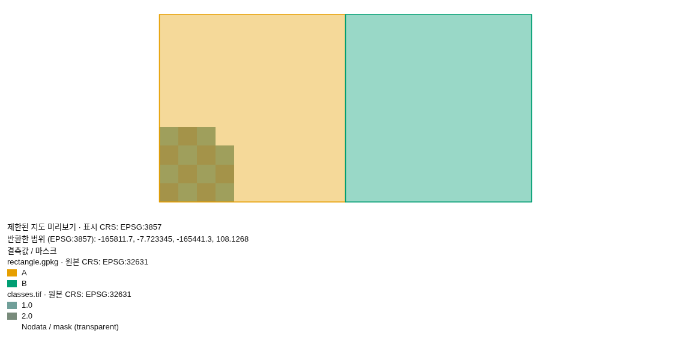

# 래스터·벡터 지도와 전체 레이어 면적표

## 0. 한눈에

| | |
|---|---|
| 요청 | 지리 자료를 함께 확인하고 지도와 면적 수치표를 만듭니다. |
| 결론 | 래스터·벡터 중첩, 레이어 선택, 범례·결측값·좌표계 표시와 면적표 계산을 구현했습니다. 지도 이미지와 면적표 다운로드를 실제 브라우저에서 확인했습니다. |
| 믿을 수 있는 정도 | 알려진 정답이 있는 합성 자료와 실제 앱 화면으로 확인했습니다. 실측 자료의 지질 해석, 사용자 연구, 모델별 과제 수행 능력은 평가하지 않았습니다. |
| 결정할 일 | 없음 |

## 1. 요청한 것

> “구현 시작하자.” — 2026-10-11 요청

승인된 지도 작업의 완료 기준은 래스터와 벡터를 함께 확인하고, 요청한 지도와 면적 수치표를 모두 제공하는 것입니다. 좌표계가 없는 자료를 임의로 배치하지 않으며 화면에 표시한 일부 자료를 전체 분석으로 간주하지 않습니다.

## 2. 수행한 것

1. 지리 참조가 있는 래스터와 일반 영상을 구분하고, 벡터 구성 파일과 여러 공간 레이어를 검사하도록 연결했습니다.
2. 화면 범위에 필요한 자료만 읽는 지도와 속성표를 구현했습니다. 레이어 표시·순서·불투명도, 밴드·분류 필드와 피처·표본 픽셀을 확인할 수 있습니다.
3. 화면 표시와 별도로 전체 폴리곤 레이어의 분류별 면적을 계산하도록 했습니다. 사용자가 투영 좌표계 또는 타원체 측지 방법을 선택합니다.
4. 지도 이미지, 면적표, 분석 파일을 참조하는 작은 결과 파일을 연결했습니다. 기존 프로젝트와 연구 기록을 별도 체계로 복제하지 않습니다.

## 3. 결과

그림 1. 합성 폴리곤 두 개와 래스터를 함께 표시한 실제 앱 화면입니다. 볼 것: 원본·표시 좌표계가 구분되며, 지도 아래에 전체 레이어의 면적과 분류별 수치가 함께 나옵니다.

| 항목 | 정답 또는 기대 동작 | 확인 결과 |
|---|---|---|
| 분류 A | 100 m × 100 m = 10,000 m² | 10,000 m², 50% |
| 분류 B | 100 m × 100 m = 10,000 m² | 10,000 m², 50% |
| 전체 | 20,000 m², 피처 2개 | 일치 |
| 표시 일부와 분석 전체 | 화면에 피처 1개만 요청해도 면적은 2개 전체 | 일치 |
| 좌표계 없음 | 원본 좌표만 표시하고 면적·중첩 거부 | 확인 |
| 결측값과 유효한 0 | 결측값은 마스크, 0은 표본값 0 | 확인 |
| 여러 공간 레이어 | 선택한 레이어의 지도·속성 표시 | 확인 |
| 범주형 래스터 | 최근접 표본에 없는 중간 분류값을 만들지 않음 | 확인 |

그림 2. 앱에서 내려받은 지도 이미지입니다. 볼 것: 분류 범례, 원본·표시 좌표계와 표시 범위를 함께 기록하며 전체 분석이 아닌 제한된 미리보기임을 명시합니다.

## 4. 검증

- 과학적 검증: 사각형의 해석적 면적, 독립적인 구면 메르카토르 좌표식, 타원체 면적과 구멍, 길이 단위 변환을 대조했습니다. 이 결과는 구현의 수치 검사이며 현장 좌표 정확도나 지질 해석의 타당성을 입증하지 않습니다.
- 처리기 검사: 구성 파일 누락, 좌표계 없음, 일반 영상 구분, 여러 공간 레이어, 범주형 표본, 결측값·마스크·알파 채널, 일반 래스터의 부분 읽기, 크기 제한과 잘못된 입력을 확인했습니다.
- 앱 연결 검사: 실제 파일을 앱의 지도·면적 요청 경로로 읽는 검사와 프로젝트별 파일 분리, 결과 파일 참조, 보조 파일 변경 감지를 확인했습니다.
- 브라우저 검사: 두 종류의 자료 중첩, 면적표 계산과 이미지·수치표 다운로드를 확인했습니다. 원본 좌표 표시, 면적·중첩 거부, 여러 레이어 선택과 래스터 표본값 0도 확인했습니다.
- 전체 통합 검사: 백엔드 1,609개, 프런트엔드 924개, 배포·지리 자료 검사 24개가 통과했습니다. 백엔드 11개는 제외되었으며, 그중 2개는 네트워크에서 외부 어휘 파일을 내려받지 못하는 기존 제한입니다. 두 Python 환경의 필수 모듈 검사와 깨끗한 데이터 폴더에서의 시작·종료·재시작 검사도 통과했습니다.

## 5. 한계

- 합성 자료와 이 Linux 환경을 확인했습니다. 다른 운영체제, 실측 대용량 자료, 모델별 완료 성능과 연구자 사용성은 미검증입니다.
- 래스터 화면은 최대 256×256 표본, 벡터 화면은 페이지당 최대 500개 피처입니다. 복잡한 도형·속성·분류와 전체 면적 계산에도 제한이 있습니다. 제한을 넘으면 부분 면적을 전체 결과처럼 반환하지 않습니다.
- 면적은 피처별 면적의 합입니다. 겹친 폴리곤은 중복 계산하며, 비율의 분모도 이 합계입니다. 도형 오류를 임의로 고치거나 경계를 합치지 않습니다.
- 투영 면적에는 자료에 적합한 좌표계가 필요합니다. 표시용 좌표계를 면적 계산의 기본값으로 쓰지 않습니다. 좌표계가 없는 회전 래스터와 일부 복합 공간 컨테이너는 지원 범위가 제한됩니다.
- 지도 그림은 현재 표시한 일부 자료입니다. 전체 수치 결과는 면적표로 확인해야 합니다. 앱 전체 브랜딩과 기존 화면의 한국어 전환은 별도 작업 범위입니다.

## 6. 결정할 일

없음.

## 7. 대체되었거나 실패한 시도

펼치기 — 수정한 문제와 검사 도구 문제

- 초기 검사에서 보조 파일 접근 실패 시 좌표계 상태 누락, 같은 지리 좌표계의 표기 차이, 점·선 자료의 폭 없는 범위, 과도한 페이지 번호 처리를 수정했습니다.
- 처리기 검사에서 일반 영상·알파 채널 시험 자료의 생성 방식과 논리형 분류값 표현을 수정했습니다.
- 화면 검토에서 원본 좌표 지도의 배율, 결과 파일의 분류 색상 복원, 선택 필드 요청과 일시적인 처리 용량 응답의 제한된 재시도를 수정했습니다.
- 작업 실행기의 환경설정 예제 파일 판정 문제 때문에 허브가 승인한 직접 검사 방식을 사용했습니다. 브라우저 자동화의 선택 상자 탐색과 원격 다운로드 수집 실패는 검사 도구를 고친 뒤 재검사했습니다. 실패 기록을 수치 검증 성공으로 세지 않았습니다.

## 부록 A. 근거 위치

펼치기 — 구현, 검사, 원본

| 항목 | 위치 |
|---|---|
| 구현 | `server/src/geo/maps/`, `server/src/geo/routes/maps.ts`, `web/src/geo/viewers/map/`, `web/src/geo/contracts/maps.ts` |
| 사용법·제한 | `docs/geo-maps.md` |
| 처리기 정답 검사 | `geo/tests/maps-helper.test.mjs`, `geo/tests/fixtures/maps_fixture.py` |
| 실제 앱 연결 검사 | `server/test/geo-maps-integration.test.ts`, `server/test/geo-maps.test.ts` — 두 파일 10개 검사 통과 |
| 화면 표적 검사 | `npm --prefix web test -- src/geo/viewers/map` — 4개 파일, 19개 검사 통과 |
| 브라우저 절차·파일 | `pc74:/home/seongin3/data/geoaidesk/work/gaid-maps/browser/`의 `full-check.mjs`, `edges.mjs`, `manifest.mjs`, `area.csv`, `map-area.png`, `map-export.png` |
| 전체 검사 | `task sync`가 실행한 `scripts/check` 통과 — 백엔드 150개 파일/1,609개 통과(1개 파일/11개 검사 제외), 프런트엔드 140개 파일/924개 통과, GAID 24개 통과. 환경·시작·재시작 포함 |
| 결과 해시 | `results/registry.toml` |

작성 시점: 2026-10-11. 검토 대상 코드 기준: `d604849596b6`.

