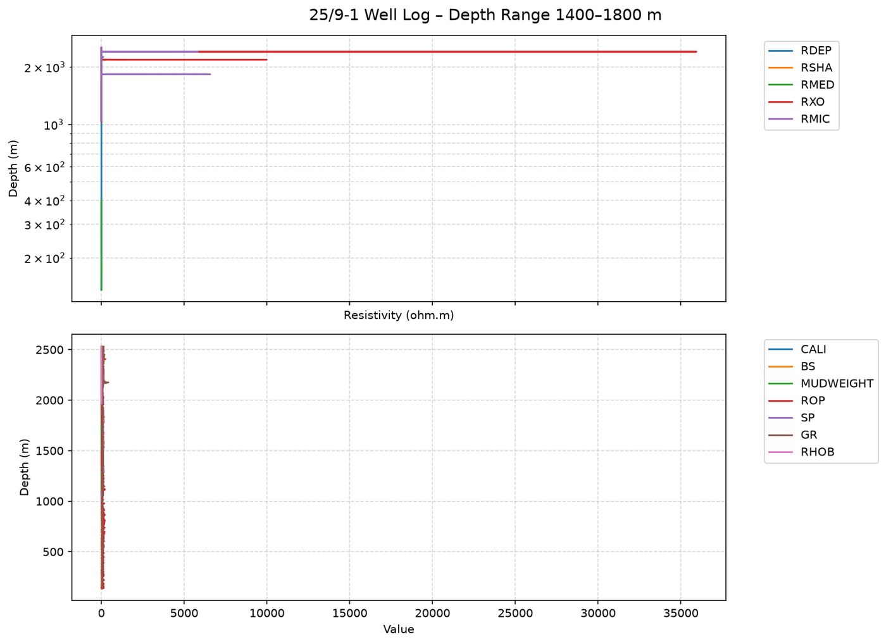

# GeoAIDesk 0.1.0 출시 검증 — 설치·업데이트·모델 경로 증거

## 0. 한눈에

| | |
|---|---|
| 요청 | 출시판의 설치, 업데이트, 모델 경로, 과제 수행 증거를 만들고, 증거가 있는 조합만 안내합니다. |
| 결론 | Linux, Windows+WSL, Windows 기본 환경 모두 새 설치, 재시작, 이전 버전에서의 업데이트를 통과했습니다. Windows에서는 한글이 들어간 경로에서 앱이 멈추는 결함 두 가지를 찾아 고친 뒤 통과했습니다. 로컬 Qwen 모델은 64K·98K 모두 연결은 됐지만, 실제 과제는 98K 지도·면적표 1건만 기준을 통과했습니다. |
| 믿을 수 있는 정도 | 설치·업데이트는 실제 앱 API와 정답을 아는 합성 자료로 확인했습니다. 화면 조작 시험, macOS, 유료·구독 모델 경로는 시험하지 않았습니다. 로컬 모델 결과물은 검토 전이며 과학적으로 검증된 결과가 아닙니다. |
| 결정할 일 | 4건 (6절) |

## 1. 요청한 것

> “2번 GeoAIDesk(약칭 GAID), 나머지는 권장방식으로 하자.” · “구현 시작하자.” — 2026-10-11 요청
>
> “gaid-runtime#1을 포함하여 #1,2,3,4 모두 권장안으로 진행하자.” — 2026-10-11 요청

완료 기준(WP10): 안내하는 환경에서 새 설치와 결정적 미리보기가 동작하고, 업데이트 뒤에도 기존 프로젝트·스킬·기록이 남습니다. 요청한 로컬·API·구독 경로는 연결과 과제 결과를 따로 기록합니다. Claude Pro/Max 경로는 공급자의 서면 답이 없으면 안내하지 않습니다. LAS와 지도+면적표 과제를 기록된 조합에서 보여 주고, 시험하지 않은 조합은 미시험으로 남깁니다. 함께 넘어온 결정으로 로컬 모델은 64K와 98K를 실제 과제로 시험하고(gaid-runtime#1), 카탈로그 아카이브는 GeoAIDesk GitHub Release에 올려 앱이 고정 해시로 내려받게 합니다(gaid-runtime#2).

## 2. 수행한 것

1. 스킬 카탈로그를 0.2.1로 고정했습니다. 앱이 처음 시작할 때 카탈로그를 GeoAIDesk 릴리스에서 내려받고, 해시가 맞을 때만 보관하게 했습니다. 사용자 결정에 따라 카탈로그 릴리스를 공개했고(시험판 표시), 로컬 사본 없이 새로 설치한 앱이 공개 릴리스에서 내려받아 모든 설치 단계를 통과하는 것을 확인했습니다.
2. 실제 설치·업데이트 시험 도구를 만들었습니다. 새 폴더에 앱을 내려받아 설치·실행하고, 정답을 아는 합성 자료로 LAS 수치, 래스터·벡터 지도, 전체 레이어 면적표, CSV·TSV 구간 검사를 API로 확인합니다. 이전 버전에서 업데이트한 뒤에도 사용자가 만든 프로젝트·파일·대화 기록·노트·수정한 스킬이 남는지도 하나씩 확인합니다. 데이터 폴더 이름에는 일부러 공백과 한글을 넣었습니다.
3. Linux(PC74), Windows+WSL(PC71), Windows 기본 환경(PC71)에서 실행했습니다. Windows에서 나온 실패는 원인을 찾아 고친 뒤 다시 시험했습니다.
4. 로컬 모델(Ollama, Qwen3 30B, RTX 4090 한 대)을 64K와 98K 컨텍스트로 설정해, 카탈로그의 검층 QC 과제(FORCE 25/9-1 공개 자료)와 지도·면적표 과제(정답 면적을 아는 합성 자료)를 실제 대화로 실행했습니다. 연결 시험과 과제 결과를 따로 기록했습니다.
5. 구독 로그인 경로의 공급자 문서를 다시 확인하고(2026-10-11), ChatGPT 로그인이 GeoAIDesk 이름으로 등록되도록 고쳤습니다.
6. 결과를 호환성 기록 파일과 설치·호환성 안내 문서, 로컬 모델 설정 화면 문구에 반영했습니다.

## 3. 결과

### 3.1 설치와 업데이트

| 환경 | 새 설치·재시작·미리보기 | 이전 버전에서 업데이트 | 비고 |
|---|---|---|---|
| Linux x86-64 (Ubuntu 24.04) | 통과 (30단계) | 통과 | 첫 시작 약 44초(패키지 설치 포함), 재시작 약 6초 |
| Windows + WSL 2 | 통과 | 통과 | 첫 시작 약 62초 |
| Windows 기본 (Windows 11) | 통과 (30단계) | 통과 | 아래 결함 2건 수정 후 통과. 첫 시작 약 5분 24초, 재시작 약 13초. 업데이트 시험은 ASCII 데이터 폴더 사용(이전 버전은 한글 경로에서 시작하지 못함) |
| macOS | 미시험 | 미시험 | 시험 기기 없음 |

업데이트 시험에서는 카탈로그가 0.2.0에서 0.2.1로 바뀌었습니다. 사용자가 고치지 않은 스킬만 새 판으로 바뀌었고, 사용자가 고친 스킬·직접 만든 스킬·꺼 둔 스킬은 그대로 남았습니다. 두 번째 프로젝트, 올린 파일과 그 기록, 지출 한도, 에이전트 지침, 대화 기록, 노트 메모도 모두 다시 열렸습니다.

Windows에서 찾아 고친 결함은 다음 두 가지입니다.

- **한글 경로에서 앱이 메시지 없이 멈춤.** Windows용 Node에서 파일 복사·삭제 함수 일부가, 경로에 한글 같은 비ASCII 문자가 있으면 프로세스를 즉시 종료시킵니다. Node 22와 24 모두에서 재현했습니다. 데이터 폴더 기본 위치가 사용자 폴더 아래라서, Windows 사용자 이름이 한국어면 첫 실행부터 실패합니다. 이런 경로에서는 같은 동작을 안전한 방식으로 처리하는 보정을 넣었고, 앱이 띄우는 모든 프로세스에 적용했습니다.
- **한글 경로의 지도 파일을 찾지 못함.** 지도 처리 도우미가 받은 경로를 Windows 기본 문자 인코딩으로 읽어서 한글 경로가 깨졌습니다. UTF-8로 읽도록 고쳤습니다.

이 밖에, 스킬을 설치할 때 Windows가 새로 복사된 폴더를 잠깐 잠가 이름 바꾸기가 실패하는 현상도 확인했습니다. 짧게 다시 시도하도록 했습니다.

### 3.2 모델 경로

| 경로 | 연결 | 검층 QC 과제 | 지도·면적표 과제 |
|---|---|---|---|
| 로컬 Qwen3 30B, 64K | 통과 (약 29초) | 일부 완료: 45분 제한에 걸림, 그림 누락, 컨텍스트 한계 도달 | 일부 완료: 면적표는 정답과 일치, 지도 그림 없음 |
| 로컬 Qwen3 30B, 98K | 통과 (약 30초) | 일부 완료: 파일은 모두 생성, 도구 호출 반복으로 45분 제한, QC 값 결함 | 통과: 76초, 면적 정답과 일치(A 30,000 m², B 20,000 m²) |
| 개인 API 키 | 미시험 | 미시험 | 미시험 |
| ChatGPT 로그인 | 미시험 | 미시험 | 미시험 |
| Claude Pro/Max 로그인 | 안내하지 않음 | — | — |
| GitHub Copilot 로그인 | 안내하지 않음 | — | — |

로컬 모델은 두 설정 모두 모델 일부를 CPU에서 돌렸습니다(64K 약 7%, 98K 약 18%). 따라서 24 GB GPU 하나에 모델 전체가 올라간 것이 아닙니다. 네 번의 과제 모두에서 모델은 대화에 노출된 워크플로 스킬을 읽지 않았습니다. 스스로 작성한 스크립트를 여러 번 고쳐야 했습니다.

그림 1. 98K 로컬 모델이 합성 지도 자료(평면 좌표계 EPSG:5186의 직사각형 세 개)로 만든 지도. 볼 것: 분류 A(빨강)·B(파랑)의 배치와 좌표가 입력과 일치하고, 같은 실행에서 만든 면적표의 면적이 정답과 같습니다. 좌표계 목록과 실행 기록 파일에는 요청한 항목 일부가 빠졌고, 실제와 다른 날짜가 적혀 있었습니다.

그림 2. 98K 로컬 모델이 FORCE 25/9-1 검층 자료로 만든 미리보기. 볼 것: 제목은 1400–1800 m 구간이라고 적었지만 실제로는 전체 깊이를 그렸고, 깊이 축 방향이 뒤집혔으며, 단위가 다른 curve를 한 축에 섞었습니다. 함께 만든 QC 결과는 헤더 종료 깊이(2532.17 m)와 실제 마지막 깊이(2532.06 m)의 차이는 올바르게 남겼지만, 결측값을 모두 0개로 잘못 셌습니다. 실행은 끝났지만 검증된 QC 결과는 아닙니다.

| 완료 기준 | 결과 | 근거 |
|---|---|---|
| 안내 환경의 새 설치와 결정적 미리보기 | Linux·WSL·Windows 기본 충족, macOS 미시험 | 3.1 표 |
| 업데이트 뒤 프로젝트·스킬·기록 유지 | Linux·WSL·Windows 기본 충족 | 3.1 표 |
| 요청한 모델 경로의 연결·과제 결과를 따로 기록 | 로컬 충족, 유료·구독 경로는 사용자 요청 대기 | 3.2 표 |
| Claude Pro/Max 경로 처리 | 충족(안내하지 않음) | 3.2 표, 5절 |
| LAS와 지도+면적표 과제 시연 | 지도+면적표는 98K에서 기준 통과, LAS는 일부 완료 | 3.2 표, 그림 1·2 |
| 카탈로그 내려받기 경로 | 충족: 공개 릴리스에서 내려받아 설치 통과 | 2절 1단계 |

## 4. 검증

- 과학적 검증: 지도 면적은 해석적으로 아는 정답과 비교했습니다. 검층 QC 결과는 원본 LAS를 직접 읽어 얻은 값(표본 수, 시작·끝 깊이, 결측값 수)과 대조했고, 그 결과 모델 출력의 결함을 확인했습니다. 실측 자료의 지질 해석과 전문가 검토는 하지 않았습니다(미검증).
- 소프트웨어 검증: 설치·업데이트 시험은 실제 앱을 띄워 API로 정답을 대조했습니다(화면 조작 시험은 아님). Windows 결함 두 가지는 각각 재현 후 수정했고, 수정 전 코드에서는 실패하고 수정 후 코드에서는 통과하는 테스트를 넣었습니다. 저장소 전체 검사 결과는 부록 A에 적었습니다.

## 5. 한계

- macOS는 시험하지 않았습니다. Windows+WSL에서 Windows 쪽 모델 서버에 접속하는 경로도 시험하지 않았습니다.
- 설치 시험은 API와 제공된 화면 HTML만 확인합니다. 브라우저에서 사람이 조작하는 시험은 아닙니다.
- 로컬 모델 시험은 한 기기, 한 모델, 과제당 한 번입니다. 반복 실행에 따른 편차는 모릅니다. 결과물은 검토 전입니다.
- 모델이 노출된 워크플로 스킬을 읽지 않은 원인은 이번 작업에서 조사하지 않았습니다. 스킬 노출 방식이 작은 로컬 모델에 효과가 있는지는 별도 확인이 필요합니다.
- 구독 경로 판단은 2026-10-11에 확인한 공개 문서를 근거로 합니다. 법률 의견이나 공급자의 개별 승인이 아닙니다. ChatGPT 로그인은 요금제의 포함 사용량과 앱별 한도를 소비하며, 무제한이 아닙니다.
- 한글 경로 결함의 근본 원인은 Node 자체에 있습니다. 앱의 보정은 앱이 띄우는 Node 프로세스에만 적용됩니다.

## 6. 결정할 일

1. 로고(GAID 브랜드 이미지)의 기관 공개 승인
   - 가) 승인을 이미 받았습니다. 공개 릴리스에 그대로 씁니다.
   - 나) 아직 받지 못했습니다. 앱 릴리스는 GitHub 초안까지만 만들고 공개는 승인 뒤로 미룹니다. (권장: 공개 전 승인이 필요하다는 기록이 남아 있음)
   - 다) 아직 받지 못했습니다. 로고 없이 글자 표기만으로 공개합니다.
2. 카탈로그 아카이브 0.2.1 공개(GeoAIDesk GitHub Release, 시험판 표시)
   - 가) 지금 공개합니다. 새 설치의 실제 내려받기까지 시험합니다. (권장: 아카이브에는 스킬 파일과 각 스킬의 라이선스 고지만 있고 로고가 없음)
   - 나) 앱 릴리스를 공개할 때 함께 공개합니다.
3. 유료·구독 모델 경로 시험(결정 D4)
   - 가) 개인 API 키와 ChatGPT 로그인을 모두 시험합니다. 과제당 수 달러의 API 비용과 ChatGPT 사용량이 듭니다. (권장: D4가 출시 전 두 경로 시험을 정함)
   - 나) 개인 API 키만 시험합니다.
   - 다) ChatGPT 로그인만 시험합니다.
   - 라) 이번 출시에서는 시험하지 않고 미시험으로 표기합니다.
4. 로컬 모델 경로의 안내 방식
   - 가) 지원으로 안내하지 않고, 시험 결과와 한계만 공개합니다. (권장: 4건 중 1건만 기준 통과)
   - 나) 98K 설정의 지도·면적표 과제에 한해 시험된 조합으로 안내합니다.

## 7. 대체되었거나 실패한 시도

펼치기 — 6건

- 업데이트 시험 1·2차(Linux): 시험 도구 오류(프로젝트 지정 방식, 대화 기록 형식)로 실패했습니다. 고친 3차에서 통과했고, 실패 기록은 보존했습니다.
- Windows 기본 설치 1차(예약 작업 실행): 백엔드가 첫 요청 직후 메시지 없이 멈췄습니다. 처음에는 예약 작업 환경 문제로 보였지만, 대화형 세션에서도 새 설치의 첫 시작이면 재현되었습니다. 원인은 한글 경로의 Node 결함이었습니다.
- Windows 기본 설치 2차: 스킬 폴더 이름 바꾸기의 일시적 잠금만 고친 상태라 같은 방식으로 실패했습니다.
- Windows 기본 설치 3차: 한글 경로 보정 후 첫 시작은 통과했지만, 지도 미리보기 3종이 한글 경로를 읽지 못해 실패했습니다. 도우미 인코딩을 고쳤습니다.
- Windows 업데이트 1차: 기준 버전이 한글 데이터 폴더에서 시작하지 못해 실패했습니다(이번에 고친 결함). ASCII 데이터 폴더로 다시 시험해 통과했습니다.
- 로컬 모델 시험은 실패한 실행을 다시 돌리거나 앱을 조정하지 않았습니다. 일부 완료 3건이 그대로 기록입니다.

## 부록 A. 근거 위치

펼치기 — 실행 방법, 원본, 해시, 커밋

(최종 커밋과 검사 결과를 마지막에 채웁니다.)

| 항목 | 위치 |
|---|---|
| 호환성 기록 | `geo/compatibility.json`, 요약 `docs/geo/compatibility.md` |
| 설치·업데이트 안내 | `docs/geo/install.md` |
| 시험 도구 | `geo/release-proof/` (설치 `install-proof.mjs`, 업데이트 `update-proof.mjs`, 모델 경로 `route-trial.mjs`) |
| 카탈로그 | 자산 `pc74:~/assets/geo-catalogue/0.2.1/` (MANIFEST.sha256 9ac82d84…ee48), 공개 스크립트 `geo/catalogue-release.mjs` |
| 공급자 문서 조사 | `pc74:~/data/geoaidesk/work/gaid-release-proof/oracle-provider-terms-harvest.md` |
| 그림 원본 | 그림 1 map.png sha256 798e56a4119faa226dc17e39c62ff3aef24e9ffe517dd821278b199dc98393bc, 그림 2 quicklook.png sha256 c2d3b598170e96461d57d646703bdf9d37f5da2cb68aab57a178997060b25cd1 (각 시험 실행 폴더) |

