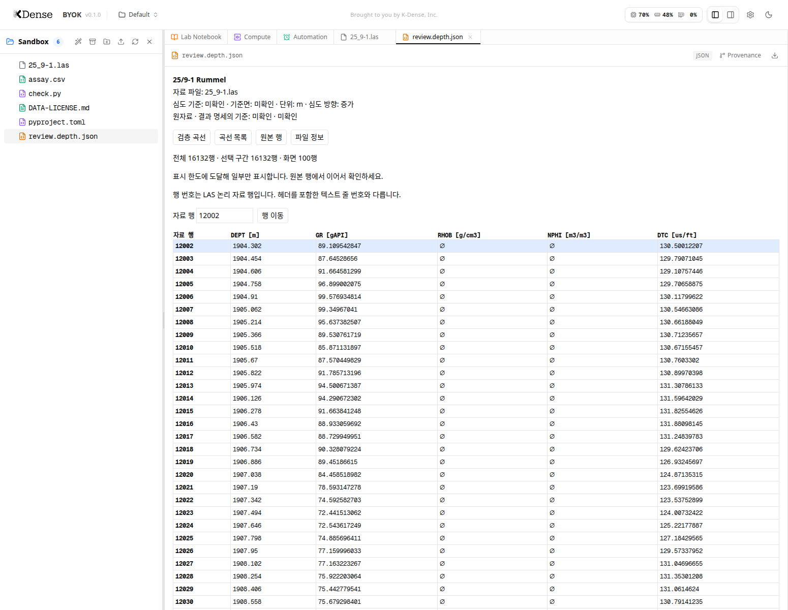
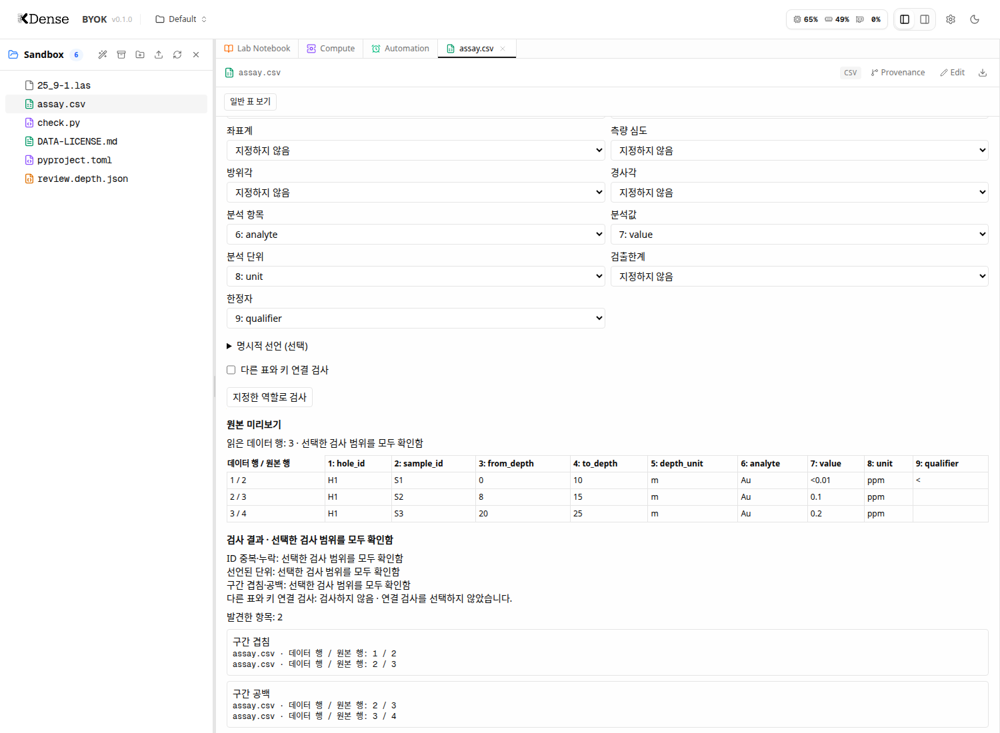

# 검층 곡선과 시추공 표를 원자료와 함께 확인합니다

## 0. 한눈에

| | |
|---|---|
| 요청 | 검층 파일을 먼저 열고, 시추공·분석표의 구간과 연결 관계를 확인합니다. |
| 결론 | 검층 곡선·단위·결측과 정확한 원본 행을 확인합니다. 표에서는 열의 역할을 지정해 구간 중복·공백·ID·연결·단위를 점검합니다. |
| 믿을 수 있는 정도 | 생성한 정답 자료와 실자료의 별도 내보내기를 비교했습니다. 지질학적 해석이나 분야 전문가 검토를 대신하지 않습니다. |
| 결정할 일 | 없음 |

## 1. 요청한 것

> “구현 시작하자.” — 2026-10-11 요청

완료 기준은 여러 MB 검층 파일을 원문 전체 읽기 없이 여는 것, 값·단위·결측·심도 기준을 보존하는 것, 종류별 검토 표시와 원본 행 연결입니다. 이후 표의 구간과 연결을 점검하되 궤적이나 단위를 추정해 변환하지 않습니다.

## 2. 수행한 것

1. 검층의 헤더와 수치 자료를 분리해 읽고, 한도를 둔 곡선·원본 행 화면을 추가했습니다.
2. 화면에서는 극값과 결측 경계를 보존하며 자료를 줄입니다. 값의 변경이나 보정은 하지 않습니다.
3. 검토 표시의 기호와 색을 구분하고, 클릭한 표시의 정확한 자료 행과 원본·분석 코드 파일을 연결했습니다.
4. 시추공 표의 열 역할을 명시적으로 선택하고, 원래 열과 검출한계 표기를 유지하며 구간·ID·연결·단위를 점검합니다.

## 3. 결과

그림 1. FORCE 25/9-1 자료의 1,800–2,400 m 구간을 실제 앱에서 열었습니다. 볼 것: 각 곡선의 단위, 결측으로 끊긴 선, 미확인으로 남긴 심도 기준입니다. 출처: Bormann 등(2020), FORCE, Zenodo 4351156, CC BY 4.0. 원자료는 NOLD 2.0이며 주최 측의 정리·일부 급변 제거를 거친 내보내기입니다.

| 확인 항목 | 결과 |
|---|---|
| 대용량 검층 | 4,841,277바이트, 16,132개 자료 행을 읽었습니다. |
| 값과 결측 | 별도 내보내기와 대응한 15,743행의 7개 곡선은 최대 절대 차이 0, 결측 위치 불일치 0입니다. 단위는 각 곡선의 원래 단위입니다. |
| 심도 기준 | 근거가 없는 기준과 기준면은 미확인 상태입니다. |
| 실제 헤더 불일치 | 마지막 심도와 헤더의 차이 0.1128047 m를 그대로 보고합니다. |
| 원본 행 연결 | 검토 표시를 눌러 12,002번째 논리 자료 행으로 이동했습니다. 시험용 표시는 과학적 QC 결과가 아닙니다. |

그림 2. 시험용 급변 표시에서 12,002번째 자료 행으로 이동했습니다. 볼 것: 원본 행 번호와 원래 단위의 값입니다. 이 표시는 화면 연결 시험을 위해 만든 것이며, 실제 과학적 이상을 판정한 결과가 아닙니다. 검층 자료 출처와 권리는 그림 1과 같습니다.

그림 3. 합성 표에서 구간 중복 1건과 공백 1건을 찾았습니다. 볼 것: 원본 행 위치와 그대로 남긴 검출한계 미만 값입니다. 점검 전후 원본 파일의 바이트가 같음을 확인했습니다.

## 4. 검증

- 과학적 수치 확인: 같은 제공자의 두 내보내기를 대응시켰습니다. 독립 측정의 진실성이나 지질 해석을 입증한 것은 아닙니다.
- 수치 회귀검사: NULL과 0 구분, 줄바꿈 자료, 중복·누락·역전 심도, 미확인 단위, 극값·결측 경계 보존과 표시 한도를 확인했습니다.
- 백엔드 회귀검사: 1,593개 통과, 11개 건너뜀입니다. 이 중 2개는 기관 네트워크에서 어휘 자료를 받지 못하는 기존 시험입니다. 시험을 건너뛴 것을 통과로 세지 않았습니다.
- 프런트엔드 회귀검사: 905개가 통과했습니다. 이후 배포용 빌드에서 발견한 시험 자료의 타입 누락을 수정했고, 타입 검사와 관련 화면 시험 7개가 다시 통과했습니다.
- 실제 브라우저: 검층 열기, 심도 범위 선택, 원본 행 이동, 표 역할 지정과 구간 점검, 일반 표로 돌아가기, 원본 바이트 보존을 확인했습니다. 새 데이터 공간에서 배포용 앱을 시작·종료·재시작하는 검사도 통과했습니다.

## 5. 한계

- 초기 검층 수치 보기는 버전 2.0만 지원합니다. 점군용 이진 파일과 버전 3.0은 지원하지 않는다고 표시합니다.
- 화면은 원자료의 부분집합일 수 있습니다. 한도에 걸린 결과는 부분 표시로 구분하며, 이 화면 자료를 전체 분석 자료로 사용하지 않습니다.
- 범위 이탈·급변·공경 확대 검사는 이 뷰어가 실행하지 않습니다. 결과 명세의 후보 표시는 원인 검토 전이며, 자료를 무효화하거나 보정하지 않습니다.
- 결과 명세는 현재 자료의 행 번호를 가리킵니다. 분석 뒤 원자료가 바뀌지 않았다는 증명은 별도의 실행 기록으로 확인해야 합니다.
- 시추공 궤적 계산, 자동 단위 변환, 검출한계 미만 값의 대체는 하지 않습니다. 표의 일부만 읽었다면 누락된 연결이나 공백을 전체 자료의 결함으로 단정하지 않습니다.
- 모델 실행, 다른 운영체제 검증과 서비스 배포는 하지 않았습니다.

## 6. 결정할 일

없음.

## 7. 대체되었거나 실패한 시도

펼치기 — 4건

- 처음 사용한 파서가 심도 열의 NULL을 값으로 남기고 일부 줄바꿈 자료를 잘못 나눴습니다. 헤더에 선언된 열 수로 자료를 읽도록 수정하고 회귀검사로 확인했습니다.
- 화면 점검에서 결측 사이의 단일 값이 보이지 않는 문제와 잘못된 심도 범위를 바로 수정하지 못하는 문제를 찾았습니다. 단일 값을 점으로 표시하고 입력 단계에서 범위를 확인하도록 수정했습니다.
- 배포용 빌드의 타입 검사에서 새 시험 자료에 필드가 빠진 것을 찾았습니다. 실제 계약에 맞게 필드를 채웠고, 느슨한 타입 변환으로 우회하지 않았습니다.
- 검사 스냅샷 도구가 기존 환경설정 예시 파일 때문에 중단됐습니다. 사용자가 승인한 임시 절차에 따라 작업 경로에서 직접 검사했습니다. 해당 예시 파일은 변경하지 않았습니다.

## 부록 A. 근거 위치

펼치기 — 실행 방법, 원본, 해시, 커밋

| 항목 | 위치와 근거 |
|---|---|
| 앱 코드 확인 기준 | `ebbe2e0856a771c0cc024ef61bed7178e5833738` (표 하위 작업 포함). 이후 변경은 시험 자료의 타입 명시와 보고서입니다. 최종 통합은 이 보고서의 Git 이력과 작업 완료 기록으로 확인합니다. |
| 사용법·계약·한도 | `docs/geo/well-tables.md`, `web/src/geo/contracts/depth.ts`, `web/src/geo/contracts/tables.ts` |
| 검층 읽기·보기 | `server/src/geo/well/`, `server/src/geo/routes/depth.ts`, `web/src/geo/viewers/depth/` |
| 표 역할·점검 | `server/src/geo/tables/`, `server/src/geo/routes/tables.ts`, `web/src/geo/viewers/tables/` |
| 원자료 이름 | `configs/inputs.toml`의 `force2020_welllogs`: `pc74:~/assets/force2020-welllogs/c8d01ee9/` |
| 검층 원본 해시 | `las/25_9-1.las` · sha256 `5604b035b6d6406eb51b01796d48688505a1b56cc77e50ec17dcf00cb40252ce` |
| 실자료 수치 확인 | `uv run --frozen --project server/src/helpers python geo/tests/force-concordance.py --output <external-output>` |
| 수치 결과 | `pc74:~/data/geoaidesk/work/gaid-well-tables/checks/force-concordance.json` · sha256 `4512f9ded9dea4979394fb23196eab758c5c8f8f003b5afd030d9a080e32d834` |
| 생성 자료 검사 | `node --test geo/tests/well.test.mjs` (Python 9개), `server/test/geo-depth.test.ts` (4개), 표 검사 13개 |
| 전체 회귀검사 | `VITEST_MAX_WORKERS=1`로 `scripts/check` 실행. 서버는 원래 순차 실행이며 이 설정은 프런트엔드도 순차 실행합니다. 테스트나 제한 시간을 바꾸지 않았습니다. |
| 화면 검사 | `web/src/geo/viewers/depth/viewer.test.tsx`, `web/src/geo/viewers/tables/table-option.test.tsx`; 수정 후 7개 통과 |
| 실제 브라우저 재현 | `pc74:~/data/geoaidesk/work/gaid-well-tables/{depth,table}-browser-smoke.py`; 격리된 `browser/projects/default/sandbox/` 자료 사용, 유료 모델 호출 없음 |
| 화면 원본 | `pc74:~/data/geoaidesk/work/gaid-well-tables/checks/`의 `depth-window-ko.png`, `depth-exact-row-ko.png`, `table-checks-ko.png`; 해시는 `results/registry.toml`에 기록 |
| 배포용 시작·재시작 검사 | `node geo/tests/production-smoke.mjs` 통과. `pc74:~/data/geoaidesk/work/gaid-well-tables/checks/production-smoke.log` |
| 실행 환경 | PC74 Ubuntu 24.04, Node 24.21.0, uv 관리 Python 3.12.14 |
| 배포 | 실행 중인 서비스의 배포나 모델 실행은 하지 않았습니다. |

작성 시점: 2026-10-11. 검토 상태는 아직 사용자 채택을 뜻하지 않습니다.

