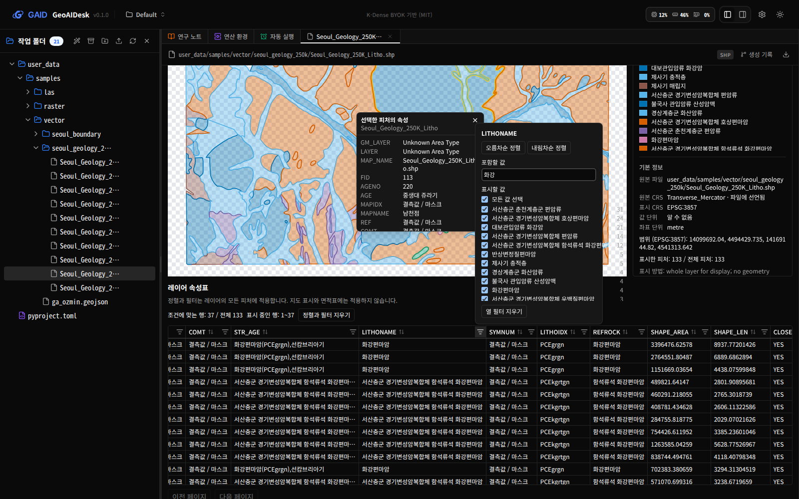
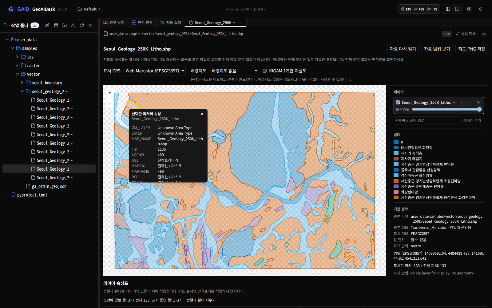
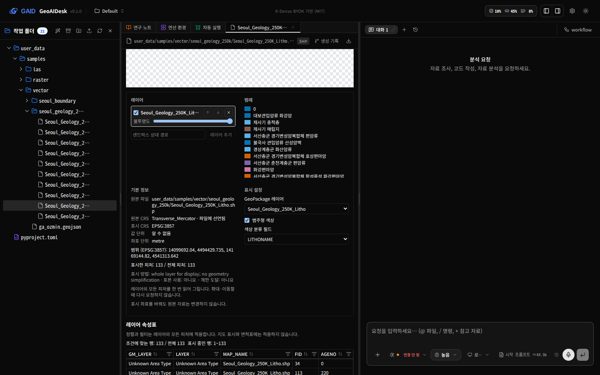
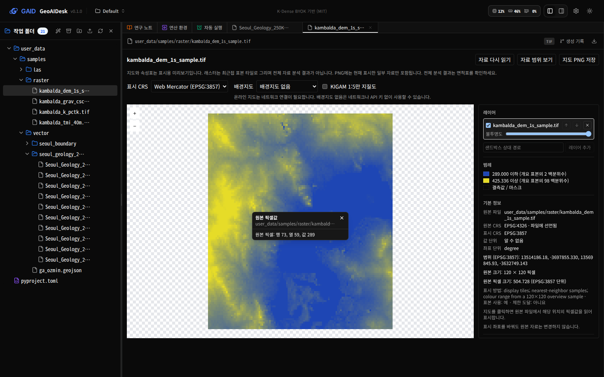

# 지도 오른쪽 정보 패널, 속성표 열 정렬·필터, 지도 위 미니 팝업

## 0. 한눈에

| | |
|---|---|
| 요청 | 지도 오른쪽에 범례와 기본 정보를 두고, 속성표 열 머리글에서 정렬·필터를 쓰고, 선택한 피처 정보를 지도 위 미니 팝업으로 보여 줍니다. |
| 결론 | 세 가지 모두 구현했습니다. 지도 화면이 넓으면 지도와 정보 패널이 나란히 같은 높이로 보이고, 좁으면 패널이 지도 바로 아래에 두 열로 놓입니다. 속성표 정렬·필터는 표에만 적용하며 지도 표시와 면적표는 바꾸지 않습니다. |
| 믿을 수 있는 정도 | 검토용과 같은 표본 자료(서울 지질도, Kambalda DEM)로 별도 실행한 앱에서 자동 브라우저로 화면을 확인했습니다. 사용자가 PC71에서 직접 써 본 체감은 아직 확인하지 않았습니다. |
| 결정할 일 | 없음 |

## 1. 요청한 것

> "첨부한 이미지처럼 맵과 관련해서는 맵 오른쪽 패널에 범례와 기본 정보가 표시되어야 이용자들이 스크롤 없이 확인 가능하다. 그리고 2번째 이미지처럼 테이블의 경우 상단 컬럼 이름에서는 필터 및 오름/내림 차순과 같은 기능을 적용하여 테이블 조회를 할 수 있어야 한다. 그리고 선택된 포인트의 정보는 최하단에 위치하는 것이 아니라 맵에서 미니팝업으로 정보가 표시되어야 한다. (…)" — 2026-10-12 요청 (workflow·스킬 연계 부분은 별도 작업 gaid-workflow-catalog에서 다룹니다)

완료 기준: (1) 범례와 레이어 기본 정보(CRS, 범위, 단위, 출처, 레이어 목록·불투명도)를 지도 오른쪽 패널에 두어 스크롤 없이 보이게 하고, 좁은 화면에서도 쓸 수 있게 합니다. (2) 속성표 열 머리글에서 오름·내림차순 정렬과 필터를 씁니다. (3) 선택한 피처·지점 정보를 맨 아래 목록 대신 지도 위 미니 팝업으로 보여 줍니다.

## 2. 수행한 것

1. 지도 화면을 다시 배치했습니다. 위쪽에는 제목과 동작 버튼, 표시 CRS와 배경지도 선택을 한 줄로 모았고, 그 아래에 지도와 정보 패널을 나란히 놓았습니다. 패널은 지도와 같은 높이를 유지하고 내용이 길면 패널 안에서만 스크롤합니다. 배경지도 출처 표기는 지도 오른쪽 아래 모서리로 옮겨 지도와 함께 늘 보이게 했습니다.
2. 정보 패널에는 위에서부터 레이어 목록(표시 여부, 불투명도, 순서, 제거, 추가), 범례, 기본 정보(원본 파일, 원본 CRS, 표시 CRS, 값 단위, 좌표 단위, 범위, 피처 수 또는 래스터 크기, 표시 방법과 한계), 표시 설정(GeoPackage 레이어, 밴드, 범주형 색상 필드)을 둡니다.
3. 속성표 열 머리글을 누르면 오름차순, 내림차순, 정렬 없음 순서로 바뀝니다. 머리글 옆 필터 단추를 누르면 그 열의 정렬, "포함할 값" 검색, 값 목록(빈도와 함께) 선택, 필터 지우기를 고르는 작은 창이 열립니다. 결측값은 정렬 방향과 관계없이 맨 뒤에 둡니다. 긴 값은 한 줄로 줄여 보여 주고 마우스를 올리면 전체 값을 보여 줍니다.
4. 지도에서 피처를 클릭하면 그 위치에 미니 팝업으로 속성을 보여 줍니다. 속성표에서 행을 고르면 같은 팝업이 지도 위 해당 피처에 뜨고, 레이어 전체를 받은 경우 피처가 화면 밖이면 지도를 그 피처로 옮깁니다. 래스터를 클릭하면 원본 파일에서 읽은 픽셀값도 같은 팝업으로 보여 줍니다. 빈 곳을 클릭하거나 닫기 단추, Esc 키로 팝업을 닫습니다. 기존의 맨 아래 "선택한 피처의 속성" 목록은 없앴습니다.

## 3. 결과

그림 1. 넓은 화면(대화창 숨김)에서 서울 1:25만 지질도를 연 모습. 볼 것: 오른쪽 패널에 레이어·범례·기본 정보가 지도와 같은 높이로 보이고, 클릭한 피처(노란 테두리)의 속성이 지도 위 팝업으로 뜹니다.

그림 2. 속성표 열 머리글 정렬·필터. 볼 것: AGENO 머리글의 내림차순 표시, LITHONAME 필터 창의 정렬 단추·"포함할 값" 검색·값 목록, 표 위의 "조건에 맞는 행: 37 / 전체 133"과 적용 범위 안내.

그림 3. 속성표에서 행을 고른 결과. 볼 것: 지도 왼쪽 위의 해당 피처가 노란 테두리로 강조되고 그 옆에 팝업이 뜹니다.

그림 4. 좁은 화면(파일 목록과 대화창을 모두 연 상태, 지도 화면 폭 약 630 px). 볼 것: 패널이 지도 바로 아래에서 레이어·범례 / 기본 정보·표시 설정의 두 열로 놓여 짧게 스크롤하면 보입니다.

그림 5. Kambalda DEM 래스터 클릭. 볼 것: 원본 파일에서 읽은 행·열·값이 팝업으로 뜨고, 범례와 원본 크기·픽셀 크기가 오른쪽 패널에 보입니다.

| 완료 기준 | 결과 | 근거 |
|---|---|---|
| 지도 오른쪽 패널의 범례·기본 정보, 스크롤 없이 확인 | 충족 (넓은 화면). 좁은 화면은 패널이 지도 바로 아래 두 열로 놓여 짧은 스크롤이 필요합니다 | 그림 1, 4, 5 |
| 속성표 열 머리글의 필터와 오름·내림차순 정렬 | 충족 | 그림 2 |
| 선택한 피처·지점 정보를 지도 위 미니 팝업으로 표시 | 충족 (벡터 피처, 속성표 행, 래스터 픽셀) | 그림 1, 3, 5 |

## 4. 검증

- 과학적 검증: 해당 없음. 화면 배치와 표 조회 기능이며 자료 값을 계산하거나 바꾸지 않습니다. 정렬·필터는 표에만 적용되고 지도 색상, 면적표, 원본 파일에는 영향을 주지 않습니다. 원본 CRS와 표시 CRS는 패널에 따로 표시합니다.
- 소프트웨어 검증: 검토용과 같은 표본 자료로 별도 실행한 앱에서 자동 브라우저(Chromium)로 지질도 열기, 범주형 색상, 지도 클릭 팝업, 속성표 정렬·필터(133행 중 "화강" 포함 37행), 행 선택 팝업, 래스터 픽셀 팝업, 좁은 화면 배치를 확인했습니다. 자동 검사로 정렬 순서(숫자·문자·결측값), 필터 조합, 팝업 위치 지정, 기존 지도 동작(요청 범위, 프로젝트 전환, 늦게 온 응답 무시)을 확인했습니다. 저장소 전체 검사 결과는 부록 A에 적었습니다.

## 5. 한계

- 레이어가 커서 화면 범위만 나누어 받는 경우(피처나 꼭짓점이 많은 레이어) 정렬·필터는 현재 페이지의 피처 최대 500개에만 적용합니다. 표 위에 이 범위를 안내합니다. 레이어 전체를 받은 경우에는 모든 피처에 적용합니다.
- 화면 범위로 나누어 받는 레이어에서는 속성표 행을 골라도 지도를 옮기지 않습니다. 지도를 옮기면 새 페이지를 받아 선택이 풀리기 때문입니다.
- 값 목록 필터는 빈도 상위 200개 값까지만 목록에 보여 줍니다. 나머지 값은 "포함할 값" 검색으로 찾습니다.
- 팝업은 지도 화면 안에서 열리며, 지도 가장자리 근처를 클릭하면 반대쪽으로 열립니다. 팝업 내용이 길면 팝업 안에서 스크롤합니다. 지도 PNG 저장에는 팝업이 들어가지 않습니다.
- 사용자가 PC71에서 터널로 직접 써 본 체감은 확인하지 않았습니다. 이 작업이 합쳐진 뒤 hub가 검토용 앱을 새 버전으로 바꿉니다.

## 6. 결정할 일

없음

## 7. 대체되었거나 실패한 시도

펼치기 — 1건

- 배경지도 출처 표기를 정보 패널 안으로 옮기는 안: 패널을 스크롤하면 출처가 가려질 수 있어, 지도 오른쪽 아래 모서리에 표기하는 방식으로 바꿨습니다.

## 부록 A. 근거 위치

펼치기 — 실행 방법, 원본, 해시, 커밋

| 항목 | 위치 |
|---|---|
| 코드 | `web/src/geo/viewers/map/` (`index.tsx`, `side-panel.tsx`, `attribute-table.tsx`, `table.ts`, `map-canvas.tsx`, `basemaps-picker.tsx`), 문구 `web/src/geo/locales/map/{ko,en}.json`; 브랜치 `task/gaid-map-table-ux` |
| 자동 검사 | `cd web && npx tsc --noEmit && npx vitest run src/geo` (13 파일, 78 테스트 통과), `node geo/copy/validate-copy.mjs web/src/geo/locales` (오류 0), `scripts/check` (결과는 task 문서 Current state) |
| 화면 확인 | PC74 별도 앱(UI 3310, 백엔드 18310), 자료 `pc74:~/data/geoaidesk/work/gaid-map-table-ux/projects` (검토용 표본 사본), 스크립트 `pc74:~/data/geoaidesk/work/gaid-map-table-ux/shots.py` |
| 표본 자료 | `user_data/samples/vector/seoul_geology_250k/Seoul_Geology_250K_Litho.shp`, `user_data/samples/raster/kambalda_dem_1s_sample.tif` |

추가한 문구 id(`map.*`, 한·영): `panel` 지도 정보 / Map information, `info` 기본 정보 / Layer information, `sourceFile` 원본 파일 / Source file, `displayOptions` 표시 설정 / Display settings, `pixelTitle` 원본 픽셀값 / Source pixel value, `closePopup` 팝업 닫기 / Close popup, `sortCycle`, `columnMenu` {field} 열 정렬과 필터 / Sort and filter column {field}, `sortAsc` 오름차순 정렬 / Sort ascending, `sortDesc` 내림차순 정렬 / Sort descending, `sortClear` 정렬 해제 / Clear sort, `filterText` 포함할 값 / Contains, `filterValues` 표시할 값 / Values to show, `selectAll` 모든 값 선택 / Select all values, `clearFilter` 열 필터 지우기 / Clear column filter, `clearFilters` 정렬과 필터 지우기 / Clear sort and filters, `moreValues`, `rowsSummary` 조건에 맞는 행: {matched} / 전체 {total}, `rowsRange` 표시 중인 행: {from}~{to}, `tableScopeFull`, `tableScopePage`, `noMatch` 조건에 맞는 피처가 없습니다. 필터를 바꾸세요. 기존 문구는 바꾸지 않았습니다.

작성 시점: 2026-10-12, commit 7603796 이후.

