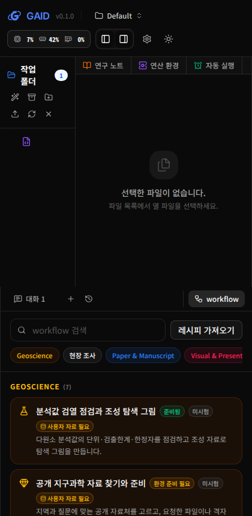
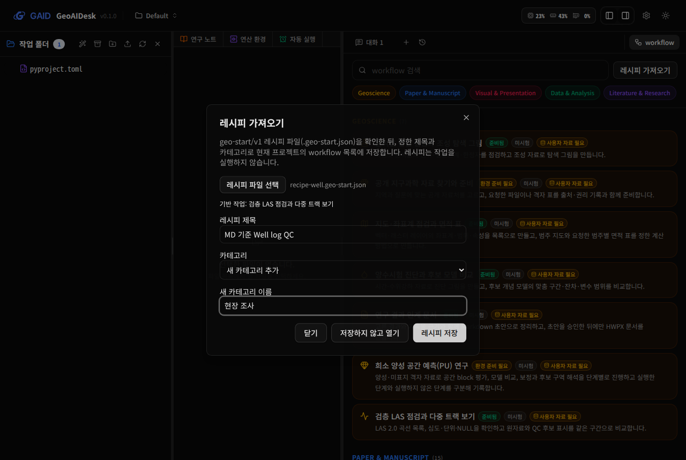
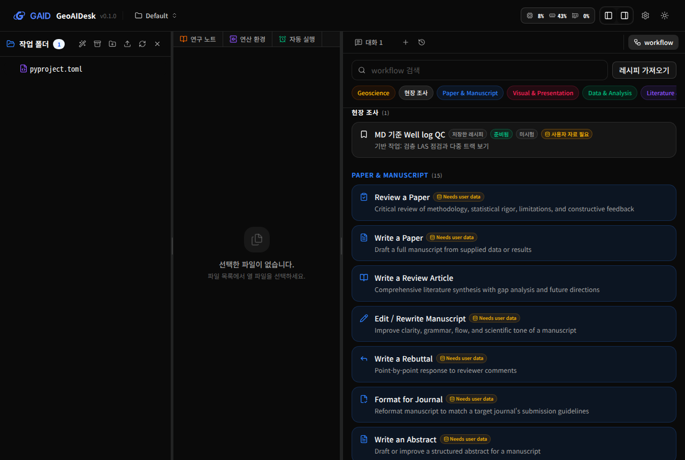
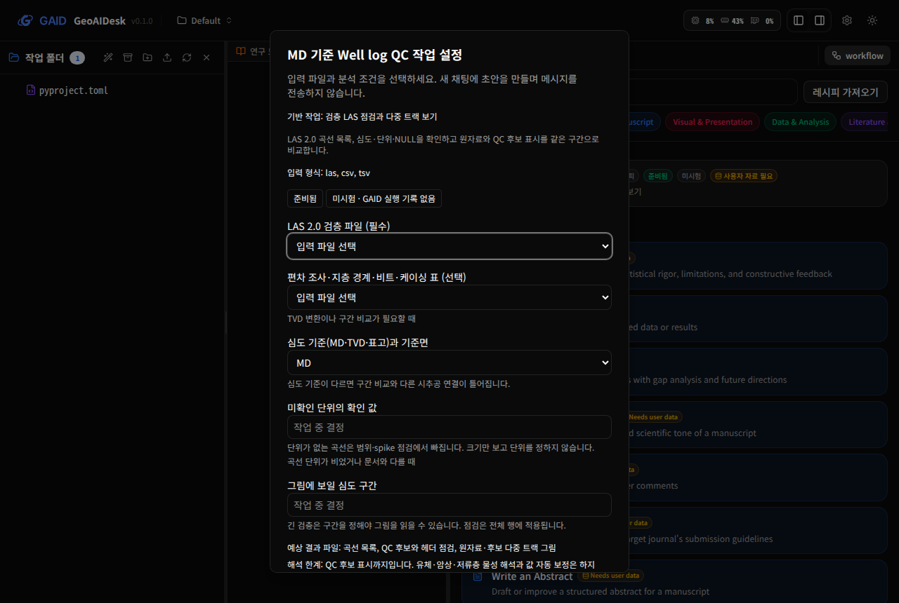
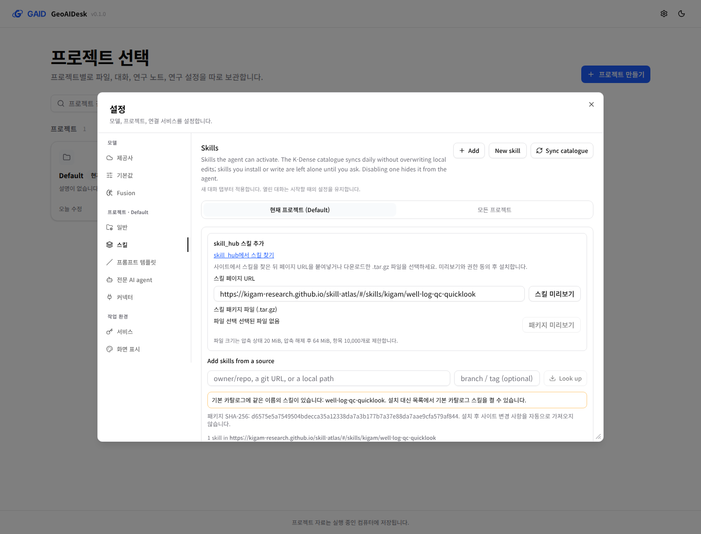
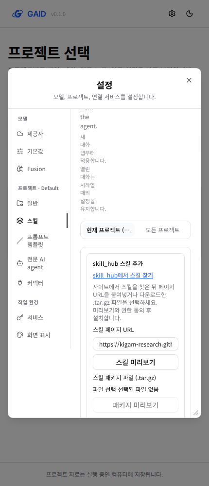

# workflow 목록 통합, 카테고리를 고르는 레시피 저장, skill_hub 스킬 가져오기

## 0. 한눈에

| | |
|---|---|
| 요청 | 대화창 위 workflow 화면을 K-Dense workflow 디자인과 일관되게 바꾸고 Geoscience 카테고리를 추가하며, 레시피를 추가할 때 카테고리를 고르게 하고, skill_hub 사이트에서 스킬을 찾아 가져오는 연계를 검토해 적용합니다. |
| 결론 | Geoscience 작업 7개가 큰 카드 대신 K-Dense와 같은 한 줄 목록으로 맨 앞 카테고리에 나오며, 검색창과 카테고리 버튼을 함께 씁니다. 준비 상태·미시험·사용자 자료 필요는 배지로 남겼습니다. 레시피는 확인한 뒤 제목과 카테고리(Geoscience, K-Dense 카테고리, 새로 만든 카테고리)를 골라 프로젝트에 저장합니다. 설정 → 스킬 추가 화면에서 skill_hub 사이트를 열고, 스킬 페이지 URL을 붙여 넣거나 받은 패키지 파일을 고르면 기존 미리보기·권한 동의·설치 절차로 가져옵니다. |
| 믿을 수 있는 정도 | 자동 시험과 별도 인스턴스의 실제 브라우저 화면으로 확인했습니다. 사용자가 PC71에서 직접 써 본 체감은 아직 확인하지 않았습니다. |
| 결정할 일 | 없음 |

## 1. 요청한 것

> "그리고 세번째 이미지처럼 대화창 상단의 workflow를 클릭하면 Geoscience 작업에 대한 레시피가 표시되는데 기존 K-Dense workflow에서 제공하는 4번째 디자인과 같이 일관되게 ui를 개선해야하며, Geoscience 카테고리를 추가하고 workflow를 4번째 디자인과 같이 구성하는 것이 필요하다. 레시피를 추가할때 카테고리를 선택하게 하는 방식으로 해야 자유도와 기능 확장성을 만족할 수 있을 것이다. 그리고 스킬을 추가할 때에는 skill_hub 프로젝트에서 작업한 skill_hub 사이트를 클릭하여 스킬을 탐색하고 해당 사이트에서 스킬을 가져올 수 있게 연계하는 방안도 검토 후 적용해보아야 한다." — 2026-10-12 요청(같은 요청의 지도·표 부분은 다른 작업 gaid-map-table-ux가 맡습니다)

완료 기준: (1) workflow 화면에서 Geoscience 작업이 K-Dense 목록과 같은 형태(검색, 카테고리 버튼, 아이콘·제목·한 줄 설명·배지 행)로 Geoscience 카테고리에 나오고 준비 상태 표시는 유지합니다. (2) 레시피를 추가할 때 카테고리를 고릅니다. (3) skill_hub 사이트 연계를 검토해 적용하되, 스킬 설치 전 내용 확인과 사용자 동의 절차는 그대로 둡니다.

## 2. 수행한 것

1. K-Dense workflow 목록에 다른 카테고리와 행을 끼워 넣을 수 있는 작은 연결부를 만들고, 고정 카탈로그의 Geoscience 작업을 그 목록의 첫 카테고리로 넣었습니다. 검색은 두 목록을 함께 찾고, 행을 누르면 기존 작업 설정 창이 열립니다. 카드에 있던 입력 형식·예상 결과·해석 한계·환경 준비는 작업 설정 창으로 옮겼습니다.
2. 행의 배지는 K-Dense의 "Needs user data"와 같은 크기로 준비 상태(준비됨·스킬 필요·환경 준비 필요·사용 불가), 미시험, 사용자 자료 필요를 보여 줍니다. 미시험 배지에 마우스를 올리면 "미시험 · GAID 실행 기록 없음" 전체 문구가 나오고, 작업 설정 창에는 전체 문구가 그대로 있습니다.
3. "레시피 가져오기"를 레시피 파일 확인 → 제목·카테고리 선택 → 저장 순서로 바꿨습니다. 카테고리는 Geoscience, K-Dense 카테고리 22개, 이미 만든 카테고리, 새 카테고리 추가 중에서 고릅니다. 저장한 레시피는 그 카테고리의 행으로 나타나고, 누르면 레시피의 분석 조건이 채워진 작업 설정 창이 열립니다. 저장하지 않고 한 번만 여는 방법도 남겼습니다.
4. 저장한 레시피는 목록을 읽을 때마다 현재 카탈로그로 다시 확인합니다. 카탈로그가 바뀌어 맞지 않게 된 레시피는 지우지 않고 "사용 불가"로 보여 주며, 누르면 이유와 삭제 버튼이 나옵니다. 삭제는 두 번 눌러야 됩니다.
5. skill_hub 연계를 검토했습니다. 비공개 저장소·사이트→앱 직접 호출은 쓸 수 없어서, 공개 Atlas 스킬 페이지의 패키지 파일을 기존 설치 절차로 넘기는 방식을 하위 작업으로 구현했습니다(3절 "skill_hub 스킬 가져오기").

## 3. 결과

### workflow 목록

### 레시피 저장

- 레시피는 프로젝트별로 저장합니다. 다른 프로젝트에서는 보이지 않습니다.
- 레시피는 고정 카탈로그에 있는 작업의 분석 조건을 미리 채우는 파일입니다. 새 분석 절차(새 workflow)를 정의하지는 않습니다.

### skill_hub 스킬 가져오기

설정의 스킬 추가 화면에서 skill_hub 사이트를 열고, 스킬 페이지 URL 또는 다운로드한 패키지 파일을 미리보기할 수 있습니다. 미리보기에 나온 스킬을 선택하고 전체 권한 실행에 동의한 뒤 기존 설치 버튼으로 설치합니다. 같은 이름의 기본 카탈로그 스킬이 있으면, 설치 대신 목록에서 켤 수 있다고 안내합니다.

| 방식 | 판단과 적용 결과 |
|---|---|
| Git 저장소 직접 설치 | 기존 기능은 유지합니다. skill_hub 저장소는 비공개이며 KIGAM 스킬별 공개 Git 원본이 없어 기본 연결로 선택하지 않았습니다. |
| 스킬 페이지 URL → 패키지 다운로드 | 적용했습니다. 설정된 사이트의 페이지 URL을 공개 패키지 주소로 바꿔 읽습니다. 임의의 다운로드 URL과 리디렉션은 허용하지 않습니다. |
| 다운로드한 패키지 파일 선택 | 적용했습니다. 사이트에서 받은 압축 파일을 선택해 같은 미리보기·동의·설치 절차로 가져옵니다. |
| 사이트 → 로컬 앱 deep link | 적용하지 않았습니다. 공개 사이트에서 로컬 앱을 직접 호출하는 전제가 없고 기존 계획도 해당 방식을 제외합니다. |

서버 시험 16개와 화면 시험 4개가 통과했습니다. 서버·화면 타입 검사와 문구 검사도 통과했습니다. 문구 검사에는 기존 경고 1개와 자동 갱신을 하지 않는다는 설명의 경고 2개가 남습니다. 후자는 실제 동작의 한계를 설명하므로 유지합니다.

별도 앱에서 실제 공개 스킬 페이지 URL을 붙여넣고 미리보기·권한 동의·설치까지 확인했습니다. 파일 업로드도 같은 내용 지문으로 미리보기했습니다. 권한 동의 없는 설치 요청은 거부됐으며, 설치된 지침 파일은 미리보기 원본과 바이트 단위로 일치했습니다. 브라우저 실행 오류와 실패한 요청은 없었습니다. 시험용 화면·서버는 종료했습니다. 전체 검사와 부모 작업의 최종 통합은 부모 작업에서 확인합니다.

좁은 화면에서는 기존 설정 패널의 좌측 메뉴와 스킬 설명이 공간을 많이 차지합니다. 새 입력은 세로로 배치되지만 기존 설정 화면 전체의 반응형 배치는 이번 수정 범위가 아닙니다.

skill_hub 프로젝트 쪽에서 할 일(스킬 상세 페이지의 "GAID에서 설치" 안내, 새 사이트 공개와 주소 유지)은 아래 요청안으로 geoaidesk hub에 보냈습니다. skill_hub는 이번 작업에서 고치지 않았습니다.

> GAID 스킬 추가 화면에 공개 skill_hub 사이트 탐색, 스킬 페이지 URL 붙여넣기, 다운로드 패키지 선택을 연결했습니다. 새 공개 사이트의 스킬 상세 페이지에 ‘GAID에서 설치’ 안내를 추가해 주세요. 안내에는 페이지 URL을 복사해 GAID의 스킬 미리보기에 붙여넣는 절차와 패키지 다운로드 대안을 함께 적어 주세요. 로컬 앱 deep link는 전제로 삼지 않습니다. 새 사이트를 공개 배포하고 스킬 페이지와 공개 패키지 주소를 안정적으로 유지해 주세요. 공개 Git 원본으로 배포할 계획이 있다면 스킬별 저장소 또는 경로와 라이선스 정보를 함께 제공해 주세요. GAID는 공개 URL이 확인된 뒤 허용 사이트 설정에 추가할 수 있습니다.

## 4. 검증

- 서버 자동 시험: 레시피 저장·새 카테고리 생성·같은 이름 카테고리 재사용·K-Dense 카테고리 저장·확인 실패 거부(이유 반환)·카탈로그가 꺼졌을 때 레시피 유지와 사용 불가 표시·마지막 레시피 삭제 시 빈 사용자 카테고리 제거·형식이 깨진 저장 파일을 덮어쓰지 않음.
- 화면 자동 시험: Geoscience가 첫 카테고리이고 K-Dense 카테고리가 이어짐, 검색이 두 목록을 함께 거름, 상태별 배지와 작업 설정 창의 전체 준비 상태 문구, 레시피 확인 실패 시 저장 불가, 새 카테고리로 저장 → 목록 표시 → 조건이 채워진 설정 → 두 번 눌러 삭제, 저장하지 않고 열기, 카탈로그와 맞지 않는 레시피의 이유 표시. 기존 환경 준비·스킬 켜기·작업 초안 시험도 새 화면 흐름으로 통과합니다.
- 전체 시험: 하위 작업과 main(지도·표 작업 포함)을 합친 상태에서 저장소의 전체 검사(서버 시험 1,669개 통과·11개 건너뜀, 화면 시험 972개 통과, 배포·문구·환경·실행 검사)가 통과했습니다. 이 네트워크에서 내려받을 수 없는 질량분석 어휘 때문에 mzML 시험 2개는 기존과 같이 건너뛰었습니다.
- 실제 브라우저: 별도 인스턴스에서 고정 카탈로그 0.2.1로 3절 그림의 흐름(레시피 파일 확인, 새 카테고리 저장, 저장한 레시피 열기)을 확인했습니다.

## 5. 한계

- 저장한 레시피와 사용자 카테고리는 프로젝트마다 따로 있습니다. 여러 프로젝트에서 같이 쓰려면 프로젝트마다 다시 가져와야 합니다.
- 사용자 카테고리 이름 바꾸기·순서 바꾸기는 없습니다. 카테고리는 그 안의 마지막 레시피를 지우면 함께 없어집니다.
- K-Dense 카테고리 이름은 upstream 문구 그대로 영어로 보입니다.
- 미시험 배지는 이번 작업에서 바뀌지 않았습니다. GAID에서 실행 기록이 쌓인 작업이 없으므로 모든 Geoscience 작업이 미시험으로 나옵니다.

### skill_hub 스킬 가져오기

- 현재 연결 대상은 공개 Geo Skill Atlas입니다. 새 skill_hub 사이트는 공개 배포 후 설정에 추가할 수 있습니다.
- 패키지는 스킬 폴더 하나와 그 안의 지침 파일을 포함해야 합니다. 압축 크기 20 MiB, 해제 후 64 MiB, 항목 10,000개까지 받습니다. 링크, 상위 경로, 중복 경로를 거부합니다.
- 패키지는 내용 해시별로 앱 데이터에 보관합니다. 기존 임시 캐시가 지워져도 보관한 원본으로 다시 준비할 수 있습니다. 미리보기와 설치는 기존 내용 지문을 주고받습니다.
- 같은 이름의 카탈로그 스킬이 있다는 안내는 내용이나 버전이 같다는 뜻이 아닙니다. 이미 설치된 스킬을 교체한다는 기존 경고도 유지합니다.
- 사이트 변경 사항을 자동으로 받아오지 않습니다. 새 버전은 사이트 URL이나 새 패키지로 다시 미리보기해야 합니다.
- 선택 사항인 기존 스킬 목록의 사이트 상세 링크는 이번 범위에서 추가하지 않았습니다. 추가 화면의 탐색 링크와 카탈로그 중복 안내를 제공합니다.

## 6. 결정할 일

없음.

## 7. 대체되었거나 실패한 시도

- "K-Dense workflow 목록 보기/접기"로 두 목록을 따로 보여 주던 방식은 한 목록으로 합치며 없앴습니다.

## 부록 A. 근거 위치

- 목록 연결부: `web/src/components/workflows-panel.tsx` (`extension` prop, `WORKFLOW_CATEGORIES`; `geo/integration-boundaries.json`에 등록)
- Geoscience 행과 배지: `web/src/geo/workspace/task-catalogue.tsx`; 레시피 창: `web/src/geo/workspace/recipe-add.tsx`; 작업 설정: `web/src/geo/workspace/task-setup.tsx`
- 레시피 저장: `server/src/geo/workspace/saved-recipes.ts`, 경로 `GET/POST /geo/recipes`, `DELETE /geo/recipes/:id` (`server/src/geo/routes/workspace.ts`), 저장 파일 `<sandbox>/.kady/geo/recipes.json` (`gaid-saved-recipes/v1`), 계약 `web/src/geo/contracts/workspace.ts`
- 문구: `web/src/geo/locales/workspace/{ko,en}.json` (추가 id: `workspace.catalogue.category`, `.search`, `workspace.badge.*`, `workspace.recipe.{description,choose,title,category,userCategories,upstreamCategories,newCategory,newCategoryName,openOnce,save,saving,close}`, `workspace.saved.*`; 삭제 id: `workspace.catalogue.showUpstream` "K-Dense workflow 목록 보기", `workspace.catalogue.hideUpstream` "K-Dense workflow 목록 접기")
- 시험: `server/test/geo-workspace.test.ts`, `web/src/geo/workspace/workspace.test.tsx`
- 화면 확인: 인스턴스 포트 3320/18320, 데이터 `~/data/geoaidesk/work/gaid-workflow-catalog/`, 카탈로그 `~/assets/geo-catalogue/0.2.1/geo-catalogue-0.2.1.tar.gz`, 스크립트 `~/data/geoaidesk/work/gaid-workflow-catalog/scripts/shots.py`

### skill_hub 스킬 가져오기 (하위 작업 gaid-workflow-catalog--skill-hub)

- 구현 스냅샷: `b3aa2370d63c` (후속 문서·증거 커밋은 하위 작업 문서에 기록했습니다).
- 설정: `geo/distribution.json`의 `skillHub.sites`.
- 서버: `server/src/geo/skill-hub.ts`, `server/src/geo/routes/skill-hub.ts`.
- 화면: `web/src/geo/skill-hub/skill-hub.tsx`, `web/src/components/skills-panel.tsx`의 좁은 연결 지점.
- 시험: `cd server && npx vitest run test/geo-skill-hub.test.ts`; `cd web && npx vitest run src/geo/skill-hub/skill-hub.test.tsx`; 각 폴더의 `npx tsc --noEmit`; `node geo/copy/validate-copy.mjs web/src/geo/locales`.
- 실제 패키지: `https://kigam-research.github.io/skill-atlas/api/catalog/packages/kigam/well-log-qc-quicklook/well-log-qc-quicklook.tar.gz`.
- 별도 앱 시험 실행: `job-geoaidesk-gaid-workflow-catalog--skill-hub-3`. 반환된 작업 스냅샷에서 화면 14041 / 서버 18041로 실행했습니다. 사용자 앱과 검토 인스턴스는 변경하지 않았습니다.
- 실제 앱 시험 결과: URL 미리보기 200, 설치 200, 업로드 미리보기 200, 동의 누락 설치 400.
- 시험 증거 위치: `/home/seongin3/data/geoaidesk/work/gaid-workflow-catalog--skill-hub/evidence/e2e.json`.
- 시험 실행 스크립트: `/home/seongin3/data/geoaidesk/work/gaid-workflow-catalog--skill-hub/e2e.py`.
- 배포 설정 검사: `node --test geo/tests/distribution.test.mjs` 7개 통과.

파일 지문:

| 파일 | SHA-256 |
|---|---|
| `/home/seongin3/data/geoaidesk/work/gaid-workflow-catalog--skill-hub/evidence/e2e.json` | `426de698751e8e4afddf8c03b14335ff003f2c9db7cc8c7ae85a45c25ee1584b` |
| `/home/seongin3/data/geoaidesk/work/gaid-workflow-catalog--skill-hub/e2e.py` | `664065cabc336b7d6a82a08c4653e2fd4fd73a34a8e1a767478e6e754829ab36` |
| `reports/2026-10-12-gaid-workflow-catalog/figures/skill-hub-desktop.png` | `214eb6d4b9b32577a875b434d2a0f9d126a891a3f3cf55e034dd5f9756f1aaf0` |
| `reports/2026-10-12-gaid-workflow-catalog/figures/skill-hub-narrow.png` | `81c0dd2ad51c0059026074d5f16891168c2663ad52fde46892e2a69c72037655` |

새 문구:

모든 문자열은 신규이며 변경 전 값은 없습니다. 아래 값은 미리보기 대기·읽는 중·실패·카탈로그 중복·권한 동의 상태에 대응합니다. 기존 설치 경고와 설치 버튼 문구는 유지합니다.

| 문자열 id | 변경 전 | 한국어 변경 후 | 영어 변경 후 |
|---|---|---|---|
| `skillHub.title` | 없음(신규) | skill_hub 스킬 추가 | Add skills from skill_hub |
| `skillHub.browse` | 없음(신규) | skill_hub에서 스킬 찾기 | Find skills on skill_hub |
| `skillHub.url` | 없음(신규) | 스킬 페이지 URL | Skill page URL |
| `skillHub.placeholder` | 없음(신규) | skill_hub 스킬 페이지 URL을 붙여넣으세요 | Paste a skill_hub skill page URL |
| `skillHub.preview` | 없음(신규) | 스킬 미리보기 | Preview skill |
| `skillHub.file` | 없음(신규) | 스킬 패키지 파일 (.tar.gz) | Skill package file (.tar.gz) |
| `skillHub.upload` | 없음(신규) | 패키지 미리보기 | Preview package |
| `skillHub.help` | 없음(신규) | 사이트에서 스킬을 찾은 뒤 페이지 URL을 붙여넣거나 다운로드한 .tar.gz 파일을 선택하세요. 미리보기와 권한 동의 후 설치합니다. | Find a skill on the site, then paste its page URL or choose the downloaded .tar.gz file. Review the preview and acknowledge permissions before installing. |
| `skillHub.sizeHelp` | 없음(신규) | 파일 크기는 압축 상태 20 MiB, 압축 해제 후 64 MiB, 항목 10,000개로 제한합니다. | Packages are limited to 20 MiB compressed, 64 MiB expanded and 10,000 entries. |
| `skillHub.loading` | 없음(신규) | 스킬 패키지를 읽는 중입니다. | Reading the skill package. |
| `skillHub.catalogue` | 없음(신규) | 기본 카탈로그에 같은 이름의 스킬이 있습니다: {names}. 설치 대신 목록에서 기본 카탈로그 스킬을 켤 수 있습니다. | The default catalogue includes skills with the same names: {names}. You can enable the catalogue copies in the list instead of installing. |
| `skillHub.catalogueUnavailable` | 없음(신규) | 기본 카탈로그를 읽지 못해 같은 이름의 스킬이 있는지 확인하지 못했습니다. | Could not read the default catalogue to check for skills with the same names. |
| `skillHub.snapshot` | 없음(신규) | 패키지 SHA-256: {digest}. 설치 후 사이트 변경 사항을 자동으로 가져오지 않습니다. | Package SHA-256: {digest}. Changes on the site are not fetched automatically after installation. |
| `skillHub.trust` | 없음(신규) | {source}의 스킬이 AI agent의 전체 권한으로 실행됨을 이해하고 설치에 동의합니다. | I understand that skills from {source} run with the AI agent's full permissions and agree to install them. |
| `skillHub.source` | 없음(신규) | skill_hub 패키지 {digest} | skill_hub package {digest} |
| `skillHub.errors.url` | 없음(신규) | 설정된 skill_hub 사이트의 스킬 페이지 URL을 입력하세요. | Enter a skill page URL on a configured skill_hub site. |
| `skillHub.errors.download` | 없음(신규) | 스킬 패키지를 다운로드하지 못했습니다. 사이트 연결을 확인하거나 다운로드한 파일을 선택하세요. | Could not download the skill package. Check the site connection or choose a downloaded file. |
| `skillHub.errors.size` | 없음(신규) | 패키지가 크기 또는 항목 수 제한을 넘었습니다. 더 작은 패키지를 선택하세요. | The package exceeds the size or entry limit. Choose a smaller package. |
| `skillHub.errors.archive` | 없음(신규) | 패키지를 읽지 못했습니다. SKILL.md가 있는 스킬 폴더 하나를 담은 .tar.gz 파일을 선택하세요. 링크와 상위 경로는 허용하지 않습니다. | Could not read the package. Choose a .tar.gz containing one skill folder with SKILL.md. Links and parent paths are not allowed. |
| `skillHub.errors.input` | 없음(신규) | 스킬 페이지 URL 또는 .tar.gz 파일을 선택하세요. | Enter a skill page URL or choose a .tar.gz file. |
| `skillHub.errors.request` | 없음(신규) | 스킬 미리보기를 불러오지 못했습니다. 다시 시도하세요. | Could not load the skill preview. Try again. |
