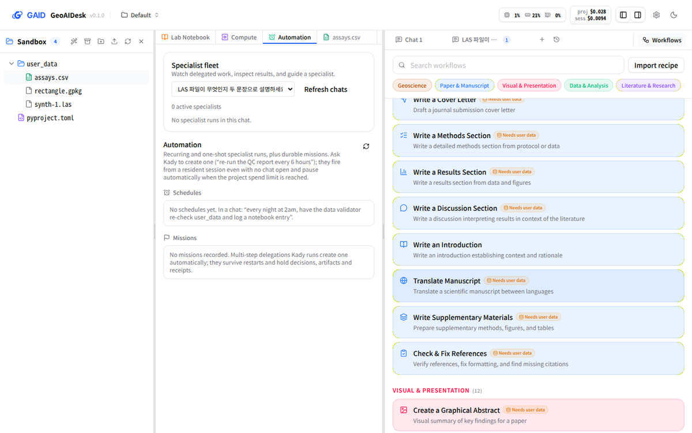
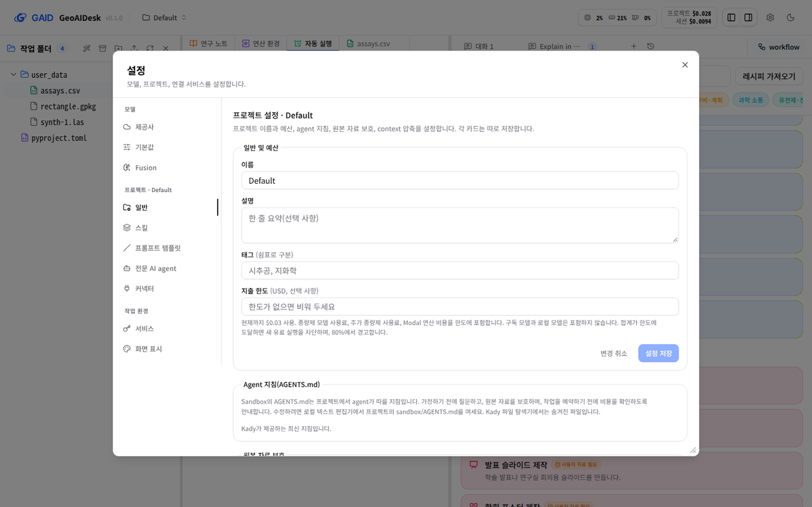
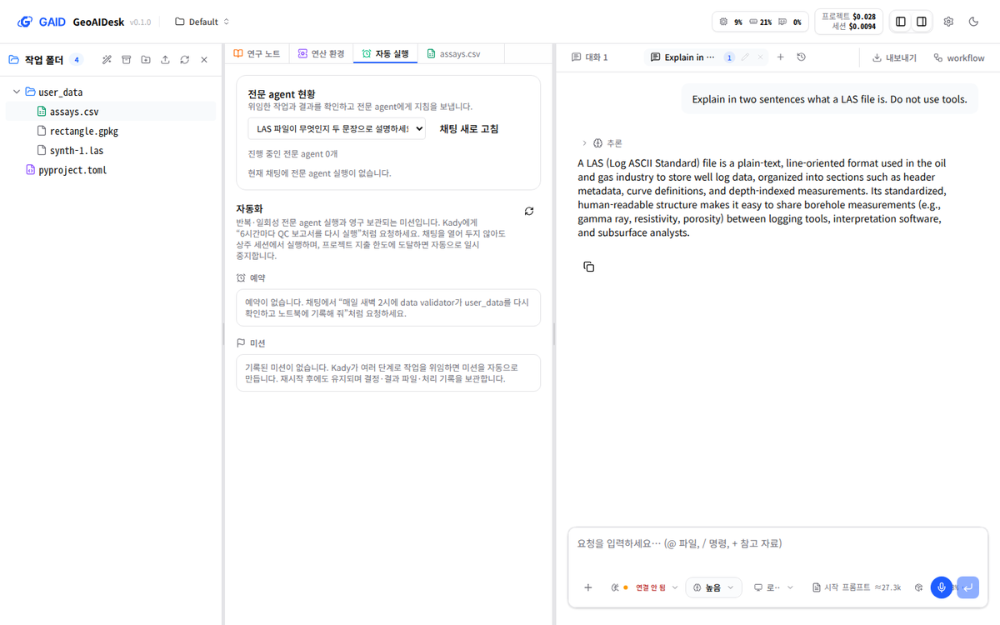
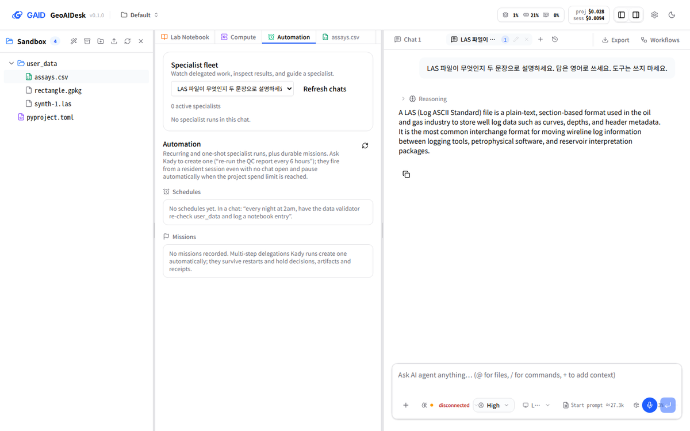

# 앱 전체 한국어·영어 화면 모드와 요청 언어를 따르는 응답

## 0. 한눈에

| | |
|---|---|
| 요청 | workflow 목록에서 Geoscience 레시피만 한국어인 불일치를 없애고, 두 언어 모드를 모두 지원하며, 응답 언어는 화면 언어와 따로 정합니다. |
| 결론 | 설정의 언어 하나로 앱 화면 전체가 바뀝니다. 한국어 모드에서 화면에 남은 영어는 파일 이름, 사용자 입력, 제품·명령 이름, 스킬 설명 같은 자료뿐입니다. 영어 모드는 기존 화면과 같습니다(문구 검사 때문에 영어 세 곳만 바꿈). 에이전트는 화면 언어와 상관없이 요청 언어로 답하고, 사용자가 언어를 지정하면 그 언어로 답했습니다. |
| 믿을 수 있는 정도 | 실제 앱에서 두 모드의 주요 화면 11개씩을 확인했고, 응답 언어는 로컬 모델과 MiniMax로 각각 세 가지 요청을 보내 확인했습니다. 문구가 없거나 형식이 깨진 경우는 자동 검사로 막습니다. 모든 대화상자를 사람이 하나씩 열어 본 것은 아닙니다. 서버가 만드는 오류 문장은 영어 그대로입니다. |
| 결정할 일 | 1건 (6절): K-Dense workflow의 프롬프트 본문을 한국어로도 둘지 |

## 1. 요청한 것

> "GAID 시스템에서 워크플로우에서 geoscience 레시피만 한글이다. 시스템에 일관성이 있어야한다. 시스템을 한글모드로 할지 영어 모드로 할지도 검토되어야한다. 두 모드를 다 지원하는것도 고려해볼수 있을것이다." — 2026-10-12 요청

> "1은 가이고, 2는 시스템언어와 독립적으로 사용자 지침이나 요청언어에 따르게해야한다." — 2026-10-12 결정(가: 두 모드를 모두 완성하고 K-Dense 화면도 번역)

> "그리고 이미 minimax api 연동되어 있을것이다." — 2026-10-12 작업 중 지시(응답 언어 확인에 사용)

완료 기준: (1) 앱의 보이는 문구가 K-Dense 화면과 GAID 화면 모두 하나의 언어 설정을 따르고, 남은 영어 목록을 남깁니다. (2) 에이전트의 응답 언어는 화면 언어가 아니라 사용자 지시나 요청 언어를 따릅니다.

## 2. 수행한 것

1. K-Dense 화면에 남은 영어 문구를 세었습니다(약 1,190개, 화면 부품 79개, workflow 326개).
2. 화면을 여섯 묶음(workflow, 채팅·작업, 파일 보기, 설정, 연구 노트, 연구 대화상자)으로 나눠 기존 GAID 문구 목록 방식으로 옮겼습니다. 한국어 문구는 GAID 문구 규칙과 용어집을 따르고, 영어는 원래 문장을 그대로 둡니다. 새 문구는 한·영 쌍으로 3,863개입니다.
3. K-Dense workflow 326개의 이름·설명·입력 항목(484개)과 범주 22개를 번역했습니다. K-Dense 쪽에 workflow가 새로 생기면 번역이 없어도 영어로 보이고, 영어 원문이 바뀌면 자동 시험이 알립니다.
4. 시스템 프롬프트, 프로젝트 지침 파일, 카탈로그를 조사했습니다. 응답 언어를 고정하는 문장은 없었고, 화면 언어는 서버로 가지 않습니다. GAID 지침에 "사용자가 지정한 언어, 없으면 마지막 요청의 언어로 답한다"는 규칙 한 줄을 넣었습니다.
5. 별도 인스턴스에서 두 모드의 화면을 캡처하고, 로컬 모델과 MiniMax로 응답 언어를 확인했습니다.

## 3. 결과

그림 1. 한국어 모드의 workflow 목록입니다. 볼 것: Geoscience 범주 다음의 K-Dense 범주("논문·원고", "시각화·발표")와 행("고찰 절 작성", "원고 번역")도 한국어이고, 파일 이름과 표 값은 원래대로입니다.

그림 2. 같은 화면의 영어 모드입니다. 볼 것: K-Dense 행과 단추가 기존 영어 문장 그대로이고, Geoscience 작업 제안 카드도 영어입니다.

그림 3. 설정 → 프로젝트 → 일반(한국어 모드)입니다. 볼 것: 설정 메뉴, 입력 칸, 예산 안내 문장이 한국어입니다. 입력 예시는 새 프로젝트 만들기 화면과 같은 Geoscience 예시입니다.

그림 4. 한국어 모드 화면에서 영어로 요청한 대화입니다(MiniMax). 볼 것: 화면은 한국어인데 답은 요청 언어인 영어입니다.

그림 5. 영어 모드 화면에서 한국어로 요청하면서 "답은 영어로 쓰세요"라고 지정한 대화입니다(MiniMax). 볼 것: 사용자가 지정한 영어로 답합니다.

| 완료 기준 | 결과 | 근거 |
|---|---|---|
| 채팅 창·입력·탭 | 충족 | 그림 4·5. 채팅 입력, 모델·사고 수준 선택, 비용 표시, 권한·질문 카드, 도구 실행 표시 |
| workflow 목록(K-Dense 범주와 행) | 충족 | 그림 1·2. 326개 이름·설명·입력 항목, 범주 22개, 실행 대화상자 |
| 파일 목록·미리보기 | 충족 | 파일 목록, 미리보기, 과학 자료 보기, LaTeX, PDF 주석, Office 도구 막대(문구 465개) |
| 설정 | 충족 | 그림 3. 제공사, 기본값, Fusion, 서비스, 프로젝트, 스킬, 프롬프트 템플릿, 전문 AI agent, 커넥터, 로그인 대화상자(문구 721개) |
| 프로젝트 화면 | 충족 | 프로젝트 목록·전환·만들기(이전 작업에서 번역됨, 이번에 확인) |
| 나머지 화면 | 충족 | 연구 노트·생성 기록·결과 카드(264개), 연구 대화상자(분석 계획, 견고성, 다음 실험, 연구 메모리, 근거 패키지; 480개), 자동 실행·연산 작업·전문 agent 현황(채팅·작업 묶음 736개 중 일부) |
| 남은 영어 목록 | 충족 | 5절 |
| 응답 언어가 화면 언어와 따로 정해짐 | 충족 | 그림 4·5와 아래 표. 화면 언어는 서버에 전달되지 않음 |

응답 언어 확인(내용의 정확성은 판단하지 않았습니다):

| 요청 | 로컬 모델(qwen3 30B) | MiniMax-M3 |
|---|---|---|
| 한국어로 요청 | 한국어로 답함 | 한국어로 답함 |
| 영어로 요청 | 영어로 답함 | 영어로 답함 |
| 한국어로 요청 + "답은 영어로 쓰세요" | 영어로 답함 | 영어로 답함 |

바뀐 영어 문장(문구 검사에서 근거 없는 표현 "insights", "unlocks"가 오류로 걸린 곳):

| 문자열 id | 변경 전 영어 | 변경 후 영어 | 한국어 |
|---|---|---|---|
| workflows.rows.comparative-genomics.description | Compare genomes across species for evolutionary insights | Compare genomes across species to examine evolutionary relationships | 종 간 유전체를 비교해 진화적 특성을 분석합니다. |
| settings.services.search_fallback_plus_youtube_… | … the same GEMINI_API_KEY that unlocks Google Gemini models … | … the same GEMINI_API_KEY that enables Google Gemini models … | … 제공사 설정에서 Google Gemini 모델을 활성화하는 GEMINI_API_KEY와 같은 키입니다. |
| work.database.description.plaid | Bank account connectivity, transaction data, and financial insights | Bank account connectivity, transaction data, and financial analytics | 은행 계좌 연결, 거래 자료, 금융 분석 정보를 제공합니다. |

나머지 3,860개는 영어가 바뀌지 않았고 한국어만 새로 생겼습니다. 전체 id와 한·영 문장은 부록 A의 문구 목록에 있습니다. 대표 예: 연구 노트 "Lab Notebook" → "연구 노트", "reported, not independently verified" → "보고된 상태이며 독립적으로 확인하지 않았습니다", 생성 기록 "Current — the bytes on disk match what the producing step recorded." → "일치함 — 디스크의 바이트가 생성 단계의 기록과 같습니다."

## 4. 검증

- 과학적 검증: 해당 없음. 이 작업은 화면 문구와 응답 언어 규칙이며 분석 결과를 만들지 않습니다. 과학 결과의 한계 문장(추정, 검증되지 않음, 외부 사전 등록이 아님 등)은 한국어에도 그대로 남겼습니다.
- 소프트웨어 검증: 하위 작업마다 타입 검사와 화면 시험 전체(972–978개)를 통과했습니다. 문구 검사기는 16개 문구 목록에서 오류 0건입니다. 경고는 실제 동작을 설명하는 문장만 남았고 하나씩 검토했습니다. 새 시험은 세 가지입니다. K-Dense workflow 번역이 빠짐없고 영어가 원본과 같은지, 응답 언어 규칙이 GAID 지침에 있고 서버 코드에 고정된 응답 언어나 화면 언어 설정이 없는지, 자료 값(상태 코드 등)의 표시 이름이 바르게 바뀌는지를 봅니다. 저장소 전체 점검 결과는 task 문서에 적습니다.
- 실제 화면: 별도 인스턴스에서 두 모드의 주요 화면 11개씩(프로젝트 목록, 작업 화면, 연구 노트, 자동 실행, 응답 언어 대화, workflow 두 화면, 설정 네 화면)을 캡처했습니다. 한국어 모드의 화면 전체 문자열에서 한국어가 없는 줄은 파일 이름, 사용자 요청, 제품 이름(GeoAIDesk, Geoscience, workflow)뿐이었습니다.

## 5. 한계

남은 영어(한국어 모드에서도 영어로 보이는 것):

- K-Dense workflow의 프롬프트 본문 326개(약 42만 자)는 영어 그대로입니다. 행을 눌러 입력창에 넣으면 영어 요청이 되므로 답도 영어가 됩니다. 6절에서 결정합니다.
- 서버가 만들어 보내는 오류·상태 문장(제공사 오류, 도구 실패 이유, 로그인 단계 안내, 실행 기록 문장)은 영어입니다.
- 파일이나 설정에서 읽어 오는 내용은 원문 그대로입니다. 스킬 설명(카탈로그 원문), 기본 제공 프롬프트 템플릿과 전문 AI agent 설명, 프로젝트 지침 파일, Watchdog 규칙이 이에 해당합니다.
- Office 편집기 안에 내장된 LibreOffice 엔진의 메뉴와 대화상자는 엔진 원문 그대로입니다. 앱이 그리는 도구 막대는 번역했습니다.
- 제품·명령·형식 이름(OpenRouter, Ollama, Modal, InChI, git HEAD, 명령 예시)은 번역하지 않습니다.

그 밖의 한계:

- 문구를 찾을 때 쓴 검사 도구는 근사치입니다. 자주 쓰지 않는 대화상자에 빠진 문구가 있을 수 있습니다. 모든 대화상자를 실제 화면에서 열어 보지는 않았습니다.
- K-Dense 화면 부품 92개 파일에서 문구 자리만 바꿨습니다. 각 변경은 한 줄 치환이지만, 다음 K-Dense 동기화 때 충돌이 생길 수 있는 곳이 그만큼 늘었습니다. 동기화로 새 영어 문구가 들어오면 번역을 더할 때까지 한국어 모드에서도 영어로 보입니다.
- 응답 언어 확인은 짧은 질문 세 가지를 두 모델에 보낸 결과입니다. 긴 작업이나 하위 에이전트가 쓴 보고서의 언어까지 확인하지는 않았습니다. 응답 내용의 정확성은 이 작업의 범위가 아닙니다. 실제로 한 답은 LAS를 다른 형식으로 잘못 설명했습니다.
- 스킬 설정 화면의 안내 문장은 K-Dense 원문의 뜻을 그대로 옮긴 것입니다. "K-Dense 카탈로그를 매일 동기화" 같은 설명은 GAID의 고정 카탈로그 동작과 맞지 않습니다. 문구 번역이 아니라 동작 설명의 문제라 이번에는 바꾸지 않았습니다.

## 6. 결정할 일

1. K-Dense workflow 프롬프트 본문(326개)을 한국어로도 둘지 정해 주세요.
   - 가) 영어로 둡니다. 한국어 답이 필요하면 사용자가 요청에 "한국어로 답하세요"를 덧붙입니다. (권장: 번역량이 약 42만 자로 크고, 프롬프트는 화면 문구가 아니라 요청 내용이며, 응답 언어 규칙으로 지시를 따릅니다.)
   - 나) 한국어 프롬프트를 추가해 한국어 모드에서는 한국어 요청으로 넣습니다. 별도 작업으로 번역과 검토가 필요합니다.

## 7. 대체되었거나 실패한 시도

펼치기 — 3건

- 하위 작업자 다섯이 Codex 모델 용량 부족으로 시작 직후, 두 개는 작업 중간에 한 번 더 멈췄습니다. 같은 지시를 다시 보내 이어서 끝냈습니다. 결과물에는 영향이 없습니다.
- 한 하위 작업의 마무리 점검이 아직 돌 때 상위 작업자가 그 작업 폴더의 설치 파일을 먼저 지워 점검이 한 번 실패했습니다. 다시 설치하고 점검을 통과했습니다.
- 화면 문자열을 영어 원문으로 찾아 바꾸는 방식(화면 전체에 번역표를 덮는 방식)은 쓰지 않았습니다. 숫자나 이름이 섞인 문장을 놓치고, 기존 문구 검사기를 쓸 수 없기 때문입니다. 기존 GAID 방식(문장마다 id를 두고 한·영 목록에서 찾기)을 유지했습니다.

## 용어

없음.

## 부록 A. 근거 위치

펼치기 — 실행 방법, 원본, 해시, 커밋

| 항목 | 위치 |
|---|---|
| 문구 목록 | `web/src/geo/locales/{workflows,work,files,settings,notebook,research}/{ko,en}.json` (새 namespace 6개, `web/src/geo/locales/index.ts`에 등록) |
| workflow 번역 | `web/src/geo/locales/workflows/` (영어는 `generate-en.mjs`로 `web/src/data/workflows.json`에서 생성), 시험 `web/src/geo/workflows-locale.test.tsx` |
| 응답 언어 규칙 | `server/src/geo/instructions.ts` `REPLY_LANGUAGE_RULE`, 시험 `server/test/geo-reply-language.test.ts` |
| 자료 값 표시 이름 | `web/src/geo/work-labels.ts`, 시험 `web/src/geo/work-labels.test.ts` |
| 수정한 K-Dense 파일 | `geo/integration-boundaries.json`의 owner `gaid-ui-locale` 항목 6개(92개 파일) |
| 화면 캡처 | PC74 `~/data/geoaidesk/work/gaid-ui-locale/browser/` (`shots.mjs`, `baseline/`, `final/`, 해시 `final.sha256`), 앱 인스턴스 `../app/run.sh` |
| 응답 언어 원본 | PC74 `~/data/geoaidesk/work/gaid-ui-locale/reply/` (`run.sh`, `0?-*.sse` 로컬 모델, `1?-*.sse` MiniMax-M3) |
| 남은 문자열 검사 | `~/data/geoaidesk/work/gaid-ui-locale/tools/scan.mjs web/src --list`: 시작 1,191건 → 끝 21건(모두 명령·제품 이름) |
| 하위 작업 | `gaid-ui-locale--{workflows,work,files,settings,notebook,research}` (task 문서와 완료 기록) |
| 그림 sha256 | 01 `26e07bdf…`, 02 `bee95fe6…`, 03 `ea9c180e…`, 04 `6d392b57…`, 05 `0fecbd0a…` |

작성 시점: 2026-10-13.

