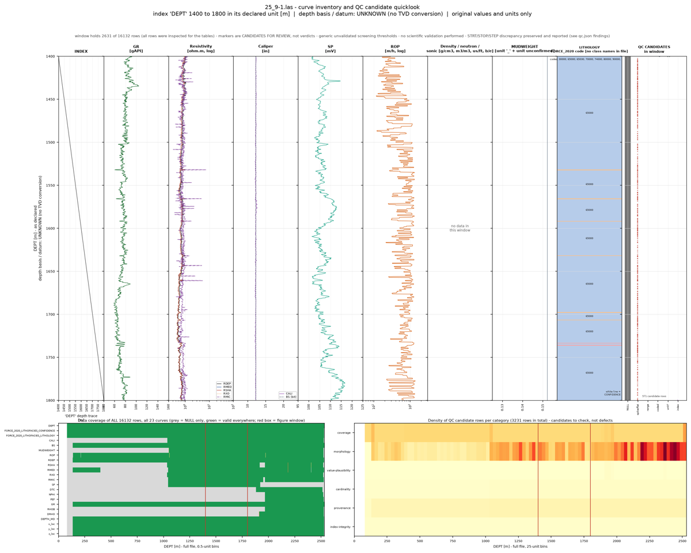

# 기관 내부 Qwen 서버 실제 과제 시험 — 연결·과제 결과와 사용 조건

## 0. 한눈에

| | |
|---|---|
| 요청 | 복구된 기관 내부 Qwen 서버를 앱에서 쓸 수 있는지, 출시 검증 때 로컬 모델에 했던 실제 과제 시험으로 확인합니다. |
| 결론 | 연결이 되고, 지도·면적표 과제와 검층 QC 과제를 모두 기준대로 끝냈습니다(각 약 11분, 수치는 정답·원본과 일치, 비용 0원). 다만 대화의 추론량 기본값인 "높음"에서는 서버가 요청을 거절하므로, "사용 안 함·낮음·보통" 중 하나를 골라야 합니다. |
| 믿을 수 있는 정도 | 과제마다 한 번씩 실행했습니다. 수치는 정답을 아는 합성 자료와 원본 LAS를 직접 읽은 값에 대조했습니다. 그림 두 장에는 결함이 하나씩 있고, 결과물은 과학적으로 검증한 것이 아닙니다. 시험한 프로젝트에는 워크플로 스킬이 설치되어 있지 않았습니다(5절). |
| 결정할 일 | 2건 (6절) |

## 1. 요청한 것

> “현재 67ip llm 서버가 복구되었다. 사용가능한지 확인해보자.” — 2026-10-14 요청
>
> “가와 나 모두 진행하자.” — 2026-10-14 요청 (나: 출시 검증에서 미뤄 둔 기관 내부 Qwen 서버 시험을 작업 단위로 진행)

완료 기준: 출시 검증(WP10)에서 로컬 모델에 했던 실제 과제 시험을 이 서버로 다시 하고, 연결과 과제 결과를 따로 호환성 기록에 남깁니다. 시험하지 않은 조합은 미시험으로 둡니다.

## 2. 수행한 것

1. 서버 상태를 확인했습니다. 서버는 모델 이름 셋(Qwen3.8 Flash Next, Qwen3.8 27B, Qwen3.6 27B)을 내놓습니다. 그런데 세 이름이 모두 같은 원본 모델을 가리킨다고 보고합니다. 그래서 과제는 Qwen3.8 Flash Next 하나로 돌리고, 나머지 두 이름은 연결만 확인했습니다.
2. 출시 검증 때의 시험 도구에 "사용자 지정 모델 서버" 경로를 더했습니다. 사용자가 설정 화면에서 서버를 등록하는 것과 같은 방식입니다. 컨텍스트 262,144 토큰, 최대 출력 16,384 토큰, 추론 사용, 비용 0으로 등록합니다. 매번 새 데이터 폴더로 앱을 띄웠고, 사용자의 검토용 앱은 건드리지 않았습니다.
3. 연결 시험 때 추론량 단계별로 짧은 대화를 하나씩 보냈습니다.
4. 출시 검증과 같은 두 과제를 같은 입력과 같은 45분 제한으로 하나씩 실행했습니다. 지도·면적표 과제는 정답 면적을 아는 합성 직사각형 자료를, 검층 QC 과제는 FORCE 25/9-1 공개 LAS를 씁니다. 서버를 여럿이 함께 쓰므로 동시에는 한 과제만 돌렸습니다.
5. 산출물을 정답 면적과 원본 LAS에서 직접 읽은 값에 대조하고, 결과를 호환성 기록과 안내 문서에 반영했습니다.

## 3. 결과

### 3.1 연결과 추론량

| 시험 | 결과 |
|---|---|
| 연결(추론량 "사용 안 함") | 통과, 약 9초 |
| 추론량 "낮음"·"보통" | 통과 |
| 추론량 "최소"·"높음"·"매우 높음" | 실패: 서버가 요청을 거절함 |
| 다른 모델 이름 두 개(27B) | 연결 통과 |
| 과금 | 비용 0원으로 기록됨(사용자 지정 서버의 선언 비용) |

앱은 대화에서 고른 추론량을 그대로 서버에 보냅니다. 이 서버는 "낮음·보통·매우 높음" 세 값만 받습니다. "매우 높음"도 실패한 이유는, 앱이 이 모델에 대해 "매우 높음"을 "높음"으로 낮춰 보내기 때문입니다. 대화의 기본 추론량이 "높음"이어서, 새 대화에서 추론량을 바꾸지 않으면 첫 요청부터 실패합니다. "사용 안 함"을 고르면 앱은 추론량 값을 보내지 않고, 서버는 자기 기본값으로 추론합니다. 사용자의 검토용 앱에 등록한 같은 서버에도 이 조건이 그대로 적용됩니다.

### 3.2 과제

| 과제 | 결과 | 시간 | 대화 횟수·도구 호출 | 컨텍스트 최대 사용 |
|---|---|---|---|---|
| 지도·면적표 | 통과: 파일 5종 모두 생성, 면적이 정답과 일치(A 30,000 m², B 20,000 m²) | 10분 46초 | 54회·57회(오류 14회는 모델이 스스로 고침) | 101,560 토큰(39%) |
| 검층 QC | 통과: 파일 5종 모두 생성, 수치가 원본과 일치 | 10분 33초 | 43회·47회(오류 2회는 스스로 고침) | 108,676 토큰(41%) |


그림 1. 기관 Qwen 서버 모델이 합성 지도 자료(평면 좌표계 EPSG:5186의 직사각형 세 개)로 만든 지도. 볼 것: 분류 A·B의 배치, 범례의 면적과 비율이 정답과 같습니다. 오른쪽의 "면적 좌표계로 그린 같은 자료" 작은 그림은 비어 있습니다. 범위 표기도 위경도를 반올림한 값인데 EPSG:5186이라고 적혀 있습니다. 함께 만든 좌표계 목록과 실행 기록은 요청한 항목을 모두 담았습니다.



그림 2. 기관 Qwen 서버 모델이 FORCE 25/9-1 검층 자료로 만든 미리보기(1400–1800 m 구간). 볼 것: 요청한 구간만 그렸고, 측정값이 없는 구간은 회색으로 표시했으며, 원래 단위를 유지했습니다. 다만 깊이 축이 위로 갈수록 깊어지도록 그려져 있습니다. 검층 그림은 보통 아래로 갈수록 깊어지게 그립니다.

검층 QC 결과는 원본 LAS와 다음과 같이 일치했습니다. 표본 16,132개, 처음 깊이 80.15 m, 마지막 깊이 2532.062 m. 헤더 종료 깊이(2532.17 m)와 마지막 표본 사이의 0.1128 m 차이는 고치지 않고 발견 사항으로 보고했습니다. 23개 curve의 결측값 수도 모두 맞았습니다. 출시 검증 때 로컬 모델은 결측값을 모두 0개로 잘못 세고 구간을 잘못 그렸는데, 이번에는 그런 결함이 없었습니다.

| 완료 기준 | 결과 | 근거 |
|---|---|---|
| 같은 두 과제를 이 서버로 실행 | 충족 | 3.2 표 |
| 연결과 과제 결과를 따로 기록 | 충족 | 3.1·3.2 표, 호환성 기록 |
| 호환성 기록과 모델 경로 안내 갱신 | 충족 | 부록 A |
| 시험하지 않은 조합은 미시험으로 둠 | 충족: 27B 이름의 과제, 추론량 "낮음·보통"의 과제는 미시험 | 3.1 표 |

## 4. 검증

- 과학적 검증: 지도 면적은 해석적으로 아는 정답과 비교했습니다(허용 오차 10⁻⁶ m²). 검층 QC는 원본 LAS를 따로 읽어 얻은 표본 수, 처음·끝 깊이, curve별 결측값 수와 대조했습니다. 그림은 눈으로 확인해 결함 두 가지를 적었습니다. 실측 자료의 지질 해석과 전문가 검토는 하지 않았습니다(미검증).
- 소프트웨어 검증: 실제 앱을 띄워 실제 서버와 대화했고, 비용 기록이 모두 0원인지 확인했습니다. 시험 도구에 더한 기능(사용자 지정 서버 경로, 승인 요청 자동 응답)은 단위 시험 6건으로 확인했습니다. 저장소 전체 검사 결과는 부록 A에 적었습니다.

## 5. 한계

- 시험 프로젝트에 워크플로 스킬이 없었습니다. 앱은 카탈로그 스킬을 앱이 시작될 때만 프로젝트에 설치합니다. 그래서 앱이 켜진 동안 새로 만든 프로젝트에는 다음 재시작 전까지 지질 스킬이 없습니다. 코드를 보면 화면에서 새 프로젝트를 만들 때도 같습니다(화면에서 직접 확인하지는 않았습니다). 시험 도구도 프로젝트를 새로 만들기 때문에, 출시 검증 때와 이번 시험 모두 노출한 워크플로 스킬이 실제로는 없었습니다. 출시 검증 보고서의 "모델이 노출된 워크플로 스킬을 읽지 않았다"는 관찰의 원인으로 보입니다. 이번 검층 QC 실행에서는 모델이 스킬을 찾으려고 프로젝트 밖의 호스트 폴더까지 검색했습니다. 그러다 다른 작업 폴더에 남아 있던 이전 판 스킬을 읽었습니다. 앱은 같은 사용자 권한으로 도구를 실행하므로 이런 검색을 막지 않습니다(알려진 한계).
- 과제마다 한 번씩만 실행했고, 서버를 다른 사용자와 함께 쓰는 상태였습니다. 반복 실행에 따른 편차와 혼잡할 때의 시간은 모릅니다.
- 과제는 추론량 "사용 안 함"(서버 기본 추론)으로만 실행했습니다. "낮음"·"보통"은 연결만 확인했습니다.
- 서버가 세 모델 이름이 같은 원본을 가리킨다고 보고하므로, 27B 두 이름의 과제 성능은 따로 시험하지 않았습니다.
- 과금 분류: 이 경로는 사용자 지정 서버로 등록되어, 선언한 비용(0)으로 기록되는 종량 과금으로 분류됩니다. 로컬 모델 전용 분류가 아니어도 비용은 0원이 됩니다. 차이는 지출 한도에 이미 닿은 프로젝트에서만 나타납니다. 이런 프로젝트에서는 0원 실행도 거절됩니다. 지금은 따로 바꿀 필요가 없다고 판단했습니다.
- 결과물은 검토 전이며 과학적으로 검증된 결과가 아닙니다.

## 6. 결정할 일

1. 새 프로젝트에 지질 스킬이 바로 설치되도록 앱을 고칠까요?
   - 가) 별도 작업으로 고치고, 두 경로(로컬 모델, 기관 서버)의 과제를 스킬이 있는 상태로 다시 시험 (권장: 화면에서 만든 새 프로젝트도 재시작 전까지 워크플로를 쓸 수 없고, 지금 기록은 스킬 없이 낸 결과입니다)
   - 나) 지금 상태로 두고 안내 문서에 "새 프로젝트는 앱을 다시 시작한 뒤 스킬이 설치됨"만 적기
2. 기관 서버에서 기본 추론량 "높음"이 실패하는 문제를 앱에서 막을까요?
   - 가) 별도 작업으로, 사용자 지정 서버마다 받을 수 있는 추론량을 설정하게 하고 받지 않는 값은 보내지 않도록 고치기 (권장: 기본 설정으로 첫 대화가 실패하면 사용자가 원인을 알기 어렵습니다)
   - 나) 앱은 그대로 두고, 호환성 안내에 적은 "사용 안 함·낮음·보통 사용" 조건만 유지

## 7. 대체되었거나 실패한 시도

<details><summary>펼치기 — 2건</summary>

- 검층 QC 1차 시도: 실행 7분 36초 만에 PC74 디스크가 가득 차 시험이 중단되었습니다(다른 프로젝트의 자료 때문). 모델 결과로 세지 않았고, 공간이 확보된 뒤 다시 실행했습니다.
- 검층 QC 2차 시도: 파일 5종을 모두 만들었고 수치도 원본과 맞았습니다. 미리보기도 깊이 축 방향이 올바랐습니다. 하지만 모델이 임시 폴더를 지우는 명령을 실행하려 하자, 앱의 원자료 보호 기능이 사용자 승인을 기다리며 멈췄습니다. 시험 도구에는 답할 사람이 없어 실행이 끊겼습니다(일부 완료로 기록). 시험 도구가 이런 승인 요청에 "거부"로 답하고 기록하도록 고친 뒤 한 번만 다시 실행했고, 그 결과가 3.2 표의 검층 QC입니다. 출시 검증의 규칙(시험 도구만 고친 뒤 재실행은 한 번)을 따랐습니다.

</details>

## 용어

없음.

## 부록 A. 근거 위치

<details><summary>펼치기 — 실행 방법, 원본, 해시, 커밋</summary>

| 항목 | 위치 |
|---|---|
| 호환성 기록 | `geo/compatibility.json` (경로 `kigam-qwen-vllm-262k`), 요약 `docs/geo/compatibility.md` |
| 시험 도구 | `geo/release-proof/route-trial.mjs` `--route custom-server`, `--permission`; 사용법 `geo/release-proof/route-usage.md`; 시험 `geo/release-proof/route-tests.mjs` |
| 서버 | `http://10.13.15.67:8000/v1` (vLLM 0.30.0, 키 없음); 모델 목록의 `root`는 세 이름 모두 `/models/Qwen3.8-Flash-Next-FP8` |
| 연결·지도 과제 기록 | `pc74:~/data/geoaidesk/runs/gaid-kigam-qwen-trial-20261014T050117.036909Z/out/record.json` sha256 2bfe9ccaee910150ae93b86a8a3c5d2ba28f6e4952825bc304b448f135b26e0f (app b9b5f2d) |
| 검층 QC 기록(통과) | `pc74:~/data/geoaidesk/runs/gaid-kigam-qwen-trial-20261014T061028.499209Z/out/record.json` sha256 1d73cbe9a538937a17c448b5bc9c2e68c4ae7aa0937cc83c38e6b92bea6ce16d (app a1a6a5b) |
| 검층 QC 기록(일부 완료) | `pc74:~/data/geoaidesk/runs/gaid-kigam-qwen-trial-20261014T054107.553208Z/out/record.json` sha256 27a48ee71a8b656762b98f4d7f02defacde62509871d63d22e0894224abadd1b (app 8cb08a5) |
| 디스크 부족으로 중단된 실행 | `pc74:~/data/geoaidesk/runs/gaid-kigam-qwen-trial-20261014T051459.845388Z/` (기록 없음, job 로그만) |
| LAS 대조 기준값 | `pc74:~/data/geoaidesk/work/gaid-kigam-qwen-trial/las-reference.json` (lasio로 원본을 직접 읽음) |
| 그림 원본 | 그림 1 map.png sha256 91b5f5ea08b56ca9f4e5af23d7830188708edb628de4c01f1d0d120713de3380, 그림 2 quicklook.png sha256 425adf7d9c3ded6c08f1c4481e817aaa0590161546de1e3fa4e95f1a13ec54ca (각 실행의 프로젝트 `results/route-trial/`) |
| 스킬 설치 경로 | `server/src/geo/provision.ts` `provisionProjectSkills`: 시작 시 `npm run prep`, 또는 `POST /projects/:id/sandbox/init`(웹 코드에서 호출하지 않음) |
| 전체 검사 | `scripts/check` job, `pc74:~/data/geoaidesk/runs/gaid-kigam-qwen-trial-20261014T062705.955719Z` (exit 0; 백엔드 1671 통과·11 건너뜀, 웹 981, geo 41, 실제 실행 스모크 통과; 코드 9f9daee) |

실행 예:

```sh
task job run --input assets:geo-catalogue/0.2.1 --input assets:force2020-welllogs/c8d01ee9 -- node geo/release-proof/route-trial.mjs --route custom-server --provider-id kigam-qwen --base-url http://10.13.15.67:8000/v1 --model qwen3.8-flash-next --context 262144 --max-tokens 16384 --workflow well-log-qc --thinking off --permission deny
```

작성 시점: 2026-10-14, 브랜치 task/gaid-kigam-qwen-trial.

</details>
