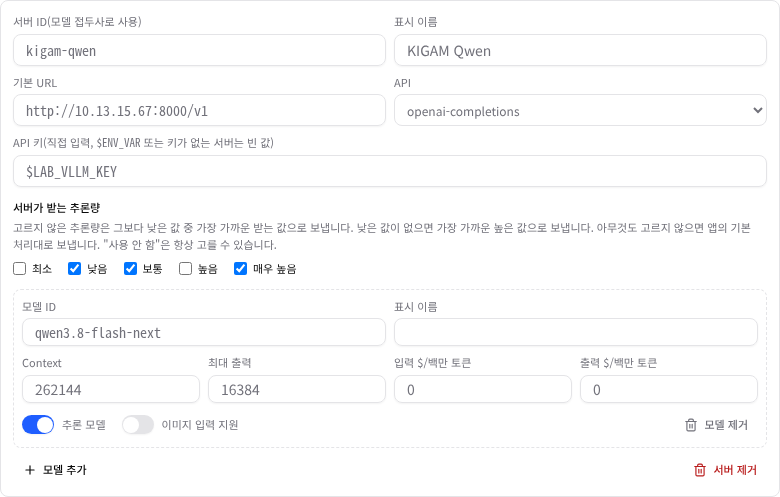
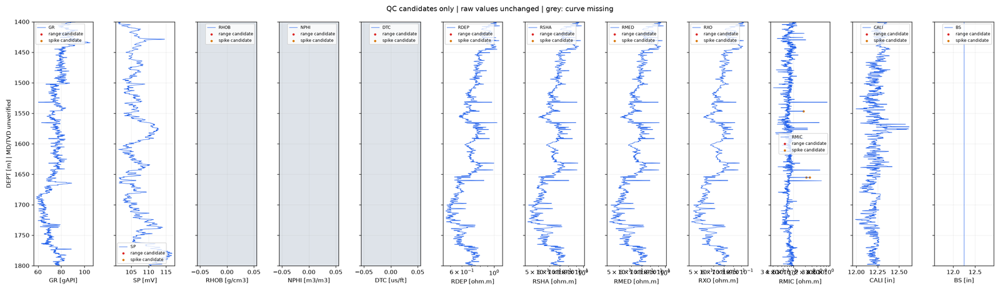

# 새 프로젝트 스킬 설치와 서버별 추론량 설정 — 기관·로컬 모델 재시험

## 0. 한눈에

| | |
|---|---|
| 요청 | 기관 서버 시험에서 나온 두 문제를 고칩니다. 새 프로젝트에 지질 스킬이 바로 설치되게 하고, 서버가 받지 않는 추론량은 보내지 않게 합니다(기관 서버에서는 "높음"을 "보통"으로 보냄). 그다음 두 경로를 스킬이 있는 상태로 다시 시험합니다. |
| 결론 | 두 수정 모두 동작합니다. 기관 서버는 "높음" 지정으로 두 과제를 각각 4분대에 통과했습니다. 로컬 모델은 64K 컨텍스트 두 과제와 98K 지도 과제를 통과했고, 98K 검층 QC는 45분 제한에 걸려 실패했습니다. |
| 믿을 수 있는 정도 | 과제마다 한 번씩 실행했습니다. 수치는 정답을 아는 합성 자료와 원본 LAS 기준값에 대조했습니다. 기관 서버 재시험에서는 스킬과 추론량이 함께 바뀌어, 빨라진 원인을 하나로 나눌 수 없습니다. 결과물은 과학적으로 검증한 것이 아닙니다. |
| 결정할 일 | 없음 |

## 1. 요청한 것

> "1번은 가로하고 2번은 가로 하면서 높음을 지정하면 보통으로 보내지게 하자." — 2026-10-14 요청

1번은 "새 프로젝트에 지질 스킬이 바로 설치되도록 고치고, 로컬·기관 서버 과제를 스킬이 있는 상태로 재시험"입니다. 2번은 "사용자 지정 서버마다 받을 수 있는 추론량을 설정하게 하고, 받지 않는 값은 보내지 않도록 고치기"입니다.

완료 기준: 앱이 켜진 동안 만든 프로젝트에도 스킬이 바로 설치됩니다. 서버별로 받는 추론량을 설정할 수 있고, 기관 서버에서 "높음"을 고르면 "보통"으로 보내며 그 사실이 화면에 보입니다. 두 경로의 과제를 스킬이 있는 상태로 다시 시험하고 호환성 기록에 남깁니다.

## 2. 수행한 것

1. 새 프로젝트를 만들면 앱이 응답하기 전에 고정된 지질 카탈로그를 설치하도록 고쳤습니다. 화면의 "프로젝트 만들기"와 외부 프로그램이 만드는 경우 모두 해당합니다.
2. 사용자 지정 모델 서버 설정에 "서버가 받는 추론량"을 더했습니다. 고르지 않은 추론량은 그보다 낮은 값 중 가장 가까운 받는 값으로 보냅니다. 낮은 값이 없으면 가장 가까운 높은 값으로 보냅니다. 이 규칙은 하위 에이전트 요청에도 똑같이 적용되고, 대화의 추론량 선택기에 실제로 보내는 값이 표시됩니다. 이 부분은 하위 작업으로 나누어 만들고 통합했습니다.
3. 시험 도구를 고쳤습니다. 과제가 쓰는 스킬이 새 프로젝트에 켜져 있지 않으면 시험을 시작하지 않습니다. 실행이 끝나면 모델이 스킬 파일을 읽었는지, 프로젝트 밖 경로를 건드렸는지 기록합니다.
4. 별도 데이터 폴더로 앱을 띄워 화면에서 직접 확인했습니다. 사용자의 검토용 앱은 건드리지 않았습니다.
5. 출시 검증 때와 같은 두 과제를 다시 실행했습니다. 로컬 모델은 64K·98K 컨텍스트에서 각각 두 과제, 기관 서버는 추론량 "높음"으로 두 과제입니다. 기관 서버는 함께 쓰는 서버라 한 번에 한 과제만 돌렸습니다.

## 3. 결과

### 3.1 새 프로젝트의 스킬

| 확인 | 결과 |
|---|---|
| 앱이 켜진 상태에서 시험 도구가 만든 프로젝트 6개 | 6개 모두 만들자마자 과제 스킬이 켜져 있음(카탈로그 스킬 13종) |
| 화면의 "프로젝트 만들기"로 만든 프로젝트 | 카탈로그 스킬 13종이 바로 설치됨 |

지난 보고서는 화면에서 만든 프로젝트도 재시작 전까지 스킬이 없다고 적었습니다. 이 판단은 틀렸습니다. 화면의 대화상자는 원래 만든 직후 스킬 설치를 따로 요청하고 있었습니다. 스킬이 없던 경우는 외부 프로그램이 프로젝트를 만든 경우였고, 시험 도구가 여기에 해당합니다. 이제는 어느 경로로 만들어도 처음부터 스킬이 들어 있습니다.

### 3.2 서버별 추론량


그림 1. 기관 서버 모델을 고른 대화 화면의 추론량 선택기. 볼 것: 아래 칩이 "높음 → 보통"으로 바뀌었습니다. 목록의 "최소 → 낮음", "높음 → 보통" 항목에는 "선택한 서버에는 … 값으로 보냅니다."가 붙어 있습니다.



그림 2. 설정의 사용자 지정 모델 서버 카드. 볼 것: "서버가 받는 추론량"에서 기관 서버가 받는 낮음·보통·매우 높음만 골랐습니다.

| 고른 추론량 | 기관 서버로 보내는 값 | 2026-10-14 첫 시험 | 이번 재시험 |
|---|---|---|---|
| 사용 안 함 | 값 없음(서버 기본 추론) | 통과 | 통과 |
| 최소 | 낮음 | 실패(서버가 거절) | 통과 |
| 낮음 | 낮음 | 통과 | 통과 |
| 보통 | 보통 | 통과 | 통과 |
| 높음(대화 기본값) | 보통 | 실패(서버가 거절) | 통과 |
| 매우 높음 | 매우 높음 | 실패(앱이 "높음"으로 낮춰 보냄) | 통과 |

설정하지 않은 서버는 지금까지와 똑같이 동작합니다. 사용자의 검토용 앱에 등록된 기관 서버에는 아직 이 설정이 없습니다. 병합 뒤 허브가 같은 설정을 저장합니다.

### 3.3 과제 재시험

| 경로 | 과제 | 결과 | 시간 | 스킬 파일을 읽었는지 | 출시 검증·첫 시험(스킬 없음) |
|---|---|---|---|---|---|
| 기관 서버, 추론량 "높음"(보통으로 보냄) | 지도·면적표 | 통과: 면적 정답, 지도와 범위 표기 정확 | 3분 59초 | 예 | 통과, 10분 46초(추론량 사용 안 함) |
| 기관 서버, 추론량 "높음"(보통으로 보냄) | 검층 QC | 통과: 수치가 원본과 일치, 깊이 축 방향 정상 | 4분 28초 | 예 | 통과, 10분 33초(추론량 사용 안 함) |
| 로컬 모델, 64K | 검층 QC | 통과: 수치가 원본과 일치 | 52초 | 예 | 부분(45분 제한, 그림 없음) |
| 로컬 모델, 64K | 지도·면적표 | 통과: 면적 정답, 지도 정상 | 54초 | 아니요 | 부분(지도 없음) |
| 로컬 모델, 98K | 검층 QC | 실패: 45분 제한, 산출물 없음 | 45분 | 아니요 | 부분(45분 제한, 결측값 결함) |
| 로컬 모델, 98K | 지도·면적표 | 통과: 면적 정답, 지도 정상 | 2분 25초 | 아니요 | 통과, 76초 |

모든 실행의 비용은 0원으로 기록되었습니다.



그림 3. 기관 서버 모델이 FORCE 25/9-1 검층 자료로 만든 미리보기(1400–1800 m). 볼 것: 깊이가 아래로 갈수록 커집니다(첫 시험에서는 반대였음). 측정값이 없는 curve는 회색입니다. 로그 축 눈금 글자는 겹칩니다.

검층 QC 결과 두 건(기관 서버, 로컬 64K)은 원본 LAS 기준값과 모두 맞았습니다. 표본 16,132개, 처음 깊이 80.15 m, 마지막 깊이 2532.062 m이고, curve 23개의 단위와 결측값 수도 같습니다. 로컬 98K 검층 QC 실행에서 모델은 스킬을 읽지 않았습니다. 대신 원본 LAS를 100줄씩 21번 읽었습니다. 입력이 약 89K 토큰으로 커지자 한 턴에 2분 반쯤 걸렸고, 결국 45분 제한에 닿았습니다.

| 완료 기준 | 결과 | 근거 |
|---|---|---|
| 앱이 켜진 동안 만든 새 프로젝트에 스킬 설치 | 충족 | 3.1 |
| 서버별 받는 추론량 설정, 받지 않는 값은 보내지 않음 | 충족 | 3.2 표 |
| 기관 서버에서 "높음"을 "보통"으로 보내고 화면에 표시 | 충족 | 그림 1, 3.2 표 |
| 두 경로 과제를 스킬이 있는 상태로 재시험 | 충족(로컬 4건 중 3건 통과, 기관 2건 통과) | 3.3 표 |
| 호환성 기록 갱신 | 충족 | 부록 A |

## 4. 검증

- 과학적 검증: 면적은 해석적으로 아는 정답과 비교했습니다(허용 오차 10⁻⁶ m²). 검층 QC는 원본 LAS를 따로 읽어 얻은 표본 수, 처음·끝 깊이, curve별 단위와 결측값 수에 대조했습니다. 그림은 눈으로 확인했습니다. 실측 자료의 지질 해석과 전문가 검토는 하지 않았습니다(미검증).
- 소프트웨어 검증: 새 프로젝트 설치와 추론량 규칙에 단위 시험을 더했습니다. 하위 작업의 전체 시험은 백엔드 1,675건, 웹 984건이 통과했습니다. 앱이 서버에 실제로 보내는 값은 두 가지로 확인했습니다. 하나는 요청 내용을 가로챈 시험이고, 다른 하나는 실제 기관 서버가 "높음"을 거절하지 않은 결과입니다. 저장소 전체 검사 결과는 부록 A에 적었습니다.

## 5. 한계

- 과제마다 한 번씩 실행했습니다. 반복에 따른 편차는 모릅니다. 기관 서버는 다른 사용자와 함께 쓰는 상태였습니다.
- 기관 서버 재시험에서는 스킬 설치와 추론량("사용 안 함" → "보통")이 함께 바뀌었습니다. 시간이 10분대에서 4분대로 줄었지만, 어느 쪽의 효과인지는 나누지 않았습니다.
- 로컬 모델은 스킬이 노출되어 있어도 4건 중 1건에서만 스킬 파일을 읽었습니다. 스킬이 설치되어 있어도 모델이 그것을 읽을지는 모델에 달려 있습니다.
- 로컬 98K 검층 QC 실패는 모델의 작업 방식 탓입니다. 지질 파일 읽기 안내는 100줄 이하로 제한된 읽기를 허용하므로, 제한된 읽기를 거듭해 파일 전체를 훑는 경우는 막지 못합니다. 이 실행은 기관 서버 시험과 같은 시간대에 같은 컴퓨터에서 돌아, 시간에는 CPU 경합이 섞였을 수 있습니다. 시험 도구 결함이 아니므로 다시 돌리지 않았습니다.
- 그 밖의 결함: 로컬 64K 지도 과제의 실행 기록에는 모델이 지어낸 날짜(2025-04-05)가 들어 있습니다. 로컬 98K 지도 과제는 결과 폴더에 고쳐 쓴 스크립트 사본 넷을 남겼습니다. 검층 미리보기의 로그 축 눈금 글자가 겹칩니다.
- 선택 사항(결정 필요 없음): 제한된 읽기를 반복해 큰 지질 파일을 훑는 경우를 안내로 막는 일은 별도 작업으로 할 수 있습니다.
- 결과물은 검토 전이며 과학적으로 검증된 결과가 아닙니다.

## 6. 결정할 일

없음.

## 7. 대체되었거나 실패한 시도

<details><summary>펼치기 — 1건</summary>

- 하위 작업이 처음 쓴 한국어 문구("서버가 지원하는 추론 수준", "끄기", "해당 서버에는 {값}으로 보냅니다")는 통합할 때 바꿨습니다. 화면의 기존 용어("추론량", "사용 안 함")에 맞췄고, "최소으로"처럼 조사가 틀리는 문장을 고쳤습니다.

</details>

## 용어

없음.

## 부록 A. 근거 위치

<details><summary>펼치기 — 실행 방법, 원본, 해시, 커밋</summary>

| 항목 | 위치 |
|---|---|
| 새 프로젝트 설치 | `server/src/geo/provision.ts` `provisionCreatedProject`, `server/src/api/projects.ts` `POST /projects`; 접두사 없는 `POST /sandbox/init`도 `provisionProjectSkills` 사용(`server/src/api/skills.ts`); 커밋 1927e2d |
| 서버별 추론량 | `server/src/agent/custom-models.ts` `reasoningLevels` → 모델별 Pi `thinkingLevelMap`(`customThinkingLevelMap`), 선택기 행 `thinkingSentAs`; `web/src/components/thinking-selector.tsx`, `custom-models-card.tsx`; 하위 작업 `gaid-qwen-followups--gaid-qwen-reasoning`(병합 7d39ec7), 문구 수정 cb4d83b |
| 문자열 | `customModels.acceptedReasoningLevels` 서버가 받는 추론량 / Reasoning levels the server accepts; `customModels.reasoningLevelsHelp`; `chat.thinking.sentAs` 선택한 서버에는 {level} 값으로 보냅니다. / Sent to this server as {level}.; `chat.thinking.mappedLevel` {selected} → {sentAs} |
| 시험 도구 | `geo/release-proof/route-trial.mjs` `--reasoning-levels`, `--allow-missing-skills`, `record.skills`; `route-metrics.mjs` `installedSkills`, `skillUse`; 사용법 `route-usage.md` |
| 기관 지도·면적표(+추론량 단계별 연결) | `pc74:~/data/geoaidesk/runs/gaid-qwen-followups-20261014T123348.224521Z/out/record.json` sha256 c63e057586491272d9fc30eb4c5282491f3e2d8bff0dc7ab634704f07ad1ecc5 (앱 9a0c179) |
| 기관 검층 QC | `pc74:~/data/geoaidesk/runs/gaid-qwen-followups-20261014T124118.071733Z/out/record.json` sha256 1d32c957b14438d1bbcf6167bf6a3b42c840a84212ded8a9912d36fe0ecdb692 (앱 75e1eca) |
| 로컬 64K 검층 QC | `pc74:~/data/geoaidesk/runs/gaid-qwen-followups-20261014T121210.303517Z/out/record.json` sha256 b830eec1af0d84205c79be4e352dd7ef37abde84a348bebf35c3e5265f31486a (앱 b2076d8) |
| 로컬 64K 지도·면적표 | `pc74:~/data/geoaidesk/runs/gaid-qwen-followups-20261014T121233.638014Z/out/record.json` sha256 0967531dab38bae7f034a918965fee6430a91097de0a28061cb7c55cb347e0ab (앱 6e8511d) |
| 로컬 98K 검층 QC(실패) | `pc74:~/data/geoaidesk/runs/gaid-qwen-followups-20261014T121243.381587Z/out/record.json` sha256 a1a7f8435b4159dc212cafaade8a39ba3203d7f9d73dcd93041061fe6a6f51b6 (앱 7656c87) |
| 로컬 98K 지도·면적표 | `pc74:~/data/geoaidesk/runs/gaid-qwen-followups-20261014T121252.863802Z/out/record.json` sha256 864fff330a100332276444e8e0bf1b138ac00f851ae983327ca8845795c89ad3 (앱 1059867) |
| LAS 대조 | 기준값 `pc74:~/data/geoaidesk/work/gaid-kigam-qwen-trial/las-reference.json`, 대조 스크립트 `pc74:~/data/geoaidesk/work/gaid-qwen-followups/scripts/check_las.py` |
| 화면 확인 | 별도 인스턴스(포트 3400/18400, 데이터 `pc74:~/data/geoaidesk/work/gaid-qwen-followups/ui-home`); 원본 그림 `pc74:~/data/geoaidesk/work/gaid-qwen-followups/playwright/thinking-selector.png` sha256 653bb4a6a7e7dea2fbb4355d993ea82beae563b0b20265e409b0cc8e0407fa07, `custom-server-card.png` sha256 fd296e62c8037cbe765331ffed235e84fa30de3e6c3e291481a1f34626921edf |
| 그림 3 원본 | 기관 검층 QC 프로젝트 `results/route-trial/quicklook.png` sha256 bb27bc7fbc5c965e1c71eb1f7841805e2dca087b2d5a9abeea6957fd218c8c84 (가로 1600으로 줄임) |
| 호환성 기록 | `geo/compatibility.json`(경로 `kigam-qwen-vllm-262k`, `local-ollama-qwen3-30b-64k`, `local-ollama-qwen3-30b-98k`; 이전 연결 기록은 `earlierConnections`), 요약 `docs/geo/compatibility.md` |
| 전체 검사 | CHECK_PLACEHOLDER |

실행 예:

```sh
task job run --input assets:geo-catalogue/0.2.1 --input assets:force2020-welllogs/c8d01ee9 -- node geo/release-proof/route-trial.mjs --route custom-server --provider-id kigam-qwen --base-url http://10.13.15.67:8000/v1 --model qwen3.8-flash-next --context 262144 --max-tokens 16384 --workflow well-log-qc --thinking high --reasoning-levels low,medium,xhigh --permission deny
task job run --gpu --input assets:geo-catalogue/0.2.1 --input assets:force2020-welllogs/c8d01ee9 -- node geo/release-proof/route-trial.mjs --context 98304 --workflow well-log-qc
```

작성 시점: 2026-10-14, 브랜치 task/gaid-qwen-followups.

</details>
