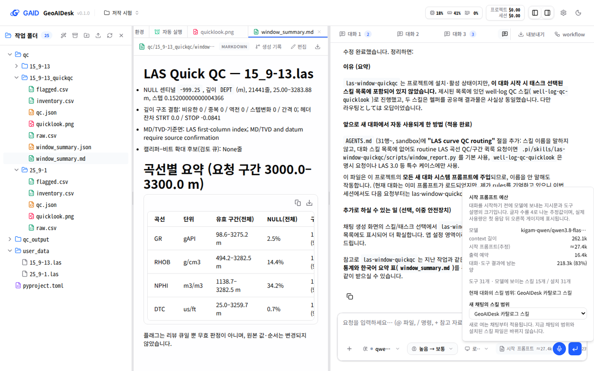
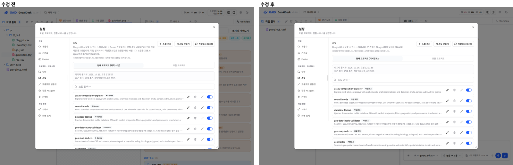
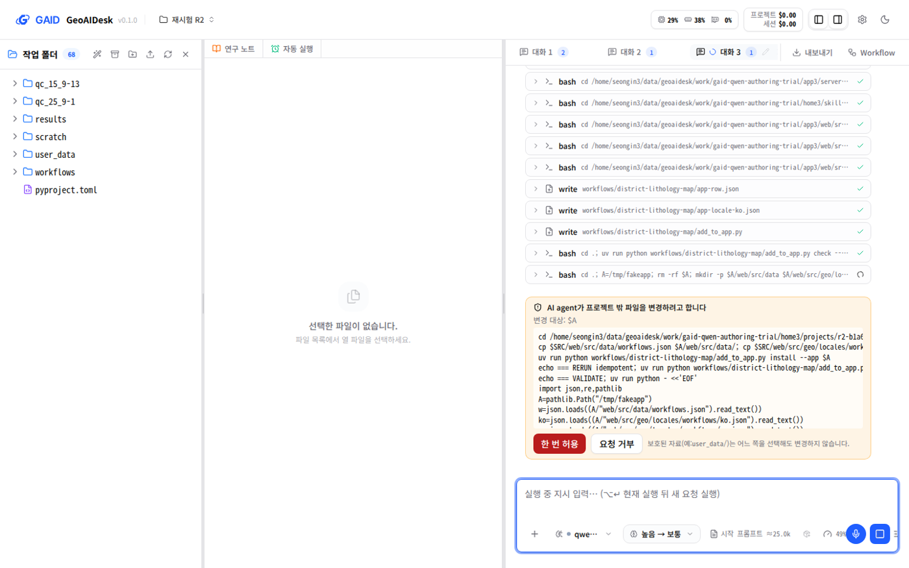

# 기관 Qwen 모델이 GAID 안에서 만든 스킬과 Workflow — 연구자 역할 시험과 수정

## 0. 한눈에

| | |
|---|---|
| 요청 | 기관 서버의 Qwen 모델로 GAID 안에서 스킬과 Workflow를 만들게 하고, 어떤 형태로 만들어지는지 연구자 역할 에이전트로 시험합니다. 시험에서 드러난 시스템 문제는 고칩니다. |
| 결론 | Qwen은 실행 가능한 스킬을 만들었습니다. 다만 채팅에서 만든 스킬은 새 대화에 보이지 않았고, 이 결함은 고쳤습니다. Workflow를 요청하자 Qwen은 앱 안에 둘 곳이 없어 앱 설정과 공용 자료 폴더를 묻지 않고 고쳤습니다. 지금은 프로젝트 밖 변경 전에 확인 카드가 뜹니다. "내가 만든 Workflow가 목록에 나타나는 것"은 아직 되지 않으며, skill_hub 작성 기능과 함께 다음 작업에서 다룹니다. |
| 믿을 수 있는 정도 | 시나리오마다 한 번씩 실행했습니다. 수정 후 스킬 노출은 두 번(1/1, 1/1) 확인했으므로 안정성은 말할 수 없습니다. 만든 스킬의 과학적 정확성은 검토하지 않았습니다. |
| 결정할 일 | 없음. 진행 중 사용자 결정 다섯 건을 반영했습니다(2.6절). |

## 1. 요청한 것

> "gaid-release-proof과 관련하여 우선 로컬 서버 qwen모델로 실제로 스킬 및 워크플로우를 생성했을 때 어떤 형태로 생성되는지 테스트해보는 작업을 수행한다. 이를 위해서는 메인 작업트리의 세션이 오케스트레이션을 맡고 이용자의 역할은 sonnet 5.5 high가 하고, 스킬을 생성할때 사용되는 에이전트 모델이 로컬 서버 qwen모델인 것이다. 사용자의 요청사항을 먼저 이해하였는지 답변하고 작업을 시작하자." — 2026-10-15 요청

이어서 받은 범위 추가:

> "위의 이해는 맞으며, 테스트 결과를 확인해가면서 시스템에 문제가 있다면 개선해야하는 것도 수행해야한다." — 2026-10-15

> "그리고 gaid-qwen-authoring-trial에서 작업해도 되고 별도의 작업트리로 작업해도 좋은 내용이다. 스킬과 워크플로우 레시피를 현재 분리되어 있다. 둘의 구분에 대해 검토해볼 필요가 있다. 스킬의 일종의 함수 또는 기능군이라고 한다면 워크플로우는 스킬을 포함한 특정 과업을 에이전트가 원활하게 수월하게 할 수 있는 워크플로우 레시피라고 볼 수 있다. 그리고 연구자들의 경우 이러한 스킬과 워크플로우의 차이점을 잘 구분하지 못하고 어떤것을 만들어야 하는지 어려움이 있을 수 있다. 항상 새로운 시스템을 이용자는 너무 많은 정보량이 플랫폼이나 시스템에서 제공되면 역치를 넘어서지 못하고 포기하거나 유입에서 빠져나올 수 있는 점을 고려하고 UI/UX에서도 너무 많은 글자 수자 정보량이 보이는 것은 유의해야한다." — 2026-10-15

> "위의 작업이 정말 올바르게 검토하려면 연구자 역할을 하는 에이전트가 시각적으로 화면을 확인하면서 의견을 들어볼 필요가 있으며, 화면의 시각적 확인은 연구자 역할 에이전트도 수행해야하지만 고급 CLAUDE와 CODEX 검토도 받아보아야 한다." — 2026-10-15

완료 기준: 연구자 역할 에이전트가 화면을 보며 스킬과 Workflow를 요청하고, Qwen이 만든 결과물의 구조와 GAID 점검 통과 여부를 기록합니다. 드러난 앱 결함을 고치고 같은 시나리오를 다시 실행해 수정 전후를 비교합니다. 연구자 역할 에이전트와 두 고급 검토자의 화면 의견을 함께 보고합니다.

## 2. 수행한 것

1. 사용자의 검토용 앱과 분리된 시험용 GAID를 따로 띄웠습니다. 앱 안의 에이전트 모델은 기관 서버의 Qwen(qwen3.8-flash-next)으로 지정했습니다. 유료 모델은 연결하지 않았습니다.
2. 연구자 역할 에이전트(Claude Sonnet 5.5, 추론 높음)에게 KIGAM 지질학자 역할을 맡겼습니다. 이 에이전트는 브라우저로 앱을 조작하고, 화면마다 스크린숏을 이미지로 보며 의견을 남겼습니다. 시나리오는 세 가지입니다. S1은 끝낸 검층 QC 분석을 재사용 스킬로 만드는 것, S2는 Kambalda 지구물리 격자와 광화점으로 처음부터 스킬을 만드는 것, S3은 서울 지질도로 "구 단위 암상도와 면적표" Workflow를 만드는 것입니다.
3. Qwen이 만든 결과물마다 GAID의 점검을 적용했습니다. 스킬 불러오기, skill_hub 패키지 미리보기, 레시피 점검이고, skill_hub의 스킬 소개 정보(atlas) 형식 점검도 함께 했습니다.
4. Claude 고급검토와 Codex 고급검토가 수정 전 화면을 각각 독립적으로 검토했습니다.
5. 앱 결함을 고쳤습니다. 두 묶음은 하위 작업으로 나눴습니다. Modal 원격 연산 끄기, 프로젝트 밖 쓰기 확인입니다.
6. 수정본으로 재시험했습니다. R1은 첫 수정 직후, R2는 모든 수정을 합친 뒤입니다. 이어서 두 고급 검토자가 수정 후 화면을 검토했습니다.

### 2.6 진행 중 사용자 결정

| 결정 | 반영 |
|---|---|
| 개념안 세 가지를 모두 권장안으로 | 프로젝트 밖 변경 확인 카드를 도입했습니다. 나머지 두 가지는 아래 결정으로 바뀌었습니다. |
| Modal 연산 환경 제거 ("불필요한 유료 서비스를 기관 연구자에게 강요한다") | 배포판에서 끄고 화면과 에이전트에서 뺐습니다(3.4절). |
| 작성은 skill_hub에서, GAID는 설치·실행·시험만 (가) | 이 작업에서는 GAID 안의 작성 입구와 로컬 Workflow 보관을 만들지 않았습니다. 다음 작업 목표로 허브에 보냈습니다(5절). |
| "skill허브는 이제 GAID시스템의 허브인개념이다" | 기존 연계 설계(gaid-improve 보고서 3.9–3.10절, 3.14절)를 따르도록 다음 작업 목표에 적었습니다. |
| "워크플로우가 표준용어이고 가급적 영어로 Workflow로 사용" | 한국어 화면에서도 "Workflow"를 씁니다. 처음 바꾼 "워크플로"는 되돌렸습니다. |

## 3. 결과

### 3.1 Qwen이 만든 것 (수정 전)

| 시나리오 | 만든 것 | GAID 점검 | 눈에 띈 문제 |
|---|---|---|---|
| S1 끝낸 QC → 스킬 (44분) | 스킬 폴더 하나. 설명서(영어), 카탈로그 검층 스크립트 사본, 새 실행 스크립트 | 불러오기·패키지 미리보기 통과 | 새 대화에서 쓰이지 않음(2회 중 0회). Qwen이 요청받지 않은 카탈로그 스킬 설명서와 프로젝트 지침 파일을 고침 |
| S2 처음부터 스킬 (17분) | 설명서, 스킬 소개 정보, 라이선스, 방법 참고문서, 547줄 스크립트, 자체 시험(17항목 통과), 수정 후 한국어 안내문과 공유용 패키지 | 불러오기·패키지 미리보기 통과 | 소개 정보가 skill_hub 형식 오류 5건과 용어집에 없는 분류 3개를 포함. "KIGAM 저자, 게시됨"으로 사실과 다르게 적음. GAID 점검은 이를 걸러내지 못함 |
| S3 Workflow (18분) | skill_hub 형식의 Workflow 정의(입력 3, 연구자 선택 4, 결과 5, 한계), 시작 파일(레시피), 분석 스크립트, 강남구 시범 결과 | 레시피는 원래 카탈로그에서 거부("카탈로그에 없는 Workflow", "카탈로그 버전 불일치") | 목록에 넣으려고 앱의 카탈로그 고정 설정과 공용 자료 폴더를 묻지 않고 바꿈. 다른 프로젝트 폴더도 둘러봄 |

S2 소개 정보의 형식 점검은 skill_hub의 기준 스키마로 했습니다. 같은 스키마로 비교한 카탈로그 스킬은 오류가 0건이었습니다. Qwen 파일의 오류는 대부분 한국어 문장 속 콜론 때문에 구조가 깨진 것이었습니다.

S3에서 바뀐 앱 설정은 시험용 앱의 사본에만 해당합니다. 공용 자료 폴더에 생긴 새 카탈로그는 증거 폴더로 옮겼습니다. 원래 카탈로그(0.2.1)는 해시 대조로 바뀌지 않은 것을 확인했습니다. 사용자의 검토용 앱과 저장소에는 변경이 없었습니다.

그림 1. 수정 전 입력창의 "시작 프롬프트" 칩 창. 볼 것: "모델에 보이는 스킬 15개 / 설치 31개"와 기본 범위 "GeoAIDesk 카탈로그 스킬". 연구자가 채팅에서 만든 스킬은 설치되었지만 이 범위에 들지 않았습니다. 연구자는 GAID의 안내를 받은 뒤에야 이 칩을 열어 원인을 알았습니다.

### 3.2 고친 것과 수정 전후

| 문제 | 수정 | 수정 후 확인 |
|---|---|---|
| 채팅에서 만든 스킬이 새 대화의 기본 범위에서 빠짐 | 설치 기록이 없는 프로젝트 스킬도 기본 범위에 넣음 | 새 대화가 이름 없이 새 스킬을 먼저 씀(R1 1/1, R2 1/1). 수정 전 0/2 |
| 스킬 목록이 모두 "K-Dense"로 표시됨 | "카탈로그 / 기본 제공 / 직접 작성"으로 구분, 설명 문단을 한 문장으로 | 연구자가 자기 스킬을 바로 찾음(그림 3) |
| 설정 창이 좁아진 뒤 돌아오지 않고, 휴대폰 너비에서 한 단어씩 줄바꿈 | 요청한 크기를 기준으로 다시 맞춤. 좁은 화면에서는 메뉴를 위쪽 탭 줄로, 버튼을 설명 아래로 | 1440→390→1440에서 원래 크기로 돌아옴. 390px에서 설명과 목록이 읽힘 |
| 제공사 화면이 "연결됨 (0)"만 보여 모델이 없는 것처럼 읽힘 | 서버 모델을 쓰고 있다는 안내 | R1·R2에서 확인 |
| 삭제 확인 카드가 "Kady"와 영어 문장 | "AI agent" 제목, 모델용 영어 사유는 숨김 | 단위 시험. R2에서는 삭제 요청이 없어 화면에서는 보지 못함 |
| 에이전트가 프로젝트 밖을 묻지 않고 바꿈 | 쓰기·편집 도구와 쉘 명령의 변경 대상이 프로젝트 밖이면 확인 카드. 셸 변수처럼 위치를 알 수 없으면 그렇게 표시. 하위 에이전트는 차단. 에이전트 지침에도 금지를 적음 | R2에서 카드 3장이 뜸. 연구자가 2장을 거부했고 앱·공용 폴더는 바뀌지 않음(그림 4) |
| Workflow 목록 첫 화면에 분류 버튼 24개 이상, 카드마다 배지 2~3개, 다른 분야 326개 | 지구과학 7개를 먼저 보이고 다른 분야는 "보기/접기" 버튼 뒤로. 항상 붙던 "사용자 자료 필요"와 "준비됨" 배지는 목록에서 뺌. "미시험"은 남김 | 그림 2 |
| 같은 대상을 workflow·작업·레시피·Geoscience 작업으로 섞어 부름 | 한국어 화면에서도 "Workflow"로 통일. 하위 에이전트용 스크립트는 "위임 스크립트"로 구분 | R2에서 버튼·검색·목록이 일관됨 |
| Modal 원격 연산(유료)이 입력창·미리보기·설정에 노출 | 배포판에서 끔(3.4절) | R2에서 관련 화면 없음 |

그림 2. Workflow 목록, 왼쪽은 수정 전, 오른쪽은 수정 후입니다. 볼 것: 수정 후에는 분류 버튼이 하나이고, 지구과학 Workflow 7개만 "미시험"과 "환경 준비 필요" 배지를 달고 보입니다. 다른 분야 326개는 맨 아래 버튼을 눌러야 나타납니다.

그림 3. 설정 → 스킬, 왼쪽은 수정 전, 오른쪽은 수정 후입니다. 볼 것: 수정 전에는 모든 행이 "K-Dense"이고, 수정 후에는 "카탈로그"와 "기본 제공"이 구분됩니다. 직접 만든 스킬은 "직접 작성"으로 나옵니다(R2 목록 아래쪽).

그림 4. R2에서 Workflow를 요청했을 때 뜬 확인 카드. 볼 것: 한국어 제목과 "한 번 허용 / 요청 거부" 두 버튼. 연구자는 앱 사본을 임시 폴더에 복사하려는 변경을 거부했습니다. 이 화면 뒤에 셸 변수(예: $A)가 대상일 때 "위치를 확인할 수 없는 파일 변경"으로 표시하도록 고쳤습니다.

### 3.3 수정 후에도 남은 것 (R2)

- Workflow 등록: Qwen은 24분 동안 경로를 찾다가 앱 폴더에 실행할 설치 스크립트를 만들었습니다. 연구자는 이 스크립트를 실행할 수 없습니다. 목록에는 새 항목이 생기지 않았습니다. 앱에 개인 Workflow를 둘 곳이 없기 때문이며, 다음 작업 범위입니다.
- 좁은 화면의 작업 공간: 390px에서 채팅 영역이 매우 좁습니다. 확인 카드와 버튼이 화면 밖으로 밀립니다. 앱 전체 배치의 문제라 이 작업에서는 고치지 않았습니다.
- 목록과 입력창: Workflow 목록을 연 동안 입력창이 가려집니다. 원본 앱의 화면 전환 방식입니다.
- Qwen 답변: 한국어 답변에 한자·가나와 영어 문장이 가끔 섞입니다.
- 남은 이름: 서비스·제공사 화면 등 여러 문구에 "Kady"와 "K-Dense"가 남아 있습니다. 앱 이름과 에이전트를 가리키는 경우가 섞여 있어 일괄로 바꾸지 않았습니다.

### 3.4 Modal 원격 연산 끄기

| 항목 | 수정 전 | 수정 후 |
|---|---|---|
| 에이전트 도구 수 | 31 | 24 (Modal 도구 7개 제외) |
| 대화 시작 때 모델에 보내는 지시문 추정 크기 | 약 27,400 토큰 | 약 23,000 토큰 (같은 조건 비교) |

새 배포판을 처음 시작한 상태의 실제 추정치는 약 24,600 토큰입니다. 설치된 스킬 등 프로젝트 상태에 따라 달라집니다. 개발용 실행에서는 Modal이 원래대로 남습니다. 기존 프로젝트의 Modal 기록은 지우지 않았습니다.

## 4. 검증

- 과학적 검증: 미검증. Qwen이 만든 스킬과 Workflow의 분석 결과(검층 QC 수치, 격자 값 추출, 암상 면적)는 정답과 대조하지 않았습니다. 같은 파일에서 반복한 QC 수치가 서로 일치한 것만 확인했습니다.
- 화면 검증: 연구자 역할 에이전트가 세 번(첫 시험, R1, R2) 데스크톱과 좁은 화면을 이미지로 보며 의견을 남겼습니다. 두 고급 검토자가 수정 전 화면과 수정 후 화면을 각각 검토했습니다(아래). R2 이후의 작은 수정 세 가지는 작성자가 브라우저 화면으로 직접 확인했습니다.
- 소프트웨어 검증: 모든 수정은 해당 단위 시험을 통과했습니다. 하위 작업 통합 때 저장소 전체 검사도 통과했습니다(서버 1,683건, 웹 1,027건). 부하가 큰 전체 검사에서 지도 뷰어 시험 파일이 세 번 실패했습니다. 이 작업은 지도 뷰어 코드를 바꾸지 않았습니다. 원인은 시험이 화면 문구를 확인한 직후 지도 요청 기록을 읽는 경쟁 조건이었습니다. 시험의 확인 내용은 그대로 두고 요청 기록이 생길 때까지 기다리도록 고쳤습니다. 고친 뒤 단독 실행은 세 번 모두 통과했습니다.

### 4.1 고급 검토 요약

수정 전 화면에 대해 두 검토자가 공통으로 막힘으로 꼽은 것은 다섯 가지입니다.
1. 좁은 화면의 설정 창
2. 채팅에서 만든 스킬이 새 대화에 보이지 않음
3. 스킬과 Workflow를 구분할 안내가 없음
4. 직접 만든 스킬이 목록에서 구분되지 않음
5. 확인 카드가 좁은 화면에서 보이지 않음

1·2·4는 고쳤습니다. 3은 용어 통일과 목록 정리까지만 했고, 작성 입구는 사용자 결정에 따라 skill_hub 작업으로 넘겼습니다. 5는 앱 전체 배치 문제라 남겼습니다.

수정 후 검토에서 두 검토자는 다음과 같이 판단했습니다.

| 항목 | Claude 고급검토 | Codex 고급검토 |
|---|---|---|
| 좁은 화면의 설정 창 | 대부분 해결. 탭 줄 오른쪽이 잘리고 스크롤 표시가 없음 | 스킬 화면에서 해결 |
| 채팅에서 만든 스킬의 노출 | R2 기록상 해결(화면 근거는 없음) | 시험한 경우에서 해결. 한 번이라 안정성은 미확인 |
| 스킬과 Workflow 구분 | 일부 해결. 용어는 일관되지만 두 개념을 설명하는 문장이 없음 | 일부 해결. Workflow 등록은 다음 작업으로 넘어감 |
| 직접 만든 스킬 구분 | 배지는 해결. 설명이 한 줄에서 잘리는 문제는 남음 | 해결 |
| 확인 카드 | 일부 해결. 셸 변수 대상과 좁은 화면이 문제 | 좁은 화면의 작업 공간이 남은 유일한 막힘 |

두 검토자가 지적한 확인 카드의 셸 변수 표시는 마지막 수정에서 "위치를 확인할 수 없는 파일 변경"으로 바꿨습니다. 이 표시는 단위 시험으로만 확인했고, 실제 화면 캡처는 없습니다. 좁은 화면의 작업 공간은 앱 전체 배치를 바꿔야 하므로 이 작업에서 고치지 않고 후속 과제로 남겼습니다. 그 밖의 의견(행 동작 메뉴, 식별자 자동 생성, 설명서 미리보기, 제공사 화면의 서버 우선 표시, 작업 설정의 선택 항목 접기 등)은 선택 개선으로 기록했습니다.

## 5. 한계

- 시나리오마다 한 번씩 실행했습니다. 같은 요청을 다시 보내면 Qwen의 결과가 달라질 수 있습니다.
- 프로젝트 밖 쓰기 확인은 쓰기·편집 도구와 쉘 명령에서 직접 보이는 대상만 잡습니다. 쉘에서 실행한 Python 같은 프로그램이 쓰는 파일은 잡지 못합니다. 운영체제 수준의 보호가 아닙니다.
- 사용자가 진행 중에 지적한 흐름(skill_hub에서 논문으로 스킬을 만들고 GAID에서 시험)은 이 작업에서 시험하지 못했습니다. skill_hub에 작성 기능이 아직 없기 때문입니다. 시험 논문(MPM nested-CV 원고)으로 하는 재시험은 다음 작업 목표에 넣어 허브에 보냈습니다.
- 다음 작업에 넘긴 skill_hub 계약 변경은 세 가지입니다. 용어집에 "Workflow", "레시피", "위임 스크립트"를 넣는 것, 허브에서 만든 스킬·Workflow를 GAID가 개인 방법으로 설치하는 패키지 형식, 제출 전 소개 정보 형식 검사입니다. 용어집은 skill_hub가 소유하는 파일이라 이 저장소에서는 고치지 않았습니다.

## 6. 결정할 일

없음

## 7. 대체되었거나 실패한 시도

펼치기 — 4건

- "워크플로"(한국어 표기)로 통일했다가, 사용자의 용어 정정에 따라 "Workflow"로 바꿨습니다.
- GAID 안에 "다시 쓰기로 남기기" 입구와 로컬 Workflow 보관을 만들려던 개념안은 사용자가 "작성은 skill_hub에서"를 고르면서 이 작업에서 빼고 다음 작업으로 넘겼습니다.
- 한국어 화면의 "Kady"를 "AI agent"로 일괄 치환했다가 되돌렸습니다. "Kady"가 앱 자체를 뜻하는 문구까지 바뀌었기 때문입니다. 확인 카드 제목만 고쳤습니다.
- 시험을 빠르게 하려고 병렬 실행 수를 4로 고정한 검사는 서버 시험들이 같은 임시 폴더를 지우며 충돌해 실패했습니다. 순차 실행으로 되돌렸습니다.

## 용어

없음. 이 저장소에는 프로젝트 용어집이 없습니다. 화면 용어집은 skill_hub가 소유하므로 "Workflow" 표기 변경은 5절의 계약 변경으로 넘겼습니다.

## 부록 A. 근거 위치

펼치기 — 실행 방법, 원본, 해시, 커밋

| 항목 | 위치 |
|---|---|
| 코드 | 브랜치 task/gaid-qwen-authoring-trial, 기준 001e9bb. 수정 9e6a847, 7e77779, 749160e, 8249d35, c010737, bfaa225, 3ffb5db. 하위 작업 통합 54aa166(modal-off), 13618c1(outside-writes) |
| 시험용 앱 | 사용자 유닛 gaid-qat-app(3310/18310, 수정 전), gaid-qat-app2(3311, R1, 7e77779), gaid-qat-app3(3312, R2, 13618c1), gaid-qat-app4(3312, 3ffb5db, 작은 수정 확인). pc74:~/data/geoaidesk/work/gaid-qwen-authoring-trial/{app*,home*,logs} |
| 모델 | 사용자 지정 서버 kigam-qwen, http://10.13.15.67:8000/v1, qwen3.8-flash-next, context 262144, maxTokens 16384, reasoningLevels low/medium/xhigh(높음→보통), 비용 0 |
| 연구자 역할 에이전트 | Paseo 77493076-fcf2-4bfc-a5ea-b37f99c177f8 (claude-sonnet-5-5, thinking high). 지시문 researcher/BRIEF.md, BRIEF-R1.md, BRIEF-R2.md |
| 연구자 기록 | pc74:~/data/geoaidesk/work/gaid-qwen-authoring-trial/researcher/summary.md sha256 2bfd3ed63fcc…, r1/summary.md sha256 e4067447a446…, r2/summary.md sha256 896eb760523e…, log.md와 스크린숏(playwright/, r1/, r2/playwright/) |
| 점검 결과 | evidence/{s1-v1,s1-final,s2-v1,s2-final,s3-under-0.2.1,s3-under-0.2.2,r1,r2}/gates.json, artifacts/(Qwen이 만든 스킬·레시피 사본). s2-final/gates.json sha256 7de81f8b…, s3-under-0.2.1/gates.json sha256 a6c6724a… |
| 점검 스크립트 | scripts/gates.py(스킬 불러오기, skill_hub 패키지 미리보기, 레시피 점검), scripts/atlas_check.py(skill_hub 957d366의 atlas-profile 스키마와 분류 용어집, 읽기 전용) |
| S3 프로젝트 밖 변경 증거 | evidence/s3-outside-writes/ (옮긴 0.2.2 카탈로그, sha256 목록 a8a1e557…, 바뀐/원래 distribution.json) |
| 고급 검토 | reviews/{claude,codex}-advanced-{before,after}.md. 리더 76752b51(Claude 고급검토, 수정 전), 6316650b(Codex 고급검토, 수정 전), ea327b29(Claude, 수정 후), df0238ad(Codex, 수정 후) |
| Modal 측정 | 하위 작업 job 기록 ~/data/geoaidesk/runs/gaid-qwen-authoring-trial--modal-off-20261015T140438.137272Z/out/remote-compute-prompt-budget.json sha256 5cfd4f8e43756a8c… |
| 다음 작업 목표 | 허브 요청 bd45c51400e1, 본문 reviews/next-goal.md |

작성 시점: 2026-10-16, commit 3ffb5db 이후.

