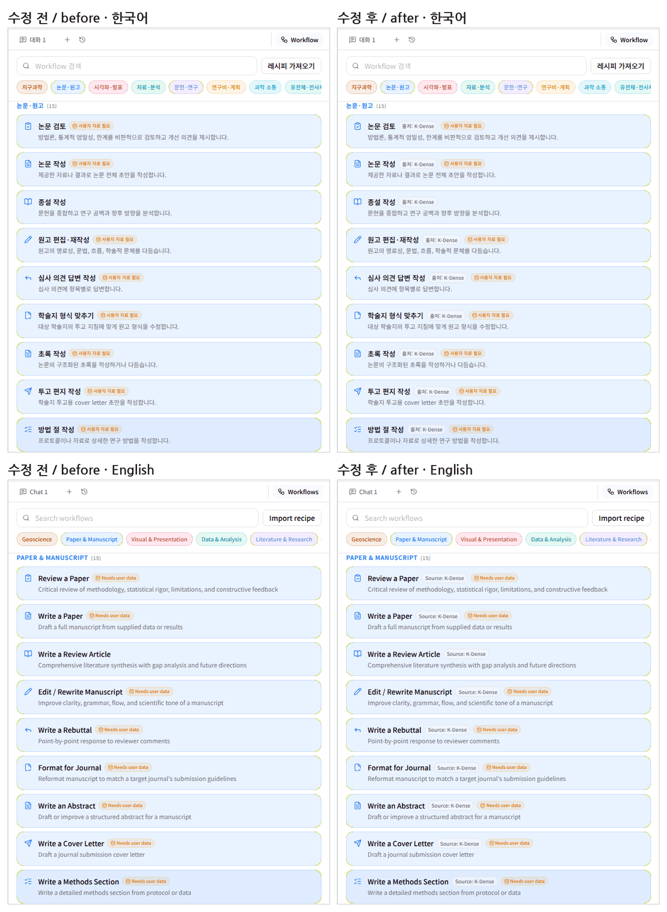
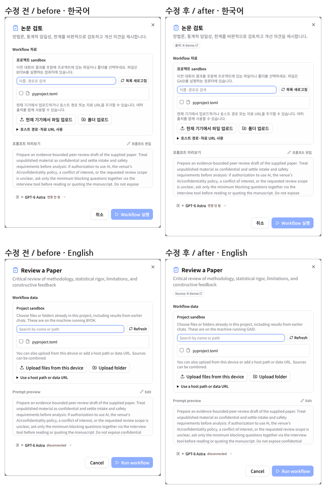
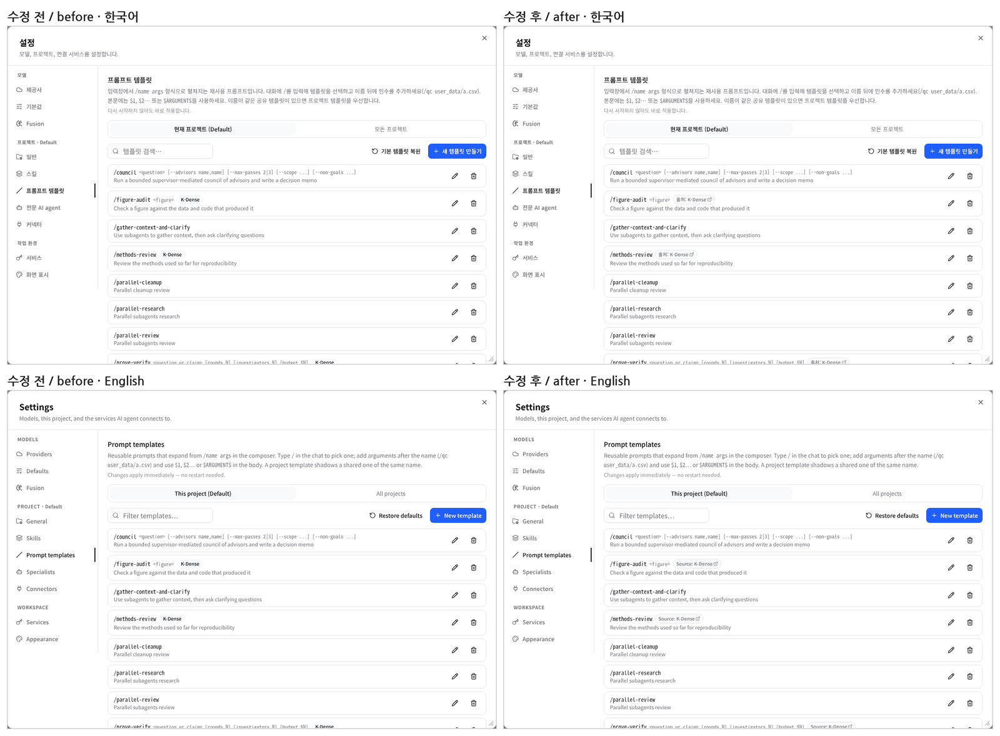
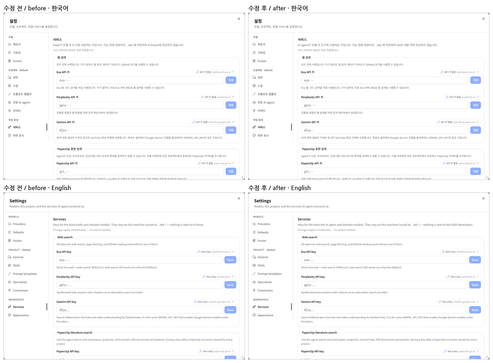
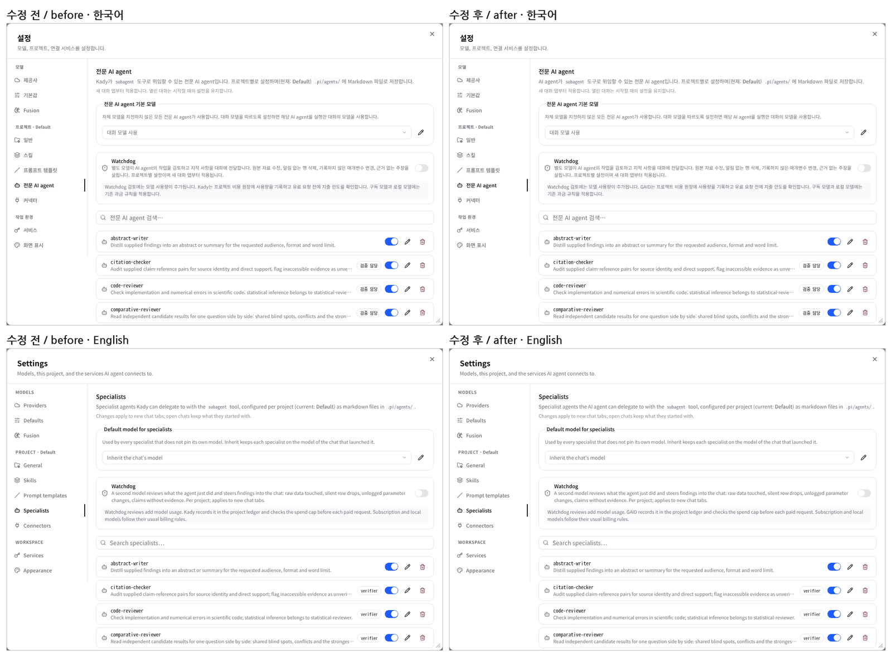

# 화면의 이름을 "AI agent"와 GAID로 바꾸고 K-Dense에서 온 스킬·Workflow에 출처 표시

## 0. 한눈에

| | |
|---|---|
| 요청 | 화면에서 "Kady"는 AI agent로, K-Dense는 GAID로 표시합니다. K-Dense에서 가져온 스킬과 Workflow는 그 항목이 표시되는 창에 출처를 보여 줍니다. 좁은 화면은 고치지 않고 지원 범위에 적습니다. |
| 결론 | 화면 문구 54곳(한국어·영어 각각)을 바꿨습니다. "Kady"가 비서를 가리키면 "AI agent", 앱을 가리키면(다시 시작, 서버, 파일 탐색기, 비용 기록) GAID로 썼습니다. 설정 → 스킬, Workflow 목록과 실행 창, 프롬프트 템플릿에서 K-Dense에서 온 항목에 "출처: K-Dense" 링크가 붙습니다. KIGAM이 만든 스킬과 지구과학 Workflow에는 붙지 않습니다. |
| 믿을 수 있는 정도 | 수정 전·후 앱을 나란히 띄워 한국어·영어 화면 24장으로 확인했습니다. main과 합친 뒤 저장소 전체 검사(서버 시험 1,805건, 웹 시험 1,051건, 문구 검사기 오류 0건)를 통과했습니다. 바뀐 문구가 모두 이 그림들에 나오지는 않습니다. 나머지는 문자열 단위로만 확인했습니다. |
| 결정할 일 | 없음 |

## 1. 요청한 것

> "gaid-qwen-authoring-trial#1은 나로하고 #2는 "Kady"는 AI agent로 하고 K dense는 GAID로 표시하자. 그런데 워크플로우나 스킬 중 K dense에서 가져온것은 출처가 해당 스킬이나 워크플로우가 표시되는 창에 표시되어야한다." — 2026-10-16 요청

#1 나)는 "데스크톱 우선으로 두고 지원 범위에 명시한다", #2는 화면 문구 약 54곳의 "Kady"·"K-Dense"를 고치는 항목입니다.

완료 기준: 화면 문구에서 "Kady"와 앱 이름으로 쓰인 "K-Dense"가 사라집니다. K-Dense에서 온 스킬과 Workflow는 그것이 보이는 창에 출처를 표시합니다. 좁은 창(약 390px)의 작업 공간은 지원하지 않는다고 지원 환경 문서에 적습니다. 코드 이름, 환경 변수, 경로, 원본 앱의 라이선스 표기는 바꾸지 않습니다.

## 2. 수행한 것

1. "Kady"·"K-Dense"·"BYOK"가 들어 있는 화면 문구를 모두 찾아 문구마다 무엇을 가리키는지 나눴습니다. 이전 시험에서는 일괄 치환이 앱을 뜻하는 "Kady"까지 바꿔서 되돌렸습니다. 이번에는 비서를 가리키면 "AI agent", 앱을 가리키면 GAID로 썼습니다. 사용자가 정한 "K-Dense → GAID"를 앱 이름 전체에 적용한 해석입니다.
2. 남긴 표기를 정했습니다. 화면 위쪽의 "K-Dense BYOK 기반 (MIT)"은 원본 앱의 라이선스 표기라 그대로 두었습니다. "K-Dense Workflow 목록", "K-Dense Workflow 카테고리"도 그대로입니다. 두 문구는 K-Dense에서 온 Workflow 묶음을 가리키므로 출처 표시에 해당합니다. 모델에게 보내는 지시문과 코드 이름도 바꾸지 않았습니다.
3. 고정 카탈로그를 확인했습니다. 스킬 13개 중 5개(geomaster, geopandas, database-lookup, uncertainty-and-units, marine-carbonate-chemistry)가 K-Dense 저장소에서 가져온 것이고, 8개는 KIGAM이 만든 것입니다. 카탈로그의 지구과학 Workflow 7개는 모두 KIGAM이 만들었습니다. 지구과학 외 분야의 기본 Workflow 목록(326개)과 기본 프롬프트 템플릿 6개는 K-Dense 원본 앱에서 왔습니다.
4. 출처 표시를 넣었습니다. 서버가 카탈로그 기록에서 가져온 스킬의 원본 저장소와 가져온 시점의 폴더 주소를 함께 넘기고, 화면은 이를 "출처: K-Dense" 배지로 보여 줍니다. 배지를 누르면 원본 위치가 새 탭에서 열립니다. Workflow 목록의 각 행에는 같은 배지를 글자로 붙이고, 실행 창에서는 원본 저장소 링크로 보여 줍니다.
5. 지원 환경 문서와 지원 환경 기록에 "데스크톱 브라우저 창 기준이며, 휴대폰 너비(약 390px)의 작업 공간은 지원하지 않는다"는 내용을 넣었습니다. 확인 카드와 입력 버튼이 화면 밖으로 밀릴 수 있다는 이유도 함께 적었습니다.

## 3. 결과

그림 1. 설정 → 스킬, "geo"로 거른 목록. 위는 한국어, 아래는 영어입니다. 볼 것: 수정 후에는 geomaster·geopandas에만 "출처: K-Dense"(Source: K-Dense) 링크가 붙습니다. KIGAM 스킬 세 개에는 붙지 않습니다.

그림 2. Workflow 패널에서 "다른 분야 Workflow 보기"를 연 상태. 볼 것: K-Dense에서 온 행마다 "출처: K-Dense"가 붙습니다. 지구과학 Workflow(KIGAM)에는 붙지 않습니다.

그림 3. 기본 Workflow "논문 검토"의 실행 창. 볼 것: 제목 아래의 출처 링크와, 안내문의 "BYOK를 실행하는 컴퓨터"가 "GAID를 실행하는 컴퓨터"로 바뀐 것.

그림 4. 설정 → 프롬프트 템플릿. 볼 것: 수정 전에는 기본 템플릿 배지가 앱 이름처럼 "K-Dense"였습니다. 수정 후에는 "출처: K-Dense" 링크입니다. 위임 기능이 함께 넣는 템플릿에는 붙지 않습니다.

그림 5. 설정 → 서비스 안내문. 볼 것: "Kady가 모델 외 도구에 사용하는 키 … K-Dense에 전송하지 않습니다"가 "AI agent가 … GAID 개발 측에 전송하지 않습니다"로 바뀌었습니다.

그림 6. 설정 → 전문 AI agent. 볼 것: 첫 문장의 "Kady가"는 "AI agent가"(비서)로, Watchdog 안내의 "Kady는 … 비용 원장에 기록"은 "GAID는"(앱)으로 바뀌었습니다.

| 완료 기준 | 결과 | 근거 |
|---|---|---|
| 화면 문구의 "Kady" → AI agent | 충족. 비서를 뜻하는 곳 20곳은 AI agent로, 앱을 뜻하는 곳은 GAID로 바꿨습니다 | 그림 5·6, 부록 B |
| 앱 이름으로 쓰인 K-Dense·BYOK → GAID | 충족. 라이선스 표기와 Workflow 묶음 이름은 출처 표시라 남겼습니다 | 그림 3, 부록 B |
| K-Dense에서 온 스킬·Workflow의 출처 표시 | 충족. 스킬 목록, Workflow 목록, Workflow 실행 창, 프롬프트 템플릿에 표시합니다 | 그림 1–4 |
| GAID/KIGAM 항목은 자기 표시 유지 | 충족. KIGAM 스킬과 지구과학 Workflow에는 출처 배지가 없습니다 | 그림 1·2 |
| 좁은 창 미지원을 지원 범위에 적기 | 충족. 지원 환경 문서, 설치 안내, 지원 환경 기록 | 부록 A |
| 코드 이름·환경 변수·경로·라이선스 표기 유지 | 충족 | 부록 A |

## 4. 검증

- 과학적 검증: 해당 없음. 화면 문구와 출처 표시만 바꿨습니다.
- 화면 검증: 수정 전 앱과 수정 후 앱을 각각 시험용 데이터 폴더로 띄워 같은 순서로 한국어·영어 화면을 찍었습니다(24장, 그림 1–6). 사용자의 검토용 앱은 건드리지 않았습니다.
- 소프트웨어 검증: main(허브 연동 작업 포함)과 합친 뒤 저장소 전체 검사를 통과했습니다. 서버 시험 1,805건(11건은 원래 건너뜀), 웹 시험 1,051건, 배포판 시험 43건이 통과했고, 새로 넣은 출처 계산 시험 3건과 화면의 출처 표시 시험이 여기에 들어 있습니다. 문구 검사기는 오류 0건입니다. 경고 56건은 이번에 바꾸지 않은 기존 문구에서 나옵니다.

## 5. 한계

- 화면 문구만 바꿨습니다. 서버가 보내는 일부 오류 문장과 모델에게 보내는 지시문, 내보내기 파일 머리말("K-Dense BYOK에서 내보냄" 등)에는 "Kady"·"K-Dense"가 남아 있습니다. 제공사 안내문은 서버 문장을 그대로 두고 화면에서 GAID 문장으로 바꿔 보여 줍니다.
- 출처 배지는 카탈로그가 기록한 출처에만 의존합니다. 사용자가 직접 설치하거나 허브에서 받은 스킬은 기존 "설치 출처" 표시를 따릅니다.
- 대화 입력창의 스킬 선택 메뉴에는 출처를 넣지 않았습니다. 짧은 선택 목록이라 글자를 늘리지 않았습니다.
- 좁은 창의 작업 공간 배치는 고치지 않았습니다. 결정에 따라 지원하지 않는 범위로 적었습니다.

## 6. 결정할 일

없음

## 7. 대체되었거나 실패한 시도

펼치기 — 1건

- 첫 Workflow 화면 캡처는 "K-Dense"가 들어간 단추를 찾다가 출처 배지가 붙은 행을 눌러 실행 창이 열렸습니다. 출처 배지가 모든 행에 붙으면서 생긴 일이라, 목록을 여는 단추를 이름으로 지정해 다시 찍었습니다.

## 용어

없음

## 부록 A. 근거 위치

펼치기 — 실행 방법, 원본, 커밋

| 항목 | 위치 |
|---|---|
| 코드 | 브랜치 task/gaid-brand-copy. 문구·출처 314a68a, 출처 계산·배지 783eff9, 그림 6d27043, main 통합 da35cdb |
| 문구 | web/src/geo/locales/*/{ko,en}.json; 새 문구 app.attribution.source, app.attribution.sourceTitle, files.office_workspace.product |
| 출처 계산 | server/src/geo/skill-origin.ts (SkillInfo.upstream), server/src/api/skills.ts; 화면 web/src/geo/attribution/source-badge.tsx |
| 지원 범위 | docs/geo/compatibility.md "Screen size", docs/geo/install.md 요구 사항 표, geo/compatibility.json `display` |
| 화면 원본 | pc74:~/data/geoaidesk/work/gaid-brand-copy/shots/ (24장, before/after × ko/en × 6화면) |
| 시험용 앱 | 수정 전: main c4ce9bf를 압축 해제한 사본(촬영 후 삭제), 포트 3330/18330. 수정 후: 이 작업 트리, 포트 3310/18310. 데이터는 ~/data/geoaidesk/work/gaid-brand-copy/{before,after}-home |
| 검사 | `cd web && npx vitest run` 1,032건 통과; `cd server && npx vitest run test/geo-skill-origin.test.ts test/skills-api.test.ts test/skills-toggle.test.ts` 16건 통과; `node geo/copy/validate-copy.mjs web/src/geo/locales` 오류 0; `node --test geo/tests/*.test.mjs` 43건 통과; main 통합 후 `scripts/check` 종료 코드 0 (서버 1,805 통과·11 건너뜀, 웹 1,051, geo 43, copy 오류 0), 로그 pc74:~/data/geoaidesk/work/gaid-brand-copy/check.log |

작성 시점: 2026-10-16, commit da35cdb.

## 부록 B. 바꾼 문구

펼치기 — 문자열 id와 한국어 변경 전후 (영어는 같은 대상으로 바꿈)

AI agent로 바꾼 문구(비서를 가리킴):

| id | 변경 전 → 변경 후 |
|---|---|
| files.latex_toolbar.ask_kady | Kady에 질문 → AI agent에 질문 |
| files.latex_toolbar.ask_kady_about_this_document_in_chat | 채팅에서 Kady에 문서 질문 → 채팅에서 AI agent에 문서 질문 |
| notebook.view.empty_description | Kady가 작업하며… → AI agent가 작업하며… |
| notebook.role.lead | Kady (주 AI agent) → 주 AI agent (영어 "AI agent (lead)") |
| research.next_experiments.no_saved_… | Kady는 일반 대화 중에도… → AI agent는… |
| settings.project_settings.applies_to_kady_… | Kady와 백그라운드 전문 agent → 주 AI agent와 백그라운드 전문 agent |
| settings.subagents.intro | Kady가 {tool} 도구로… → AI agent가… |
| settings.services.intro | Kady가 모델 외 도구에… K-Dense에 전송하지 않습니다 → AI agent가… GAID 개발 측에 전송하지 않습니다 |
| work.automation_panel.* (3개) | Kady에게/Kady를/Kady가 → AI agent에게/AI agent를/AI agent가 |
| work.subagent_fleet_panel.some_entries_… | Kady에게 물어보세요 → AI agent에게 물어보세요 |
| work.delegate_picker.* (3개) | Kady가 선택 등 → AI agent가 선택 등 |
| work.research_picker.* (3개) | Kady가… → AI agent가… |
| workflows.inputs.access_help | Kady는 Workflow를 시작할 때… → AI agent는… |

GAID로 바꾼 문구(앱을 가리킴):

| id | 변경 전 → 변경 후 |
|---|---|
| files.office_workspace.* (4개), files.office_runtime.browser | Kady를 다시 시작, Kady로 돌아가기, Kady 파일 탐색기, Kady를 여세요 → GAID… |
| (새) files.office_workspace.product | 코드에 직접 쓰인 "Kady Office" → GAID Office |
| notebook.header.methods_description | Kady가 비용 한도 내에서 AI를 한 번 호출해… → GAID가… |
| research.evidence_package.browser_checksum_… | Kady를 여세요 → GAID를 여세요 |
| settings.project_settings.* (3개) | Kady가 제공하는 지침, Kady 파일 탐색기, Kady는 요약 앞에 → GAID… |
| settings.services.save_and_validate_…, settings.services.restart_help | Kady를 다시 시작 → GAID를 다시 시작 |
| settings.skills.stored_in_your_kady_…, settings.connectors.stored_in_… | Kady Pi agent 디렉터리 → GAID Pi agent 디렉터리 |
| settings.skills.no_skills_installed_… | K-Dense 카탈로그 → GAID 카탈로그 |
| settings.prompts.* (2개) | Kady 기본 템플릿 → GAID 기본 템플릿 |
| settings.subagents.watchdog_…, settings.provider_auth.* (2개), settings.oauth_login.*, settings.connectors.approve_… | Kady는/Kady의 → GAID는/GAID의 |
| settings.api_token_gate.* (3개) | Kady 서버, Kady를 시작한 터미널 → GAID 서버, GAID를 시작한 터미널 |
| settings.source.* (10개) | 제공사 안내의 "Kady는 남은 사용량을 확인할 수 없습니다" 등 → GAID는… |
| work.resource_monitor.machine_wide_… | Kady 백엔드 프로세스 → GAID 백엔드 프로세스 |
| workflows.inputs.sandbox_help, workflows.inputs.access_help, workflows.inputs.uploading | BYOK를 실행하는 컴퓨터, BYOK 프로젝트 → GAID… |

새 문구: app.attribution.source "출처: {name}" / "Source: {name}", app.attribution.sourceTitle "{repository}에서 가져왔습니다. 원본 저장소를 엽니다." / "Taken from {repository}. Opens the source repository." 프롬프트 템플릿의 "K-Dense" 배지는 이 출처 배지로 바뀌었습니다.

