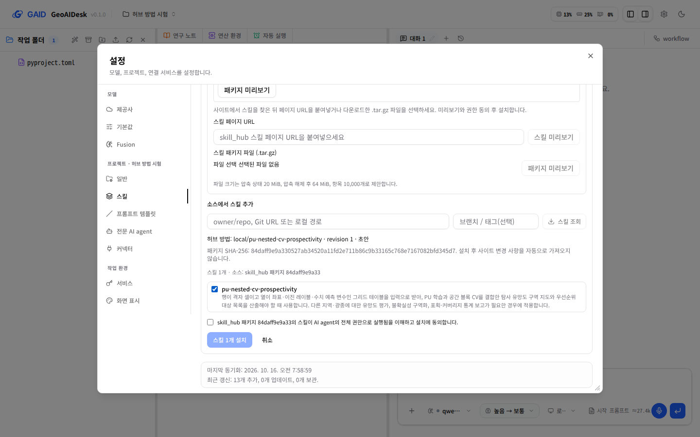
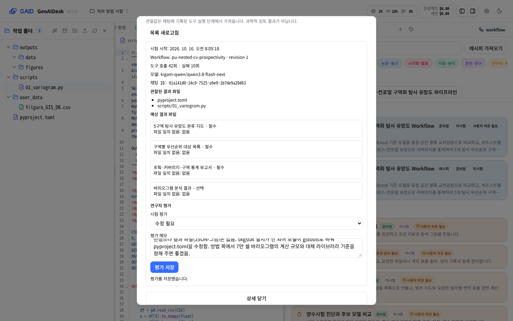

# skill_hub에서 만든 방법을 GAID에서 받아 설치하고 시험하기

## 0. 한눈에

| | |
|---|---|
| 요청 | skill_hub(GAID 허브)에서 논문으로 만든 스킬·Workflow 레시피를 GAID가 불러와 설치하고 시험하는 연계 |
| 결론 | GAID는 hub 초안을 받아 미리보기·동의·설치를 거쳐 방법 카드로 등록하고, 레시피로 시험 채팅을 열고, 시험 기록과 연구자 평가를 남깁니다. 시험 논문으로 만든 첫 패키지는 제한 시험에서 바리오그램을 45분 넘게 반복해 블록 크기 확인 지점에 이르지 못했고, 패키지 쪽 원인은 hub에 넘겼습니다. |
| 믿을 수 있는 정도 | 설치·노출·기록은 실제 앱에서 연구자 역할 에이전트와 독립 시각 검토 두 건으로 확인했습니다. 방법의 과학적 타당성은 검토하지 않았습니다. 수정판 패키지로 다시 시험하지 않았습니다. |
| 결정할 일 | 없음 (hub의 수정판 패키지를 기다리는 일 1건은 6절) |

## 1. 요청한 것

> 사용자는 현재 writer tab에 skill hub의 전면개선 작업도 요청하였다. 시안만 보여주고 구현작업을 하지 않고 있었던것과 앞으로 스킬허브는 GAID 허브가 되어야한다. 그리고 GAID허브에서 생성한 스킬 또는 워크플로우 레시피가 GAID 시스템에서 불러와서 테스트되어야한다. 사용자가 진정으로 요청한 방식이고 연계된 생태계이다. 이를 위해 논문을 지정해주고 테스트시나리오를 알려주어 시스템을 일관성 있게 검증하면서 개선구현하라고한것이다. — 2026-10-15 요청

> skill_hub에서 작성하고 GAID는 설치·실행·시험만 합니다. (권장) 연구자는 skill_hub에서 논문이나 자료를 첨부하고 에이전트와 질문·답을 주고받아 스킬이나 워크플로를 만듭니다. GAID는 그것을 받아 설치하고 시험합니다. GAID의 대화 화면에는 "방금 한 분석을 skill_hub 초안으로 보내기"만 둡니다. — 2026-10-15 사용자 선택

> 용어로서 워크플로우가 표준용어이고 가급적 영어로 Workflow로 사용하길 원한다. — 2026-10-15 요청

완료 기준: hub가 만든 방법(스킬, Workflow, 레시피)을 GAID가 같은 설치 관문으로 받아 개인 방법으로 등록하고, 레시피로 시작한 시험의 관찰 결과를 남깁니다. GAID 대화 화면의 저작 입구는 분석을 hub 초안 재료로 보내는 기능 하나입니다. 시험 논문과 PU 시나리오로 두 시스템을 이어서 확인합니다.

## 2. 수행한 것

1. skill_hub 작업 단위와 방법 패키지 계약을 맞췄습니다. 스킬 폴더 안에 Workflow·레시피·hub 기록 수명 단계·검사 기록·파일 목록을 담는 방법 설명 파일을 두는 방식입니다. hub가 계약 v1으로 확정했습니다.
2. GAID에 받는 쪽을 만들었습니다. hub 목록 읽기, 초안 받기(바이트·파일 목록·revision 대조), 설치된 방법을 "허브에서 설치한 Workflow"로 보여 주기, 레시피로 시작 설정 열기, 시험 채팅에는 그 방법의 스킬만 보이기, 채팅이 생길 때 시험 기록 고정하기, 연구자 평가 저장하기입니다.
3. 대화 화면의 "재사용 스킬 만들기"를 "방금 한 분석을 skill_hub 초안으로 보내기"로 바꿨습니다. 요청, 이후 요청, 마지막 답변, 만든 파일, 방법 시험 기록과 평가를 묶어 내려받고, 같은 PC의 hub에는 직접 보낼 수도 있습니다. 원자료는 사용자가 고를 때만 포함합니다.
4. hub가 시험 논문(Yilgarn Ni 탐사 PU·중첩 공간 CV 원고)과 원저자 코드로 만든 첫 패키지를 연구자 역할 에이전트가 화면만으로 설치하고 Yilgarn 격자 자료(70,200셀)로 제한 시험했습니다. 모델은 KIGAM Qwen이고 유료 실행은 없습니다.
5. 시험과 독립 시각 검토 두 건(Claude, Codex)에서 나온 GAID 쪽 문제를 고치고, 패키지 쪽 문제는 hub에 넘겼습니다.

## 3. 결과

그림 1. 설정 → 스킬에서 hub 방법 초안을 미리 보는 화면. 볼 것: 방법 이름, revision 1, "초안", 패키지 지문이 설치 전에 보이고, 권한 동의를 체크해야 설치 버튼이 켜집니다.

그림 2. 수정 후 방법 상세의 Workflow 카드. 볼 것: 준비 상태, "GAID 시험 1회 · 평가: 수정 필요", 입력·정할 과학적 선택·예상 결과·해석 한계가 한 카드에 있고, 아래에 GAID 시험 기록이 이어집니다.

그림 3. 시험 직후 연구자가 평가를 저장한 시험 기록(수정 전 화면). 볼 것: 도구 호출 42회 중 실패 10회, 관찰된 결과 파일 2개, 평가 "수정 필요"와 메모. 이 화면의 "파일 일치 없음: 없음" 문구는 수정 후 "패키지가 결과 파일 이름을 정하지 않아 결과 파일과 대조하지 않았습니다."로 바뀌었습니다.

| 완료 기준 | 결과 | 근거 |
|---|---|---|
| hub 방법을 같은 설치 관문으로 받아 설치 | 충족 | 그림 1, 연구자 기록 |
| 개인 방법으로 등록하고 Workflow·레시피로 시작 | 충족 | 그림 2 |
| 시험 채팅에 그 방법만 노출 (기존 PU 스킬 제외) | 충족: 기존 PU 스킬이 프로젝트에 설치돼 있었지만 모델에는 보이지 않음 | 부록 A 노출 기록 |
| 시험 기록과 관찰 결과, 연구자 평가 | 충족 | 그림 3 |
| 대화 화면에서 분석을 hub 초안으로 보내기 | 충족: 묶음을 서버가 정한 파일 이름으로 내려받음. hub 쪽 받기는 이번에 시험하지 않음 | 부록 A |
| 시험 논문 시나리오의 제한 시험 완료 | 부분: 자료 점검은 나왔으나 바리오그램에서 45분 넘게 반복해 첫 확인 지점 전 중단 | 그림 3, 4절 |

시험 채팅에서 모델은 격자 표를 읽고 셀 수(70,200), 양성 셀(818), 격자 간격(5 km), 좌표계 미지정을 보고했습니다. 이어서 7만 셀 전체로 바리오그램을 계산하는 스크립트를 반복해 고치고 다시 돌렸습니다. 방법이 요구한 바리오그램 라이브러리는 설치 이름을 잘못 써 실패했고, 모델은 다른 라이브러리로 바꾸며 프로젝트 환경 설정을 고쳤습니다. 연구자는 45분 뒤 중단하고 "수정 필요"로 평가했습니다.

## 4. 검증

- 과학적 검증: 미검증. 시험은 블록 크기 제안 전에 끝났고, 결과 파일(구역 지도, 우선순위 목록)이 없습니다. 방법이 논문 결과를 재현하는지, 새 자료에 맞는지는 판단하지 않았습니다.
- 소프트웨어 검증: 실제 앱에서 연구자 역할 에이전트가 설치부터 평가 저장까지 화면만으로 진행했습니다. 독립 시각 검토 두 건이 수정 전후 화면을 비교했고, 두 검토가 같은 막는 문제 하나(시험 횟수 표시와 "미시험" 표시의 모순)를 찾아 고쳤습니다. 서버·웹 대상 테스트와 타입 검사를 통과했습니다. 테스트 통과는 결과의 과학적 타당성을 뜻하지 않습니다. 전체 점검은 작업 마무리 때 실행합니다.

## 5. 한계

- 수정판 패키지로 같은 시험을 다시 하지 않았습니다. hub가 바리오그램 계산 규모, 라이브러리 이름, 결과 파일 이름을 고친 수정판을 만들면 다시 시험해야 이 시나리오가 끝납니다.
- 긴 실행 중에 채팅은 진행 상황이나 끝날 시점을 알려 주지 않습니다. 연구자가 멈출 시점을 정할 근거가 화면에 없습니다.
- 업로드한 격자 CSV에 대한 작업 제안은 설치된 hub 방법을 보지 않고 카탈로그 Workflow만 제안합니다.
- 8 MB를 넘는 CSV를 파일 패널에서 열어 두면 미리보기 요청이 몇 초마다 반복되어 브라우저 콘솔에 413 오류가 쌓입니다(한 세션 2,138건). 원래 K-Dense 앱의 열린 파일 갱신 동작입니다.
- "방금 한 분석을 skill_hub 초안으로 보내기"는 글자 없는 아이콘이라 찾기 어렵습니다.
- hub 쪽 받기(묶음을 초안 재료로 붙이기)는 이 단위에서 확인하지 않았습니다.
- 검토자 브라우저에서 다시 연 시험 채팅의 모델 칩이 "연결 안 됨"으로 보였습니다. 시험 인스턴스의 Qwen 연결과 기본 모델은 정상이었고, 새 브라우저가 원래 앱의 기본 모델 선택을 쓴 것으로 봅니다(추정).

## 6. 결정할 일

없음. 다음 일은 hub를 기다립니다: hub가 수정판 패키지를 보내면 같은 제한 시험을 다시 합니다.

Optional(사용자가 고르기 전에는 하지 않음):
- 업로드한 파일에 맞는 hub 방법도 작업 제안에 넣기
- "방금 한 분석을 skill_hub 초안으로 보내기"에 글자 표시 붙이기
- 큰 CSV를 열어 둘 때 반복 요청 멈추기(원래 앱 동작 변경)

## 7. 대체되었거나 실패한 시도

- 첫 초안은 연구자 역할 에이전트의 입력 실수로 제한 문구 없이 전송되었습니다. 30초 안에 중단하고 제한 문구를 다음 메시지로 보냈습니다. 시험 기록에는 두 메시지가 모두 남아 있습니다.
- 처음 구현한 시험 상태 표시는 방법 카드에 "GAID 시험 1회"와 "미시험"을 함께 보였습니다. 두 시각 검토가 지적해 시험 기록을 실행 기록으로 쓰도록 바꿨습니다.

## 용어

없음

## 부록 A. 근거 위치

- 브랜치 task/gaid-hub-integration, 보고 시점 커밋 1d56e44. 계약: geoaidesk docs/design/hub-method-package.md(받는 쪽), skill_hub docs/specs/gaid-method-package.md v1(task/gaid-hub-authoring 9d81eca).
- 구현: server/src/geo/methods/{method-file,package-origin,local-methods,trials}.ts, server/src/geo/skill-hub.ts(descriptor·목록·GAID_SKILL_HUB_SITES), server/src/geo/context.ts(`method:` 노출), server/src/geo/hub-handoff/, web/src/geo/methods/, web/src/geo/hub-handoff/, web/src/geo/skill-hub/, web/src/geo/workspace/{task-catalogue,task-setup}.tsx. 하위 단위: gaid-hub-integration--handoff, gaid-hub-integration--methods-ui(문자열 표는 각 docs/tasks 문서).
- 시험 패키지: http://127.0.0.1:4317/api/gaid/packages/local/pu-nested-cv-prospectivity/1, sha256 84daff9e9a330527ab34520a11fd2e711b86c9b33165c768e7167082bfd345d7, packageDigest 9897d964e0581df4653d5d4844cff43e6b508d9a368c0ca0d4bc370b032c0363.
- 시험 인스턴스: PC74 user unit gaid-hub-app, 포트 3320/18320, GAID_HOME ~/data/geoaidesk/work/gaid-hub-integration/home, 프로젝트 proj-90b0c8, 세션 01a141d0-14c0-7525-a9e9-1b7de9a20d63. 노출 기록 skills = council-mode, pi-subagents, pu-nested-cv-prospectivity (spatial-pu-workflow 설치됨, 숨김). 시험 기록 .kady/geo/method-trials/01a141d0-….json.
- 시험 자료: asset yilgarn-gis-db/20260911 Yilgarn_GIS_DB.csv(라벨 CC BY-NC 4.0, 내부 시험용).
- 연구자 역할 에이전트 7e41440e(Claude Sonnet 5.5): ~/data/geoaidesk/work/gaid-hub-integration/researcher/summary.md (sha256 7e4c9e5f…bcae), log.md (sha256 5ab5cd5f…506d), playwright/*.png. 내려받은 묶음 gaid-analysis-01a141d0-20261016.tar.gz (sha256 e5e45698…0e0d).
- 시각 검토: reviews/claude-advanced.md(reader f62eecd7), reviews/codex-advanced.md(reader 22391b2a), 같은 폴더의 playwright-*/.
- hub 보고: routed request 351e0b68701b 결과 파일 ~/data/geoaidesk/work/gaid-hub-integration/route-results/351e0b68701b.md.
- 그림 원본: researcher/playwright/05-preview.png, 21c-trial-rating-saved.png, playwright/after-method-detail.png (1440×900).
