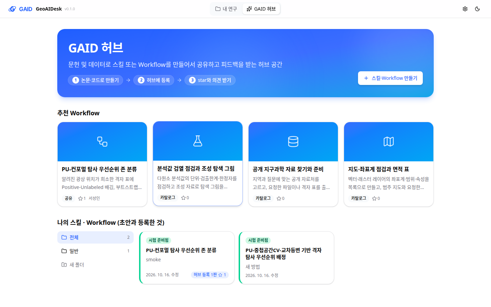
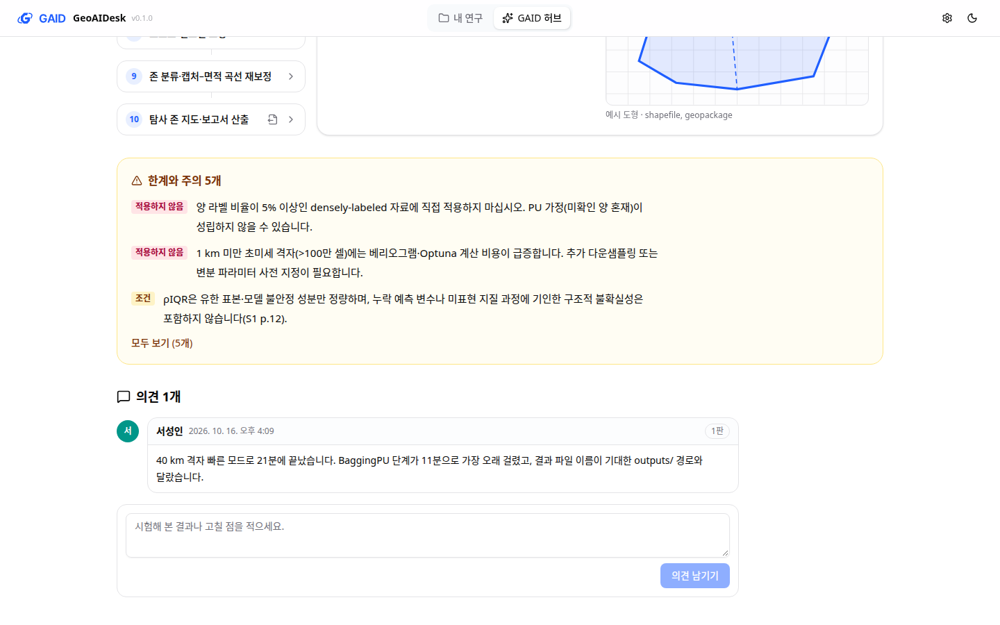
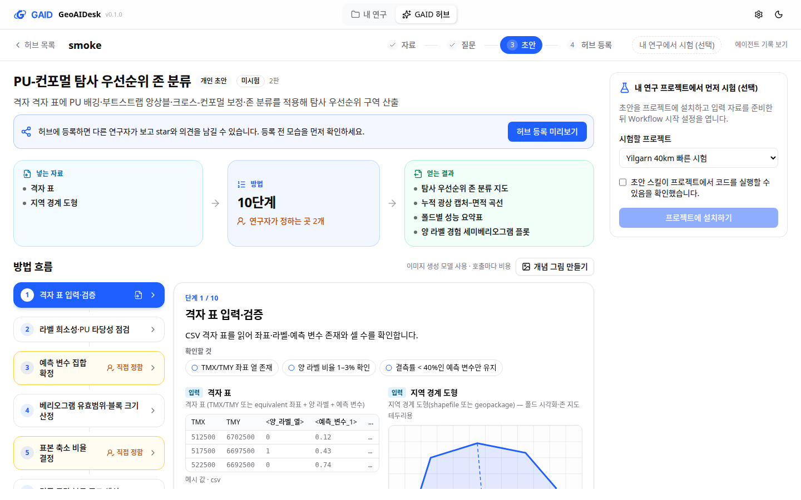
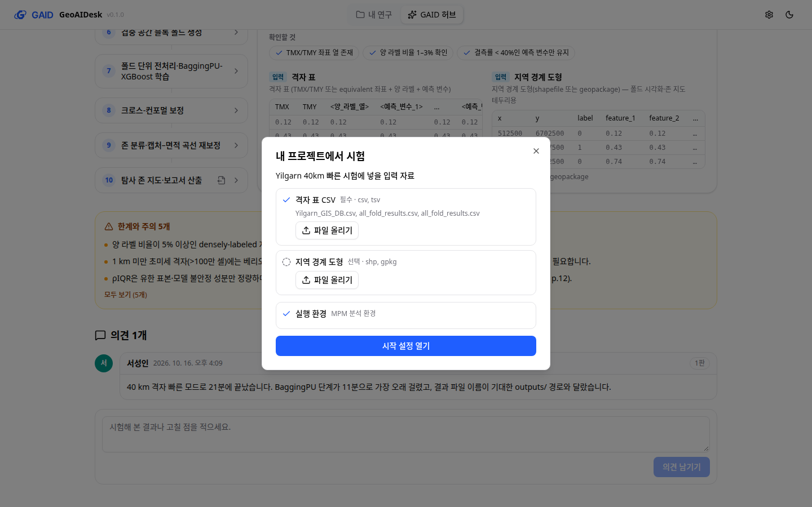
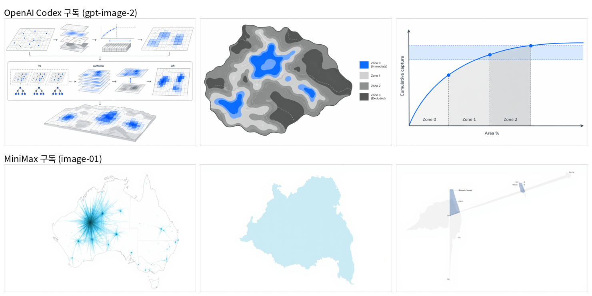
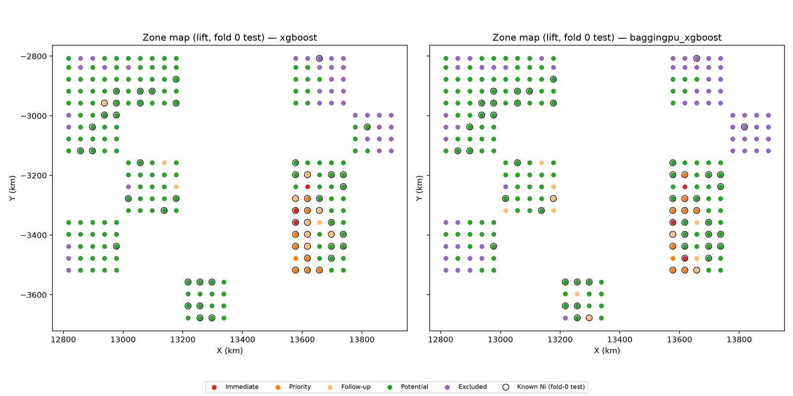

# GAID 안에서 스킬·Workflow를 만들고 공유하는 GAID 허브

## 0. 한눈에

| | |
|---|---|
| 요청 | skill_hub의 저작 기능을 GAID로 옮기고, 프로젝트 선택 화면에서 들어가는 GAID 허브에서 방법을 만들어 공유하고 내 연구에 가져오게 하기 |
| 결론 | GAID 허브에서 논문·코드·웹 주소로 질문에 답하며 초안을 만들고, 허브에 등록해 star와 의견을 받고, 내 연구 프로젝트에 설치해 입력 준비 후 시작 설정까지 엽니다. 40 km 격자 빠른 시험은 21분 만에 구역 지도와 포착 곡선을 냈습니다. |
| 믿을 수 있는 정도 | 화면 흐름은 개발용 GAID에서 실제로 눌러 확인했고, 시각 검토 다섯 번과 연구자 역할 시험 한 번을 거쳤습니다. 시험 결과 수치는 파이프라인 확인용(부트스트랩 3회, 외측 폴드 1개)이며 과학적 검증은 하지 않았습니다. 개념 그림은 사용자의 OpenAI Codex 구독과 MiniMax 구독으로 실제로 만들어 비교했고, 에이전트 모델은 Qwen과 MiniMax M3.1을 같은 조건으로 한 번씩 비교했습니다. |
| 결정할 일 | 없음 (개념 그림용 이미지 모델 연결은 사용자가 정함, 6절) |

## 1. 요청한 것

> "1번 - (가)안으로 하자. 우선은 GAID시스템에서 프로젝트 선택화면에서 GAID 허브로 접속할 수 있는 기능을 제공하고 GAID 허브에서 스킬 또는 워크플로우를 생성할 수 있게 하는 방식으로 하나의 시스템이라는 인식을 가질 수 있게 UI/UX가 개선되어야 한다. (…) 3번은 옮긴뒤 GAID안에서 다시해야한다. 특히 Variogram이나 계산량이 많이 소요될 것으로 보이는 것들은 최대한 간단하게 하여 테스트할 수 있게 하여야 한다. (…) 질문에 대해서는 권장 옵션을 포함한 선택지가 제공되어야 하고, 사람 이용자가 다른 의견을 원할 경우 입력할 수 있는 기타 입력란을 제공하는 방식으로 하고 한번에 한 개의 질문을 하며, 질문은 탭으로 이전/다음으로 이동할 수 있게 한 뒤 모든 질문에 대한 답변이 일괄 반영되어 스킬 또는 워크플로우 초안이 생성되고 사용자가 시각적으로나 잘 정리된 흐름도 및 명료한 설명으로 인지부하를 낮추면서도 의도가 잘 반영될 수 있게 UI/UX 시스템이 구성되어야 한다." — 2026-10-16 요청

> "GAID 시스템은 개별 연구자가 GAID 허브에서 유용한 스킬 및 워크플로우를 바탕으로 개인 연구를 수행하는 공간이고 실제로 스킬 및 워크플로우가 공유되고 토의되는 공간은 GAID 허브임을 명심하고 이를 시스템에서 구분하고 반영해야한다." — 2026-10-16 피드백

> "허브에서 보이는 화면에서 아래의 내용처럼 텍스트가 많은 부분은 시인성이 좋게 표시되고 웹 상에서 디자인적으로 상품성 및 마케팅성 있게 보여야 한다." — 2026-10-16 중간 피드백

완료 기준: skill_hub의 저작 서비스(자료 읽기, 질문과 답, 초안, 검사, 패키지)가 GAID 안에서 GAID의 모델 연결로 동작하고, 프로젝트 선택 화면에서 허브로 들어가 방법을 만들어 등록하고 내 연구 프로젝트로 가져옵니다. 화면은 사용자가 정한 규칙(적은 글, 끝없는 스크롤 없음, 한 번에 한 질문과 권장안·기타, 일괄 반영, 흐름도)을 따르고, 시험 논문과 시나리오로 GAID 안에서 다시 시험합니다.

## 2. 수행한 것

1. skill_hub의 저작 서비스를 GAID 서버로 옮겼습니다. PDF 쪽별 글 읽기, 코드 묶음 받기, 질문·답·초안 기록과 재시작 복구, 근거 인용, 여섯 가지 검사, 방법 패키지 만들기를 GAID 안에서 하고, 모델 호출은 GAID의 모델 연결과 비용 기록·한도를 그대로 씁니다. skill_hub의 용어·형식 정의는 출처를 적어 함께 넣었습니다.
2. 프로젝트 선택 화면 위에 "내 연구 / GAID 허브" 전환을 두고, 허브 안에서 자료 → 질문 → 초안 → 허브 등록 순서로 방법을 만들게 했습니다. 질문은 한 번에 하나씩, 권장안과 이유, 기타 입력, 이전·다음 탭, 모두 답한 뒤 한꺼번에 반영합니다.
3. 사용자 피드백에 따라 허브를 공유·토의 공간으로 나눴습니다. 등록 전 미리보기, 주제 폴더, 등록한 방법의 star와 의견, 추천 Workflow 카드, 내 연구 프로젝트로 가져오기(설치 → 입력 자료와 실행 환경 준비 → 시작 설정)를 만들었습니다. 웹 주소로 자료 추가와 이미지 모델로 개념 그림 만들기도 연결했습니다. 공유 허브와 개념 그림·웹 자료는 두 하위 작업이 나눠 만들었습니다.
4. 시험 논문과 Yilgarn 시나리오로 GAID 안에서 다시 시험했습니다. 처음 두 번(7만 셀 격자)은 30~41분 안에 결과를 내지 못해, 사용자 지시대로 40 km 집계 격자(1,122칸)와 빠른 모드로 바꿨습니다. 모델은 KIGAM Qwen이고 유료 모델 실행은 없습니다.
5. 사용자 요청에 따라 개념 그림을 사용자의 OpenAI Codex 구독(gpt-image-2)으로만 만들게 했습니다. 다른 그림 모델로 넘어가지 않고, 사용량 한도에 걸리면 알림을 띄웁니다. MiniMax의 새 모델 M3.1 Flash Preview를 모델 목록에 넣고(Pi 최신판과 원본 BYOK에는 아직 없음), 허브에서 에이전트 모델을 고를 수 있게 한 뒤 Qwen과 같은 조건으로 한 번씩 비교했습니다.
6. 화면은 독립 시각 검토(Claude 두 번, 인포그래픽 에이전트 두 번), 코드 검토(Codex 한 번), 연구자 역할 에이전트 한 번으로 확인하고, 막히는 지적을 고쳤습니다.

## 3. 결과

그림 1. GAID 허브 첫 화면. 볼 것: 슬로건과 "논문·코드로 만들기 → 허브에 등록 → star와 의견 받기" 흐름, 위의 추천 Workflow 카드 4개(등록한 방법은 star 수와 작성자), 아래 "나의 스킬 · Workflow"의 폴더와 진행 단계별 색 카드.

그림 2. 허브에 등록된 방법 화면. 볼 것: 제목, 한 줄 소개와 작성자가 위에 크게 보이고, 그 아래 "넣는 자료 → 10단계·연구자가 정하는 곳 2개 → 얻는 결과" 띠와 방법 소개(첫 문장과 요점)가 이어집니다. 오른쪽 위에 "내 프로젝트에서 시험"과 star 수가 있습니다.

그림 3. 같은 화면의 아래쪽. 볼 것: 한계마다 "적용하지 않음 / 조건" 표시, 의견에 작성자·시각·판이 붙고 새 의견을 남길 수 있습니다.

그림 4. 만든 사람의 초안 화면. 볼 것: 허브 등록 미리보기가 주된 동작이고, 내 연구 프로젝트에서 먼저 시험하는 일은 오른쪽의 선택 항목입니다. 왼쪽 단계 목록에서 고른 단계의 설명, 확인할 것, 입력 표와 경계 도형 예시가 오른쪽에 나옵니다.

그림 5. 등록된 방법을 내 연구 프로젝트에 설치한 직후. 볼 것: 시작 설정을 열기 전에 필요한 입력 자료(필수·선택)와 실행 환경이 준비됐는지 먼저 보여 줍니다. 이전에는 자료가 없는 프로젝트에서 시작 설정이 바로 열렸습니다.

그림 6. 같은 초안(PU 탐사 우선순위 구역 분류)에서 만든 개념 그림. 위는 OpenAI Codex 구독(gpt-image-2), 아래는 MiniMax 구독(image-01)이고, 왼쪽부터 표지, 결과 구역 지도, 포착 곡선입니다. 볼 것: Codex 그림은 방법의 흐름과 결과 모양을 알아볼 수 있고, MiniMax 그림은 형태가 흐리고 글자가 깨져 개념 그림으로 쓰기 어렵습니다. 이 비교에 따라 그림은 Codex로만 만듭니다.

에이전트 모델 비교입니다. 두 모델 모두 같은 자료와 같은 조건으로 한 번씩 돌렸습니다.

| 단계 | Qwen (kigam-qwen qwen3.8-flash-next) | MiniMax M3.1 Flash Preview |
|---|---|---|
| 자료 읽기 (논문+원본 코드) | 4분 21초, 근거 36개, 질문 5개 | 13분 1초(응답 한 번 고침), 근거 35개, 질문 4개 |
| 권장 답으로 초안 | 4분 28초, 검사 오류 13개 | 13분 11초(응답 한 번 고침), 검사 오류 1개 |
| GAID 시험 채팅 (40 km, 빠른 모드) | 약 21분, 계산 12.3분(BaggingPU 11분) | 약 6분, 계산 약 17초 |
| 시험 결과 | 블록 186 km, 면적 10.1%에서 광산 32.7% 포획 | 블록 198 km, 면적 9.7%에서 광산 33.6% 포획 |
| 눈에 띈 문제 | 결과 파일 이름이 방법의 기대와 다름, 권한 확인 창 2번 | 구역 지도 남북이 뒤집힘, 요청하지 않은 나머지 폴드 4개도 실행(12초) |

Qwen 초안은 소개 문장을 짧게 쓰라는 규칙이 생기기 전에 만든 것이라 문장 품질은 비교하지 않았습니다.

그림 7. GAID 안에서 설치한 방법으로 낸 탐사 우선순위 구역 지도(외측 폴드 0의 시험 칸, 왼쪽 XGBoost, 오른쪽 BaggingPU). 볼 것: 결과 지도가 실제로 만들어졌다는 점입니다. 부트스트랩 3회·외측 폴드 1개로 줄인 확인용 결과이므로 구역 배치를 해석에 쓰지 않습니다.

| 완료 기준 | 결과 | 근거 |
|---|---|---|
| 저작 서비스를 GAID 안에서 GAID 모델 연결로 실행 | 충족: 분석 약 4.5분(근거 36개, 질문 5개), 초안 약 4.5분, 고치기 2~4분 | 부록 A |
| 프로젝트 선택 화면에서 허브로 들어가 방법 만들기 | 충족 | 그림 1 |
| 한 번에 한 질문, 권장안·기타, 탭 이동, 일괄 반영 | 충족 | 시각 검토 1·2차 |
| 초안을 흐름도와 짧은 설명으로 | 충족: 세로 단계 목록과 단계별 설명·예시 | 그림 4 |
| 허브 등록, star, 의견, 내 연구로 가져오기 | 충족: 개발용 GAID에서 등록 → star → 의견 → 설치 → 입력 준비 → 시작 설정까지 눌러 확인 | 그림 2, 3, 5 |
| 글이 많은 부분의 시인성과 상품성 | 부분: 화면 구성을 바꾸고 인포그래픽 검토를 반영함. 소개 문장 자체는 초안을 새로 만들거나 고칠 때부터 짧아짐 | 그림 2, 6절 |
| GAID 안에서 다시 시험, 무거운 계산 줄이기 | 충족: 40 km 격자 빠른 모드 21분, 줄인 계산은 아래 표 | 그림 7 |

v5 시험(40 km 집계 격자, 빠른 모드)에서 줄인 계산과 걸린 시간입니다. 방법이 남긴 실행 기록에서 옮겼습니다.

| 단계 | 걸린 시간 | 줄인 계산 |
|---|---|---|
| 바리오그램 | 21초 | lag 20 → 8, 최대 거리 300 → 200 km. 1,122칸이라 표본 줄이기는 필요 없음 |
| 블록 교차검증 | 약 2초 | 외측 폴드 5개 중 1개만 실행 |
| XGBoost 부트스트랩 | 약 27초 | 50회 → 3회, 트리 50개·깊이 3, 하이퍼파라미터 탐색 생략 |
| BaggingPU 부트스트랩 | 304초 | 3회, 설정 격자 45조합 생략 |
| 교차 등변 보정 | 354초 | 내측 폴드 2개(적합 4회, 원래 10회) |
| 전체 | 파이프라인 12.3분, 채팅 시작부터 약 21분 | 가장 느린 단계는 BaggingPU(합계 약 11분) |

## 4. 검증

- 과학적 검증: 미검증. 시험 결과(블록 185.7 km, 명목 0.85 대비 등변 커버리지 XGBoost 0.982·BaggingPU 0.964, 상위 세 구역이 면적 10.1%에서 알려진 광상의 32.7% 포착)는 부트스트랩 3회·외측 폴드 1개 값이라 논문 값과 비교하지 않았습니다.
- 소프트웨어 검증: 두 하위 작업은 각자 전체 점검을 통과했습니다(백엔드 시험 1,850개, 프런트엔드 1,059개, 배포·환경·기동 검사). 저작 서버 시험 19개, 허브 화면 시험 18개가 있습니다. 상위 작업의 최종 전체 점검 결과는 부록 A에 적습니다. 화면 흐름은 개발용 GAID에서 실제로 눌러 확인했고, 그때 찾은 결함 두 개(등록 대화상자의 폴더 선택, 긴 입력 경로가 대화상자를 넘침)를 고쳤습니다.
- 검토: 연구자 역할 에이전트가 처음부터 시험까지 화면만으로 진행했고, Claude 시각 검토 두 번, Codex 코드 검토 한 번(막히는 지적 4건 수정), 인포그래픽 에이전트의 목업 검토와 실화면 검토를 반영했습니다.

## 5. 한계

- 공유 허브는 기관 서버 한 대의 GAID를 여럿이 쓰는 구조로 만들었고, 연구자는 처음 한 번 입력한 표시 이름으로 구분합니다. 계정 인증은 없습니다. 기관 서버에 배포하지 않았습니다.
- 개념 그림은 OpenAI Codex 구독(설정의 "OpenAI Codex (legacy)" 로그인)으로만 만들고 다른 그림 모델로 넘어가지 않습니다. 현재 OpenAI 로그인("Sign in with ChatGPT")으로는 그림을 만들 수 없습니다. OpenAI가 이 로그인의 그림 생성을 거절합니다(2026-10-16 확인). 사용량 한도 알림은 시험으로만 확인했고 실제 한도 응답은 받아 보지 않았습니다. 구독 사용은 비용 기록에 $0으로 남고, 남은 구독 사용량은 GAID가 알 수 없습니다.
- MiniMax M3.1 Flash Preview는 MiniMax 문서의 모델 이름과 M3의 설정을 따라 GAID가 직접 등록했습니다. Qwen과의 비교는 단계마다 한 번씩만 돌린 결과라 속도와 품질의 차이를 일반화하지 않습니다. M3.1의 방법 만들기가 느린 것은 응답이 길었기 때문입니다(단계마다 출력 7만 토큰 이상).
- 그림이 없는 추천 카드는 주제 아이콘만 보입니다.
- 이미 만든 초안의 소개 문장은 기법 이름이 많은 긴 문장 그대로입니다. 짧게 쓰라는 규칙은 다음 초안이나 고치기부터 적용됩니다.
- 시험한 방법에 남은 결함: 방법이 예상한 결과 파일 이름(outputs/…)과 실제 저장 위치(results/, figures/)가 달라 GAID 시험 기록의 결과 대조가 맞지 않습니다. BaggingPU가 빠른 모드에서도 11분 걸립니다. 다음 판에서 고칠 일입니다.
- GAID 쪽 결함 두 가지는 이번 범위 밖입니다. 채팅에서 "실행 중단"을 눌러도 에이전트가 배경으로 띄운 계산은 멈추지 않았고, 무인 시험 중에도 데이터 보호 확인 창이 떠 사람이 눌러야 했습니다(v5에서 두 번).
- skill_hub 쪽 저작 화면을 끄는 일은 skill_hub 작업으로 요청했고, 이 보고서는 그 결과를 확인하지 않았습니다.

## 6. 결정할 일

없음.

개념 그림용 이미지 모델은 사용자가 연결하기로 정했고("가로 연결합니다."), 이어서 개인 구독으로 만들게 하라고 지시했습니다("개인용 구독 codex에서 이미지를 생성하게 하자.", 2026-10-16). 사용자가 개발용 GAID에 OpenAI Codex 로그인과 MiniMax 키를 연결했고, 두 구독으로 그림을 실제로 만들었습니다(그림 6). 그림은 "개념 그림 만들기"를 누를 때만 만듭니다. 기관 서버에 올릴 때 누구의 구독으로 그림을 만들지는 그때 정합니다.

## 7. 대체되었거나 실패한 시도

펼치기 — 6건

- PDF 쪽 일부를 잘라 단계 그림으로 쓰던 방식: 사용자가 완성도가 낮다고 판단해 모두 없앴습니다. 관련 개념 그림이나 예시 도식만 씁니다.
- 7만 셀 격자 시험 두 번(연구자 역할 시험 30분, 빠른 모드 41분): 최종 결과를 내지 못했습니다. 40 km 집계 격자와 빠른 모드로 바꿨습니다.
- 저작 서버를 Codex 하위 작업에 맡기려던 계획: 하위 작업이 빠른 모드로 만들어졌고 이어서 인증 오류가 반복되어, 사용자 선택에 따라 상위 작업이 직접 옮겼습니다.
- "Sign in with ChatGPT" 로그인으로 그림 만들기: OpenAI가 그림 API(401, 이 인증으로 허용되지 않는 작업)와 응답 API의 그림 도구(400, 구독 공유는 그림 도구를 지원하지 않음)를 모두 거절했습니다. "OpenAI Codex (legacy)" 로그인으로 바꿨습니다.
- 가로 카드에 화살표로 단계를 늘어놓던 초안 흐름도: 사용자 요청에 따라 왼쪽 세로 단계 목록과 오른쪽 단계 설명으로 바꿨습니다.
- 초안에서 내 연구 프로젝트 시험으로 바로 이끌던 동선: 허브 등록 미리보기가 주된 동작이 되도록 바꿨습니다.

## 용어

없음

## 부록 A. 근거 위치

펼치기 — 실행 방법, 원본, 해시, 커밋

| 항목 | 위치 |
|---|---|
| 코드 | 브랜치 task/gaid-hub. 공유 허브 하위 작업 통합 81984e9, 개념 그림·웹 자료 하위 작업 통합 a297b62, 화면 개선 4f37b35·dc72efe, 연결 eb54922, 실화면 확인 수정 1c2e7e1 |
| 저작 서버 | server/src/geo/authoring/, server/src/geo/hub-shared/, 설계 docs/design/hub-authoring-service.md, 함께 넣은 형식 정의 geo/hub/ (SOURCE.md: skill_hub 54fe477) |
| 화면 | web/src/geo/hub/, 문구 web/src/geo/locales/hub/ |
| 개발용 GAID | PC74 사용자 서비스 gaid-hub-dev(포트 3330/18330), 데이터 ~/data/geoaidesk/work/gaid-hub/home |
| v5 시험 | 프로젝트 yilgarn-40km-2a436b, 입력 ~/data/geoaidesk/work/gaid-hub/inputs/yilgarn-40km/yilgarn_40km.csv · sha256 49b7855e…f151 (자산 geo-catalogue/0.2.1 geo-examples) |
| v5 결과 원본 | pc74:~/data/geoaidesk/work/gaid-hub/home/projects/yilgarn-40km-2a436b/sandbox/: figures/zone_map.png · sha256 5232c02b0e336591975abc28ee4d8d505e0173ae34abc7cf739dde5799c06ef2, figures/capture_curve.png · bb91aa32731964990d4d7e78204b409c87de91e39a88dda9664c10eba31defe7, results/run_log.md · a4ee7229a725c5036ccda24748bcbc545c493165d40d224027e42787b2437671, results/sensitivity_table.csv · a8e64dc59b9153d756b1d59d84a4425a887b39e73ff6d2efa8b3b45f597b55df, results/zone_map.tif · 654206a9013ed5569d70e8933f33a76cbeaa46ee5e6b8ab8cd5b312df0aa9dbd |
| 등록 확인 | 허브 항목 entry-ap-a135f290-1c4 (저작 프로젝트 ap-a135f290-1c4 초안 2판, 패키지 sha256 99dda800…edc1) |
| 개념 그림 비교 원본 | pc74:~/data/geoaidesk/work/gaid-hub/visuals-test/{codex,minimax}/ (Codex 표지 sha256 49ca4777…275a, 구역 지도 21e81706…b03f; MiniMax 표지 72863863…be6e, 구역 지도 f2c7401f…d8f) |
| 모델 비교 | M3.1 방법 만들기 ap-8475d969-daf, 시험 채팅 프로젝트 yilgarn-40km-m3-1-5a4198 (구역 지도 sha256 cf0a24db…df7, 실행 기록 6025cca8…fcb8), 기록 pc74:~/data/geoaidesk/work/gaid-hub/m31/ |
| 로그인 시험 | ~/data/geoaidesk/work/gaid-hub/tools/probe-openai-*.mts (토큰은 출력하지 않음) |
| 검토 | ~/data/geoaidesk/work/gaid-hub/reviews/ (claude-visual-1, claude-visual-2, codex-code, infographic-mockup-3, infographic-4), 연구자 역할 시험 ~/data/geoaidesk/work/gaid-hub/researcher/summary.md |
| 화면 사진 | ~/data/geoaidesk/work/gaid-hub/playwright/ (fb3, v5, mock4) |
| 점검 | scripts/check (최종 결과는 task 문서와 finish 기록) |

작성 시점: 2026-10-16, commit dc72efe.

