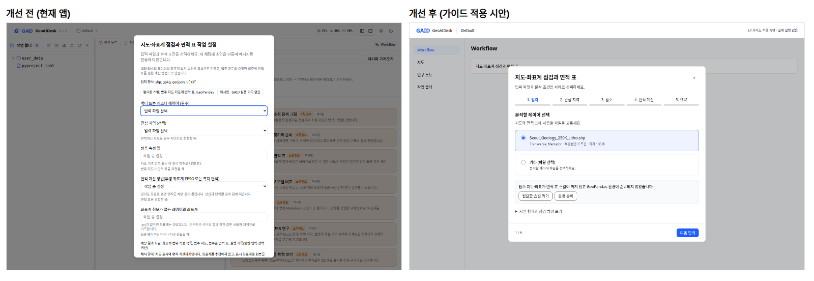
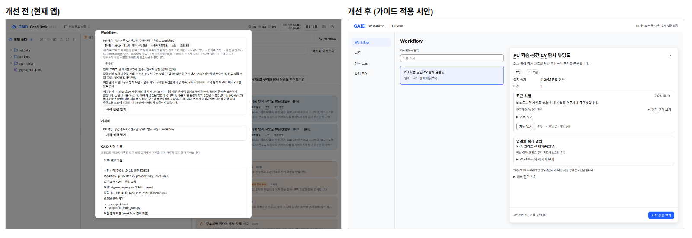

# Samsung One UI를 참고한 GAID 화면 가이드와 화면 적용 예

## 0. 한눈에

| | |
|---|---|
| 요청 | One UI 디자인 가이드를 적극 참고해 GAID 화면 가이드를 만들고, 앞으로 에이전트가 이 가이드를 기준으로 화면을 만들게 합니다. |
| 결론 | 화면 가이드(원칙 6개와 구성요소별 규칙)를 저장소에 넣고 에이전트 작업 규칙에 "화면 작업 전에 읽고, 지킨 규칙을 보고한다"를 추가했습니다. 문구 길이, 연구자 화면의 원시 오류·모델명·내부 ID, 하드코딩한 색과 작은 글자는 저장소 검사가 막습니다. 세 화면의 개선 전후 시안을 만들었고, 실제 앱 화면은 아직 바꾸지 않았습니다. |
| 믿을 수 있는 정도 | One UI 33쪽을 직접 읽어 정리했고, 별도 웹 조사(ChatGPT Pro)가 인용 수치를 교차 확인했습니다. 연구자 역할 검토와 두 독립 검토(Claude, Codex)의 지적을 반영했습니다. 시안은 정적 화면이라 실제 앱에서 같은 효과가 나는지는 이후 구현 작업에서 확인해야 합니다. |
| 결정할 일 | 없음 |

## 1. 요청한 것

> "현재 gaid ui/ux 시스템과 관련하여 https://developer.samsung.com/one-ui 를 적극 참고하여 ui/ux 가이드를 개선하자. 현재는 에이전트가 스스로 판단하여 개발하였지만 이제부터는 올바른 가이드를 기반으로 해서 시스템을 구축하게 하고 싶다." — 2026-10-16 요청

이 가이드가 담아야 할 앞선 요구(원문):

> "항상 새로운 시스템을 이용자는 너무 많은 정보량이 플랫폼이나 시스템에서 제공되면 역치를 넘어서지 못하고 포기하거나 유입에서 빠져나올 수 있는 점을 고려하고 UI/UX에서도 너무 많은 글자 수자 정보량이 보이는 것은 유의해야한다."

> "사람 이용자들이 읽어야 하는 글자량이 너무 많으며, 스크롤이 한없이 아래로 내려가게 되어 있어 불친절하고 처음 사용자의 유입을 떨어뜨리게 한다. 그리고 가급적 현재 사용자가 에이전트 작업하는 방식처럼 질문에 대해서는 권장 옵션을 포함한 선택지가 제공되어야 하고, ... 기타 입력란을 제공하는 방식으로 하고 한번에 한 개의 질문을 하며, 질문은 탭으로 이전/다음으로 이동할 수 있게 ... 흐름도 및 명료한 설명으로 인지부하를 낮추면서도 의도가 잘 반영될 수 있게"

지도 화면에 대한 요구도 함께 담았습니다. 범례와 기본 정보는 스크롤 없이 지도 옆에 두고, 속성표는 열마다 거르고 정렬하며, 피처 정보는 지도 팝업으로 봅니다. 모델명, 실행 기록, 원시 오류 같은 에이전트 내부 정보는 연구자에게 보이지 않아야 합니다.

완료 기준: One UI를 데스크톱 연구용 웹 앱에 맞게 옮긴 가이드가 있고, 규칙마다 One UI 출처와 일부러 다르게 정한 점이 적혀 있습니다. 에이전트 작업 규칙과 자동 검사가 이 가이드를 기준으로 삼게 합니다. 대표 화면 2–3개의 개선 전후를 보이고, 연구자 역할 검토와 독립 검토를 받습니다.

## 2. 수행한 것

1. One UI 디자인 가이드 33쪽(원칙, 구조, 레이아웃, 구성요소, 색, 움직임, 글쓰기, 접근성, 큰 화면)을 읽고 쪽마다 지침과 수치를 정리했습니다. 별도 웹 조사로 같은 내용을 교차 확인했습니다. 두 조사 모두 One UI에 글자 크기 체계, 기본 간격 단위, 최소 클릭 크기, 선택 단계 화면, 진행 표시 규칙이 없다고 확인했습니다. 가이드는 이 값들을 GAID 자체 기준으로 표시했습니다.
2. 데스크톱 연구 도구에 맞게 규칙을 정했습니다. 원칙 6개(한 화면 한 작업, 보는 영역과 조작 영역, 처음에는 적게, 맥락 유지, 편안한 화면, 연구자에게는 연구만)를 두고, 레이아웃·글자·색·버튼·탭·대화상자·질문 단계·목록·표·지도 패널·진행·오류·움직임·접근성·문구 길이 규칙을 ID와 함께 적었습니다. 규칙마다 근거가 된 One UI 쪽과 절을 적었습니다. Samsung 색, 아이콘, 전용 글꼴은 쓰지 않았습니다.
3. 사용자에게 구조와 핵심 규칙, 기본값(첫 화면 300자, 문구 길이 상한, 지도 기본 정보 5행·팝업 8행, 표 기본 8열)을 보였고 승인을 받았습니다("승인한다.", 2026-10-16).
4. 가이드를 작업 기준으로 만들었습니다. 에이전트 작업 규칙에 "화면 작업 전에 가이드를 읽고, 변경 보고에 지킨 규칙 ID와 두 크기의 한국어 화면을 붙인다"를 넣었습니다. 저장소 검사에 화면 가이드 검사를 추가했습니다. 지금 있는 위반은 기존 부채로 기록해 두고, 새로 생기는 위반만 검사에서 실패하게 했습니다.
5. 워크플로 시작 설정, 지도, 방법 상세 세 화면을 골라 현재 앱 화면을 찍고, 가이드를 적용한 시안을 만들었습니다.
6. 연구자 역할(Sonnet 5.5), Claude 고급 검토, Codex 검토를 받고 지적을 반영했습니다. 반영 내용은 4절에 적었습니다.

## 3. 결과

### 화면 가이드

가이드는 12개 절로 되어 있습니다. 화면 작업 전에 반드시 읽을 부분은 원칙(1절)과 "연구자에게 보이지 않아야 할 것"(9절)이고, 나머지는 작업하는 구성요소의 절만 찾아 읽습니다.

| 영역 | 규칙 | One UI 근거 |
|---|---|---|
| 한 화면 한 작업 | 강조 버튼은 화면마다 하나이고, 스크롤 없이 보입니다. | 원칙 "Focus on the task at hand", 글쓰기 "Make a choice" |
| 처음에는 적게 | 첫 화면 본문은 한국어 300자 이하, 첫 버튼 앞 문단 2개 이하, 한 행의 배지 3개 이하입니다. 설명과 한계 상세는 접어 둡니다. 화면에 남기는 한계는 가장 구체적인 한 줄입니다. | 글쓰기 "Focused and purposeful", "Entice users to explore" |
| 질문 | 결정할 항목이 셋 이상이면 단계 화면으로 나눕니다. 선택지는 2–5개이고 마지막은 `기타`입니다. `권장`은 근거가 있을 때만 붙이고 이유를 한 줄로 씁니다. 단계 탭과 이전/다음으로 이동하고, 마지막 단계에서 답을 요약합니다. | 글쓰기 "Make a choice"(한 번에 하나), "Understand what's happening"(장단점) |
| 지도 | 지도 옆 패널에 레이어 → 범례 → 기본 정보를 둡니다. 범례가 다 들어가지 않으면 개수와 `모두 보기`를 보입니다. 피처를 누르면 그 옆에 팝업이 열리고, 속성표는 열마다 정렬과 필터를 둡니다. 축척 막대, 커서 좌표, 선택 강조를 둡니다. | 큰 화면 "Multi-pane layout", "Get things done without leaving the screen" |
| 대화상자 | 필수 입력, 삭제 확인, 외부 전송 동의, 꼭 읽을 정보에만 씁니다. 버튼은 3개까지이고, 대화상자 위에 대화상자를 열지 않습니다. 상세 보기는 측면 패널로 엽니다. | 글쓰기 "Only interrupt for important things", 구조 "Visual depth" |
| 연구자에게 숨길 것 | 모델명, 세션·채팅·실행 ID, 토큰 수, 도구 이름, 실행 로그, 내부 상태 키는 설정 화면과 `기록 보기` 화면 밖에서 보이지 않습니다. 원시 오류는 접힌 `기술 정보` 안에만 둡니다. 결과를 인용할 때 필요한 모델명과 채팅 링크는 `기록 보기`에 남깁니다. | 글쓰기 "Show benefits and possibilities" |
| 문구 길이 | 버튼 16자, 제목·목록 항목 30자, 알림 40자, 그 밖의 문구 140자(영어는 두 배)입니다. | 목록 "Main text"(31자), 알림(한 줄) |

One UI와 일부러 다르게 정한 점도 가이드에 표로 적었습니다. 하단 대화상자 대신 가운데 대화상자를 씁니다. 질문형 확인 문구는 쓰지 않습니다(기존 GAID 문구 규칙). 움직임은 300ms 이하로 제한하고, 장식용 그라데이션은 쓰지 않습니다.

### 화면 적용 예

그림 1. 워크플로 "지도·좌표계 점검과 면적 표"의 시작 설정. 볼 것: 개선 전에는 입력 다섯 개와 설명이 한 화면에 이어져 아래로 스크롤해야 합니다. 개선 후에는 한 단계에 질문 하나와 선택지, 해결 버튼이 붙은 차단 사유, 다음 단계 버튼만 보입니다.

그림 2. 서울 1:25만 지질도(피처 133개)를 연 지도 보기. 볼 것: 개선 후에는 지도 위쪽 설명 문단과 작업 제안 카드가 빠지고, 범례 14개와 기본 정보 4행이 지도 옆에 모두 보입니다. 피처 팝업은 읽을 수 있는 이름을 단 5행이고, 속성표는 6행이 보입니다.

그림 3. 설치한 방법 "PU 학습·공간 CV 탐사 유망도"의 상세. 볼 것: 개선 전 화면의 모델명, 채팅 ID, 도구 호출 횟수, 내부 판번호가 개요에서 빠졌습니다. 중단 사유("바리오그램 계산을 45분 넘게 반복해 연구자가 중단")와 검증 범위 한 줄("Yilgarn Ni 사례에서만 검증")은 화면에 남았습니다. 모델명은 `기록 보기` 안에 복사할 수 있게 남겼습니다.

시작 설정의 요약·면적 계산 단계와 1280×800 화면은 부록 A의 그림 목록에 있습니다.

| 완료 기준 | 결과 | 근거 |
|---|---|---|
| One UI를 데스크톱 연구 앱에 맞게 옮긴 가이드, 규칙마다 출처, 다르게 정한 점 | 충족 | 3절 표, 가이드 11·12절 |
| Samsung 자산·글꼴·아이콘을 복사하지 않음 | 충족 | 시안은 GAID 색과 Pretendard만 씀, 외부 요청 0건 |
| 기존 디자인 토큰·문구 키트와 맞춘 기계 판독 규칙 | 충족 | 색·글꼴·움직임은 기존 토큰을 이름으로 참조, 기존 문구 키트는 수정하지 않음 |
| 에이전트 작업 규칙 추가 | 충족 | 작업 규칙의 "UI guide" 항목 |
| 비례적인 자동 검사 | 충족 | 4절 |
| 대표 화면 2–3개 개선 전후 | 충족 | 그림 1–3 |
| 연구자 역할 검토와 독립 검토 | 충족 | 4절 |

## 4. 검증

- 출처 대조: One UI 33쪽을 직접 읽어 쪽별로 정리했습니다. 별도 웹 조사(ChatGPT Pro)도 인용한 수치(측면 여백 24dp, 대비 4.5:1·3:1, 탭 4개 미만·최대 5개, 목록 항목 31자, 움직임 100–500ms, 창 크기 구분 600·840dp, 분할 비율 38:62)가 원문과 같다고 확인했습니다. 두 조사가 One UI에서 찾지 못한 값은 가이드에 GAID 자체 기준으로 표시했습니다. Codex 검토도 원문 네 쪽을 직접 대조했습니다.
- 연구자 역할 검토(Sonnet 5.5, 지구과학 연구자 역할): 개선 방향이 요구를 대체로 충족한다고 판단했습니다. 세 가지 부족한 점을 지적했습니다. 속성표가 2.5행만 보였고, 흐름도와 단계 탭이 따로 놀았고, 모델명을 숨기면 결과를 인용하기 어렵다는 점입니다. 세 가지 모두 가이드와 시안에 반영했습니다(그림 1–3이 반영 후 모습입니다).
- Claude 고급 검토: "목표 달성"으로 판정했습니다. 지도 시안의 범례가 14개 중 3개만 보이는 점을 막는 문제로 지적했고, 고쳤습니다.
- Codex 검토: 문구 길이 검사가 선택 분기 안에 인자가 있는 짧은 문구를 길다고 잘못 판정하는 점을 막는 문제로 지적했습니다. 길이 계산을 기존 ICU 파서로 바꿔 고쳤습니다. 이 오판으로 부채에 들어가 있던 3건은 목록에서 뺐습니다.
- 자동 검사: 현재 문구 10,562개와 GAID 화면 코드를 검사하면 새 오류 0건, 기존 부채 102건입니다. 부채는 길이 초과 31건, 내부 정보 노출 61건, 하드코딩 색·12px 미만 글자 10건입니다. 검사 단위 시험 5개가 통과했습니다. 저장소 전체 검사는 마무리 단계에서 다시 돌립니다.
- 시안 측정: 첫 화면에 보이는 본문 글자 수는 시작 설정 단계별 117–170자, 지도 97자, 방법 상세 213자입니다. 버튼과 제목까지 포함한 화면 글자는 182–300자입니다. 1440×900과 1280×800 모두 페이지 스크롤이 생기지 않았고, 강조 버튼이 보였습니다. 범주 필터(화강 → 133행 중 37행), 열 정렬, 22개 속성 전체 보기, 단계 간 답 유지를 브라우저에서 확인했습니다.
- 수치 점검: 위 글자 수는 정적 시안 한 벌에서 한 번 측정한 값입니다(반복 측정 해당 없음). 실제 앱에서 같은 글자 수가 나오는지는 미확인입니다.

## 5. 한계

- 실제 앱 화면은 바꾸지 않았습니다. 세 시안은 기준 구현 예이고, 실제 화면은 이후 작업(허브 작성 화면을 만드는 작업 포함)이 이 가이드에 맞춰 고칩니다.
- 자동 검사는 화면 검토의 일부만 대신합니다. 첫 화면 정보량, 배치, 접기 여부는 화면 검토로만 판단합니다. 버튼 길이 검사는 새 규칙대로 이름 붙인 새 문구에만 적용됩니다. `{id}`·`{status}`처럼 일반 이름을 쓴 인자는 검사가 잡지 못합니다.
- 기존 위반 102건은 고치지 않고 부채로 남겼습니다. 해당 화면을 고치는 작업이 하나씩 지웁니다.
- 어두운 화면 모드, 200% 확대, 공식 대비 측정은 하지 않았습니다.
- One UI 페이지에는 판 번호나 갱신 날짜가 없습니다. 2026-10-16에 읽은 내용 기준입니다.

## 6. 결정할 일

없음

## 7. 대체되었거나 실패한 시도

펼치기 — 3건

- 문구 길이를 정규식으로 계산한 첫 검사기는 선택 분기 안에 인자가 있으면 ICU 원문 전체를 글자 수로 셌습니다. 독립 검토에서 발견해 ICU 파서 기반으로 바꿨습니다.
- 첫 지도 시안은 페이지 스크롤을 없애려고 범례 영역을 짧게 잘라 14개 중 3개만 보였고, 속성표도 2.5행만 보였습니다. 범례에 패널 높이를 쓰게 하고 표를 6행으로 늘렸습니다.
- 첫 시작 설정 시안은 단계 탭과 별도의 4칸 흐름도를 함께 보여 순서가 두 개였고, 파일 하나뿐인 선택지에도 `권장`을 붙였습니다. 순서를 하나로 줄이고 `권장`은 근거가 있을 때만 붙이도록 가이드와 시안을 고쳤습니다.

## 용어

없음 (화면 용어는 기존 GAID 용어표를 따릅니다).

## 부록 A. 근거 위치

펼치기 — 파일, 검사, 검토 기록

| 항목 | 위치 |
|---|---|
| 가이드 | `docs/design/ui-guide.md` |
| 기계 판독 규칙·검사·부채 | `geo/ui/ui-rules.json`, `geo/ui/check-ui.mjs`, `geo/ui/ui-baseline.json`, 시험 `geo/tests/ui-check.test.mjs`, `scripts/check` 단계 |
| 에이전트 작업 규칙 | `AGENTS.md`의 "UI guide" 항목 |
| 기준 시안 | `docs/design/mockups/{setup,map,method}.html`, 설명 `docs/design/mockups/README.md` |
| 그림 | `figures/0{1,2,3}-*-compare.png`(본문), 개별 화면 `figures/01-setup-{before,after}.png`, `01b-setup-after-summary.png`, `01c-setup-after-area.png`, `02-map-{before,after}.png`, `03-method-{before,after}.png`, 각 `-1280.png` |
| 개선 전 화면 출처 | 시작 설정·지도: 격리 실행본(커밋 fed75bc, 포트 3347/18347, 자료 `~/data/geoaidesk/work/gaid-ui-guide--screens/`)에서 촬영. 방법 상세: `reports/2026-10-16-gaid-hub-integration/figures/02-method-detail-after.png`(main 0679b17) 재사용 |
| One UI 정리 | PC74:`~/data/geoaidesk/work/gaid-ui-guide/oneui-notes.md`(33쪽, 2026-10-16) |
| 교차 웹 조사 | Obsidian `웹 조사/geoaidesk/2026-10-16-i-am-writing-a-ui--0230c8af23.md`(Oracle 세션 i-am-writing-a-ui) |
| 검토 기록 | PC74:`~/data/geoaidesk/work/gaid-ui-guide/reviews/{researcher-persona,claude-advanced-review,codex-review}.md`(검토 대상 커밋 c5fdb05) |
| 시안 브라우저 확인 | PC74:`~/data/geoaidesk/work/gaid-ui-guide--screens2/visual-check.log`, `verify.js` |
| 검사 명령 | `node geo/ui/check-ui.mjs`, `node --test geo/tests/ui-check.test.mjs`, `scripts/check` |
| 비교 그림 sha256 | 01 `d5aad5533c994bcb…`, 02 `0e187e7a57939c37…`, 03 `df8c3ac09efb3493…` |

작성 시점: 2026-10-16, 브랜치 task/gaid-ui-guide(통합 커밋 82592e3 이후).

