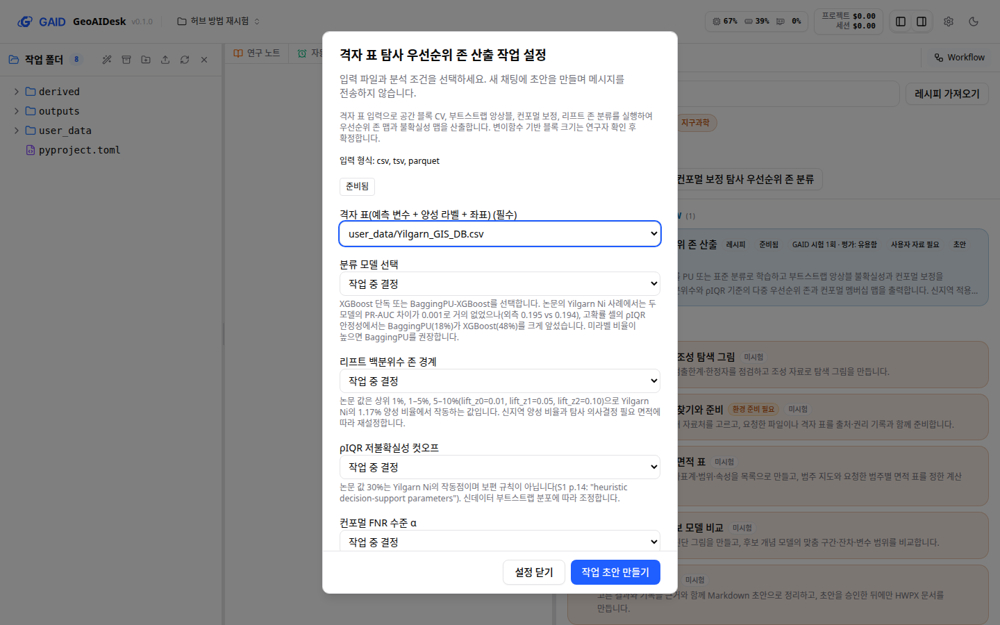
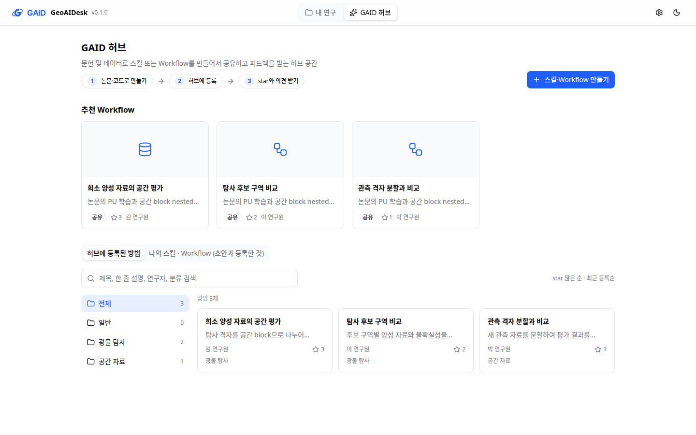
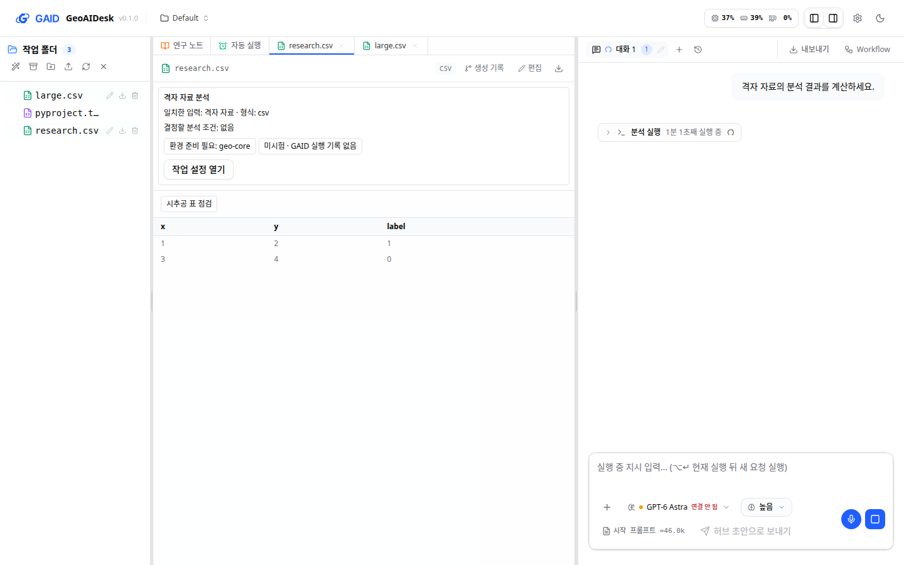
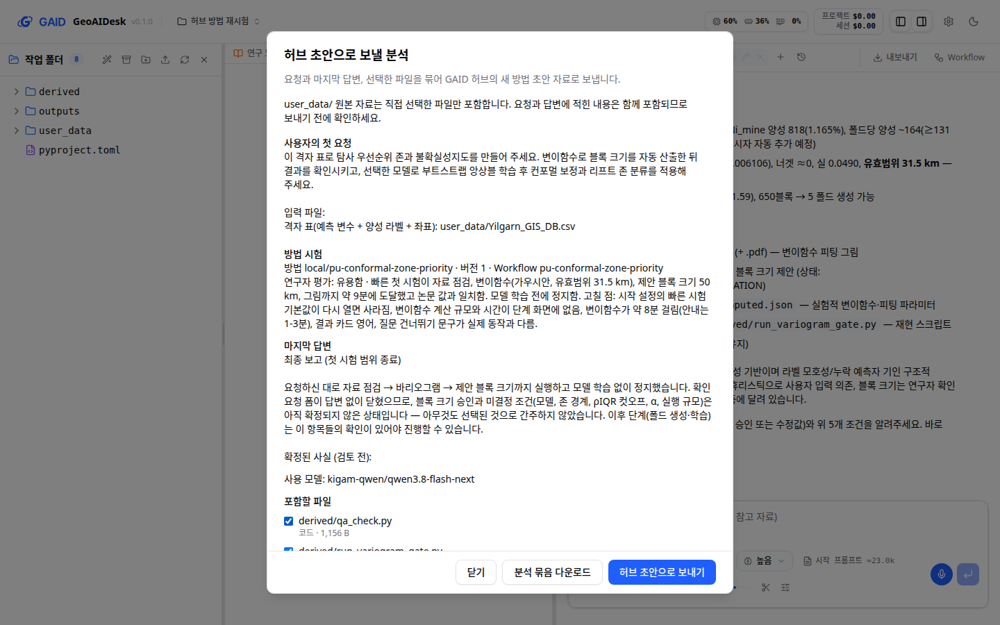

# PU 방법 수정판 재시험과 GAID 허브·채팅 결함 정리

## 0. 한눈에

| | |
|---|---|
| 요청 | gaid-hub-integration과 gaid-hub에서 남은 일을 권장안대로 진행하기 |
| 결론 | GAID 허브에서 다시 만든 PU 방법이 2026-10-16과 같은 제한 시험에서 약 9분 만에 첫 확인 지점에 이르렀습니다(첫 판은 45분이 지나도 이르지 못함). 긴 실행 표시, 실행 중단, 데이터 보호 확인, 큰 CSV, 허브로 보내기와 받기 등 GAID 결함과 허브 첫 화면 목록, 저작 질문, 시작 설정 기본값도 고쳤습니다. |
| 믿을 수 있는 정도 | 재시험은 실제 앱에서 연구자 역할 에이전트가 화면만으로 한 번 진행했습니다. 제안 블록 크기는 논문 값과 같지만, 논문과 같은 자료라서 새 지역 적용을 검증한 것은 아닙니다. 빠른 시험 경로와 모델 학습 단계는 이번 시험 범위 밖이었습니다. |
| 결정할 일 | 없음 (확인 대기 1건은 5절과 6절) |

## 1. 요청한 것

> gaid-hub-integration와 gaid-hub의 작업 및 개선 작업에 대해 권장 옵션으로 작업 진행하자. — 2026-10-18 요청

> 시작하자. — 2026-10-18, 범위 확인 뒤

완료 기준: 수정판 PU 방법을 GAID 안에서 만들고, 2026-10-16 시험과 같은 지시 문구로 다시 시험해 첫 확인 지점에 이르는지 확인합니다. 남은 GAID 결함(긴 실행 표시, 업로드한 파일에 맞는 허브 방법 제안, 큰 CSV 반복 요청, 보내기 버튼 글자, 허브 쪽 받기, 실행 중단, 데이터 보호 확인 창)과 허브 개선(등록된 방법 목록, 저작 질문 두 가지, 시작 설정 기본값)을 고칩니다.

## 2. 수행한 것

1. 저작 규칙을 고쳤습니다. 허브는 이제 "원본 코드를 넣을지"와 "빠른 첫 시험용 줄인 설정을 만들지"를 항상 묻습니다. 시작 설정 기본값에는 연구자의 답이 뒷받침하는 값만 남고, 논문 값은 "작업 중 결정"으로 둡니다. 계산량이 큰 단계는 그 단계 안에 계산 규모를 적고, 연구자가 확인할 제안값은 확인 지점으로 표시합니다. 그 밖의 규칙: 결과 파일 이름은 스킬 설명과 맞춥니다. 중첩 병렬 계산은 스레드를 제한합니다. 원본 코드 안의 모듈은 외부 패키지로 선언하지 않고 함께 넣습니다.
2. 같은 논문과 원본 코드, 같은 목표로 GAID 허브에서 PU 방법을 다시 만들었습니다(기관 Qwen). 연구자 역할로 질문 7개에 답하고, 2026-10-16 시험에서 나온 문제를 "고치기"로 두 번 반영해 3판을 만들었습니다. 3판은 모든 검사를 통과했고, 경고는 1건입니다(MPM 분석 환경에 없는 optuna를 스킬 설명의 방법으로 설치).
3. 연구자 역할 에이전트가 화면만으로 3판을 새 프로젝트에 설치했습니다. Yilgarn 격자 표(70,200칸)를 올리고, 2026-10-16과 같은 제한 문구를 덧붙여 시험했습니다.
4. 결함 수정은 두 하위 작업에 나눠 맡겼습니다. 하나는 채팅·파일 패널·작업 제안·실행 중단·데이터 보호를, 다른 하나는 허브 첫 화면 목록을 맡았습니다. 허브 쪽 받기와 저작 규칙, 시작 설정은 이 작업에서 직접 고쳤습니다.
5. 재시험에서 새로 드러난 GAID 결함 여섯 가지를 고쳤습니다(3절 마지막 표).

## 3. 결과

그림 1. 재시험 채팅의 첫 확인 지점(1440×900). 볼 것: 가운데에 변이함수 그림(유효범위 31.5 km 점선)이 있고, 오른쪽에 제안 블록 크기 50 km와 "여기서 정지했습니다"가 보입니다. 연구자 확인을 묻는 양식도 함께 열렸습니다. 모델 학습은 실행하지 않았습니다.

| 항목 | 2026-10-16 첫 판 | 2026-10-18 수정판(3판) |
|---|---|---|
| 첫 확인 지점 도달 | 못 함(45분 뒤 연구자가 중단) | 전송 약 9분 뒤 도달, 약 11분 뒤 최종 보고 |
| 변이함수 계산 점 수 | 70,200칸 전체를 반복 계산 | 18,193점(격자 2배 줄임 + 양성 칸 모두) |
| 변이함수 결과 | 없음 | 가우시안, 유효범위 31.5 km, sill 0.049, nugget 0 |
| 제안 블록 크기 | 없음 | 50 km(유효범위 × 1.59, 약 650블록) |
| 결과 파일 | 없음 | 변이함수 그림, 블록 크기 제안, 계산 기록 |
| 도구 호출(실패) | 42회(10회) | 17회(0회) |
| 변이함수 라이브러리 | 설치 이름이 틀려 다른 라이브러리로 바꿈 | 설치 이름과 설치 방법을 스킬에 적음 |
| 데이터 보호 확인 창 | (v5 시험에서 2번) | 뜨지 않음 |
| 연구자 평가 | 수정 필요 | 유용함 |

그림 2. 고친 뒤 Workflow 패널에서 연 시작 설정(1440×900). 볼 것: 프로젝트의 CSV가 하나뿐이라 격자 표가 미리 선택됐고, 논문 값만 있는 과학적 선택은 "작업 중 결정"입니다. 화면 아래쪽의 "공간 블록 크기 결정 방식"은 "자동 변이함수 → 실패 시 사용자 입력", "실행 규모"는 "빠른 시험"으로 미리 정해져 있습니다(양식 값으로 확인). 둘 다 연구자의 답에서 온 값입니다. 오른쪽 목록에는 방법이 한 줄로 보입니다.

그림 3. 허브 첫 화면의 "허브에 등록된 방법" 탭(하위 작업 화면, 시험용 등록 3개). 볼 것: 주제 폴더와 개수, 제목·설명·연구자·분류 검색, star 많은 순 정렬, 카드의 연구자와 star 수가 보입니다. "나의 스킬 · Workflow"는 옆 탭에 있습니다.

그림 4. 실행 중인 분석 단계(하위 작업 화면, 모델 호출 없는 고정 응답으로 재현). 볼 것: 도구 카드에 "분석 실행 1분 1초째 실행 중"이 보이고, 입력창 아래에 "허브 초안으로 보내기" 글자가 보입니다. 파일 패널에는 업로드한 CSV에 맞는 방법 제안이 있습니다.

그림 5. 고친 보내기 대화상자(1440×900, 재시험 채팅). 볼 것: 채운 버튼은 "허브 초안으로 보내기" 하나이고, 다운로드는 보조 버튼입니다. 마지막 답변은 Markdown 기호 없이 보입니다. 외부 허브 주소 줄은 직접 보낼 수 있는 외부 허브가 있을 때만 나옵니다. 1280×800 화면은 부록 A에 있습니다.

| 완료 기준 | 결과 | 근거 |
|---|---|---|
| 수정판 방법을 GAID 안에서 만들기 | 충족: 3판, 검사 통과, 경고 1건 | 2절 |
| 같은 지시 문구로 다시 시험해 첫 확인 지점 도달 | 충족: 약 9분, 블록 크기 50 km 제안 뒤 정지 | 그림 1, 표 |
| 긴 실행 진행 표시 | 충족: 도구 카드에 경과 시간 | 그림 4, 재시험 기록 |
| 업로드한 파일에 맞는 허브 방법 제안 | 충족: 설치된 방법을 형식이 맞으면 먼저 제안, 연구자 기본값 포함 | 그림 4 |
| 8 MB 넘는 CSV 반복 요청 멈추기 | 충족: 실제 브라우저에서 첫 413 뒤에는 304만 옴 | 하위 작업 기록 |
| 보내기 버튼에 글자 | 충족: "허브 초안으로 보내기" | 그림 4 |
| 허브 쪽 받기 | 충족: 재시험 채팅을 보내 새 허브 초안이 생기고 분석 묶음이 자료로 붙음 | 그림 5, 재시험 기록 |
| 실행 중단이 배경 계산도 멈춤 | 충족(시험으로 확인): 분리 실행한 배경 작업이 중단 뒤 종료되고 다른 채팅 계산은 유지. Linux만 | 하위 작업 기록 |
| 데이터 보호 확인 창이 무인 시험을 막지 않음 | 충족: 보호 자료가 아닌 작업 폴더 안의 재귀 삭제는 묻지 않음. 재시험에서 확인 창 없음 | 표 |
| 허브 첫 화면에 등록된 방법 목록(폴더·검색) | 충족 | 그림 3 |
| 저작 질문 "원본 코드 포함", "빠른 시험용 줄인 설정" | 충족: 허브가 늘 묻는 질문 | 2절 |
| 시작 설정 기본값이 연구자 취지를 따름 | 충족: 연구자 답이 뒷받침하는 값만 기본값 | 그림 2 |

재시험에서 새로 드러나 이번에 고친 GAID 결함입니다.

| 재시험에서 본 것 | 고친 내용 |
|---|---|
| Workflow 패널에 같은 이름의 줄이 둘 있고, 연구자는 기본값이 없는 줄로 다시 열어 "빠른 시험"이 사라짐 | 레시피가 하나인 Workflow는 한 줄로 보이고 레시피 기본값으로 열림. 파일 제안에서 연 설정도 같음 |
| 방법의 스크립트를 실행하자 생긴 Python 캐시 때문에 "GAID에서 수정됨", "시험 이후 방법 파일이 바뀌었습니다"가 뜸 | 캐시는 수정으로 보지 않음. 다음 판을 설치할 때도 캐시 때문에 막히지 않음 |
| 질문을 건너뛰자 "AI agent가 권장안으로 계속 진행했습니다"가 떴지만 실제로는 멈춤 | "질문을 건너뛰었습니다. AI agent는 이를 승인으로 보지 않고, 꼭 필요한 값이 없으면 멈추고 알립니다."로 바꿈 |
| 보내기 대화상자에 외부 허브 주소, Markdown 기호, 버튼 아래로 비치는 파일 목록 | 외부 허브 줄은 직접 보낼 때만, Markdown 기호 제거, 아래 단추 줄을 대화상자 끝에 붙임 |
| 결과 카드와 연구 노트가 영어 | 연구 노트와 결과 요약도 연구자의 요청 언어로 쓰라는 지시를 추가(다음 실행부터) |
| 스킬 설명의 예상 시간("1–3분")과 실제(약 8분)가 다름 | 저작 규칙: 원본에 측정 시간이 없으면 시간을 추정하지 않고 "측정하지 않음"으로 씀(다음 초안부터) |

## 4. 검증

- 과학적 검증: 미검증. 재시험은 논문과 같은 Yilgarn 자료라서, 유효범위 31.5 km와 블록 50 km가 논문 값과 같다는 것은 방법이 원본 계산을 다시 냈다는 뜻입니다. 새 지역 적용의 타당성은 보여 주지 않습니다. 숫자 점검: (1) 비교 기준은 논문의 유효범위 31.5 km·블록 50 km이고 단위는 km입니다. (2) 한 번 실행했고 반복 간 차이는 미확인입니다. (3) 같은 자료를 썼으므로 독립 검증이 아닙니다. 첫 판 시험과 수정판 시험 사이에 데이터·모델은 같고 방법 패키지와 GAID 코드가 달라졌습니다. (4) 이번 결론은 "첫 확인 지점에 이른다"뿐이라 정밀도 요구가 없습니다. (5) 빠른 시험 경로(5,000점 변이함수), 폴드 생성 이후 단계, BaggingPU 시간은 실행하지 않았습니다.
- 소프트웨어 검증: 실제 앱에서 연구자 역할 에이전트가 설치부터 평가 저장, 허브로 보내기까지 화면만으로 진행했습니다. 재시험 뒤 고친 결함은 같은 앱을 다시 띄워 확인했습니다. 시험 기록은 이제 "바뀌지 않음"이고, 첫 확인 지점의 두 결과 파일은 예상한 이름 그대로 대조됩니다. 시작 설정은 기본값과 하나뿐인 CSV를 채운 채 열립니다. 두 하위 작업을 합칠 때 전체 점검(백엔드 1,862개, 프런트엔드 1,065개, 배포·환경·기동 점검)을 통과했습니다. 이 작업의 최종 전체 점검은 마무리 단계에서 돌고, 그 결과는 작업 기록과 마무리 보고에 남습니다. 테스트 통과는 결과의 과학적 타당성을 뜻하지 않습니다.
- 독립 검토: 이번에는 따로 두지 않았습니다. 연구자 역할 재시험이 화면 검토를 겸했고, 하위 작업은 각자 두 해상도 화면을 확인했습니다.

## 5. 한계

- 재시험의 시작 설정에서 "빠른 시험" 기본값이 빠진 채 실행되어, 변이함수가 전체 설정(약 18,000점)으로 약 8분 걸렸습니다. 빠른 시험 경로(5,000점)는 실행하지 않았습니다. 이 결함은 시험 뒤에 고쳤습니다.
- 시험은 첫 확인 지점에서 멈추게 했으므로, BaggingPU가 빠른 모드에서 11분 걸리던 문제는 방법 설명에 스레드 제한을 적는 데까지만 고쳤고 실행 시간으로 확인하지 않았습니다(확인 대기 1건).
- 실행 중단으로 배경 계산을 멈추는 기능은 시험으로만 확인했고, 재시험에서는 중단을 누르지 않았습니다. Linux에서만 동작하고 Windows에서는 기존 중단 동작 그대로입니다.
- 데이터 보호 확인 창의 두 번째 사례(v5 시험)는 남은 기록에서 찾지 못했습니다. 찾은 한 건(작업 폴더 안 재귀 삭제)만 고쳤습니다.
- 보내기 대화상자는 첫 화면 글자 수 기준(W5)을 넘고, 방법 식별자와 사용 모델 이름(R1)이 보입니다. 이전 단위부터 있던 내용이고 이번에 바꾸지 않았습니다.
- 허브에서 설치할 프로젝트 목록에서 새 프로젝트를 만들 수 없고, 설치 뒤 시작 설정이 바로 열리지 않고 입력 준비를 거칩니다. 이번 범위 밖입니다.
- 연구 노트·결과 카드 언어와 예상 시간 규칙은 다음 실행·다음 초안부터 적용되며, 실행으로 다시 확인하지 않았습니다.
- 재시험 처음에 시험용 앱의 연결 설정을 잘못 해 첫 전송이 실패했습니다(시험 준비 문제). 그래서 시험 기록의 시작 시각은 실패한 전송 시각(15:19:57)이고, 실제 시험은 15:22:24에 시작했습니다.

## 6. 결정할 일

없음.

확인 대기 1건: 다음 PU 시험에서 빠른 시험을 모델 학습까지 실행해 5,000점 변이함수와 BaggingPU 시간(스레드 제한)을 확인합니다. 작업 문서의 미완료 항목으로 남깁니다.

Optional(사용자가 고르기 전에는 하지 않음):
- 보내기 대화상자의 첫 화면 줄이기와 방법 식별자·모델 이름 숨기기
- 허브의 설치 대화상자에서 새 프로젝트 만들기

## 7. 대체되었거나 실패한 시도

펼치기 — 4건

- 수정판 1판은 원본 코드 안의 분석 모듈을 외부 패키지로 선언했습니다. 고치기 한 번으로는 사라지지 않아, 그런 모듈을 스킬에 넣고 선언에서 빼도록 저작 서버를 고친 뒤 3판에서 사라졌습니다.
- 첫 허브 쪽 받기 화면은 외부 허브 주소를 계속 보였고, 재시험 연구자가 혼동했습니다. 직접 보낼 때만 보이게 바꿨습니다.
- 하위 작업을 합치는 점검이 두 번 실패했습니다(지도 화면 시험, 파일 미리보기 시험의 시간 초과). 그때 다른 프로젝트의 계산이 CPU를 거의 다 쓰고 있었습니다(부하 43, 32스레드). 코드 문제가 아니라서 테스트를 더 고치지 않고 8코어로 제한해 다시 돌려 통과했습니다. 지도 화면 시험의 대기 시간은 10초로 늘렸습니다.
- 하위 작업 점검 중 일부 기록이 이전 소유자 이름 규칙 때문에 실패했습니다. 고친 뒤의 점검이 그 기록을 대체합니다.

## 용어

없음

## 부록 A. 근거 위치

펼치기 — 실행 방법, 원본, 해시, 커밋

| 항목 | 위치 |
|---|---|
| 코드 | 브랜치 task/gaid-hub-followups. 하위 작업 통합 509ad66(hub-browse), 01fc3d1(defects). 저작 규칙 e5461bd, 89087a4, ddfd566, 1a59b39, a434b89; 재시험 뒤 수정 bca7ba8, a6d29b2, 7f52bac |
| 저작 서버 | server/src/geo/authoring/{agent,prompts,package,routes,sources,install}.ts, 설계 docs/design/hub-authoring-service.md |
| 허브 쪽 받기 | POST /geo/authoring/handoffs (server/src/geo/authoring/routes.ts), web/src/geo/hub-handoff/{client,dialog}.tsx |
| 방법·시험 기록 | server/src/geo/methods/{trials,local-methods,tree-hash}.ts, web/src/geo/methods/methods.tsx, server/src/geo/routes/workspace.ts |
| 하위 작업 기록 | docs/tasks/gaid-hub-followups--defects.md, docs/tasks/gaid-hub-followups--hub-browse.md (문자열 표와 화면 규칙 포함) |
| 시험용 앱 | PC74 사용자 서비스 gaid-followups-app(포트 3360/18360), GAID_HOME ~/data/geoaidesk/work/gaid-hub-followups/home, 기동 스크립트 bin/dev.sh |
| 수정판 방법 | 저작 프로젝트 ap-c8f90117-4e8, 3판, 패키지 sha256 0db56f328753ca90828aba91e511e09ee6bba458106bd411b71e57249d05ba2f, 답 tools/answers1.json, 고치기 tools/feedback1.md·feedback2.md |
| 재시험 | 프로젝트 proj-035916 "허브 방법 재시험", 세션 01a14daa-bc63-724c-8bb9-5892f79122d5, 자산 yilgarn-gis-db/20260911 Yilgarn_GIS_DB.csv(라벨 CC BY-NC 4.0, 내부 시험용) |
| 재시험 결과 원본 | pc74:~/data/geoaidesk/work/gaid-hub-followups/home/projects/proj-035916/sandbox/outputs/variogram_fit.png · sha256 9adfc832028325ce61464c9d11afb282c5ad6de9a993142a27bff23f5171358c, outputs/block_size.json · 67a9d50d98fbe2c2ffc1a483d0e574f420f44be836d0e7600c934f55f5042821 |
| 연구자 역할 기록 | ~/data/geoaidesk/work/gaid-hub-followups/researcher/log.md · sha256 907601c96f6e19612d84cbc135f8833154c42205c2f83914319a389625f85528, summary.md, playwright/ (29장). 지시서 briefs/researcher-retrial.md |
| 허브로 보낸 초안 | 저작 프로젝트 ap-2efc649a-540, 자료 gaid-analysis-01a14daa-20261018.tar.gz |
| 화면 사진 | ~/data/geoaidesk/work/gaid-hub-followups/shots/ (c-setup-1440/1280, h-handoff-1440/1280), figures/{defects,hub-browse}/ |
| 점검 | 하위 작업 통합 task complete: `env -u VITEST_MAX_WORKERS taskset -c 0-7` (서버 시험은 한 작업자로 돌아야 함). 최종 scripts/check는 task finish 기록 |

작성 시점: 2026-10-18, commit 7f52bac.

