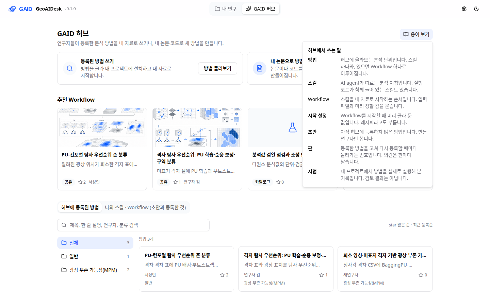
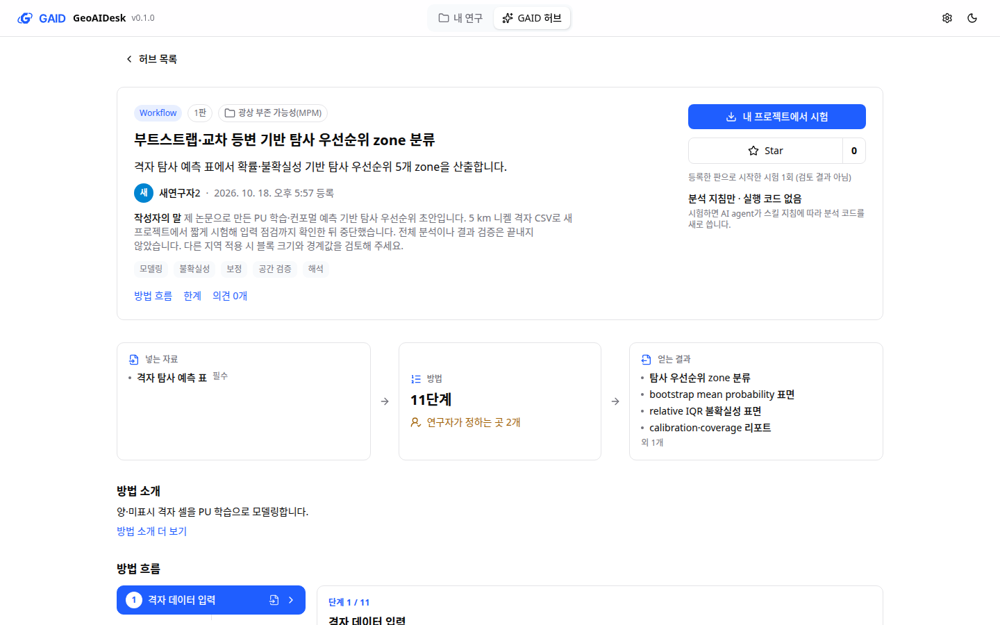
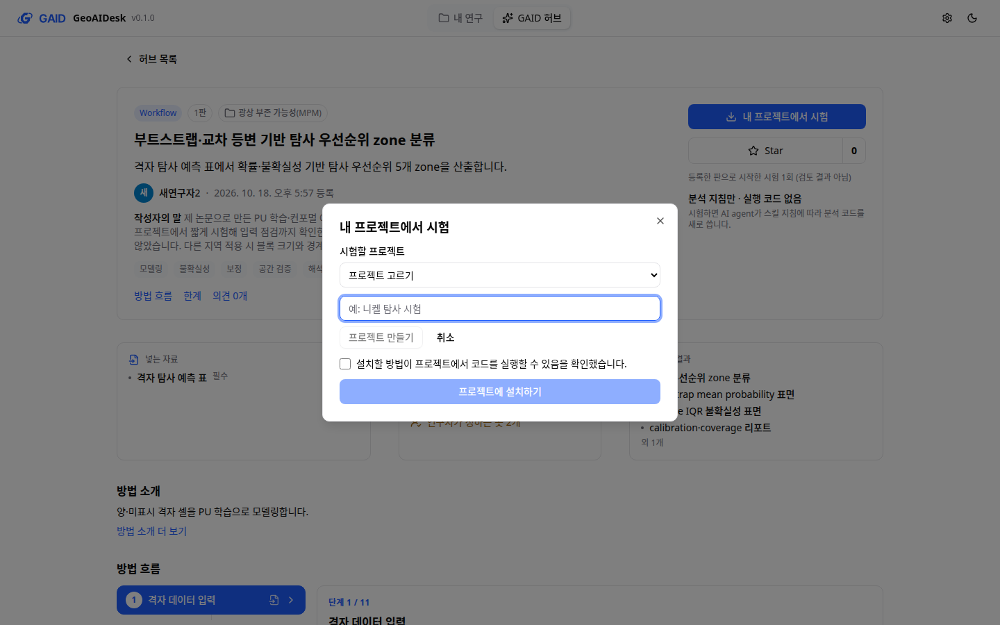

# 처음 쓰는 연구자 관점의 GAID 허브 점검과 개선

## 0. 한눈에

| | |
|---|---|
| 요청 | GPT sol 6.1 high 검토자에게 처음 쓰는 이용자 역할을 맡겨 허브를 올바르게 쓸 수 있는지 보고, 빠지거나 약한 곳을 고칩니다. |
| 결론 | 검토자 세 명이 차례로 허브를 처음 썼습니다. 세 번째 검토자는 방법 찾기, 내 자료로 쓰기, 내 논문으로 방법 만들기·등록, star·의견 남기기를 모두 해냈습니다. 허브 화면과 저작 규칙에서 나온 지적은 이 작업에서 고쳤습니다. 가장 큰 문제(시작 초안이 고른 설정과 어긋나는 문제)는 시작 설정 팝업을 맡은 gaid-system-ui가 고쳤고, 그 변경은 아직 main에 없습니다. |
| 믿을 수 있는 정도 | 근거는 실제 앱을 쓴 기록 세 벌(단계별 기록과 화면 사진 118장)과 자동 시험입니다. 검토자는 모두 같은 모델 계열이라 같은 사각지대가 있을 수 있습니다. 사람 연구자는 아직 써 보지 않았습니다. |
| 결정할 일 | 없음 |

## 1. 요청한 것

> 보고서를 확인하였다. GAID 허브는 비교적 OneUI기반의 프로젝트의 디자인 가이드를 기반으로 개선되었는데 GAID 시스템에서는 덜 반영된 곳들이 있다. workflow를 불러올 때 뜨는 팝업창에는 여전히 글자 수도 많고 디자인 완성도와 이용자 시인성이 부족한 편이다. 그리고 연구노트와 관련해서도 해당 기능이 개선될 필요가 있다. 사용자의 관점에서 obsidian vault 연구보고서를 정리하는 것을 참고하여 현재 연구노트 기능이 개선되었으면 한다. 지금의 방식은 단순히 에이전트의 작업 흐름만 따라가는 형태로 보이며, 해당 연구노트가 어디에 저장되고 어떻게 활용되는지에 대한 연계가 부족하다고 생각한다. 연구노트의 경우에는 별도 작업 트리로 현황을 진단해보고 어떻게 개선 수정하면 좋을지 검토 후 사용자와 논의하여 시스템을 개선할 필요가 있다. GAID 허브의 경우에는 GPT sol 6.1high 워커가 허브를 배경 지식과 맥락없이 처음 이용하는 이용자의 역할을 부여하였을 때 해당 허브를 올바르게 사용할 수 있는지를 검토하게 하는 작업을 통해 누락되거나 개선이 필요한 부분들을 개선하는 작업을 별도의 작업트리에서 수행하여야 한다. — 2026-10-18 요청

이 작업은 위 요청 가운데 GAID 허브 부분입니다. 시작 설정 팝업은 gaid-system-ui, 연구노트는 gaid-notebook-review가 맡습니다.

완료 기준: 처음 쓰는 이용자 역할의 검토자가 허브를 끝까지 써 보고 막힌 곳을 보고합니다. 그 지적을 고친 뒤 새 검토자로 같은 방식으로 다시 확인합니다. 시작 설정 팝업에 대한 지적은 gaid-system-ui로 넘깁니다.

## 2. 수행한 것

1. 이 작업만 쓰는 시험용 앱을 따로 띄웠습니다. 기관 Qwen 모델을 쓰고, 이전에 등록된 공유 방법 두 개를 넣어 허브가 비어 있지 않게 했습니다. 검토자에게는 논문 PDF(PU 학습·conformal prediction으로 탐사 구역을 나누는 원고)와 Yilgarn 5 km 니켈 격자 CSV를 "자기 자료"로 주었습니다.
2. 검토자는 저장소 문서·코드·이전 기록을 보지 않고, 한국어 화면만 보며 네 목표를 시도했습니다. 목표는 방법 찾기·이해, 내 자료로 쓰기, 내 논문으로 방법 만들기·등록, star·의견 남기기입니다.
3. 1차 검토 뒤 지적 9건을 나눴습니다. 허브 화면과 저작 규칙은 이 작업에서 고쳤습니다. 공유 허브의 검색·상태 표시는 하위 작업 하나가 맡았습니다. 시작 설정 팝업과 작업 공간 관련 지적은 gaid-system-ui로 넘겼습니다.
4. 고친 앱으로 새 검토자가 2차 확인을 했고, 새 지적을 다시 고쳤습니다. 마지막으로 3차 확인을 한 뒤 남은 허브 지적을 고쳤습니다. 파일 미리보기와 Workflow 목록 지적은 gaid-system-ui로 넘겼습니다.

## 3. 결과

| 목표 | 1차 | 2차 | 3차 |
|---|---|---|---|
| 허브를 이해하고 관련 방법 찾기 | 달성 | 달성 | 달성 |
| 공유 방법을 내 CSV로 쓰기 | 달성(모순된 요청문을 직접 고쳐 씀) | 일부(모순된 요청문을 보고 보내지 않음) | 달성(요청문을 직접 고쳐 둠, 실행은 안 함) |
| 내 논문으로 방법 만들고 등록 | 달성 | 달성(새 프로젝트에서 짧게 시험 후 등록) | 달성 |
| star와 의견 남기기 | 달성 | 달성 | 달성 |

세 번의 검토에서 모두 남은 문제는 시작 설정 팝업이 만드는 요청문입니다. 공유 방법에 저장된 예시 요청("Cu-PGE … 1 km 해상도, 약 30만 셀")이 연구자가 고른 "Ni / 코마티이트"와 함께 들어갑니다. gaid-system-ui가 연구자 설정을 맨 앞에 두고 우선하도록 고쳤지만, 그 변경은 아직 main에 없어 이 시험용 앱에는 반영되지 않았습니다. 새 저작 규칙으로 만든 2차·3차 검토자의 초안에서는 요청문과 설정이 서로 맞았습니다.

그림 1. 고친 뒤의 허브 첫 화면(1440×900). 볼 것: "등록된 방법 쓰기"와 "내 논문으로 방법 만들기" 두 갈래와 오른쪽 위 "용어 보기". 1280×800 화면은 figures/02-hub-home-1280.png입니다.

그림 2. "용어 보기"를 연 모습. 볼 것: 방법, 스킬, Workflow, 시작 설정, 초안, 판, 시험을 한두 문장으로 설명합니다. 2차·3차 검토자 모두 도움이 됐다고 했습니다.

그림 3. 등록된 방법 화면(1440×900). 볼 것: 오른쪽의 "분석 지침만 · 실행 코드 없음"과 설명, "등록한 판으로 시작한 시험 1회 (검토 결과 아님)", 넣는 자료 옆의 "필수". 1280×800 화면은 figures/05-entry-1280.png입니다.

그림 4. 공유 방법을 내 프로젝트에 설치하는 창. 볼 것: 프로젝트를 미리 고르지 않고 "프로젝트 고르기"에서 시작하며, 그 자리에서 새 프로젝트를 만들 수 있습니다. 1280×800 화면은 figures/09-install-1280.png입니다. 내가 만든 방법 목록은 figures/06-my-methods-1280.png, 결과 없는 검색 화면은 figures/07-empty-search-1440.png입니다.

지적별 처리 결과입니다.

| 회차 | 지적 | 처리 |
|---|---|---|
| 1 | 시작 초안이 고른 설정과 모순 | 저작 규칙 수정: 새 Workflow 요청문에 특정 자료의 사실(해상도, 셀 수, 광종, 지역)과 미리 정한 선택값을 쓰지 않음. 팝업 쪽은 gaid-system-ui가 처리 |
| 1 | 실행 코드가 없는 방법인지 알 수 없음 | 초안·등록 미리보기·등록된 방법에 "분석 지침만 · 실행 코드 없음"과 설명 표시 |
| 1 | 환경 "준비됨"인데 AI가 패키지가 없다고 함 | 환경 준비 칸에 "준비된 환경 밖의 패키지"와 AI agent가 설치한다는 안내 표시 |
| 1 | 입력 예시 표에서 라벨 열이 빠짐 | 열이 많으면 앞 세 열과 끝 두 열을 남기도록 고침. 저작 규칙에 라벨 열과 0/1 의미를 쓰게 함 |
| 1 | 스킬·Workflow·레시피·초안 같은 말을 모름 | 두 갈래 안내와 "용어 보기" 추가, 첫 화면 문구를 "분석 방법" 중심으로 |
| 1 | 시험 횟수가 무엇을 뜻하는지 모호, 질문이 "보장"을 주장 | 표기를 "등록한 판으로 시작한 시험"으로, 저자가 등록 전 같은 판을 시험한 기록도 셈. 질문에서 "보장" 같은 주장 금지 |
| 1 | "니켈" 검색이 안 됨 | 검색어를 낱말별로 나눠 모두 맞는 것을 찾고 원소 이름 별칭(니켈↔Ni 등)을 씀. 결과 없을 때 검색 요령 표시 |
| 1 | 논문 읽기가 끝난 뒤 다음 할 일을 모름 | 읽기 완료 뒤 "질문에 답하기" 버튼, 읽는 동안 다시 여는 곳 안내 |
| 1 | 설치할 프로젝트를 새로 만들 수 없음, 작업 공간에서 허브로 못 돌아감 | 두 설치 창에 "새 프로젝트 만들기". 허브로 돌아가는 길은 gaid-system-ui가 처리 |
| 2 | 내 초안을 설치한 뒤 자료 올리기 단계가 없음 | 첫 시험 전에는 공유 방법과 같은 자료·환경 준비 단계를 보여 줌 |
| 2 | "나의" 목록에 남의 초안이 섞임 | 방법을 만들 때 허브 이름을 묻고 기록. 목록은 내 이름의 것과 이름 기록이 없던 예전 것만 보여 주고 작성자를 표시 |
| 2 | 필수·선택 입력을 설치 뒤에야 앎 | 방법 개요의 넣는 자료에 "필수/선택" 표시 |
| 2 | 저작 질문에 개발자 용어(파이프라인, 하드코딩, override, S1) | 저작 규칙: 연구자가 읽는 글은 쉬운 말로 쓰고, 방법 이름을 새로 번역하지 않으며, 한 개념에 한 용어를 씀 |
| 2 | 주제 폴더 하나에만 들어가 관련 방법이 숨음 | 하지 않음(5절) |
| 3 | 설치 창이 다른 연구자의 프로젝트를 미리 고름 | 미리 고르지 않음. 프로젝트를 골라야 설치 단추가 켜짐 |
| 3 | 저작 추천이 연구자 자료에 대한 사실을 단정 | 저작 규칙: 연구자 자료에 대한 사실에는 추천을 붙이지 않거나 "자료를 확인한 뒤 정하기"를 추천. 빠른 시험 선택지 이름에 시간을 쓰지 않음 |
| 3 | 등록한 뒤에도 "시험·등록 준비됨"으로 보임, "추천 Workflow"가 용어 설명보다 먼저 나옴 | "허브에 등록됨" 표시, "추천 분석 방법"으로 바꿈 |
| 3 | CSV 미리보기 한도 오류가 표의 열 이름처럼 보임, Workflow 목록의 상태 표시가 겹침 | gaid-system-ui로 넘김 |
| 3 | 논문 읽기 6분 동안 진행 내용이 거의 안 보이고 취소가 없음 | 하지 않음(5절) |

UI 가이드 규칙 가운데 따른 것은 다음과 같습니다. 두 갈래 안내와 용어 설명은 P1, P3, W6, B1입니다. 상태와 실행 코드 표시는 R1, R3, S4입니다. 설치 창과 새 프로젝트 만들기는 P1, B1, D입니다. 시험 횟수 표기는 R3, F이고, 입력 표시는 G입니다. 어긴 규칙은 없습니다. 문구 검사와 UI 검사 모두 오류 0건입니다.

## 4. 검증

- 과학적 검증: 해당 없음. 화면 사용성 작업입니다. 검토자들이 돌린 분석은 입력 점검까지만 진행했고, 그 결과(70,200셀, 양성 818개 등)는 AI agent가 보고한 값이며 따로 확인하지 않았습니다.
- 사용성 확인: 1차 검토 뒤 고친 점은 2차 검토자가 실제로 써 보고 도움이 됐다고 기록했습니다. 두 갈래 안내, 용어 보기, 검색 요령, 다시 여는 곳 안내, 실행 코드 표시, 새 프로젝트 만들기가 여기에 해당합니다. 2차 뒤에 고친 점 가운데 필수/선택 표시와 작성자 표시는 3차 검토자가 확인했습니다. 내 초안의 자료 준비 단계도 3차 검토자가 거쳐 갔습니다. 3차 뒤에 고친 점은 새 검토자로 다시 확인하지 않았습니다. 대신 이 작성자가 화면 사진(그림 3, 4)과 자동 시험으로 확인했습니다. 프로젝트 미리 고르지 않기, 등록됨 표시, 추천 분석 방법 이름이 여기에 해당합니다.
- 저작 규칙의 효과: 2차·3차 검토자가 새 규칙으로 만든 초안은 요청문이 설정과 맞았습니다. 고친 시험 횟수 계산은 실제 앱에서 2차 검토자의 방법이 0회에서 1회로 바뀐 것으로 확인했습니다. 3차 뒤에 고친 저작 규칙(추천 제한, 시간 표기)은 아직 초안을 만들어 보지 않았습니다.
- 소프트웨어 검증: 허브 웹 시험 30개, 서버 저작·공유 허브 시험 44개, 패키지 목록 시험, 작성자 기록 시험이 통과했습니다. 웹·서버 타입 검사, 문구 검사(오류 0), UI 검사(오류 0)도 통과했습니다. 하위 작업은 전체 점검을 통과했고, 이 작업의 전체 점검은 마무리할 때 돌립니다.

## 5. 한계

- 시작 설정 팝업의 모순은 gaid-system-ui 변경이 main에 들어가야 사라집니다. 그 전까지 공유 방법의 요청문은 예전처럼 나옵니다. 이미 등록된 방법 패키지의 예시 요청문은 새 저작 규칙으로 바뀌지 않습니다.
- 검토자 세 명은 같은 모델 계열(GPT sol 6.1 high)입니다. 사람 연구자, 특히 한국어 원어민 연구자가 느끼는 어려움은 다를 수 있습니다.
- 하지 않은 것:
  - 방법 하나를 여러 주제 폴더에 넣는 기능은 하지 않았습니다.
  - 논문 읽기 중 세부 진행 표시와 취소 단추는 하지 않았습니다. 다시 여는 곳 안내만 넣었습니다.
  - AI가 만든 방법 문구의 오탈자("변블로그램", "폴 단위")를 연구자가 쉽게 고치는 기능은 하지 않았습니다.
  - 채팅 기록에 도구 이름과 영어 지시문이 보이는 문제는 허브가 아니라 작업 공간 채팅에서 생기므로 이 작업 범위 밖입니다.
- "내가 만든 방법" 목록은 허브 이름으로 거르는 화면 정리입니다. 접근 권한을 막는 기능은 아닙니다. 이름을 기록하기 전에 만든 예전 초안은 누구에게나 "작성자 미기록"으로 보입니다.
- 화면 사진은 개발 모드 시험용 앱에서 찍었습니다.

## 6. 결정할 일

없음

## 7. 대체되었거나 실패한 시도

펼치기 — 1건

- 보고서용 화면 사진을 브라우저 명령으로 하나씩 찍을 때, 새 주소를 열면 저장해 둔 허브 이름이 사라졌습니다. 그 사진에서는 "내가 만든 방법"이 거르지 않은 목록처럼 보였습니다. 코드 결함이 아니었고, 한 브라우저 세션 안에서 다시 찍었습니다.

## 용어

없음

## 부록 A. 근거 위치

펼치기 — 실행 방법, 원본, 해시, 커밋, 문구 변경표

| 항목 | 위치 |
|---|---|
| 코드 | 브랜치 task/gaid-hub-novice-review. 저작 규칙 32ad970·252ef27·ad4f7b3, 허브 화면 b32f43b·252ef27·ad4f7b3, 하위 작업 gaid-hub-novice-review--shared 통합 ce0128c |
| 바뀐 파일 | server/src/geo/authoring/{prompts,store}.ts, server/src/geo/methods/{extra-packages,local-methods}.ts, server/src/geo/hub-shared/{routes,search}.ts, web/src/geo/hub/{hub-home,hub-screen,draft-step,trial-step,input-prep,io-examples,source-step,method-overview,shared-entry,shared-method,shared-browse}.tsx, web/src/geo/contracts/{authoring,methods,hub-shared}.ts, web/src/geo/locales/{hub,app}/{ko,en}.json |
| 하위 작업 기록 | docs/tasks/gaid-hub-novice-review--shared.md (화면 사진 pc74:~/data/geoaidesk/work/gaid-hub-novice-review--shared/playwright/) |
| 시험용 앱 | PC74 사용자 서비스 gaid-novice-app(포트 3370/18370), 기동 스크립트 ~/data/geoaidesk/work/gaid-hub-novice-review/bin/dev.sh, GAID_HOME ~/data/geoaidesk/work/gaid-hub-novice-review/home |
| 검토 지시서 | pc74:~/data/geoaidesk/work/gaid-hub-novice-review/briefs/novice-{1,2,3}.md, 넘긴 요청 route-system-ui.md(88fe3c357f47), route-system-ui-2.md(f5448549a275) |
| 검토 결과 | pc74:~/data/geoaidesk/work/gaid-hub-novice-review/novice1/summary.md · sha256 0fefb7ce567830bc3e46dbff065348c2c51a60a35198c3a546710965aa551e83, log.md · 8371f31e9929610b9ab81684ac172b65748a129acda90411f7d4c1bb76ac0ea4 |
| | novice2/summary.md · cac472658c5729fe2069020bb999301cddab4d0500351fe290d2373653b61771, log.md · f4c67f8f4c76dd72bc1240d08ce4b26146680f824d5ad4c797ab3188e3e3fd1e |
| | novice3/summary.md · 993cb014fee895da59222f514bd639984ef9d284c16e4dbf547b074dd61610df, log.md · f4b3ac5298c2b5f73d9ad765cae03c72f05eb242b29891f85cc67b680790fa6e; 화면 사진 novice{1,2,3}/shots/ (118장) |
| 검토자 | Paseo 읽기 작업자 857f65bb(1차), e6e928de(2차), 5db3a0b5(3차), 프로필 general work |
| 검토 자료 | 논문 PDF = 입력 authoring_preview_paper(gaid-authoring-preview/20261015, sha256 de611db0…), CSV = yilgarn-gis-db/20260911 Yilgarn_GIS_DB.csv |
| 점검 | web `npx tsc --noEmit`, `npx vitest run src/geo/hub`(30); server `npx tsc --noEmit`, `env -u VITEST_MAX_WORKERS npx vitest run test/geo-authoring.test.ts test/geo-authoring-extra.test.ts test/geo-hub-shared.test.ts`(44), test/geo-method-extra-packages.test.ts; `node geo/copy/validate-copy.mjs web/src/geo/locales`, `node geo/ui/check-ui.mjs` |
| gaid-system-ui 결과 | 요청 88fe3c357f47 결과: task/gaid-system-ui 커밋 8ae7682 (main 통합 전) |

문구 변경표(기준 3f6bcbb → 이 보고서 시점, 한국어 / 영어 변경 전 → 변경 후, "—"는 없음):

| id | ko | en |
|---|---|---|
| `hub.draft.implementation.descriptive` | — → 분석 지침만 · 실행 코드 없음 | — → Instructions only · no run code |
| `hub.draft.implementation.descriptiveHint` | — → 시험하면 AI agent가 스킬 지침에 따라 분석 코드를 새로 씁니다. | — → When you try it, the AI agent writes the analysis code from these instructions. |
| `hub.draft.implementation.implemented` | — → 실행 코드 포함 | — → Includes run code |
| `hub.entry.body` | 문헌 및 데이터로 스킬 또는 Workflow를 만들어서 공유하고 피드백을 받는 허브 공간 → 연구자들이 등록한 분석 방법을 내 자료로 쓰거나, 내 논문·코드로 새 방법을 만듭니다. | A hub to build skills or Workflows from literature and data, share them and get feedback → Use analysis methods other researchers registered with your own data, or make a new method from your paper or code. |
| `hub.home.body` | 문헌 및 데이터로 스킬 또는 Workflow를 만들어서 공유하고 피드백을 받는 허브 공간 → 연구자들이 등록한 분석 방법을 내 자료로 쓰거나, 내 논문·코드로 새 방법을 만듭니다. | A hub to build skills or Workflows from literature and data, share them and get feedback → Use analysis methods other researchers registered with your own data, or make a new method from your paper or code. |
| `hub.home.browse.empty` | 등록된 방법이 없습니다. 추천 Workflow를 살펴보세요. → 등록된 방법이 없습니다. 추천 분석 방법을 살펴보세요. | No methods are registered. Browse recommended Workflows. → No methods are registered. Browse the recommended analysis methods. |
| `hub.home.browse.recommended.action` | 추천 Workflow 보기 → 추천 분석 방법 보기 | View recommended Workflows → View recommended methods |
| `hub.home.browse.search.hint` | — → 원소 기호(Ni)나 방법 이름(PU)으로도 찾을 수 있습니다. | — → You can also search by element symbol (Ni) or method name (PU). |
| `hub.home.byUpdated` | — → {author} · {when} 수정 | — → {author} · updated {when} |
| `hub.home.flow.feedback` | star와 의견 받기 → — | Get stars and comments → — |
| `hub.home.flow.make` | 논문·코드로 만들기 → — | Build from papers and code → — |
| `hub.home.flow.register` | 허브에 등록 → — | Register in the hub → — |
| `hub.home.glossary.button` | — → 용어 보기 | — → Show terms |
| `hub.home.glossary.draft.term` | — → 초안 | — → Draft |
| `hub.home.glossary.draft.text` | — → 아직 허브에 등록하지 않은 방법입니다. 다른 연구자의 허브 목록에는 나오지 않습니다. | — → A method not yet registered in the hub. It does not appear in other researchers' hub lists. |
| `hub.home.glossary.method.term` | — → 방법 | — → Method |
| `hub.home.glossary.method.text` | — → 허브에 올라오는 분석 단위입니다. 스킬 하나와, 있으면 Workflow 하나로 이루어집니다. | — → The unit of analysis in the hub: one skill and, when present, one Workflow. |
| `hub.home.glossary.recipe.term` | — → 시작 설정 | — → Start settings |
| `hub.home.glossary.recipe.text` | — → Workflow를 시작할 때 미리 골라 둔 값입니다. 레시피라고도 부릅니다. | — → Values chosen in advance for starting a Workflow, also called a recipe. |
| `hub.home.glossary.revision.term` | — → 판 | — → Revision |
| `hub.home.glossary.revision.text` | — → 등록한 방법을 고쳐 다시 등록할 때마다 올라가는 번호입니다. 의견은 판마다 남습니다. | — → The number that goes up each time a registered method is revised and registered again. Comments stay with their revision. |
| `hub.home.glossary.skill.term` | — → 스킬 | — → Skill |
| `hub.home.glossary.skill.text` | — → AI agent가 따르는 분석 지침입니다. 실행 코드가 함께 들어 있는 스킬도 있습니다. | — → Analysis instructions the AI agent follows. Some skills also include run code. |
| `hub.home.glossary.title` | — → 허브에서 쓰는 말 | — → Words used in the hub |
| `hub.home.glossary.trial.term` | — → 시험 | — → Trial |
| `hub.home.glossary.trial.text` | — → 내 프로젝트에서 방법을 실제로 실행해 본 기록입니다. 검토 결과는 아닙니다. | — → A record of running the method in your project. It is not a review result. |
| `hub.home.glossary.workflow.term` | — → Workflow | — → Workflow |
| `hub.home.glossary.workflow.text` | — → 스킬을 내 자료로 시작하는 순서입니다. 입력 파일과 미리 정할 값을 묻습니다. | — → The steps to start a skill with your data. It asks for input files and values to set first. |
| `hub.home.mine` | 나의 스킬 · Workflow (초안과 등록한 것) → 내가 만든 방법 (초안과 등록한 것) | My skills and Workflows (drafts and registered) → Methods I made (drafts and registered) |
| `hub.home.new` | 스킬·Workflow 만들기 → 방법 만들기 | Create skill or Workflow → Make a method |
| `hub.home.noAuthor` | — → 작성자 미기록 | — → Maker unknown |
| `hub.home.recommended` | 추천 Workflow → 추천 분석 방법 | Recommended Workflows → Recommended analysis methods |
| `hub.home.route.make.body` | — → 논문이나 코드를 올리고 질문에 답하면 방법 초안이 만들어집니다. | — → Upload a paper or code and answer the questions to get a method draft. |
| `hub.home.route.make.title` | — → 내 논문으로 방법 만들기 | — → Make a method from your paper |
| `hub.home.route.use.body` | — → 방법을 골라 내 프로젝트에 설치하고 내 자료로 시작합니다. | — → Pick a method, install it in your project and start it with your data. |
| `hub.home.route.use.button` | — → 방법 둘러보기 | — → Browse methods |
| `hub.home.route.use.title` | — → 등록된 방법 쓰기 | — → Use a registered method |
| `hub.overview.optional` | — → 선택 | — → optional |
| `hub.overview.required` | — → 필수 | — → required |
| `hub.prep.extraPackages` | — → 준비된 환경 밖의 패키지: {packages}. 분석할 때 AI agent가 스킬 안내에 따라 설치합니다. 설치가 막힌 PC에서는 해당 단계가 멈춥니다. | — → Packages outside the prepared environment: {packages}. The AI agent installs them during the analysis as the skill describes. On a PC that blocks installation, those steps stop. |
| `hub.prep.optionalPackage` | — → {name}(선택 단계) | — → {name} (optional step) |
| `hub.reading.note` | 화면을 닫아도 계속 진행됩니다. → 화면을 닫아도 계속 읽습니다. 허브 첫 화면의 '내가 만든 방법'에서 다시 열 수 있습니다. 논문이 길면 몇 분 넘게 걸립니다. | It continues if you close the screen. → Reading continues if you close this screen. Reopen it from 'Methods I made' on the hub home. A long paper takes several minutes or more. |
| `hub.shared.trials` | GAID 시험 기록 {count}회 (검토 결과 아님) → 등록한 판으로 시작한 시험 {count}회 (검토 결과 아님) | {count, plural, one {# GAID trial record} other {# GAID trial records}} (not a review) → {count, plural, one {# trial started with registered revisions} other {# trials started with registered revisions}} (not a review) |
| `hub.sources.next` | — → 질문에 답하기 | — → Answer the questions |
| `hub.sources.readDone` | — → 자료를 다 읽었습니다. 다음은 방법을 정하는 질문에 답할 차례입니다. | — → The sources have been read. Next, answer the questions that decide the method. |
| `hub.stage.package` | 시험 준비됨 → 시험·등록 준비됨 | Ready to try → Ready to try and register |
| `hub.stage.registered` | — → 허브에 등록됨 | — → Registered in the hub |
| `hub.trial.consent` | 초안 스킬이 프로젝트에서 코드를 실행할 수 있음을 확인했습니다. → 설치할 방법이 프로젝트에서 코드를 실행할 수 있음을 확인했습니다. | I understand the draft skill can run code in the project. → I understand that the method to install can run code in the project. |
| `hub.trial.newProject.action` | — → 새 프로젝트 만들기 | — → Create a new project |
| `hub.trial.newProject.button` | — → 프로젝트 만들기 | — → Create project |
| `hub.trial.newProject.cancel` | — → 취소 | — → Cancel |
| `hub.trial.newProject.failed` | — → 프로젝트를 만들지 못했습니다. 이름을 바꿔 다시 만드세요. | — → Could not create the project. Change the name and create it again. |
| `hub.trial.newProject.label` | — → 새 프로젝트 이름 | — → New project name |
| `hub.trial.newProject.placeholder` | — → 예: 니켈 탐사 시험 | — → e.g. Nickel targeting trial |
| `hub.trial.none` | 아직 시험 채팅이 없습니다. 시작 설정에서 시험을 시작하세요. → — | No trial chat yet. Start a trial from the start settings. → — |
| `hub.trial.pickProject` | — → 프로젝트 고르기 | — → Choose a project |
| `hub.user.body` | 등록, star, 의견에 이 이름이 표시됩니다. 이 브라우저에 저장합니다. → 만든 방법, 등록, star, 의견에 표시할 이름입니다. 브라우저에 저장합니다. | Registrations, stars and comments show this name. It is kept in this browser. → The name shown on methods you make, registrations, stars and comments. It is saved in this browser. |
| `app.projects.each_project_keeps_its_files_chats_notebook` | 프로젝트마다 파일, 대화, 연구 노트, 연구 설정을 따로 보관합니다. GAID 허브의 스킬·Workflow를 가져와 내 자료로 연구합니다. → 프로젝트마다 파일, 대화, 연구 노트, 연구 설정을 따로 보관합니다. GAID 허브의 분석 방법을 가져와 내 자료로 연구합니다. | Each project keeps its files, chats, notebook and research settings. Bring skills and Workflows from the GAID hub and research with your data. → Each project keeps its files, chats, notebook and research settings. Bring analysis methods from the GAID hub and research with your data. |

작성 시점: 2026-10-18, commit 3870223 (코드 기준).

