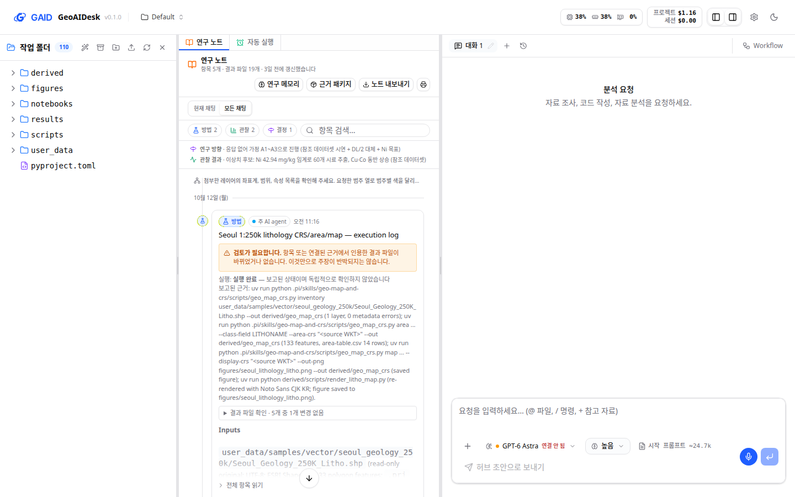
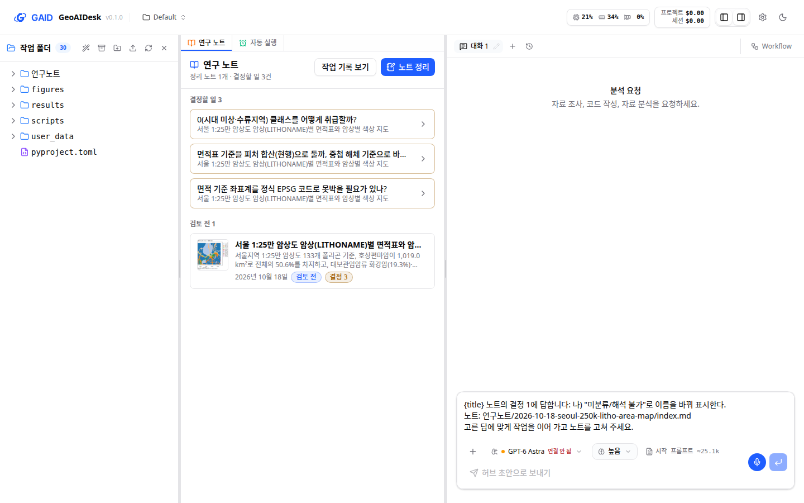
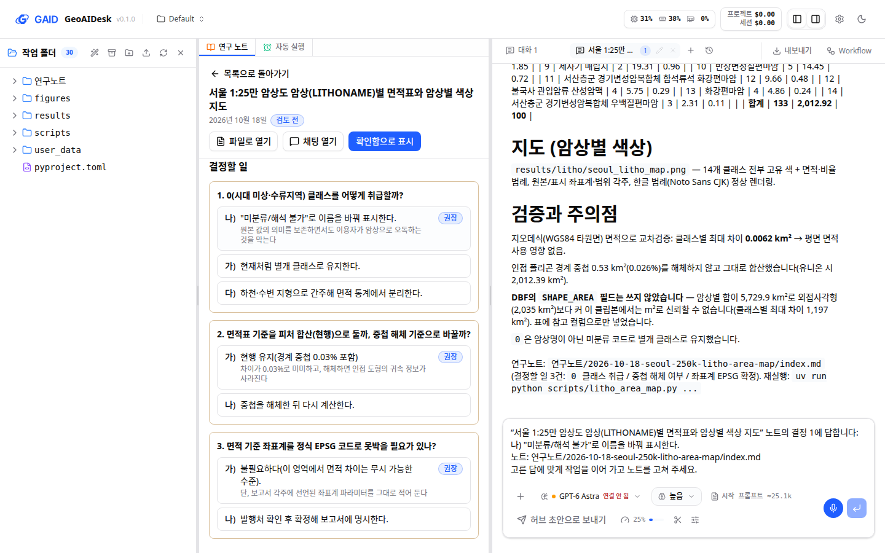
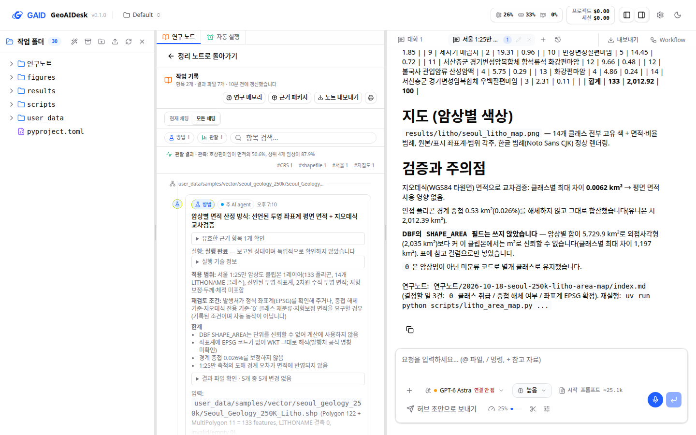
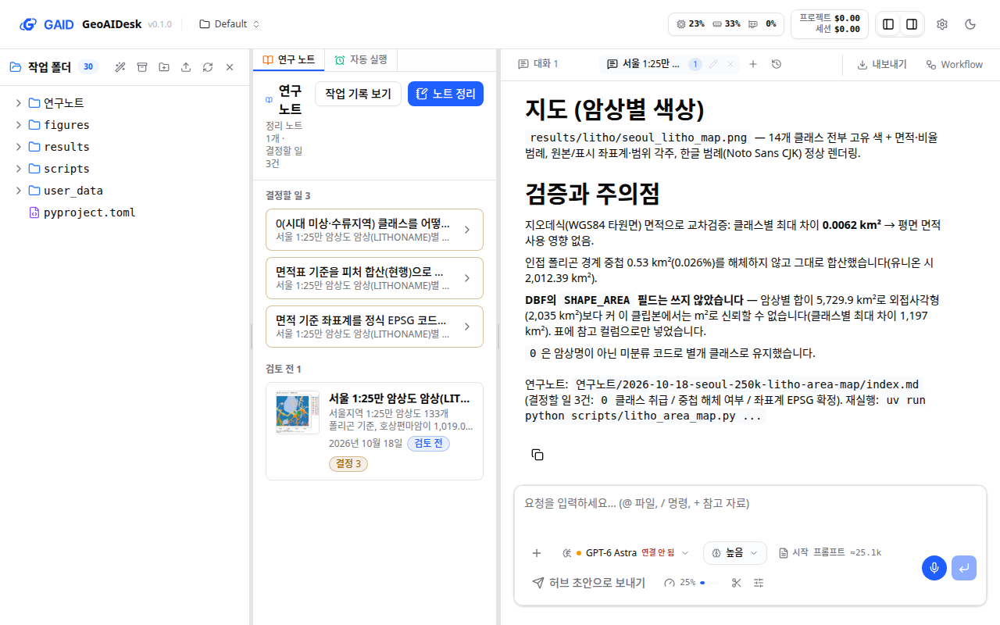
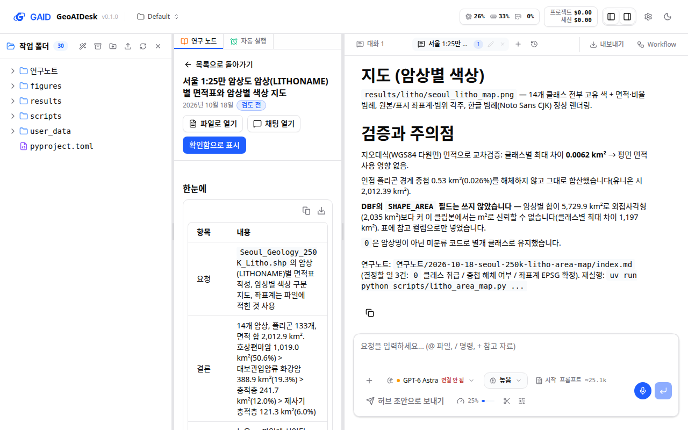

# GAID 연구노트를 분석별 정리 노트 중심으로 바꿈

## 0. 한눈에

| | |
|---|---|
| 요청 | 연구노트가 어디에 저장되고 어떻게 쓰이는지 진단하고, Obsidian 연구보고서 정리 방식을 참고해 개선하기 |
| 결론 | 연구노트 탭이 이제 분석마다 하나씩 쓰는 정리 노트를 먼저 보여 줍니다. 노트는 요청·결론·믿을 수 있는 정도·결정할 일부터 쓰며, 프로젝트의 `연구노트` 폴더에 Markdown과 그림으로 남습니다. 결정할 일은 목록 맨 위에 모이고, 선택지를 누르면 노트를 쓴 채팅에 답이 들어갑니다. 지금까지의 항목 타임라인은 "작업 기록"으로 한 단계 뒤에 남았고, 명령줄과 내부 ID는 접어 두었습니다. |
| 믿을 수 있는 정도 | 시험용 앱에서 기관 Qwen으로 실제 분석을 두 번 돌려 확인했습니다. 첫 실행에서 노트를 썼고, 결정에 답하자 같은 노트를 고쳤습니다. 다른 모델, 긴 연구 과제, 다른 연구자의 사용은 아직 시험하지 않았습니다. 검토용 앱(포트 3000)에는 아직 반영하지 않았습니다. |
| 결정할 일 | 없음 (2026-10-18 결정 2건은 6절) |

## 1. 요청한 것

> 그리고 연구노트와 관련해서도 해당 기능이 개선될 필요가 있다. 사용자의 관점에서 obsidian vault 연구보고서를 정리하는 것을 참고하여 현재 연구노트 기능이 개선되었으면 한다. 지금의 방식은 단순히 에이전트의 작업 흐름만 따라가는 형태로 보이며, 해당 연구노트가 어디에 저장되고 어떻게 활용되는지에 대한 연계가 부족하다고 생각한다. 연구노트의 경우에는 별도 작업 트리로 현황을 진단해보고 어떻게 개선 수정하면 좋을지 검토 후 사용자와 논의하여 시스템을 개선할 필요가 있다. — 2026-10-18 요청

> 모두 권장으로 진행하자. — 2026-10-18, 진단 보고서의 결정 2건에 대한 답

완료 기준: 1단계에서 지금의 연구노트를 진단하고 개선안을 냅니다. 2단계에서는 사용자가 고른 범위(정리 노트 중심, 분석이 끝나면 AI agent가 노트를 씀)만 구현하고, 실제 앱에서 한국어 화면으로 확인합니다.

## 2. 수행한 것

1. 검토용 앱의 실제 연구노트(채팅 2개, 항목 5개), 코드, Obsidian vault의 `연구 보고서`와 `결정 대기`를 비교해 진단했습니다(3.1, 3.2).
2. 개선안 세 가지를 내고 사용자와 정했습니다. 고른 안은 "정리 노트 중심"이고, 노트는 분석이 끝날 때 AI agent가 씁니다(6절).
3. 노트 형식과 저장 위치를 정했습니다. 그다음 일을 셋으로 나눴습니다. 서버(노트 읽기, 상태 바꾸기, 노트를 쓴 채팅 기록, AI agent 지시)와 기존 기록 정리(내부 정보 숨김, 내보내기 언어)는 하위 작업 둘이 맡았습니다. 연구 노트 화면은 이 작업에서 직접 만들었습니다.
4. 세 부분을 합친 뒤 시험용 앱을 따로 띄웠습니다. 서울 1:25만 지질도로 기관 Qwen에게 실제 분석을 맡겼고, 노트에 적힌 결정 하나에 답한 뒤 노트가 어떻게 바뀌는지 확인했습니다.
5. 확인 중에 드러난 문제 다섯 가지를 고쳤습니다(7절).

## 3. 결과

### 3.1 바꾸기 전의 연구노트

그림 1. 바꾸기 전 검토용 앱의 연구노트(1440×900). 볼 것: 좁은 탭에 AI agent의 항목이 시간순으로 쌓이고, 본문에 실행 명령줄과 내부 경로가 그대로 보입니다.

진단에서 확인한 문제는 다섯 가지였습니다.

- 기록의 단위가 채팅과 실행이었습니다. 연구 질문, 결론, 결정할 일, 검토 상태가 없었습니다.
- 기록은 숨김 폴더에 채팅별로 저장되어 파일 트리에 보이지 않았습니다. 연구자가 열 Markdown 파일도 없었습니다.
- 연구자는 항목을 만들거나 고칠 수 없었고, 메모 입력란도 기본 범위에서는 보이지 않았습니다.
- 화면에 명령줄, 내부 경로, 채팅·도구 호출 ID가 보였습니다(UI 가이드 R1). 내보내기와 연구 방법 초안은 영어였습니다.
- GAID의 방법·Workflow, 시험 평가와 이어지지 않았습니다. AI agent가 연구자용 정리 문서를 결과 폴더에 따로 썼지만, 연구노트는 그 문서를 결과 파일 하나로만 보여 주었습니다.

### 3.2 Obsidian 연구보고서에서 가져온 것

| 기준 | Obsidian 연구보고서 | 바꾼 GAID 연구노트 |
|---|---|---|
| 기록 단위 | 목표 하나에 보고서 하나 | 분석(연구 질문) 하나에 정리 노트 하나 |
| 첫 화면 | 한눈에: 요청, 결론, 믿을 수 있는 정도, 결정할 일 | 같은 네 줄 |
| 결정할 일 | 번호 질문, 가)·나) 선택지, 권장과 이유, `결정 대기`에 모음 | 같은 형식, 목록 맨 위에 모음, 고르면 채팅으로 답 |
| 상태 | 확인 필요, 확인함, 대체됨 | 검토 전, 확인함, 대체됨 |
| 근거 | 부록에 접어 둠 | 노트의 근거 절과 "작업 기록 보기" |
| 저장 | 프로젝트 폴더의 Markdown과 그림, 파일이 정본 | `연구노트` 폴더 안의 날짜-주제 폴더에 Markdown과 그림, 파일이 정본 |

### 3.3 바꾼 연구노트

그림 2. 연구 노트 탭의 첫 화면(1440×900). 볼 것: 파일 트리에 `연구노트` 폴더가 보입니다. 탭 맨 위에 결정할 일 3건이 모여 있고, 그 아래 검토 전 노트가 대표 그림, 한 줄 결론, 날짜, 상태와 함께 나옵니다. 탭 머리에는 "작업 기록 보기"와 "노트 정리" 두 동작만 있습니다.

그림 3. 노트를 연 화면(1440×900). 볼 것: 제목 아래에 날짜와 검토 상태가 있고, "파일로 열기", "채팅 열기", "확인함으로 표시"가 이어집니다. 본문은 한눈에 표부터 시작합니다. 이 노트는 기관 Qwen이 실제 분석에서 쓴 것입니다.

그림 4. 결정할 일 카드에서 선택지를 고른 화면(1440×900). 볼 것: 권장 선택지가 맨 위에 이유와 함께 있습니다. 하나를 고르면 노트를 쓴 채팅이 열리고, 입력창에 노트 제목·결정 번호·고른 답이 들어갑니다. 보내기 전에 고칠 수 있습니다.

그림 5. "작업 기록 보기"로 연 지금까지의 항목 타임라인(1440×900). 볼 것: 제목이 "작업 기록"이고, 실행 근거는 접힌 "실행 기술 정보" 안에 있습니다. 명령줄과 내부 ID는 첫 화면에 없습니다.

1280×800 화면은 그림 6, 7입니다(부록 B). 좁은 창에서도 목록과 노트의 동작 버튼이 가로 스크롤 없이 보입니다.

| 완료 기준 | 결과 | 근거 |
|---|---|---|
| 노트가 어디에 저장되는지 보임 | 충족: 파일 트리의 `연구노트` 폴더, Obsidian에서 그대로 열림 | 그림 2 |
| 결과부터 읽힘 | 충족: 한눈에 → 결과 → 한 일 → 한계 → 결정할 일 → 근거 | 그림 3 |
| 결정할 일이 모이고 답할 수 있음 | 충족 | 그림 2, 4 |
| 분석이 끝나면 AI agent가 노트를 씀 | 충족(기관 Qwen 1회) | 3.4 |
| 지금의 기록이 사라지지 않음 | 충족: 작업 기록으로 남고 내보내기·근거 패키지도 그대로 | 그림 5 |
| 내부 정보와 영어 고정 문구 정리 | 충족: 명령줄·ID는 기술 정보로, 내보내기·인쇄·연구 방법 초안은 화면 언어로 | 그림 5, 부록 A |
| 노트와 GAID 연결 | 부분: 노트를 쓴 채팅, 허브 방법과 시험 평가(방법으로 시작한 채팅일 때), 허브로 보내기 포함. 방법으로 시작한 채팅의 노트는 실제 앱에서 보지 않았음 | 4절 |

### 3.4 실제 분석에서 AI agent가 쓴 노트

시험용 앱에서 기관 Qwen에게 "서울 1:25만 지질도의 암상별 면적표와 암상별 색 지도"를 요청했습니다. 연구노트 지시 외에 노트에 관한 말은 넣지 않았습니다.

| 확인 항목 | 결과 |
|---|---|
| 노트 위치와 형식 | `연구노트` 폴더에 날짜-주제 폴더로 저장, 머리말 항목과 여섯 절이 모두 있음, 지도 그림을 노트 폴더에 복사 |
| 내용 | 14개 분류의 면적표, 지도, 면적 계산 방법, 한계 6가지, 결정할 일 3건(각각 권장과 이유) |
| 노트를 쓴 채팅 기록 | 채팅 1개가 노트에 연결됨("채팅 열기"로 열림) |
| 결정에 답한 뒤 | 같은 노트를 고침: 답한 결정을 본문으로 옮기고, 표와 지도 범례의 표시 이름을 바꾸고, 남은 결정 2건에 새 결정 1건을 더함. 새 노트는 만들지 않음 |
| 형식 문제 | 처음에는 권장 표시를 선택지 줄이 아닌 별도 줄에 썼음. 이 쓰임을 읽도록 고친 뒤 형식 문제 0건 |

## 4. 검증

- 과학적 검증: 해당 없음. 노트 안의 면적 값은 AI agent가 계산한 시험 내용이며 이 작업에서 검증하지 않았습니다.
- 시각 자료: 시험용 앱의 실제 화면을 한국어로 1440×900과 1280×800에서 캡처해 UI 가이드 10절 목록으로 확인했습니다. 지킨 규칙은 P1·P2(보기마다 주 동작 하나, 머리 동작 3개 이하), P3·P4(작업 기록과 기술 정보는 한 단계 뒤, 노트는 탭 안에서 열림), P6·R1·R2(채팅 ID·명령줄 숨김, 오류는 기술 정보에), B1·B3·B5, G1·G2(제목 한 줄, 배지 3개 이하), Q2(권장 선택지 먼저), F3·F4, T1(12 px 이상)입니다. 지키지 못한 규칙은 P7입니다. 1440 폭의 노트 첫 화면에서는 한눈에 표가 먼저 보이고 그림은 스크롤해야 보입니다. 목록에서는 대표 그림을 미리 보기로 보여 줍니다.
- 소프트웨어 검증:
  - 새 시험: 노트 화면 8개, 서버 노트 23개.
  - 기존 연구노트·인쇄 시험 69개, 파일 패널 시험, GAID 시험 48개(1개 건너뜀)가 통과했습니다.
  - 웹·서버 타입 검사, 문구 검사(오류 0), UI 검사(오류 0)를 통과했습니다.
  - 하위 작업 둘은 마칠 때 전체 검사를 통과했습니다. 합친 브랜치의 전체 검사는 마무리 단계에서 돌립니다.
  - 시험이 통과했다고 해서 노트 내용이 맞다는 뜻은 아닙니다.

## 5. 한계

- AI agent가 노트를 쓰는지는 기관 Qwen 한 모델, 분석 하나로만 확인했습니다. 다른 모델이나 긴 연구에서는 노트를 빠뜨리거나 형식을 틀릴 수 있습니다. 그런 노트는 목록에 "형식 확인 필요"로 표시되고, 연구자가 "노트 정리"로 다시 쓰게 할 수 있습니다.
- 노트 본문은 AI agent가 쓰는 내용이라, "한 일"과 "근거"에 파일 경로나 명령이 들어갈 수 있습니다. 시험한 노트에도 스크립트 경로가 있었습니다. 지시문은 연구 언어로 쓰라고 요구하지만 화면에서 걸러 내지는 않습니다.
- 결정에 답한 뒤 고친 노트에서 한눈에 표의 "결정할 일 2건"과 결정할 일 절의 3건이 맞지 않았습니다. 노트 안의 일관성은 AI agent에 달려 있습니다.
- 바꾸기 전의 채팅에는 정리 노트가 없습니다. 그 기록은 작업 기록에서 그대로 볼 수 있고, 필요하면 그 채팅에서 "노트 정리"를 누르면 됩니다.
- 노트 상태(확인함)는 연구자만 바꿉니다. 이 상태는 GAID 안의 표시이며, Obsidian vault의 `결정 대기`와는 연결하지 않았습니다.
- 검토용 앱(포트 3000)에는 아직 반영하지 않았습니다. 반영은 이 작업이 main에 합쳐진 뒤 hub가 처리합니다.

## 6. 결정할 일

없음. 진단 단계에서 나온 결정 2건은 2026-10-18에 사용자가 "모두 권장으로 진행하자."로 답했습니다.

1. 연구노트의 방향 → 가) 정리 노트 중심(분석마다 결과부터 쓰는 노트를 `연구노트` 폴더에 두고 지금의 기록은 근거로 내림)
2. 노트를 쓰는 시점 → 가) 분석 하나가 끝나면 AI agent가 같은 대화에서 쓰고, 이어지는 질문이면 같은 노트를 고침. "노트 정리"로 언제든 다시 쓰게 할 수 있음

## 7. 대체되었거나 실패한 시도

펼치기 — 6건

- 1단계 구상안 그림(정적 HTML)은 실제 화면(그림 2–5)으로 바꿨습니다.
- 권장 표시를 선택지 줄 끝의 `(권장: …)`로만 읽었습니다. Qwen은 선택지 아래 별도 줄(`- (권장: 나 — 이유)`)에 썼고, 이 쓰임도 읽도록 고쳤습니다.
- 결정 답 문구에서 노트 제목 자리에 `{title}`이 그대로 나왔습니다. 문구 형식에서 작은따옴표가 자리 표시를 막았기 때문이며, 따옴표를 바꿔 고쳤습니다.
- 노트 본문의 절 제목이 채팅용 큰 글씨(30 px)로 나왔습니다. GAID 글자 크기(16 px)로 맞췄습니다.
- 날짜가 화면 언어가 아니라 브라우저 언어(영어)를 따랐습니다. 화면 언어를 따르게 고쳤습니다.
- 결정 답이 지금 열린 채팅으로 들어갔습니다. 노트를 쓴 채팅을 열고 그쪽에 넣도록 바꿨습니다.

## 용어

| 용어 | 새 정의 / 정의 변경 | 정의 |
|---|---|---|
| [정리 노트](../../geo/copy/terminology.csv) | 새 정의 | 분석 하나의 요청, 결론, 믿을 수 있는 정도, 결과, 결정할 일, 근거를 결과부터 적은 Markdown 노트. 프로젝트의 `연구노트` 폴더에 저장 |
| [작업 기록](../../geo/copy/terminology.csv) | 새 정의 | AI agent가 작업하면서 남긴 항목(방법, 관찰, 결정). 정리 노트의 근거 |

## 부록 A. 근거 위치

펼치기 — 코드, 문구 변경, 시험 실행, 그림 원본

| 항목 | 위치 |
|---|---|
| 형식과 동작 | `docs/geo/research-notes.md`, 규약 `web/src/geo/contracts/research-notes.ts` |
| 서버 | `server/src/geo/notes/{parser,store,extension}.ts`, `server/src/geo/routes/notes.ts`, `RESEARCH_NOTE_RULE`(`server/src/geo/instructions.ts`, 시작 프롬프트 +678자), 시험 `server/test/geo-notes.test.ts` (하위 작업 gaid-notebook-review--notes-server) |
| 화면 | `web/src/geo/notes/`, 문구 `web/src/geo/locales/notes/{ko,en}.json`, 연결 `web/src/components/file-preview-panel.tsx`, `web/src/app/page.tsx` |
| 기존 기록 정리 | 하위 작업 gaid-notebook-review--record-cleanup: 실행 근거·출처 접기, 결과 링크 ID 제거, 내보내기·인쇄 언어, 채팅 내보내기 이름, 연구 방법 초안 언어. 문구 id별 변경 전후는 `docs/tasks/gaid-notebook-review--record-cleanup.md` "Catalogue changes" |
| 이 작업의 문구 변경 | 새 이름공간 `notes.*`(ko/en 전체 새로 추가). `notebook.header.title` 연구 노트 → 작업 기록 / Lab Notebook → Work record. `notebook.export.title`(en) Lab Notebook → Work record. 용어 `geo/copy/terminology.csv`에 정리 노트, 작업 기록 추가 |
| 시험용 앱 | PC74 `systemd-run --user` unit `gaid-notes-app`(이 작업 트리, 포트 3370/18370), 자료 `~/data/geoaidesk/work/gaid-notebook-review/home`, 로그 `.../logs/app.log` |
| 실제 분석 | 채팅 `01a14e7a-d440-76b4-83b1-aeb7777ab157`, 모델 `kigam-qwen/qwen3.8-flash-next`, 요청·출력 `~/data/geoaidesk/work/gaid-notebook-review/tools/{msg1,msg2}.md`, `run1.log`, `run2.log` |
| 노트 원본 | `~/data/geoaidesk/work/gaid-notebook-review/home/projects/default/sandbox/연구노트/2026-10-18-seoul-250k-litho-area-map/` |
| 화면 원본 | `~/data/geoaidesk/work/gaid-notebook-review/shots/`(1440×900, 1280×800), 바꾸기 전 화면 `.../playwright/03-notebook-top.png` |
| 진단 근거 | 저장 `server/src/agent/notebook-store.ts`, 주석 `server/src/agent/notebook-annotations.ts`, 기본 범위 `web/src/components/lab-notebook-view.tsx`, 숨김 폴더 제외 `server/src/sandbox-fs.ts`, vault `~/vaults/cmds-main/연구 보고서/` |

작성 시점: 2026-10-18, commit a2cc53f.

## 부록 B. 1280×800 화면

그림 6. 1280×800의 정리 노트 목록. 볼 것: 결정할 일과 노트 행이 가로 스크롤 없이 보입니다.

그림 7. 1280×800의 노트 상세. 볼 것: 동작 버튼이 두 줄로 나뉘어도 모두 보입니다. 한눈에 표의 칸이 좁아 줄이 많이 바뀝니다.
