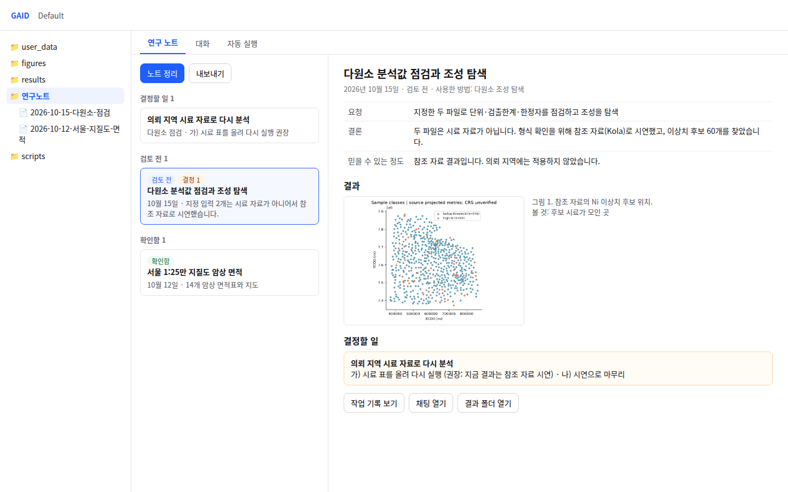
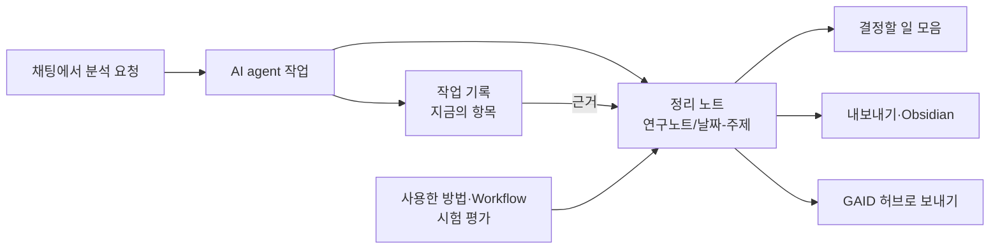

# GAID 연구노트 진단과 개선안

## 0. 한눈에

| | |
|---|---|
| 요청 | 연구노트가 어디에 저장되고 어떻게 쓰이는지 진단하고, Obsidian 연구보고서 정리 방식을 참고한 개선안을 만들기 |
| 결론 | 지금의 연구노트는 AI agent가 작업하면서 남기는 항목을 시간순으로 보여 주는 기록입니다. 연구 질문, 결론, 결정할 일, 검토 상태가 없고, 파일은 화면에 보이지 않는 숨김 폴더에 채팅별로 저장되며, GAID의 방법·Workflow·허브와 이어지지 않습니다. 분석 하나마다 결과부터 쓰는 "정리 노트"를 프로젝트 폴더에 두고, 지금의 기록은 그 근거로 내리는 안(가)을 권장합니다. |
| 믿을 수 있는 정도 | 코드 전체와 검토용 앱의 실제 기록(채팅 2개, 항목 5개)을 확인했습니다. 다른 연구자의 사용 기록은 없어서, 어떤 정리 방식이 연구자에게 맞는지는 이 보고서의 판단입니다. 코드는 바꾸지 않았습니다. |
| 결정할 일 | 2건 (6절) |

## 1. 요청한 것

> 그리고 연구노트와 관련해서도 해당 기능이 개선될 필요가 있다. 사용자의 관점에서 obsidian vault 연구보고서를 정리하는 것을 참고하여 현재 연구노트 기능이 개선되었으면 한다. 지금의 방식은 단순히 에이전트의 작업 흐름만 따라가는 형태로 보이며, 해당 연구노트가 어디에 저장되고 어떻게 활용되는지에 대한 연계가 부족하다고 생각한다. 연구노트의 경우에는 별도 작업 트리로 현황을 진단해보고 어떻게 개선 수정하면 좋을지 검토 후 사용자와 논의하여 시스템을 개선할 필요가 있다. — 2026-10-18 요청

> 권장대로 하고 모두 진행하자. — 2026-10-18, hub가 작업 단위 세 개를 제안한 뒤

완료 기준: 1단계는 진단만 합니다. 연구노트의 저장 위치, 재사용 경로, 연결 대상(프로젝트 파일, 결과, 보고서, 허브 방법, 내보내기)을 확인하고, 어디가 AI agent의 작업 흐름만 따라가는지 밝힙니다. 연구자가 고를 수 있는 개선안과 권장안을 냅니다. 2단계 구현은 사용자가 고른 범위만 합니다.

## 2. 수행한 것

1. 검토용 앱(현재 배포판)에서 Default 프로젝트의 연구노트를 한국어 화면으로 열어 1440×900으로 캡처했습니다. 이 프로젝트에는 2026-10-12과 10-15 두 채팅의 항목 5개가 있습니다.
2. 연구노트의 저장, 작성 주체, 화면, 내보내기, 재사용 기능, AI agent 지시문을 코드에서 확인했습니다.
3. Obsidian vault의 `연구 보고서` 폴더와 `결정 대기` 노트를 읽어, 연구자가 결과를 어떤 단위와 순서로 정리하는지 정리했습니다.
4. 두 정리 방식을 비교해 차이를 표로 만들고, 개선안 세 가지와 권장안을 정했습니다. 권장안의 화면은 구상안으로 그렸습니다(그림 2).

## 3. 결과

### 3.1 지금의 연구노트

그림 1. 검토용 앱의 지금 연구노트(1440×900, 한국어). 볼 것: 가운데 패널의 좁은 탭에 항목이 시간순으로 쌓입니다. 첫 항목의 제목은 영어("execution log")이고, 본문에는 실행 명령줄과 내부 경로가 그대로 보입니다. 이 위치에서 조금 내리면 "저장된 결과 1 보기" 아래에 채팅 ID와 도구 호출 ID가 그대로 나옵니다.

| 질문 | 지금 상태 |
|---|---|
| 누가 쓰는가 | AI agent가 작업 도중에 기록 도구로 항목을 남깁니다(방법, 관찰, 결정, 가설, 메모). 지시문은 "마지막에 요약 하나보다 중간중간 작은 항목 여러 개"를 요구합니다. 연구자는 항목을 만들거나 고칠 수 없고, 고정·댓글·메모만 덧붙일 수 있습니다. |
| 어디에 저장되는가 | 프로젝트 안의 숨김 폴더에 채팅마다 기록 파일 하나씩 저장됩니다. 파일 트리는 숨김 폴더를 보여 주지 않습니다. 연구자가 열어 볼 수 있는 Markdown 사본은 없고, 내보내기로 내려받을 때만 만들어집니다. |
| 무엇을 묶는 단위인가 | 채팅과 실행입니다. 연구 질문, 주제, 결론, 검토 상태를 담는 칸이 없습니다. 머리글은 "최근 결정"과 "최근 관찰" 한 줄씩만 보여 줍니다. |
| 연구자 메모 | 메모 입력란은 "현재 채팅" 범위에서만 보입니다. 기본 범위가 "모든 채팅"이라 처음 여는 연구자에게는 메모 입력란이 보이지 않습니다. 메모와 댓글은 고치거나 지울 수 없습니다. |
| 어떻게 다시 쓰이는가 | 내보내기(Markdown, JSON, 결과 파일 묶음, PDF 인쇄), 연구 방법 초안, 연구 메모리 검색, 후속 실험 제안, 근거 패키지, 분석 계획 고정이 있습니다. 모두 원본 K-Dense에서 온 기능입니다. 내보낸 Markdown과 PDF의 제목·항목 이름은 영어로 고정되어 있고, 연구 방법 초안도 영어 지시문으로 만들어집니다. |
| 무엇과 이어지는가 | 항목이 인용한 결과 파일(열기 링크, 바뀌었는지 확인)과 저장된 결과 카드뿐입니다. GAID의 방법·Workflow, 방법 시험 평가(유용함/수정 필요), 저장한 레시피, GAID 허브로 보내기와는 이어지지 않습니다. 허브로 보내는 분석 묶음은 숨김 폴더를 빼기 때문에 연구노트가 들어가지 않습니다. |
| 화면 규칙 | 연구자 화면에 실행 명령줄, 내부 경로, 채팅·도구 호출 ID가 보입니다(UI 가이드 R1 위반). 머리글에 버튼 4개, 필터 줄, 요약 줄이 겹쳐 첫 화면이 항목 내용보다 도구로 채워집니다(P1, P3, W5). |

2026-10-15 채팅의 실제 기록을 보면, AI agent는 연구자가 읽을 정리 문서(`다원소 분석값 단위·검출한계·한정자 점검 및 조성 탐색 (검토 전)`)를 결과 폴더에 따로 썼습니다. 이 문서에는 전제, 가정, 결과 표, 상태(검토 전)가 있어 vault 보고서에 가깝습니다. 그러나 연구노트는 이 문서를 보고서로 알아보지 못하고, 인용한 결과 파일 9개 가운데 하나로만 보여 줍니다.

### 3.2 Obsidian 연구보고서와의 차이

| 기준 | Obsidian 연구보고서(vault) | GAID 연구노트(지금) |
|---|---|---|
| 기록 단위 | 목표 하나에 보고서 하나 | 채팅마다 작업 항목 여러 개 |
| 첫 화면 | "한눈에": 요청, 결론, 믿을 수 있는 정도, 결정할 일 | 최근 결정·관찰 한 줄과 항목 목록 |
| 순서 | 결과 먼저, 근거(실행 방법·원본·해시)는 부록에 접어 둠 | 시간순, 실행 명령줄이 본문에 노출 |
| 결정할 일 | 번호가 붙은 질문, 선택지 가)·나), 권장과 이유, 근거 절 링크. `결정 대기`에 모임 | 없음(결정 항목은 이미 내린 결정의 기록) |
| 상태 | 확인 필요, 확인함, 대체됨, 검토 기록 | 없음 |
| 저장 | 프로젝트 폴더의 Markdown과 그림 폴더. 파일이 정본이고 vault는 읽기 전용 사본 | 숨김 폴더의 기록 파일. Markdown은 내려받을 때만 |
| 목록 | `보고서 목록`과 표 보기: 상태별, 프로젝트별 | 항목 유형·태그 필터 |
| 연결 | 프로젝트 허브 ↔ 보고서 ↔ 결정 ↔ 후속 작업 | 결과 파일 링크뿐 |

vault의 방식이 맞는 이유는 연구자가 묻는 순서와 같기 때문입니다. 연구자는 "무엇을 알게 되었나 → 얼마나 믿을 수 있나 → 내가 정할 것은 무엇인가 → 근거는 어디 있나" 순으로 읽습니다. 지금의 연구노트는 AI agent가 일한 순서로 쓰여 있어, 이 질문에 답하려면 연구자가 항목을 끝까지 읽어야 합니다.

### 3.3 개선안

| | 가) 정리 노트 중심 (권장) | 나) 지금 기록 정리와 연결 보강 | 다) 최소 수정 |
|---|---|---|---|
| 기록 단위 | 분석 하나(연구 질문 하나)에 정리 노트 하나 | 지금처럼 채팅마다 항목 | 지금과 같음 |
| 첫 화면 | 정리 노트 목록(결정할 일, 검토 전, 확인함)과 선택한 노트 | 프로젝트 요약 한 단과 항목 목록 | 지금과 같음 |
| 저장 | 프로젝트에 보이는 `연구노트` 폴더 아래 날짜-주제 폴더에 Markdown과 그림. Obsidian에서 그대로 열림 | 숨김 기록은 그대로, 보이는 폴더에 채팅별 Markdown 사본을 자동 갱신 | 저장 위치를 화면에 안내 |
| 지금의 항목 | 노트의 근거로 남김. "작업 기록 보기" 뒤로 이동 | 그대로 첫 화면 | 그대로 |
| 결정할 일 | 노트마다 가)·나)와 권장. 목록 맨 위에 모음 | 없음 | 없음 |
| GAID 연결 | 사용한 방법·Workflow와 시험 평가, 채팅 열기, 결과 폴더, 허브로 보내기에 노트 포함 | 방법·시험 평가 표시, 허브로 보내기에 사본 포함 | 없음 |
| 화면 규칙(R1) 정리, 한국어 내보내기 | 포함 | 포함 | 포함 |
| 작업 규모 | 큼: 노트 형식, AI agent 지시, 목록·노트 화면, 연결 | 중간 | 작음 |
| 남는 문제 | 노트 품질이 AI agent의 정리 능력에 달림. 노트 상태를 연구자가 직접 바꿔야 함 | 여전히 작업 순서의 기록이라 결론과 결정이 드러나지 않음 | 요청한 문제(작업 흐름만 따라감, 연계 부족)가 남음 |

그림 2. 가)안의 구상 화면(1440×900, 실제 앱이 아닌 그림). 볼 것: 파일 트리에 `연구노트` 폴더가 보이고, 목록은 결정할 일, 검토 전, 확인함으로 나뉩니다. 오른쪽 노트는 요청, 결론, 믿을 수 있는 정도를 먼저 보여 주고, 그림과 결정할 일 다음에 작업 기록·채팅·결과 폴더로 가는 버튼이 있습니다. 내용은 2026-10-15 실제 기록을 옮겨 만든 예시입니다.

가)안에서 기록이 이어지는 방식은 다음과 같습니다.

가)는 요청에서 짚은 두 문제(작업 흐름만 따라감, 저장과 활용의 연계 부족)를 둘 다 직접 다룹니다. AI agent가 이미 결과 폴더에 비슷한 정리 문서를 쓰고 있어서, 형식과 저장 위치를 정해 주면 그 문서가 연구노트로 모입니다. 노트가 보이는 폴더의 Markdown이면 파일 트리, Obsidian, 내보내기, 허브로 보내기가 별도 변환 없이 같은 파일을 씁니다. 지금의 기록과 원본 K-Dense 기능(근거 패키지, 연구 메모리 등)은 지우지 않고 "작업 기록" 쪽으로 옮기므로 잃는 기능은 없습니다.

## 4. 검증

- 과학적 검증: 해당 없음. 이 작업은 기능 진단입니다.
- 시각 자료: 그림 1은 검토용 앱의 실제 화면입니다. 그림 2는 정적 HTML로 그린 구상안이며, GAID의 색과 글꼴 크기만 맞췄고 실제 구성 요소로 만든 화면이 아닙니다.
- 소프트웨어 검증: 코드를 바꾸지 않았으므로 검사를 돌리지 않았습니다. 진단 내용은 코드 위치(부록 A)와 실제 기록 파일로 확인했습니다.

## 5. 한계

- 실제 사용 기록이 검토용 앱의 채팅 2개, 항목 5개뿐입니다. 긴 연구 과제에서 노트가 몇 개나 생기고 목록이 어떻게 보일지는 확인하지 못했습니다.
- vault의 보고서 형식은 코드 작업 결과를 사람에게 보고하는 형식입니다. 연구 분석 결과에 맞추려면 절을 줄여야 할 수 있습니다(예: "소프트웨어 검증" 대신 "확인한 것"). 2단계에서 정합니다.
- 가)안의 노트 품질은 AI agent와 고른 모델에 달려 있습니다. 기관 Qwen 같은 지역 모델에서 정리 노트를 제대로 쓰는지는 시험하지 않았습니다.

## 6. 결정할 일

1. 연구노트를 어떤 방향으로 바꿀지 정해 주십시오.
   - 가) 정리 노트 중심: 분석마다 결과부터 쓰는 노트를 프로젝트 `연구노트` 폴더에 두고, 지금의 기록은 근거로 내림 (권장: 작업 흐름만 따라가는 문제와 연계 부족을 둘 다 고치고, Obsidian 보고서와 같은 순서로 읽힘)
   - 나) 지금 기록을 정리하고 연결을 보강: 화면 규칙 정리, 보이는 폴더에 Markdown 사본, 방법·허브 연결
   - 다) 최소 수정: 내부 정보 숨김과 한국어 내보내기만
2. 가)를 고를 때, 정리 노트를 언제 쓸지 정해 주십시오.
   - 가) 분석 하나가 끝나면 AI agent가 같은 대화에서 노트를 쓰고, 같은 질문을 이어 가면 그 노트를 고침. 연구자는 "노트 정리"로 언제든 다시 쓰게 할 수 있음 (권장: 연구자가 잊어도 기록이 남고, 따로 모델을 한 번 더 부르지 않음)
   - 나) 연구자가 "노트 정리"를 누를 때만 AI agent가 씀

## 7. 대체되었거나 실패한 시도

펼치기 — 0건

- 없음

## 용어

| 용어 | 새 정의 / 정의 변경 | 정의 |
|---|---|---|
| 정리 노트 | 새 정의(제안) | 분석 하나의 요청, 결론, 믿을 수 있는 정도, 결과 그림, 결정할 일을 결과부터 적은 Markdown 노트. 프로젝트 `연구노트` 폴더에 저장. 1번 결정에서 가)를 고르면 프로젝트 용어집에 올림 |
| 작업 기록 | 새 정의(제안) | 지금 연구노트에 쌓이는 AI agent의 항목(방법, 관찰, 결정, 가설, 메모). 가)안에서는 정리 노트의 근거 |

## 부록 A. 근거 위치

펼치기 — 코드 위치, 자료, 그림 원본

| 항목 | 위치 |
|---|---|
| 저장 경로와 형식 | `server/src/agent/notebook-store.ts:1-101`, `server/src/projects.ts:122,133` (`sandbox/.kady/notebook/<sessionId>.jsonl`) |
| 연구자 주석 | `server/src/agent/notebook-annotations.ts:16-33`, `web/src/lib/use-notebook-annotations.ts:147-191` (고정·댓글·메모 추가만) |
| 메모 입력란 범위 | `web/src/components/lab-notebook-view.tsx:94,130,547-583` (기본 범위 모든 채팅, 메모는 현재 채팅에서만) |
| AI agent 지시 | `server/src/agent/notebook.ts:150-171`; 시드 AGENTS.md에는 연구노트 언급 없음 (`server/src/sandbox-seed.ts`); `server/src/geo/instructions.ts:9` 언어 규칙 |
| 항목 형식 | `server/src/agent/notebook.ts:40-102`, `server/src/agent/notebook-store.ts:29-78` |
| 화면 위치 | `web/src/components/file-preview-panel.tsx:186-203,1921-1932` |
| 숨김 폴더 제외 | `server/src/sandbox-fs.ts:78-87`(파일 트리), `server/src/geo/hub-handoff/builder.ts:40-43`(허브로 보내기) |
| 영어 고정 문구 | `web/src/lib/notebook-print.ts`, `server/src/agent/notebook-export.ts:16-22,103-195`, `server/src/agent/session-export.ts:243-252`, `server/src/agent/methods-draft.ts:60-79` |
| 방법 시험 평가(따로 저장) | `server/src/geo/methods/trials.ts:38,230-239` |
| 실제 기록 | PC74 `~/.geoaidesk/projects/default/sandbox/.kady/notebook/` (채팅 2개, 항목 5개), 정리 문서 `results/assay_composition_audit_ko.md` |
| vault 참고 | PC74 `~/vaults/cmds-main/연구 보고서/` (보고서 폴더, `결정 대기.md`, `보고서 목록.md`, `보고서 표.base`) |
| 그림 원본 | 그림 1: PC74 `~/data/geoaidesk/work/gaid-notebook-review/playwright/03-notebook-top.png`; 그림 2: 같은 폴더의 `../mockup/notebook.html` (sha256 bca76c7aded42cff478a3ee148cd357d5325992fc3063b3f4803910835fb6a1d) |
| 검토용 앱 | PC74 `gaid-review` (`~/deploy/geoaidesk`, main 75703f6) |

작성 시점: 2026-10-18, commit dabb723.

