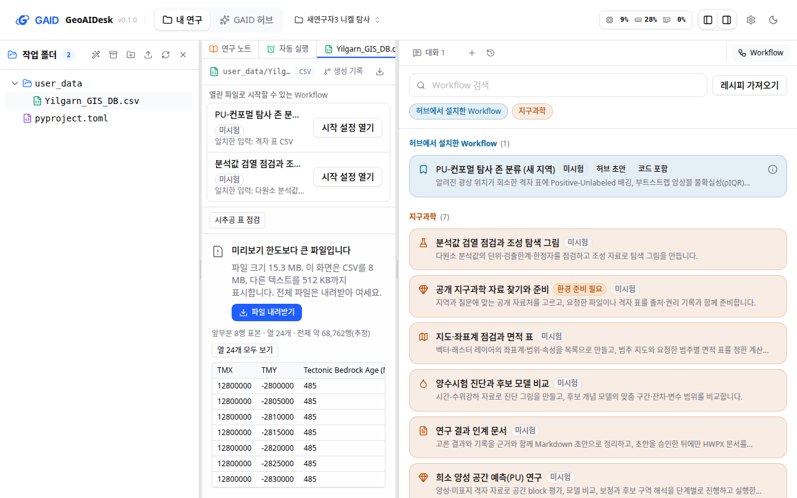
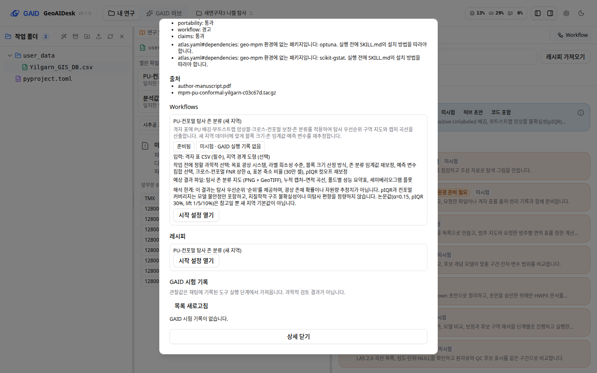

# 큰 CSV 미리보기 화면과 허브 방법 배지 정리

## 0. 한눈에

| | |
|---|---|
| 요청 | 처음 쓰는 연구자 검토 3회차의 두 지적(큰 CSV의 오류 문구가 표 머리글로 보임, 허브 방법 행에 뜻을 구분할 수 없는 배지가 겹침)을 별도 작은 작업으로 고칩니다. |
| 결론 | 두 지적을 모두 고쳤습니다. 큰 CSV는 파일 크기, 미리보기 한도, 앞부분 8행 표본, 내려받기 버튼을 보여 줍니다. 허브 방법 행은 배지 3개 이하로 `미시험`, `허브 초안`, `코드 포함`처럼 범위가 드러나게 표시하고, 배지마다 설명이 뜹니다. |
| 믿을 수 있는 정도 | 검토 때와 같은 16 MB 니켈 CSV와 같은 설치 방법으로 실제 앱을 띄워 두 화면 크기에서 확인했습니다. 어두운 화면과 200% 확대는 확인하지 않았습니다. |
| 결정할 일 | 없음 |

## 1. 요청한 것

> "따로 작은 작업으로 권장 방식으로 지적 처리하고 output 작업도 별도작업으로 진행하자." — 2026-10-18 요청

이 작업은 위 답 가운데 지적 처리 부분을 맡습니다. 대상은 신규 사용자 검토 3회차의 지적 2와 7입니다.

완료 기준: 두 지적을 화면 가이드와 문구 규칙에 맞게 고치고, 실제 앱에서 한국어 화면 1440×900과 1280×800으로 확인합니다.

## 2. 수행한 것

1. 현재 main에서 두 지적을 다시 확인했습니다. 큰 CSV는 이전 작업 뒤로 "파일을 불러오지 못했습니다" 오류 화면으로 바뀌어 있었습니다. 그러나 다시 시도해도 결과가 같은데 다시 시도 버튼을 보여 주었습니다. 편집 버튼도 남아 있어서, 편집기에서 저장하면 원래 16 MB 파일을 오류 문구로 덮어쓸 수 있었습니다. 허브 방법 행은 이미 배지 3개로 줄어 있었지만 `초안`이 무엇의 단계인지 드러나지 않았습니다. 방법 상세에는 여전히 배지 5개와 `사용자 자료 필요`가 함께 나왔습니다.
2. 미리보기 한도를 넘은 파일에 전용 화면을 만들었습니다. 파일 크기, 미리보기 한도, 내려받기 버튼을 보여 주고, 공용 파일 점검 기능으로 앞부분 8행 표본을 읽어 표로 보여 줍니다. 열은 처음 8개만 보여 주고, 버튼을 누르면 모든 열을 보여 줍니다. 전체 행 수는 읽은 앞부분으로 추정한 값이므로 "(추정)"을 붙였습니다.
3. 불러오지 못한 파일과 한도를 넘은 파일에서는 편집 버튼을 숨겼습니다.
4. 배지 이름과 설명에 범위를 넣었습니다. 허브 패키지 단계는 `허브 초안`(`허브 제출됨`, `허브 공개됨`)으로 바꾸고, 미시험·시험 횟수·준비 상태에는 "현재 프로젝트"라는 범위를 설명에 적었습니다. `사용자 자료 필요`는 배지에서 뺐습니다. 이 배지는 자료를 올린 뒤에도 바뀌지 않는 패키지 속성인데 프로젝트 상태처럼 읽혔습니다. 필수 입력은 상세의 "입력: 격자 표 CSV (필수)" 줄이 이미 보여 줍니다.
5. 방법 상세의 Workflow 카드에서는 배지 줄을 뺐습니다. 바로 아래 준비 상태 줄(`준비됨`, `미시험 · GAID 실행 기록 없음`)과 내용이 겹쳤기 때문입니다.

## 3. 결과

그림 1. 검토 때 쓴 16 MB 니켈 격자 CSV를 연 파일 패널(가운데)과 Workflow 목록(오른쪽), 1440×900. 볼 것: 가운데에는 오류 문구 대신 "미리보기 한도보다 큰 파일입니다", 파일 크기, 내려받기 버튼, 앞부분 8행 표본(열 24개 중 8개)이 나옵니다. 머리글 줄에 편집 버튼이 없습니다. 오른쪽 허브 방법 행에는 `미시험`, `허브 초안`, `코드 포함` 세 배지만 나옵니다.

그림 2. 같은 화면, 1280×800. 볼 것: 좁은 파일 패널에서 설명이 세 줄로 접히고 내려받기 버튼은 설명 아래에 있습니다. 표는 패널 안에서 가로로 스크롤됩니다.

그림 3. 방법 상세 창의 Workflow 카드, 1440×900. 볼 것: 카드에는 준비 상태 줄 하나만 있고, 배지가 두 번 나오지 않습니다.

| 완료 기준 | 결과 | 근거 |
|---|---|---|
| 큰 CSV에 전용 크기 한도 화면을 보여 주고, 가능하면 앞부분 표본도 보여 줌 | 충족 | 그림 1, 2 |
| 허브 방법 행의 배지가 무엇을 가리키는지 구분됨 | 충족 | 그림 1 |
| 화면 가이드와 문구 규칙 | 충족(부록 A의 규칙 목록) | 문구·화면 검사 |
| 실제 앱 한국어 화면 1440×900, 1280×800 | 충족 | 그림 1–3 |

## 4. 검증

- 과학적 검증: 해당 없음(화면 수정).
- 소프트웨어 검증: 검토 자료를 복사한 별도 앱 인스턴스에서 같은 CSV와 같은 설치 방법으로 화면을 확인했습니다. 자동 시험을 추가했습니다. 크기 한도 화면은 표본 표, 추정 행 수, 내려받기 버튼을 보여 주고 다시 시도와 편집 버튼은 보여 주지 않는지 확인합니다. 불러오지 못한 파일에 편집 버튼이 없는지, 행 배지의 범위 설명이 맞는지, `사용자 자료 필요`가 나오지 않는지도 확인합니다. 저장소 전체 검사 결과는 부록 A에 적었습니다.

## 5. 한계

- 표본은 파일 앞부분에서 읽은 8행입니다. 전체 행 수는 읽은 바이트로 추정한 값입니다.
- 미리보기 한도(CSV 8 MB, 다른 텍스트 512 KB)는 바꾸지 않았습니다.
- 방법 상세 창에는 이번 범위 밖의 화면 가이드 위반이 남아 있습니다. 예를 들어 첫 화면 글자 수가 많고, 허브 검사 기록 목록과 `revision` 표기가 그대로 보입니다(그림 3 위쪽).
- 시험 횟수 배지는 연구자의 평가(`평가: 수정 필요`)를 배지 안에 함께 보여 줍니다. 화면 가이드 G2는 평가를 배지 밖의 별도 줄로 보여 주라고 합니다. 이번에는 고치지 않았습니다.

## 6. 결정할 일

없음

## 7. 대체되었거나 실패한 시도

펼치기 — 1건

- 1280×800에서 내려받기 버튼을 제목 오른쪽에 두었더니 좁은 파일 패널에서 설명이 한 줄에 몇 글자씩 일곱 줄로 접혔습니다. 버튼을 설명 아래로 옮겼습니다.

## 용어

없음

## 부록 A. 근거 위치

펼치기 — 코드, 문자열, 규칙, 검사

| 항목 | 위치 |
|---|---|
| 코드 | 브랜치 `task/gaid-system-ui-followups`; `web/src/geo/viewers/preview-limit.tsx`(새 파일), `web/src/lib/use-sandbox.ts`(탭의 `previewLimited`), `web/src/components/file-preview-panel.tsx`(전용 화면 연결, 편집 숨김), `web/src/geo/methods/methods.tsx`(배지) |
| 시험 | `web/src/components/file-preview-panel.test.tsx`, `web/src/geo/methods/methods.test.tsx` |
| 실제 앱 | PC74 `~/data/geoaidesk/work/gaid-system-ui-followups/bin/dev.sh`(개발 서버, GAID_HOME은 novice-review 자료 사본); 원본 스크린숏 `~/data/geoaidesk/work/gaid-system-ui-followups/playwright/` |
| 검토 근거 | `~/data/geoaidesk/work/gaid-hub-novice-review/novice3/summary.md` 지적 2, 7; `shots/16-csv-preview-error.png`, `shots/09-start-settings.png` |
| 전체 검사 | `scripts/check` 통과(2026-10-18, 백엔드 1,929개·웹 1,093개 시험, GAID 검사 포함), 로그 `~/data/geoaidesk/work/gaid-system-ui-followups/logs/check.log` |

화면 가이드 규칙: F4(오류·한도 화면이 할 수 있는 다음 동작을 알림, 다시 시도 없음), F3/B1(주 동작 하나: 파일 내려받기), X2/X4(기본 8열, 표 위 상태 한 줄), P3(표본 외 정보 없음), G2/W5(행 배지 3개 이하, 배지마다 설명), W6(같은 상태를 한 화면에 두 번 쓰지 않음), R1(내부 이름 없음). 어긴 규칙: 없음.

문자열(새 id, 한국어 / 영어):

| id | 한국어 | 영어 |
|---|---|---|
| `viewers.oversize.title` | 미리보기 한도보다 큰 파일입니다 | This file is larger than the preview limit |
| `viewers.oversize.size` | 파일 크기 {size} MB. | File size {size} MB. |
| `viewers.oversize.body` | 미리보기는 CSV 8 MB, 다른 텍스트 512 KB까지입니다. 전체 파일은 내려받아 여세요. | This view shows CSV files up to 8 MB and other text up to 512 KB. Download the file to open all of it. |
| `viewers.oversize.download` | 파일 내려받기 | Download file |
| `viewers.oversize.loading` / `.failed` | 앞부분 표본을 읽고 있습니다… / 앞부분 표본을 읽지 못했습니다. | Reading the first rows… / Could not read the first rows. |
| `viewers.oversize.state` | 앞부분 {rows}행 표본 · 열 {columns}개 · 전체 약 #행(추정) | Sample of the first {rows} rows · {columns} columns · about # rows in total (estimate) |
| `viewers.oversize.lines`, `.sample`, `.allColumns`, `.fewerColumns` | 앞부분 {rows}줄 표본 · 앞부분 표본 · 열 {count}개 모두 보기 · 처음 8개 열만 보기 | Sample of the first {rows} lines · First rows · Show all {count} columns · Show the first 8 columns |
| `methods.badge.stage` | 허브 초안 / 허브 제출됨 / 허브 공개됨 | Hub draft / Hub submitted / Hub published |
| `methods.badge.stageTip`, `.readinessTip`, `.trialsTip`, `.codeTip` | 배지 설명(범위: 허브 패키지 / 현재 프로젝트 / 현재 프로젝트의 GAID 시험 / 패키지의 실행 코드) | same scopes in English |

바뀐 문자열: `methods.badge.noTrials` 한국어 "해당 Workflow의 GAID 시험 기록이 없습니다." → "현재 프로젝트에서 해당 Workflow를 GAID로 시험한 기록이 없습니다."; 영어 "No GAID trial records for this Workflow." → "No GAID trial of this Workflow in this project." 행 배지의 `초안`(`methods.lifecycle.draft`)은 `methods.badge.stage`로 바뀌었습니다. `methods.lifecycle.*`는 설정의 skill_hub 카드에서 그대로 씁니다. 화면에서 빠진 문자열: `workspace.badge.userData`(허브 방법 배지에서만 뺐고, 문자열은 남아 있음).

작성 시점: 2026-10-18.

