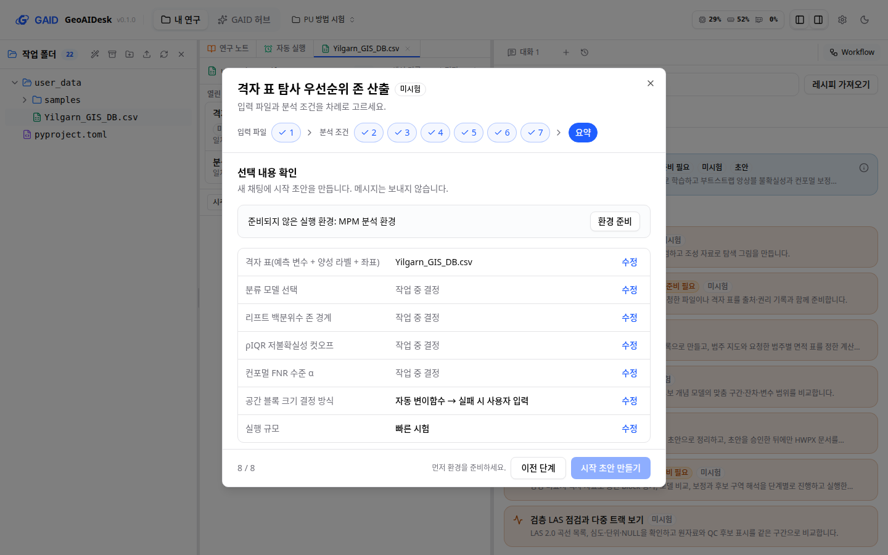
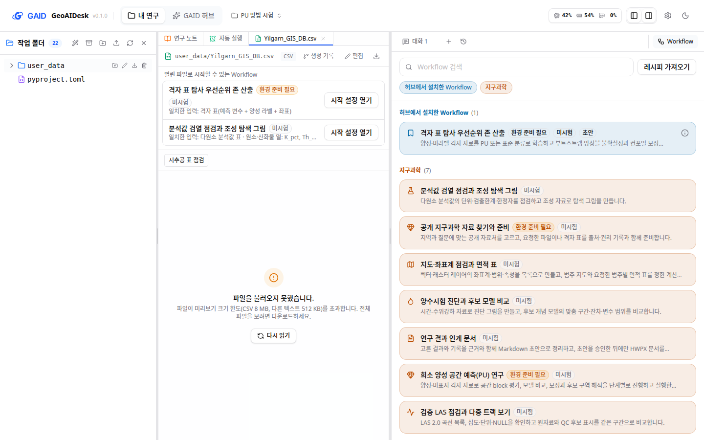

# Workflow 시작 설정을 단계 화면으로 다시 만들고 GAID 작업 화면을 화면 가이드에 맞춤

## 0. 한눈에

| | |
|---|---|
| 요청 | Workflow를 불러올 때 뜨는 팝업의 글자 수를 줄이고 디자인 완성도와 시인성을 높입니다. GAID 작업 화면의 나머지 부분도 화면 가이드로 점검합니다. |
| 결론 | 시작 설정은 2026-10-16에 승인된 시안대로 바뀌었습니다. 위쪽에 단계 표시(입력 파일 → 분석 조건 → 요약)가 있고, 한 단계에 질문 하나와 선택지 카드가 나오며, 마지막 요약에서 시작 초안을 만듭니다. Workflow 목록, 파일 패널, skill_hub 카드의 명확한 위반은 고쳤고, 고치지 않은 항목은 5절에 적었습니다. |
| 믿을 수 있는 정도 | 실제 앱을 격리해 띄우고, 카탈로그 Workflow와 허브 방법(분석 조건 6개)으로 두 화면 크기에서 확인했습니다. 화면 동작은 자동 시험으로 확인했습니다. 어두운 화면과 200% 확대는 확인하지 않았습니다. |
| 결정할 일 | 없음 |

## 1. 요청한 것

> "보고서를 확인하였다. GAID 허브는 비교적 OneUI기반의 프로젝트의 디자인 가이드를 기반으로 개선되었는데 GAID 시스템에서는 덜 반영된 곳들이 있다. workflow를 불러올 때 뜨는 팝업창에는 여전히 글자 수도 많고 디자인 완성도와 이용자 시인성이 부족한 편이다. 그리고 연구노트와 관련해서도 해당 기능이 개선될 필요가 있다. 사용자의 관점에서 obsidian vault 연구보고서를 정리하는 것을 참고하여 현재 연구노트 기능이 개선되었으면 한다. 지금의 방식은 단순히 에이전트의 작업 흐름만 따라가는 형태로 보이며, 해당 연구노트가 어디에 저장되고 어떻게 활용되는지에 대한 연계가 부족하다고 생각한다. 연구노트의 경우에는 별도 작업 트리로 현황을 진단해보고 어떻게 개선 수정하면 좋을지 검토 후 사용자와 논의하여 시스템을 개선할 필요가 있다. GAID 허브의 경우에는 GPT sol 6.1high 워커가 허브를 배경 지식과 맥락없이 처음 이용하는 이용자의 역할을 부여하였을 때 해당 허브를 올바르게 사용할 수 있는지를 검토하게 하는 작업을 통해 누락되거나 개선이 필요한 부분들을 개선하는 작업을 별도의 작업트리에서 수행하여야 한다." — 2026-10-18 요청
>
> "권장대로 하고 모두 진행하자." — 2026-10-18 요청 (작업 세 개로 나누는 안에 대한 답)

이 작업은 위 요청 가운데 Workflow 팝업과 GAID 시스템 화면 부분을 맡습니다. 연구노트와 허브 신규 사용자 검토는 별도 작업입니다.

사용자가 고른 범위(가안): 시작 설정 팝업을 화면 가이드에 맞게 다시 만들고, 작업 공간·Workflow 목록·파일 패널·설정의 GAID 카드를 같은 가이드로 점검합니다. 명확한 위반은 고치고 나머지는 보고서에 적습니다. 허브 신규 사용자 검토 작업이 찾은 시작 설정 문제는 이 작업이 받아 처리합니다.

완료 기준: 시작 설정이 가이드의 질문 규칙(한 단계에 질문 하나, 선택지 카드, 기타 입력, 이전/다음, 요약)을 따르고, 첫 화면 글자 수가 기준(300자) 안에 듭니다. 점검한 화면의 위반은 고치거나 목록으로 남깁니다. 한국어 화면을 1440×900과 1280×800으로 보입니다.

## 2. 수행한 것

1. 고치기 전 화면을 격리한 앱에서 찍었습니다. 시작 설정에는 입력 파일 선택, 분석 조건 선택, 설명, 준비 상태, 예상 결과, 해석 한계가 한 화면에 이어져 있어 아래로 길게 스크롤해야 했습니다(그림 1).
2. 화면 가이드 작업이 만든 승인 시안을 기준으로 시작 설정을 다시 만들었습니다. 입력 파일과 분석 조건마다 한 단계씩 묻고, 마지막 요약 단계에서 고른 값을 확인합니다.
3. Workflow 목록, 파일 패널, 설정의 skill_hub 카드를 같은 가이드로 점검했습니다. 행마다 배지가 너무 많은 곳, 12px보다 작은 글자, 브라우저 기본 영어 문구를 고쳤습니다.
4. 허브 신규 사용자 검토 작업이 넘긴 6건을 받아 4건을 고쳤습니다. 시작 초안의 문장 순서, 미결정 조건 개수 안내, 작업 공간에서 허브로 가는 전환, 실행 코드 없는 방법의 표시입니다.
5. 실제 앱에서 두 화면 크기로 찍고 가이드 10절 점검표로 확인했습니다. 저장소 전체 검사를 돌렸습니다.

## 3. 결과

### 시작 설정

그림 1. 고치기 전 시작 설정(허브 방법 "격자 표 탐사 우선순위 존 산출", 1440×900, 이전 작업 보고서의 그림). 볼 것: 분석 조건마다 선택 칸과 서너 줄 설명이 이어지고, 화면 아래로 스크롤해야 나머지 조건이 보입니다.

그림 2. 고친 시작 설정의 분석 조건 단계(같은 방법, 1440×900). 볼 것: 위쪽 단계 표시에서 입력 파일 1개와 분석 조건 7개, 요약의 위치가 보입니다. 질문 하나에 선택지 카드가 있고, 마지막 두 카드는 `기타 (직접 입력)`과 `작업 중 결정`입니다. 방법이 적은 긴 선택 이유는 두 줄까지만 보이고 `근거 전체 보기`로 펼칩니다.

그림 3. 같은 방법의 요약 단계. 레시피에서 열면 이 단계부터 보입니다. 볼 것: 고른 파일과 조건이 한 표에 있고 줄마다 `수정`이 있습니다. 실행 환경이 준비되지 않아 위쪽 한 줄에 `환경 준비` 버튼이 있고, 아래의 `시작 초안 만들기`는 꺼져 있으며 그 이유("먼저 환경을 준비하세요.")가 옆에 보입니다.

바뀐 점:

- 한 단계에 질문 하나만 묻습니다. 입력 파일은 프로젝트에서 형식이 맞는 파일을 카드로 보이고, 맞는 파일이 하나면 미리 고릅니다. 선택 입력은 `사용하지 않음`이 기본입니다. 필수 파일을 고르기 전에는 `다음 단계`가 꺼지고 이유가 한 줄로 보입니다.
- 분석 조건은 아무것도 미리 고르지 않습니다. 근거 없는 `권장`을 붙이지 않았습니다(Workflow 정보에 권장 근거가 없습니다). 레시피나 방법 기본값에서 온 값은 미리 골라 두고 `레시피 값`으로 표시합니다.
- 카탈로그가 영어 식별자만 준 선택지 10개에 한국어 이름을 붙였습니다(`투영 좌표계로 계산`, `측정 심도(MD)` 등).
- 설명, 입력 형식, 예상 결과, 해석 한계는 접힌 항목(`작업 내용과 입력 형식 보기`, `예상 결과와 해석 한계 보기`)으로 옮겼습니다. `미시험`은 제목 옆 배지와 요약의 한 줄("미시험 Workflow입니다. 결과는 검토 전입니다.")로 남겼습니다.
- 환경 준비나 스킬 켜기 같은 막힘은 첫 단계와 요약에 해결 버튼과 함께 나옵니다. 환경 준비가 실패하면 연구 용어로 한 줄을 보이고, 원래 오류는 접힌 `기술 정보`에 둡니다.
- 닫았다 다시 열어도 고른 값과 보던 단계가 남습니다.
- 처음 보이는 영역의 글자 수(사용자 파일 이름과 폴더 제외)는 제목과 버튼을 포함해 입력 단계 113자, 분석 조건 단계 297자, 요약 단계 250자입니다. 제목, 버튼, 선택지 이름을 뺀 본문은 77자, 199자, 123자입니다. 가이드 기준(300자) 안이지만, 분석 조건 단계는 방법이 적은 선택 이유가 길어 기준에 가깝습니다.

### 다른 GAID 화면

그림 4. 고친 뒤 큰 CSV 파일을 연 작업 공간(1440×900). 볼 것: 가운데 파일 패널 위에 이 파일로 시작할 수 있는 Workflow가 한 줄씩 있고(제목, 배지, 일치한 입력, `시작 설정 열기`), 크기 한도를 넘은 CSV는 오류 화면으로 보입니다. 오른쪽 Workflow 목록은 행마다 설명 한 줄과 배지 3개 이하이고, 허브에서 설치한 방법의 상세는 행 오른쪽 정보 아이콘으로 엽니다. 위쪽 머리글에 `내 연구 / GAID 허브` 전환이 있습니다.

| 화면 | 고친 것 | 가이드 규칙 |
|---|---|---|
| Workflow 목록 | 행 설명을 한 줄로 줄였습니다. 허브 방법 행의 배지 6개를 3개로 줄였습니다(준비 상태 → 시험 기록 → 단계 순서, 나머지는 방법 상세). 목록 위에 따로 있던 "방법 상세 보기" 버튼 줄을 행의 정보 아이콘으로 옮겼습니다. 분류 버튼과 개수의 11px·10px 글자를 12px로 키웠습니다. | G1, G2, T1, P3 |
| 파일 패널의 Workflow 제안 | 제안마다 4–5줄이던 카드를 한 줄 행으로 바꿨습니다. 아직 정할 조건 목록은 시작 설정에서 묻기 때문에 뺐습니다. 영어 형식 식별자는 화면에서 뺐습니다. | G1, G2, P3, R1 |
| 파일 패널의 불러오기 오류 | 한국어 화면에서 크기 한도를 넘은 CSV의 오류 문장이 표 머리글로 보였습니다. 한국어 오류 표시도 오류 화면으로 보이게 고쳤습니다(영어 화면에서는 원래 오류 화면이 나왔습니다). | F4 |
| 설정의 skill_hub 카드 | 브라우저 기본 파일 칸("Choose File No file chosen")을 `패키지 파일 선택` 버튼과 파일 이름 한 줄로 바꿨습니다. 가져올 패키지가 없으면 빈 목록 제목과 문장을 보이지 않습니다. 제목과 사이트 링크를 한 줄에 두고, 11px 글자를 없앴습니다. | P2, P3, T1, W6 |
| 작업 공간 머리글 | 프로젝트 목록에만 있던 `내 연구 / GAID 허브` 전환을 작업 공간 머리글에도 두었습니다. | L3 |
| 문구 | "작업 설정"과 "시작 설정"이 섞여 있던 것을 허브와 같은 "시작 설정"으로 통일했습니다. 버튼은 `시작 초안 만들기`입니다. | W6 |

고치기 전 화면은 부록 A의 그림 목록에 있습니다.

### 허브 신규 사용자 검토에서 넘어온 항목

| 항목 | 처리 |
|---|---|
| 1. 시작 초안의 문장이 서로 어긋남(방법 작성자의 예시 값이 연구자의 선택보다 앞에 옴) | 고쳤습니다. 초안은 연구자가 정한 설정(입력 파일, 고른 조건, 작업 중 결정할 조건)을 먼저 적고 "아래 Workflow 지시문보다 우선합니다"라고 밝힙니다. 그 뒤에 저장된 지시문을 두고, 지시문의 예시 값이 설정이나 실제 파일과 다르면 설정과 파일을 따르고 차이를 먼저 알리라고 적습니다. 요약 단계에서 고른 값을 모두 확인한 뒤 만듭니다. |
| 2. 조건 설명이 작성자의 예시를 연구자의 자료처럼 씀 | 화면 변경 없음. 설명은 두 줄로 줄여 보입니다. 새 패키지는 허브 작성 규칙에서 고칩니다. |
| 3. 작은 첫 시험 묶음이 없고, 작업 중 결정이 몇 개 남는지 모름 | 일부 고쳤습니다. 요약에 "작업 중 결정한 조건 n개는 채팅에서 해당 조건이 필요한 단계 전에 묻습니다."를 보입니다. 첫 시험 묶음은 Workflow 정보에 해당 항목이 없어 하지 않았습니다. |
| 4. 앞 선택에 따라 뒤 선택지가 바뀌지 않음 | 기록만 했습니다. 조건끼리 서로 묶는 정보가 Workflow 정보에 없습니다. |
| 5. 작업 공간에서 허브로 돌아갈 길이 없음 | 고쳤습니다(머리글 전환). |
| 6. 실행 코드 없는 방법이 목록에서 잘 보이지 않음 | 고쳤습니다. 방법 행의 단계 배지가 "초안 · 분석 지침만"처럼 함께 보입니다. "설명만"이던 이름을 허브 화면과 같은 "분석 지침만"으로 바꿨습니다. |

| 완료 기준 | 결과 | 근거 |
|---|---|---|
| 시작 설정이 질문 규칙(Q1–Q6)을 따름 | 충족 | 그림 2–3 |
| 첫 화면 글자 수 300자 이하, 주 버튼이 스크롤 없이 보임 | 충족(분석 조건 단계 297자) | 3절 글자 수, 부록 A의 1280×800 그림 |
| 다른 GAID 화면 점검, 명확한 위반 수정, 나머지 목록화 | 충족 | 3절 표, 5절 |
| 신규 사용자 검토 항목 처리 | 충족(2건은 기록만) | 3절 표 |
| 한국어 화면 1440×900, 1280×800 | 충족 | 부록 A |

## 4. 검증

- 화면 확인: 이 작업 판을 격리해 띄운 앱(별도 자료 폴더, 예시 시추공·래스터·벡터 자료와 PU 격자 표, 허브 방법 1개 설치)에서 카탈로그 Workflow와 허브 방법을 열어 단계 이동, 파일 선택, 선택지 고르기, 요약의 수정 링크, 닫았다 다시 열기를 확인했습니다. 두 화면 크기 모두 페이지 스크롤 없이 주 버튼이 보였습니다.
- 글자 수: 실제 앱에서 대화상자 안의 보이는 글자를 화면 기준으로 셌습니다(접힌 내용, 화면 낭독기 전용 문장, 스크롤해야 보이는 부분, 사용자 파일 이름 제외). 1440×900과 1280×800에서 같은 값이 나왔습니다. 입력 단계는 "지도·좌표계 점검과 면적 표", 분석 조건과 요약은 허브 방법 "격자 표 탐사 우선순위 존 산출"로 셌습니다. 분석 조건 단계 글자 수는 방법이 적은 선택 이유의 길이에 따라 달라집니다(두 줄까지만 보이므로 위쪽 한도가 있습니다).
- 자동 시험: 저장소 전체 검사가 통과했습니다(서버 시험 파일 170개, 웹 시험 파일 160개, GAID 검사, 배포판 시작 점검 포함). 시작 설정 시험은 새 흐름(단계마다 질문 하나, 필수 파일 전 `다음 단계` 꺼짐, 요약에서 수정, 연구자 설정이 지시문보다 앞에 오는 초안, 레시피는 요약부터 열림)에 맞춰 다시 썼습니다. 화면 가이드 검사는 새 오류 0건이고 기존 부채가 102건에서 89건으로 줄었습니다.
- 확인하지 않은 것: 어두운 화면, 200% 확대, 공식 대비 측정, 화면 낭독기 실제 사용.

## 5. 한계

점검했지만 이번에 고치지 않은 항목입니다.

- 방법 상세 대화상자는 글자가 많습니다. 시험 기록에 "도구 호출 3회 · 실패 1회" 같은 에이전트 내부 정보가 보이고(R1, R3), 허브 검사 항목 ID와 영어 메시지가 그대로 나옵니다. 방법 상세는 허브 화면과 같은 정보를 다루므로 허브 작업과 함께 정리하는 편이 낫습니다.
- 크기 한도를 넘은 파일의 오류 화면에 `다시 읽기`가 나오지만, 다시 읽어도 결과는 같습니다. 8 MB가 넘는 CSV는 표 미리보기가 없습니다(내려받거나 시추공 표 점검을 씁니다).
- 작업 공간 머리글의 판 번호와 출처 문구, 기본 숨김 상태인 다른 분야 Workflow 행의 배지는 여전히 12px보다 작습니다(업스트림 화면 부분).
- 첫 시험 묶음(작은 시험용 조건 한 벌)과 조건끼리의 연동은 Workflow 정보에 해당 항목이 생겨야 할 수 있습니다.
- 레시피 가져오기 대화상자와 지도·검층 보기는 이번 점검 범위에서 자세히 보지 않았습니다. 연구노트는 같은 날 시작한 별도 작업이 다룹니다.

## 6. 결정할 일

없음

## 7. 대체되었거나 실패한 시도

펼치기 — 3건

- 분석 조건마다 답을 골라야 `다음 단계`로 넘어가게 하는 안을 검토했다가 쓰지 않았습니다. 조건이 7개인 방법에서 클릭이 크게 늘고, 이전 화면에서도 비워 두면 작업 중 결정이었습니다. 지금은 필수 입력 파일만 다음 단계를 막고, 비워 둔 조건은 요약에 `작업 중 결정`으로 보입니다.
- 형식이 맞는 파일이 다섯 개를 넘으면 목록을 따로 스크롤하게 했다가, 단계 본문 스크롤과 겹쳐 뺐습니다.
- 처음 만든 준비 안내는 설치되지 않은 스킬도 "꺼져 있습니다"라고 적었습니다. 설치된 스킬과 설치되지 않은 스킬을 나눠 적게 고쳤습니다.

## 용어

없음 (화면 이름 "시작 설정", 버튼 "시작 초안 만들기"는 허브 화면이 이미 쓰는 이름으로 맞췄습니다).

## 부록 A. 근거 위치

펼치기 — 코드, 그림, 실행 방법

| 항목 | 위치 |
|---|---|
| 시작 설정 | `web/src/geo/workspace/task-setup.tsx`, `web/src/geo/workspace/setup-steps.tsx`, `web/src/geo/workspace/readiness.tsx`(준비 안내), `web/src/geo/workspace/api.ts`(시작 초안), 문구 `web/src/geo/locales/workspace/{ko,en}.json` `setup.*` |
| Workflow 목록 | `web/src/components/workflows-panel.tsx`(행 상세 버튼, 한 줄 설명, 글자 크기), `web/src/geo/methods/methods.tsx`(배지 3개), `web/src/geo/workspace/task-catalogue.tsx` |
| 파일 패널 | `web/src/geo/workspace/file-actions.tsx`, `web/src/components/file-preview-panel.tsx`(한국어 오류 표시 인식) |
| skill_hub 카드 | `web/src/geo/skill-hub/skill-hub.tsx`, 문구 `web/src/geo/locales/skillHub/*` |
| 작업 공간 머리글 | `web/src/app/page.tsx`(`GaidTopNav`) |
| 업스트림 파일 변경 기록 | `geo/integration-boundaries.json`(workflows-panel, file-preview-panel, page) |
| 화면 가이드 부채 | `geo/ui/ui-baseline.json`: 해결된 13건 삭제(오류 문구 10건, 작은 글자 3건), 새로 추가한 부채 없음 |
| 바뀐 문자열 id (한·영) | `workspace.setup.*` 대부분 새로 씀(제목 `{title} 작업 설정` → 제목만, `작업 초안 만들기`/`Create task draft` → `시작 초안 만들기`/`Create start draft`, `작업 설정 열기` → `시작 설정 열기`, 막힘 안내·오류 문구는 원래 오류를 빼고 다음 행동만), `workspace.setup.draft` → `workspace.setup.draft.*` 9개 문장, `workspace.setup.options.*` 10개 새로 씀, `workspace.files.match` `일치한 입력: {role} · 형식: {format}` → `일치한 입력: {role}`, `workspace.files.needs` 삭제, `workspace.files.title` 새로 씀, `workspace.environment.{done,incomplete,error}`·`workspace.skills.error`·`workspace.files.error`는 `{detail}`을 빼고 기술 정보로 옮김, `methods.implementation.descriptive` `설명만` → `분석 지침만`, `skillHub.chooseFile`·`skillHub.noFile` 새로 씀 |
| 따른 가이드 규칙 | P1 P2 P3 P6 L6 L7 T1 S3 S5 B1 B3 D2 Q1 Q2 Q3 Q4 Q5 Q6 G1 G2 F4 F5 R1 R2 W5 W6 A1. 어긴 규칙: N1은 해당 없음(단계 표시는 탐색 탭이 아니라 Q4의 번호 단계 표시) |
| 고치기 전 그림 | `figures/01-setup-before.png`(이전 작업 보고서 그림 재사용), `figures/05-workflows-before.png`, `figures/07-file-panel-before.png`, `figures/09-skill-hub-before.png` |
| 고친 뒤 그림 | 1440×900: `figures/02-setup-input.png`, `03-setup-choice.png`, `04-setup-summary.png`, `06-workflows-after.png`, `08-file-panel-after.png`, `10-skill-hub-after.png`; 1280×800: `figures/02-setup-input-1280.png`, `03-setup-choice-1280.png`, `04-setup-summary-1280.png` |
| 전체 화면 사진 | PC74:`~/data/geoaidesk/work/gaid-system-ui/shots/final/`(두 크기 12장, `SHA256SUMS`), 고치기 전 `shots/before-*`, `shots/audit-*` |
| 격리 실행 | PC74:`~/data/geoaidesk/work/gaid-system-ui/bin/run.sh`(화면 3361, 서버 18361, 자료 `home/`), 사진 스크립트 `bin/final-shots.sh`, 글자 수 `bin/count.js` |
| 신규 사용자 검토 결과 회신 | PC74:`~/data/geoaidesk/work/gaid-system-ui/briefs/route-88fe3c357f47-result.md` |
| 검사 | `scripts/check` EXIT=0 (로그 PC74:`~/data/geoaidesk/work/gaid-system-ui/logs/check.log`) |

작성 시점: 2026-10-18, branch task/gaid-system-ui.

