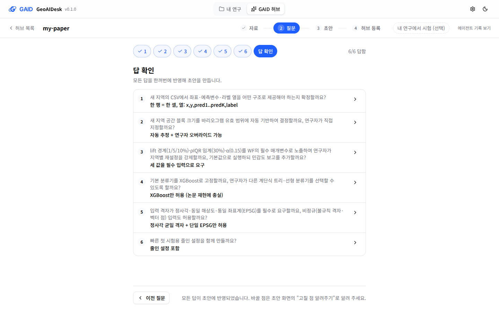
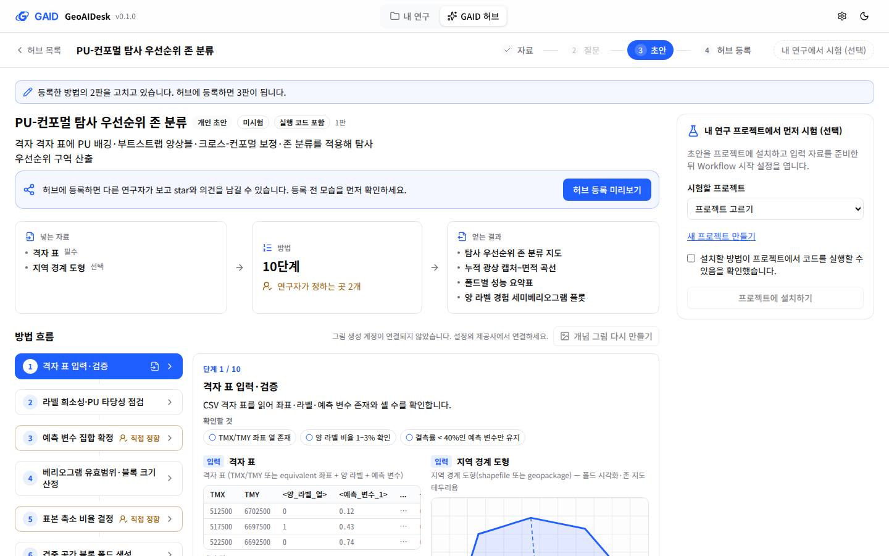
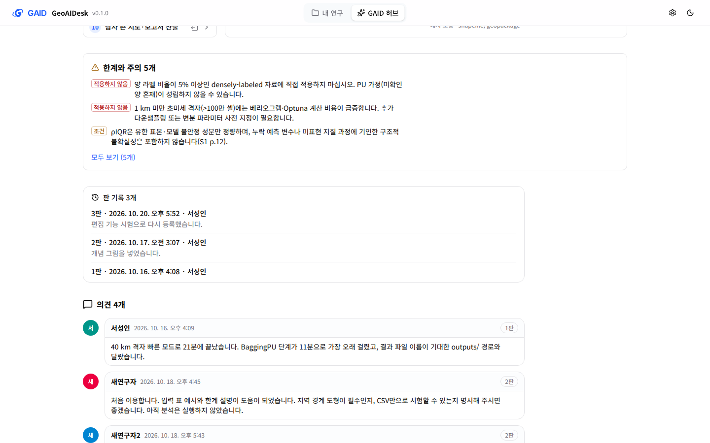
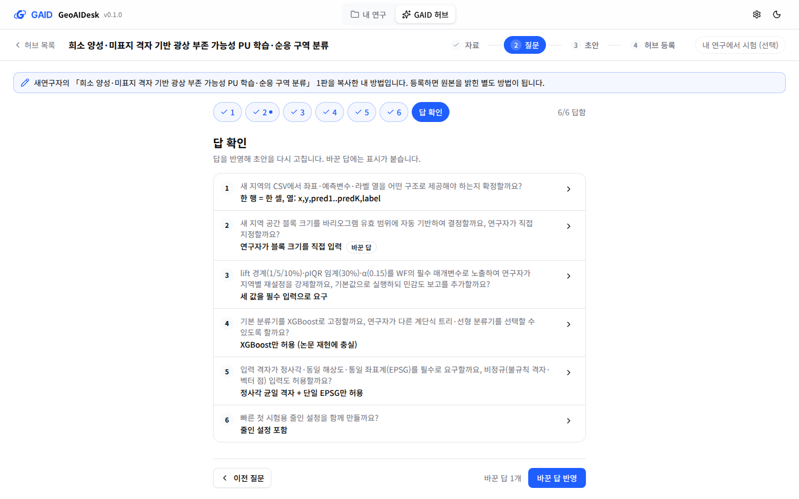
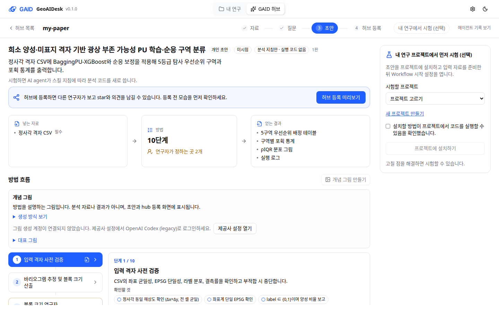
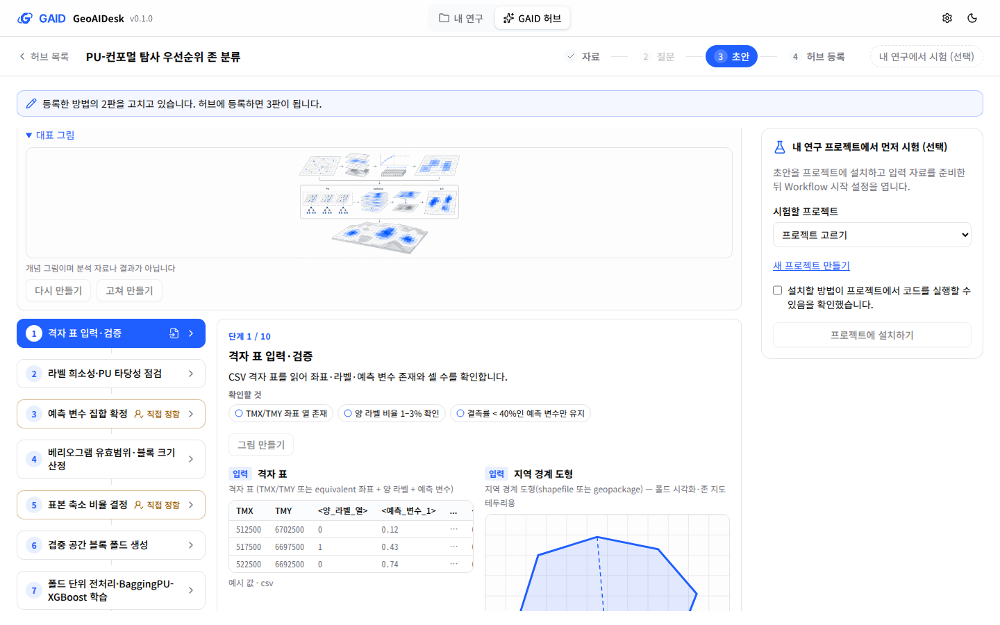

# GAID 허브 개선 — 방법 고치기, 답 다시 고르기, 허브 연동, 개념 그림

## 0. 한눈에

| | |
|---|---|
| 요청 | GAID 허브에서 등록한 방법 고치기, 답한 질문 다시 고르기, 레시피·스킬을 허브에서 가져오기, 개념 그림 안내와 다시 만들기 |
| 결론 | 다섯 항목을 모두 구현하고 시험 앱에서 확인했습니다. 실제 모델 호출(초안 다시 쓰기, 그림 생성)은 비용과 로그인 문제로 실행하지 않았습니다. |
| 믿을 수 있는 정도 | 화면과 서버 동작은 자동 시험과 시험 앱(검토 자료 복사본)으로 확인했습니다. 모델이 바꾼 답을 초안에 잘 반영하는지, 그림 수정 결과가 마음에 드는지는 확인하지 못했습니다. |
| 결정할 일 | 1건 (6절) |

## 1. 요청한 것

> GAID 시스템 노트에서 결정한 일이 여러가지 일 경우 답변 하나를 클릭할 때마다 채팅창으로 메시지를 입력하게 하지 않고 전체 답변이 클릭되고 사용자가 답변 보내기라는 별도의 버튼을 클릭하면 한번에 전송될 수 있게 수정되어야 한다. 그리고 답변에서도 별도 지시 옵션이 추가되어 있어야 한다. 그리고 레시피 가져오기에서 GAID 허브가 연동되어 이용자들이 GAID 허브에서 레시피를 가져올 수 있게 연동되어야 한다. skill 추가 시에도 skill_hub는 legacy이며 GAID 허브에서 스킬을 찾을 수 있게 연동되어야 한다. 한편, GAID 허브에서는 등록된 방법을 수정할 수 있는 기능이 없으며, 사용자들이 작성한 방법을 클릭해서 들어갔을 때 이미 선택된 질문들도 수정이 되지 않는다. 또한 각 방법 초안에서 개념 그림도 어떻게 생성되는지 안내도 없으며, 기능도 보이지 않는다. 사용자가 해당 개념이 마음에 들지 않으면 수정하지도 못하는 것으로 보인다. 관련 현황을 확인 후 GAID 허브를 개선하여야 한다. — 2026-10-20 요청

이 보고서는 위 요청 가운데 GAID 허브 부분입니다. 연구 노트의 결정 답변 묶어 보내기는 별도 작업(gaid-note-decisions)이 맡았습니다.

완료 기준(사용자와 확정한 범위):

1. 먼저 실제 앱에서 각 항목의 현재 동작을 확인합니다.
2. Workflow 목록의 "레시피 가져오기"에서 GAID 허브의 레시피를 찾아 가져옵니다.
3. 설정 → 스킬에서 GAID 허브의 스킬을 찾습니다. skill_hub는 "이전 skill_hub" 링크로만 남깁니다.
4. 허브에 등록한 방법을 고칠 수 있습니다. 고치면 새 판이 되고, 계정 없이 이름만 쓰는 구조에서 누가 고칠 수 있는지 정합니다.
5. 방법 초안에서 이미 답한 질문을 다시 고를 수 있습니다.
6. 개념 그림이 어떻게 만들어지는지 안내하고 기능을 보여 줍니다. 마음에 들지 않는 그림은 다시 만들거나 지시해서 고칠 수 있습니다.

## 2. 수행한 것

1. 검토 앱 자료를 복사한 시험 앱을 띄워 다섯 항목의 현재 동작을 화면으로 기록했습니다.
2. 누가 방법을 고칠 수 있는지 정하고(3절 표 아래), 고치기·복사·새 판 등록을 서버와 화면에 넣었습니다.
3. 답한 질문을 다시 고를 수 있게 하고, 바꾼 답만 모아 초안을 고치도록 했습니다.
4. 허브 연동(레시피·스킬)과 개념 그림은 하위 작업 두 개로 나눠 동시에 진행한 뒤 합쳤습니다.
5. 자동 시험, 문구·화면 규칙 검사, 시험 앱 화면(1440×900, 1280×800)으로 확인했습니다.

## 3. 결과

### 3.1 현재 동작 확인 (작업 전)

| 항목 | 작업 전 동작 |
|---|---|
| 레시피 가져오기 | 레시피 파일(.geo-start.json)만 받았습니다. 허브 검색이 없었습니다. |
| 스킬 추가 | 첫 카드가 "skill_hub 스킬 추가"였고, GAID 허브에 등록된 방법은 보이지 않았습니다. |
| 등록한 방법 | Star, 의견, "내 프로젝트에서 시험"만 있고 고치는 기능이 없었습니다. 작성자 본인도 같았습니다. 검토 자료의 등록 방법 5개 중 2개(사용자 본인의 방법 포함)는 원래 초안이 이 서버에 없어서, 고칠 초안에 갈 길이 없었습니다. |
| 답한 질문 | 기록된 답은 잠겨 있었고, "고칠 점 알려주기"로만 바꿀 수 있다고 안내했습니다. 서버는 같은 질문에 다시 답하는 것을 이미 받았으므로 잠금은 화면에만 있었습니다. |
| 개념 그림 | "개념 그림 만들기" 버튼이 꺼져 있고 작은 회색 문장 한 줄만 있었습니다. 만드는 방식 안내, 연결 링크, 그림 한 장씩 다시 만들기가 없었습니다. |

그림 1. 작업 전 질문 화면입니다. 볼 것: 아래 안내가 "바꿀 점은 초안 화면의 고칠 점 알려주기로 알려 주세요"라고만 말하고, 답을 다시 고를 방법이 없습니다.

### 3.2 등록한 방법 고치기

그림 2. 작성자가 자기 방법을 연 화면입니다. 볼 것: "내 프로젝트에서 시험"과 Star 아래에 "방법 고치기"와 한 줄 안내(새 판으로 등록, 이전 판도 설치 가능)가 있습니다. 다른 연구자에게는 같은 자리에 "복사해서 고치기"가 나옵니다.

그림 3. "방법 고치기"로 연 초안입니다. 원래 초안이 이 서버에 없던 방법이라, 등록된 2판에서 초안을 새로 만들었습니다. 볼 것: 맨 위 안내 줄("2판을 고치고 있습니다. 허브에 등록하면 3판이 됩니다"), 함께 옮겨진 개념 그림, 검사 통과.

그림 4. 같은 방법을 3판으로 등록한 뒤의 "판 기록"입니다. 볼 것: 판마다 날짜, 등록한 사람, 작성자의 말이 남고, 이전 판은 계속 설치할 수 있습니다.

누가 고칠 수 있는지(계정 없이 이름만 쓰는 구조):

| 보는 사람 | 버튼 | 결과 |
|---|---|---|
| 등록한 이름과 같은 이름 | 방법 고치기 | 연결된 초안을 엽니다. 이 서버에 없으면 최신 판으로 초안을 만듭니다. 등록하면 같은 방법의 다음 판이 됩니다. |
| 다른 이름 | 복사해서 고치기 | 내 방법으로 복사합니다(원래 초안이 이 서버에 있으면 자료, 질문, 답도 함께 복사합니다). 등록하면 원본을 밝힌 별도 방법이 됩니다. 같은 방법을 다시 누르면 만든 사본을 다시 엽니다. |

누구나 아무 방법에나 새 판을 올리는 방식은 쓰지 않았습니다. 이름을 자유롭게 정할 수 있어서, 다른 사람이 기본으로 설치하는 최신 판을 아무나 바꿀 수 있게 되기 때문입니다.

### 3.3 답한 질문 다시 고르기

그림 5. 다른 연구자의 방법을 복사한 초안에서 2번 답을 바꾼 뒤의 "답 확인" 화면입니다. 볼 것: 2번 탭의 점과 "바꾼 답" 표시, 아래쪽 "바꾼 답 1개 · 바꾼 답 반영" 버튼, 맨 위 복사 안내 줄.

- 기록된 답도 다시 고를 수 있습니다. 질문 화면 아래에 "초안에 반영된 답입니다. 다른 답을 고르면 초안을 다시 고칩니다."가, 바꾼 뒤에는 "반영된 답과 다릅니다."가 보입니다.
- "바꾼 답 반영"을 누르면 바꾼 답만 보내고, 초안을 고치는 요청에 "이전 답 → 바꾼 답"을 질문별로 적어 보냅니다.

### 3.4 레시피·스킬 허브 연동

(하위 작업 hub-in-project 결과를 합친 뒤 채웁니다.)

### 3.5 개념 그림 안내와 다시 만들기

그림 6. 그림 계정이 연결되지 않은 초안입니다. 볼 것: "개념 그림" 상자가 용도(방법을 설명하는 그림, 분석 자료나 결과가 아님)를 한 줄로 말합니다. 그 아래 "생성 방식 보기"를 펼치면 만드는 방식을 볼 수 있고, "제공사 설정 열기" 버튼으로 연결할 곳이 바로 열립니다.

그림 7. 그림이 있는 초안의 대표 그림입니다. 볼 것: 그림마다 "다시 만들기"와 "고쳐 만들기"가 있습니다. 이 시험 앱에는 그림 계정이 없어서 두 버튼이 꺼져 있습니다.

- 만드는 방식: 연구자의 OpenAI Codex (legacy) 로그인으로 그림 모델(gpt-image-2)을 씁니다. 요청할 때만 만들고, 그 구독의 그림 사용량을 씁니다. 다른 방식으로 대신 만들지 않습니다.
- 대표 그림, 단계 그림, 결과 그림마다 "다시 만들기"와 "고쳐 만들기"가 있습니다. "고쳐 만들기"는 기존 그림과 최대 500자의 수정 요청(예: "블록을 더 크게, 색은 단색으로")을 함께 보냅니다. 기존 그림을 입력으로 받는 편집 방식은 OpenAI Codex 공개 소스로 확인했습니다.
- 선택한 그림만 바꾸고, 이전 그림 파일은 지우지 않습니다. 전체 "개념 그림 만들기"와 사용량 한도 알림은 그대로입니다.
- 설정에서 로그인하고 돌아오면 화면을 다시 불러오지 않아도 연결 상태를 다시 읽습니다. 실제 로그인으로는 확인하지 않았습니다.

### 완료 기준별 결과

| 완료 기준 | 결과 | 근거 |
|---|---|---|
| 현재 동작 확인 | 충족 | 3.1 표, 그림 1 |
| 레시피를 허브에서 가져오기 | 3.4 | 3.4 |
| 스킬을 허브에서 찾기, skill_hub는 이전 링크로 | 3.4 | 3.4 |
| 등록한 방법 고치기(새 판), 고칠 수 있는 사람 | 충족 | 그림 2–4, 3.2 표 |
| 답한 질문 다시 고르기 | 충족(화면·서버). 모델이 바꾼 답을 초안에 반영하는 결과는 미확인 | 그림 5 |
| 개념 그림 안내, 다시 만들기, 지시로 고치기 | 충족(화면·서버). 실제 구독으로 그림을 만들거나 고치는 시험은 하지 않음 | 그림 6–7 |

## 4. 검증

- 과학적 검증: 해당 없음(화면과 저장 방식 변경). 모델이 바꾼 답을 초안에 맞게 고치는지는 실제 모델로 실행하지 않아 미검증입니다.
- 소프트웨어 검증:
  - 서버 시험: 작성자가 연결된 초안으로 다음 판 등록, 원래 초안이 없는 방법에서 초안 만들기(그림·코드 파일 포함, 검사 통과), 다른 이름의 사본(새 방법 이름, 자료·질문 복사, 원본 표시, 원본은 그대로), 다른 이름이 작성자 초안으로 새 판을 올리려 하면 거부, 바꾼 답의 "이전 답 → 바꾼 답" 문장.
  - 화면 시험: 기록된 답 바꾸기와 "바꾼 답 반영", 답 비교, 고치기·복사 버튼, 원본 줄, 판 기록.
  - 시험 앱(검토 자료 복사본): 작성자 이름으로 원래 초안이 없는 방법을 고쳐 3판까지 등록했고, 다른 이름으로 복사해 질문 6개가 함께 오는 것을 확인했습니다.
  - 전체 검사(`scripts/check`)는 하위 작업을 합친 뒤 실행합니다.

## 5. 한계

- 이름은 계정이 아닙니다. 같은 이름을 쓰면 다른 사람도 작성자처럼 새 판을 올릴 수 있습니다. 판마다 등록한 이름과 날짜가 남고 이전 판은 지워지지 않습니다.
- 원래 초안이 이 서버에 없는 방법을 고치면 등록된 판에서 초안을 만듭니다. 이때 원래 논문 자료와 질문은 없으므로, 고치기는 "고칠 점 알려주기"와 직접 편집으로 합니다.
- 사본을 다시 등록해도 원본 방법에는 판이 늘지 않습니다. 원본 작성자에게 고친 내용을 알리려면 의견을 남겨야 합니다.

## 6. 결정할 일

1. 등록한 방법을 고칠 수 있는 사람
   - 가) 등록한 이름만 새 판, 다른 사람은 복사해서 별도 방법으로 등록 (권장: 다른 사람이 설치하는 최신 판을 이름만 바꿔 덮어쓸 수 없고, 고친 내용은 원본을 밝힌 채 남습니다)
   - 나) 누구나 새 판을 올리고 판 기록에 등록한 이름을 남김

## 7. 대체되었거나 실패한 시도

펼치기 — 1건

- 원래 초안이 없는 방법에서 초안을 만들 때 코드 파일 위치를 처음에는 압축 파일 안의 맨 위 폴더 기준으로 잡아 검사가 실패했습니다. 압축을 풀 때 맨 위 폴더가 빠지는 방식에 맞춰 고쳤고, 시험으로 확인했습니다.

## 용어

없음

## 부록 A. 근거 위치

펼치기 — 실행 방법, 원본, 해시, 커밋

| 항목 | 위치 |
|---|---|
| 코드 | 브랜치 `task/gaid-hub-editing` |
| 고치기 서버 | `server/src/geo/hub-shared/edit.ts`, `POST /geo/hub/entries/:id/edit`, `server/src/geo/hub-shared/routes.ts` |
| 답 다시 고르기 | `web/src/geo/hub/question-step.tsx`, `answersFeedback` in `server/src/geo/authoring/routes.ts` |
| 시험 | `cd server && npx vitest run test/geo-hub-shared.test.ts test/geo-authoring.test.ts`; `cd web && npx vitest run src/geo/hub` |
| 시험 앱 | PC74 `systemd-run --user` unit `gaid-hubedit-app` (UI 3380, API 18380), 자료 `pc74:~/data/geoaidesk/work/gaid-hub-editing/home` (2026-10-20 `~/.geoaidesk` 복사본) |
| 화면 원본 | `pc74:~/data/geoaidesk/work/gaid-hub-editing/{before,after}/` |

작성 시점: 2026-10-20.

