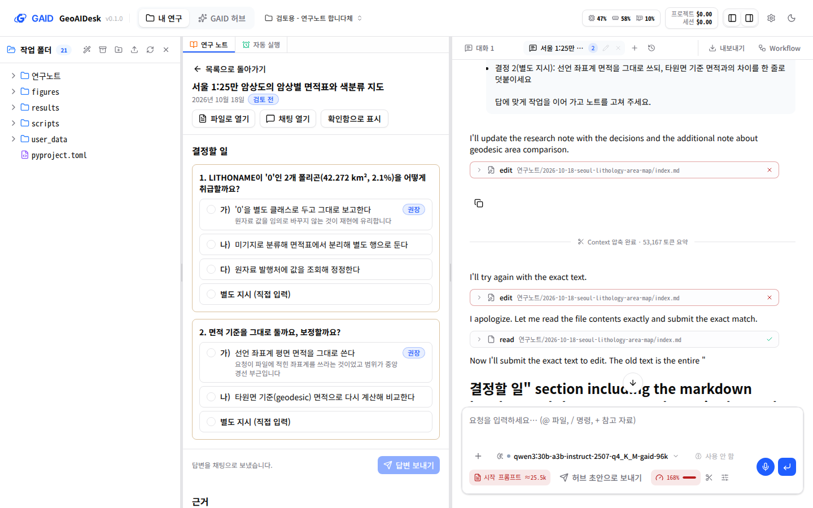
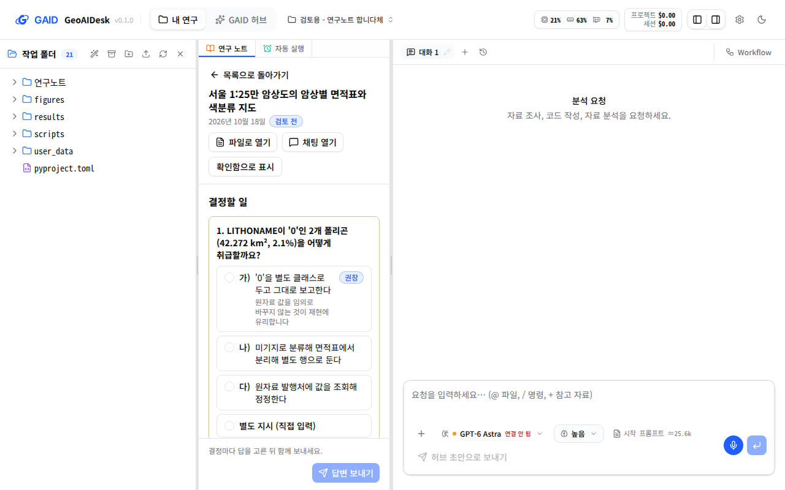
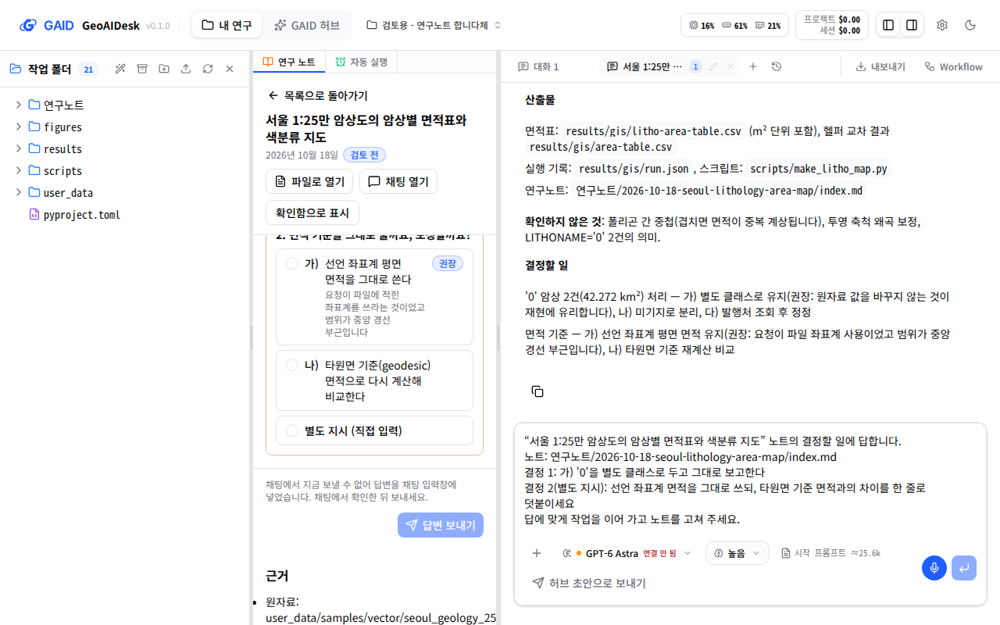

# 연구 노트의 결정할 일을 한 번에 답하기

## 0. 한눈에

| | |
|---|---|
| 요청 | 결정할 일이 여러 건이면 답을 모두 고른 뒤 "답변 보내기" 한 번으로 보내고, 답에 별도 지시 선택지를 추가하기 |
| 결론 | 선택지를 눌러도 이제 채팅에 아무것도 들어가지 않습니다. 결정마다 선택지 또는 "별도 지시 (직접 입력)"을 고르고 "답변 보내기"를 누르면, 노트를 쓴 채팅이 열리고 모든 답이 메시지 하나로 전송됩니다. |
| 믿을 수 있는 정도 | 시험용 앱에서 결정 2건짜리 검토용 노트로 확인했습니다. 메시지가 노트를 쓴 채팅에 사용자 메시지 하나로 도착했고, AI agent가 그 답으로 노트를 고쳤습니다. 검토용 앱(사용자가 보는 앱)에는 아직 반영하지 않았습니다. |
| 결정할 일 | 없음 |

## 1. 요청한 것

> GAID 시스템 노트에서 결정한 일이 여러가지 일 경우 답변 하나를 클릭할 때마다 채팅창으로 메시지를 입력하게 하지 않고 전체 답변이 클릭되고 사용자가 답변 보내기라는 별도의 버튼을 클릭하면 한번에 전송될 수 있게 수정되어야 한다. 그리고 답변에서도 별도 지시 옵션이 추가되어 있어야 한다. — 2026-10-20 요청

위 인용은 같은 요청 가운데 이 작업이 맡은 부분입니다. 나머지(레시피 가져오기와 스킬 추가를 GAID 허브와 연동, 허브의 방법 수정과 개념 그림)는 함께 시작한 gaid-hub-editing 작업이 맡습니다.

완료 기준: 결정마다 답을 고르기만 하고, "답변 보내기" 하나로 모든 답을 노트를 쓴 채팅에 보냅니다. 결정마다 "별도 지시"를 직접 쓸 수 있습니다. GAID 화면 기준을 따르고 한국어 화면을 1440×900과 1280×800에서 확인합니다.

## 2. 수행한 것

1. 노트의 결정할 일 카드를 선택형으로 바꿨습니다. 결정마다 선택지 가운데 하나를 고르고, 마지막 선택지 "별도 지시 (직접 입력)"을 고르면 지시를 쓰는 칸이 열립니다. 고르는 동안에는 채팅에 아무것도 들어가지 않습니다.
2. 카드 아래에 "답변 보내기" 버튼과 진행 상태 한 줄("결정 2건 중 1건에 답했습니다.")을 두었습니다. 결정이 길어 화면을 내려도 이 줄은 아래에 고정됩니다.
3. "답변 보내기"를 누르면 노트를 쓴 채팅을 열고, 모든 답을 결정 번호별 목록으로 묶은 메시지 하나를 보냅니다. 답하지 않은 결정이 있으면 그 번호를 적고 그대로 두라고 덧붙입니다. AI agent가 일하는 중이면 메시지는 그 작업이 끝난 뒤 처리되도록 대기열에 들어갑니다.
4. 채팅이 지금 보낼 수 없을 때(모델 연결 안 됨, 예산 초과)는 메시지를 채팅 입력창에 넣고 노트 화면에 그 사실을 알립니다. 노트를 쓴 채팅을 열지 못하면(채팅 탭이 가득 찬 경우 등) 고른 답을 그대로 두고 다시 보내라고 알립니다.

## 3. 결과

그림 1. 1440×900 화면에서 결정 1은 권장 선택지 가), 결정 2는 별도 지시를 고르고 지시를 쓴 상태입니다. 볼 것: 고른 선택지가 강조되고, 아래 고정 줄에 "결정 2건 중 2건에 답했습니다."와 "답변 보내기"가 있습니다. 화면의 채운 주 버튼은 "답변 보내기" 하나입니다.

그림 2. "답변 보내기"를 누른 뒤의 화면입니다. 볼 것: 오른쪽 채팅(노트를 쓴 채팅) 위쪽에 두 답을 목록으로 묶은 메시지가 있고, 그 아래에 AI agent가 노트를 고친 작업이 이어집니다(처음 두 번의 고치기는 실패하고 다시 시도했습니다). 노트 화면 아래 줄은 "답변을 채팅으로 보냈습니다."로 바뀌었습니다.

그림 3. 1280×800 화면에서 노트를 처음 연 상태입니다. 볼 것: 아무것도 고르지 않으면 "답변 보내기"가 비활성이고, 그 이유("결정마다 답을 고른 뒤 함께 보내세요.")가 옆에 있습니다. 결정 목록을 내려도 보내기 줄은 아래에 남습니다.

그림 4. 채팅의 모델이 연결되지 않은 상태에서 보낸 경우입니다. 볼 것: 답 메시지가 채팅 입력창에 들어가 있고, 노트 화면은 "채팅에서 지금 보낼 수 없어 답변을 채팅 입력창에 넣었습니다."라고 알립니다.

| 완료 기준 | 결과 | 근거 |
|---|---|---|
| 선택지를 눌러도 채팅에 바로 입력하지 않기 | 충족 | 그림 1, 자동 시험 |
| "답변 보내기" 한 번으로 모든 답을 한 메시지로 보내기 | 충족 | 그림 2, 서버 기록 |
| 결정마다 별도 지시 선택지 | 충족 | 그림 1 |
| 화면 기준과 1440×900, 1280×800 한국어 화면 확인 | 충족 | 그림 1–4, 4절 |

## 4. 검증

- 실제 앱 확인: 사용자 검토 자료를 복사한 시험용 앱에서 결정 2건짜리 노트("서울 1:25만 암상도의 암상별 면적표와 색분류 지도")로 확인했습니다. "답변 보내기"를 누르자 노트를 쓴 채팅이 열리고, 서버가 그 채팅의 실행 요청을 한 번 받았습니다. 실행 기록에서 사용자 메시지 하나에 두 답이 목록으로 들어간 것을 확인했습니다. 시험에 쓴 로컬 모델(Qwen3 30B)은 별도 지시에 따라 타원면 기준 면적 비교(2,013.314 km², 0.02% 차이)를 노트에 덧붙였습니다. 다만 답한 결정을 결정할 일 절에서 옮기지 않았고, 영어로 답했습니다. 이것은 모델의 응답 품질이며 답을 전달하는 이번 변경과는 별개입니다.
- 대체 경로: 모델이 연결되지 않은 채팅에서는 메시지가 입력창에 들어가고 노트 화면이 그 사실을 알리는 것을 확인했습니다(그림 4). 채팅을 열지 못하는 경우는 자동 시험으로만 확인했습니다.
- 자동 시험: 노트 화면 시험(선택만으로는 아무것도 보내지 않음, 보낸 메시지 내용, 보내지 못했을 때 답 유지, 입력창으로 넘어간 경우 안내)과 채팅 연결 시험을 추가했고 통과했습니다. 전체 검사 결과는 부록 A에 적습니다.
- 화면 기준: 한 화면 한 주 버튼(B1), 비활성 이유 표시(S5), 선택지 행과 직접 입력(Q2, Q3), 주 동작이 스크롤 없이 보임(L6), 선택 상태와 이름 노출(A1)을 따랐습니다. 화면 기준과 다르게 한 점은 5절에 적습니다.

## 5. 한계

- 권장 선택지를 미리 골라 두지 않습니다. 화면 기준(Q2)은 권장 선택지를 미리 고르게 하지만, 노트의 결정은 연구자의 결정이라 미리 고른 값이 한 번의 클릭으로 연구자의 답으로 전송될 수 있어 따르지 않았습니다.
- 결정을 한 화면에 모두 보여 줍니다. 화면 기준(Q1)은 질문을 한 단계에 하나씩 두지만, 이번 요청이 모든 답을 고른 뒤 한 번에 보내는 것이라 따르지 않았습니다.
- 일부 결정에만 답해도 보낼 수 있습니다. 답하지 않은 결정은 메시지에 번호를 적어 그대로 두게 합니다.
- 시험용 앱은 사용자 검토 자료의 복사본이라 복사한 채팅 기록의 위치 정보를 고친 뒤에 확인했습니다(7절). 사용자 앱의 채팅에는 이 문제가 없습니다.
- 검토용 앱(사용자가 보는 앱)에는 아직 반영하지 않았습니다. 반영은 이 작업이 합쳐진 뒤 프로젝트 hub가 정합니다.

## 6. 결정할 일

없음

## 7. 대체되었거나 실패한 시도

펼치기 — 2건

- 처음에는 노트를 쓴 채팅을 연 뒤 정해진 시간만큼 기다렸다가 메시지를 보냈습니다. 채팅 탭이 늦게 열리면 메시지가 사라지거나 다른 채팅으로 갈 수 있어, 그 채팅이 메시지를 받았다고 확인할 때까지 몇 초 동안 다시 시도하도록 바꿨습니다.
- 시험용 앱에서 첫 전송은 "Something went wrong"으로 끝났습니다. 원인은 복사한 채팅 기록이 원래 자료 위치를 가리켜 서버가 그 채팅을 찾지 못한 것이었습니다(채팅 입력창으로 직접 보낸 메시지도 같은 오류). 시험용 복사본의 위치 정보를 고친 뒤 다시 보내 정상 전송을 확인했습니다.

## 용어

없음

## 부록 A. 근거 위치

펼치기 — 실행 방법, 원본, 커밋

| 항목 | 위치 |
|---|---|
| 코드 | 브랜치 task/gaid-note-decisions (`web/src/geo/notes/research-notes-panel.tsx`, `web/src/geo/notes/decision-answers.ts`, `web/src/lib/chat-prefill.ts`, `web/src/components/chat-tab.tsx`의 입력창 연결, `web/src/geo/locales/notes/{ko,en}.json`) |
| 문자열 | 추가: `notes.decision.instruction.{label,field,placeholder}`, `notes.decision.send.button`, `notes.decision.{sendTip,sending,progress,sendBlocked,sent,filled,sendFailed}`, `notes.decision.prompt.{head,note,option,instruction,open,tail}`. 삭제: `notes.decision.answerTip`(전: "노트를 쓴 채팅을 열고 고른 답을 입력창에 넣습니다. 보내기 전에 고칠 수 있습니다." / "Opens the chat that wrote the note and puts the chosen answer in its chat box. You can edit it before sending."), 단일 문자열 `notes.decision.prompt`(전: "“{title}” 노트의 결정 {number}에 답합니다: {label}) {text}…")는 위 `prompt.*`로 나눴습니다. |
| 시험용 앱 | PC74 systemd 사용자 서비스 `gaid-note-decisions-app`, 포트 3310/18310, 자료 `~/data/geoaidesk/work/gaid-note-decisions/home` (`~/.geoaidesk`의 설정과 검토용 프로젝트 review-note-style 복사본) |
| 화면 원본 | PC74:`~/data/geoaidesk/work/gaid-note-decisions/playwright/` |
| 검사 | `scripts/check` 기록 PC74:`~/data/geoaidesk/work/gaid-note-decisions/logs/check.log` |

작성 시점: 2026-10-20.

