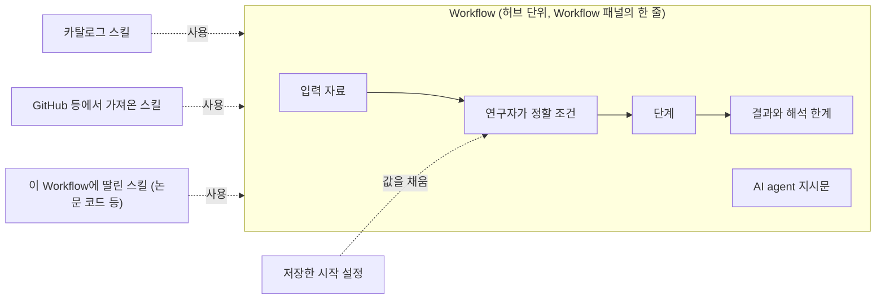

# GAID의 스킬·Workflow·방법·레시피 진단과 Workflow 중심 정리안

## 0. 한눈에

| | |
|---|---|
| 요청 | 스킬·Workflow·방법이 섞여 쓰이고 허브 방법의 구성이 보이지 않는 현황을 진단하고, 체계적으로 정리할 방안을 논의하기 |
| 결론 | 같은 허브 항목이 화면에 따라 "방법", "Workflow", "설치됨 스킬"로 다르게 불립니다. "Workflow"라는 말도 서로 다른 세 가지를 가리킵니다. 연구자가 Workflow에서 기대하는 단계별 절차는 Workflow 정의에 없고 스킬 안에 있습니다. 같은 절차가 두 곳에 따로 적혀 단계 수도 다릅니다(8단계와 7단계). AI agent에게 가는 지시문과 사용하는 스킬은 허브에도 프로젝트에도 시작하기 전에는 나오지 않습니다. 사용자 제안대로 허브 단위를 Workflow로 하고 스킬은 부품으로 두는 안(3.7의 나안)을 권장합니다. |
| 믿을 수 있는 정도 | 코드와 검토용 앱 자료의 복사본, 그 복사본으로 띄운 별도 앱 화면으로 확인했습니다. 다른 연구자에게 화면을 보여 주고 이해도를 시험하지는 않았습니다. 이 단계에서는 코드를 바꾸지 않았습니다. |
| 결정할 일 | 4건 (6절) |

## 1. 요청한 것

> 현재 gaid 허브에서는 워크플로우를 방법이라고 표현하고 있다. 그리고 Gaid 시스템에는 스킬과 워크플로우가 별도의 기능으로 제공되고 있다. 또한, BYOK에서 제공하는 워크플로우는 지침의 형태로 구성되어 있는데 반해 GAID 허브에서 방법(워크플로우)는 어떻게 구성되어 있는지 허브에서도 보이지 않고 GAID 시스템에서도 보이지 않는다. 현재 스킬, 워크플로우, 방법이 혼용되고 있는 것도 이용자들은 혼선이 올 수 밖에 없다. 오히려 스킬은 github를 비롯한 곳에서 유용한 스킬을 가져올 수 있게하고, 워크플로우에 집중하는 것도 하나의 방법이라고 생각한다. 이와 관련하여 현황을 진단하고 어떻게 체계적으로 정리하고 개선할지 논의하고 개선하는 작업을 진행하자. — 2026-10-20 요청

완료 기준: 1단계에서 이름, 저장 형태, 화면 표시, 서로의 관계를 진단하고, 선택지와 권장안, 용어표, 기존 자료와 skill_hub 계약에 미치는 영향을 냅니다. 2단계에서는 사용자와 정한 범위만 구현합니다. 이 보고서는 1단계 결과입니다.

## 2. 수행한 것

1. 검토용 앱 자료를 작업 폴더로 복사하고, 그 복사본으로 앱을 따로 띄웠습니다. 검토용 앱 자료는 고치지 않았습니다.
2. 허브에 등록된 항목 5개와 설치된 패키지 4개를 열어 실제 구성을 확인했습니다.
3. 허브 상세, 프로젝트의 Workflow 패널, 설치한 방법의 상세 창, 시작 설정, 기존 BYOK Workflow 실행 창, 설정의 스킬 목록을 한국어 화면(1440×900)으로 찍었습니다.
4. 화면 문구 카탈로그, 용어집, 허브 패키지 형식, skill_hub 생산자 계약, 카탈로그 Workflow 정의를 대조했습니다.
5. 정리안 세 가지를 비교하고 권장안의 용어표와 영향 범위를 정리했습니다.

## 3. 결과

### 3.1 지금의 네 가지 개념과 실제 구성

| 개념 | 실제로 무엇인가 | 들어 있는 것 | 개수(검토용 자료) |
|---|---|---|---|
| 스킬 | AI agent가 읽는 지침과 도구 꾸러미 | 지침 문서, 스크립트, 참고 문서 | 카탈로그 13개, 프로젝트마다 허브에서 설치한 1개 |
| BYOK Workflow (출처: K-Dense) | 지시문 하나를 채워 보내는 양식 | 영어 지시문, 빈칸 0–5개, 자료 필요 여부. 스킬과 단계는 없습니다 | 326개 |
| 카탈로그 Workflow (지구과학) | 시작 양식 | 입력 파일, 연구자가 정할 분석 조건, 한두 문장 지시문, 사용할 스킬 목록, 예상 결과, 해석 한계. 단계는 없습니다 | 7개 |
| 허브 "방법" | 스킬 하나에 카탈로그와 같은 형식의 Workflow를 0–1개, 레시피를 0–1개 붙인 묶음 | 스킬 폴더, 허브 흐름도용 단계 정보, Workflow 정의, 레시피 | 허브 등록 5개(모두 Workflow 1개, 레시피 1개) |
| 레시피 | Workflow의 분석 조건 값을 미리 정해 둔 것 | 조건별 선택값, 작업 중 정할 조건 | 방법마다 1개, 프로젝트에서 따로 저장 가능 |

허브 화면의 용어 설명도 이 구조를 그대로 적고 있습니다. "방법: 스킬 하나와, 있으면 Workflow 하나로 이루어집니다", "시작 설정: 레시피라고도 부릅니다". 연구자는 사용자가 쓴 표현처럼 방법을 Workflow로 이해합니다. 저장 구조에서는 스킬이 중심이고, Workflow는 스킬에 붙은 시작 양식입니다.

### 3.2 같은 항목이 화면마다 다른 이름으로 나옵니다

허브에 등록된 「격자 탐사 우선순위: PU 학습·순응 보정·구역 분류」 하나가 화면마다 이렇게 불립니다.

| 화면 | 부르는 이름 |
|---|---|
| 허브 목록과 상세 | "방법", "분석 방법", "방법 흐름", "방법 소개", "복사해서 고치기: 내 방법으로" |
| 허브 상세의 종류 표시 | "Workflow" (그림 1의 왼쪽 위) |
| 패키지 안의 Workflow 제목 | "격자 탐사 우선순위 레시피" (만든 모델이 Workflow 제목에 레시피라고 씀) |
| 프로젝트 Workflow 패널 | "허브에서 설치한 Workflow" |
| 같은 줄의 상세 단추 | "방법 상세 보기" |
| 방법 상세 창 | 제목 아래 "본 스킬은…", 머리글 "Workflows", "레시피", "버전 0.1.0 · revision 1" |
| 시작 설정 | "입력 파일과 분석 조건", "레시피 값" |
| 설정 → 스킬 | 이름 없는 "설치됨" 스킬 한 줄과 내부 저장 경로 (그림 6) |
| 설정 → 스킬 → 추가의 허브 검색 | "GAID 허브에서 스킬 찾기", 종류 표시 "스킬"/"Workflow", "허브 패키지", "허브 방법: … revision …" |

판 번호도 "1판", "판 1", "revision 1", "버전 0.1.0"으로 섞여 있습니다. "레시피"는 연구 기능 쪽 화면에서 그림 생성 설정이라는 다른 뜻으로도 쓰입니다. 용어집에는 "Workflow"와 "스킬"만 있고 "방법"과 "레시피"는 없습니다.

그림 1. 허브 상세 화면(1440×900). 볼 것: 종류 표시는 "Workflow"인데 제목 아래 설명과 단추는 모두 "방법"이라고 부릅니다. "실행 코드 포함" 한 줄 말고는 어떤 스킬과 파일이 들어 있는지 나오지 않습니다.

### 3.3 "Workflow"가 서로 다른 세 가지를 가리킵니다

| | BYOK Workflow | 카탈로그 Workflow | 허브 방법 안의 Workflow |
|---|---|---|---|
| 본질 | 지시문 | 시작 양식 + 짧은 지시문 | 시작 양식 + 짧은 지시문 |
| 지시문을 시작 전에 보여 줌 | 예 (영어, 고칠 수 있음, 그림 5) | 아니요 | 아니요 |
| 사용하는 스킬 | 없음 | 1–3개, 화면에 안 나옴 | 자기 스킬 1개, 화면에 안 나옴 |
| 단계 | 없음 | 없음 (스킬 지침 안에만 있음) | 없음 (스킬 지침과 허브 흐름도에 따로 있음) |
| 상세 보기 | 실행 창 | 없음 | 방법 상세 창 |

사용자가 지적한 차이는 여기서 생깁니다. BYOK Workflow는 지시문 자체라서 실행 창에서 무엇을 시키는지 다 보입니다. GAID Workflow는 입력과 조건을 묻는 양식이고, 실제로 무엇을 하는지는 스킬 지침에 있어서 보이지 않습니다.

그림 5. BYOK Workflow 「논문 검토」 실행 창(1440×900). 볼 것: "프롬프트 미리보기"에 AI agent에게 보낼 지시문 전체가 나오고 고칠 수 있습니다. 다만 지시문은 영어 그대로입니다.

### 3.4 구성이 보이지 않는 곳

○ 보임, △ 일부, × 안 보임.

| 화면 | 단계 | AI agent 지시문 | 사용하는 스킬 | 포함 파일·코드 | 입력·분석 조건 | 결과·한계 |
|---|---|---|---|---|---|---|
| 허브 상세 (등록 항목) | ○ 7단계 | × | × | △ "실행 코드 포함" 한 줄 | △ 입력 ○, 조건은 5개 중 1개만 표시 | ○ |
| 허브 추천의 카탈로그 카드 | × 상세 화면 없음, 알림만 뜸 | × | × | × | × | × |
| 허브 초안 (작성자 본인) | ○ | × | × | ○ "생성 파일 보기" (Workflow 정의 파일은 빠짐) | △ | ○ |
| 프로젝트 Workflow 패널 줄 | × | × | × | △ "코드 포함" 표시 | × | × |
| 방법 상세 창 (설치 후) | × | × | × | × | ○ | ○ |
| 카탈로그 Workflow | × 상세 단추 없음 | × | △ 준비가 안 됐을 때만 이름 표시 | × | 시작 설정에서만 | 시작 설정에서만 |
| 시작 설정 | × | × 시작 초안을 만든 뒤 입력창에서 처음 보임 | × 첫 스킬만 조용히 고정, 나머지는 보이지 않게 허용 | × | ○ | △ 접힘 |
| 설정 → 스킬 | × | △ 연필(편집) 단추로 지침 문서만 열림 | — | × 스크립트와 나머지 파일은 안 보임 | — | — |

그림 2. 허브 상세의 "방법 흐름"(1440×900). 볼 것: 허브는 7단계와 단계별 확인 항목을 잘 보여 줍니다. 하지만 이 흐름은 설치한 뒤 프로젝트의 어느 화면에도 나오지 않습니다.

그림 3. 프로젝트 Workflow 패널에서 연 방법 상세 창(1440×900). 볼 것: 검사 기록과 출처, 입력·조건·결과 목록은 있지만 단계, AI agent 지시문, 사용하는 스킬, 포함 파일이 없습니다. 설명 첫 문장이 "본 스킬은"으로 시작하고, 판 번호는 "revision 1"로 나옵니다.

그림 4. 시작 설정의 요약 단계(1440×900). 볼 것: 입력 2개와 분석 조건 8개를 차례로 고르지만, 이 값들이 어떤 지시문과 스킬로 AI agent에게 넘어가는지는 "시작 초안 만들기"를 누른 뒤에야 입력창에서 보입니다.

그림 6. 설정 → 스킬 목록(1440×900). 볼 것: 프로젝트에 설치한 허브 방법이 "pu-conformal-targeting 설치됨" 한 줄로만 나오고, 어느 Workflow의 스킬인지 대신 내부 저장 경로가 보입니다.

### 3.5 절차가 두 곳에 따로 적혀 있고, Workflow에는 없습니다

허브 방법 하나에 절차가 이렇게 나뉘어 있습니다.

| 어디 | 누가 읽나 | 「격자 탐사 우선순위」의 내용 |
|---|---|---|
| 스킬 지침 문서의 "처리 절차" | AI agent | 8단계 (6단계 순응 보정과 7단계 구역 분류가 따로) |
| 허브 흐름도용 단계 정보 | 허브 화면의 연구자 | 7단계 (순응 보정·구역 분류가 한 단계) |
| Workflow 정의 | 시작 설정 | 단계 없음. 지시문은 한 문단 |

허브 작성 기능은 두 곳을 한 번에 만들지만, 둘이 같은지 확인하지 않습니다. 연구자가 허브에서 본 7단계와 AI agent가 따르는 8단계가 다를 수 있습니다. 같은 이유로 허브의 "연구자가 정하는 곳 1개"(흐름도에서 직접 정하는 단계 수)와 시작 설정이 묻는 분석 조건 5개(이 항목 기준)도 맞지 않습니다. 단계마다 "연구자가 정함" 줄을 보여 주는 화면 기능은 있지만, 작성 과정에서 결정이 어느 단계에 속하는지 정보가 빠져 한 번도 표시되지 않습니다.

### 3.6 GitHub에서 스킬을 가져오는 기능은 이미 있습니다

설정 → 스킬 → "스킬 추가"에는 "owner/repo, Git URL 또는 로컬 경로"로 스킬을 가져오는 입력란이 그대로 있습니다. 미리보기 → 출처 신뢰 확인 → 설치 절차도 같습니다. 그 위에 GAID 허브 검색이, 아래 접힌 칸에 이전 skill_hub 입력이 있습니다.

다만 Workflow와 이어지지 않습니다. Workflow가 쓰는 스킬은 카탈로그 스킬이거나 자기 패키지 안의 스킬만 가리킬 수 있습니다. 그래서 GitHub에서 가져온 스킬을 Workflow의 부품으로 지정할 방법이 없습니다. 지금 가져온 스킬은 기본 범위의 채팅에서만 AI agent에게 보이고, Workflow로 시작한 채팅에서는 숨겨집니다.

### 3.7 정리안 세 가지

| | 가안: 이름만 정리 | 나안: Workflow 중심 (사용자 제안) | 다안: 스킬 중심 |
|---|---|---|---|
| 허브의 단위 | "방법" 유지 | Workflow | 스킬 |
| 스킬의 위치 | 방법의 일부 | Workflow가 쓰는 부품. 카탈로그, GitHub 등 외부, Workflow에 딸린 것 세 출처 | 허브의 주인공 |
| Workflow의 뜻 | 방법 안의 시작 양식 | 연구 작업 하나의 절차: 입력, 정할 조건, 단계, 지시문, 사용 스킬, 결과·한계 | 스킬을 시작하는 양식 |
| BYOK Workflow와의 관계 | 다른 것으로 남음 | 같은 개념에서 단계·스킬이 없는 가장 단순한 형태 | 다른 것으로 남음 |
| 연구자가 배울 말 | 방법, Workflow, 스킬, 레시피 | Workflow, 스킬, 저장한 시작 설정 | 스킬, Workflow, 레시피 |
| 구성 보이기 | 각 화면에 따로 추가 | Workflow 구성 화면 하나를 허브·프로젝트·시작 설정에서 같이 씀 | 스킬 문서 보기 위주 |
| 패키지 형식 | 바꾸지 않음 | 처음에는 바꾸지 않음. 절차를 한 곳에 모으고 외부 스킬을 가리키려면 나중에 선택 항목 추가 | 바꾸지 않음 |
| 약점 | "방법"과 "Workflow" 두 이름이 계속 같은 것을 가리킴 | 화면 문구를 넓게 고쳐야 함 | 연구자는 지침 문서를 읽지 않음. 사용자 방향과 반대 |

나안을 권장합니다. 근거는 세 가지입니다.

- 저장된 허브 항목 5개가 이미 모두 종류 "Workflow"이고 각각 Workflow 하나를 갖고 있습니다. 이름만 바꾸면 자료는 그대로 맞습니다.
- 연구자가 고르고 시작하는 것은 Workflow 패널의 줄입니다. 허브와 프로젝트가 같은 단어를 쓰면 "허브에서 고른 것이 프로젝트에서 이 줄이 된다"가 한 번에 이어집니다.
- GitHub 스킬 가져오기가 이미 있어서, 스킬을 부품으로 두는 쪽은 새 기능보다 연결 작업에 가깝습니다.

### 3.8 권장안의 개념과 용어표

| 지금 쓰는 말 | 제안 (한국어) | 영어 | 정의 |
|---|---|---|---|
| 방법, 분석 방법, 허브 방법 | Workflow | Workflow | 연구 작업 하나를 AI agent에게 맡기는 절차. 입력 자료, 연구자가 정할 조건, 단계, AI agent 지시문, 사용하는 스킬, 결과와 해석 한계로 이루어집니다. |
| 카탈로그 Workflow | 기본 Workflow (분야: 지구과학) | built-in Workflow | GAID와 함께 배포되는 Workflow |
| BYOK Workflow | 일반 Workflow (출처: K-Dense) | general Workflow | 지시문만 있는 Workflow. 단계와 스킬 없이 시작합니다. |
| 스킬 | 스킬 | skill | AI agent가 읽는 지침과 도구 꾸러미. Workflow가 부품으로 씁니다. 출처는 카탈로그, GitHub 등 외부, Workflow에 딸린 것입니다. |
| 레시피, 시작 설정, 저장한 레시피 | 저장한 시작 설정 | saved start settings | Workflow의 입력과 조건 값을 미리 정해 둔 것 |
| 방법 흐름 | Workflow 단계 | steps | Workflow가 거치는 처리 순서 |
| 판, revision, 버전 | 판 | revision | 등록한 Workflow를 고쳐 다시 등록할 때 올라가는 번호 |
| 허브 패키지, 패키지 | (화면에 쓰지 않음) | — | 내부 저장 형식 이름은 화면에 내보내지 않습니다. |

"Workflow"는 2026-10-15 사용자 결정대로 한국어 문구에서도 로마자로 씁니다.

### 3.9 기존 자료와 skill_hub 계약에 미치는 영향

| 대상 | 2단계 1차(이름 정리, 구성 보기) | 나중의 형식 확장(선택) |
|---|---|---|
| 허브 등록 항목 5개 | 그대로. 새 이름으로 보임 | 그대로 읽힘 |
| 프로젝트에 설치한 방법 | 그대로. 실행 기록과 시험 기록도 그대로 | 다시 설치하지 않아도 됨 |
| 프로젝트에 저장한 레시피 | 그대로. "저장한 시작 설정"으로 보임 | 영향 없음 |
| 허브 패키지 형식(gaid-method/v1) | 바꾸지 않음. 내부 이름도 유지 | Workflow에 단계 항목과 외부 스킬 참조를 선택 항목으로 추가. 계약 규칙상 선택 항목 추가는 v1 유지 |
| 카탈로그 Workflow 형식(skill_hub가 만듦) | 바꾸지 않음 | 카탈로그 Workflow의 단계를 같은 화면에 보이려면 skill_hub 쪽에도 단계 항목이 필요 |
| skill_hub 생산자 계약 문서 | 용어 메모 한 줄("레시피는 저장한 시작 설정")을 결정 3에 맞춰 고치기 | 두 hub가 합의해 선택 항목 추가 |
| BYOK Workflow 326개 | 그대로. 이름만 "일반 Workflow"로 묶음 | 영향 없음 |

허브의 작성 기능은 이미 skill_hub에서 GAID로 옮겨 왔으므로, 형식 확장을 할 때 실제로 만드는 쪽은 GAID입니다. 계약 문서의 주인은 아직 skill_hub이므로 확장 전에 그쪽 문서를 함께 고쳐야 합니다.

### 3.10 2단계 작업 묶음 제안 (나안 기준)

1. 이름 정리: 허브, 허브 검색, 설치한 방법, Workflow 패널, 스킬 설치 화면의 문구와 허브 용어 설명, 용어집을 3.8 표에 맞춥니다. 새 초안이 Workflow 제목에 "레시피"를 쓰지 않도록 작성 지시도 고칩니다. 이미 저장된 제목은 고치지 않습니다.
2. Workflow 구성 화면 하나: 단계, 입력, 정할 조건 전부, 결과와 한계, 사용하는 스킬(이름, 출처, 지침 읽기), AI agent에게 보낼 지시문, 포함 파일과 코드를 한 화면에 모읍니다. 허브 상세, 프로젝트의 상세 창, 시작 설정 요약에서 같은 화면을 씁니다. 카탈로그 Workflow에도 상세 단추를 달고, 허브 추천의 카탈로그 카드도 이 화면으로 엽니다.
3. 스킬 화면 연결: 허브에서 온 스킬 줄에 내부 경로 대신 "「…」 Workflow에 딸린 스킬"을 보입니다. 지침을 읽기 전용으로 여는 단추를 둡니다. 허브 검색은 Workflow 쪽(레시피 가져오기 자리)으로 옮기고, 스킬 추가는 GitHub 등 출처에서 가져오기를 앞에 둡니다.
4. 진단 중 찾은 결함 고치기: 등록 창의 "공유: 스킬·Workflow 파일 … 시험 평가" 문구가 실제로 공유되는 것보다 많이 약속합니다. 다른 연구자가 등록한 항목을 설치해도 "GAID 허브에서 만든 초안"으로 표시됩니다. 허브에서 바로 설치할 때 설치 내용 미리보기가 보이지 않습니다. 허브 흐름도의 "연구자가 정하는 곳"이 실제 분석 조건 수와 맞지 않습니다.
5. 형식 확장(별도 결정, 결정 4): 절차를 Workflow의 단계 항목 한 곳에서 만들고 스킬 지침과 허브 흐름도가 그것을 따르게 합니다. Workflow가 GitHub 등에서 가져온 스킬을 출처와 판으로 가리킬 수 있게 합니다.

## 4. 검증

- 과학적 검증: 해당 없음. 이 작업은 화면 구성과 용어 진단입니다.
- 소프트웨어 검증: 진단은 코드와 저장 자료를 읽어 확인했습니다. 화면 설명은 검토용 자료의 복사본으로 띄운 별도 앱에서 직접 찍은 한국어 화면(1440×900) 6장으로 확인했습니다. 3.5의 단계 수(8단계, 7단계)와 분석 조건 수는 허브에 등록된 패키지 파일에서 직접 셌습니다. 연구자 대상 이해도 시험은 하지 않았습니다.

## 5. 한계

- 검토용 앱의 등록 항목은 시험 자료라서 모두 광상 부존 가능성 분야이고 작성자가 둘뿐입니다. 다른 분야나 스킬만 있는 항목의 실제 예는 없습니다.
- 카탈로그 Workflow의 단계를 같은 화면에 보이려면 카탈로그에 단계 정보가 있는지 확인해야 합니다. 이번에는 확인하지 않았습니다.
- 3.8 용어표는 제안입니다. 용어집과 화면 문구는 아직 바꾸지 않았습니다.
- 나안의 사용성은 화면을 만든 뒤에 확인할 수 있습니다.

## 6. 결정할 일

1. GAID의 기능 구조를 어느 방향으로 정리할까요?
   - 가) Workflow 중심: 허브 단위와 Workflow 패널의 줄을 모두 Workflow로 부르고, 스킬은 Workflow가 쓰는 부품으로 둡니다 (권장: 저장된 허브 항목이 이미 모두 Workflow 종류이고, 연구자가 고르고 시작하는 단위와 이름이 같아집니다)
   - 나) 이름만 정리: "방법"을 허브 단위로 유지하고 각 화면에 구성 보기를 따로 붙입니다
   - 다) 스킬 중심: 허브를 스킬 목록으로 두고 Workflow는 시작 양식으로만 둡니다
2. 허브에 스킬만 있는 항목(Workflow 없는 초안)을 어떻게 다룰까요?
   - 가) 허브에는 Workflow만 등록합니다. 스킬만 만든 초안은 등록 전에 입력·조건·지시문을 갖추게 하고, 스킬 자체는 GitHub 등에서 가져오게 합니다 (권장: 허브에서 고르는 것이 늘 프로젝트에서 바로 시작할 수 있는 Workflow가 됩니다. 지금 등록된 항목 중 영향을 받는 것은 없습니다)
   - 나) 스킬 항목도 허브의 별도 칸으로 남깁니다
3. 레시피를 어떤 이름으로 부를까요?
   - 가) "저장한 시작 설정"으로 통일합니다 (권장: 시작 설정 화면의 이름과 같아지고, 연구 기능의 다른 "레시피"와 겹치지 않습니다)
   - 나) "레시피"를 유지하고 정의만 용어집에 고정합니다
4. 2단계에서 어디까지 할까요?
   - 가) 이름 정리, Workflow 구성 화면, 스킬 화면 연결, 진단 중 찾은 결함(3.10의 1–4)을 먼저 하고, 패키지 형식 확장(3.10의 5)은 skill_hub와 맞춘 뒤 따로 정합니다 (권장: 기존 자료와 계약을 건드리지 않고 이번 불편 대부분을 풉니다)
   - 나) 형식 확장까지 이번에 함께 합니다

## 7. 대체되었거나 실패한 시도

펼치기 — 0건

- 없음

## 용어

| 용어 | 새 정의 / 정의 변경 | 정의 |
|---|---|---|
| 없음 | — | 3.8의 용어표는 제안입니다. 결정 후 2단계에서 용어집에 반영합니다. |

## 부록 A. 근거 위치

펼치기 — 실행 방법, 원본, 해시, 커밋

| 항목 | 위치 |
|---|---|
| 기준 코드 | geoaidesk main 5f139a4 (task branch base f69300a), 검토용 앱도 5f139a47 |
| 진단용 앱 | systemd user unit `gaid-wfm-app`, `GAID_HOME=~/data/geoaidesk/work/gaid-workflow-model/home` (copy of `~/.geoaidesk` without project 2-bb7bed, `config.env`, `auth.json`), ports 3110/18110 |
| 화면 원본 | PC74 `~/data/geoaidesk/work/gaid-workflow-model/playwright/*.png` (01–09) |
| 허브 자료 | `~/.geoaidesk/pi-agent/skill-hub/shared/entries/*/entry.json` (5 entries, all `kind: "workflow"`); package `c70e5068…/conformal-grid-priority/` (`SKILL.md` 처리 절차 8 steps, `atlas.yaml` `procedure.nodes` 7, `gaid-method.json` `workflows[0]` with 5 `requiredScientificChoices`, no `steps`) |
| 허브 용어 설명 | `web/src/geo/locales/hub/ko.json:70-101` |
| 이름 혼용 | `web/src/geo/locales/{hub,hubPicker,methods,workspace,skillHub}/ko.json`; `geo/copy/terminology.csv` (workflow, 스킬 only) |
| BYOK Workflow | `web/src/data/workflows.json` (326), launch dialog prompt preview `web/src/components/workflows-panel.tsx:473-503`, sent with `skills: []` `web/src/components/chat-tab.tsx:2396` |
| 카탈로그 Workflow | catalogue 0.2.1 `workflows.json` (7, `geo-workflow/v1`, no steps); spec skill_hub `docs/specs/gaid-interfaces.md` §9 ("a task template, not a DAG") |
| 패키지 형식 | `docs/design/hub-method-package.md`; producer contract skill_hub `docs/specs/gaid-method-package.md` (v1; §7 additive fields keep v1); builder `server/src/geo/authoring/package.ts:105-249, 628-701` |
| Workflow 구성이 빠지는 곳 | shared entry API `server/src/geo/hub-shared/routes.ts:309-316`; method detail `web/src/geo/methods/methods.tsx:154-193`; task setup `web/src/geo/workspace/task-setup.tsx:55-176`, draft `web/src/geo/workspace/api.ts:27-37`; exposure `server/src/geo/context.ts:183-192, 245-252` |
| 흐름도 결정 표시 | `userDecisions.at` dropped `server/src/geo/authoring/agent.ts:670-681`; `web/src/geo/hub/method-flow.tsx:204-206` |
| GitHub 스킬 가져오기 | `web/src/components/skills-panel.tsx:459-488`, `server/src/agent/skills-fetch.ts` (bundled `skills` CLI 1.7.0) |
| 결함 | registration copy `hub/ko.json:322`; install origin label `server/src/geo/authoring/install.ts:70-76`, `methods/ko.json:23`; install without visible preview `install.ts:103-115` |

작성 시점: 2026-10-20, commit 6bbd7fa (task branch).

