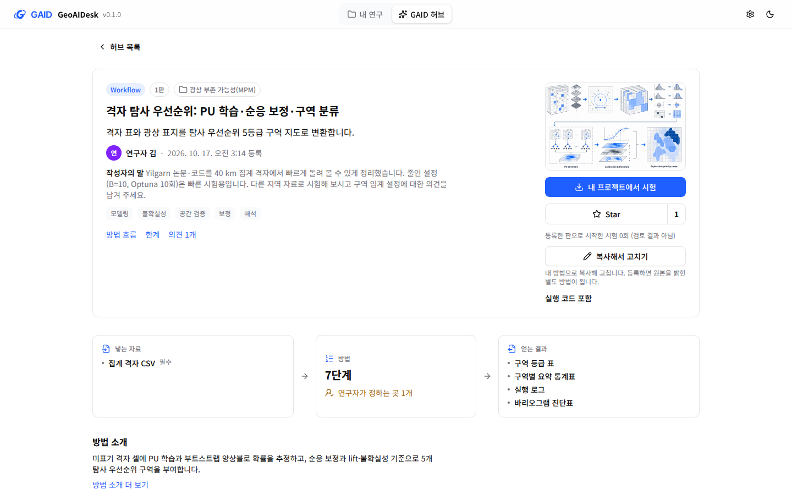
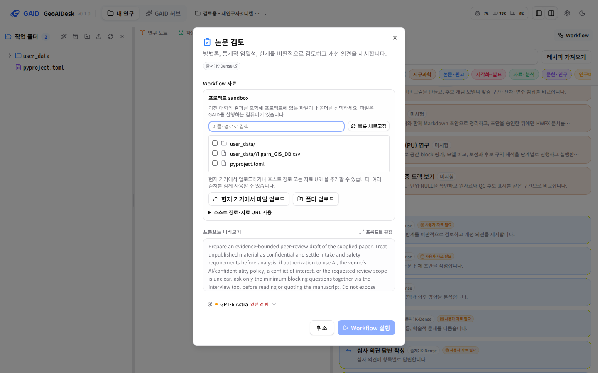
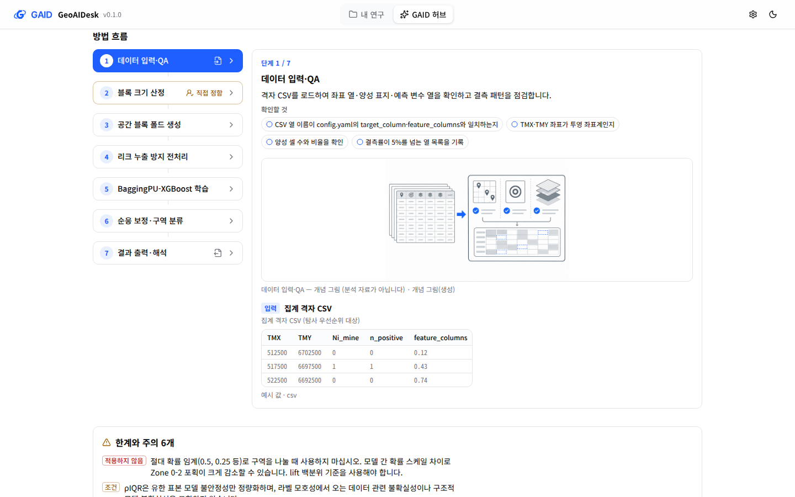
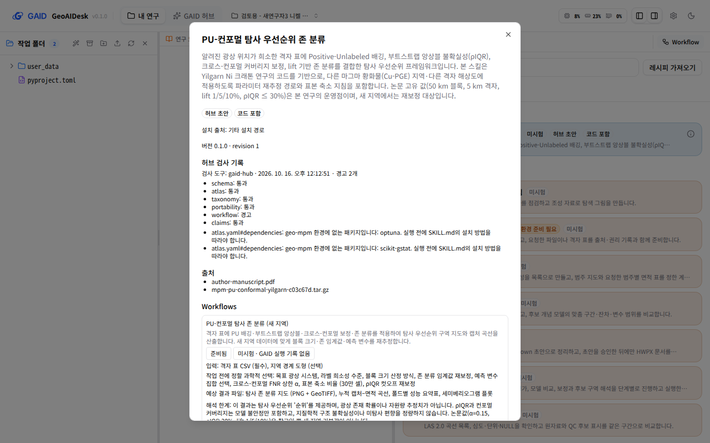
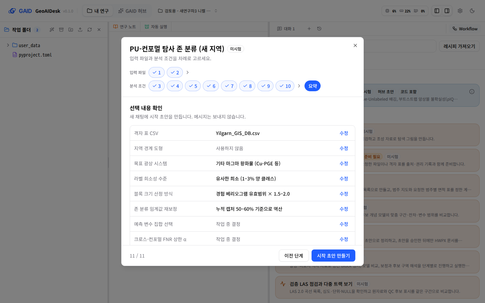
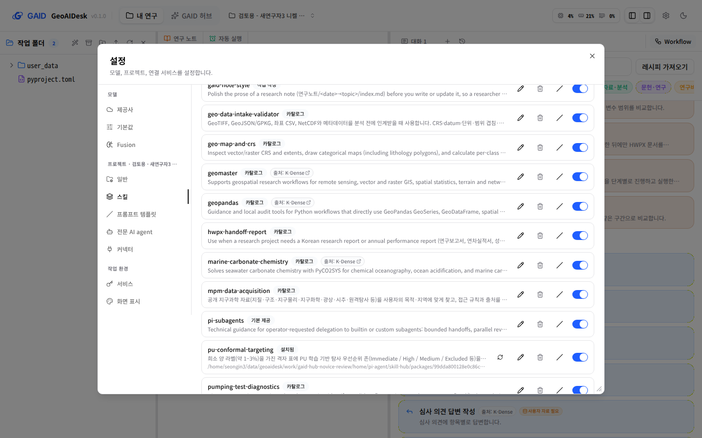
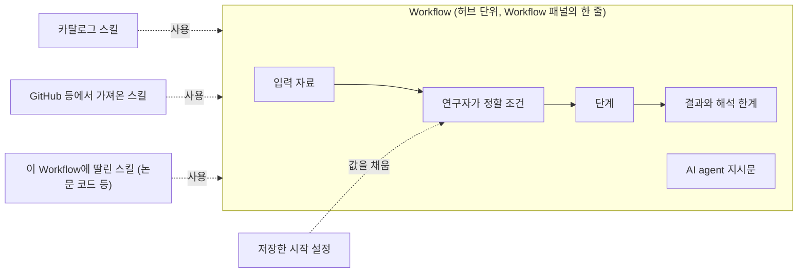

# GAID의 스킬·Workflow·방법·레시피 진단과 Workflow 중심 정리안

## 0. 한눈에

| | |
|---|---|
| 요청 | 스킬·Workflow·방법이 섞여 쓰이고 허브 방법의 구성이 보이지 않는 현황을 진단하고, 체계적으로 정리할 방안을 논의하기 |
| 결론 | 같은 허브 항목이 화면에 따라 "방법", "Workflow", "설치됨 스킬"로 다르게 불립니다. "Workflow"라는 말도 서로 다른 세 가지를 가리킵니다. 연구자가 Workflow에서 기대하는 단계별 절차는 Workflow 정의에 없고 스킬 안에 있습니다. 같은 절차가 두 곳에 따로 적혀 단계 수도 다릅니다(8단계와 7단계). AI agent에게 가는 지시문과 사용하는 스킬은 허브에도 프로젝트에도 시작하기 전에는 나오지 않습니다. 지금 허브 Workflow는 채팅에 짧은 지시와 "스킬을 쓰라"는 한 줄로만 들어가고, 절차는 AI agent가 스킬 문서를 스스로 읽어야 전달됩니다(3.11). Workflow 중심 정리를 정했고, Workflow를 단계·사용 스킬·결과가 적힌 하나의 지침 문서로 보내는 형태를 제안합니다. 허브에서 보는 글이 곧 AI agent가 받는 글이 되고, 같은 파일을 CLI 에이전트에서도 씁니다(3.12–3.14). |
| 믿을 수 있는 정도 | 코드와 검토용 앱 자료의 복사본, 그 복사본으로 띄운 별도 앱 화면으로 확인했습니다. 다른 연구자에게 화면을 보여 주고 이해도를 시험하지는 않았습니다. 이 단계에서는 코드를 바꾸지 않았습니다. |
| 결정할 일 | 1건: Workflow 실행 형태 확정 (6절). 1단계 결정 4건은 2026-10-20에 모두 권장안으로 정함 |

## 1. 요청한 것

> 현재 gaid 허브에서는 워크플로우를 방법이라고 표현하고 있다. 그리고 Gaid 시스템에는 스킬과 워크플로우가 별도의 기능으로 제공되고 있다. 또한, BYOK에서 제공하는 워크플로우는 지침의 형태로 구성되어 있는데 반해 GAID 허브에서 방법(워크플로우)는 어떻게 구성되어 있는지 허브에서도 보이지 않고 GAID 시스템에서도 보이지 않는다. 현재 스킬, 워크플로우, 방법이 혼용되고 있는 것도 이용자들은 혼선이 올 수 밖에 없다. 오히려 스킬은 github를 비롯한 곳에서 유용한 스킬을 가져올 수 있게하고, 워크플로우에 집중하는 것도 하나의 방법이라고 생각한다. 이와 관련하여 현황을 진단하고 어떻게 체계적으로 정리하고 개선할지 논의하고 개선하는 작업을 진행하자. — 2026-10-20 요청

> 모두 권장하는 방식으로 진행해도 좋다. skill_hub는 legacy이므로 계획에 포함하지 말아야 한다. GAID 허브에서 스킬도 추후에 관리해야한다. 그리고 워크플로우에서 스킬을 사용하는 것은 어떻게 사용하는지도 설계되어야 하며, BYOK의 워크플로우는 지침이 GAID 시스템에서 보이는데 GAID 허브의 워크플로우는 어떤 형태로 GAID 시스템의 에이전트 채팅에 반영되는지도 정의되어야 한다. 지침형태로 되는 것인지? 아니면 지금의 형태가 어떻게 구현되어 있는지도 구체화되고 확정되어야 한다. 즉, GAID 허브에서도 최종 워크플로우 형태가 어떤 것인지 보여야 한다는 것이다. 현재는 워크플로우가 어떤 흐름으로 진행되는지 설명만 있을 뿐 에이전트 채팅(CLAUDE, CODEX 채팅 같은 형태), CLI 환경에서 어떻게 적용되는지가 불분명하다. — 2026-10-20, 결정 4건에 대한 답과 추가 요청

완료 기준: 1단계에서 이름, 저장 형태, 화면 표시, 서로의 관계를 진단하고, 선택지와 권장안, 용어표, 기존 자료와 skill_hub 계약에 미치는 영향을 냅니다. 2단계에서는 사용자와 정한 범위만 구현합니다. 이 보고서는 1단계 결과와, 추가 요청에 따른 Workflow 실행 형태 설계(3.11–3.15)입니다.

## 2. 수행한 것

1. 검토용 앱 자료를 작업 폴더로 복사하고, 그 복사본으로 앱을 따로 띄웠습니다. 검토용 앱 자료는 고치지 않았습니다.
2. 허브에 등록된 항목 5개와 설치된 패키지 4개를 열어 실제 구성을 확인했습니다.
3. 허브 상세, 프로젝트의 Workflow 패널, 설치한 방법의 상세 창, 시작 설정, 기존 BYOK Workflow 실행 창, 설정의 스킬 목록을 한국어 화면(1440×900)으로 찍었습니다.
4. 화면 문구 카탈로그, 용어집, 허브 패키지 형식, skill_hub 생산자 계약, 카탈로그 Workflow 정의를 대조했습니다.
5. 정리안 세 가지를 비교하고 권장안의 용어표와 영향 범위를 정리했습니다.
6. 결정 뒤 추가 요청에 따라, 허브 Workflow가 지금 채팅에 어떤 글로 들어가는지 코드에서 확인하고, 지침 문서 형태의 실행 방식과 스킬 사용 방식, CLI에서 쓰는 방식을 설계했습니다.

## 3. 결과

### 3.1 지금의 네 가지 개념과 실제 구성

| 개념 | 실제로 무엇인가 | 들어 있는 것 | 개수(검토용 자료) |
|---|---|---|---|
| 스킬 | AI agent가 읽는 지침과 도구 꾸러미 | 지침 문서, 스크립트, 참고 문서 | 카탈로그 13개, 프로젝트마다 허브에서 설치한 1개 |
| BYOK Workflow (출처: K-Dense) | 지시문 하나를 채워 보내는 양식 | 영어 지시문, 빈칸 0–5개, 자료 필요 여부. 스킬과 단계는 없습니다 | 326개 |
| 카탈로그 Workflow (지구과학) | 시작 양식 | 입력 파일, 연구자가 정할 분석 조건, 한두 문장 지시문, 사용할 스킬 목록, 예상 결과, 해석 한계. 단계는 없습니다 | 7개 |
| 허브 "방법" | 스킬 하나에 카탈로그와 같은 형식의 Workflow를 0–1개, 레시피를 0–1개 붙인 묶음 | 스킬 폴더, 허브 흐름도용 단계 정보, Workflow 정의, 레시피 | 허브 등록 5개(모두 Workflow 1개, 레시피 1개) |
| 레시피 | Workflow의 분석 조건 값을 미리 정해 둔 것 | 조건별 선택값, 작업 중 정할 조건 | 방법마다 1개, 프로젝트에서 따로 저장 가능 |

허브 화면의 용어 설명도 이 구조를 그대로 적고 있습니다. "방법: 스킬 하나와, 있으면 Workflow 하나로 이루어집니다", "시작 설정: 레시피라고도 부릅니다". 연구자는 사용자가 쓴 표현처럼 방법을 Workflow로 이해합니다. 저장 구조에서는 스킬이 중심이고, Workflow는 스킬에 붙은 시작 양식입니다.

### 3.2 같은 항목이 화면마다 다른 이름으로 나옵니다

허브에 등록된 「격자 탐사 우선순위: PU 학습·순응 보정·구역 분류」 하나가 화면마다 이렇게 불립니다.

| 화면 | 부르는 이름 |
|---|---|
| 허브 목록과 상세 | "방법", "분석 방법", "방법 흐름", "방법 소개", "복사해서 고치기: 내 방법으로" |
| 허브 상세의 종류 표시 | "Workflow" (그림 1의 왼쪽 위) |
| 패키지 안의 Workflow 제목 | "격자 탐사 우선순위 레시피" (만든 모델이 Workflow 제목에 레시피라고 씀) |
| 프로젝트 Workflow 패널 | "허브에서 설치한 Workflow" |
| 같은 줄의 상세 단추 | "방법 상세 보기" |
| 방법 상세 창 | 제목 아래 "본 스킬은…", 머리글 "Workflows", "레시피", "버전 0.1.0 · revision 1" |
| 시작 설정 | "입력 파일과 분석 조건", "레시피 값" |
| 설정 → 스킬 | 이름 없는 "설치됨" 스킬 한 줄과 내부 저장 경로 (그림 6) |
| 설정 → 스킬 → 추가의 허브 검색 | "GAID 허브에서 스킬 찾기", 종류 표시 "스킬"/"Workflow", "허브 패키지", "허브 방법: … revision …" |

판 번호도 "1판", "판 1", "revision 1", "버전 0.1.0"으로 섞여 있습니다. "레시피"는 연구 기능 쪽 화면에서 그림 생성 설정이라는 다른 뜻으로도 쓰입니다. 용어집에는 "Workflow"와 "스킬"만 있고 "방법"과 "레시피"는 없습니다.



그림 1. 허브 상세 화면(1440×900). 볼 것: 종류 표시는 "Workflow"인데 제목 아래 설명과 단추는 모두 "방법"이라고 부릅니다. "실행 코드 포함" 한 줄 말고는 어떤 스킬과 파일이 들어 있는지 나오지 않습니다.

### 3.3 "Workflow"가 서로 다른 세 가지를 가리킵니다

| | BYOK Workflow | 카탈로그 Workflow | 허브 방법 안의 Workflow |
|---|---|---|---|
| 본질 | 지시문 | 시작 양식 + 짧은 지시문 | 시작 양식 + 짧은 지시문 |
| 지시문을 시작 전에 보여 줌 | 예 (영어, 고칠 수 있음, 그림 5) | 아니요 | 아니요 |
| 사용하는 스킬 | 없음 | 1–3개, 화면에 안 나옴 | 자기 스킬 1개, 화면에 안 나옴 |
| 단계 | 없음 | 없음 (스킬 지침 안에만 있음) | 없음 (스킬 지침과 허브 흐름도에 따로 있음) |
| 상세 보기 | 실행 창 | 없음 | 방법 상세 창 |

사용자가 지적한 차이는 여기서 생깁니다. BYOK Workflow는 지시문 자체라서 실행 창에서 무엇을 시키는지 다 보입니다. GAID Workflow는 입력과 조건을 묻는 양식이고, 실제로 무엇을 하는지는 스킬 지침에 있어서 보이지 않습니다.



그림 5. BYOK Workflow 「논문 검토」 실행 창(1440×900). 볼 것: "프롬프트 미리보기"에 AI agent에게 보낼 지시문 전체가 나오고 고칠 수 있습니다. 다만 지시문은 영어 그대로입니다.

### 3.4 구성이 보이지 않는 곳

○ 보임, △ 일부, × 안 보임.

| 화면 | 단계 | AI agent 지시문 | 사용하는 스킬 | 포함 파일·코드 | 입력·분석 조건 | 결과·한계 |
|---|---|---|---|---|---|---|
| 허브 상세 (등록 항목) | ○ 7단계 | × | × | △ "실행 코드 포함" 한 줄 | △ 입력 ○, 조건은 5개 중 1개만 표시 | ○ |
| 허브 추천의 카탈로그 카드 | × 상세 화면 없음, 알림만 뜸 | × | × | × | × | × |
| 허브 초안 (작성자 본인) | ○ | × | × | ○ "생성 파일 보기" (Workflow 정의 파일은 빠짐) | △ | ○ |
| 프로젝트 Workflow 패널 줄 | × | × | × | △ "코드 포함" 표시 | × | × |
| 방법 상세 창 (설치 후) | × | × | × | × | ○ | ○ |
| 카탈로그 Workflow | × 상세 단추 없음 | × | △ 준비가 안 됐을 때만 이름 표시 | × | 시작 설정에서만 | 시작 설정에서만 |
| 시작 설정 | × | × 시작 초안을 만든 뒤 입력창에서 처음 보임 | × 첫 스킬만 조용히 고정, 나머지는 보이지 않게 허용 | × | ○ | △ 접힘 |
| 설정 → 스킬 | × | △ 연필(편집) 단추로 지침 문서만 열림 | — | × 스크립트와 나머지 파일은 안 보임 | — | — |



그림 2. 허브 상세의 "방법 흐름"(1440×900). 볼 것: 허브는 7단계와 단계별 확인 항목을 잘 보여 줍니다. 하지만 이 흐름은 설치한 뒤 프로젝트의 어느 화면에도 나오지 않습니다.



그림 3. 프로젝트 Workflow 패널에서 연 방법 상세 창(1440×900). 볼 것: 검사 기록과 출처, 입력·조건·결과 목록은 있지만 단계, AI agent 지시문, 사용하는 스킬, 포함 파일이 없습니다. 설명 첫 문장이 "본 스킬은"으로 시작하고, 판 번호는 "revision 1"로 나옵니다.



그림 4. 시작 설정의 요약 단계(1440×900). 볼 것: 입력 2개와 분석 조건 8개를 차례로 고르지만, 이 값들이 어떤 지시문과 스킬로 AI agent에게 넘어가는지는 "시작 초안 만들기"를 누른 뒤에야 입력창에서 보입니다.



그림 6. 설정 → 스킬 목록(1440×900). 볼 것: 프로젝트에 설치한 허브 방법이 "pu-conformal-targeting 설치됨" 한 줄로만 나오고, 어느 Workflow의 스킬인지 대신 내부 저장 경로가 보입니다.

### 3.5 절차가 두 곳에 따로 적혀 있고, Workflow에는 없습니다

허브 방법 하나에 절차가 이렇게 나뉘어 있습니다.

| 어디 | 누가 읽나 | 「격자 탐사 우선순위」의 내용 |
|---|---|---|
| 스킬 지침 문서의 "처리 절차" | AI agent | 8단계 (6단계 순응 보정과 7단계 구역 분류가 따로) |
| 허브 흐름도용 단계 정보 | 허브 화면의 연구자 | 7단계 (순응 보정·구역 분류가 한 단계) |
| Workflow 정의 | 시작 설정 | 단계 없음. 지시문은 한 문단 |

허브 작성 기능은 두 곳을 한 번에 만들지만, 둘이 같은지 확인하지 않습니다. 연구자가 허브에서 본 7단계와 AI agent가 따르는 8단계가 다를 수 있습니다. 같은 이유로 허브의 "연구자가 정하는 곳 1개"(흐름도에서 직접 정하는 단계 수)와 시작 설정이 묻는 분석 조건 5개(이 항목 기준)도 맞지 않습니다. 단계마다 "연구자가 정함" 줄을 보여 주는 화면 기능은 있지만, 작성 과정에서 결정이 어느 단계에 속하는지 정보가 빠져 한 번도 표시되지 않습니다.

### 3.6 GitHub에서 스킬을 가져오는 기능은 이미 있습니다

설정 → 스킬 → "스킬 추가"에는 "owner/repo, Git URL 또는 로컬 경로"로 스킬을 가져오는 입력란이 그대로 있습니다. 미리보기 → 출처 신뢰 확인 → 설치 절차도 같습니다. 그 위에 GAID 허브 검색이, 아래 접힌 칸에 이전 skill_hub 입력이 있습니다.

다만 Workflow와 이어지지 않습니다. Workflow가 쓰는 스킬은 카탈로그 스킬이거나 자기 패키지 안의 스킬만 가리킬 수 있습니다. 그래서 GitHub에서 가져온 스킬을 Workflow의 부품으로 지정할 방법이 없습니다. 지금 가져온 스킬은 기본 범위의 채팅에서만 AI agent에게 보이고, Workflow로 시작한 채팅에서는 숨겨집니다.

### 3.7 정리안 세 가지

| | 가안: 이름만 정리 | 나안: Workflow 중심 (사용자 제안) | 다안: 스킬 중심 |
|---|---|---|---|
| 허브의 단위 | "방법" 유지 | Workflow | 스킬 |
| 스킬의 위치 | 방법의 일부 | Workflow가 쓰는 부품. 카탈로그, GitHub 등 외부, Workflow에 딸린 것 세 출처 | 허브의 주인공 |
| Workflow의 뜻 | 방법 안의 시작 양식 | 연구 작업 하나의 절차: 입력, 정할 조건, 단계, 지시문, 사용 스킬, 결과·한계 | 스킬을 시작하는 양식 |
| BYOK Workflow와의 관계 | 다른 것으로 남음 | 같은 개념에서 단계·스킬이 없는 가장 단순한 형태 | 다른 것으로 남음 |
| 연구자가 배울 말 | 방법, Workflow, 스킬, 레시피 | Workflow, 스킬, 저장한 시작 설정 | 스킬, Workflow, 레시피 |
| 구성 보이기 | 각 화면에 따로 추가 | Workflow 구성 화면 하나를 허브·프로젝트·시작 설정에서 같이 씀 | 스킬 문서 보기 위주 |
| 패키지 형식 | 바꾸지 않음 | 처음에는 바꾸지 않음. 절차를 한 곳에 모으고 외부 스킬을 가리키려면 나중에 선택 항목 추가 | 바꾸지 않음 |
| 약점 | "방법"과 "Workflow" 두 이름이 계속 같은 것을 가리킴 | 화면 문구를 넓게 고쳐야 함 | 연구자는 지침 문서를 읽지 않음. 사용자 방향과 반대 |

나안을 권장합니다. 근거는 세 가지입니다.

- 저장된 허브 항목 5개가 이미 모두 종류 "Workflow"이고 각각 Workflow 하나를 갖고 있습니다. 이름만 바꾸면 자료는 그대로 맞습니다.
- 연구자가 고르고 시작하는 것은 Workflow 패널의 줄입니다. 허브와 프로젝트가 같은 단어를 쓰면 "허브에서 고른 것이 프로젝트에서 이 줄이 된다"가 한 번에 이어집니다.
- GitHub 스킬 가져오기가 이미 있어서, 스킬을 부품으로 두는 쪽은 새 기능보다 연결 작업에 가깝습니다.

### 3.8 권장안의 개념과 용어표



| 지금 쓰는 말 | 제안 (한국어) | 영어 | 정의 |
|---|---|---|---|
| 방법, 분석 방법, 허브 방법 | Workflow | Workflow | 연구 작업 하나를 AI agent에게 맡기는 절차. 입력 자료, 연구자가 정할 조건, 단계, AI agent 지시문, 사용하는 스킬, 결과와 해석 한계로 이루어집니다. |
| 카탈로그 Workflow | 기본 Workflow (분야: 지구과학) | built-in Workflow | GAID와 함께 배포되는 Workflow |
| BYOK Workflow | 일반 Workflow (출처: K-Dense) | general Workflow | 지시문만 있는 Workflow. 단계와 스킬 없이 시작합니다. |
| 스킬 | 스킬 | skill | AI agent가 읽는 지침과 도구 꾸러미. Workflow가 부품으로 씁니다. 출처는 카탈로그, GitHub 등 외부, Workflow에 딸린 것입니다. |
| 레시피, 시작 설정, 저장한 레시피 | 저장한 시작 설정 | saved start settings | Workflow의 입력과 조건 값을 미리 정해 둔 것 |
| 방법 흐름 | Workflow 단계 | steps | Workflow가 거치는 처리 순서 |
| 판, revision, 버전 | 판 | revision | 등록한 Workflow를 고쳐 다시 등록할 때 올라가는 번호 |
| 허브 패키지, 패키지 | (화면에 쓰지 않음) | — | 내부 저장 형식 이름은 화면에 내보내지 않습니다. |

"Workflow"는 2026-10-15 사용자 결정대로 한국어 문구에서도 로마자로 씁니다.

### 3.9 기존 자료에 미치는 영향

| 대상 | 2단계 1차(이름 정리, 구성 보기) | 나중의 형식 확장(선택) |
|---|---|---|
| 허브 등록 항목 5개 | 그대로. 새 이름으로 보임 | 그대로 읽힘 |
| 프로젝트에 설치한 방법 | 그대로. 실행 기록과 시험 기록도 그대로 | 다시 설치하지 않아도 됨 |
| 프로젝트에 저장한 레시피 | 그대로. "저장한 시작 설정"으로 보임 | 영향 없음 |
| 허브 패키지 형식 | 바꾸지 않음. 내부 이름도 유지 | Workflow에 단계 항목과 사용 스킬 목록을 추가(3.12, GAID가 형식을 정함) |
| 카탈로그 Workflow(고정 파일) | 바꾸지 않음 | 바꾸지 않음. 카탈로그의 스킬 단계 정보로 GAID가 단계를 만들어 보여 줌(3.15) |
| BYOK Workflow 326개 | 그대로. 이름만 "일반 Workflow"로 묶음 | 영향 없음 |

1단계 초안에는 skill_hub 계약 문서를 함께 고치는 항목이 있었습니다. 사용자 결정(skill_hub는 legacy)에 따라 계획에서 뺐습니다.

### 3.10 2단계 작업 묶음 제안 (나안 기준)

1. 이름 정리: 허브, 허브 검색, 설치한 방법, Workflow 패널, 스킬 설치 화면의 문구와 허브 용어 설명, 용어집을 3.8 표에 맞춥니다. 새 초안이 Workflow 제목에 "레시피"를 쓰지 않도록 작성 지시도 고칩니다. 이미 저장된 제목은 고치지 않습니다.
2. Workflow 구성 화면 하나: 단계, 입력, 정할 조건 전부, 결과와 한계, 사용하는 스킬(이름, 출처, 지침 읽기), AI agent에게 보낼 지시문, 포함 파일과 코드를 한 화면에 모읍니다. 허브 상세, 프로젝트의 상세 창, 시작 설정 요약에서 같은 화면을 씁니다. 카탈로그 Workflow에도 상세 단추를 달고, 허브 추천의 카탈로그 카드도 이 화면으로 엽니다.
3. 스킬 화면 연결: 허브에서 온 스킬 줄에 내부 경로 대신 "「…」 Workflow에 딸린 스킬"을 보입니다. 지침을 읽기 전용으로 여는 단추를 둡니다. 허브 검색은 Workflow 쪽(레시피 가져오기 자리)으로 옮기고, 스킬 추가는 GitHub 등 출처에서 가져오기를 앞에 둡니다.
4. 진단 중 찾은 결함 고치기: 등록 창의 "공유: 스킬·Workflow 파일 … 시험 평가" 문구가 실제로 공유되는 것보다 많이 약속합니다. 다른 연구자가 등록한 항목을 설치해도 "GAID 허브에서 만든 초안"으로 표시됩니다. 허브에서 바로 설치할 때 설치 내용 미리보기가 보이지 않습니다. 허브 흐름도의 "연구자가 정하는 곳"이 실제 분석 조건 수와 맞지 않습니다.
5. 형식 확장(3.12–3.15의 설계로 구체화): 절차를 Workflow의 단계 항목 한 곳에서 만들고 스킬 지침과 허브 흐름도가 그것을 따르게 합니다. Workflow가 GitHub 등에서 가져온 스킬을 출처와 판으로 가리킬 수 있게 합니다.

### 3.11 지금 허브 Workflow가 채팅에 들어가는 형태 (2026-10-20 추가 확인)

사용자 질문("지침 형태로 되는 것인지, 지금은 어떻게 구현되어 있는지")에 답하려고 실제 전달 경로를 코드에서 확인했습니다. 「격자 탐사 우선순위」를 저장된 기본 설정으로 시작하면 AI agent는 세 가지를 받습니다.

| 전달 위치 | 내용 | 연구자가 보는가 |
|---|---|---|
| 시스템 지시(대화 전체에 적용) | GAID 작업 규칙과, 이 Workflow가 쓰는 스킬 1개의 이름·한 줄 설명·지침 파일 위치. 다른 스킬은 목록에서 빠집니다 | 아니요 |
| 첫 메시지 | 아래 상자의 글. 입력창에 들어가고 연구자가 보냅니다 | 시작 설정을 마친 뒤 입력창에서 |
| 보낼 때 붙는 줄 | "Make sure to use the skills: 'conformal-grid-priority'" | 아니요 |

```text
연구자가 정한 설정 (아래 Workflow 지시문보다 우선합니다)

입력 파일:
- 집계 격자 CSV: user_data/<격자 파일>.csv

선택한 분석 조건:
- 공간 블록 크기 산정 방식: 경험 바리오그램 유효 범위의 약 1.6배로 자동 산정 (auto-variogram)
- lift 백분위 구역 경계: 1% / 5% / 10% (논문 Yilgarn 운영점) (paper-operating)
- …(조건 5개)

작업 중 결정할 조건: 없음
미결정 조건은 해당 조건이 필요한 단계 전에 질문하세요.

Workflow 지시문:
이 격자 표로 탐사 우선순위 5등급 구역(Immediate ~ Excluded)을 만들어 주세요. 공간 블록 크기는 바리오그램으로 자동 산정하되 …
첫 시험은 줄인 설정으로 하고 줄인 설정임을 결과에 반드시 적어 주세요.
지시문의 예시 값(…)이 위 설정이나 입력 파일과 다르면 위 설정과 실제 파일을 따르고, 다른 점을 먼저 알려 주세요.

해석 한계: 이 결과는 Yilgarn 단일 craton에서 개발·검증된 방법론의 일반화 적용입니다. …
결과는 검토 전입니다. 실행 완료를 검토 완료로 표시하지 마세요.
```

지금의 허브 Workflow는 "짧은 지시 + 스킬을 쓰라는 한 줄"입니다. 7단계 절차는 이 메시지에 없습니다. AI agent가 스킬 이름을 보고 스스로 그 지침 문서를 읽어야 8단계 절차를 알게 됩니다. 읽을지는 모델이 정합니다. 허브가 보여 주는 7단계 흐름은 AI agent에게 전달되지 않는 별도 설명입니다. 사용자가 "설명만 있을 뿐"이라고 본 것이 실제 구현과 맞습니다.

### 3.12 제안: Workflow는 하나의 지침 문서로 AI agent에게 갑니다

BYOK Workflow처럼 지침 형태로 확정하자고 제안합니다. 다만 이 문서는 Workflow의 구성 요소(입력, 조건, 단계, 사용 스킬, 결과, 한계)에서 GAID가 같은 규칙으로 만들어 냅니다. 허브 상세, 프로젝트의 Workflow 상세, 시작 설정 요약, 채팅의 첫 메시지, CLI 파일이 모두 이 한 문서를 씁니다. 그래서 허브에서 본 글이 곧 AI agent가 받는 글입니다.

같은 Workflow를 이 방식으로 만들면 첫 메시지는 다음과 같습니다(허브의 7단계와 실제 조건 값으로 만든 예시이며, 설정 줄은 일부 줄였습니다).

```text
# Workflow: 격자 탐사 우선순위: PU 학습·순응 보정·구역 분류 (1판)
목적: 격자 표와 광상 표지로 탐사 우선순위 5등급 구역을 만듭니다.

## 연구자가 정한 설정 (이 지침의 예시 값보다 우선합니다)
- 집계 격자 CSV: user_data/<격자 파일>.csv
- 공간 블록 크기 산정 방식: 경험 바리오그램 유효 범위의 약 1.6배로 자동 산정
- lift 백분위 구역 경계: 1% / 5% / 10%
- rho_IQR 불확실성 임계: 30%
- 순응 보정 허용 FNR alpha: 0.15
- 계산 설정 규모: 줄인 설정 (B=10, Optuna 10 trials, T=10)
정하지 않은 조건: 없음. 정하지 않은 조건이 있으면 그 조건을 쓰는 단계 전에 연구자에게 물으세요.

## 사용하는 스킬
- conformal-grid-priority (이 Workflow에 딸린 스킬, 실행 코드 포함): 1–7단계에서 씁니다.
  각 단계를 시작하기 전에 이 스킬 지침에서 그 단계의 절을 읽으세요.

## 단계
1. 데이터 입력·QA: 격자 CSV를 읽고 좌표 열, 양성 표지, 예측 변수 열과 결측을 점검합니다.
   확인할 것: 열 이름이 설정 파일과 같은지 / 좌표가 투영 좌표계인지 / 양성 셀 수와 비율 / 결측률 5% 초과 열
2. 블록 크기 산정 [연구자 결정: 공간 블록 크기 산정 방식]: 위 설정의 방식으로 정합니다.
   확인할 것: 유효 범위 추정값이 0보다 큰지 / 블록 크기가 격자 간격의 정수배인지
3. 공간 블록 폴드 생성: 정한 블록 크기로 바깥 폴드 5개와 안쪽 교차 검증 폴드를 나눕니다.
4. 누출 방지 전처리: 폴드마다 학습 폴드에서만 변환과 결측 대체 값을 정합니다.
5. BaggingPU-XGBoost 학습 [연구자 결정: 계산 설정 규모]: 위 설정의 규모로 학습합니다.
6. 순응 보정·구역 분류 [연구자 결정: alpha, lift 경계, rho_IQR 임계]: 위 설정 값을 씁니다.
7. 결과 출력·해석: 아래 결과 파일을 만들고, 줄인 설정을 썼으면 실행 로그에 적습니다.

## 결과 파일
- outputs/zone_table.csv: 구역 등급 표 (필수)
- outputs/summary_stats.csv: 구역별 요약 통계 (필수)
- outputs/run_log.md: 실행 로그 (필수)
- outputs/variogram_fit.csv: 바리오그램 진단 (선택)

## 해석 한계
이 결과는 Yilgarn 단일 craton에서 개발·검증된 방법론의 일반화 적용입니다. …

결과는 검토 전입니다. 실행 완료를 검토 완료로 쓰지 마세요. 분석이 끝나면 연구노트를 씁니다.
```

채팅에서는 이 문서가 "Workflow · 격자 탐사 우선순위 · 1판" 카드 하나로 보이고, 누르면 전문이 펼쳐집니다. 지금처럼 입력창에 넣은 뒤 연구자가 한 줄을 덧붙여 보낼 수 있습니다. 채팅 기록에는 어느 Workflow의 몇 판으로 시작했는지 남습니다. "Make sure to use the skills" 줄은 붙이지 않습니다. 단계마다 쓸 스킬과 읽을 부분을 적었기 때문입니다.

### 3.13 Workflow가 스킬을 쓰는 방식

| 스킬 출처 | Workflow에 적는 것 | 프로젝트에 들어오는 방법 | AI agent가 읽는 때 |
|---|---|---|---|
| 기본 제공 스킬(카탈로그) | 스킬 이름 | GAID 설치 때 이미 있음 | 그 스킬을 쓰는 단계 전 |
| GitHub 등에서 가져온 스킬 | 스킬 이름, 가져온 곳과 판 | 시작 설정의 준비 확인에서 "가져오기"를 누르면 지금의 미리보기·신뢰 확인 절차로 설치 | 그 스킬을 쓰는 단계 전 |
| Workflow에 딸린 스킬(논문 코드 등) | 스킬 이름 | Workflow를 설치할 때 함께 설치 | 그 스킬을 쓰는 단계 전 |
| GAID 허브에서 관리하는 스킬 | (나중에) | 사용자 결정대로 나중에 허브에서 관리 | — |

- 스킬은 "할 줄 아는 것"을 담습니다. 자료 형식 점검, 스크립트 실행법, 방법의 세부 사항이 여기에 들어갑니다. 순서, 연구자 결정, 결과 파일은 Workflow의 단계가 정합니다. 같은 스킬을 여러 Workflow가 쓸 수 있습니다.
- 채팅에서는 그 Workflow의 스킬만 AI agent에게 목록으로 보입니다. 지금도 이렇게 동작합니다. 스킬 전문은 처음부터 메시지에 넣지 않고, 단계가 지시할 때 AI agent가 읽습니다. 64K 문맥으로 설정한 로컬 모델에서도 도구 설명만으로 시작 문맥 약 25K 토큰 가운데 약 19K 토큰을 쓰기 때문입니다.
- 허브의 Workflow 작성 기능은 절차를 단계에 한 번만 씁니다. Workflow에 딸린 스킬의 지침은 단계 이름과 같은 절 제목을 두고, 둘이 어긋나면 검사에서 경고합니다. 지금처럼 7단계와 8단계가 따로 생기지 않습니다.

### 3.14 CLI 에이전트에서 쓰는 방식

GAID 채팅은 Pi라는 CLI 에이전트를 앱 안에서 돌리는 구조입니다. 그래서 같은 지침 문서를 CLI 에이전트에서도 쓸 수 있습니다. 허브 상세와 프로젝트 Workflow 상세에 "CLI에서 쓰기"를 두고, 내려받은 폴더에 두 가지를 넣습니다.

| 들어가는 것 | 내용 | CLI에서 쓰는 법 |
|---|---|---|
| Workflow 지침 파일 1개 | 3.12의 문서. "연구자가 정한 설정" 자리는 명령 뒤에 적은 값으로 채워지고, 비어 있으면 AI agent가 조건 목록(선택지 포함)을 먼저 묻습니다 | 명령 하나로 시작(예: `/conformal-grid-priority 격자=… alpha=0.15`) |
| 스킬 폴더 | Workflow가 쓰는 스킬의 지침과 파일. Claude Code, Codex, Pi가 같은 스킬 폴더 형식(SKILL.md)을 읽습니다 | 각 CLI의 스킬 폴더에 둠 |

Pi에서는 GAID가 이미 같은 방식(프롬프트 템플릿과 스킬 폴더)으로 동작하므로 2단계에서 직접 확인합니다. Claude Code와 Codex의 폴더 위치와 명령 이름 규칙은 구현할 때 실제 CLI로 확인한 뒤에 내놓습니다. 확인하지 못한 CLI는 내려받기 목록에 넣지 않습니다.

### 3.15 기존 Workflow와 2단계 순서

- 허브 등록 항목 5개, 프로젝트에 설치한 사본, 기본 Workflow 7개는 저장 자료를 바꾸지 않습니다. GAID가 주 스킬의 단계 정보(허브 항목은 등록 때 저장된 흐름, 기본 Workflow는 카탈로그의 스킬 단계)로 단계를 만들어 같은 지침 문서로 보여 줍니다. 이런 Workflow에는 "이전 형식: 자세한 방법은 스킬 지침의 처리 절차를 따릅니다"를 붙입니다. 허브에서 고쳐 다시 등록하면 새 형식이 됩니다.
- 일반 Workflow(BYOK 326개)는 지금 지시문을 그대로 지침 문서로 보여 줍니다.
- skill_hub는 사용자 결정대로 계획에 넣지 않습니다. Workflow 형식은 GAID가 정하고, 고정된 카탈로그 파일은 바꾸지 않습니다.
- 2단계 순서: (1) 이름 정리·스킬 화면 연결·결함 수정(하위 작업으로 이미 시작, 이 설계와 무관), (2) 이 설계 확정 후 지침 문서를 만드는 공통 부분과 채팅 시작 방식, (3) 허브·프로젝트·시작 설정의 Workflow 상세 화면, (4) 허브 작성 기능이 단계를 쓰도록 바꾸기, (5) CLI에서 쓰기.

### 3.16 최종 Workflow 지침을 허브와 프로젝트에서 함께 봅니다

허브 등록 항목, 작성 중인 초안, 프로젝트의 Workflow 상세, 기본 Workflow 상세에 공통 구성 화면을 연결했습니다. 기본 Workflow는 패널 줄의 상세 단추나 허브 추천 카드에서 엽니다. 시작 설정 요약에서는 연구자가 채운 입력과 조건을 반영한 지침을 펼쳐 읽고 복사합니다. 복사한 글과 새 채팅의 첫 메시지는 같은 문서 렌더러를 씁니다.

단계마다 사용하는 스킬, 먼저 읽을 부분, 확인할 항목, 연구자 결정, 결과를 표시합니다. 허브의 개념 그림과 입력·결과 예시는 기존 표시 기능을 재사용합니다. 연구자 결정 표시는 단계에 연결된 선택 조건에서 읽습니다. 이전 형식의 Workflow에는 자세한 방법을 스킬 지침에서 읽어야 한다는 안내가 남습니다.

사용하는 스킬은 기본 제공, 가져온 스킬, Workflow에 딸린 스킬로 구분합니다. 프로젝트에 설치한 스킬 지침은 읽기 전용으로 엽니다. 허브 등록 항목의 스킬 지침은 화면에 표시한 판의 실제 등록 파일에서 읽습니다. 기본 Workflow의 스킬도 허브에서 읽을 수 있습니다. 입력과 선택 조건 전체, 결과 파일과 해석 한계, AI agent가 받는 지침은 접힌 칸에서 확인합니다. 프로젝트 상세에서는 첫 단계만 펼쳐 보여 주며, 나머지는 제목을 눌러 읽습니다. 검사 기록도 접힌 칸에 보관합니다.

가져온 스킬이 프로젝트에 없으면 이름과 기록된 출처를 표시합니다. 가져오기 단추는 기존 스킬 설치 화면에 출처를 채웁니다. 출처를 읽거나 설치하는 동작은 연구자가 미리보기와 출처 확인을 거쳐 선택합니다.

## 4. 검증

- 과학적 검증: 해당 없음. 이 작업은 화면 구성과 용어 진단입니다.
- 소프트웨어 검증: 진단은 코드와 저장 자료를 읽어 확인했습니다. 화면 설명은 검토용 자료의 복사본으로 띄운 별도 앱에서 직접 찍은 한국어 화면(1440×900) 6장으로 확인했습니다. 3.5의 단계 수(8단계, 7단계)와 분석 조건 수는 허브에 등록된 패키지 파일에서 직접 셌습니다. 3.11의 현재 전달 형태는 시작 초안을 만드는 코드, 보낼 때 덧붙이는 코드, 스킬 목록을 시스템 지시에 넣는 코드를 읽어 확인했습니다. 모델 연결 없이 확인했으므로 실제 대화를 돌려 기록을 보지는 않았습니다. 3.12의 예시는 설계를 보이려고 등록 자료로 손수 만든 것이며 GAID가 만든 출력이 아닙니다. 연구자 대상 이해도 시험은 하지 않았습니다.

## 5. 한계

- 검토용 앱의 등록 항목은 시험 자료라서 모두 광상 부존 가능성 분야이고 작성자가 둘뿐입니다. 다른 분야나 스킬만 있는 항목의 실제 예는 없습니다.
- 카탈로그의 스킬 13개에는 단계 정보(3–8단계)가 있음을 확인했습니다. 기본 Workflow 7개의 단계를 이것으로 만들 때 여러 스킬을 쓰는 Workflow(3개)의 단계 순서는 구현 때 정해야 합니다.
- 3.14의 Claude Code와 Codex 사용법은 아직 실제 CLI로 확인하지 않았습니다.
- 3.8 용어표는 2026-10-20에 정했습니다. 용어집과 화면 문구는 하위 작업에서 바꾸는 중입니다.
- 나안의 사용성은 화면을 만든 뒤에 확인할 수 있습니다.

## 6. 결정할 일

1. Workflow가 AI agent에게 가는 형태를 무엇으로 확정할까요?
   - 가) 지침 문서: Workflow의 입력, 조건, 단계, 사용 스킬, 결과, 한계로 GAID가 하나의 지침 문서를 만들고, 허브·프로젝트·시작 설정·채팅 첫 메시지·CLI 파일이 모두 이 문서를 씁니다. 스킬은 단계가 지시할 때 AI agent가 읽습니다 (권장: 허브에서 본 글이 곧 AI agent가 받는 글이 되고, 같은 파일을 CLI 에이전트에서도 씁니다. 저장된 자료를 바꾸지 않고 이전 Workflow도 같은 형태로 보입니다)
   - 나) 지금 형태 유지: 짧은 지시와 스킬 사용 권고를 그대로 두고 화면에 보여 주기만 합니다
   - 다) 스킬 전문 전달: Workflow에 딸린 스킬의 지침 전문을 첫 메시지로 보냅니다

2026-10-20에 정한 결정(1단계 보고서의 4건, 모두 권장안):

| 질문 | 정한 답 |
|---|---|
| 기능 구조를 어느 방향으로 정리할까요? | Workflow 중심. 허브 단위와 Workflow 패널의 줄을 Workflow로 부르고, 스킬은 Workflow가 쓰는 부품 |
| 허브에 스킬만 있는 항목은? | 지금은 허브에 Workflow만 등록. 스킬은 나중에 GAID 허브에서 관리 |
| 레시피의 이름은? | "저장한 시작 설정" |
| 2단계 범위는? | 이름 정리, Workflow 구성 화면, 스킬 화면 연결, 결함 수정을 먼저 하고, 형식 확장은 따로 정함. skill_hub는 계획에서 뺌 |

## 7. 대체되었거나 실패한 시도

<details><summary>펼치기 — 0건</summary>

- 없음

</details>

## 용어

| 용어 | 새 정의 / 정의 변경 | 정의 |
|---|---|---|
| 없음 | — | 3.8의 용어표는 2026-10-20에 정했습니다. 용어집(GAID 문구 용어표)에는 2단계 하위 작업에서 반영합니다. |

## 부록 A. 근거 위치

<details><summary>펼치기 — 실행 방법, 원본, 해시, 커밋</summary>

| 항목 | 위치 |
|---|---|
| 기준 코드 | geoaidesk main 5f139a4 (task branch base f69300a), 검토용 앱도 5f139a47 |
| 진단용 앱 | systemd user unit `gaid-wfm-app`, `GAID_HOME=~/data/geoaidesk/work/gaid-workflow-model/home` (copy of `~/.geoaidesk` without project 2-bb7bed, `config.env`, `auth.json`), ports 3110/18110 |
| 화면 원본 | PC74 `~/data/geoaidesk/work/gaid-workflow-model/playwright/*.png` (01–09) |
| 허브 자료 | `~/.geoaidesk/pi-agent/skill-hub/shared/entries/*/entry.json` (5 entries, all `kind: "workflow"`); package `c70e5068…/conformal-grid-priority/` (`SKILL.md` 처리 절차 8 steps, `atlas.yaml` `procedure.nodes` 7, `gaid-method.json` `workflows[0]` with 5 `requiredScientificChoices`, no `steps`) |
| 허브 용어 설명 | `web/src/geo/locales/hub/ko.json:70-101` |
| 이름 혼용 | `web/src/geo/locales/{hub,hubPicker,methods,workspace,skillHub}/ko.json`; `geo/copy/terminology.csv` (workflow, 스킬 only) |
| BYOK Workflow | `web/src/data/workflows.json` (326), launch dialog prompt preview `web/src/components/workflows-panel.tsx:473-503`, sent with `skills: []` `web/src/components/chat-tab.tsx:2396` |
| 카탈로그 Workflow | catalogue 0.2.1 `workflows.json` (7, `geo-workflow/v1`, no steps); spec skill_hub `docs/specs/gaid-interfaces.md` §9 ("a task template, not a DAG") |
| 패키지 형식 | `docs/design/hub-method-package.md`; producer contract skill_hub `docs/specs/gaid-method-package.md` (v1; §7 additive fields keep v1); builder `server/src/geo/authoring/package.ts:105-249, 628-701` |
| Workflow 구성이 빠지는 곳 | shared entry API `server/src/geo/hub-shared/routes.ts:309-316`; method detail `web/src/geo/methods/methods.tsx:154-193`; task setup `web/src/geo/workspace/task-setup.tsx:55-176`, draft `web/src/geo/workspace/api.ts:27-37`; exposure `server/src/geo/context.ts:183-192, 245-252` |
| 흐름도 결정 표시 | `userDecisions.at` dropped `server/src/geo/authoring/agent.ts:670-681`; `web/src/geo/hub/method-flow.tsx:204-206` |
| GitHub 스킬 가져오기 | `web/src/components/skills-panel.tsx:459-488`, `server/src/agent/skills-fetch.ts` (bundled `skills` CLI 1.7.0) |
| 현재 채팅 전달 형태 | start draft `web/src/geo/workspace/api.ts:27-37` + `workspace.setup.draft.*`; nudge `web/src/components/skills-selector.tsx:263-267` ("Make sure to use the skills"), pinned primary `web/src/geo/workspace/task-setup.tsx:99-104`; skills index Pi `formatSkillsForPrompt` (`<available_skills>`) filtered by `server/src/geo/context.ts` exposure |
| 설계 | ADR `docs/adr/2026-10-20-workflow-runtime-form.md` (proposed); catalogue skill procedures `catalogue/details/*/*.json` `profile.procedure.nodes` (3–8 per skill, catalogue 0.2.1) |
| 결함 | registration copy `hub/ko.json:322`; install origin label `server/src/geo/authoring/install.ts:70-76`, `methods/ko.json:23`; install without visible preview `install.ts:103-115` |

작성 시점: 2026-10-20, commit 6bbd7fa (task branch).

</details>

### 화면 구현 근거 (gaid-workflow-model--views)

- 공통 구성 화면: `web/src/geo/workflow/workflow-view.tsx`; 그림과 입출력 예시 재사용: `web/src/geo/hub/method-flow.tsx`.
- 적용 위치: 허브 등록 상세, 허브 초안, 프로젝트 Workflow 상세, 기본 Workflow 패널 상세, 허브 추천 상세, 시작 설정 요약.
- UI guide 적용: P1–P3, L6, B1, D2, F1/F4, A1–A3, Q4, R2. R1의 지시문 비표시 규칙은 사용자 요청과 승인된 Workflow 지침 ADR에 따라 이 문서에 한해 예외로 합니다. 시스템 지시나 실행 로그를 새로 공개하지 않습니다.
- 문자열: `workflowView.*`는 모두 신규(변경 전 없음). 한·영 전체 대응은 `web/src/geo/locales/workflowView/{ko,en}.json`. 주요 신규 문구: `workflowView.agentInstructions`: “AI agent가 받는 지침 보기” / “View instructions the AI agent receives”; `workflowView.instructions.button`: “지침 보기” / “Read instructions”; `workflowView.detail.button`: “Workflow 상세 보기” / “View Workflow details”; `workflowView.import.button`: “GitHub 등에서 가져오기” / “Import from GitHub or elsewhere”. 기존 문자열은 바꾸지 않았습니다.
- 부모 통합용 CLI 동작은 공통 상세 화면, 허브 상세와 프로젝트 상세의 `exportAction` 슬롯으로 전달합니다. 이 자식 작업에서는 CLI 구현 파일을 수정하지 않았습니다.
