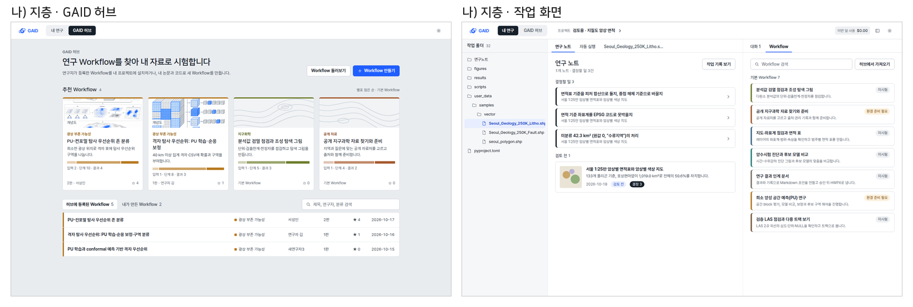
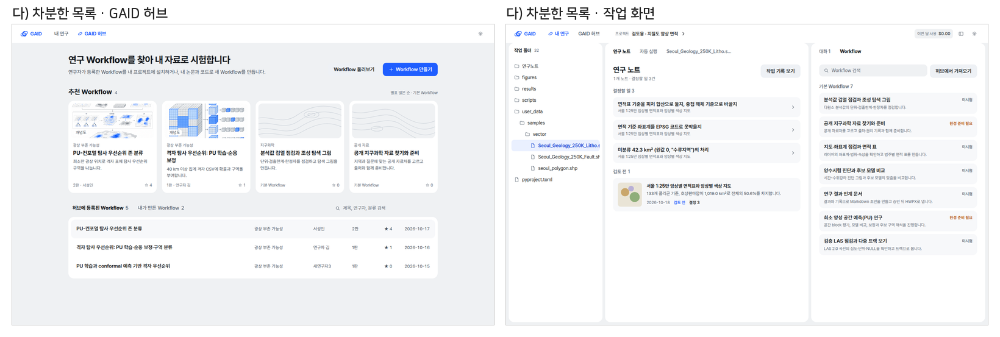

# GAID 디자인 정체성: 현재 화면 진단과 세 가지 시각 방향

## 0. 한눈에

| | |
|---|---|
| 요청 | AI slop을 피하고 GAID만의 브랜드로 알아볼 수 있는 UI/UX 체계를 만듭니다. |
| 결론 | 1단계(진단·벤치마크·시안)를 마쳤습니다. 현재 화면은 브랜드 글꼴이 실제로 적용되지 않고 범용 구성요소와 AI 상징 아이콘을 그대로 써서 GAID다운 점이 로고 하나뿐입니다. 같은 허브·작업 화면을 세 방향으로 그렸고, 권장은 가) 도면입니다. |
| 믿을 수 있는 정도 | 진단은 실제 앱 화면과 코드에서 확인했습니다. 시안은 정적 화면이며 앱 코드는 아직 바꾸지 않았습니다. |
| 결정할 일 | 2건 (6절): 시각 방향 선택, 로고 유지 여부 |

## 1. 요청한 것

> "GAID 허브와 GAID 시스템에서 디자인 가이드와 관련하여 ONEUI 가이드를 기반으로 작성된 것으로 이해하고 있다. 추가 디자인 가이드로 https://tossmini-docs.toss.im/tds-mobile/ 가 있으며, 현재 GAID 허브와 GAID 시스템의 디자인에서 AISlop을 피하면서 독자적인 브랜딩으로 ui/ux시스템이 인식 될 수 있게 디자인을 개선하고 싶다." — 2026-10-21 요청

hub 제안 뒤 사용자 답: "gaid-design-identity 는 진행하자."

완료 기준: (1) 현재 가이드와 실제 화면의 AI slop 징후를 근거와 함께 정리합니다. (2) TDS Mobile에서 GAID에 맞는 것만 고르고 One UI 가이드와 합치는 방법을 정합니다. (3) 색·글꼴·아이콘·로고 사용·개념 그림·움직임을 담은 브랜드 체계를 2–3개 방향의 실제 화면 시안으로 보여 주고 사용자가 고릅니다. (4) 고른 방향을 토큰과 UI 가이드에 반영하고 허브·시스템 화면에 적용하며, UI 검사에 AI slop 규칙을 추가합니다. 이 보고서는 (1)–(3)을 다룹니다. (4)는 선택 뒤 2단계에서 이 보고서에 이어 씁니다.

## 2. 수행한 것

1. 현재 UI 가이드(One UI 기반), 기계 판독 규칙, 브랜드 자산을 읽었습니다.
2. 검토용 앱 자료를 복사한 별도 인스턴스를 띄워 실제 화면 6장(허브 첫 화면, 허브 Workflow 상세, 프로젝트 목록, 작업 화면, 연구 노트와 Workflow 패널, 지도 뷰어)을 1440×900으로 찍었습니다. 자격 증명은 복사하지 않았습니다.
3. 화면과 코드에서 AI slop 징후를 찾아 근거를 붙였습니다(3.1절).
4. TDS Mobile 공개 문서 37쪽을 읽고 원칙·색·글꼴·구성요소 규칙을 정리해, GAID에 들일 것과 뺄 것을 나눴습니다(3.2절).
5. 같은 내용의 허브 화면과 작업 화면을 세 방향으로 그렸습니다. 로고는 세 방향 모두 그대로 두었습니다(3.3절).

## 3. 결과

### 3.1 현재 화면 진단

그림 1. 현재 GAID 허브(왼쪽)와 작업 화면(오른쪽), 1440×900. 볼 것: 허브의 반짝임(Sparkles) 아이콘, 테두리 카드의 반복, 작업 화면 기본 Workflow 목록의 살구색 카드, 거의 모든 제목 앞의 아이콘.

| # | 징후 | 근거 | 영향 |
|---|---|---|---|
| 1 | 브랜드 글꼴이 실제로 적용되지 않습니다 | 가이드와 토큰은 Pretendard와 D2Coding을 지정하지만 앱에 글꼴 파일이나 불러오기 선언이 없습니다. 이 PC는 Noto Sans CJK JP로, Windows는 맑은 고딕으로 표시합니다 | 글꼴로 생길 정체성이 없고, 운영체제마다 화면이 다릅니다 |
| 2 | GAID 허브의 상징이 범용 "AI" 반짝임 아이콘입니다 | 상단 전환 버튼, 프로젝트 목록의 허브 안내 띠, Workflow 상세의 고정 막대 | 생성형 AI 서비스 어디에나 있는 표식이라 GAID를 구분하지 못합니다 |
| 3 | 구성요소 라이브러리 기본값을 그대로 씁니다 | 회색 계열(zinc), 모서리 10px, 흰 카드와 옅은 테두리. 프로젝트 카드 9개가 모두 같은 "폴더 아이콘 상자 + ⋯ + 설명이 없습니다" 모양입니다 | 템플릿으로 만든 관리 화면처럼 보입니다 |
| 4 | 정해진 역할 밖의 색이 섞여 있습니다 | upstream 코드의 Tailwind 색 지정 401곳(GAID 코드 66곳), 보라색 상태 표시, 작성자 원형 배지의 6색 무작위 팔레트, 기본 Workflow의 살구색 분류 카드 | 화면마다 다른 제품처럼 보이고, 색이 뜻을 갖지 않습니다 |
| 5 | 정체성 색이 파랑 하나뿐이고 그 파랑을 모든 곳에 씁니다 | 주요 버튼, 링크, 선택 표시, 안내 띠 배경, 개념 그림 강조색이 모두 같은 파랑입니다 | 흔한 SaaS 파랑과 구별되지 않습니다 |
| 6 | 개념 그림이 범용 "AI 설명도" 화풍입니다 | 떠 있는 층, 파랗게 빛나는 격자, 등각 투영 지형. 모든 Workflow가 같은 프롬프트로 그려지고, 그림이 없는 카드는 가운데 아이콘 하나만 둡니다 | 허브에서 가장 큰 시각 요소가 생성형 이미지의 전형을 드러냅니다 |
| 7 | 뜻 없는 장식이 많습니다 | 작업 폴더·연구 노트·자동 실행·Workflow·넣는 자료·단계·얻는 결과 등 거의 모든 제목 앞의 아이콘, 반투명 흐림 머리글, 깜박이는 점 | 시선이 분산되고 어디에 집중할지 흐려집니다 |
| 8 | 글자 크기와 서체가 섞여 있습니다 | 파일 트리는 고정폭 글꼴, 머리글 칩은 11px(가이드 T1 위반) | 연구자가 읽을 글이 작고 불규칙합니다 |
| 9 | 허브와 작업 화면이 시각적으로 이어지지 않습니다 | 허브는 넓은 카드 화면, 작업 화면은 3분할 도구 화면이며 로고 말고는 공통 표식이 없습니다 | 두 곳이 한 제품이라는 인상이 약합니다 |
| 10 | 문구에도 이전에 지적된 표현이 남아 있습니다 | 기본 Workflow 제목 "공개 지구과학 자료 찾기와 준비". 사용자는 2026-10-11에 "지구과학 자료"가 AI slop 같은 뉘앙스라고 지적했습니다 | 화면 문구가 직역투로 읽힙니다 |

현재 가이드의 구조 규칙(한 화면 한 작업, 첫 화면 글자량, 질문 방식, 연구자에게 숨길 정보)은 이번 진단에서 문제로 드러나지 않았습니다. 비어 있는 곳은 시각 정체성 층입니다. 가이드는 색·글꼴을 토큰 파일에 맡겼고, 토큰은 라이브러리 기본값에 파랑 하나를 얹은 상태입니다.

### 3.2 TDS Mobile에서 가져올 것

TDS Mobile 공개 문서(시작, 색, 글꼴, 구성요소 34쪽)를 2026-10-21에 읽었습니다. 정리한 결과는 다음과 같습니다.

- 문서가 밝힌 목표는 일관된 기본 품질, 재사용 구성요소, 일관된 상호작용입니다. 별도의 UX 문구 원칙은 이 문서들에 없습니다. 문서 자체는 해요체로 쓰였지만 이것은 제품 문구 규칙이 아닙니다. GAID는 승인된 합니다체 문구 규칙을 유지합니다.
- 색은 7개 색상군과 회색 1개, 각 10단계이고, 배경을 역할 이름(기본, 회색 바탕, 겹친 면, 떠 있는 면)으로 나눕니다. 글꼴은 30px부터 11px까지 20단계이고, 큰 글자 설정에 맞춰 토큰별로 커집니다.
- 모바일 전용 요소(하단 고정 버튼, 바텀시트, 56px 버튼, 17px 본문)와 Toss 고유 자산(Toss Product Sans, Tossface, 아이콘·삽화, 대표 파랑)은 쓰지 않습니다. 시안의 회색값도 TDS 팔레트와 겹치지 않게 GAID 값으로 정했습니다.

| 가져오는 것 | GAID에 적용하는 방식 |
|---|---|
| 배경을 역할로 나누기 | 바탕·패널·떠 있는 면을 이름으로 구분하고, 깊이는 색 대신 배치와 선으로 나타냅니다 |
| 목록 행의 세 칸 구조 | 왼쪽 표식, 제목과 한 줄 보조 정보, 오른쪽 상태나 동작. 가이드 G1(제목 한 줄, 보조 한 줄)을 유지합니다 |
| 배지의 진한 표시와 옅은 표시 | 평소 상태는 옅게, 예외만 진하게 표시합니다. 행마다 배지 3개 제한(G2)은 그대로입니다 |
| 결과 화면: 결과 제목, 설명, 다음 동작 | 빈 상태와 오류 상태에 씁니다. 과학 결과에 성공 삽화를 붙이지 않습니다 |
| 구조를 아는 곳은 skeleton, 모르는 곳은 이름 붙은 진행 표시 | 가이드 F1과 합칩니다 |
| 입력란의 상시 라벨과 단위 접미사 | 분석 조건 입력에 씁니다 |
| 버튼 로딩 중 폭 유지 | 가이드 S5에 이미 있는 규칙을 그대로 확인합니다 |

One UI 가이드와 합치는 방식: One UI 기반 구조 규칙(P·L·Q·W·R)은 그대로 기준으로 둡니다. TDS에서는 위 표의 구성요소 구조만 가져와 G·F·S 규칙에 한두 줄씩 더합니다. 시각 정체성(색, 글꼴, 선, 표식)은 GAID 고유 층으로 새로 쓰고, 아래 세 방향 가운데 하나를 그 층으로 삼습니다.

### 3.3 세 가지 시각 방향

세 방향 모두 내용과 배치는 같고 로고와 브랜드 파랑(주요 동작 색)은 그대로입니다. 차이는 바탕, 선, 표식, 글꼴 짝, 분류와 상태를 보여 주는 방법입니다. 세 방향 모두 Pretendard를 앱에 실제로 넣습니다(진단 1 해결).

그림 2. 가) 도면. 지질도 도폭의 언어를 빌렸습니다. 볼 것: 따뜻한 종이색 바탕과 먹색 테두리선, 허브 머리 아래 이중선(도곽선), 분류를 범례 칸(작은 네모)으로, 상태를 원형 점으로 나눈 표시, 숫자와 날짜의 고정폭 글꼴(IBM Plex Mono), 그림 없는 Workflow 자리의 등고선 무늬, 개념 그림의 "개념도" 표지.

그림 3. 나) 지층. Workflow 분류를 지층 색띠로 보여 줍니다. 볼 것: 카드 위쪽과 목록 왼쪽의 분류 색띠(광상은 황토, 지구화학은 올리브, 지하수는 청록 등), 넣는 자료·단계·얻는 결과 수를 길이로 보여 주는 단면 막대, 제목의 각진 글꼴(나눔스퀘어, 각진 G 로고와 어울림), 짙은 먹색 선택 표시.

그림 4. 다) 차분한 목록. TDS의 방식을 가장 많이 따랐습니다. 볼 것: 회색 바탕 위 테두리 없는 흰 면, 큰 제목과 굵은 위계, 넓은 목록 행, 로고의 기울어진 궤도를 현재 위치 표시로 쓴 점.

| 항목 | 가) 도면 | 나) 지층 | 다) 차분한 목록 |
|---|---|---|---|
| 첫인상 | 지질 도면, 연구 문서 | 분류가 눈에 띄는 자료 목록 | 깔끔한 일반 앱 |
| GAID다움 | 높음. 지질도 도폭의 선과 범례에서 왔습니다 | 중간에서 높음. 색띠가 강한 표식입니다 | 낮음. 다른 서비스와 구별이 약합니다 |
| 색 | 종이색·먹색·파랑 1개. 분류색은 작은 범례 칸에만 | 회색·파랑. 분류색 7개를 띠와 막대에 씁니다 | 회색·파랑만 |
| 글꼴 | Pretendard + IBM Plex Mono(숫자) | 나눔스퀘어(제목) + Pretendard | Pretendard |
| 지도·자료 색과 충돌 | 적음. 분류색이 작습니다 | 있음. 분류색띠가 지도 범례색과 겹칠 수 있습니다 | 없음 |
| 정보 밀도 | 현재와 같습니다 | 현재와 같습니다 | 현재보다 낮습니다(행이 넓음) |
| 개념 그림 화풍 제안 | 먹선 단면도·평면도, 종이 바탕, 파랑 하나 | 지층 단면 스타일, 분류색 하나 | 지금처럼 단순 평면도 |
| 바꿀 양 | 토큰, 머리글, 카드·행, 상태 표식 | 토큰, 카드·행, 분류색 체계 | 토큰, 간격, 카드 |

권장은 가) 도면입니다. 지질도 도폭이라는 연구 현장의 익숙한 시각 언어에서 출발해 다른 AI 서비스와 겹치지 않고, 분류색을 작게 써서 지도·그래프 색과 다투지 않습니다. 나)의 "넣는 자료 · 단계 · 얻는 결과" 수 표시는 가)에도 글자로 넣었습니다. 다)는 정돈되어 보이지만 GAID라는 것을 알아보게 하는 힘이 약합니다.

## 4. 검증

- 과학적 검증: 해당 없음(디자인 제안).
- 소프트웨어 검증: 현재 화면은 이 작업 단위의 앱 인스턴스(현재 main 기준 코드, 검토용 자료 복사본)에서 찍었습니다. 시안은 정적 HTML을 같은 브라우저로 1440×900에서 찍었습니다. 시안의 본문·보조 글자 대비는 4.5:1 이상으로 맞췄고(가) 5.4–8.7:1, 나) 4.7–6.6:1), 다)의 옅은 회색 행 위 보조 글자는 4.3:1로 기준보다 낮아 2단계에서 고칩니다. 1280×800 화면과 어두운 테마는 아직 확인하지 않았습니다.

## 5. 한계

- 시안은 허브 첫 화면과 작업 화면 두 장입니다. Workflow 상세, 시작 설정, 지도 뷰어, 설정 화면은 고른 방향으로 2단계에서 적용하며 그리지 않았습니다.
- 개념 그림 화풍은 문장으로만 제안했습니다. 새 화풍의 그림은 그림 생성 계정이 필요해 만들지 않았고, 시안에는 기존 그림을 채도만 낮춰 넣었습니다.
- TDS Mobile 정리는 공개 문서 37쪽 기준입니다. 데모를 실행하거나 실제 앱 화면을 재지는 않았습니다.
- 앱 코드는 바꾸지 않았습니다. 진단 1(글꼴 미적용)도 2단계에서 고칩니다.

## 6. 결정할 일

1. GAID의 시각 방향을 어느 것으로 할까요?
   - 가) 도면: 종이색 바탕, 먹선, 범례 표식, 숫자 고정폭 글꼴 (권장: 지질 연구 현장의 시각 언어라 다른 AI 서비스와 구별되고, 지도 색과 다투지 않습니다)
   - 나) 지층: 분류 색띠와 단면 막대, 각진 제목 글꼴
   - 다) 차분한 목록: TDS식 회색 바탕과 큰 제목
   - 라) 섞기: 예를 들어 가)에 나)의 분류 색띠를 더하는 식으로 원하는 요소를 말씀해 주세요
2. 로고(각진 G와 기울어진 궤도)를 그대로 둘까요?
   - 가) 그대로 둡니다 (권장: 세 방향 모두 지금 로고와 어울리고, 기관 브랜드 승인 대기 항목과 엮이지 않습니다)
   - 나) 고른 방향에 맞춰 색이나 글자 모양을 다듬는 시안을 따로 만듭니다(기관 브랜드 승인 대기 항목 gaid-release-proof#2와 함께 다룹니다)

## 7. 대체되었거나 실패한 시도

펼치기 — 1건

- 다) 시안의 처음 회색값이 TDS 회색 팔레트와 정확히 같았습니다. Toss 고유 정체성을 피하려고 GAID 값으로 바꿨습니다.

## 용어

없음

## 부록 A. 근거 위치

펼치기 — 실행 방법, 원본, 해시, 커밋

| 항목 | 위치 |
|---|---|
| 현재 화면 원본 | PC74 `~/data/geoaidesk/work/gaid-design-identity/shots/01-home.png` … `06-map.png` |
| 시안 원본 | PC74 `~/data/geoaidesk/work/gaid-design-identity/mockups/` (`screens.html?d=a|b|c&s=hub|work`, `base.css`, `dir-{a,b,c}.css`, `png/`) |
| 시안 비교 문서 | PC74 `~/data/geoaidesk/work/gaid-design-identity/mockups/compare.md` (원본 크기 그림 6장) |
| TDS Mobile 정리 | PC74 `~/data/geoaidesk/work/gaid-design-identity/tds-notes.md`, 원문 HTML `tds-pages/` (`manifest.json`에 URL·SHA-256) |
| 앱 인스턴스 | systemd 사용자 unit `gaid-design-identity-app`, UI 3310 / API 18310, GAID_HOME `~/data/geoaidesk/work/gaid-design-identity/home` |
| 진단 근거 코드 | `web/src/app/globals.css`·`geo/copy/gaid-app.css`(글꼴 선언만 있음), `web/src/geo/hub/top-nav.tsx`·`shared-method.tsx`(Sparkles, 6색 팔레트), `web/src/app/page.tsx`(보라 표시, `text-[11px]`), `server/src/geo/authoring/visuals.ts`(개념 그림 프롬프트) |
| 글꼴 라이선스 | Pretendard, IBM Plex Mono, 나눔스퀘어 모두 SIL OFL 1.1 |

작성 시점: 2026-10-21, 기준 커밋 776187ee(task 브랜치 시작점).

