# GAID 디자인 정체성: 현재 화면 진단, 시각 방향과 로고 후보

> 2026-10-22 갱신: 3.3–3.4절의 네 방향은 채택되지 않았습니다. 사용자 결정에 따라 One UI 가이드를 따르는 새 시안을 3.6절에 정리했습니다.

## 0. 한눈에

| | |
|---|---|
| 요청 | AI slop을 피하고 GAID만의 브랜드로 알아볼 수 있는 UI/UX 체계를 만듭니다. |
| 결론 | 처음 제안한 네 방향은 채택되지 않았고, 사용자는 One UI 가이드를 따르는 새 디자인을 정했습니다. One UI 기반 시안 세 가지를 만들었습니다(3.6절). 어두운 테마를 함께 만들고 로고는 유지한다는 결정은 그대로입니다. |
| 믿을 수 있는 정도 | 진단은 실제 앱 화면과 코드에서 확인했습니다. 새 시안은 정적 화면입니다. 브랜치에는 채택되지 않은 라) 방향을 적용한 코드가 있으며, 고른 시안으로 다시 맞추기 전에는 main에 넣지 않습니다. |
| 결정할 일 | 1건 (6절): One UI 시안 선택 |

## 1. 요청한 것

> "GAID 허브와 GAID 시스템에서 디자인 가이드와 관련하여 ONEUI 가이드를 기반으로 작성된 것으로 이해하고 있다. 추가 디자인 가이드로 https://tossmini-docs.toss.im/tds-mobile/ 가 있으며, 현재 GAID 허브와 GAID 시스템의 디자인에서 AISlop을 피하면서 독자적인 브랜딩으로 ui/ux시스템이 인식 될 수 있게 디자인을 개선하고 싶다." — 2026-10-21 요청

hub 제안 뒤 사용자 답: "gaid-design-identity 는 진행하자."

두 번째 제안 뒤 사용자 답(2026-10-21): "1번 라로 하거나 현재 방식 유지다. 새로 제안한 디자인이 적절한 것이 없다. 2번 (가) 3번 (가)로 하고 (다)로 더 다듬거나 새롭게 디자인하는 것도 고려하자. 디자인은 항상 impeccable과 taste와 브랜딩 가이드 전문가 입장에서 디자인해야한다." 이어서 hub에서 확인한 결정(2026-10-21): "새로운 디자인을 oneui가이드에 따라 생성하자."

첫 제안 뒤 사용자 의견(2026-10-21): "가 도면은 권장하는데 여전히 흰색 배경이 작동하는 부분들이 있지 않나? 그리고 다크테마는 어떻게 할 것인지도 고민해야한다. impeccable 스킬과 taste 스킬로 검토해볼 필요가 있다. codex 고급검토에게 검토도 받고 codex가 시각방향을 제안하게도 해보아야 한다. 로고의 경우 그대로 두어도 된다. 그런데 후보군으로 KIGAM로고의 G에 위치한 3가지 색상을 로고에 반영하거나 유사한 방식의 디자인적으로 어색하지 않은 방식으로 반영할 수 있다면 후보군으로 다듬어서 제시하는 것도 필요하다." 이어서 "로고 디자인도 생성되면 고급 codex에게 검토 받고 해당 codex가 시안을 생성할 수 있게 해보자.", "현재 제안한 후보 로고는 색상을 그대로 사용해서인지 어색한 감이 있다. 그리고 GAID허브와 GAID시스템의 색상과도 일관성이 있어야 하며, 꼭 KIGAM 로고의 3개 색상을 다 사용할 필요도 없으며, 디지털 형식으로 반영해도 된다."

완료 기준: (1) 현재 가이드와 실제 화면의 AI slop 징후를 근거와 함께 정리합니다. (2) TDS Mobile에서 GAID에 맞는 것만 고르고 One UI 가이드와 합치는 방법을 정합니다. (3) 색·글꼴·아이콘·로고 사용·개념 그림·움직임을 담은 브랜드 체계를 2–3개 방향의 실제 화면 시안으로 보여 주고 사용자가 고릅니다. (4) 고른 방향을 토큰과 UI 가이드에 반영하고 허브·시스템 화면에 적용하며, UI 검사에 AI slop 규칙을 추가합니다. 이 보고서는 (1)–(3)을 다룹니다. (4)는 선택 뒤 2단계에서 이 보고서에 이어 씁니다.

## 2. 수행한 것

1. 현재 UI 가이드(One UI 기반), 기계 판독 규칙, 브랜드 자산을 읽었습니다.
2. 검토용 앱 자료를 복사한 별도 인스턴스를 띄워 실제 화면 6장을 1440×900으로 찍었습니다. 자격 증명은 복사하지 않았습니다.
3. 화면과 코드에서 AI slop 징후를 찾아 근거를 붙였습니다(3.1절).
4. TDS Mobile 공개 문서 37쪽을 읽고 GAID에 들일 것과 뺄 것을 나눴습니다(3.2절).
5. 같은 내용의 허브 화면과 작업 화면을 세 방향으로 그린 뒤, impeccable·taste 스킬 기준으로 다시 검토해 고쳤습니다. 모든 방향에 어두운 테마를 더했습니다(3.3–3.4절).
6. Codex 고급검토에게 시안 검토와 독자 방향 제안을, 다른 Codex 고급검토에게 로고 검토와 독자 로고 후보를 맡겼습니다(3.3, 3.5절).
7. KIGAM 로고 G의 색을 GAID 색에 맞춰 반영한 로고 후보를 만들고, 원색을 그대로 쓴 1판은 사용자 의견에 따라 버렸습니다. 로고는 유지하기로 정해졌고, Codex 고급검토가 다듬기·새 디자인 후보를 한 번 더 탐색했습니다(3.5, 7절).
8. 사용자 결정에 따라 One UI 가이드를 따르는 새 시안 세 가지(작성자 두 가지, Codex 한 가지)를 밝은·어두운 테마로 만들었습니다(3.6절).

## 3. 결과

### 3.1 현재 화면 진단

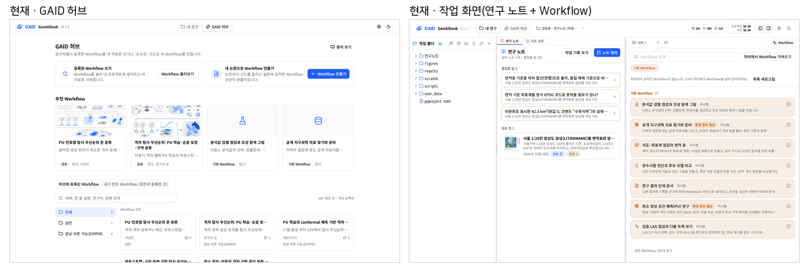

그림 1. 현재 GAID 허브(왼쪽)와 작업 화면(오른쪽), 1440×900. 볼 것: 허브의 반짝임(Sparkles) 아이콘, 테두리 카드의 반복, 작업 화면 기본 Workflow 목록의 살구색 카드, 거의 모든 제목 앞의 아이콘.

| # | 징후 | 근거 | 영향 |
|---|---|---|---|
| 1 | 브랜드 글꼴이 실제로 적용되지 않습니다 | 가이드와 토큰은 Pretendard와 D2Coding을 지정하지만 앱에 글꼴 파일이나 불러오기 선언이 없습니다. 이 PC는 Noto Sans CJK JP로, Windows는 맑은 고딕으로 표시합니다 | 글꼴로 생길 정체성이 없고, 운영체제마다 화면이 다릅니다 |
| 2 | GAID 허브의 상징이 범용 "AI" 반짝임 아이콘입니다 | 상단 전환 버튼, 프로젝트 목록의 허브 안내 띠, Workflow 상세의 고정 막대 | 생성형 AI 서비스 어디에나 있는 표식이라 GAID를 구분하지 못합니다 |
| 3 | 구성요소 라이브러리 기본값을 그대로 씁니다 | 회색 계열(zinc), 모서리 10px, 흰 카드와 옅은 테두리. 프로젝트 카드 9개가 모두 같은 "폴더 아이콘 상자 + ⋯ + 설명이 없습니다" 모양입니다 | 템플릿으로 만든 관리 화면처럼 보입니다 |
| 4 | 정해진 역할 밖의 색이 섞여 있습니다 | upstream 코드의 Tailwind 색 지정 401곳(GAID 코드 66곳), 보라색 상태 표시, 작성자 원형 배지의 6색 무작위 팔레트, 기본 Workflow의 살구색 분류 카드 | 화면마다 다른 제품처럼 보이고, 색이 뜻을 갖지 않습니다 |
| 5 | 정체성 색이 파랑 하나뿐이고 그 파랑을 모든 곳에 씁니다 | 주요 버튼, 링크, 선택 표시, 안내 띠 배경, 개념 그림 강조색이 모두 같은 파랑입니다 | 흔한 SaaS 파랑과 구별되지 않습니다 |
| 6 | 개념 그림이 범용 "AI 설명도" 화풍입니다 | 떠 있는 층, 파랗게 빛나는 격자, 등각 투영 지형. 모든 Workflow가 같은 프롬프트로 그려지고, 그림이 없는 카드는 가운데 아이콘 하나만 둡니다 | 허브에서 가장 큰 시각 요소가 생성형 이미지의 전형을 드러냅니다 |
| 7 | 뜻 없는 장식이 많습니다 | 작업 폴더·연구 노트·자동 실행·Workflow·넣는 자료·단계·얻는 결과 등 거의 모든 제목 앞의 아이콘, 반투명 흐림 머리글, 깜박이는 점 | 시선이 분산되고 어디에 집중할지 흐려집니다 |
| 8 | 글자 크기와 서체가 섞여 있습니다 | 파일 트리는 고정폭 글꼴, 머리글 칩은 11px(가이드 T1 위반) | 연구자가 읽을 글이 작고 불규칙합니다 |
| 9 | 허브와 작업 화면이 시각적으로 이어지지 않습니다 | 허브는 넓은 카드 화면, 작업 화면은 3분할 도구 화면이며 로고 말고는 공통 표식이 없습니다 | 두 곳이 한 제품이라는 인상이 약합니다 |
| 10 | 문구에도 이전에 지적된 표현이 남아 있습니다 | 기본 Workflow 제목 "공개 지구과학 자료 찾기와 준비". 사용자는 2026-10-11에 "지구과학 자료"가 AI slop 같은 뉘앙스라고 지적했습니다 | 화면 문구가 직역투로 읽힙니다 |

현재 가이드의 구조 규칙(한 화면 한 작업, 첫 화면 글자량, 질문 방식, 연구자에게 숨길 정보)은 이번 진단에서 문제로 드러나지 않았습니다. 비어 있는 곳은 시각 정체성 층입니다. 가이드는 색·글꼴을 토큰 파일에 맡겼고, 토큰은 라이브러리 기본값에 파랑 하나를 얹은 상태입니다.

### 3.2 TDS Mobile에서 가져올 것

TDS Mobile 공개 문서(시작, 색, 글꼴, 구성요소 34쪽)를 2026-10-21에 읽었습니다. 정리한 결과는 다음과 같습니다.

- 문서가 밝힌 목표는 일관된 기본 품질, 재사용 구성요소, 일관된 상호작용입니다. 별도의 UX 문구 원칙은 이 문서들에 없습니다. 문서 자체는 해요체로 쓰였지만 이것은 제품 문구 규칙이 아닙니다. GAID는 승인된 합니다체 문구 규칙을 유지합니다.
- 색은 7개 색상군과 회색 1개, 각 10단계이고, 배경을 역할 이름(기본, 회색 바탕, 겹친 면, 떠 있는 면)으로 나눕니다. 글꼴은 30px부터 11px까지 20단계이고, 큰 글자 설정에 맞춰 토큰별로 커집니다.
- 모바일 전용 요소(하단 고정 버튼, 바텀시트, 56px 버튼, 17px 본문)와 Toss 고유 자산(Toss Product Sans, Tossface, 아이콘·삽화, 대표 파랑)은 쓰지 않습니다. 시안의 회색값도 TDS 팔레트와 겹치지 않게 GAID 값으로 정했습니다.

| 가져오는 것 | GAID에 적용하는 방식 |
|---|---|
| 배경을 역할로 나누기 | 바탕·패널·떠 있는 면을 이름으로 구분하고, 깊이는 색 대신 배치와 선으로 나타냅니다 |
| 목록 행의 세 칸 구조 | 왼쪽 표식, 제목과 한 줄 보조 정보, 오른쪽 상태나 동작. 가이드 G1(제목 한 줄, 보조 한 줄)을 유지합니다 |
| 배지의 진한 표시와 옅은 표시 | 평소 상태는 옅게, 예외만 진하게 표시합니다. 행마다 배지 3개 제한(G2)은 그대로입니다 |
| 결과 화면: 결과 제목, 설명, 다음 동작 | 빈 상태와 오류 상태에 씁니다. 과학 결과에 성공 삽화를 붙이지 않습니다 |
| 구조를 아는 곳은 skeleton, 모르는 곳은 이름 붙은 진행 표시 | 가이드 F1과 합칩니다 |
| 입력란의 상시 라벨과 단위 접미사 | 분석 조건 입력에 씁니다 |
| 버튼 로딩 중 폭 유지 | 가이드 S5에 이미 있는 규칙을 그대로 확인합니다 |

One UI 가이드와 합치는 방식: One UI 기반 구조 규칙(P·L·Q·W·R)은 그대로 기준으로 둡니다. TDS에서는 위 표의 구성요소 구조만 가져와 G·F·S 규칙에 한두 줄씩 더합니다. 시각 정체성(색, 글꼴, 선, 표식)은 GAID 고유 층으로 새로 쓰고, 3.3절의 방향 가운데 하나를 그 층으로 삼습니다.

### 3.3 시각 방향 (1·2차 제안, 채택되지 않음)

네 방향 모두 내용과 배치가 같고, 로고와 주요 동작의 파랑은 그대로입니다. 모두 Pretendard를 앱에 실제로 넣습니다(진단 1 해결). 첫 시안 뒤 impeccable·taste 기준으로 고친 점은 세 방향에 공통으로 적용했습니다. 허브 추천은 같은 크기 카드 4개 대신 대표 Workflow 하나와 목록으로 바꿨고, 제목 위 작은 라벨을 지웠습니다. 개념 그림에는 색 필터를 걸지 않습니다. 과학 그림의 색을 바꾸기 때문입니다(Codex 지적).

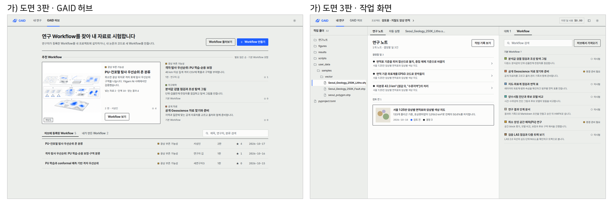

그림 2. 가) 도면 3판, 밝은 테마. 볼 것: 앱 틀은 차가운 회녹색, 흰 면은 연구자의 내용물(개념 그림, 연구 노트)에만 있고 먹색 1px 테두리를 둡니다. 목록은 상자 없이 가는 선으로 나눕니다. 분류는 범례 네모, 상태는 원형 점, 숫자와 날짜는 고정폭 숫자 글꼴입니다.

가) 1판은 따뜻한 종이색 바탕에 카드와 패널이 흰색이어서, 사용자 지적대로 흰 바탕이 화면 대부분을 차지했습니다. 따뜻한 종이색은 taste 스킬이 AI 기본값으로 지목한 크림색 계열이기도 합니다. 3판은 "틀은 회녹색, 내용물만 흰 면"이라는 규칙 하나로 정리했습니다.

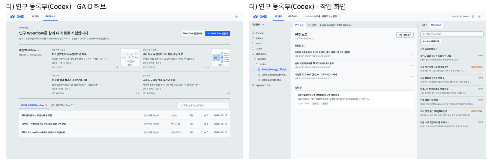

그림 3. 라) 연구 등록부, Codex 고급검토의 제안, 밝은 테마. 볼 것: 회청색 틀과 흰 연구 노트, 분류색 없이 글자로만 쓴 분류, "환경 준비 필요"에만 쓰는 호박색, 2열로 줄인 추천 Workflow, 작은 개념 그림.

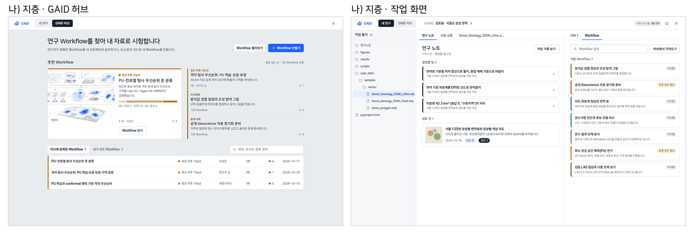

그림 4. 나) 지층. 볼 것: 분류 색띠, 각진 제목 글꼴. 단면 막대는 단위가 다른 수(입력, 단계, 결과)를 한 막대에 섞어 비율처럼 보이게 하므로 채택하면 뺍니다(Codex 지적).

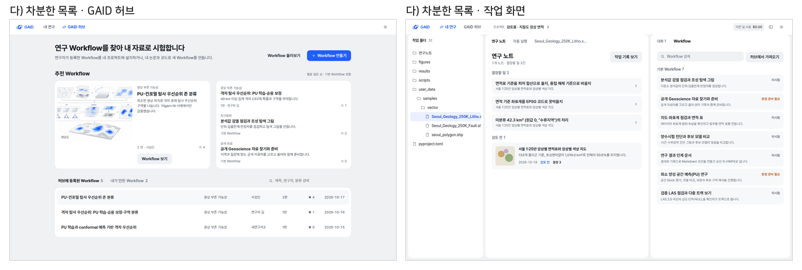

그림 5. 다) 차분한 목록. 볼 것: 회색 바탕 위 둥근 흰 면, 큰 제목. 둥근 패널 안에 둥근 칸이 들어가 화면이 조각나고 GAID다운 표식이 약합니다.

| 항목 | 가) 도면 3판 | 라) 연구 등록부 (Codex) | 나) 지층 | 다) 차분한 목록 |
|---|---|---|---|---|
| GAID다움 | 높음. 도곽선, 범례 표식, 고정폭 숫자 | 중간. 정돈된 색인과 탭 표시 | 중간에서 높음. 색띠 | 낮음 |
| 색 | 회녹색 틀, 흰 내용물 면, 파랑 1개, 분류색 7개(작은 범례 칸) | 회청색, 파랑 1개, 호박색은 준비 필요에만 | 회색, 파랑, 분류색 7개(띠) | 회색, 파랑 |
| 글꼴 | Pretendard + IBM Plex Mono(숫자) | Pretendard 하나 | Pretendard + 나눔스퀘어(제목) | Pretendard |
| 지도·그림 색과 충돌 | 적음 | 가장 적음 | 있음 | 없음 |
| impeccable·taste 기준 | 통과(1판의 크림색·라벨·왼쪽 띠는 고침) | 제목 위 작은 라벨이 남아 있음 | 색 왼쪽 띠가 금지 항목에 걸림 | 둥근 칸 중첩 |
| 검증 범위 | 1440×900, 밝은·어두운 | 1440×900과 1280×800, 밝은·어두운, 대비 4.9:1 이상 | 1440×900, 밝은·어두운 | 1440×900, 밝은·어두운 |

권장은 가) 도면 3판입니다. 다른 AI 서비스와 겹치지 않는 표식(도곽선, 범례 칸, 고정폭 숫자)이 있고, 3판에서 흰 바탕과 크림색 문제를 고쳤습니다. Codex는 기존 세 방향 중 가)를 가장 낫다고 보면서도 라)를 더 권했습니다. 라)는 색이 가장 절제되어 있지만 GAID를 알아보게 하는 힘은 가)보다 약합니다. Codex 검토에서 나온 원칙은 어느 방향을 고르든 함께 적용합니다.

- 분류는 글자가 먼저입니다. 분류색은 비교가 필요한 곳에만 작게 씁니다.
- 경고색(호박색)은 "환경 준비 필요"처럼 행동이 필요한 상태에만 씁니다. "미시험"과 "검토 전"은 중립색으로 둡니다.
- 그림이 없으면 빈 자리를 무늬로 채우지 않습니다.

### 3.4 어두운 테마

바탕을 역할로 나누는 규칙은 어두운 테마에서도 같습니다. 틀이 가장 어둡고, 연구자의 내용물 면은 한 단계 밝습니다. 강조색은 기존 어두운 바탕용 파랑 #4D7FFF입니다.

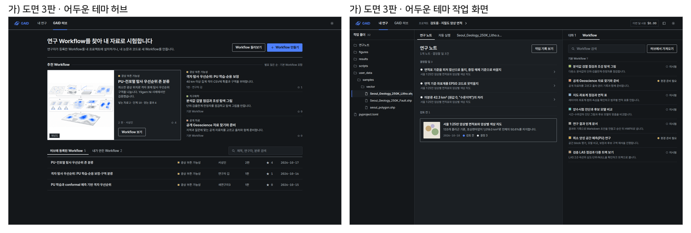

그림 6. 가) 도면 3판, 어두운 테마. 볼 것: 흰 개념 그림이 원래 색 그대로 어두운 틀 안에 있습니다. 먹선은 회색 선으로 바뀌고, 상태 점과 범례 칸은 같은 뜻을 유지합니다.

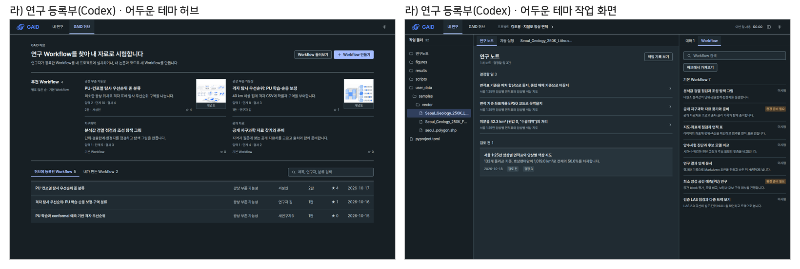

그림 7. 라) 연구 등록부, 어두운 테마. 볼 것: 같은 구조에서 연구 노트 면만 한 단계 밝습니다.

| 바탕 | 밝은 테마 | 어두운 테마 |
|---|---|---|
| 앱 틀(머리글, 파일, Workflow 목록) | 조용한 중립색 | 가장 어두운 중립색 |
| 연구자의 내용물(노트, 문서, 결과 요약) | 흰 면 | 한 단계 밝은 면 |
| 가져온 PDF, 그림, 지도 | 원본 색 그대로 | 원본 색 그대로 두고 둘레만 어두운 틀 |
| GAID가 그리는 표·그래프 | 축·격자·선택 색을 역할로 지정 | 축·격자·글자만 바꾸고 자료 색의 뜻은 유지 |

흰 PDF나 밝은 바탕지도가 어두운 화면 안에 있어도 테마 실패가 아닙니다. 분석에 쓰는 그림은 반전하거나 채도를 낮추지 않습니다. 테마는 밝게·어둡게·시스템 따름 세 가지로 두고 선택을 저장합니다. 지금 앱에도 테마 전환 단추는 있지만, 어두운 테마 값은 UI 라이브러리 기본값이라 GAID 색이 아닙니다.

### 3.5 로고 후보

로고는 지금 것을 그대로 두어도 된다는 사용자 의견에 따라, 현재 로고를 기준으로 두고 KIGAM 로고 G의 색을 반영한 후보를 따로 만들었습니다. 원색을 그대로 쓴 1판 후보는 어색하다는 의견을 받아 버렸습니다(7절). 2판은 GAID 파랑과 어울리게 조정한 색 하나만 더합니다.

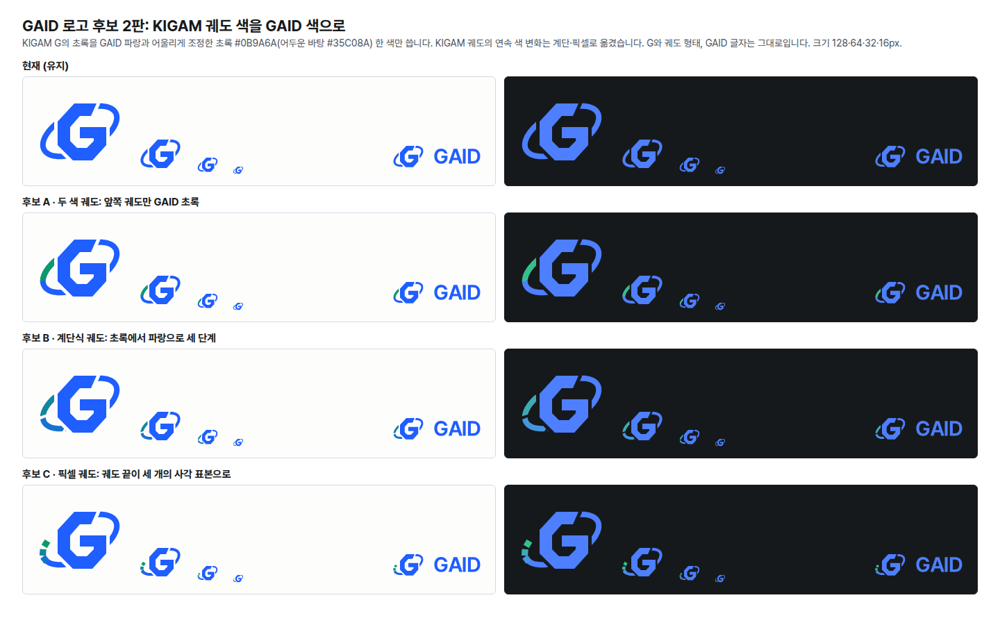

그림 8. 작성자 후보 2판. KIGAM 초록을 GAID 쪽으로 조정한 초록 #0B9A6A(어두운 바탕 #35C08A)를 씁니다. 볼 것: 후보 A 두 색 궤도, 후보 B 초록에서 파랑으로 세 단계 바뀌는 계단식 궤도, 후보 C 궤도 끝이 사각 표본 세 개로 끊기는 픽셀 궤도. 16px에서는 B와 C의 디지털 표현이 거의 보이지 않습니다.

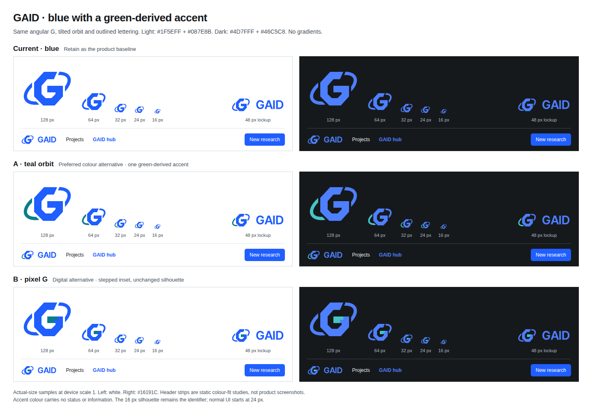

그림 9. Codex 고급검토의 후보. 볼 것: 청록 궤도(궤도의 왼쪽 아래 윤곽만 청록 #087E8B, 어두운 바탕 #46C5C8)는 기존 궤도의 두 윤곽선을 그대로 나눠 칠해 새 이음매가 없습니다. 픽셀 G는 G 가로획 안에 계단 모양 청록 조각을 넣었지만 16px에서는 거의 사라집니다.

두 검토가 같은 결론에 닿았습니다.

- 지금 로고를 기준으로 유지합니다.
- 색을 더한다면 궤도의 한쪽 윤곽만 초록 계열로 칠하는 방식이 가장 자연스럽습니다. 작성자 후보 A와 Codex 청록 궤도가 이 방식입니다.
- 둘 중에서는 Codex 청록 궤도가 낫습니다. 기존 도형을 하나도 바꾸지 않고 색만 나누기 때문입니다.
- 이 색은 상태(성공, 경고, 오류)를 뜻하지 않는 브랜드 전용 색으로 둡니다.
- 연결이 은근한 만큼, 설명 없이는 KIGAM과의 관계가 드러나지 않을 수 있습니다.

로고는 유지하기로 정해졌습니다(사용자 답 2026-10-21). 이후 선택을 위해 Codex 고급검토가 한 번 더 탐색했습니다.

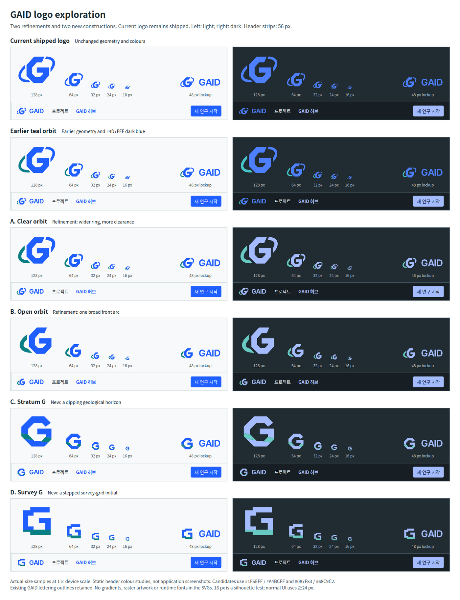

그림 13. 로고 2차 탐색(Codex). 볼 것: A 맑은 궤도(궤도를 조금 굵게, 간격을 넓게, 왼쪽 아래 윤곽만 청록)와 C 지층 G(각진 G를 기울어진 청록 지층 띠가 가로지름). 탐색자의 판단은 지금 로고 유지, 다듬기 후보로 A, 새 방향 후보로 C입니다. 어두운 테마에서 지금 로고 글자는 머리글 바탕 #171F24 위에서 4.6:1, 본문 바탕 #202B32 위에서 4.0:1이므로 로고는 머리글 바탕 위에 둡니다.

### 3.6 One UI 가이드를 따르는 새 시안 (2026-10-22)

세 시안 모두 One UI의 구조를 따릅니다. 화면 위쪽은 큰 제목의 보기 영역, 아래쪽은 조작 영역입니다. 관련 내용은 소제목이 붙은 포커스 블록(카드 묶음, 묶음 목록)에 모읍니다. 바탕은 단색이고, 바탕과 블록의 대비는 낮게, 글자 대비는 높게 둡니다. 버튼은 세 단계 강조(글자, 회색 채움, 파랑 채움)입니다. 넓은 화면에서는 파일, 연구 노트, Workflow 세 창을 함께 보여 줍니다. Samsung의 색, 글꼴, 그림은 쓰지 않았습니다. 앞에서 정한 규칙(그림 원본 유지, 호박색은 "환경 준비 필요"에만, 분류는 글자로, AI 아이콘·그라데이션 없음, Pretendard)은 그대로 지켰습니다.

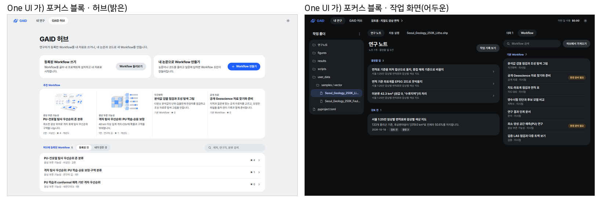

그림 10. 가) One UI 포커스 블록(작성자). 왼쪽은 밝은 테마 허브, 오른쪽은 어두운 테마 작업 화면입니다. 볼 것: 34px 큰 제목, 둥근 흰 블록(모서리 22px), 파란 소제목, 안쪽으로 들인 구분선, 알약 모양 버튼, 추천 Workflow 네 개를 한 블록에 담은 카드 묶음.

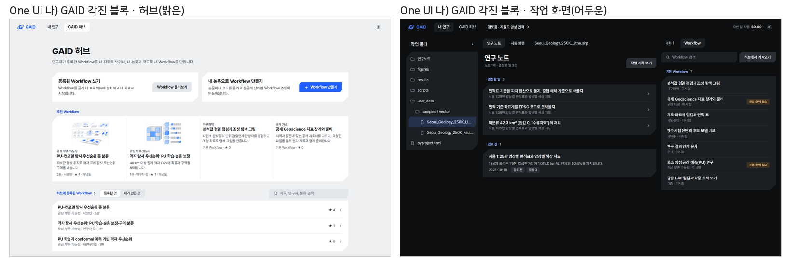

그림 11. 나) One UI + GAID 각진 블록(작성자). 구조는 가)와 같고, 블록과 버튼의 두 모서리를 로고 G처럼 비스듬히 깎았습니다. 볼 것: 둥근 모서리 대신 깎은 모서리가 GAID 표식이 되는지, 화면 전체에 반복될 때 과하지 않은지.

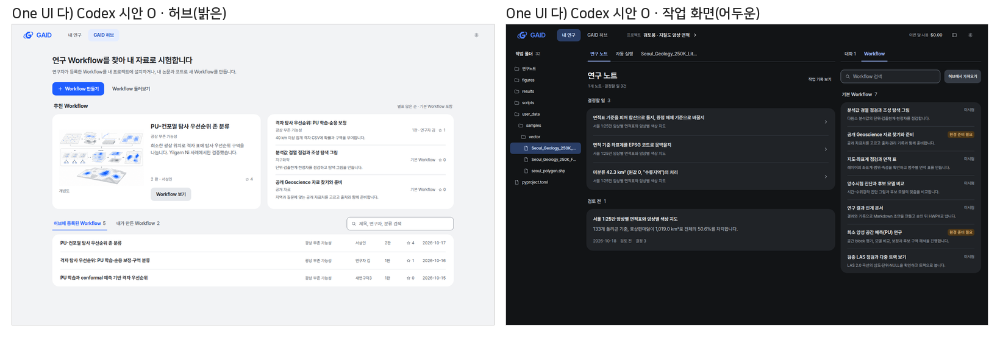

그림 12. 다) Codex 고급검토의 시안 O. 볼 것: 대표 Workflow 하나(그림과 글을 나눈 카드)와 추천 목록 블록, 열이 정렬된 등록 목록 블록, 블록 모서리 20px와 네모난 내부 행, 1440×900과 1280×800 모두 화면 안에 맞음(글자 대비 4.6:1 이상, Codex 측정).

| 항목 | 가) 포커스 블록 | 나) GAID 각진 블록 | 다) Codex 시안 O |
|---|---|---|---|
| One UI 충실도 | 높음 | 구조는 높음, 모서리는 GAID 변형 | 높음 |
| GAID다움 | 로고·파랑·Pretendard에 기댐 | 깎은 모서리가 GAID 표식 | 로고·파랑·정렬된 목록에 기댐 |
| 추천 Workflow | 같은 크기 카드 네 개 | 같은 크기 카드 네 개 | 대표 하나 + 목록 |
| 정보 밀도 | 중간(행 높이 58px) | 중간 | 중간(정렬된 표 행) |
| 어두운 테마 | 바탕 #0C0E10, 블록 #1B1E22 | 같음 | 바탕 #121416, 블록 #202327 |
| 확인 범위 | 1440×900, 두 테마 | 1440×900, 두 테마 | 1440×900·1280×800, 두 테마, 대비 측정 |

권장은 다) Codex 시안 O입니다. One UI 구조를 가장 충실히 따르면서, 같은 크기 카드 묶음 대신 대표 하나와 목록으로 위계를 만들었습니다. 두 화면 크기와 두 테마에서 대비까지 확인되었습니다. GAID 고유 모양을 더 강하게 원하시면 나)가 대안입니다. 다만 깎은 모서리가 모든 블록과 버튼에 반복되면 과해 보일 수 있습니다.

브랜치 상태: 이 작업 단위의 브랜치에는 앞서 라) 연구 등록부로 해석해 적용한 색 변수, UI 가이드 2판, 허브·시스템 화면 수정이 있습니다. 이것은 사용자 결정이 아니었으므로 main에 넣지 않습니다. 고르신 시안에 맞춰 색 변수, 가이드, 화면을 다시 맞춘 뒤 통합합니다. 방향과 관계없는 부분(AI slop 검사, 색 역할 변수, 그림 원본 유지, Sparkles 제거, Pretendard 글꼴 내장, 어두운 테마 구조)은 유지합니다.

## 4. 검증

- 과학적 검증: 해당 없음(디자인 제안).
- 소프트웨어 검증: 현재 화면은 이 작업 단위의 앱 인스턴스(현재 main 기준 코드, 검토용 자료 복사본)에서 찍었습니다. 시안은 정적 HTML을 같은 브라우저로 1440×900에서 찍었습니다. 가) 3판의 글자 대비는 지정한 색 쌍으로 계산해 밝은 테마 5.1:1 이상, 어두운 테마 5.2:1 이상입니다. 라)는 Codex가 1440×900과 1280×800, 두 테마에서 화면 넘침, 깨진 그림, 글꼴 미적용이 없고 글자 대비가 4.93:1 이상임을 확인했습니다. 로고 대비는 Codex가 계산했습니다(브랜드 파랑 흰 바탕 5.1:1, 청록 #087E8B 흰 바탕 4.8:1, 어두운 바탕 청록 #46C5C8 8.5:1).
- 확인하지 못한 것: 가)·나)·다)의 1280×800 화면, 나)·다) 어두운 테마의 글자 대비 계산, 실제 지도가 그려진 화면, 사용자 시험.

## 5. 한계

- 시안은 허브 첫 화면과 작업 화면 두 종류입니다. Workflow 상세, 시작 설정, 지도 뷰어, 설정 화면은 고른 방향으로 2단계에서 적용합니다.
- 개념 그림 화풍 변경은 다루지 않았습니다. 기존 그림을 원본 그대로 두는 규칙만 정했습니다. 새 화풍은 그림 생성 계정이 있어야 시험할 수 있습니다.
- TDS Mobile 정리는 공개 문서 37쪽 기준입니다. 데모를 실행하지 않았습니다.
- 로고 연상(Google, 국기 등) 판단은 검토자 두 명의 디자인 판단이며 사용자 조사나 상표 검토가 아닙니다. 로고를 바꾸면 기관 브랜드 승인 대기 항목(gaid-release-proof#2)과 함께 다뤄야 합니다.
- 앱 코드는 바꾸지 않았습니다. 진단 1(글꼴 미적용)도 2단계에서 고칩니다.

## 6. 결정할 일

1. One UI 기반 시안 가운데 어느 것으로 확정할까요?
   - 가) Codex 시안 O (권장: One UI 구조에 가장 충실하고, 대표 하나와 목록으로 위계가 분명하며, 두 화면 크기와 두 테마에서 확인되었습니다)
   - 나) One UI + GAID 각진 블록: GAID 고유 모양이 가장 강합니다
   - 다) One UI 포커스 블록: 가장 단순한 One UI 형태입니다
   - 라) 다시 그립니다: 바꿀 점을 말씀해 주세요

이전 결정(어두운 테마를 함께 만들기, 로고 유지)은 그대로 적용합니다.

## 7. 대체되었거나 실패한 시도

펼치기 — 6건

- 시각 방향 1차 제안(가 도면, 나 지층, 다 차분한 목록)과 2차 제안(가 도면 3판, 라 연구 등록부): 사용자가 "새로 제안한 디자인이 적절한 것이 없다"고 답했습니다.
- 라) 연구 등록부를 사용자 선택으로 해석한 것: 사용자 결정이 아니었습니다. hub가 바로잡았고(2026-10-21) 사용자는 One UI 기반 새 디자인을 정했습니다. 브랜치의 라) 적용분은 확정 전까지 main에 넣지 않습니다.

- 로고 후보 1판(KIGAM 원색 그대로): 파랑 G에 초록·노랑·빨강 궤도를 붙인 안은 Google 색 조합처럼 읽혔고, 남색 G로 바꾼 안도 세 원색이 어색하다는 사용자 의견을 받았습니다. 짧은 세 색 띠는 16–32px에서 국기 줄무늬처럼 보였고, 노랑 #FDD000은 흰 바탕 대비가 1.5:1로 기준(3:1)에 못 미쳤습니다.
- 가) 도면 1판의 따뜻한 종이색 바탕: taste 스킬이 AI 기본값으로 지목한 크림색 계열이고, 카드와 패널이 흰색이라 흰 바탕이 화면 대부분을 차지했습니다. 3판에서 바꿨습니다.
- 가) 2판의 그림 채도 필터와 어두운 테마 반전: 과학 그림의 색을 바꾸므로 지웠습니다.
- 다) 시안의 처음 회색값이 TDS 회색 팔레트와 같았습니다. Toss 고유 정체성을 피하려고 GAID 값으로 바꿨습니다.

## 용어

없음

## 부록 A. 근거 위치

펼치기 — 실행 방법, 원본, 해시, 커밋

| 항목 | 위치 |
|---|---|
| 현재 화면 원본 | PC74 `~/data/geoaidesk/work/gaid-design-identity/shots/01-home.png` … `06-map.png` |
| 가)·나)·다) 시안 | PC74 `~/data/geoaidesk/work/gaid-design-identity/mockups/` (`screens.html?d=a|b|c&s=hub|work&t=light|dark`, `base.css`, `dir-{a,b,c}.css`, `png/`; 1판은 `screens-v1.html`, `dir-a-v1.css`) |
| 라) 시안과 Codex 검토 | PC74 `~/data/geoaidesk/work/gaid-design-identity/codex/` (`review.md`, `dir-d.css`, `png/d-*.png`, 1280×800 포함) |
| 작성자 로고 후보 | PC74 `~/data/geoaidesk/work/gaid-design-identity/logo/` (`make_logos2.py`, `mark-*.svg`, `sheet.png`; 1판은 `v1/`) |
| Codex 로고 검토와 후보 | PC74 `~/data/geoaidesk/work/gaid-design-identity/codex-logo/` (`review.md`, `mark-teal-orbit-*.svg`, `mark-pixel-g-*.svg`, `contrast.json`, `legibility.png`) |
| 원본 크기 비교 문서 | PC74 `~/data/geoaidesk/work/gaid-design-identity/compare/index.md` |
| TDS Mobile 정리 | PC74 `~/data/geoaidesk/work/gaid-design-identity/tds-notes.md`, 원문 HTML `tds-pages/` (`manifest.json`에 URL·SHA-256) |
| 검토 기준 스킬 | `~/repos/skill_hub/.claude/skills/impeccable/`, `~/repos/skill_hub/.claude/skills/design-taste-frontend/` |
| 앱 인스턴스 | systemd 사용자 unit `gaid-design-identity-app`, UI 3310 / API 18310, GAID_HOME `~/data/geoaidesk/work/gaid-design-identity/home` |
| 진단 근거 코드 | `web/src/app/globals.css`·`geo/copy/gaid-app.css`(글꼴 선언만 있음), `web/src/geo/hub/top-nav.tsx`·`shared-method.tsx`(Sparkles, 6색 팔레트), `web/src/app/page.tsx`(보라 표시, `text-[11px]`), `server/src/geo/authoring/visuals.ts`(개념 그림 프롬프트) |
| KIGAM CI 참고 | `~/data/skill_hub/work/gaid-design-copy--assets/ref/0206_1.jpg`, `0206_3.jpg` (초록 #00973D, 노랑 #FDD000, 빨강 #E60012, 남색 #00335B) |
| 글꼴 라이선스 | Pretendard, IBM Plex Mono, 나눔스퀘어 모두 SIL OFL 1.1 |
| One UI 시안(작성자) | PC74 `~/data/geoaidesk/work/gaid-design-identity/oneui/` (`oneui.html?v=a|b&s=hub|work&t=light|dark`, `oneui.css`, `png/`) |
| One UI 시안 O(Codex) | PC74 `~/data/geoaidesk/work/gaid-design-identity/codex-oneui/` (`review.md`, `dir-o.css`, `png/`, `audit.json`) |
| 로고 2차 탐색 | PC74 `~/data/geoaidesk/work/gaid-design-identity/logo-explore/` (`review.md`, `sheet.png`, SVG) |
| 브랜치의 라) 적용분(미확정) | 토큰·가이드 3c069f11, 허브 하위 작업 0921aebb, 시스템 하위 작업 a0286ff4, slop 검사 4ba70475 |
| Codex reader | 시안 검토 e90b5a1e, 로고 검토 efc66f40, 로고 탐색 a2a44d17, One UI 시안 f980bd78 (Paseo 프로필 Codex 고급검토) |

작성 시점: 2026-10-21, 기준 커밋 776187ee(task 브랜치 시작점).

