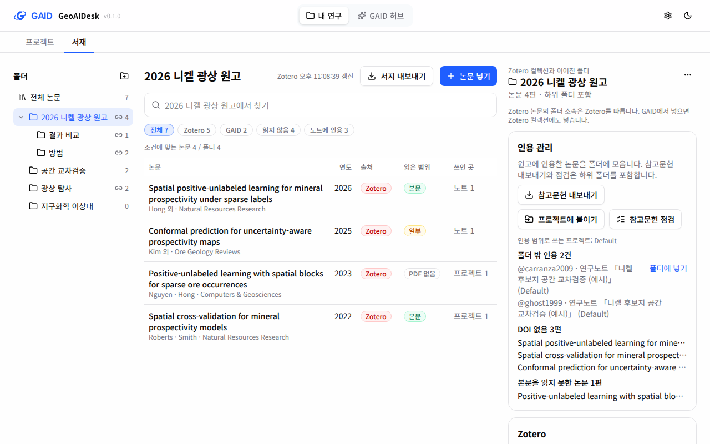
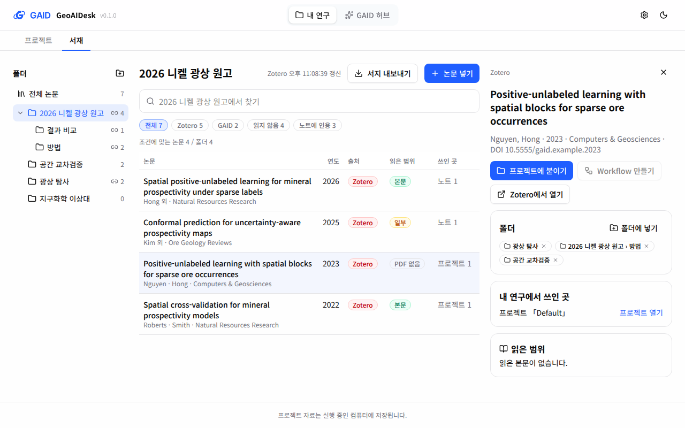
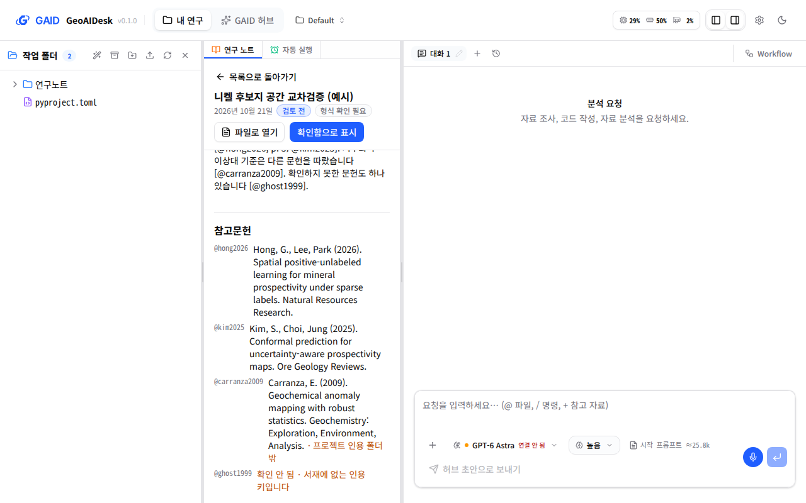

# GAID 서재 폴더와 Zotero 보내기

## 0. 한눈에

| | |
|---|---|
| 요청 | 서재를 논문 주제별 폴더로 정리하고, 투고 원고의 인용 문헌을 그 폴더만으로 관리하며, GAID에서 모은 문헌을 Zotero로 보냅니다. |
| 결론 | 서재 왼쪽에 하위 폴더를 둘 수 있는 폴더 목록이 생겼습니다. 폴더를 고르면 그 폴더의 논문만 보고 찾고, 참고문헌을 내보내고 점검합니다. 폴더를 프로젝트에 붙이면 연구노트와 AI agent의 인용 범위가 됩니다. 논문 한 편이나 폴더 전체를 Zotero로 보내면 Zotero에 같은 구조의 컬렉션이 만들어지고, PDF와 본문 색인도 함께 올라갑니다. 이미 Zotero에 있는 논문은 새로 만들지 않습니다. |
| 믿을 수 있는 정도 | 자동 시험과 실제 앱으로 확인했습니다. Zotero 쪽은 화면 없이 띄운 실제 Zotero 10.0.6 시험 인스턴스에 예시 자료를 넣어 확인했습니다. Windows PC의 Zotero, Zotero 웹 계정, 연구자의 실제 서재, 연구자 사용성은 아직 시험하지 않았습니다. |
| 결정할 일 | 1건 (6절): 선택 기능 두 가지를 만들지 정합니다. |

## 1. 요청한 것

> gaid-research-hub와 관련한 피드백이다. 우선 논문 서재에서는 보통 논문 주제 단위로 관리할 수 있는 폴더가 있어야 한다. 전체 자료 검색도 가능해야겠지만 폴더별로 정리되어야 추후 논문을 투고할 때 인용되는 논문들만 관리하는 폴더만 보편적으로 참고하고 인용문헌 관리할 때에도 해당 폴더만 볼 수 있어야 한다. 그리고 GAID 허브에 직접 추가하거나 수집한 문헌들도 Zotero로 보낼 수 있게 해야 상호 연동 된다고 볼 수 있다. — 2026-10-21 요청

함께 기록된 답변:

> 동료 연구자의 경우 zotero, endnote를 도구로 사용하고 대부분은 pdf로 직접 윈도우 파일 탐색기에서 관리한다.

> 이용하는 연구자 PC는 보편적으로 Windows에서 실행된다.

완료 기준: (1) 서재에 주제 폴더가 있고, 한 논문이 여러 폴더에 들어가며, 전체와 폴더 안을 모두 찾습니다. Zotero 논문의 폴더는 Zotero 컬렉션과 맞춥니다. (2) 원고 폴더가 노트 인용, 참고문헌 내보내기(BibTeX·RIS·CSL-JSON·참고문헌 목록), 참고문헌 점검의 범위가 됩니다. (3) GAID 논문을 한 편씩 또는 폴더째 Zotero로 보내고, 컬렉션을 만들고, PDF를 붙이고, 중복을 만들지 않습니다. 어디서 되는지 밝힙니다. (4) 실제 앱에서 한국어 화면을 1440×900, 1280×800으로 확인하고, Zotero는 별도 시험 인스턴스로 확인합니다.

## 2. 수행한 것

1. 폴더 구조를 정했습니다. Zotero 컬렉션이 하위 컬렉션을 두므로 폴더도 하위 폴더를 둡니다. 폴더는 Zotero 컬렉션과 이어질 수 있고, 이어진 폴더의 Zotero 논문 소속은 Zotero를 따릅니다. 이 규칙과 Zotero에 쓰는 범위를 ADR로 남겼습니다.
2. 서재 저장 방식과 Zotero 동기화를 폴더에 맞게 고쳤습니다. GAID에서 만든 폴더를 Zotero로 보내도 폴더 번호가 바뀌지 않아, 프로젝트와 노트의 연결이 그대로 유지됩니다.
3. Zotero에 쓰는 기능(컬렉션 만들기, 컬렉션에 넣기, 논문 만들기, PDF 올리기와 본문 색인)은 하위 작업이 만들고 실제 Zotero 10.0.6에서 확인했습니다. 상위 작업은 보내기 순서, 중복 합치기, 폴더 화면을 만들었습니다.
4. 폴더를 인용 범위로 썼습니다. 폴더별 참고문헌 내보내기와 점검을 만들었습니다. 프로젝트에 붙인 폴더 밖의 인용은 연구노트, AI agent, 점검 결과에 따로 표시됩니다.
5. 실제 앱을 따로 띄워 예시 서재로 폴더 화면, 점검, Zotero 보내기, 다시 보내기, 노트 참고문헌을 확인했습니다. 확인 중 찾은 결함 두 가지(Zotero 논문의 연도가 비고, Zotero 논문이 섞이면 내보내기가 실패함)를 고쳤습니다.

## 3. 결과

그림 1. 원고 폴더 "2026 니켈 광상 원고"를 고른 서재 화면입니다(1440×900, Zotero로 보낸 뒤). 볼 것: 왼쪽 폴더 목록의 하위 폴더와 Zotero 연결 표시, 가운데 표는 폴더와 하위 폴더의 논문 4편만 보여 줍니다. 오른쪽 인용 관리 칸에는 참고문헌 점검 결과가 나옵니다. 연구노트가 폴더 밖 논문 하나와 서재에 없는 키 하나를 인용했다고 표시합니다.

그림 2. 그림 1과 같은 화면을 1280×800 창에서 본 것입니다. 볼 것: 폴더 목록, 표, 인용 관리 칸이 가로 스크롤 없이 함께 보입니다.

그림 3. 이미 Zotero에 있던 논문의 상세 칸입니다. GAID에서 넣은 같은 논문은 Zotero로 보낼 때 이 논문에 합쳐졌습니다. 볼 것: 폴더 칸에 Zotero 컬렉션 두 개(광상 탐사, 원고 › 방법)와 GAID에만 있는 폴더(공간 교차검증)가 함께 나옵니다. "폴더에 넣기"로 다른 폴더에 넣습니다.

그림 4. 원고 폴더를 붙인 프로젝트의 연구노트 아래 참고문헌입니다. 볼 것: 폴더 밖 논문은 "프로젝트 인용 폴더 밖", 서재에 없는 키는 "확인 안 됨"으로 표시됩니다.

### 3.1 폴더와 검색

- 폴더는 몇 단계든 하위 폴더를 둘 수 있고, 한 논문이 여러 폴더에 들어갑니다. 표의 논문을 폴더로 끌어 놓거나, 논문 상세의 "폴더에 넣기"로 넣습니다.
- "전체 논문"을 고르면 서재 전체를, 폴더를 고르면 그 폴더와 하위 폴더를 찾습니다. 폴더마다 논문 수가 보입니다.
- GAID 폴더는 이름 바꾸기, 하위 폴더 만들기, 삭제를 할 수 있습니다. 폴더를 지워도 논문은 서재에 남습니다.

### 3.2 Zotero 컬렉션과 맞추는 규칙

| 경우 | 폴더 소속의 기준 | GAID에서 넣을 때 | GAID에서 뺄 때 |
|---|---|---|---|
| Zotero 논문, 같은 Zotero 서재의 컬렉션과 이어진 폴더 | Zotero | Zotero 컬렉션에도 넣습니다 | Zotero에서 빼도록 안내합니다 |
| GAID 논문, 또는 이어지지 않은 GAID 폴더 | GAID | GAID에만 기록합니다 | GAID에서 뺍니다 |

Zotero에서 컬렉션 이름을 바꾸면 GAID 폴더 이름도 바뀝니다. 폴더 번호는 그대로이므로 프로젝트 연결이 유지됩니다(자동 시험으로 확인). Zotero에서 지운 컬렉션은 GAID에서도 사라집니다. 다만 그 안에 GAID 논문이나 GAID 하위 폴더가 있으면 GAID 폴더로 남습니다. GAID는 Zotero의 서지 정보, 컬렉션 이름, 소속 빼기, 삭제, 주석을 바꾸지 않습니다.

### 3.3 원고 폴더로 인용 관리

| 기능 | 결과 |
|---|---|
| 참고문헌 내보내기 | 폴더(하위 폴더 포함)의 논문을 BibTeX, RIS(EndNote에서 가져올 수 있음), CSL-JSON, 참고문헌 목록(.txt)으로 받습니다. 파일 이름은 폴더 이름입니다. 참고문헌 목록은 APA와 비슷한 한 줄 형식이며 완전한 APA 양식은 아닙니다. |
| 참고문헌 점검 | 철회 기록, 폴더 밖 인용, 같은 논문으로 보이는 묶음, Zotero에서 지워진 논문, 서지 확인 전, DOI·연도·저자 없음, 본문을 읽지 못한 논문을 보여 줍니다. 폴더 밖 인용 옆의 "폴더에 넣기"로 바로 넣습니다. |
| 프로젝트에 붙이기 | 폴더가 프로젝트의 인용 범위가 됩니다. AI agent는 이 범위의 논문만 찾아 읽습니다. 연구노트를 쓸 때 범위 밖 인용이 있으면 AI agent에게 알리고, 노트 참고문헌에도 표시합니다. |

### 3.4 Zotero로 보내기

실제 Zotero 10.0.6 시험 인스턴스에서 확인한 결과입니다. Zotero에는 컬렉션 "광상 탐사"와 논문 2편이 있었습니다. 그중 한 편은 GAID 서재에도 따로 넣어 둔 논문이었습니다.

| 단계 | Zotero에서 확인한 결과 |
|---|---|
| 원고 폴더 보내기(GAID 논문 4편, 하위 폴더 2개) | 컬렉션 3개(원고, 그 아래 "결과 비교"·"방법")가 같은 구조로 생겼습니다. 새 논문 3편이 각자의 컬렉션에 들어갔고 PDF 3개가 붙었습니다. Zotero에 이미 있던 1편은 새로 만들지 않고 "방법" 컬렉션에만 넣었습니다. |
| PDF | 올라간 PDF 3개가 GAID의 파일과 SHA-256이 같습니다. 본문 색인도 들어갔습니다(빈 쪽이 있는 논문은 3쪽 중 2쪽). |
| 같은 폴더 다시 보내기 | 새로 만든 것이 없습니다. Zotero 항목 수는 8개 그대로입니다. |
| GAID 쪽 | 보낸 논문은 번호와 인용 키가 그대로입니다. 합쳐진 논문의 예전 번호와 인용 키도 Zotero 사본을 가리킵니다. |

한 편씩 보낼 때는 논문이 들어 있는 이어진 폴더의 컬렉션에 넣습니다. 그런 폴더가 없으면 "GAID 수집함"에 넣습니다. 보내기 전에 GAID는 Zotero를 먼저 갱신하고 같은 논문을 찾습니다. DOI가 같거나, 제목·연도·첫 저자가 같으면 같은 논문으로 봅니다. 보내다가 끊겨도 다시 보내면 이미 만든 논문을 찾아내므로 두 번 만들지 않습니다.

### 3.5 어디서 되는가

| 연구자 환경 | 동작 |
|---|---|
| Windows PC에서 GAID와 Zotero를 함께 실행 | PC의 Zotero 연결로 읽고 씁니다. 처음 쓸 때 Zotero에 승인 창이 뜹니다. "항상 허용"을 고르면 한 번에 보냅니다. 한 번만 허용하면 첫 쓰기 뒤에 멈추고, 보낸 만큼을 알려 줍니다. 미시험(Windows에서 실행하지 않았습니다). |
| WSL 안의 GAID와 Windows의 Zotero | WSL이 Windows의 localhost에 닿는 설정(mirrored networking)일 때만 됩니다. 미시험. |
| 기관 서버의 GAID | 연구자의 Zotero 웹 키로 연결합니다. 보내려면 쓰기 권한이 있는 키가 필요하고, PDF는 연구자의 Zotero 저장 용량을 씁니다. 가짜 웹 서버 시험만 했고 실제 계정은 시험하지 않았습니다. |
| Linux PC(시험 환경) | 화면 없는 Zotero 10.0.6 시험 인스턴스로 위 3.4절을 확인했습니다. |

## 4. 검증

- 과학적 검증: 해당 없음. 서재 기능이며 연구 결과를 내지 않습니다.
- 자동 시험: 서재 서버 시험 76개(폴더, 인용 범위, 점검, 내보내기, 별칭, 동기화 후 폴더 맞추기, 가짜 Zotero로 폴더 보내기·중복 합치기·다시 보내기·이름 변경)와 웹 시험 233개가 통과했습니다. 서버와 웹 타입 검사, 문구 검사(서재 경고 0), UI 검사(오류 0)도 통과했습니다. 전체 저장소 검사 결과는 부록 A에 적습니다.
- 실제 앱: 따로 띄운 GAID에 예시 서재(논문 6편, 폴더 5개, 연구노트 1개)를 넣었습니다. 시험용 Zotero를 화면에서 연결하고 폴더를 보냈습니다. 결과는 3.4절과 그림 1–4입니다.
- 실제 Zotero: 하위 작업이 Zotero 10.0.6 시험 인스턴스에서 하위 컬렉션, 두 컬렉션 소속, PDF 올리기와 내려받기(SHA-256 같음), 본문 색인을 따로 확인했습니다.
- 확인 중 고친 결함: Zotero 10은 연도를 글자("2023")로 내보냅니다. 그래서 Zotero 논문의 연도 칸이 비었고, Zotero 논문이 섞인 서재나 폴더를 BibTeX·RIS로 내보내면 실패했습니다. 1단계부터 있던 결함입니다. 연도를 숫자로 바꿔 저장하고, 이미 저장된 글자 연도도 읽도록 고쳤습니다. 시험을 추가했습니다.

## 5. 한계

- Windows PC의 Zotero, WSL에서 Windows Zotero 연결, 실제 Zotero 웹 계정과 저장 용량, Better BibTeX가 붙은 Zotero는 시험하지 않았습니다.
- Zotero 승인 창의 실제 동작(한 번 허용, 항상 허용)은 화면 없는 시험 인스턴스에서 볼 수 없었습니다. 미리 승인된 키로 시험했습니다.
- 중복 판정은 DOI, 또는 제목·연도·첫 저자로만 합니다. DOI가 없고 제목 표기가 다른 같은 논문은 찾지 못합니다.
- GAID에서 넣은 논문이 Zotero 사본에 합쳐지면 Zotero 사본의 인용 키가 기본 키가 됩니다. 예전 키로 쓴 인용도 계속 찾아지지만, 내보낸 BibTeX에는 Zotero 사본의 키가 들어갑니다.
- 폴더 소속 빼기는 Zotero에 쓰지 않습니다. Zotero 논문을 이어진 폴더에서 빼려면 Zotero에서 뺍니다.
- 참고문헌 목록은 APA와 비슷한 한 줄 형식입니다. 학술지 양식에 맞춘 목록은 Zotero나 EndNote에서 만듭니다.
- 연구자 사용성은 시험하지 않았습니다. 예시 자료만 썼습니다.

## 6. 결정할 일

1. 요청에서 선택으로 남긴 두 기능을 만들지 정합니다.
   - 가) 지금은 만들지 않음. 1단계 시험에서 폴더와 Zotero 보내기를 먼저 써 본 뒤 정합니다. (권장: 동료 대부분이 PDF를 Windows 탐색기 폴더로 관리하므로 쓸모는 있습니다. 하지만 Windows에서의 연결을 아직 시험하지 않았고, EndNote 사용자는 지금도 RIS로 주고받을 수 있습니다.)
   - 나) Windows 탐색기의 PDF 폴더를 서재 폴더로 가져오는 기능을 만듭니다. 폴더 구조를 그대로 옮기고, PDF마다 DOI·제목을 찾아 확인받습니다.
   - 다) 나)에 더해 EndNote XML 가져오기를 만듭니다(RIS 가져오기·내보내기는 이미 있습니다).

## 7. 대체되었거나 실패한 시도

펼치기 — 2건

- 임시 작업 폴더에서 하위 작업 결과를 미리 합쳐 앱을 띄우려 했습니다. UI 빌드가 연결된 패키지 폴더를 거부해, 하위 작업을 정식으로 합친 뒤 작업 폴더에서 띄웠습니다.
- 확인용 앱을 처음 띄울 때 고른 포트를 디자인 작업의 미리보기 앱이 이미 쓰고 있었습니다. 이 작업이 그 앱을 자기 앱으로 잘못 알고 멈췄습니다. 해당 작업에 알렸고, 이 작업의 앱은 다른 포트로 옮겼습니다.

## 용어

| 용어 | 새 정의 / 정의 변경 | 정의 |
|---|---|---|
| [폴더 (서재)](../../docs/glossary.md) | 새 정의 | 서재의 논문을 주제나 원고별로 묶는 곳입니다. 하위 폴더를 둘 수 있고, 한 논문이 여러 폴더에 들어갈 수 있습니다. Zotero 컬렉션과 이어질 수 있습니다. |
| [인용 범위](../../docs/glossary.md) | 새 정의 | 프로젝트에 붙인 폴더(하위 폴더 포함)와 논문입니다. AI agent와 연구노트 인용 점검이 이 범위 밖 인용을 따로 표시합니다. |

## 부록 A. 근거 위치

펼치기 — 실행 방법, 원본, 해시, 커밋

| 항목 | 위치 |
|---|---|
| 결정 기록 | docs/adr/2026-10-21-library-folders.md (2026-10-21 서재 ADR의 결정 3을 고침) |
| 코드 | web/src/geo/contracts/library.ts; server/src/geo/library/{store,uses,tools,zotero-service}.ts; server/src/geo/library/zotero/{writes,attachments,client,sync}.ts (하위 작업 gaid-library-folders--zotero-writes, 합친 커밋 0a2f8ebc); server/src/geo/routes/library.ts; web/src/geo/library/{folder-tree,folder-panel,folder-name-dialog,library-screen,note-references,api}.tsx; locales library/{ko,en}.json |
| 새 경로 | `POST/PATCH/DELETE /geo/library/collections[/:id]`, `POST /geo/library/collections/:id/items`, `GET /geo/library/collections/:id/check`, `POST /geo/library/collections/:id/send-to-zotero`, `GET /geo/library/export?collectionId=&format=bibtex\|ris\|csl-json\|text` |
| 자동 시험 | `cd server && npx vitest run test/geo-library-folders.test.ts test/geo-library-zotero.test.ts test/geo-library-zotero-service.test.ts test/geo-library.test.ts test/geo-library-formats.test.ts` (76 passed); `cd web && npx vitest run src/geo src/components/project-view` (233 passed) |
| 실제 앱 | systemd 사용자 단위 gaid-library-folders-app, 포트 3340/18340 (처음 고른 3330/18330은 gaid-design-identity--system의 미리보기 앱이 쓰고 있었음), GAID_HOME pc74:~/data/geoaidesk/work/gaid-library-folders/home, 예시 자료 bin/seed.mjs; `GAID_ZOTERO_LOCAL_URL=http://127.0.0.1:23139/api/` |
| 실제 Zotero 확인 | pc74:~/data/geoaidesk/work/gaid-library-folders/real-zotero-check.json · sha256 c0eab3c8e97afcfe5565ec97f1e4c9fd3ab8dc02a2a99ca153a8bef08ef2c97c (oat-zotero 시험 인스턴스 10.0.6, 디렉터리 zotero-sandbox, 예시 자료만, 정지함) |
| 하위 작업 Zotero 확인 | pc74:~/data/geoaidesk/work/zotero-writes/smoke.json · sha256 22b43c3dfde37e6fc93b99996d5dc2ecdea4484110e2765c9bfb3641c9787bd4 |
| 화면 원본 | pc74:~/data/geoaidesk/work/gaid-library-folders/playwright/ — 10-library-{1440,1280}.png, 11-folder-check-{1440,1280}.png, 12-item-folders-{1440,1280}.png, 13-note-refs-{1440,1280}.png, 03-send-confirm-1440.png (보내기 확인 창), 04-sent-1440.png |
| UI 지침 | 따름: P1 P2 P4 L2 B1(인용 관리 칸의 내보내기를 테두리 버튼으로) B2 B4 D1(폴더 이름 입력, 삭제·보내기 확인만 대화상자) D4 G1 G2 X3 X4 F2 F3 W6 R1 R2. 어김: X1(표 열마다 정렬·필터 없음, 1단계 표 그대로). 오른쪽 칸 폭을 380에서 340px로 줄였습니다(L2 범위 안). |
| 문자열 | 새 문자열 id: library.folders.*, library.folder.*, library.send.{created,merged,added,pdfs,nothing,stopped,skipped,toast,busy}, library.screen.{searchFolder,stateFolder}, library.references.outside. 바꾼 문자열: library.send.confirm ("Zotero에서 승인 창이 뜨면 허용하세요." → "Zotero에서 승인 창이 뜨면 \"항상 허용\"을 고르세요."), library.zotero.hint ("…GAID 수집함에 넣을 때만 Zotero에 씁니다." → "…Zotero로 보내거나 이어진 폴더에 넣을 때만 Zotero에 씁니다."), library.zotero.webKeyHint (읽기 권한 키 → 보내려면 쓰기 권한도 필요). 지운 문자열: library.send.done. |

작성 시점: 2026-10-21, 기준 커밋 0a2f8ebc 이후 작업분(이 보고서와 함께 저장).

