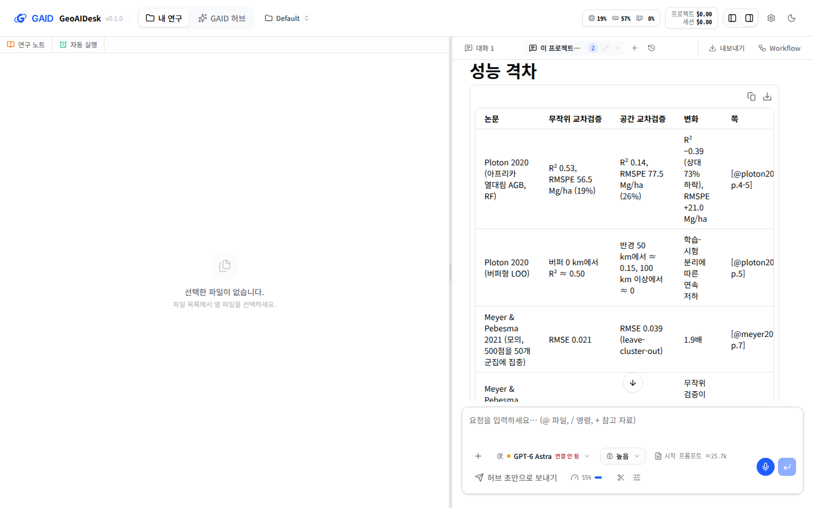

# 서재 남은 항목 세 가지: 실제 모델의 쪽 인용 확인, 문헌 스킬 배포, Better BibTeX 상태

## 0. 한눈에

| | |
|---|---|
| 요청 | 서재 개선 작업 뒤에 남은 서재 항목 세 가지를 진행합니다. |
| 결론 | 기관 Qwen 실제 채팅에서 AI agent가 서재 도구로 논문 4편을 찾아 읽고 수치마다 쪽 인용을 붙였습니다. 제가 확인한 34개 인용이 모두 해당 쪽에 있었고, 서재에 없는 논문에는 인용 키를 만들지 않았습니다. 문헌 스킬 4개(논문 찾기, 인용 정리, 문헌 고찰, Zotero 연결)를 넣은 카탈로그 0.3.0을 GAID 저장소에서 만들어 앱에 고정했습니다. 새 프로젝트와 기존 프로젝트 모두에 들어가고, 기관 Qwen이 논문 찾기 스킬로 DOI를 조회했습니다. Better BibTeX 기능은 조건이 그대로라 만들지 않았습니다. |
| 믿을 수 있는 정도 | 채팅 한 번(질문 두 개)과 제 대조 결과입니다. 연구자 본인의 논문과 질문으로 하는 확인은 남아 있습니다(체크리스트 3.2절). |
| 결정할 일 | 1건 (6절): 카탈로그 0.3.0 파일을 GitHub 릴리스로 공개할지 정합니다. 사용자 확인 1건은 3.2절 체크리스트로 합니다. |

## 1. 요청한 것

> 남은 서재 관련항목 3건도 개선 작업 완료후 진행하자. — 2026-10-21 요청

세 항목과 사용자가 고른 답입니다.

| 항목 | 고른 답 |
|---|---|
| 실제 모델 채팅에서 AI agent가 서재 도구로 쪽 근거를 찾아 인용하는지 | 가) 사용자 채팅으로 확인. "1단계를 시험할 연구자는 사용자 혼자로 충분하다. 그리고 이미 70, 74PC로 2명의 역할을 할 수 있다." |
| 문헌 스킬(논문 검색, 서지 정리, 문헌 고찰, Zotero 연결)이 배포 스킬 목록에 없음 | 가) 카탈로그 새 판에 넣음 |
| Better BibTeX에 기대는 기능(원고 인용으로 Zotero 컬렉션 만들기, 인용 키 고정) | 가) Zotero 10 호환이 명시되고 열린 문제 둘이 닫힌 뒤 검토 |

완료 기준: (1) 실제 논문과 질문으로 시험을 준비하고, 연결된 기관 모델로 할 수 있는 만큼 돌리고, 사용자가 자기 채팅으로 확인할 짧은 체크리스트를 드립니다. (2) 문헌 스킬을 넣은 카탈로그 새 판을 GAID가 받아 쓰게 합니다. (3) Better BibTeX 상태를 다시 확인하고, 조건이 풀렸을 때만 만듭니다.

## 2. 수행한 것

1. 이 작업 공간에 따로 띄운 GAID에 사용자의 광상 유망도 원고와 공간 교차검증 공개 논문 3편을 서재 폴더로 넣었습니다. 연구자와 같은 순서로 넣었습니다(PDF 올리기, DOI로 서지 정보 찾기, 폴더에 넣기, 프로젝트에 폴더 붙이기).
2. 기관 Qwen에 질문 두 개를 보냈습니다. 첫째는 여러 논문의 수치와 쪽 근거를 묻는 질문이고, 둘째는 원고 한 편의 방법과 서재에 없는 논문을 함께 묻는 질문입니다. 답의 인용을 PDF 본문과 하나씩 대조했습니다.
3. 연구노트에 남은 인용이 서재 참고문헌으로 바뀌는지 실제 화면으로 확인하고, 사용자 확인용 체크리스트를 만들었습니다.
4. 카탈로그를 만드는 도구를 GAID 저장소에 새로 두고, 0.2.1을 바탕으로 문헌 스킬 4개와 선택 환경 "문헌 환경"을 더한 0.3.0을 만들어 고정했습니다. 처음에는 skill_hub에 요청했으나, 사용자 지적에 따라 철회했습니다(7절).
5. Better BibTeX 저장소의 최신 릴리스와 열린 문제를 다시 확인했습니다.

## 3. 결과

### 3.1 실제 모델의 쪽 인용 (#7)

| 확인한 것 | 결과 |
|---|---|
| 서재 도구를 쓰는가 | 첫 질문에서 도구를 40번 불렀습니다. 서재 검색으로 관련 논문을 찾고, 4편을 여러 쪽씩 읽었습니다. 둘째 질문에서는 23번 불렀습니다. |
| 수치마다 쪽 인용을 붙이는가 | 붙였습니다. 표의 칸마다 `[@ploton2020, p.5]` 형식으로 붙였습니다. |
| 인용한 쪽에 그 내용이 있는가 | 제가 대조한 34개(첫 답 24개, 둘째 답 10개)가 모두 해당 쪽에 있었습니다. 예: 무작위 교차검증 R² 0.53이 공간 교차검증에서 0.14로 떨어짐(Ploton 2020, 4–5쪽), 블록 50 km가 유효 범위 31.5 km의 1.59배(원고 9쪽). |
| 서재에 없는 논문을 물으면 | Roberts et al. (2017)을 묻자 "이 논문은 라이브러리에 붙어 있지 않다"고 먼저 밝혔습니다. 웹에서 저자 원고를 찾아 줄 번호로 인용했고, 서재 인용 키는 만들지 않았습니다. |
| 사본과 게재판의 쪽 차이를 밝히는가 | 밝혔습니다. 두 편의 PDF가 프리프린트라 게재판과 쪽수가 다를 수 있다고 답 첫머리에 적었습니다. |
| 연구노트 참고문헌 | 노트의 인용 키 4개가 모두 서재 항목의 참고문헌 줄로 바뀌었습니다(그림 2). 서재에 없는 Roberts는 키 없이 일반 글로 적혔습니다. |

그림 1. 기관 Qwen의 첫 답 가운데 성능 격차 표. 볼 것: 칸마다 수치와 출처 쪽이 함께 있는지. 오른쪽 "쪽" 열이 채팅 폭에 잘려 보이는 문제도 함께 보입니다.

그림 2. AI agent가 쓴 연구노트의 근거 목록과 참고문헌. 볼 것: 근거의 `[@키, 쪽]`이 아래 참고문헌 줄과 짝을 이루는지, 서재에 없는 Roberts가 키 없이 "라이브러리 미탑재"로 적혔는지.

틀린 곳도 있었습니다.

- 추론 한 곳이 틀렸습니다. 원고의 내부 fold PR-AUC(0.157·0.172)가 외부 평균보다 낮다는 수치는 맞습니다. 그런데 AI agent는 이를 근거로 "공간 검증을 쓴다고 성능이 항상 낮게 나오지는 않는다"고 썼습니다. 내부와 외부가 모두 공간 검증이므로 이 비교로는 그런 결론이 나오지 않습니다. 쪽 인용이 맞아도 그 쪽을 근거로 한 결론은 따로 읽어야 합니다.
- 저자 이름을 한 번 "An"으로 잘못 쓰고 바로 다음 기록에서 고쳤습니다.
- 화면 문제 두 가지를 찾았습니다. 채팅의 `[@키, p. 쪽]`이 글자로만 나와 눌러서 그 쪽을 열 수 없습니다. 넓은 표에서는 마지막 열이 채팅 폭에 잘립니다. 이번 작업에서는 고치지 않았습니다.

### 3.2 사용자 확인 체크리스트

사용자의 검토용 GAID(PC74, 현재 main 판)에서 자기 논문으로 한 번 확인해 주십시오. PC70과 PC74를 두 연구자로 나눠 쓰셔도 됩니다.

1. 서재에 논문 3–5편을 넣습니다. PDF를 올리거나 Zotero 폴더를 연결합니다. 목록의 읽은 범위가 "본문"인지 봅니다.
2. 그 폴더를 프로젝트에 붙입니다(프로젝트의 문헌 설정).
3. 새 대화에서 기관 Qwen을 고르고 추론량을 "보통"으로 둡니다.
4. 질문 세 개를 보냅니다.
   - 수치 질문: "붙인 논문에서 ○○의 값을 쪽 근거와 함께 정리해 주세요."
   - 비교 질문: "○○을 정하는 방법을 논문별로 비교해 주세요."
   - 서재에 없는 논문 질문: 붙인 논문이 인용만 하는 논문을 하나 골라 그 내용을 묻습니다.
5. 답에서 다섯 가지를 봅니다.
   - 수치 옆에 `[@키, p. 쪽]`이 붙었는가
   - 인용 2–3개를 PDF의 그 쪽에서 직접 찾았는가 (서재 상세 칸에서 PDF를 엽니다)
   - 서재에 없는 논문에 가짜 키를 만들지 않고 "없다"고 밝혔는가
   - 쪽은 맞는데 결론이 지나친 문장이 있는가
   - 연구노트를 남기게 하면, 노트 아래 참고문헌이 서재 항목으로 바뀌는가

결과는 "통과" 또는 "문제: <무엇>" 한 줄로 프로젝트 허브에 주시면 됩니다.

### 3.3 문헌 스킬 배포 (#8)

카탈로그는 이제 GAID 저장소에서 만듭니다. 이 결정은 결정 기록(ADR)으로 남겼습니다. 0.3.0은 검증된 0.2.1 묶음을 그대로 바탕으로 쓰고 아래를 더했습니다.

| 스킬 | 화면 이름 | 하는 일 | 새 프로젝트에서 |
|---|---|---|---|
| `paper-lookup` | 논문 찾기 | Crossref·OpenAlex·arXiv 등 18개 학술 서비스에서 논문·인용·공개 전문을 찾고 조회 경로를 남김 | 켜짐 |
| `citation-management` | 인용 정리 | DOI로 서지를 확인해 BibTeX로 정리하고 인용 오류를 점검 | 켜짐 |
| `literature-review` | 문헌 고찰 | 검색·선별 기록을 남기며 체계적·범위·서술 문헌 고찰을 씀 | 켜짐 |
| `pyzotero` | Zotero 연결(pyzotero) | Zotero 서재의 항목을 읽고, 요청하면 씀 | 꺼짐(설정 → 스킬에서 켬) |

- 스킬 본문은 원래 K-Dense 스킬을 고치지 않고 넣었습니다. 한국어 이름, 설명, 한계는 GAID가 따로 썼습니다. 한계에는 KIGAM 망에서 확인한 접속 상태를 적었습니다(Semantic Scholar 요청 한도, arXiv 검색 무응답).
- `pyzotero`는 연구자의 Zotero에 쓰고 지울 수 있습니다. 그래서 원래 앱의 기본값대로 꺼진 상태로 설치됩니다. 한계에는 "요청할 때만 쓰고, 쓰기 전에 확인을 받는다"고 적었습니다.
- 인용 정리와 문헌 고찰 스크립트는 `requests`가 필요한데 기본 환경에 없습니다. 그래서 선택 환경 "문헌 환경"(`requests`, `pyzotero`)을 더했습니다.
- 같은 원본으로 다시 만들면 바이트까지 같은 묶음이 나옵니다. 이 재현성은 자동 시험으로 확인합니다.

실제 앱에서 확인한 것입니다.

| 확인 | 결과 |
|---|---|
| 기존 프로젝트(0.2.1 사용 중) | 앱을 다시 시작하자 새 스킬 4개가 추가되고, 기존 스킬은 그대로였습니다. |
| 새 프로젝트 | 문헌 스킬 3개는 켜짐, `pyzotero`는 꺼짐으로 들어갔습니다. 새 대화에 보이는 스킬은 19개입니다. |
| 시작 프롬프트 크기 | 추정치가 약 25.7k에서 약 26.4k 토큰으로 늘었습니다. |
| 문헌 환경 준비 | 준비 버튼에 해당하는 요청으로 `requests` 2.34.2, `pyzotero` 1.16.0이 설치되고 불러오기 검사를 통과했습니다. |
| 기관 Qwen 실제 사용 | DOI 하나의 서지, 공개 전문 위치, 피인용 수를 물었습니다. AI agent는 논문 찾기 스킬 지침과 참고 문서를 먼저 읽고 7개 서비스에 물었습니다. 서비스별 피인용 수(OpenAlex 896, Crossref 824 등)와 조회 경로를 표로 냈고, "서비스마다 1.7배 차이가 나니 출처 없이 한 값으로 쓰지 말라"고 적었습니다. 저는 Crossref 824와 OpenAlex 896을 직접 조회해 같은 값을 얻었습니다. |

확인 중에 고친 것: 처음 만든 0.3.0은 `pyzotero` 버전을 범위(1.15.2 이상 1.16 미만)로 적었습니다. 앱은 하한만 받기 때문에 환경 목록 화면이 오류를 냈습니다. 하한만 적도록 고치고, 같은 오류를 빌드 도구와 자동 시험이 막도록 했습니다. 처음 묶음은 공개하거나 다른 곳에서 쓰기 전이었으므로 같은 판 번호로 다시 만들었습니다.

함께 찾은 문제: AI agent가 스킬 안의 Python 스크립트를 실행하면 스킬 폴더에 캐시 폴더가 생깁니다. 앱은 이 폴더 때문에 그 스킬을 "연구자가 고친 스킬"로 봅니다. 그러면 다음 카탈로그 판이 그 스킬을 새로 바꾸지 않습니다. 이 문제는 원래 앱의 스킬 동기화 방식에서 생기며, 스크립트가 있는 기존 지질 스킬에도 해당합니다. 이번에는 고치지 않고 남은 항목으로 기록했습니다(6절).

### 3.4 Better BibTeX (#9)

2026-10-21에 다시 확인했습니다. 조건이 풀리지 않아 만들지 않았습니다.

| 조건 | 현재 |
|---|---|
| Zotero 10 호환 명시 | 없음. 최신판 9.0.71(2026-10-07)의 설명은 여전히 "Zotero 8·Zotero 9 베타 호환"입니다. |
| Zotero 10을 느리게 하는 문제(#3602) | 열려 있음 (마지막 갱신 2026-09-21) |
| Zotero 10.0.6 + 9.0.71에서 인용 삽입 창이 빈 응답을 주는 문제(#3626) | 열려 있음 (마지막 갱신 2026-10-08) |
| 그 뒤 새 판 | 없음. 저장소의 마지막 변경은 2026-10-17의 인용 처리 수정이고 새 릴리스는 나오지 않았습니다. |

GAID는 지금처럼 Zotero의 인용 키 칸만 읽습니다. 이 항목은 기다림으로 다시 기록했습니다(6절).

## 4. 검증

- 쪽 인용 대조: 답에 나온 수치·용어 34개를 PDF에서 뽑은 본문의 해당 쪽에서 찾았습니다. 쪽 번호는 서재에 넣은 PDF 파일의 쪽 순서입니다. 게재판 쪽수와는 대조하지 않았습니다.
- 표의 버퍼형 검증 곡선 값(반경 50 km에서 약 0.15 등)은 그림에서 읽은 값이라 본문 대조를 하지 않았습니다.
- 반복: 질문마다 한 번씩 돌렸습니다. 같은 질문을 다시 돌렸을 때의 차이는 확인하지 않았습니다.
- 서재 참고문헌: 인용 키 5개(서재 4편과 Roberts)를 서재 인용 확인 기능에 넣어 4개가 풀리고 Roberts는 "서재에 없음"으로 나오는 것을 확인했습니다.
- 과학적 검증: 해당 없음. 논문 내용의 옳고 그름을 판단하지 않았습니다.
- 소프트웨어 검증: 전체 검사(`scripts/check`, 2026-10-22)를 통과했습니다. 백엔드 시험 2,067개(건너뜀 8), 프런트엔드 시험 1,144개, GAID 시험 50개가 통과했고, 실제 0.3.0 묶음으로 띄운 production 점검에서 17개 스킬이 설치됐으며 제외 대상 문서 스킬 4개는 없었습니다. 문구 검사 경고 1건은 이번 작업과 무관한 기존 문구입니다. 이 결과는 GitHub 릴리스를 공개하기 전 상태입니다.

## 5. 한계

- 시험한 모델은 기관 Qwen 하나이고, 질문은 두 개였습니다. 다른 모델과 연구자 본인의 질문으로는 시험하지 않았습니다.
- 서재의 Valavi 논문은 서지 정보가 학술지판(2019년 출판, 온라인 2018년)이고 PDF는 2018년 프리프린트입니다. AI agent의 쪽 인용은 프리프린트 쪽입니다. Meyer & Pebesma 논문도 PDF는 프리프린트입니다.
- 채팅의 인용은 눌러서 쪽을 열 수 없어, 연구자가 PDF를 따로 열어 확인해야 합니다.
- 문헌 스킬 본문은 미국·생의학 서비스 중심입니다. KCI, RISS 같은 국내 자료원은 다루지 않습니다.
- `pyzotero` 스킬은 pyzotero 1.15.2 기준으로 검토된 글인데, 문헌 환경은 하한만 적어 1.16.0이 설치됐습니다. Zotero에 쓰는 기능은 실제 Zotero로 시험하지 않았습니다.
- 인용 정리와 문헌 고찰 스킬은 실제 채팅으로 시험하지 않았습니다. 논문 찾기만 기관 Qwen으로 한 번 시험했습니다.
- 0.3.0을 쓰는 새 설치는 공개 릴리스에서 묶음을 내려받습니다. 릴리스를 공개하기 전까지는 묶음이 있는 PC(자산 폴더 또는 GAID 자료 폴더)에서만 동작합니다.

## 6. 결정할 일

1. 카탈로그 0.3.0 파일을 GitHub 릴리스(시험판, 이름 geo-catalogue-0.3.0)로 공개할지 정합니다.
   - 가) 지금 공개합니다. 새로 설치하거나 업데이트한 GAID가 이 파일을 내려받아 해시가 맞을 때만 씁니다. 0.2.1 때와 같은 방식입니다.
   - 나) 공개하지 않습니다. 묶음이 있는 PC에서만 0.3.0을 쓰고, 다른 PC는 카탈로그 스킬 없이 시작합니다.
   - 권장: 가). 앱의 고정값이 이미 0.3.0을 가리키므로, 공개하지 않으면 다른 PC의 새 설치에서 카탈로그 스킬이 빠집니다.

남은 확인, 기다림, 부채:

- [확인] 사용자 본인 논문과 질문으로 3.2절 체크리스트를 확인합니다.
- [대기] Better BibTeX 기능: Zotero 10 호환이 명시되고 #3602·#3626이 닫히면 다시 검토합니다.
- [부채] 스크립트를 실행한 스킬이 "고친 스킬"로 잡혀 다음 카탈로그 판에서 바뀌지 않는 문제(3.3절).

선택 개선 후보(지금 만들지 않음):

- 채팅의 `[@키, p. 쪽]`을 눌러 서재 PDF의 그 쪽을 여는 기능
- 채팅의 넓은 표가 잘리지 않게 하는 표시

## 7. 대체되었거나 실패한 시도

- 카탈로그 새 판을 skill_hub에 요청했습니다. 이전 기록이 카탈로그를 skill_hub에서 만든다고 적고 있었기 때문입니다. 사용자가 "이제 GAID 허브와 시스템은 본 워크스페이스에서 모두 작업하고 있다"고 지적해 요청을 철회했습니다. skill_hub에서는 아무것도 만들지 않았습니다. 카탈로그를 GAID에서 만든다는 결정은 결정 기록과 작업 지침에 반영했습니다.
- 처음 만든 0.3.0은 환경 버전 표기 때문에 환경 목록 화면이 오류를 냈습니다(3.3절). 공개 전에 고쳐 다시 만들었습니다.

## 용어

없음.

## 부록 A. 근거 위치

펼치기 — 시험 앱, 채팅 기록, 논문, 외부 확인

| 항목 | 위치 |
|---|---|
| 시험 앱 | systemd 사용자 단위 `gaid-library-next-app`, 자료 pc74:~/data/geoaidesk/work/gaid-library-next/home, 포트 3330/18330, 모델 공급자 `kigam-qwen/qwen3.8-flash-next` (추론량 medium) |
| 서재 넣기 스크립트 | pc74:~/data/geoaidesk/work/gaid-library-next/bin/seed-library.mjs |
| 채팅 실행 도구와 질문 | pc74:~/data/geoaidesk/work/gaid-library-next/bin/chat.mjs, prompts/q1.md, q2.md |
| 채팅 기록 | 세션 `01a15eed-09cc-7207-a427-b6f85287abdf`, 출력 pc74:~/data/geoaidesk/work/gaid-library-next/runs/q1.log, q2.log |
| AI agent가 쓴 연구노트 | 시험 앱 프로젝트 default의 `연구노트/2026-10-21-spatial-cv-vs-random-cv/index.md` |
| 논문 | 원고: 자산 `authoring_preview_paper` (DOI 10.1007/s11053-026-10778-w, 저자 R3 원고, 36쪽); Ploton et al. 2020 Nat. Commun. (10.1038/s41467-020-18321-y, CC BY, 11쪽); Valavi et al. blockCV bioRxiv 프리프린트 (서지 10.1111/2041-210x.13107, 19쪽); Meyer & Pebesma arXiv 2005.07939 (서지 10.1111/2041-210x.13650, 16쪽). PDF는 pc74:~/data/geoaidesk/work/gaid-library-next/papers/ |
| 쪽 대조 | `pdftotext -layout`로 뽑은 본문 pc74:~/data/geoaidesk/work/gaid-library-next/text/, 쪽은 폼 피드 기준 |
| 화면 | 1440×900 원본 pc74:~/data/geoaidesk/work/gaid-library-next/shots/ |
| skill_hub 요청과 철회 | 요청 `bbaae80a7640`, 철회 `e50e5d58661c` (skill_hub 허브가 2026-10-22 철회 확인), 본문 pc74:~/data/geoaidesk/work/gaid-library-next/skill_hub-{request,withdraw}.md |
| 카탈로그 빌드 | ADR `docs/adr/2026-10-22-gaid-builds-catalogue.md`, 도구 `geo/catalogue-build.mjs`, 판 정의 `geo/catalogue-src/releases/0.3.0.json`, 한국어 설명 `geo/catalogue-src/imports/k-dense/*.yaml`, 원본 해시 `geo/catalogue-src/sources.lock.json`, 재현 시험 `geo/tests/catalogue-build.test.mjs` |
| 카탈로그 0.3.0 자산 | pc74:~/assets/geo-catalogue/0.3.0/ (MANIFEST.sha256 b39fd31e…df0f), 묶음 sha256 d09d5311b7be44d700d40b0bc52a53c9d1ca08a7099ce47bcab1df7d6d4c6598, 예시 sha256 66eeb190…d29f, 빌드 commit 64e2f756 |
| 원본 자산 | `k_dense_scientific_agent_skills` = pc74:~/assets/k-dense-scientific-agent-skills/92ace75a (K-Dense-AI/scientific-agent-skills@92ace75a, MIT) |
| 문헌 스킬 시험 채팅 | 시험 앱 프로젝트 `lit-check-dccd5c`, 세션 `01a161e9-a806-7143-b515-0de38b4358c0`, 출력 pc74:~/data/geoaidesk/work/gaid-library-next/runs/lit1.log |
| Better BibTeX | `gh api repos/retorquere/zotero-better-bibtex/releases`, `issues/3602`, `issues/3626`, `commits` (2026-10-21) |

