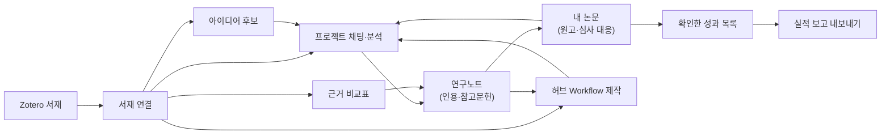
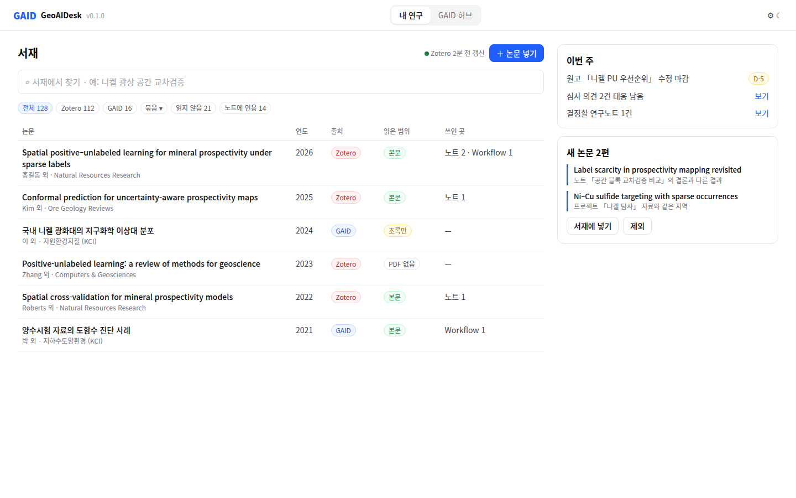
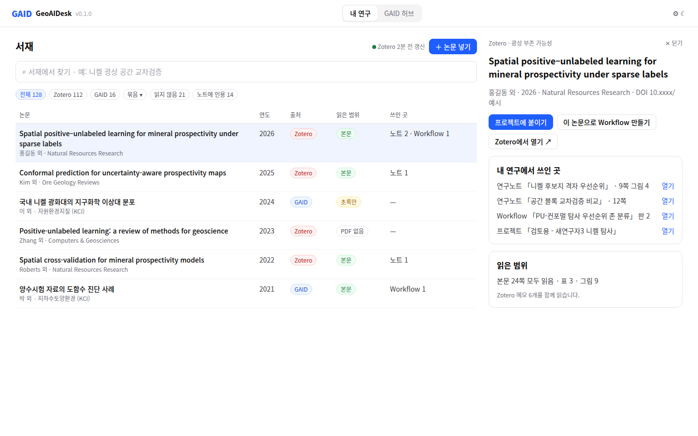

# 논문 수집에서 연구노트·Workflow까지 잇는 GAID 연구 허브 설계안

## 0. 한눈에

| | |
|---|---|
| 요청 | GAID 허브를 연구자의 논문 수집·서지 관리, 인사이트·아이디어, 내 논문 관리까지 돕는 곳으로 키우고, 허브의 Workflow 제작·에이전트 작업·연구노트와 서로 잇습니다. |
| 결론 | PDF 읽기, 인용 그래프, 범용 문헌 검색은 만들지 않고 기존 서비스에 연결합니다. 서재는 하이브리드로 만듭니다. Zotero 사용자는 Zotero와 끊김 없이 연결하고, Zotero를 쓰지 않는 연구자는 GAID 안에서 PDF와 서지를 관리합니다. 그 위에 GAID가 만들 것은 세 가지입니다. 내 서재의 근거를 분석·연구노트에 잇는 기능, 원고·투고·심사 대응을 관리하는 "내 논문", 논문에서 Workflow로 가는 길입니다. |
| 믿을 수 있는 정도 | 외부 도구 현황은 공식 문서·저장소·설문 원자료를 읽은 독립 조사 두 건과 사용자가 준 조사 한 건으로 확인했습니다. 실제 설치·API 호출·KIGAM 문서 시험은 하지 않았습니다. 연구자 사용성은 아직 시험하지 않았습니다. |
| 결정할 일 | 없음. 사용자가 2026-10-21에 정보 구조, 보관 위치, 첫 단계 범위, 하이브리드 서재, 계정 시점, 기본 모델, 서재 화면 배치를 정했습니다(6절). 사실 확인 4건이 남았습니다. |

## 1. 요청한 것

> GAID 허브를 크게 개선하고 싶다. 현재는 워크플로우를 생성하고 공유하는 용도로 구축되어 있다. 일반적으로 연구자는 본인의 연구 산출물을 관리하고 논문을 수집하고 서지 관리하고, 수집한 논문에서 인사이트와 새로운 연구 아이디어를 얻고 싶어한다. 또한, 본인이 게재한 논문, 투고한 논문, 투고할 논문들을 관리해야한다. 이러한 기능은 zotero를 포함하여 현재 AI연계 도구들이 있다고 생각한다. 또한, BYOK내에 K-dense 워크플로우와 스킬에서도 문헌연구, 연구비 계획과 같은 카테고리에 관련 워크플로우를 제공하고 있다. 사용자는 GAID허브에 해당 기능을 구현하여 연구자가 논문작성 및 연구에 도움이 될 수 있는 시스템을 만들어서 유인하고 이를 GAID 허브의 워크플로우 생성 기능과 연계하고 나아가 GAID 시스템에서 에이전트 기반 작업과 연구노트를 생성하고 다시 이를 연계하는 시스템을 만들고 싶다. 이를 위해서는 관련 정보들과 현재 최신 오픈소스 도구들도 조사하여야 하며, 어떻게 시스템을 설계할 것인지도 벤치마킹하고, 현 시스템에 맞춰서 커스터마이징 하고 설계할 필요가 있다. 시스템을 구현하는 것은 에이전트나 기계가 볼 때 유의미한 것이 아니라 이용자(사람)가 해당 도구를 사용할 가치가 있어야 한다. 더 편한 도구가 있거나 유인이 없다면 상품성의 측면에서 설계가 잘못되었다고 볼 수 있다. 이를 위해서 별도의 작업 트리를 열어서 관련한 내용들을 조사하고 논의하여 구현하는 작업을 시작하자. — 2026-10-21 요청

> Claude web의 조사 결과도 첨부했으니 참조하자 — 2026-10-21 추가 요청

> 모두 권장으로 하고 싶다. 그런데 중요한 점은 zotero와 gaid의 연동이 원활해야한다는 것이고, zotero를 사용하지 않고 GAID 기관 허브에 서지를 관리하고 싶은 이용자들도 이용할 수 있게 하는 하이브리드형 시스템이 구축되어야 한다. 사용자는 Zotero와 obsidian을 사용할 수 있지만 이용자들 중에는 해당 프로그램이 익숙하지 않은 사람도 있으며, 웹검색과 pdf파일 관리만으로 수행하는 사람도 있기 때문이다. 그리고 아래 내용은 claude에서도 조사한 내용이므로 참고하자. — 2026-10-21 결정과 추가 요청

> 1번은 다안의 첫화면에 가안의 상세칸에 나안의 표형식으로 하자. 2,3번은 권장으로 하자. — 2026-10-21 결정

완료 기준: 이번 단계는 조사와 설계안입니다. 연구자가 이미 쓰는 도구를 조사하고, GAID에 있는 것을 확인합니다. 기능마다 연구자가 GAID를 쓸 이유와 만들지 않을 이유를 밝힙니다. 정보 구조, 데이터 모델, 허브·에이전트·연구노트 연결, 단계별 계획을 선택지와 권장안으로 제시합니다. 구현은 사용자와 합의한 범위만 다음 단계에서 합니다.

## 2. 수행한 것

1. 연구자가 지금 쓰는 도구를 조사했습니다. 대상은 서지 관리, AI 문헌 검색·독해, 인용 그래프, PDF 변환, 아이디어 생성, 연구성과·투고 관리, 국내 연구정보 서비스입니다. 웹 조사 두 건(도구 현황, 설계 사례)을 따로 실행하고, 사용자가 준 Claude 웹 조사와 대조했습니다.
2. 연구자가 새 도구를 쓰게 되는 이유와 떠나는 이유를 2024–2026년 설문과 실제 사용 기록 연구에서 확인했습니다.
3. GAID 코드에서 문헌과 관련된 것을 모두 찾았습니다. 원래 K-Dense의 문헌·논문 작성·연구비 Workflow, 배포 스킬 목록, Paperclip 연결, 허브 제작 자료, 연구노트, 서지 형식 처리를 확인했습니다.
4. 기능마다 연구자가 기존 도구 대신(또는 함께) GAID를 쓸 이유와 다시 오게 할 장치를 정리했습니다. 더 나은 도구가 있는 기능은 만들지 않을 목록에 넣었습니다.
5. 정보 구조, 저장 방식, 비공개 자료의 위치를 선택지로 비교하고 권장안을 정했습니다. 단계별 계획과 첫 단계의 완료 기준도 정했습니다.
6. 사용자가 권장안을 고르고 하이브리드 서재를 요구한 뒤, 서재를 두 출처(Zotero 연결, GAID 관리)로 다시 설계했습니다. 사용자가 붙여 준 두 번째 Claude 조사를 대조하고, 기관망에서 서지 API에 접속되는지 확인했습니다.
7. 서재 화면의 배치 시안 세 개를 만들었고, 사용자가 고른 조합을 합친 화면으로 다시 확인했습니다. 서재 데이터 형식과 노트 인용 해석기의 초안을 만들었습니다.

## 3. 결과

### 3.1 연구자는 지금 무엇으로 일하는가

| 하는 일 | 연구자가 이미 쓰는 도구 | 연구자가 좋아하는 점 | 확인된 불편 | GAID의 판단 |
|---|---|---|---|---|
| 논문 수집·서지·인용 | Zotero(최신 10.0.6, 2026-10-07), EndNote, Mendeley, JabRef, Paperpile | 브라우저 한 번 클릭으로 수집, Word·LaTeX 인용, 그룹 공유 | 도구마다 같은 논문·메모가 따로 쌓임 | 만들지 않음. Zotero에 연결하고 나머지는 서지 파일로 가져옴 |
| 문헌 검색 | Google Scholar(Labs 포함), Semantic Scholar·Asta, OpenAlex, Elicit, Consensus, SciSpace, Undermind | 빠르고 무료이거나 저렴함, 기능이 빠르게 좋아짐 | 유료 본문을 못 읽으면서 알리지 않음, 검색 과정이 보이지 않음, 보고서·국내 학술지가 약함 | 범용 검색은 만들지 않음. 국내 문헌·기관 보고서만 보완 |
| 수집한 논문에 질문 | Gemini Notebook(이전 NotebookLM), Zotero AI 플러그인, open-notebook | 출처가 붙은 답, 여러 표현 형식 | 외부 업로드에 대한 보안 우려, 내 분석과 분리됨 | 같은 화면을 만들지 않음. 답을 내 분석·연구노트에 붙이는 부분만 만듦 |
| 인용 관계 탐색 | Litmaps(ResearchRabbit 인수), Connected Papers, Inciteful, scite | 핵심 논문 주변을 그림으로 탐색 | 결과를 다시 서지로 옮겨야 함 | 만들지 않음. "내 서재에 없는 많이 인용된 논문" 목록만 제공 |
| 아이디어·가설 | 범용 챗봇, AI Scientist류, Google AI co-scientist | 빠르게 많은 후보 | 실행해 보면 평가가 크게 떨어짐 | 자동 생성은 만들지 않음. 근거와 검증 시험이 붙은 후보만 |
| 내 논문·투고 | 출판사 투고 사이트, 엑셀, 메모, ORCID | 게재 논문은 ORCID·Crossref·KCI에 남음 | 투고 중·계획 논문을 관리하는 표준 도구가 없음, 심사 대응 진행 상태가 흩어짐 | 만듦 |
| 성과 보고 | 기관 시스템, NTIS, KRI | 공식 기록 | 같은 실적을 여러 곳에 다시 입력 | 기관 시스템은 만들지 않음. 확인한 성과 목록과 보고용 내보내기만 |

연구자 대부분이 AI를 쓰지만 주로 범용 챗봇을 씁니다. Wiley 조사에서 AI 사용률은 57%에서 84%로 늘었으나 전문 연구 보조 도구 사용은 25%였습니다. 부정확성(64%)과 개인정보·보안(58%)이 가장 큰 우려였습니다. Elsevier 조사에서는 신뢰를 높일 조건으로 참고문헌 자동 인용(59%), 최신 문헌 반영(55%), 전문가 검토(49%)를 꼽았습니다. 세 출판사 조사는 표본과 사용률 정의가 달라 수치를 서로 비교하지 않습니다.

Ai2 Asta의 25만여 건 사용 기록에서 첫 사용에 오류를 겪은 사람의 재방문은 10%, 성공한 사람은 53%였습니다. 이전에 만든 보고서를 다시 연 사용자도 절반을 넘었습니다. 응답이 1분을 넘으면 이탈이 늘었습니다. 교육학 연구자 175명의 편의표본 조사에서는 도구를 고르는 이유로 기관 지원·동료 사용이 가장 많았고, 바꾸지 않는 이유로는 "몰라서"가 가장 많았습니다. 재방문 비율과 이 조사는 사용자가 준 조사에만 있어 다른 조사와 대조하지 못했습니다.

연구자는 기능이 많다는 이유로 새 플랫폼으로 옮기지 않고, 이미 쓰는 서지·글쓰기 도구를 그대로 둡니다. 새 도구는 첫 사용이 성공하고 답의 근거를 빨리 확인할 수 있을 때 씁니다. 자료가 기관 밖으로 나가지 않는다는 점도 분명해야 합니다. 이 세 조건을 설계 기준으로 삼습니다.

### 3.2 GAID에 이미 있는 것과 없는 것

| 이미 있는 것 | 연구 허브에서의 쓰임 |
|---|---|
| 논문 PDF·코드·분석 결과로 Workflow를 만드는 허브. 원문 쪽수·인용 구절이 확인된 근거를 남김 | 서재의 논문을 다시 올리지 않고 제작 자료로 씀. 같은 근거 확인 방식을 문헌 답변에도 씀 |
| 분석마다 쓰는 Markdown 연구노트. 파일이 원본이고 Obsidian에서 열림. 결정할 일에 답하면 해당 채팅으로 돌아감 | 문헌 인용과 비교표를 노트 안에 둠. 새 저장소를 만들지 않음 |
| 채팅의 분석 결과를 허브 초안으로 보내는 경로 | 원고의 심사 대응 분석, 논문 방법 시험 결과를 Workflow로 잇는 데 씀 |
| Paperclip 문헌 검색 연결, 웹 검색 도구 | 외부 문헌 검색의 기본 경로로 유지 |
| 원래 K-Dense의 논문 작성 15개, 문헌 11개, 연구비 12개 Workflow | 원고·서재 정보를 미리 채워 시작하는 데 씀. 심사 답변서, 참고문헌 점검, 저널 양식 맞춤 등 |
| 연구원 성과 보고서를 한글 문서로 만드는 KIGAM 스킬 | 확인한 성과 목록을 보고서 초안으로 내보내는 데 씀 |

GAID 어디에도 서지 목록이나 문헌 항목은 없습니다. 연구노트에는 인용 칸이 없습니다. 허브 자료의 DOI는 직접 입력하는 글자일 뿐 서지 정보를 조회하지 않습니다. 원래 K-Dense에는 문헌 스킬이 여럿 있습니다. 논문 검색, 서지 정리, Zotero 연결, 문헌 고찰, 가설 생성, 연구비 계획, 심사 등입니다. 하지만 GAID 배포의 기본 스킬 13개에는 하나도 들어 있지 않습니다. 원래의 문헌 Workflow 문장은 이 스킬들을 전제로 쓰였으므로 지금 GAID에서는 웹 검색만으로 수행합니다. 연구비 스킬은 미국 기관과 대만만 다루며 한국 연구비 체계는 없습니다.

### 3.3 만들지 않을 것

| 만들지 않을 기능 | 이미 더 나은 도구 | GAID가 대신 할 일 |
|---|---|---|
| 브라우저 수집 버튼, Word 인용 플러그인, 서지 양식 편집기, 양방향 동기화 | Zotero(Connector, Word·LibreOffice 플러그인, Better BibTeX) | Zotero 사용자는 Zotero에 연결. 쓰지 않는 연구자에게는 가벼운 GAID 서재(3.5절)와 "Zotero로 보내기" |
| PDF 읽기·밑줄·메모 | Zotero 리더 | Zotero의 메모와 하이라이트를 읽어 씀 |
| 인용 관계 그림 | Litmaps, Connected Papers, Inciteful | 서재에 없는 많이 인용된 논문 목록, 외부 도구로 여는 링크 |
| 범용 문헌 검색 엔진 | Paperclip, Semantic Scholar·Asta, OpenAlex, Elicit, Consensus | 기존 연결을 쓰고, 검색 결과를 서재 후보로 저장 |
| 문서 채팅 노트북, 팟캐스트·슬라이드 생성 | Gemini Notebook, open-notebook | 답을 연구노트에 남기는 부분만 |
| 투고 사이트의 상태 자동 수집 | 출판사 투고 사이트 (모든 저널을 조회하는 공개 API가 없음) | 연구자가 투고 확인·결정 메일을 붙이면 내용을 뽑아 확인받음 |
| 기관 연구성과 시스템 | 기관 시스템, NTIS, KRI | 연구자가 확인한 성과를 보고 형식으로 내보냄 |
| 원고 편집기 | Word, Overleaf | 원고 파일·저장소 링크와 서지 파일 내보내기 |
| 정식 체계적 문헌고찰(검색식 재현, 선별 판정, PRISMA 보고) | Elicit 체계적 문헌고찰, 전문 도구 | 가벼운 비교표와 새 논문 확인까지만. 정식 절차는 전문 도구와 함께 씀 |
| 자율 연구 수행 에이전트 | 없음 (근거상 신뢰하기 어려움) | 연구자가 고른 아이디어를 작은 시험으로 실행 |

아이디어 생성의 근거는 다음과 같습니다. NLP 연구자 100여 명의 블라인드 평가에서 AI 아이디어가 더 참신하다고 평가됐습니다. 그러나 43개 아이디어를 실제로 수행한 후속 연구에서는 AI 아이디어의 평가가 더 크게 떨어졌습니다. 다른 연구에서 LLM의 아이디어는 기존 연구를 잇는 유형에 몰렸고(사람 12%, LLM 47–64%), 에이전트 실행의 68%가 가용한 증거를 무시했습니다. 이 결과는 주로 다른 분야의 평가이며 지구과학 연구에서는 확인되지 않았습니다. 따라서 아이디어는 근거와 검증 시험이 붙은 후보로만 다룹니다. 선행연구를 찾지 못했다는 결과도 새로운 연구라는 증거로 쓰지 않습니다. 문헌 데이터베이스의 범위, 검색 언어, 색인되지 않은 보고서 때문에 놓친 연구가 있을 수 있습니다.

### 3.4 GAID가 만들 것: 연구자가 쓸 이유

| 기능 | 연구자가 GAID에서 쓰는 이유 | 다시 오게 하는 것 | 함께 쓰는 도구 |
|---|---|---|---|
| ① 내 서재 연결 | Zotero 컬렉션이나 GAID 서재의 묶음을 프로젝트에 붙이면 같은 논문을 다시 올리지 않습니다. 에이전트가 내가 고른 문헌 안에서 근거를 찾습니다. | 분석 중에 "이 결과와 맞는 선행연구"를 바로 물을 수 있음 | Zotero 또는 GAID 서재 |
| ② 근거가 달린 문헌 답변 → 연구노트 | 답의 문장마다 논문과 쪽수가 붙고, 본문을 읽었는지 초록만 읽었는지 표시됩니다. 답이 내 분석 결과와 같은 연구노트에 남습니다. 서재에 없는 문헌이나 확인되지 않은 DOI는 "확인 안 됨"으로 표시합니다. | 지난주에 확인한 근거를 다시 찾지 않음. 노트의 참고문헌이 저절로 정리됨 | Zotero, Obsidian |
| ③ 근거 비교표 | 고른 논문을 연구 지역, 자료, 방법, 수치·단위, 결과, 한계로 비교합니다. 칸마다 원문 위치를 열 수 있고, 연구자가 고친 칸은 유지합니다. 원고의 선행연구 표로 씁니다. | 원고 작성과 과제 기획 때마다 같은 표를 다시 씀 | Zotero, Word·LaTeX |
| ④ 논문 → Workflow | 서재의 논문을 골라 바로 허브 Workflow를 만듭니다. 만든 Workflow는 원 논문을 인용합니다. 논문 화면에서 "이 논문으로 만든 Workflow"와 동료 Workflow가 보입니다. | 읽은 방법을 내 지질 자료로 작게 시험하는 데까지 거리가 짧아짐 | GAID 허브 |
| ⑤ 내 논문 (원고·투고·심사 대응) | 원고마다 단계, 목표 저널, 공저자, 마감, 투고 이력을 둡니다. 심사 의견을 항목별로 나누고, 각 항목에 대응한 채팅·연구노트·그림을 연결합니다. 심사 답변서·참고문헌 점검 Workflow를 원고 정보가 채워진 상태로 시작합니다. | "이번 주 할 일": 수정 마감, 남은 심사 항목, 공저자 확인 | 투고 사이트, Word·Overleaf |
| ⑥ 확인한 성과 목록 | ORCID, Crossref, OpenAlex, KCI에서 내 게재 논문 후보를 찾고 연구자가 확인한 것만 목록에 넣습니다. 국내 학술지 논문은 해외 데이터베이스에서 빠지기 쉬워 KCI를 함께 씁니다. 연차 실적 보고서 초안을 한글 문서로 만듭니다. | 해마다 실적 보고 때 | 기관 시스템, NTIS, KRI |
| ⑦ 주간 문헌 브리핑 | 내 프로젝트 질문, 컬렉션, 내 논문과 관련된 새 논문만 고릅니다. 관련 이유 한 줄과 기존 판단을 지지하는지 반박하는지를 붙이고, 한 번에 Zotero에 넣거나 제외합니다. | 매주 받는 짧은 목록. 제외한 논문은 다시 추천하지 않음 | Zotero, Paperclip·OpenAlex·KCI |
| ⑧ 근거가 붙은 아이디어 후보 | 서재의 공백·상반된 결과에서 후보를 만들고, 가장 가까운 선행연구, 필요한 자료, 작게 반증할 시험을 함께 적습니다. "시험하기"로 채팅을 열고, 결과는 연구노트로 돌아옵니다. 고른 후보를 연구비 계획서 초안으로 넘깁니다. | 과제 기획 시기 | 연구비 Workflow |
| ⑨ AI 활용 기록과 참고문헌 점검 | 원고의 참고문헌이 실제로 있는지, 철회되지 않았는지 점검합니다. 실행 기록에서 어떤 모델을 어떤 목적에 썼는지 모아 AI 활용 공개 서식의 초안을 만듭니다. | 투고와 과제 보고 때마다 | 기관 규정, Crossref |

⑨는 과학기술정보통신부 「국가연구개발 AI 연구윤리 가이드」(2026-09-20)에 맞춘 기능입니다. KDI 경제정보센터의 요약에서 확인한 범위는 네 가지입니다. 연구 책임은 연구자에게 있고, 사실 확인·보안·개인정보 보호를 권고하며, 평가자는 심사 자료를 외부 AI에 넣지 않습니다. 자가 점검표와 AI 활용 공개 서식도 있습니다. 서식의 항목은 언론 보도로만 확인했고 가이드 원문은 아직 읽지 않았습니다. 생성된 인용의 위험은 실제로 있습니다. NeurIPS 2025 채택 논문 4,841편 가운데 51–53편에서 존재하지 않는 인용 100건이 발견되었습니다. 그래서 에이전트는 서재 항목과 서지 정보를 확인한 DOI만 인용으로 쓰고, 나머지는 "확인 안 됨"으로 표시합니다.

상용 검색 도구는 국내 학술지(KCI), 국가 R&D 보고서(NTIS, ScienceON), KIGAM 보고서 같은 국내 문헌과 보고서 문헌에 약합니다. 원래 K-Dense 스킬에는 국내 연구비 계획서 양식도 없습니다. 이 두 부분은 3단계에서 작게 만듭니다.

지질 연구에 특화된 후보가 하나 더 있습니다. 논문의 연구 지역을 지도에 표시해 내 자료 옆에 선행연구를 보여 주는 기능입니다. GAID에는 이미 지도와 지질도 겹치기가 있습니다. 다만 논문에서 연구 지역을 정확히 뽑을 수 있는지 확인하지 않았으므로 4단계 시험 후보로만 둡니다.

### 3.5 두 가지 서재: Zotero 연결과 GAID 서재

사용자는 Zotero를 쓰는 연구자와 쓰지 않는 연구자가 함께 쓰는 하이브리드 서재를 요구했습니다. Zotero 연동은 끊김이 없어야 합니다. Zotero·Obsidian에 익숙하지 않고 웹 검색과 PDF 파일만으로 일하는 연구자는 GAID 안에서 서지를 관리합니다.

연구자마다 GAID 서재가 하나 있고, 항목은 두 출처에서 옵니다. 출처가 달라도 연구노트 인용, 근거 답변, 비교표, Workflow 만들기, 내 논문은 똑같이 동작합니다. 목록에는 항목마다 출처 표시가 붙습니다.

| | Zotero 연결 항목 | GAID 관리 항목 |
|---|---|---|
| 쓰는 사람 | Zotero 사용자 | Zotero를 쓰지 않는 연구자. Zotero 사용자가 GAID 채팅에서 바로 찾은 논문도 여기에 먼저 들어옴 |
| 넣는 방법 | Zotero에서 평소처럼 수집하면 GAID가 고른 서재·컬렉션을 따라 읽음 | PDF 끌어 놓기, DOI·주소 붙여넣기, 채팅 검색 결과의 "서재에 넣기", 서지 파일 가져오기 |
| 서지 정보의 원본 | Zotero. 고칠 때는 Zotero에서 엶 | GAID. GAID 화면에서 고침 |
| PDF와 메모 | Zotero에 있음. GAID는 읽고 해당 쪽을 Zotero에서 엶 | 연구자 개인 GAID 저장 공간. GAID의 PDF 보기에서 메모 |
| 서지 정보 채우기 | Zotero가 채움 | PDF에서 DOI·제목을 찾아 Crossref·OpenAlex·KCI 정보로 채우고 연구자가 확인 |
| 원고에 인용 | Zotero의 Word·LibreOffice 플러그인 | 고른 양식의 참고문헌 목록을 복사해 Word·한글에 붙여 넣음. BibTeX·RIS로 내보냄 |
| 옮기기 | — | "Zotero로 보내기". Zotero를 쓰기 시작하면 항목을 Zotero로 옮기고, GAID의 인용과 연결은 그대로 둠 |

GAID 관리 항목은 웹 검색과 PDF만으로 일하는 연구자에게 필요한 만큼만 만듭니다. 브라우저 수집 버튼, Word 인용 플러그인, 서지 양식 편집기는 만들지 않습니다. 이런 기능이 필요해진 연구자는 "Zotero로 보내기"로 옮깁니다.

Zotero 연동이 원활하려면 다음이 필요합니다.

1. 연결: 연구자 PC에서는 실행 중인 Zotero를 찾아 바로 연결합니다. Zotero의 외부 프로그램 연결 설정이 꺼져 있으면 켜야 할 위치를 화면에 보여 줍니다. 기관 서버에서는 Zotero 웹 키를 한 번 등록합니다.
2. 범위: 개인 서재와 그룹 서재 가운데 GAID가 따라 읽을 서재·컬렉션을 고릅니다.
3. 갱신: GAID를 열어 둔 동안 Zotero에서 추가·수정·삭제한 항목이 바로 반영됩니다. 마지막 갱신 시각과 본문을 읽은 범위를 보여 줍니다.
4. Zotero가 꺼져 있을 때: 마지막으로 읽은 사본으로 계속 쓰고, 웹 키가 있으면 웹으로 갱신합니다.
5. Zotero로 돌아가기: 항목과 PDF의 해당 쪽을 Zotero에서 바로 엽니다.
6. Zotero에 쓰는 것: 연구자가 확인한 경우에만 세 가지를 씁니다. "GAID 수집함" 컬렉션에 논문을 넣고, GAID 연구노트로 가는 메모를 붙이고, 태그를 답니다. 서지 정보 수정과 PDF 메모 쓰기는 하지 않습니다. Zotero는 PDF 메모 쓰기를 공식 지원하지 않습니다.
7. 인용 키: Zotero 8부터 있는 인용 키 칸을 그대로 씁니다. 키 값은 Better BibTeX가 만듭니다. GAID 안의 연결은 Zotero 항목 식별자로 합니다.
8. 공식 API만 씁니다. Zotero 10에서 데이터 파일 구조가 바뀌었으므로 데이터 파일을 직접 읽지 않습니다.

환경 조건도 하나 확인해야 합니다. GAID를 WSL에서, Zotero를 Windows에서 실행하면 WSL 기본 네트워크 설정에서는 GAID가 Zotero에 닿지 못할 수 있습니다. 아직 시험하지 않았습니다.

웹 검색과 PDF만 쓰는 연구자는 주로 기관 웹으로 GAID를 쓸 것으로 봅니다(추정). 기관 서버에서 개인 서재를 열려면 연구자 계정과 개인 저장 공간이 먼저 있어야 합니다(3.9절). 따라서 계정을 만드는 시점이 이 연구자들에게 서재가 열리는 시점입니다. 사용자 결정에 따라 계정은 1단계 시험 직후, 내 논문보다 먼저 만듭니다.

### 3.6 정보 구조: 어디에 둘 것인가

현재 GAID 상단에는 "내 연구"(프로젝트)와 "GAID 허브"(기관 공유 Workflow) 두 곳이 있습니다. 공유 허브는 계정 없이 표시 이름만 받습니다. 비공개 논문·미발표 원고를 여기에 함께 두면 공유와 비공개의 경계가 흐려집니다.

| 선택지 | 구성 | 좋은 점 | 문제 |
|---|---|---|---|
| 가) 개인 자료는 "내 연구"에, 공유는 허브에 (권장) | 내 연구 첫 화면을 "이번 주 할 일·새 논문·프로젝트"로 바꾸고 그 안에 프로젝트, 서재, 내 논문을 둡니다. 허브는 기관 공유 장소로 남기고, 공개 논문과 그 논문으로 만든 Workflow를 잇는 "논문으로 찾기"를 더합니다. | 나만 보는 것과 기관이 보는 것이 화면 위치로 구분됨. 프로젝트·연구노트와 가까움 | 요청하신 "허브에 구현"과 이름이 다름 |
| 나) 모두 GAID 허브 안에 | 허브에 "내 서재·내 논문·아이디어"(비공개)와 "Workflow"(공유) 탭을 둡니다. | 한 입구. 요청 문구와 같음 | 공유 장소 안에 비공개 자료가 있어 혼동 위험. 계정이 생기기 전에는 기관 서버에서 쓸 수 없음 |
| 다) 새 최상위 장소 "서재" | 내 연구 · 서재 · GAID 허브 세 곳 | 문헌 작업이 눈에 잘 띔 | 상단 장소가 늘어남. 원고와 프로젝트의 연결이 멀어짐 |

가)를 권합니다. 연구자에게 "GAID 허브"는 동료의 Workflow를 찾는 곳으로 자리 잡았습니다. 개인 서재와 원고는 매일 쓰는 프로젝트 가까이에 있어야 다시 열게 됩니다. 허브와의 연결은 "논문으로 찾기"와 "이 논문으로 Workflow 만들기"로 유지합니다.

그림 1. 제안하는 연결. 볼 것: 서재는 Zotero에 남고, GAID의 모든 기능은 서재·연구노트·원고 사이의 연결을 만듭니다. 화살표는 연구자가 한 화면에서 다음 화면으로 넘어가는 길입니다.

### 3.7 데이터 모델과 저장

새로 만드는 저장 대상을 최소로 둡니다. 비교표와 아이디어는 새 저장소 없이 연구노트의 한 종류로 둡니다.

| 대상 | 원본 | GAID가 보관하는 것 |
|---|---|---|
| 서재 항목 (Zotero 연결) | Zotero | 서지 정보 사본, Zotero 항목 위치와 판, 첨부 PDF 위치. Zotero 서재마다 동기화 위치를 따로 기록 |
| 서재 항목 (GAID 관리) | GAID | 서지 정보(CSL-JSON), 연구자 개인 저장 공간의 PDF, 컬렉션·태그, 서지 정보의 출처(Crossref·OpenAlex·KCI·직접 입력) |
| 읽은 본문 | 원 PDF | 쪽별 본문, 표, 읽지 못한 쪽, 사용한 변환 도구의 판 |
| 프로젝트 문헌 | GAID | 프로젝트에 붙인 컬렉션·항목 목록(참조만) |
| 인용 | 연구노트 파일 | 노트 본문의 `[@키, p. 12]` 표기. Better BibTeX 인용 키가 있으면 그대로 씀. 연결 기준은 Zotero 항목 식별자이고 인용 키는 별칭 |
| 근거 위치 | GAID | 논문, 첨부 PDF, 쪽, 그림 번호, Zotero 메모, 인용 구절. PDF가 바뀌었는지 알 수 있게 파일 지문도 기록 |
| 비교표·아이디어 | 연구노트 파일 | 노트의 한 종류. 칸마다 인용 표기 |
| 원고 | GAID | 단계, 목표 저널, 공저자, 마감, 연결한 프로젝트·노트·파일 |
| 투고 이력 | GAID | 저널별 투고 번호, 투고 사이트 주소, 투고한 원고 판, 현재 단계. 한 원고에 여러 번 |
| 심사 회차와 상태 변경 | GAID | 회차별 결정, 수정 기한, 답변서. 상태를 바꿀 때마다 날짜와 출처(메일, 투고 사이트, 직접 입력) |
| 심사 의견 | GAID | 항목별 내용, 대응 상태, 연결한 채팅·노트·그림 |
| 확인한 성과 | GAID (외부 기록은 후보) | 논문·자료·소프트웨어·보고서, 외부 식별자, 연구자 확인 여부 |

원고 작업, 저널별 투고, 공개 성과는 따로 둡니다. 원고 하나가 거절 후 다른 저널에 다시 투고되고, 프리프린트와 최종 게재가 따로 생기기 때문입니다. 게재가 확인되면 원고를 공개 논문 항목으로 바꾸지 않고 둘을 연결합니다. 그래야 투고·수정·공저자 이력이 남습니다. 투고 상태는 투고 사이트의 공식 기록을 대신하지 않으므로, 직접 입력한 상태인지 공식 메일에서 가져온 상태인지 구분합니다.

PDF는 위치만 기록하고 기관 서버에 복사하지 않습니다. 구독 PDF를 개인이 읽을 권리와 중앙 서버에 복제·재배포할 권리는 다릅니다. 근거 위치는 PDF를 다시 열 때 확인합니다. 파일이 바뀌어 쪽이나 그림이 어긋나면 그 근거를 "위치 확인 필요"로 표시합니다.

인용은 연구노트의 기존 원칙을 따릅니다. 파일이 원본이고 Obsidian에서 그대로 읽힙니다. 에이전트가 노트에 인용을 쓰면, 그림 경로를 확인하는 기존 장치처럼 서재에 없는 인용 키를 바로 알려 줍니다. 노트 화면은 인용 키를 서지 정보와 원문 쪽으로 엽니다.

외부 모델로 보내는 범위도 저장 방식에 포함합니다. 출판된 논문 본문은 연구자가 고른 모델에 보낼 수 있습니다. 미발표 원고, 심사 의견, 아이디어 작업은 GAID에 연결된 기관 내부 모델을 기본으로 씁니다. 연구자가 외부 모델로 바꾸면 보내기 전에 알립니다.

### 3.8 허브·에이전트·연구노트와의 연결 (양방향)

| 연결 | 서재·내 논문에서 | 반대 방향 |
|---|---|---|
| 허브 Workflow 제작 | 서재 논문을 고르면 PDF와 서지 정보가 채워진 채 제작이 시작됩니다. | 허브 Workflow와 제작 자료에 원 논문이 서지 항목으로 남고, 논문 화면에 그 논문으로 만든 Workflow가 보입니다. |
| 에이전트 작업 | 프로젝트에 붙인 문헌만 에이전트가 검색·인용합니다. 쪽 단위로 읽고, 읽지 못한 범위를 답에 적습니다. | 에이전트가 찾은 새 논문은 서재 후보로 남고, 연구자가 확인한 것만 Zotero에 들어갑니다. |
| 연구노트 | 문헌 답변, 비교표, 아이디어가 노트로 남습니다. | 노트의 참고문헌에서 서재 항목으로, 서재 항목에서 "이 논문을 인용한 내 노트"로 갑니다. |
| 내 논문 | 심사 항목에서 대응 분석 채팅을 엽니다. 원고 정보로 Workflow를 시작합니다. | 그 채팅이 쓴 노트와 그림이 심사 항목에 붙고, 답변서 초안이 같은 원고에 남습니다. |

Workflow 형식은 바꾸지 않습니다. 이미 단계마다 읽을 자료와 검사 조건이 있으므로, 단계별로 근거 문헌을 붙이는 칸만 더합니다.

이 연결을 위해 원래 K-Dense의 문헌 스킬을 GAID에 넣어야 합니다. 논문 검색, 서지 정리, 문헌 고찰, Zotero 연결, 가설 생성 스킬이 대상입니다. 지금 배포 목록에 없기 때문입니다.

### 3.9 비공개 자료는 어디에 두는가

| 선택지 | 내용 | 판단 |
|---|---|---|
| 가) 연구자 PC의 GAID에 보관하고, 기관 허브에는 공유한 것만 (권장) | Zotero를 PC에서 바로 읽고 씁니다. 계정 없이 지금 시작할 수 있습니다. | 소수 연구자로 가치를 바로 시험할 수 있음. 저장 형식에 소유자를 넣어 두어 나중에 기관 서버로 옮길 수 있게 함 |
| 나) 기관 서버에 계정과 권한을 먼저 만들고 보관 | 연구자별 Zotero 웹 키를 서버가 보관하고 동기화합니다. | 앞선 개편안에서 정한 "기관 웹 우선"과 맞음. 계정·권한·격리를 먼저 만들어야 하고 기관 인증 방식은 아직 확인하지 않음 |
| 다) 지금 기관 서버에 계정 없이 | — | 권하지 않음. 표시 이름만으로는 다른 연구자의 미발표 원고를 막을 수 없음 |

Zotero에는 서버에서 돌릴 수 있는 형태가 없습니다. 기관 서버는 연구자 PC의 Zotero에 닿을 수 없으므로 서버 운영 때는 연구자별 Zotero 웹 연결이 필요합니다. 그룹 서재의 첨부 PDF는 Zotero 유료 저장 공간을 쓰고 기관 WebDAV를 쓸 수 없다는 점도 서버 설계의 조건입니다.

어느 선택지든 지켜야 할 조건이 두 가지 있습니다. 첫째, 논문 본문은 믿을 수 없는 입력으로 다룹니다. 본문에 에이전트를 조종하는 문장이 섞여 있을 수 있으므로, 문헌을 읽는 작업에서는 파일 쓰기와 외부 연결을 제한합니다. 둘째, Zotero AI 플러그인 상당수는 AGPL·GPL입니다. 그 코드를 GAID에 복사하지 않고 API와 파일 형식으로만 연결합니다. 함께 쓸 엔진은 MIT·Apache-2.0을 우선합니다.

### 3.10 단계별 계획

구현 범위는 세 수준으로 나눠 볼 수 있습니다. 1단계는 최소 연결이고, 목표는 프로젝트 중심 연구 허브입니다. 기관 전체 지식 플랫폼은 계정과 권한을 갖춘 뒤 검토합니다.

| 수준 | 내용 | 판단 |
|---|---|---|
| 최소 연결 | Zotero 읽기 연결, 프로젝트 문헌, 연구노트 인용, 간단한 원고 현황 | 빨리 만들 수 있고 충돌 위험이 낮음. 차별성은 작음 |
| 프로젝트 중심 연구 허브 (목표) | 위에 근거 비교표, 프로젝트별 새 논문, 아이디어 후보, 문헌→Workflow→실행→노트→원고 연결을 더함 | GAID의 실행·노트·Workflow를 그대로 씀. 근거 위치 정확도와 동기화를 설계해야 함 |
| 기관 전체 지식 플랫폼 | 기관의 문헌·성과·주장·원고를 중앙에서 통합 | 재사용 가능성은 가장 큼. 계정·권한·저작권·기밀 관리 비용이 커서 지금 공유 허브로는 맞지 않음 |

| 단계 | 만들 것 | 다음 단계로 넘어갈 근거 |
|---|---|---|
| 1. 하이브리드 서재와 근거 답변 | Zotero 연결(PC의 Zotero, Zotero 웹 키), GAID 관리 항목(PDF·DOI·검색 결과 넣기, 서지 정보 채우기, 참고문헌 목록 복사·내보내기, Zotero로 보내기), 프로젝트에 문헌 붙이기, 쪽 단위 근거 답변, 연구노트 인용과 참고문헌, 서재 논문으로 Workflow 만들기, 문헌 스킬 배포 | Zotero 사용자와 PDF만 쓰는 연구자가 각자 자기 문헌에서 질문해 쪽 근거가 붙은 답을 받고 노트에 남김. Zotero에서 바꾼 항목이 GAID에 바로 보임. 논문 한 편을 다시 올리지 않고 Workflow 초안으로 만듦 |
| 1-2. 기관 서버 계정 | 연구자 계정, 개인 저장 공간, 연구자별 Zotero 웹 연결. 기관 웹에서 GAID 서재를 엶 | 두 연구자의 비공개 자료가 검색·답변·내보내기에서 섞이지 않음 |
| 2. 내 논문 | 원고·투고 이력·심사 의견 관리, 심사 항목과 채팅·노트 연결, 원고 정보로 시작하는 Workflow, 게재 논문 후보 가져오기, 연차 실적 내보내기 | 실제 심사 중인 원고 하나를 관리하며 남은 항목을 한 화면에서 확인 |
| 3. 근거 비교·브리핑·아이디어 | 비교표 노트, 주간 문헌 브리핑, 아이디어 후보와 시험하기, 국내 문헌 연결, 국내 연구비 양식 | 시험 연구자가 2주 동안 브리핑을 열고 논문을 서재에 넣거나 제외한 기록 |
| 4. 기관 공유 | 공유 읽기 목록, 허브 "논문으로 찾기", 지도 위 선행연구 시험 | 공유한 목록과 논문 화면이 허브 Workflow와 서로 이어짐 |

PDF 변환 도구와 문헌 답변 엔진은 1단계 안에서 작게 비교해 고릅니다. 후보는 GROBID와 Docling(변환), PaperQA2(답변)입니다. 비교 자료는 지구과학 PDF 24–40편입니다. 스캔본과 디지털본, 한국어와 영어, 표·수식·지도가 섞이도록 고릅니다. 질문 36개 정도로 인용이 주장을 지지하는지, 수치와 단위가 보존되는지, 읽지 못한 쪽을 표시하는지를 확인합니다. 지금 방식인 Zotero와 기존 채팅을 비교 기준으로 둡니다.

측정할 것은 첫 질문이 성공했는지, 근거 확인에 걸린 시간, 2주 동안 다시 연 횟수와 이유, 그만둔 지점입니다. 시험 연구자는 4–6명을 권합니다. 동료 사용이 도구를 고르는 가장 큰 이유이므로 같은 부서에서 고르는 편이 좋습니다.

### 3.11 정한 서재 화면

사용자는 다안의 첫 화면에 가안의 상세 칸과 나안의 표 형식을 합치기로 정했습니다. 아래 두 장은 그 조합을 예시 자료로 그린 배치 시안입니다. 논문 제목·저자·노트 이름은 예시이며 실제 서지가 아닙니다.

그림 2. 처음 연 서재 화면. 볼 것: 할 일이 검색과 "논문 넣기"로 좁혀져 있고, 목록의 출처·읽은 범위·쓰인 곳 열로 Zotero 항목과 GAID 항목을 함께 거를 수 있는지.

그림 3. 논문을 고른 화면. 볼 것: 오른쪽이 상세 칸으로 바뀌어 "내 연구에서 쓰인 곳"에서 노트·Workflow·프로젝트로 바로 가는지, 다음 행동(프로젝트에 붙이기, Workflow 만들기, Zotero에서 열기)이 한곳에 있는지.

세 시안은 "내 연구" 안의 이동 방식도 서로 달랐습니다(가안 왼쪽 메뉴, 나안 위쪽 탭). 구현에서는 현재 허브 화면과 같은 위쪽 탭(프로젝트, 서재, 이후 내 논문)으로 시작합니다. 색과 세부 모양은 구현할 때 UI 가이드에 맞춰 다듬습니다.

## 4. 검증

- 외부 도구 현황: 웹 조사 두 건과 사용자가 준 Claude 웹 조사를 대조했고, 결론은 세 조사가 같습니다. 출시일·판·라이선스는 각 조사가 공식 저장소와 문서에서 확인한 값입니다. 이 가운데 통합 후보 6개(Zotero MCP 서버, Better BibTeX, PaperQA, Docling, GROBID, open-notebook)의 최신 판과 라이선스는 제가 GitHub에서 다시 조회해 같은 값을 얻었습니다. Zotero 10부터 로컬 API로 쓰기가 가능하다는 내용도 공식 문서에서 다시 확인했습니다.
- 조사 간 차이: OpenAlex의 API 키 필수 여부는 두 조사가 달랐습니다. 공식 문서를 다시 읽고 키 없이 검색 요청을 보내 보니 기본 조회는 키 없이 됩니다. 키는 일일 한도를 10배로 늘리고 첫 쪽 뒤의 연속 조회에 필요합니다. Crossref의 한도 변경일(2025-12-01과 2026-07-21 공지)은 대조하지 못했으므로 구현 전에 확인합니다.
- 설문 수치: 웹 조사가 인용한 조사 기관의 원자료와 보도자료 값입니다. 저는 원문을 다시 열어 대조하지 않았습니다. 조사마다 표본과 정의가 달라 비교하거나 합산하지 않았습니다. 출판사 조사는 자사 제품과 이해관계가 있습니다.
- GAID 현황: 코드와 배포 스킬 목록을 직접 확인했습니다. 원래 K-Dense 스킬 177개의 사본은 PC의 스킬 보관 위치에서 확인했습니다.
- 추가 Claude 조사(사용자가 대화에 붙임): 결론이 앞의 세 조사와 같습니다. 새로 반영한 것은 Zotero에 쓰는 범위를 세 가지로 좁힌 것, 인용 키를 Zotero 칸에서 읽는 것, 데이터 파일을 직접 읽지 않는 것, WSL 연결 조건, AI 활용 공개 서식입니다. 이 조사의 국내 규정 내용 가운데 서식 항목은 언론 보도에만 근거합니다.
- 기관망 접속: PC74에서 2026-10-21에 요청을 보내 확인했습니다. Zotero 웹 API, Crossref, OpenAlex, KCI, ORCID에는 접속됐습니다. Semantic Scholar는 접속됐으나 키 없는 공용 한도에 걸렸습니다(429). arXiv 검색 API는 30초 안에 응답하지 않았고, arXiv 웹 페이지는 열렸습니다.
- 과학적 검증: 해당 없음. 이번 단계에서 자료를 분석하거나 모델을 시험하지 않았습니다.
- 소프트웨어 검증: 제품 동작은 바꾸지 않았습니다. 서재 데이터 형식 초안에 들어 있는 노트 인용 해석기는 시험 4개와 웹 타입 검사를 통과했습니다.
- 사용성 검증: 미검증. 화면 시안과 연구자 시험은 합의 후에 합니다.

## 5. 한계

- 외부 서비스의 API, 한도, 가격은 빠르게 바뀝니다. 실제 설치와 호출로 확인하지 않았습니다. Zotero 10과 Better BibTeX 최신판의 호환, Zotero MCP 서버가 GAID 모델 설정으로 동작하는지도 확인하지 않았습니다.
- 사용자와 동료가 실제로 쓰는 서지 도구를 확인하지 못했습니다. 사용자의 Obsidian 금고 규칙에는 Zotero 자리가 있지만 PC74에서 Zotero 자료를 찾지 못했고, PC71에는 접속하지 못했습니다.
- KIGAM의 성과 보고 방식, KRI·NTIS·ScienceON 이용 자격, 기관의 ORCID 회원 여부를 확인하지 않았습니다.
- 기능별 가치는 설문, 사용 기록 연구, 제품 문서에서 추론한 판단입니다. KIGAM 연구자에게 시험한 결과가 아닙니다.
- 아이디어 품질 연구는 주로 NLP·생의학 분야입니다. 지구과학 연구에 그대로 적용되는지는 알 수 없습니다.
- WSL에서 실행한 GAID가 Windows의 Zotero에 닿는지 시험하지 않았습니다. Zotero 웹 API 응답에 인용 키 칸이 오는지도 Zotero 계정으로 확인해야 합니다.
- PC74에서는 arXiv 검색 API에 접속하지 못했습니다. 다른 KIGAM PC와 기관 서버의 접속 조건은 확인하지 않았습니다.
- 화면 시안은 정적 배치 시안입니다. 실제 화면의 1440×900·1280×800 검토와 사용성 시험은 구현 후에 합니다.

## 6. 결정할 일

사용자는 2026-10-21에 일곱 가지를 정했습니다. 처음 네 가지는 권장안이고, 서지의 원본은 하이브리드 서재로 보완했습니다(3.5절). 계정 시점과 기본 모델도 권장안으로, 서재 화면은 세 시안을 합친 형태로 정했습니다. 남은 결정은 없습니다.

| 결정 | 정한 내용 |
|---|---|
| 서재와 내 논문의 위치 | 개인 자료는 "내 연구"에 두고, GAID 허브는 기관 공유 장소로 남기며 "논문으로 찾기"를 더함 |
| 비공개 자료의 보관 위치 | 연구자 PC의 GAID에 보관하고 기관 허브에는 공유한 것만 보냄. 기관 서버 보관은 계정을 만든 뒤 |
| 첫 단계 범위 | 하이브리드 서재, 근거 답변, 연구노트 인용, 논문으로 Workflow 만들기 |
| 서지의 원본 | Zotero 연결 항목은 Zotero, GAID 관리 항목은 GAID. Zotero에는 연구자가 확인한 추가만 씀 |
| 기관 서버 계정을 만드는 시점 | 1단계 시험 직후, 내 논문보다 먼저 |
| 미발표 원고·심사 의견·아이디어 작업의 기본 모델 | GAID에 연결된 기관 내부 모델을 기본으로 두고 연구자가 바꿀 수 있게 함 |
| 서재 화면 배치 | 다안의 첫 화면(큰 검색창, 이번 주, 새 논문)에 가안의 상세 칸과 나안의 표 형식 목록을 합침 |

함께 확인할 사실입니다.

1. 동료 연구자가 실제로 쓰는 서지 도구 (Zotero, EndNote, Mendeley, 없음)
2. KIGAM의 연차 실적·성과 보고 방식과 입력하는 시스템
3. 1단계를 함께 시험할 연구자 4–6명. Zotero 사용자와 PDF만 쓰는 연구자를 함께 포함
4. 연구자 PC에서 GAID를 Windows와 WSL 가운데 어디에서 실행하는지

## 7. 대체되었거나 실패한 시도

펼치기 — 3건

- 도구 현황 웹 조사(Pro)는 브라우저 응답 대기 시간을 넘겼습니다. 저장된 대화에서 완성된 답 전체를 회수했고, 연구 기록 보관함 저장은 실행되지 않아 작업 폴더의 사본과 원 대화 주소를 근거로 씁니다.
- 처음에는 사용자가 Zotero를 쓰고 있다고 보고 설계 전제로 삼으려 했습니다. 금고 규칙에 폴더 자리만 있고 실제 자료를 찾지 못해 확인할 사실로 바꿨습니다.
- 첫 설계안은 Zotero를 유일한 서지 원본으로 두고, Zotero를 쓰지 않는 연구자에게는 서지 파일 가져오기만 제공했습니다. 사용자의 하이브리드 요구에 따라 GAID 관리 항목을 정식 경로로 바꿨습니다.

## 용어

새로 확정한 용어는 없습니다. 본문의 "서재", "내 논문", "근거 답변", "투고 이력", "심사 의견"은 설계를 논의하기 위한 이름입니다. 화면 문구와 용어집은 합의 후 구현 단계에서 확정합니다.

## 부록 A. 근거 위치

펼치기 — 조사 기록, 코드 위치, 외부 자료

### 조사 기록

| 항목 | 위치 |
|---|---|
| 도구 현황 웹 조사 (Pro, 2026-10-21) | 대화 https://chatgpt.com/g/g-p-6a3a7dbe05988191863312e3ecfea61e-jugeomsaeg/c/6ad85dbf-8238-83ee-a08e-b6cc03d64a8a ; 회수본 pc74:~/data/geoaidesk/work/gaid-research-hub/oracle/q1.harvest.md · sha256 793e6bc9bf400bf8167bad92c3aaa76395d39ae29bbbf650df0a79f569f6ecda ; 질문 q1-tools.md |
| 설계 사례 웹 조사 (Extra High, 2026-10-21) | 보관함 `웹 조사/geoaidesk/2026-10-21-benchmark-design-question-please-cite--45e2be4f0d.md` ; 원 출력 pc74:~/data/geoaidesk/work/gaid-research-hub/oracle/q2.out · sha256 6cebe4a32bc33a0e46bec5380ce2b828008aa800519680db5188db278c40780f ; 질문 q2-design.md |
| 사용자가 대화에 붙인 두 번째 Claude 조사 "GAID 문헌·출판 레이어 벤치마크와 설계 권고" | 원문은 writer 대화 기록(2026-10-21). 반영한 요점 pc74:~/data/geoaidesk/work/gaid-research-hub/inputs/claude-research-2-notes.md |
| 사용자 제공 Claude 웹 조사 "GAID 연구 허브 도구 현황 조사 (2026-10)" 16쪽 | pc74:~/data/geoaidesk/work/gaid-research-hub/inputs/claude-web-survey.pdf · sha256 50e99f4582af6520a6acd6f0b8725a30a8767f88de028c66c163f5c14cd21758 |

### GAID 현황

| 항목 | 위치 |
|---|---|
| 기준 | branch `task/gaid-research-hub`, 조사 시작 commit `aef1a6b7` |
| 설계 결정 기록 | `docs/adr/2026-10-21-research-hub-library.md` |
| 서재 데이터 형식 초안 | `web/src/geo/contracts/library.ts`, 시험 `library.test.ts` (`cd web && npx vitest run src/geo/contracts/library.test.ts`) |
| 배치 시안 원본 | pc74:~/data/geoaidesk/work/gaid-research-hub/drafts/ (HTML과 1440×900 PNG, 비교 문서 `index.md`) |
| 원래 Workflow 326개 (paper 15, literature 11, grants 12) | `web/src/data/workflows.json` (paper :3–:207, literature :625–:783, grants :799–:1010), 패널 `web/src/components/workflows-panel.tsx:107` |
| 배포 스킬 13개, 문헌 스킬 없음 | `geo/distribution.json:42-60`, `configs/inputs.toml:5-16`, 자산 pc74:~/assets/geo-catalogue/0.2.1/ |
| 원래 K-Dense 스킬 사본 177개 | pc74:~/.kady/skills-cache/catalogue/.pi/skills/ (`pyzotero`, `paper-lookup`, `citation-management`, `literature-review`, `hypothesis-generation`, `scientific-brainstorming`, `research-grants`, `peer-review`, `scientific-writing`, `venue-templates`, `paperzilla`, `open-notebook`, `markitdown`) |
| `pyzotero` 기본 비활성 | `server/src/agent/skills.ts:101`, `:151` |
| Paperclip 연결 | `server/src/agent/paperclip.ts:31`, `:99`, `:142` |
| 노트북 항목 종류 (문헌 없음) | `server/src/agent/notebook.ts:40-48`, `:80-86` |
| 채팅 결과 카드의 인용 목록 (저장되지 않음) | `server/src/agent/scientific-result.ts:220-248` |
| 연구노트 형식·저장 | `docs/geo/research-notes.md`, `web/src/geo/contracts/research-notes.ts:17-30`, `server/src/geo/notes/` |
| 허브 제작 자료 (DOI는 글자 칸) | `web/src/geo/contracts/authoring.ts:217-235`, `:466`; `server/src/geo/authoring/sources.ts:267` |
| 채팅 분석 → 허브 초안 | `server/src/geo/hub-handoff/builder.ts` |
| 공유 허브 표시 이름 | `server/src/geo/hub-shared/routes.ts`, `web/src/geo/contracts/hub-shared.ts` |
| 상단 장소 문구 | `web/src/geo/locales/hub/ko.json:2-5` |
| 그림 경로 확인 장치 (인용 확인의 본보기) | `server/src/geo/markdown-images.ts` |
| 성과 보고서 스킬 | 배포 스킬 `hwpx-handoff-report` |

### 외부 자료 (주요)

| 항목 | 출처 |
|---|---|
| Zotero 로컬 API(10부터 쓰기) | https://www.zotero.org/support/dev/web_api/v3/local_api |
| Zotero 동기화·WebDAV 조건 | https://www.zotero.org/support/sync |
| Better BibTeX | https://github.com/retorquere/zotero-better-bibtex (v9.0.71, 2026-10-07, MIT) |
| Zotero MCP | https://github.com/54yyyu/zotero-mcp (v0.15.1, 2026-10-16), https://github.com/cookjohn/zotero-mcp (v1.6.0, 2026-09-02) |
| PaperQA | https://github.com/Future-House/paper-qa (v2026.08.12, Apache-2.0) |
| GROBID / Docling | https://github.com/grobidOrg/grobid (0.9.1), https://github.com/docling-project/docling (v2.141.0) |
| open-notebook 단일 사용자 방침 | https://github.com/lfnovo/open-notebook/blob/main/VISION.md |
| OpenAlex 인증 | https://help.openalex.org/api/authentication/ |
| ORCID API | https://info.orcid.org/documentation/integration-and-api-faq/ |
| KCI Open API | https://www.kci.go.kr/kciportal/po/openapi/openApiList.kci |
| ScienceON API | https://www.data.go.kr/data/15119189/openapi.do |
| Wiley ExplanAItions 2025 | https://newsroom.wiley.com/press-releases/press-release-details/2025/AI-Adoption-Jumps-to-84-Among-Researchers-as-Expectations-Undergo-Significant-Reality-Check/default.aspx |
| Elsevier Researcher of the Future | https://www.elsevier.com/insights/confidence-in-research/researcher-of-the-future |
| Asta 사용 기록 연구 | https://arxiv.org/abs/2602.23335 |
| Zotero 쓰기 요청, Zotero 10 개발자 변경, Better BibTeX | https://www.zotero.org/support/dev/web_api/v3/write_requests, https://www.zotero.org/support/dev/zotero_10_for_developers, https://retorque.re/zotero-better-bibtex/ |
| 국가연구개발 AI 연구윤리 가이드 요약 | https://eiec.kdi.re.kr/policy/materialView.do?num=287178 (서식 항목은 https://www.fnnews.com/news/202609281035598851 보도) |
| 존재하지 않는 인용 사례 | https://gptzero.me/news/neurips/ |
| Zotero 웹 API 동기화 | https://www.zotero.org/support/dev/web_api/v3/syncing |
| Elicit 작업 방식 | https://support.elicit.com/en/articles/14757543-getting-started-with-elicit-which-workflow-should-i-use |
| ORKG 논문·기여 구조 | https://academy.orkg.org/courses/paper-course.html |
| 출판사 저작권·심사 AI 정책 | https://www.elsevier.com/about/policies-and-standards/copyright, https://www.springernature.com/gp/policies/editorial-policies/using-ai-in-peer-review |
| 신규성 평가 연구 | https://doi.org/10.18653/v1/2026.findings-acl.1607, https://doi.org/10.1145/3769733.3769747 |
| 아이디어 평가 연구 | https://arxiv.org/abs/2409.04109, https://arxiv.org/abs/2506.20803, https://arxiv.org/abs/2607.01233, https://arxiv.org/abs/2604.18805 |

작성 시점: 2026-10-21, 코드 기준 commit `aef1a6b7` (제품 코드 변경 없음).

