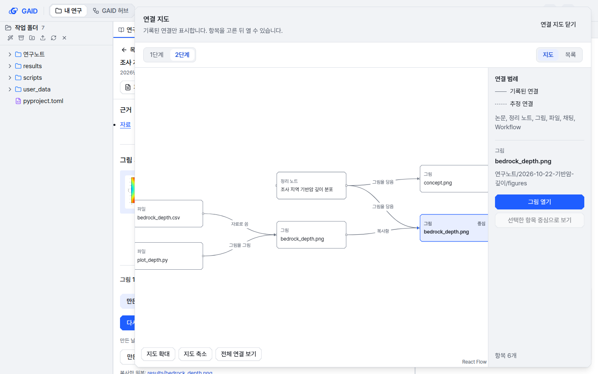
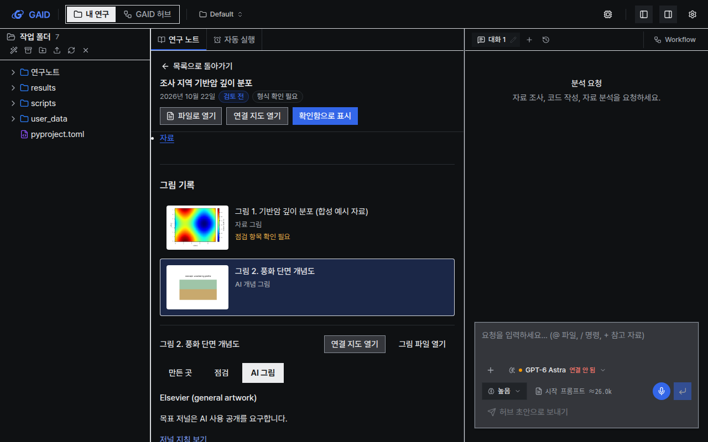
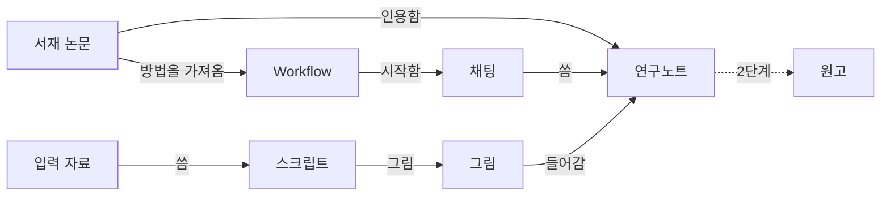

# 분석 결과를 논문 그림으로, 연구 연결을 지도로: 그림 기록·저널 그림 점검·연결 지도

## 0. 한눈에

| | |
|---|---|
| 요청 | 연구 정리와 아이디어 시각화, 논문 그림 생성 쪽에서 GAID가 더 개선할 부분을 찾고, 네 조사 보고서에 나온 도구를 도입·벤치마크·스킬로 활용합니다. |
| 결론 | 사용자가 고른 1·2단계를 구현했습니다. 정리 노트 끝의 "그림 기록"에서 그림마다 종류(자료 그림, AI 개념 그림 등), 그린 스크립트·입력 자료·채팅, 그 뒤에 바뀌었는지가 보입니다. 목표 저널과 폭을 고르면 그림을 점검하고, "다시 그리기"와 "저널 크기로 다시 그리기"는 AI agent에게 보낼 지시를 채팅 입력란에 채웁니다. 저널 7곳의 그림 요건과 그리는 방법은 GAID와 함께 배포하는 그림 스킬에 들어 있습니다. "연결 지도"는 노트나 그림 하나를 골라 그 둘레의 논문·노트·그림·자료·채팅·Workflow 연결을 보여 줍니다. 아이디어 보드와 분석 흐름도, 출판용 지도는 설계만 했습니다. |
| 믿을 수 있는 정도 | 자동 시험과, 이 작업 전용 데이터로 띄운 실제 앱에서 합성 분석 하나로 확인했습니다(스타일 2가지 × 테마 2가지 × 화면 2크기). 저널 요건은 Elsevier, Copernicus, Springer(Geosciences Journal), GSA, 대한지질학회지의 공식 페이지에서 읽은 값만 넣었고, AGU와 자원환경지질은 페이지가 열리지 않아 "확인 안 됨"입니다. 실제 모델 채팅에서 AI agent가 그림 스킬을 따르는지는 연결된 모델이 없어 확인하지 못했습니다. |
| 결정할 일 | 없음. 사용자가 2026-10-22에 설계안의 결정 5건을 모두 권장안으로 정했습니다(6절). 확인할 일 3건이 남았습니다. |

## 1. 요청한 것

> gaid 허브 개선을 위해 oracle로 chatgpt와 claude 조사결과가 4개나 모였다. 해당 관점에서 GAID 허브 시스템 뿐만 아니라 사용자의 연구 방식과 관련하여 연구 정리 및 아이디어 시각화나 논문 그림 생성, 인용의 입장에서도 더 개선할 수 있는 부분은 없었나? — 2026-10-21 질문

> 1~3번 모두 진행하자. 2번의 경우에는 이미 4개의 보고서에서 도입하거나 벤치마크하거나 스킬로 활용할 도구들도 많이 조사되어 있다고 생각한다. — 2026-10-21 결정 (이 작업은 2번)

> gaid-research-visuals 설계안 5건 권장 방안으로 진행하자. — 2026-10-22 결정

완료 기준: 논문 그림(분석 결과 플롯, 도식·그래픽 초록, 저널 양식, 재현성, 그림 점검)과 아이디어 시각화(연결 보기, 문헌 지도, 아이디어 보드)를 연구자가 GAID에서 쓸 이유를 중심으로 설계하고, 사용자와 범위를 정한 뒤 정한 범위만 구현합니다. 정한 범위는 1단계(그림 기록과 저널 그림)와 2단계(연결 지도)입니다.

## 2. 수행한 것

1. 네 조사 보고서(ChatGPT 두 건, Claude 두 건)에서 시각화·그림 관련 내용을 다시 찾았습니다. 문헌 지도와 아이디어 생성 도구는 많이 다뤘지만, 논문 그림을 만드는 도구는 한 건도 없었습니다. 그림은 "그림 번호를 근거 위치로 기록", "PDF에서 그림 추출", "심사 항목에 그림 연결"로만 나옵니다.
2. GAID에 이미 있는 그림·시각화 기능을 확인했습니다(3.3절).
3. 네 보고서가 다루지 않은 부분만 새로 웹 조사했습니다. 저널 그림 규격, 생성형 AI 이미지에 대한 저널 정책, 지구과학 그림 도구, 도식 생성 연구, 그림 재현성·점검 도구, 화면 부품입니다. 핵심 정책은 원문을 직접 열어 확인했습니다.
4. 함께 진행된 서재 작업(gaid-research-hub, 2026-10-21 병합)의 계획과 겹치지 않게 나눴습니다. 아이디어 후보, 인용 지도 도구로 여는 링크, 서재 항목의 "내 연구에서 쓰인 곳"은 그 작업의 몫입니다. 이 설계는 그 자료를 그림과 연결 화면으로 보여 주는 일을 맡습니다.
5. 사용자가 결정 5건을 모두 권장안으로 정한 뒤(2026-10-22), 구조 결정을 문서로 남기고 세 갈래로 나눠 구현했습니다. 그림 스킬과 저널 요건, 그림 기록, 연결 지도입니다. 화면은 같은 날 채택된 UI 가이드 v2를 따랐습니다.
6. 세 갈래를 합쳐 정리 노트 화면에 붙이고, 이 작업 전용 데이터로 실제 앱을 띄워 합성 분석 하나로 확인했습니다. 확인하면서 찾은 문제 네 가지(점검 결과의 영어 문장, 결과 칸의 줄바꿈, 작게 줄어드는 지도 글자, 복사한 그림을 채팅이 그린 것처럼 잇는 연결)를 고쳤습니다.

## 3. 결과

### 3.1 구현한 것

그림 1. 정리 노트 아래 그림 기록의 점검 탭(계측 스타일, 밝은 테마, 1440×900). 합성 예시 자료로 그린 기반암 깊이 그림을 Elsevier 1단(90 mm)으로 점검했습니다. 볼 것: 해상도가 199.8 dpi로 기준(사진 300 dpi)에 못 미친다고 나오는지, 무지개(jet) 색지도를 자동 추정으로 알리는지, 재지 못한 항목을 "측정 안 됨"으로 남기는지.

| 기능 | 연구자가 하는 일 | 확인한 결과 |
|---|---|---|
| 그림 기록 | 정리 노트를 열면 끝에 그 노트의 그림이 모입니다. 그림을 고르면 만든 곳(복사한 원본, 스크립트, 자료, 만든 채팅), 점검, AI 그림 탭이 열립니다. 노트에 그림이 없으면 나타나지 않습니다. | 결과 폴더의 그림을 노트로 복사한 경우에도 원본, 스크립트, 입력 자료까지 찾았습니다. 이미지 생성 도구로 만든 그림은 "AI 개념 그림"으로 분류했습니다. |
| 다시 그리기, 저널 크기로 다시 그리기 | 버튼을 누르면 그림, 스크립트, 자료, 목표 저널을 적은 지시가 채팅 입력란에 채워집니다. 연구자가 보고 보냅니다. | 지시를 자동으로 보내지 않습니다. 실제 모델이 그 지시를 수행하는지는 확인하지 못했습니다. |
| 저널 그림 점검 | 목표 저널과 폭을 고르고 "그림 점검하기"를 누릅니다. 픽셀 크기, 최종 폭에서의 해상도, 최소 글자 크기, 글꼴 포함, 파일 형식, 색지도, 색각 이상 미리보기, AI 그림 정책을 봅니다. 모델을 부르지 않습니다. | 합성 그림 세 장(jet 색지도 PNG, 5 pt 글자 SVG, 9 pt 벡터 PDF)과 실제 앱의 그림 한 장으로 확인했습니다. 결과는 그림 내용이 바뀌면 다시 점검해야 하게 저장됩니다. |
| 그림 스킬 | AI agent가 정리 노트·논문·발표용 그림을 그릴 때 읽는 스킬입니다. 최종 폭(mm)과 글자 크기(pt)로 그리고, 과학 색지도를 기본으로 쓰고, 편집 가능한 벡터와 래스터를 함께 내보내고, 점검 스크립트를 돌립니다. | 새 프로젝트와 기존 프로젝트에 자동으로 들어갑니다. 연구자가 고친 스킬은 덮어쓰지 않습니다. 분석 환경에 과학 색지도(cmcrameri), SciencePlots, PDF 점검용 pypdf를 넣었습니다. |
| AI 그림 표시 | AI 그림 탭에 목표 저널의 허용 여부와 근거 페이지가 나오고, 기록 보기에서 캡션·AI 공개문용 영어 초안을 복사합니다. | 초안은 기록된 도구, 모델, 날짜, 캡션에서만 만듭니다. 모델 이름은 기록 보기 안에서만 보입니다. |
| 연결 지도 | 정리 노트 머리나 그림 기록에서 "연결 지도 열기"를 누르면 옆 창에 지도가 열립니다. 1단계·2단계, 지도·목록을 바꾸고, 항목을 골라 열거나 그 항목 중심으로 다시 봅니다. | 그림 하나에서 입력 자료 → 스크립트 → 결과 그림 → 노트로 복사 → 노트가 담음의 흐름이 그대로 나왔습니다(그림 2). |

그림 2. 노트 그림을 중심으로 연 연결 지도(2단계). 볼 것: 입력 자료와 스크립트가 결과 그림을 만들고, 그 그림이 노트로 "복사함"으로 이어지는지. 기록된 연결은 실선, 명령줄에서 추정한 연결은 점선입니다.

그림 3. 어두운 테마, 도폭 스타일, 1280×800에서 연 AI 그림 탭. 볼 것: 흰 배경 그림이 밝은 바탕 위에 원래 색으로 보이는지, 목표 저널(Elsevier)이 AI 사용 공개를 요구한다고 나오는지.

저널 그림 요건은 공식 페이지에서 읽은 값만 넣었습니다(2026-10-22).

| 저널 | 폭 | 최소 글자 | 해상도 (사진 / 혼합 / 선화) | AI 개념 그림 |
|---|---|---|---|---|
| Elsevier | 90 / 140 / 190 mm | 7 pt | 300 / 500 / 1000 dpi | 공개하면 허용. 그래픽 초록은 허용 안 됨 |
| Copernicus (EGU) | 최소 80 mm | 확인 안 됨 | 300 dpi | 공개하면 허용 |
| Springer (Geosciences Journal) | 84 / 174 mm | 8 pt | 300 / 600 / 1200 dpi | 확인 안 됨 |
| GSA | 59 / 122.8 / 148.2 mm (전체 폭은 원문끼리 달라 비움) | 7 pt | 300 / 확인 안 됨 / 1200 dpi | 공개하면 허용 |
| 대한지질학회지 | 확인 안 됨 | 확인 안 됨 | 확인 안 됨 | 공개하면 허용 |
| AGU | 확인 안 됨 (공식 페이지가 자동 접근을 막음) | 확인 안 됨 | 확인 안 됨 | 확인 안 됨 |
| 자원환경지질 | 확인 안 됨 (공식 페이지가 빈 응답) | 확인 안 됨 | 확인 안 됨 | 확인 안 됨 |

설계안에서 Springer 일반 폭으로 적었던 39 / 84 / 129 / 174 mm는 Geosciences Journal 공식 페이지와 달라서 쓰지 않았습니다.

### 3.2 연구자는 지금 무엇으로 그림을 만들고 아이디어를 정리하는가

| 하는 일 | 지금 쓰는 도구 | 불편한 점 | GAID에서 할 일 |
|---|---|---|---|
| 분석 결과 그림 | Python·Matplotlib, Excel, Origin, Surfer, ArcGIS·QGIS | 몇 달 뒤 심사 의견으로 고칠 때 어느 스크립트와 자료로 그렸는지 다시 찾음. 저널 크기에 맞추면 글자가 너무 작아짐 | 그림마다 스크립트·자료를 보여 주고 저널 크기로 다시 그림 |
| 지도 그림 | ArcGIS, QGIS, GMT | 화면에서 본 지도와 논문 지도가 따로 만들어짐 | GAID 지도 화면의 설정에서 출판용 지도를 코드로 그림 |
| 도식·흐름도 | PowerPoint, Illustrator, Inkscape, draw.io | 분석 순서를 다시 손으로 그림 | 이미 기록된 Workflow 단계와 실행 계보로 흐름도 초안을 만듦 |
| 그래픽 초록·개념도 | PowerPoint, 이미지 생성 AI | 저널마다 AI 이미지 허용 범위가 다름 | 그림 종류와 저널 정책을 표시하고 공개 문구 초안을 만듦 |
| 그림 점검 | 눈으로 확인 | 색각 이상 독자 확인, 최종 크기의 글자 크기를 놓침 | 자동 점검 목록 |
| 문헌 지도 | Connected Papers, Litmaps, ResearchRabbit | 결과를 다시 서지로 옮겨야 함 | 만들지 않고 연결 (서재 작업 3단계) |
| 아이디어 정리 | 메모, Obsidian Canvas, Miro, PowerPoint | 카드가 실제 논문·분석 결과와 이어지지 않음 | 카드가 서재·노트·그림과 이어진 보드 |

네 조사 보고서의 공통 결론은 "인용 그래프와 추천 엔진은 만들지 말고, GAID 안에서는 논문–주장–내 실험–연구노트–원고–Workflow의 관계를 만들라"입니다. 이 설계는 그 결론을 따릅니다.

### 3.3 GAID에 있던 것

| 있는 것 | 상태 | 이 설계에서 쓰는 곳 |
|---|---|---|
| 분석 계보 기록 | 그림에서 거꾸로 그 그림을 만든 스크립트와 입력 자료까지 따라감. 화면에는 들여쓴 목록으로만 보임 | 그림 기록, 연결 지도 |
| 연구노트의 그림 | 노트마다 그림 폴더가 있고 본문에 "그림 1." 캡션으로 넣음 | 그림 기록이 붙는 곳 |
| 분석 환경 | Matplotlib 있음. 과학 색지도, 지도 출판 도구는 없음 | 과학 색지도 추가(3.1절) |
| K-Dense 그림 스킬 | "출판용 과학 그림" 스킬(MIT)에 저널 8곳의 그림 요건, 내보내기 계획, 색 점검, 이미지 정보 점검 도구가 있음. 지구과학 저널(AGU, Copernicus, GSA, 국내 학술지)은 없음. GAID 배포판에서는 이 스킬이 빠져 있음 | 그림 스킬의 바탕 |
| K-Dense 도식 스킬 | 이미지 생성 모델로 도식 초안을 만듦(OpenRouter 키 필요). 배포판에서 빠져 있음 | 쓰지 않음(3.7절) |
| K-Dense 그림 Workflow | "논문용 그림 제작", "그래픽 초록", "학회 포스터" 등 12개. 문장만 있고 연결된 스킬이 없음. "일반 Workflow" 안에 접혀 있음 | 새 기본 Workflow로 대체 |
| 이미지 생성 도구 | 에이전트가 쓸 수 있음. 허브 개념 그림은 "개념 그림 (분석 자료가 아닙니다)"로 표시함 | 그림 종류 표시 |
| 서재와 "쓰인 곳" | 서재 항목마다 인용한 노트, 붙인 프로젝트, 만든 Workflow를 계산함 | 연결 지도의 자료 |
| 화면 부품 | 그래프 라이브러리 없음. 채팅의 Mermaid 그림만 그림. 허브 초안 흐름도는 카드로 직접 그림 | 연결 지도용 부품 추가 |

### 3.4 저널이 그림에 요구하는 것

#### 생성형 AI 이미지 정책

같은 "AI로 만든 그림"이라도 무엇을 만들었는지에 따라 저널의 판단이 다릅니다. 3.6절 ① 그림 기록의 "그림 종류"와 ⑦ AI 그림 표시가 이 차이를 따릅니다.

| 출판사 | AI 보조 도식·개념도 | 그래픽 초록·표지 | 공개 방법 | 확인 |
|---|---|---|---|---|
| Elsevier (2026-08 개정) | 흐름도·결정 나무·연표·개념 도식·실험 흐름도는 허용 | 범용 이미지 생성 AI로 그래픽 초록을 만들 수 없음. 표지는 편집자·출판사 사전 허가 | 그림마다 캡션에 도구·판·사용 방법, 본문 AI 공개문 | 원문 직접 확인 |
| Copernicus (EGU 저널) | 도구를 인용하면 그림·도식 생성 허용 | 확인 못 함 | Methods 또는 Acknowledgements에 도구명·목적·범위 | 원문 직접 확인 |
| AGU | 이미지·그래픽 요소를 일괄 금지하지 않음 | 확인 못 함 | Methods 등에 도구와 사용 방법 | 웹 조사 |
| Springer Nature | 검증할 수 있는 자료·방법에서 나온 AI 보조 그림은 조건부 허용. 근거 없이 생성한 시각 자료는 불허 | 저널별 규정 우선 | AI 공개문과 캡션 | 웹 조사 |
| Nature 계열 | 2026년 Nature Methods 편집 글은 AI 생성 그림 게재를 허용하지 않는다고 밝힘 | 일부 저널은 AI 표지를 명시적으로 금지 | 저널별 확인 | 웹 조사(원문 열람 제한) |
| Science (AAAS) | 편집자의 명시적 허가 없이는 AI 생성 이미지 불허 | 같음 | 사전 허가 | 웹 조사(원문 열람 차단) |
| IEEE | 그림을 포함한 AI 생성 내용을 공개해야 함 | 확인 못 함 | Acknowledgments | 웹 조사 |

데이터 그림에는 모든 출판사가 같은 원칙을 둡니다. Elsevier 원문은 "자료 시각화는 원자료에서 직접 나온 경우에만 AI의 도움을 받을 수 있고, Methods에 적은 재현 가능한 분석으로 만들어야 한다"고 씁니다. 연구 사진(현미경, 시추 코어 사진 등)의 AI 합성·변경은 금지합니다.

따라서 GAID는 그림을 만든 방식을 다섯 종류로 나눠 기록해야 합니다.

| 그림 종류 | 예 | 출판 판단 |
|---|---|---|
| 자료 그림 | 분석 자료로 Python이 그린 그래프·지도 | 가장 안전함. 스크립트·자료가 남아야 함 |
| 코드 도식 | 에이전트가 쓴 Mermaid·SVG·draw.io 흐름도 | 대체로 허용. 저널에 따라 AI 사용 공개 |
| AI 개념 그림 | 이미지 생성 모델이 그린 개념도 | 저널마다 다름. Elsevier 그래픽 초록, Nature 계열, Science(허가 없을 때)에는 쓸 수 없음 |
| AI 그래픽 초록 | 이미지 생성 모델로 만든 그래픽 초록 | Elsevier는 금지 |
| 원본 이미지 가공 | 코어 사진·현미경 사진의 AI 보정·합성 | 금지 대상. 일반 보정도 기존 이미지 처리 도구로만 |

#### 그림 규격

| 출판사·학술지 | 폭 | 글자 | 해상도·형식 |
|---|---|---|---|
| Elsevier | 1단 90 mm, 1.5단 140 mm, 2단 190 mm | 최종 크기 7 pt(첨자 6 pt) 이상 | 사진 300 dpi, 혼합 500 dpi, 선화 1000 dpi. 벡터는 EPS·PDF |
| Copernicus | 최소 80 mm | 한 글꼴, PDF·EPS에 글꼴 포함 | 300 dpi, 여러 패널은 한 파일, 색각 이상 독자가 읽을 수 있어야 함, 과학 색지도 권장 |
| Springer 일반 | 39 / 84 / 129 / 174 mm | 8–12 pt | 사진 300, 혼합 600, 선화 1200 dpi |
| Nature 본지 | 89 / 183 mm, 높이 170 mm 이하 | 5–7 pt | 편집 가능한 글자, 벡터 유지 |
| GSA (Geology 등) | 59 / 122.8 / 185 mm | 7–12 pt | 사진 300–600 ppi, 선화 1200 ppi |
| AGU | 확인 못 함 | 확인 못 함 | JPEG·TIFF·EPS·PDF 등 |
| 대한지질학회지 | A4 이하, 축소해도 읽히는 글자 | 확인 못 함 | JPG 권장, 캡션은 영어 |
| Geosciences Journal, 자원환경지질 | 확인 못 함 | 확인 못 함 | 확인 못 함 |

같은 PNG라도 최종 폭에 따라 적합성이 달라집니다. 90 mm 폭에 300 dpi이면 약 1,063 픽셀이지만 190 mm 폭이면 약 2,244 픽셀이 필요합니다. 그래서 점검은 "목표 저널과 폭"을 먼저 정해야 의미가 있습니다. Copernicus는 색각 이상 시뮬레이터로 그림을 확인하라고 요구하고 Crameri의 과학 색지도를 권장합니다. 지구과학 그림에서 흔한 무지개 색지도는 이 요구에 맞지 않을 수 있습니다.

### 3.5 만들지 않은 것

| 만들지 않을 것 | 이유 | 대신 할 일 |
|---|---|---|
| 그림 편집기 (Illustrator·Inkscape 대체) | 연구자가 이미 쓰고, 경쟁할 이유가 없음 | 편집할 수 있는 SVG·PDF·draw.io 파일로 내보냄 |
| 새 그림 생성 모델 | 데이터 그림은 코드로 그려야 하고, AI 이미지는 저널 제약이 큼 | 기존 이미지 생성은 "AI 개념 그림"으로 표시만 함 |
| 인용 지도·추천 엔진 | 네 조사 모두 기존 도구가 낫다고 판단함 | 서재 작업 3단계의 외부 도구 링크 |
| 범용 화이트보드 (Miro 대체) | 범용 기능으로는 이길 수 없음 | 카드가 내 자료와 이어진 아이디어 보드만 |
| 저널 투고 규정 자동 판정 | 규정은 자주 바뀌고 저널마다 다름 | "점검 결과"로만 보여 주고 "규정 충족"이라고 쓰지 않음 |

### 3.6 설계: 논문 그림

이번에 구현한 것은 ①, ②, ③, ④, ⑦과 ⑤의 색지도 기본값입니다. ⑤의 출판용 지도와 ⑥ 분석 흐름도는 3단계로 남겼습니다.

| 기능 | 연구자가 GAID에서 쓰는 이유 | 다시 오게 하는 것 | 함께 쓰는 도구 |
|---|---|---|---|
| ① 그림 기록 | 연구노트와 프로젝트의 그림마다 그림 종류, 그린 스크립트, 쓴 자료, 만든 채팅이 보입니다. 자료나 스크립트가 그 뒤에 바뀌었으면 "자료가 바뀜"으로 표시합니다. | 심사 의견이 왔을 때 몇 달 전 그림의 출처를 다시 찾지 않음 | 기존 분석 계보 기록 |
| ② 다시 그리기 | 그림 기록에서 "다시 그리기"를 누르면 같은 스크립트와 자료로 채팅이 열리고, 바꿀 점(색, 단위, 범위)만 말하면 됩니다. 새 그림은 같은 노트에 판으로 남습니다. | 심사 대응, 학회 발표용 변형 | Python, Matplotlib |
| ③ 저널에 맞춘 그림 | 프로젝트나 원고의 목표 저널을 고르면 에이전트가 최종 폭(mm)·글자 크기(pt)·해상도·형식으로 그립니다. 같은 그림을 다른 저널용으로 다시 내보낼 수 있습니다. | 투고 직전, 다른 저널로 재투고할 때 | K-Dense 그림 스킬, SciencePlots |
| ④ 그림 점검 | 최종 크기의 글자 크기, 해상도, 색각 이상 시뮬레이션, 무지개 색지도, 축 단위 누락, 글꼴 포함 여부, 패널 표시를 점검하고 그림 옆에 결과를 보여 줍니다. AI의 그림 의견은 참고 의견으로만 붙입니다. | 투고 전 마지막 확인 | 색각 시뮬레이션 도구 |
| ⑤ 지구과학 그림 기본값 | 과학 색지도를 기본으로 쓰고, GAID 지도 화면에서 보던 지도를 축척 막대·방위 표시·좌표계·자료 출처를 갖춘 출판용 지도로 코드로 다시 그립니다. 화면 표시용 타일은 그림에 쓰지 않습니다. | 지도 그림이 들어가는 모든 원고 | 과학 색지도, cartopy 또는 PyGMT |
| ⑥ 분석 흐름도 | 실행한 Workflow 단계와 분석 계보로 Methods용 흐름도 초안을 코드 도식으로 만듭니다. 연구자가 draw.io나 PowerPoint에서 고칠 수 있게 내보냅니다. | 원고 방법 절, 과제 보고서 | Mermaid, draw.io |
| ⑦ AI 그림 표시와 공개 문구 | 이미지 생성 모델이 만든 그림에는 "AI 개념 그림"과 목표 저널의 허용 여부를 표시합니다. 그림 캡션과 원고 AI 공개문에 넣을 문구(도구, 판, 용도) 초안을 실행 기록에서 만듭니다. | 투고 때마다 | 서재 작업의 AI 활용 공개 서식(2단계) |

①과 ②는 일반 그림 도구에 없는 기능입니다. 일반 그림 도구는 그림 파일만 남기고, GAID는 그림을 만든 실행까지 이미 기록합니다. Elsevier가 요구하는 "원자료에서 재현 가능한 자료 그림"을 연구자가 따로 정리하지 않아도 됩니다.

③과 ④는 K-Dense의 "출판용 과학 그림" 스킬(MIT)을 바탕으로 합니다. 이 스킬은 이미 "저널 규정을 추정하지 말고, 대상 저널과 단계를 정한 뒤 최신 공식 지침을 확인하라", "도구가 점검했다고 접근성이나 규정 충족을 주장하지 말라"는 원칙을 둡니다. GAID는 여기에 지구과학 저널의 그림 요건을 더하고, 점검 결과를 그림 기록에 붙입니다.

### 3.7 도식과 그래픽 초록

도식은 세 경로로 나눕니다.

1. 코드 도식(기본). 흐름도, 분석 순서, 개념 관계는 에이전트가 Mermaid·SVG·draw.io 파일로 씁니다. 글자와 위치를 고칠 수 있고, Elsevier와 Copernicus 기준으로 공개만 하면 쓸 수 있습니다.
2. AI 개념 그림. 허브의 개념 그림과 에이전트의 이미지 생성은 그대로 둡니다. 다만 ⑦처럼 종류와 저널 허용 여부를 표시하고, Elsevier 그래픽 초록처럼 금지된 곳에 쓰려 하면 코드 도식이나 전용 도구로 안내합니다.
3. 전용 도구. 그래픽 초록을 다듬는 일은 Inkscape, draw.io, PowerPoint에 맡기고, GAID는 편집 가능한 파일을 넘깁니다.

K-Dense의 도식 스킬은 이미지 생성 모델을 기본으로 쓰므로 그대로 들여오지 않습니다. 학술 그림을 자동으로 만드는 연구(PaperBanana, AutoFigure, DeTikZify, MatPlotAgent 등)의 평가 결과는 부록 B에 정리했습니다. 공통 방식은 "언어 모델이 구조를 정하고, 코드나 렌더러로 그린 뒤, 그림을 보는 모델이 비평한다"입니다. 평가 대상은 주로 AI 분야의 방법 도식과 일반 차트입니다. 지층 순서나 단층 관계 같은 지질 도식의 사실성을 평가한 연구는 찾지 못했습니다. 그래서 GAID는 이 연구들을 들여오지 않습니다. 코드 도식을 기본으로 두고, 그림을 보는 모델의 의견은 참고 의견으로만 씁니다.

지구과학 도식 기호는 기존 자료를 씁니다. FGDC 지질 패턴을 SVG로 옮긴 자료(CC0)는 주상도 채우기에 바로 쓸 수 있습니다. IAN 기호 모음(CC BY-SA 4.0)은 출처 표시 조건이 있어 그림마다 출처를 남겨야 합니다.

### 3.8 설계: 아이디어 시각화

| 기능 | 연구자가 GAID에서 쓰는 이유 | 다시 오게 하는 것 | 함께 쓰는 도구 |
|---|---|---|---|
| ⑧ 연결 지도 | 논문, 연구노트, 그림, 채팅, Workflow 가운데 하나를 고르면 그 주변의 연결이 지도로 보입니다. "이 그림은 어떤 자료와 어느 논문의 방법에서 나왔나", "이 논문을 근거로 쓴 노트·그림은 무엇인가"에 답합니다. 프로젝트 전체를 한꺼번에 그리지 않고, 고른 대상에서 한두 단계만 보여 줍니다. | 원고를 쓸 때 근거를 모으고, 심사 의견에 답할 때 | 서재의 "쓰인 곳", 분석 계보 |
| ⑨ 아이디어 보드 | 프로젝트마다 보드를 두고 아이디어 후보, 서재 논문, 연구노트, 그림을 카드로 놓고 "지지함·반박함·조건을 붙임·필요함" 선으로 잇습니다. 카드는 실제 항목과 이어져 있어 "자료가 바뀜", 시험 결과 같은 상태가 보이고, 아이디어 카드에서 바로 시험 채팅을 엽니다. 보드는 Obsidian Canvas 형식의 파일로 저장해 Obsidian에서도 열립니다. | 과제 기획, 원고 구성 | Obsidian Canvas 형식 |
| ⑩ 문헌 지도 | 만들지 않습니다. 서재 작업 3단계의 "인용 지도 도구로 열기"를 씁니다. | — | Connected Papers, Litmaps, Inciteful |

연결 지도의 연결 종류는 이미 기록되는 것만 씁니다.

그림 1. 연결 지도가 보여 줄 연결. 볼 것: 모든 화살표가 이미 GAID가 기록하는 정보(노트 인용, 노트를 쓴 채팅, 분석 계보, 논문으로 만든 Workflow)에서 나오는지. 점선은 서재 작업 2단계(내 논문)가 생긴 뒤에 붙습니다.

인용 지도 도구는 논문끼리의 인용 관계를 보여 주고, 연결 지도는 내 연구 안의 관계를 보여 줍니다. 범용 지식 그래프(Obsidian 그래프 보기)와 달리 연결의 뜻(인용, 자료, 그림)이 구분되고, 그림이나 자료가 바뀌었는지가 함께 보입니다.

아이디어 보드는 서재 작업의 아이디어 후보(3단계, 연구노트의 한 종류)를 카드로 씁니다. 아이디어 후보가 생기기 전에도 논문·노트·그림 카드와 직접 쓴 메모 카드로 쓸 수 있습니다. 보드를 파일로 두는 것은 "연구노트는 파일이 원본"이라는 기존 결정과 같은 원칙입니다.

### 3.9 화면 부품과 도구 선택

| 쓰임 | 후보 | 라이선스·최신 판 (2026-10 확인) | 판단 |
|---|---|---|---|
| 연결 지도·아이디어 보드 | React Flow (xyflow) | MIT, 12.12.0 (2026-09) | 권장. 카드 모양을 GAID 화면 규칙에 맞추기 쉽고 두 화면에 함께 씀 |
| 연결 지도 배치 | dagre | MIT | 권장 |
| 큰 그래프 | Cytoscape.js, sigma.js | MIT, 3.34.4 / 4.0.3 | 노드가 수천 개가 될 때만 |
| 자유 그리기 | Excalidraw | MIT, 0.18.1 | 보류. 카드와 자료 연결이 핵심이라 처음에는 필요 없음 |
| 화이트보드 | tldraw | 배포에 라이선스 키가 필요한 자체 라이선스 | 쓰지 않음 |
| 보드 파일 형식 | JSON Canvas (Obsidian Canvas) | MIT 공개 명세 | 권장 |
| 배치 계산 | elkjs | EPL-2.0 | 쓰지 않음. dagre로 충분 |
| 출판 그림 스타일 | SciencePlots, UltraPlot | MIT, 2.2.2 / 2.7.2 | SciencePlots를 분석 환경에 추가 후보 |
| 과학 색지도 | cmcrameri (Crameri) | MIT(색지도 자료 포함), 1.10 (2026-08) | 분석 환경에 추가 |
| 지도 출판 | cartopy, PyGMT | BSD-3, 0.26.0 / 0.19.0 | cartopy를 먼저 씀. PyGMT는 GMT 프로그램을 따로 설치해야 해서 선택 설치 |
| 그림 재현 묶음 | showyourwork | MIT, 0.4.3 (2023) | 쓰지 않음. 마지막 판이 오래됨. GAID 계보 기록이 같은 역할 |

### 3.10 서재 작업과 나눈 일

| 일 | 맡는 곳 |
|---|---|
| 아이디어 후보 만들기, 시험하기 | 서재 작업 3단계 |
| 인용 지도 도구로 여는 링크, 서재에 없는 많이 인용된 논문 | 서재 작업 3단계 |
| 원고, 심사 항목, AI 활용 공개 서식 | 서재 작업 2단계(내 논문). 이 설계의 ⑦은 그림 한 장의 공개 문구만 만들고 서식에 넘김 |
| 원고의 목표 저널 | 서재 작업 2단계에 이미 있음. ③은 원고가 생기기 전에는 프로젝트 설정으로 받음 |
| 문헌 스킬 배포 | 서재 작업에서 남은 일(배포 스킬 목록에 없음). 그림 스킬도 같은 문제라 같은 방식으로 풂(결정 5) |
| 그림 기록, 저널 그림, 점검, 연결 지도, 아이디어 보드 | 이 작업 |

### 3.11 단계별 계획

| 단계 | 만들 것 | 다음 단계로 넘어갈 근거 |
|---|---|---|
| 1. 그림 기록과 저널 그림 | ① 그림 기록, ② 다시 그리기, ③ 저널에 맞춘 그림, ④ 그림 점검, ⑤ 과학 색지도 기본값, ⑦ AI 그림 표시. 지구과학 저널 그림 요건 묶음, 그림 스킬 배포, "논문용 그림 다듬기" 기본 Workflow | 실제 프로젝트의 그림 한 장을 목표 저널 크기로 다시 그리고, 점검 결과와 출처가 노트에 남음 |
| 2. 연결 지도 | ⑧ 연결 지도(논문·노트·그림·채팅·Workflow), 서재 상세의 "지도로 보기", 그림 기록의 "연결 보기" | 연구자가 그림 하나에서 쓴 자료와 근거 논문까지 지도에서 찾아감 |
| 3. 보드와 도식 | ⑨ 아이디어 보드, ⑥ 분석 흐름도, ⑤ 출판용 지도 | 시험 연구자가 과제 기획에 보드를 한 번 이상 씀 |

화면은 2026-10-22에 채택된 UI 가이드 v2(계측 기본, 도폭 선택, 밝은·어두운 테마)를 따릅니다. 그림·지도·이미지는 두 테마 모두에서 원래 색 그대로 보여 줍니다.

## 4. 검증

- 과학적 검증: 점검 스크립트의 측정은 크기와 내용을 아는 합성 그림 세 장으로 대조했습니다. 90 mm 폭 300 dpi 목표로 만든 jet 색지도 PNG는 1,062 픽셀, 299.7 dpi로 재고 색지도를 경고했습니다. 5 pt 글자 SVG는 최소 글자 크기 미달로, 9 pt 벡터 PDF는 글꼴 포함으로 나왔습니다. 무지개 색지도 판정은 픽셀 색상의 흐름으로 추정한 것이라 "자동 추정"으로 표시하고 실패로 처리하지 않습니다. 축 단위와 패널 표시는 아직 재지 않습니다("측정 안 됨"). 저널 요건은 3.1절 표에 적은 공식 페이지에서 읽은 값이며, 저널 정책 가운데 Elsevier와 Copernicus는 원문 문장을 직접 확인했습니다. Springer Nature, Nature 계열, Science, IEEE의 AI 이미지 정책(3.4절)은 웹 조사 결과이고 원문을 직접 확인하지 않았습니다.
- 소프트웨어 검증: 세 갈래 작업은 각자 브랜치에서 전체 검사(scripts/check)를 통과한 뒤 합쳤습니다(백엔드 시험 2,077개, 웹 시험 1,144–1,149개, 배포·환경·출시 전 검사). 합친 뒤 제가 고친 부분은 관련 시험(서버 그림 기록 10개, 연결 지도 7개, 웹 그림·연결·노트 18개, 점검 스크립트 시험), 타입 검사, 화면 규칙 검사, 문구 검사로 확인했습니다. 합친 브랜치 전체에 대한 전체 검사는 완료 처리에서 실행합니다. 실제 앱은 이 작업 전용 데이터 폴더로 띄웠고, 합성 분석 하나(Python으로 그린 기반암 깊이 그림을 노트로 복사, 이미지 생성 기록을 단 개념 그림)로 그림 기록, 점검, AI 그림 탭, 연결 지도를 계측·도폭 스타일과 밝은·어두운 테마, 1440×900과 1280×800에서 확인했습니다(화면 사진 24장). 브라우저 콘솔 오류는 앱을 다시 띄우는 동안의 연결 거부 말고는 없었습니다.

## 5. 한계

- 연결된 모델이 없어 실제 채팅에서 AI agent가 그림 스킬을 읽고 최종 크기로 그리는지, "다시 그리기" 지시를 따르는지는 확인하지 못했습니다(6절 확인 1).
- 그림 기록의 분석 계보는 합성 기록으로 확인했습니다. 실제 채팅에서 셸 명령 안에서 그린 그림은 입력이 "추정"으로만 남을 수 있습니다. 그림을 다른 방법으로 옮겨 내용이 바뀌면 원본을 찾지 못합니다.
- AGU와 자원환경지질의 그림 요건은 비어 있습니다. 공식 페이지가 자동 접근을 막거나 빈 응답을 보냈습니다(6절 확인 2). 대한지질학회지는 AI 공개 요구만 확인했고 폭과 해상도는 비어 있습니다.
- 그림 종류는 기록에서 추정합니다. 기록이 없는 그림은 "확인 안 됨"이고, 연구자가 종류를 바꿀 수 있습니다. AI 그래픽 초록은 연구자가 지정해야만 그 종류가 됩니다.
- 연결 지도는 정리 노트와 그림 기록에서만 엽니다. 서재 논문에서 여는 입구는 만들지 않았습니다. 서재는 모든 프로젝트에 걸쳐 있고 지도는 프로젝트 하나 안의 연결이라, 어느 프로젝트로 열지 정하는 화면이 필요합니다(6절 확인 3). 지도 안의 논문과 Workflow 항목은 정리 노트 화면에서 아직 열 수 없고, "선택한 항목 중심으로 보기"만 됩니다.
- 저널 정책은 2026년에도 바뀌었습니다(Elsevier 8월 개정). 점검 결과에는 요건을 확인한 날짜와 "투고 전 최신 지침 확인"이 함께 나옵니다.
- 아이디어 보드, 분석 흐름도, 출판용 지도는 설계만 했습니다(3단계).

## 6. 결정할 일

없음. 설계안의 결정 5건은 사용자가 2026-10-22에 모두 권장안으로 정했습니다. 구현 범위는 1·2단계, AI 그림은 표시와 공개 문구, 저널 7곳, 아이디어 보드는 Obsidian Canvas 형식 파일(3단계), 그림 스킬은 GAID 배포 스킬입니다.

남은 확인 3건은 task 문서에 남깁니다.

1. 실제 모델 채팅에서 그림 스킬이 쓰이는지: 모델이 연결된 GAID에서 그림을 그리게 하고, 최종 폭과 글자 크기, 점검 실행을 확인합니다.
2. AGU와 자원환경지질의 그림 요건: 실제 브라우저로 공식 페이지를 열어 채웁니다.
3. 서재 논문에서 연결 지도를 여는 입구: 논문이 쓰인 프로젝트를 고르게 할지, 서재 작업의 다음 단계와 함께 정합니다.

## 7. 대체되었거나 실패한 시도

펼치기 — 5건

- 웹 조사 첫 질문의 답이 그림 규격과 AI 정책까지만 오고 끊겼습니다. 같은 대화에 이어 묻기는 두 번 모두 질문이 전달되지 않았습니다. 나머지 항목은 새 대화로 따로 물었습니다.
- 두 번째 질문의 답은 재현성 도구 절 중간에서 두 시간 넘게 멈췄습니다. 받은 부분까지만 썼고, 화면 부품의 라이선스는 GitHub에서 직접 확인했습니다. 그림 자동 점검 도구와 그림을 보는 모델의 비평 신뢰도는 따로 조사하지 못했습니다.
- 처음 점검 결과는 측정값 칸에 영어 문장을 넣었습니다. 점검 스크립트가 숫자·단위와 언어와 무관한 메모 코드만 내고 화면이 한국어로 바꾸게 고쳤습니다.
- 연결 지도의 처음 선 모양(직각 꺾인 선)은 한 항목에서 나가는 선들이 같은 세로선을 지나 이름표가 겹쳤습니다. 곡선과 넓은 간격으로 바꿨고, 2단계에서 글자가 작아지지 않게 확대 하한을 두었습니다.
- 처음 연결 지도는 노트로 복사한 그림을 채팅이 새로 그린 것처럼 이었습니다. 내용이 같은 그림 사이를 "복사함"으로 잇고, 복사한 그림에는 채팅이 그렸다는 연결을 붙이지 않게 고쳤습니다.

## 용어

| 용어 | 새 정의 / 정의 변경 | 정의 |
|---|---|---|
| [그림 기록](../../docs/glossary.md) | 새 정의 | 정리 노트에 든 그림 한 장의 종류, 그린 채팅·스크립트·자료, 그 뒤에 바뀌었는지, 목표 저널 점검 결과, AI 그림의 공개 문구 초안을 모아 보여 주는 곳입니다. |
| [그림 점검](../../docs/glossary.md) | 새 정의 | 목표 저널의 그림 요건과 그림 파일을 비교한 결과입니다. 규정 충족을 뜻하지 않습니다. |
| [연결 지도](../../docs/glossary.md) | 새 정의 | 고른 항목 둘레의 연결을 보여 주는 화면입니다. GAID가 이미 기록한 연결만 씁니다. |

## 부록 A. 근거 위치

펼치기 — 조사 기록, GAID 현황, 외부 자료

### 조사 기록

| 항목 | 위치 |
|---|---|
| 네 조사 보고서 | PC74:~/data/geoaidesk/work/gaid-research-hub/oracle/q1.harvest.md, oracle/q2.answer.md, inputs/claude-web-survey.txt, inputs/claude-research-2-notes.md |
| 웹 조사 1 (AI 정책, 그림 규격) | 질문 PC74:~/data/geoaidesk/work/gaid-research-visuals/oracle/q1-figures.md, 답 oracle/q1.harvest.md, Obsidian `웹 조사/geoaidesk/2026-10-21-ai-geoaidesk-gaid-python-markdown--aa555d9439.md` |
| 웹 조사 2 (지구과학 도구, 도식 연구, 재현성) | 질문 oracle/q2-figures-rest.md, 답 oracle/q2.harvest.md (재현성 절 중간에서 멈춘 부분 답. 세션 상태 오류로 Obsidian 사본 없음) |
| 서재 작업 | reports/2026-10-21-gaid-research-hub/index.md, docs/adr/2026-10-21-research-hub-library.md, docs/open-items/gaid-research-hub.md |

### GAID 현황

| 항목 | 위치 |
|---|---|
| 카탈로그 고정 판 | geo/distribution.json `catalogue` (0.2.1), configs/inputs.toml `geo_catalogue` |
| geo 모드 스킬 노출 | server/src/geo/context.ts, server/src/config.ts, server/src/geo/catalogue.ts |
| K-Dense 그림 스킬 원본 | PC74:~/assets/k-dense-scientific-agent-skills/92ace75a/skills/scientific-visualization (MIT, v1.4), scientific-schematics |
| 배포 스킬 방식(본보기) | geo/skills/gaid-note-style/, server/src/geo/note-style.ts |
| K-Dense 그림 Workflow | web/src/data/workflows.json (category visual), web/src/geo/workspace/task-catalogue.tsx |
| 이미지 생성 | server/src/agent/image-tool.ts, server/src/geo/authoring/visuals.ts, codex-images.ts |
| 분석 계보 | server/src/provenance/lookup.ts (walkLineage), recorder.ts, mentions.ts; 화면 web/src/components/provenance-panel.tsx |
| 연구노트 그림 규칙 | server/src/geo/instructions.ts (RESEARCH_NOTE_RULE), docs/geo/research-notes.md |
| 서재 "쓰인 곳" | server/src/geo/library/uses.ts, web/src/geo/contracts/library.ts |
| 그래프 부품 현황 | web/package.json (@streamdown/mermaid), web/src/geo/hub/flow-diagram.tsx |

### 구현

| 항목 | 위치 |
|---|---|
| 구조 결정 | docs/adr/2026-10-22-figure-records-and-connection-map.md |
| 계약 | web/src/geo/contracts/figures.ts, web/src/geo/contracts/connections.ts |
| 그림 스킬, 저널 요건, 점검 스크립트 | geo/skills/gaid-figures/ (SKILL.md, assets/journals.json, scripts/check_figure.py), 시험 geo/tests/figures-helper.test.mjs |
| 배포 스킬 | server/src/geo/shipped-skills.ts (gaid-note-style, gaid-figures), FIGURE_RULE in server/src/geo/instructions.ts |
| 그림 기록 | server/src/geo/figures/, server/src/geo/routes/figures.ts, web/src/geo/figures/, 시험 server/test/geo-figures.test.ts |
| 연결 지도 | server/src/geo/connections/, server/src/geo/routes/connections.ts, web/src/geo/connections/ (@xyflow/react 12.12.0, @dagrejs/dagre 3.1.1), 시험 server/test/geo-connections.test.ts |
| 노트 화면 연결 | web/src/geo/notes/research-notes-panel.tsx |
| 하위 작업 | gaid-research-visuals--skill, --records, --map (각 task 문서에 세부 시험 기록) |
| 실제 앱 확인 | GAID_HOME PC74:~/data/geoaidesk/work/gaid-research-visuals/home, 합성 분석 생성 스크립트 PC74:~/data/geoaidesk/work/gaid-research-visuals/seed/seed.ts, 화면 사진 24장 PC74:~/data/geoaidesk/work/gaid-research-visuals/playwright/matrix/ |

### 외부 자료 (주요)

| 자료 | 주소 |
|---|---|
| Elsevier 생성형 AI 정책 | https://www.elsevier.com/about/policies-and-standards/generative-ai-policies-for-journals |
| Copernicus AI 정책 | https://publications.copernicus.org/for_authors/ai_policy.html |
| Copernicus 원고 준비(그림) | https://publications.copernicus.org/for_authors/manuscript_preparation.html |
| 라이브러리 저장소 | github.com/xyflow/xyflow, dagrejs/dagre, cytoscape/cytoscape.js, jacomyal/sigma.js, excalidraw/excalidraw, tldraw/tldraw, obsidianmd/jsoncanvas, garrettj403/SciencePlots, Ultraplot/UltraPlot, GenericMappingTools/pygmt, callumrollo/cmcrameri, showyourwork/showyourwork, kieler/elkjs |

작성 시점: 2026-10-21, 브랜치 task/gaid-research-visuals.

## 부록 B. 도구와 연구 조사

펼치기 — 지구과학 그림 도구, 코드 도식, 그림 생성 연구, 재현성 도구

출처: 웹 조사 2(2026-10-21). 판과 라이선스 가운데 GitHub에서 직접 확인한 것은 "직접"으로 표시했습니다.

### 지구과학 그림 도구

| 도구 | 쓰임 | 라이선스·판 | 주의 |
|---|---|---|---|
| cmcrameri | 과학 색지도(batlow 등) | MIT, 1.10 (2026-08-04), 판 직접 | 색지도 자료 8.0(2023) 포함 |
| cmocean | 해양·수문 변수 색지도 | MIT, 4.0.3 (2024-04) | 최신 환경 호환 미확인 |
| cartopy | Matplotlib 지도 투영 | BSD-3, 0.26.0 (2026-09) | Windows 설치 미확인 |
| PyGMT / GMT 6 | 지형·지질 지도, 단면 위치도 | BSD-3 0.19.0 (직접) / LGPL-3.0 6.7.0 | pip 설치만으로는 GMT가 깔리지 않음 |
| welly, striplog | LAS 검층 곡선, 주상도 | Apache-2.0, 0.5.2 (2022) / 0.9.2 (2022) | 오래된 판. GAID 검층 화면과 겹침 |
| colorspacious, DaltonLens | 색각 이상 시뮬레이션 | MIT, 1.1.2 (2018) / 릴리스 없음 | 오래된 판. 시뮬레이션이 모든 관찰자를 대표하지 않음 |
| geologic-patterns | FGDC 지질 패턴 SVG·PNG | CC0, 1.0.0 (2017) | 원 FGDC 패턴과의 대응표 미확인 |
| FGDC-STD-013-2006, USGS EPS 기호 | 미국 지질도 기호 표준 | 연방 표준, 파일별 조건 확인 필요 | 다시 구현할 이유 없음 |
| IAN Symbol Libraries | 환경·지구과학 개념도 기호 | CC BY-SA 4.0 | 출처 표시, 파생물 조건 |
| SciencePlots | 논문용 Matplotlib 스타일 | MIT, 2.2.2 (2026-06), 직접 | 스타일 이름이 저널 규격을 보장하지 않음 |
| UltraPlot | 여러 패널 배치 | MIT, 2.7.2 (2026-10), 직접 | 환경 호환 확인 필요 |
| tueplots | 지면 폭에 맞춘 그림 크기 | MIT, 판 미확인 | 크기 프리셋 설계 참고 |

무지개 색지도 문제의 근거는 Crameri, Shephard & Heron (2020), "The misuse of colour in science communication", Nature Communications 11, 5444, doi:10.1038/s41467-020-19160-7입니다.

### 코드 도식 형식

| 형식 | 쓰임 | 라이선스·판 | 판단 |
|---|---|---|---|
| Mermaid | 흐름도, 순서도 | MIT, 12.2.0 (2026-10), 직접 | 기본. GAID 채팅이 이미 그림 |
| draw.io 파일 | 편집 가능한 도식 | Apache-2.0, 32.5.5 (2026-10), 직접 | 연구자가 고칠 파일로 내보냄 |
| SVG | 단면, 범례, 정밀 도식 | W3C 표준 | 내보내기 형식 |
| TikZ/PGF | LaTeX 원고 도식 | GPL-2.0/LPPL, 3.1.12 | TeX 사용자에게만 |
| Graphviz | 계보·의존 관계 | EPL-2.0 (브라우저용 viz-js는 MIT) | 연결 지도는 dagre로 충분 |
| Excalidraw | 자유 스케치 | MIT, 0.18.1, 직접 | 보류 |

### 학술 그림 자동 생성 연구

| 연구 | 평가 | 코드 | 한계 |
|---|---|---|---|
| PaperBanana (ICML 2026) | 방법 도식 292개. 사실성·간결성·가독성·미감이 기준 모델보다 나아졌다고 보고 | Apache-2.0, 연구용 데모 | 차원별 수치 미확인 |
| AutoFigure (ICLR 2026) | 과학 글–그림 3,300쌍 | MIT | 비교 점수 미확인 |
| AutoFigure-Edit | 기존 그림을 편집 가능한 SVG로 | MIT, 1.1 | 과학적 의미 대응 미검증 |
| AutomaTikZ, DeTikZify (NeurIPS 2024) | 글·스케치 → TikZ | Apache-2.0, 1.0.0 / 0.3.0 (직접) | 지구과학 도식 평가 없음 |
| MatPlotAgent (ACL 2024) | 차트 100문항. GPT-4 직접 생성 48.86 → 그림 비평 추가 61.16 | 라이선스 미확인 | 연구 자체 척도이며 정확도 %가 아님 |
| Plot2Code, ChartMimic (ICLR 2025) | 그림 → Matplotlib 코드 복원 | 미확인 / Apache-2.0 | 일반 차트 대상 |
| Paper2Poster (NeurIPS 2025) | 논문 PDF → 편집 가능한 포스터 | MIT | 도식 사실성 미검증 |
| DiagramAgent (CVPR 2025) | 글 → 코드 다이어그램, 8개 범주 | Apache-2.0 | 지질 범주 없음 |
| SciFig (2026 preprint) | 방법 그림 2,219개, 70.1% / 66.2% | 미확인 | 품질 지표이며 사실성 보증 아님 |

### 재현성 도구

| 도구 | 쓰임 | 라이선스·판 | 판단 |
|---|---|---|---|
| showyourwork | 논문 빌드에 그림·코드·자료 연결 | MIT, 0.4.3 (2023), 직접 | 쓰지 않음. GAID 계보가 같은 역할 |
| Quarto | 코드·그림·캡션을 한 문서로 | MIT, 1.10.19 (2026-10) | 원고 내보내기 후보(서재 작업 2단계) |
| DVC, DataLad | 자료·계산 단계 버전 관리 | Apache-2.0 3.67.1 / MIT 1.7.1 | GAID 계보와 겹쳐 쓰지 않음 |
| Matplotlib 저장 메타데이터, PNG iTXt·XMP | 그림 파일 안에 출처 기록 | 공개 표준 | 그림 파일에 그림 기록 번호를 넣는 데 씀. 출판 제작 과정에서 지워질 수 있음 |
| RO-Crate | 자료·소프트웨어·계보 묶음 | Apache-2.0 명세 | GAID 증거 묶음이 이미 씀 |

