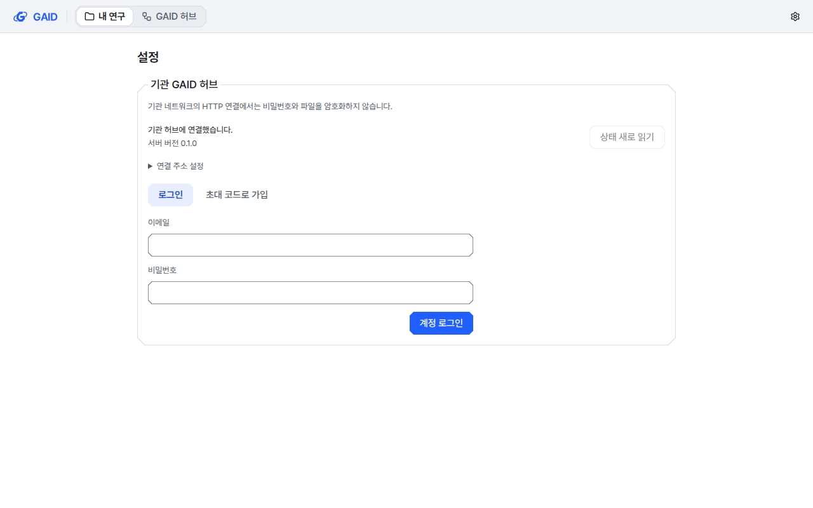
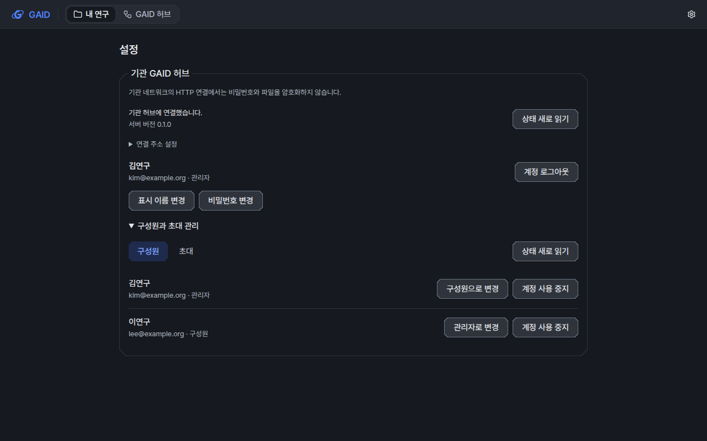
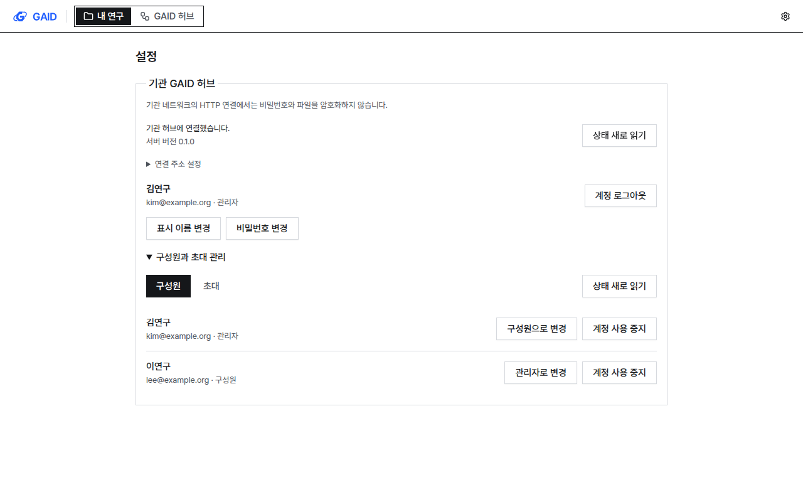
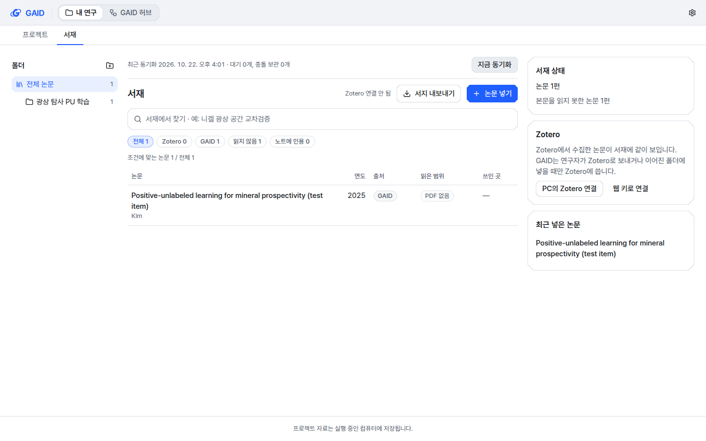
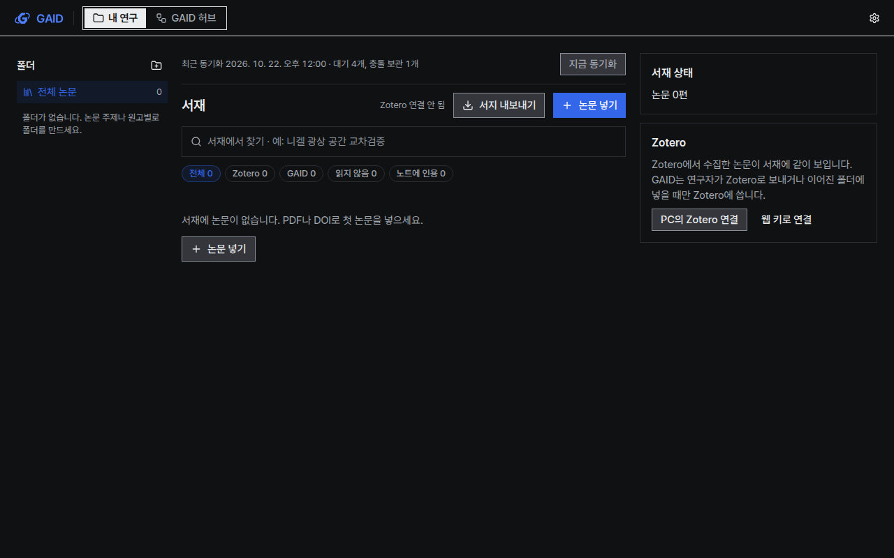
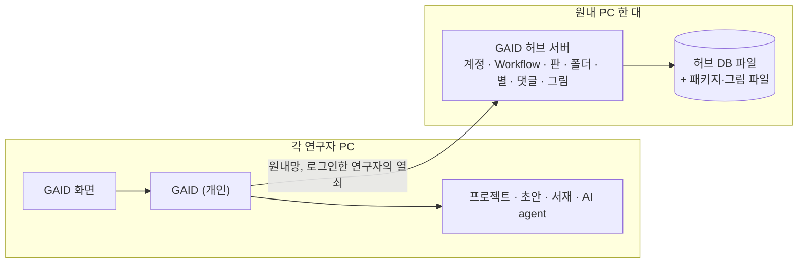

# GAID 공유 백엔드: 계정과 원내 GAID 허브 서버

## 0. 한눈에

| | |
|---|---|
| 요청 | 무료 티어 수준의 도구로 GAID 허브·시스템용 백엔드를 찾고, 사용자와 설계를 논의한 뒤 합의한 범위를 구현합니다. 최대 50명, 보통 10–20명이 쓰는 시험 수준입니다. |
| 결론 | 사용자가 고른 원내 GAID 허브 서버(계정, 공유 허브, 개인 서재 동기화, 백업, 기존 Workflow 옮기기)를 구현했습니다. PC74에서 띄운 시험 서버에 PC74의 GAID 화면과 PC70이 원내망으로 접속해 가입, 공유, 동기화, 계정별 격리를 확인했습니다. |
| 믿을 수 있는 정도 | 자동 시험(실제 HTTP 서버와 두 계정·두 PC를 쓰는 종단 간 시험 포함)과 실제 원내망 시험으로 확인했습니다. 시험 계정만 썼고, 연구자가 실제로 쓰는 시험 운영은 아직 시작하지 않았습니다. 원내 HTTP라 비밀번호와 파일이 암호화되지 않습니다. |
| 결정할 일 | 1건 (6절: 시험 운영 시작) |

## 1. 요청한 것

> 다음 작업으로 GAID허브와 GAID 시스템과 관련하여 현재 백엔드 시스템이 구현되지 않아 있다. 사용자가 활용할 수 있는 백엔드 시스템을 우선 무료 티어 수준의 도구로 검색하고 어떻게 설계해야할지 사용자와 논의하면서 진행할 수 있게 해야한다. 우선 최대 사용자 50명이며, 일반적으로 10~20명 정도 사용할 테스트 수준으로 구현하려고 한다. — 2026-10-22 요청

설계안을 보고 사용자가 고른 내용:

> 2번 다, 4번 나로 하고 나머지는 권장으로 하자. — 2026-10-22 결정

즉 1) 원내 GAID 허브 서버, 2) 1단계에 계정 + 공유 허브 이전 + 기존 Workflow 5건 + 백업 + 개인 서재 동기화, 3) 관리자 초대 + 이메일·비밀번호, 4) 원내 HTTP, 5) SQLite입니다. 확인 사항(기관 SSO·메일·인증서 유무, PC74 운영 가능 여부)은 답이 없어 PC74를 시험 서버로 두었습니다.

완료 기준: 위 1단계가 실제 서버와 연구자 GAID 사이에서 동작하고, 자동 시험과 원내망 시험으로 확인됩니다.

## 2. 수행한 것

1. 지금 GAID의 공유 허브, 초안 작성, 서재, 접근 보호 코드를 읽고 무엇이 한 대의 PC에 묶여 있는지 진단했습니다.
2. 무료 티어 서비스 7종과 원내 설치형 4종, 관련 법령을 공식 문서로 비교하고 세 가지 구성안을 제안했습니다.
3. 사용자 결정에 따라 설계 기록을 쓰고, 허브 기록을 어디에 저장하든 같은 화면이 쓰이도록 기존 허브 코드를 나눴습니다.
4. 허브 서버, 연구자 GAID의 연결·서재 동기화, 화면을 세 묶음으로 나눠 동시에 만들고 하나로 합쳤습니다.
5. 실제 HTTP 서버로 두 계정·두 PC 시나리오를 자동 시험하고, PC74 서버에 PC74 화면과 PC70을 원내망으로 연결해 시험했습니다. 검토용 GAID의 Workflow 5건을 시험 서버로 옮기고 백업·복원을 확인했습니다.

## 3. 결과

### 3.1 연구자가 이제 할 수 있는 것

그림 1. PC74 시험 서버에 관리자 계정으로 로그인한 GAID 허브 화면(1440×900). 볼 것: 검토용 GAID에서 옮긴 Workflow 5건이 계정 이름(서성인, 새연구자)과 판·별 수를 그대로 가지고 보입니다.

1. 관리자는 연구자의 이메일과 역할로 초대 코드를 만들고 직접 전달합니다(메일 서버 불필요). 연구자는 자기 GAID의 설정 → 서비스 → 기관 GAID 허브에서 서버 주소를 넣고, 초대 코드·표시 이름·비밀번호로 계정을 만듭니다. 다른 PC에서는 이메일과 비밀번호로 로그인합니다.
2. 로그인하면 GAID 허브 화면이 기관 서버의 Workflow를 보여 줍니다. 등록, 새 판, 별, 댓글, "고치기/복사해서 고치기", 내 프로젝트에 설치가 지금과 같은 화면에서 동작합니다. 작성자 확인은 계정으로 하므로 다른 사람 이름을 입력해 남의 Workflow를 고칠 수 없습니다.
3. 서재 화면 위쪽에 동기화 줄이 생겼습니다. 같은 계정으로 로그인한 PC끼리 논문, 폴더, PDF가 오갑니다. 다른 연구자는 물론 관리자도 남의 서재를 볼 수 없습니다.
4. 관리자는 같은 설정 카드에서 구성원 목록, 역할 변경, 계정 사용 중지, 초대 취소를 합니다. 마지막 관리자는 구성원으로 바꾸거나 중지할 수 없습니다.
5. 허브 서버를 설정하지 않은 GAID는 지금처럼 자기 PC의 허브를 씁니다.

그림 2. 로그인 전 기관 GAID 허브 카드(계측, 라이트, 1280×800, 시험용 가짜 서버). 볼 것: 원내 HTTP라 비밀번호와 파일을 암호화하지 않는다는 문장이 카드 맨 위에 항상 보입니다.

그림 3. 관리자로 로그인한 카드(계측, 다크). 볼 것: 계정 줄, 표시 이름·비밀번호 변경, 구성원별 역할 변경과 사용 중지.

그림 4. 같은 화면의 도폭 스타일. 볼 것: 스타일이 바뀌어도 같은 구성과 문구를 씁니다.

그림 5. 실제 시험 서버와 동기화한 서재(1440×900). 볼 것: 위쪽 동기화 줄의 "대기 0개, 충돌 보관 0개"와 "지금 동기화" 단추.

그림 6. 서재 동기화 줄(다크, 시험용 가짜 서버). 볼 것: 대기 개수와 충돌 보관 개수를 함께 보여 줍니다.

### 3.2 원내망 실제 시험 (2026-10-22, PC74 서버 · PC70 접속)

| 확인한 것 | 결과 |
|---|---|
| PC70에서 서버 상태 확인 | 정상 응답 |
| 브라우저에서 서버로 직접 보낸 요청 | 거부 |
| 로그인하지 않은 요청 | 거부 |
| 관리자 가입(PC74 GAID 화면, 원내 IP 주소로 연결) | 계정 생성, 로그인 유지 |
| 관리자가 화면에서 만든 초대 코드로 PC70에서 구성원 가입 | 계정 생성 |
| 검토용 허브의 Workflow 5건 옮기기 | 5건, 파일 17개, 댓글 5건, 별 5개. 두 번째 실행은 5건 모두 건너뜀 |
| 화면에서 서재 동기화(폴더 1, 논문 1, PDF 1) | 대기 3개 → 0개, 서버에 관리자 계정 몫으로 저장 |
| PC70에서 같은 관리자 계정으로 서재 받기 | 논문·폴더를 받고, PDF 해시가 원본과 같음 |
| PC70에서 구성원 계정으로 관리자 서재 보기 | 변경 0건, PDF는 찾을 수 없음 |
| 구성원 계정으로 공유 Workflow 보기 | 5건 모두 보임 |
| 서버를 켠 채 백업, 백업 복원 확인 | 파일 19개 해시와 표별 행 수 일치 |

옮긴 Workflow의 작성자는 지정한 계정에 연결했습니다. 계정에 연결하지 않은 이름이 누른 별과 쓴 댓글은 "이전 사용자 · 이름"으로 남겨, 다른 사람의 기록이 한 계정에 붙지 않게 했습니다. 그래서 별 4개짜리 Workflow는 옮긴 뒤에도 4개입니다.

### 3.3 동기화 규칙

- 각 PC의 서재가 작업 사본이고, 서버는 계정별 사본을 둡니다. AI agent 도구와 프로젝트는 지금처럼 PC의 서재를 읽습니다.
- 동기화는 서버의 변경을 먼저 받고, 그다음 PC의 변경을 보냅니다. 두 PC에서 같은 논문을 고쳤다면 나중에 고친 쪽이 남고, 밀려난 사본은 서재 폴더 안의 충돌 보관함에 저장됩니다.
- 한쪽에서 지우고 다른 쪽에서 고쳤다면 서버에 먼저 기록된 쪽을 따릅니다. 삭제에는 시각이 없어서 시각으로 비교할 수 없습니다. 폴더 이름과 위치가 엇갈리면 서버 쪽을 따릅니다.
- Zotero에서 가져온 논문은 두 PC가 따로 가져와도 Zotero 라이브러리와 항목 키가 같으면 하나로 합칩니다. Zotero 연결 정보와 키는 PC에만 둡니다.
- 미공개 PDF·원고·아이디어가 공유 허브로 가는 길은 없습니다. 서재 동기화는 본인 계정 사본으로만 갑니다.

### 3.4 구성

| 부분 | 하는 일 |
|---|---|
| GAID 허브 서버 | 원내 PC 한 대에서 도는 별도 프로그램입니다. 계정·초대·로그인, 공유 Workflow 기록과 파일, 계정별 서재 사본, 감사 기록, 백업과 복원 확인, 기존 허브 옮기기를 맡습니다. AI agent, 명령 실행, 프로젝트, 화면은 없습니다. 자료는 SQLite 파일 하나와 해시로 이름 붙인 파일 폴더에 둡니다. |
| 연구자 GAID | 서버 주소와 로그인 정보를 자기 데이터 폴더에 보관하고(화면으로 보내지 않음), 허브 화면의 요청을 서버로 전달합니다. 등록할 때 패키지와 그림을 올리고, 설치할 때 판을 지정해 받아 해시를 확인합니다. 서재 동기화도 여기서 합니다. |
| 화면 | 설정의 기관 GAID 허브 카드, 서재 동기화 줄, 허브 화면의 계정 표시입니다. |

### 3.5 진단: 구현 전 GAID에 없던 것

GAID는 연구자마다 자기 PC에서 실행됩니다. 공유 허브는 "기관에 GAID 한 대를 두고 모두가 그 화면에 접속한다"는 가정으로 만들어졌습니다. 그래서 다음 문제가 있습니다.

| 영역 | 지금 상태 | 공유 서버가 없어서 생기는 문제 |
|---|---|---|
| 사람 구분 | 연구자가 입력한 표시 이름만 보냅니다. 서버는 그 이름을 확인하지 않습니다. | 누구나 다른 사람 이름을 입력해 그 사람의 Workflow에 새 판을 올릴 수 있습니다. |
| 공유 허브 | Workflow 등록·판, 주제 폴더, 별, 댓글, 그림이 그 GAID가 도는 PC의 폴더에 저장됩니다. | 내 PC의 GAID에서 등록한 Workflow는 다른 연구자에게 보이지 않습니다. 다른 GAID의 허브에 접속하는 기능이 없습니다. |
| 한 대에 모두 접속하는 방식 | 원내망에 열 때는 접근 열쇠 하나를 모두가 나눠 씁니다. | 그 열쇠로 허브뿐 아니라 그 PC의 AI agent, 명령 실행, 모델 자격 증명, 모든 프로젝트까지 쓸 수 있습니다. 허브만 공유하는 것이 불가능합니다. |
| 기록의 짝 | 허브 항목이 "이 서버의 초안 프로젝트"와 "이 서버의 프로젝트 설치 횟수"를 가리킵니다. | 서버를 나누면 이 연결을 다시 만들어야 합니다. |
| 개인 서재 | 연구자 PC에 저장하고, 소유자 칸은 "local"로 둡니다. 결정 기록에 "계정이 생긴 뒤 기관 서버로" 옮긴다고 적혀 있습니다. | 계정이 없어서 다음 단계로 넘어갈 수 없습니다. |
| 알림 | 없습니다. | 내 Workflow에 달린 댓글이나 설치한 Workflow의 새 판을 알 수 없습니다. |

공유 서버로 옮길 것과 PC에 남길 것은 다음처럼 나눕니다. 서재 결정 기록(미공개 PDF·원고·아이디어는 공유 허브에 올리지 않음)을 그대로 따릅니다.

| 공유 서버로 | 연구자 PC에 그대로 |
|---|---|
| 계정, 기관 구성원과 관리자 역할 | 프로젝트, 분석 파일, AI agent 실행 |
| 등록된 Workflow와 판(패키지, 표지·단계·결과 그림, 초안 사본) | 작성 중인 Workflow 초안과 그 출처 PDF |
| 주제 폴더, 별, 댓글, 추천 | 설치한 Workflow (허브가 멈춰도 계속 쓸 수 있게) |
| 설치 기록 (누가 어느 판을 설치했는지) | 모델·Zotero 자격 증명 |
| 다음 단계: 개인 서재 동기화, 알림 | 1단계의 개인 서재와 PDF |

### 3.6 이미 가진 것과 원내망 조건

- 과거 작업 기록에서 Supabase, Firebase, Cloudflare, Neon, PocketBase, Appwrite, Convex 계정이나 기관 서버, 메일 서버를 GAID에 쓴 기록은 찾지 못했습니다.
- 사용자는 2026-09-14에 "포트개방이나 tailscale과 같은 VPN은 별도의 허가가 필요"하다고 하셨습니다. 원내망 밖에서는 원내 PC에 직접 닿지 않습니다. 이 설계는 원내망 안에서 쓰는 것을 전제로 합니다.
- 서버 후보인 PC74(32스레드, 62GB 메모리)는 아래 모든 설치형 선택지의 최소 사양을 넘습니다. 이 PC에는 Docker, PostgreSQL, 인증서 도구가 설치되어 있지 않고, 설치에는 관리자 비밀번호가 필요합니다. 디스크는 88% 차 있습니다(남은 공간 196GB).

### 3.7 무료 티어와 설치형 비교 (2026-10-22 공식 문서 기준)

50명이면 모든 서비스의 로그인 무료 한도(대부분 월 5만 명 이상)는 충분합니다. 선택을 가르는 것은 서비스 정지 규칙, 서버 위치, 메일 발송, 백업, 나중에 옮기는 비용입니다.

| 선택지 | 무료로 되는 것 | GAID에 걸리는 점 |
|---|---|---|
| Supabase Free | PostgreSQL 500MB, 파일 1GB, 서울 지역 선택 가능 | 7일간 사용이 적으면 정지됩니다. 기본 메일은 시간당 2통이고 팀 주소로만 갑니다. 자동 백업이 없습니다. 유료는 월 25달러부터입니다. |
| Firebase Spark | 문서형 DB 1GiB | 무료 요금제에는 파일 저장과 서버 함수가 없습니다. 로그인 처리는 미국에서 합니다. 메일 링크 로그인은 하루 5통입니다. |
| Appwrite Cloud Free | 저장 2GB | 서울·도쿄 지역이 목록에 없습니다. 7일간 개발 활동이 없으면 정지됩니다. |
| Convex Free | DB 0.5GB, 파일 1GB | 아시아 지역이 없습니다. 자료 모델이 독자적이라 나중에 옮기기 어렵습니다. |
| Cloudflare (Workers + D1 + R2 + Access) | 파일 10GB, 접근 통제 50명 | 한국 저장을 보장하지 않습니다. 50석이 최대 인원과 같아 여유가 없습니다. |
| Neon Free | PostgreSQL 1GB, 파일 5GB | 서울·도쿄 지역이 없습니다(싱가포르). 5분간 쓰지 않으면 DB가 잠들고 무료에서는 끌 수 없습니다. |
| PocketHost | — | 영구 무료가 없습니다(7일 시험 후 월 9.99달러). 백업은 이용자 책임입니다. |
| 원내 PocketBase | 전부 (오픈소스, MIT) | 아직 1.0 전(2026-10-08 v0.40.5)이라 업무 핵심 시스템에는 권하지 않는다고 공식 문서가 적고 있습니다. SQLite 전용이라 PostgreSQL로 옮길 때 변환이 필요합니다. |
| 원내 Supabase·Appwrite 자체 설치 | 전부 (오픈소스) | 구성 요소가 많습니다(최소 2 CPU, 4GB 메모리, Docker). 50명 허브에는 무겁습니다. |
| 원내 DB + 작은 API + 인증 라이브러리(Better Auth) | 전부 (오픈소스, MIT 등) | 계정·권한·API를 직접 만들고 운영해야 합니다. GAID와 같은 TypeScript로 만들 수 있어 기존 허브 코드를 거의 그대로 씁니다. |

법령에서 확인한 점은 다음과 같습니다. 이 보고서는 기관 승인 판단을 대신하지 않습니다.

- 연구자 이름과 이메일, 그 사람과 연결된 댓글·별 기록은 개인정보입니다. 해외 서비스에 저장하면 개인정보 보호법 제28조의8의 국외 이전 근거(별도 동의, 계약 이행에 필요한 처리위탁·보관과 고지 등)가 필요합니다. 공급사의 SOC 2나 GDPR 준수만으로는 충족되지 않습니다.
- 미공개 원고·아이디어는 개인정보와 별개로 국가연구개발혁신법 제21조와 기관 보안 규정의 대상이 될 수 있습니다.
- 클라우드컴퓨팅법 제20조는 국가기관등이 보안인증(CSAP)을 받은 클라우드를 우선 고려하도록 정합니다. 위 해외 서비스의 CSAP 인증은 확인하지 못했습니다.

따라서 기관 승인을 기다리지 않고 설계할 수 있는 것은 원내 서버입니다.

### 3.8 세 가지 구성안과 선택

가안(권장)은 원내 GAID 허브 서버입니다. GAID 저장소 안에 "허브 서버 모드"를 하나 더 만듭니다. 이 서버는 AI agent, 명령 실행, 프로젝트 없이 계정과 공유 허브만 엽니다. 원내 PC 한 대에서 돌리고, 각 연구자의 GAID는 설정에 이 서버 주소를 넣고 로그인합니다. 연구자 화면은 지금 허브 화면을 그대로 씁니다. 연구자 PC의 GAID가 로그인 정보를 들고 허브 서버에 대신 요청합니다.

그림 7. 가안(선택한 구성)의 구성. 볼 것: 허브 서버에는 등록된 Workflow와 그 주변 기록만 있고, 연구자의 프로젝트·초안·서재는 각자 PC에 남습니다.

나안은 원내 PocketBase입니다. 계정, 자료, 파일, 관리 화면이 들어 있는 실행 파일 하나를 원내 PC에서 돌립니다. 시작은 가장 빠르지만, 지금 허브 코드(등록 검사, 판 관리, 편집과 사본 규칙)를 PocketBase 규칙과 확장 코드로 다시 써야 합니다. 1.0 전 버전이라 업데이트 때마다 변경 사항을 검토해야 합니다.

다안은 Supabase Free 서울 지역입니다. 운영을 공급사에 맡깁니다. 대신 공개해도 되는 Workflow로 범위를 좁히고, 이름·이메일 국외 처리와 기관 클라우드 이용 절차를 먼저 확인해야 합니다. 7일 정지 규칙 때문에 시험 기간이 끊기면 수동으로 다시 켜야 하고, 연구자 가입 메일에는 별도 메일 서버가 필요합니다.

| 기준 | 가안 원내 GAID 허브 서버 | 나안 원내 PocketBase | 다안 Supabase 서울 |
|---|---|---|---|
| 비용 | 없음 | 없음 | 무료, 계속 켜 두려면 월 25달러 |
| 지금 허브 코드 재사용 | 거의 그대로 | 다시 작성 | 다시 작성(DB 규칙과 SDK) |
| 미공개 자료를 원내에 두기 | 됨 | 됨 | 공개 Workflow로 제한 |
| 기관 승인 | 원내 PC 사용만 | 원내 PC 사용만 | 개인정보 국외 이전과 클라우드 이용 검토 |
| 운영 책임 | 원내 담당자(백업, 재시작, 업데이트) | 원내 담당자 + 1.0 전 변경 대응 | 공급사 + 정지·메일·백업 대응 |
| 나중에 기관 서버·PostgreSQL로 옮기기 | 가장 쉬움(같은 코드, DB만 교체) | 변환 필요 | 쉬움(PostgreSQL) |
| 첫 구현 분량 | 중간 | 적음(대신 허브 규칙 재작성) | 중간 |

사용자는 가안을 골랐고, 1단계에 개인 서재 동기화를 더했습니다(6절의 2번 다). 그림 7은 결정 전에 그린 구성이라 서재 사본이 빠져 있습니다. 구현된 구성은 3.4절에 있습니다.

## 4. 검증

- 과학적 검증: 해당 없음(앱 기반 기능입니다).
- 자동 시험: 허브 서버 시험 38건(계정, 위조한 작성자·건너뛴 판·바뀐 옛 판·없는 파일 거부, 별·댓글·설치, 서재 충돌·삭제·파일, 백업·복원, 옮기기), 연결·동기화 시험 24건, 화면 시험 17건, 기존 허브 시험이 통과했습니다. 종단 간 시험은 실제 HTTP 허브 서버에 두 계정과 한 계정의 두 PC를 붙여 등록 → 다른 계정의 별·댓글·복사·설치 → 서재 올리기 → 두 번째 PC 받기 → 양쪽 수정 충돌 → 다른 계정 격리까지 한 번에 확인합니다. 저장소 전체 검사 결과는 부록 A에 적습니다.
- 원내망 시험: 3.2절과 같습니다. 시험 계정만 썼습니다.
- 화면 확인: 계측·도폭 두 스타일과 라이트·다크 두 테마를 1440×900과 1280×800에서 확인했습니다(시험용 가짜 서버 24장, 실제 서버 2장). 가로 넘침은 없었습니다. 문구 검사와 UI 규칙 검사를 통과했고 새로 허용한 예외는 없습니다.
- 확인하지 못한 것: 여러 연구자가 동시에 쓰는 부하, Windows·macOS 연구자 PC에서의 연결, 오래 켜 둔 서버의 안정성, 실제 연구자 계정으로 하는 운영.

## 5. 한계

- 원내 HTTP라 비밀번호, 로그인 열쇠, Workflow, 동기화하는 PDF가 원내망을 암호화 없이 지납니다(사용자 결정 4번). 시험 그룹보다 넓게 쓰기 전에 다시 정해야 합니다. 나중에 HTTPS를 붙여도 자료를 바꿀 필요는 없습니다.
- 서버가 PC 한 대입니다. 그 PC가 꺼지면 등록·별·댓글·동기화가 멈춥니다. 이미 설치한 Workflow와 각자의 연구는 계속 쓸 수 있습니다. PC74는 업무 PC이고 디스크가 88% 차 있습니다.
- 알림(내 Workflow의 새 댓글, 설치한 Workflow의 새 판)은 1단계에 없습니다.
- 서버를 운영하는 사람은 데이터베이스와 백업에 든 서재·PDF를 읽을 수 있습니다. 화면과 API로는 관리자도 남의 서재를 볼 수 없지만, 서버 PC와 백업은 개인 연구 자료처럼 보호해야 합니다.
- 비밀번호를 잊은 연구자는 관리자가 새 초대를 만들어 주는 방식으로만 돌아올 수 있습니다(비밀번호 재설정 메일 없음).
- 시험 서버는 이번 작업이 끝나면 내립니다. 지속 운영은 6절의 결정을 따릅니다.

## 6. 결정할 일

1. 연구자가 쓰는 시험 운영을 시작할까요?
   - 가) PC74에서 허브 서버를 고정 서비스로 띄우고(병합한 판으로 고정), 사용자 관리자 계정의 초대 코드를 드린 뒤, 검토용 허브의 Workflow 5건을 사용자가 정한 작성자 연결로 옮깁니다 (권장: 기능 시험이 끝났고, 실제 연구자 몇 명이 써 봐야 알림·부하·운영 문제를 알 수 있습니다)
   - 나) 기관 서버나 다른 원내 PC가 정해질 때까지 기다립니다

## 7. 대체되었거나 실패한 시도

펼치기 — 6건

- 지금 GAID 한 대를 원내망에 열어 모두가 접속하는 방식: 접근 열쇠 하나로 그 PC의 AI agent와 명령 실행까지 열리므로 쓰지 않았습니다.
- Firebase Spark: 무료 요금제에 파일 저장과 서버 함수가 없고, 로그인 처리가 미국에서 이뤄지며, 메일 링크 로그인이 하루 5통이라 제외했습니다.
- Convex, Appwrite Cloud, Neon: 서울·도쿄 지역이 없고(Neon은 싱가포르), 원내안보다 나은 점이 운영 편의뿐이라 세 안에 넣지 않았습니다.
- 원내 Supabase·Appwrite 자체 설치, 별도 로그인 서버(Keycloak, authentik, ZITADEL): 50명 허브에 비해 구성 요소가 많고 Docker가 필요해 제외했습니다.
- PocketBase(나안), Supabase Free(다안): 사용자가 가안을 골랐습니다.
- 통합 중 한 번: 허브 서버 묶음을 합치기 전에 종단 간 시험을 먼저 올려 다른 묶음의 검사가 막혔습니다. 시험을 빼 두었다가 합친 뒤 다시 넣었습니다.

## 용어

| 용어 | 새 정의 / 정의 변경 | 정의 |
|---|---|---|
| [GAID 허브 서버](../../docs/glossary.md) | 새 정의 | 여러 연구자의 GAID가 함께 쓰는 원내 서버입니다. 계정, 공유 허브(등록된 Workflow, 판, 폴더, 별, 댓글)와 계정별 서재 동기화를 맡습니다. AI agent, 명령 실행, 프로젝트는 없습니다. |

## 부록 A. 근거 위치

펼치기 — 코드 위치, 실행, 시험, 조사 노트

| 항목 | 위치 |
|---|---|
| 설계 기록 | `docs/adr/2026-10-22-gaid-hub-server.md`; 운영 안내 `docs/geo/hub-server.md` |
| 허브 서버 | `server/src/geo/hub-server/` (`index.ts` `buildHubServer`, `accounts.ts`, `records.ts`, `library.ts`, `backup.ts`, `import.ts`, `cli.ts`, 통신 규약 `protocol.ts`), 실행 `node geo/hub-server.mjs serve|invite|users|backup|check-backup|import-hub` |
| 기록 저장소 공통 계약 | `server/src/geo/hub-shared/records.ts` (`HubRecordStore`, `Actor`), `active.ts` (`resolveHub`) |
| 연구자 GAID 연결·동기화 | `server/src/geo/hub-client/`, `server/src/geo/library/sync/`, `server/src/geo/routes/hub-server.ts`; 화면 계약 `web/src/geo/contracts/hub-server.ts` |
| 화면 | `web/src/geo/hub-server/`, 문구 `web/src/geo/locales/hubServer/`, 설정 연결점 `web/src/components/settings/services-panel.tsx` (경계 목록 등록) |
| 하위 작업 | gaid-backend--hub-server, gaid-backend--hub-client, gaid-backend--hub-ui (각 task 문서에 시험 명령과 결과) |
| 시험 | `cd server && GAID_CATALOGUE=off npx vitest run test/geo-hub-server.test.ts test/geo-hub-client.test.ts test/geo-hub-client-integration.test.ts test/geo-library-sync.test.ts test/geo-hub-e2e.test.ts test/geo-hub-shared.test.ts`; 웹 `cd web && npx vitest run src/geo/hub-server`; 전체 `scripts/check` (task finish가 실행) |
| 원내망 시험 | 허브 서버 `pc74:~/data/geoaidesk/work/gaid-backend/hub-home` (`serve --host 0.0.0.0 --port 8700`, serverId hub-8e92c7c9d4be2a4f8c31dc52c353983c), 시험 GAID `GAID_HOME=pc74:~/data/geoaidesk/work/gaid-backend/gaid-home` (포트 3420/18420), PC70 10.13.15.70에서 curl; 기록 `pc74:~/data/geoaidesk/work/gaid-backend/logs/` |
| 옮긴 자료 | 원본 `pc74:~/.geoaidesk/pi-agent/skill-hub/shared` (읽기만, 복사본 `~/data/geoaidesk/work/gaid-backend/legacy-shared`), 작성자 연결 `authors.json` + `--unmapped-to researcher@test.gaid` |
| 백업 | `pc74:~/data/geoaidesk/work/gaid-backend/backup-1`, manifest sha256 b093fd5122a571da… , check-backup 통과 |
| 스크린샷 원본 | 실제 서버 `pc74:~/data/geoaidesk/work/gaid-backend/playwright/real-*.png`; 가짜 서버 24장 `pc74:~/data/geoaidesk/work/gaid-backend--hub-ui/screens/` |
| 웹 조사 | `[노트] 웹 조사/geoaidesk/2026-10-22-research-question-2026-10-22--a9eaa9446b.md` (oracle-web Pro, 출처 목록 포함) |
| 진단 근거 | 공유 허브 저장 `server/src/geo/hub-shared/store.ts`, 표시 이름 식별 `routes.ts`(구현 전 42-56행), 단일 접근 열쇠 `server/src/auth.ts`, 원내망 조건 `[세션] 01a09e72-00e4-7c51-8654-650c96c01f0e:29` |

작성 시점: 2026-10-22, 통합 커밋 6b54a929 이후(최종 커밋은 task 문서와 PR에 있습니다).

