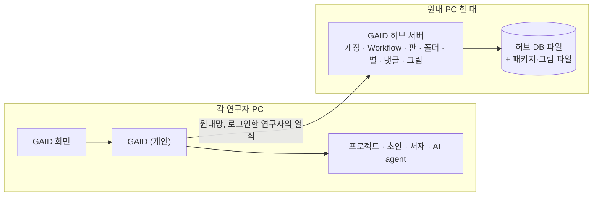

# GAID 공유 백엔드 설계안: 계정과 원내 GAID 허브 서버

## 0. 한눈에

| | |
|---|---|
| 요청 | 무료 티어 수준의 도구로 GAID 허브·시스템용 백엔드를 찾고, 사용자와 설계를 논의한 뒤 합의한 범위를 구현합니다. 최대 50명, 보통 10–20명이 쓰는 시험 수준입니다. |
| 결론 | 지금 GAID에는 계정이 없습니다. 공유 허브도 한 대의 GAID에 모두가 접속해야만 공유됩니다. 권장안은 원내 PC에서 도는 별도의 GAID 허브 서버(계정, Workflow 등록·판, 폴더, 별, 댓글, 그림)이고, 각 연구자의 GAID는 그 서버에 로그인해 씁니다. |
| 믿을 수 있는 정도 | 코드 진단은 현재 main 기준으로 직접 확인했습니다. 무료 티어 한도와 법령은 2026-10-22에 공식 문서로 대조한 웹 조사 결과입니다. KIGAM 내부 규정, 원내망에서 다른 PC가 이 서버에 닿는지, 기관 SSO·메일 서버 유무는 확인하지 못했습니다. |
| 결정할 일 | 5건 (6절). 구현은 결정 뒤에 시작합니다. |

## 1. 요청한 것

> 다음 작업으로 GAID허브와 GAID 시스템과 관련하여 현재 백엔드 시스템이 구현되지 않아 있다. 사용자가 활용할 수 있는 백엔드 시스템을 우선 무료 티어 수준의 도구로 검색하고 어떻게 설계해야할지 사용자와 논의하면서 진행할 수 있게 해야한다. 우선 최대 사용자 50명이며, 일반적으로 10~20명 정도 사용할 테스트 수준으로 구현하려고 한다. — 2026-10-22 요청

완료 기준: (1) GAID에 없는 공유 기능을 진단하고, (2) 무료 티어와 원내 설치형 선택지를 조사하고, (3) 2–3개 안과 권장안을 사용자와 논의해 정한 뒤, (4) 합의한 1단계를 구현합니다. 이 보고서는 (1)–(3)의 결과이고, (4)는 결정 뒤 같은 보고서에 이어 씁니다.

## 2. 수행한 것

1. 현재 GAID의 공유 허브, 허브 초안 작성, 개인 서재, 접근 보호 코드를 읽고 무엇이 한 대의 PC에만 묶여 있는지 정리했습니다.
2. 과거 작업 기록에서 이미 가진 클라우드 계정, 기관 서버, 원내망 조건을 찾았습니다.
3. 무료 티어 서비스 7종(Supabase, Firebase, Appwrite, Convex, Cloudflare, Neon, PocketHost)과 원내 설치형 4종(PocketBase, Supabase 자체 설치, Appwrite 자체 설치, PostgreSQL + 작은 API + 인증 라이브러리)을 공식 문서로 비교했습니다. 개인정보 보호법, 국가연구개발혁신법, 클라우드컴퓨팅법 조문도 함께 확인했습니다.
4. 세 가지 구성안을 만들고, 권장안의 1단계 범위와 자료 구조를 정했습니다.

## 3. 결과

### 3.1 지금 GAID에 없는 것

GAID는 연구자마다 자기 PC에서 실행됩니다. 공유 허브는 "기관에 GAID 한 대를 두고 모두가 그 화면에 접속한다"는 가정으로 만들어졌습니다. 그래서 다음 문제가 있습니다.

| 영역 | 지금 상태 | 공유 서버가 없어서 생기는 문제 |
|---|---|---|
| 사람 구분 | 연구자가 입력한 표시 이름만 보냅니다. 서버는 그 이름을 확인하지 않습니다. | 누구나 다른 사람 이름을 입력해 그 사람의 Workflow에 새 판을 올릴 수 있습니다. |
| 공유 허브 | Workflow 등록·판, 주제 폴더, 별, 댓글, 그림이 그 GAID가 도는 PC의 폴더에 저장됩니다. | 내 PC의 GAID에서 등록한 Workflow는 다른 연구자에게 보이지 않습니다. 다른 GAID의 허브에 접속하는 기능이 없습니다. |
| 한 대에 모두 접속하는 방식 | 원내망에 열 때는 접근 열쇠 하나를 모두가 나눠 씁니다. | 그 열쇠로 허브뿐 아니라 그 PC의 AI agent, 명령 실행, 모델 자격 증명, 모든 프로젝트까지 쓸 수 있습니다. 허브만 공유하는 것이 불가능합니다. |
| 기록의 짝 | 허브 항목이 "이 서버의 초안 프로젝트"와 "이 서버의 프로젝트 설치 횟수"를 가리킵니다. | 서버를 나누면 이 연결을 다시 만들어야 합니다. |
| 개인 서재 | 연구자 PC에 저장하고, 소유자 칸은 "local"로 둡니다. 결정 기록에 "계정이 생긴 뒤 기관 서버로" 옮긴다고 적혀 있습니다. | 계정이 없어서 다음 단계로 넘어갈 수 없습니다. |
| 알림 | 없습니다. | 내 Workflow에 달린 댓글이나 설치한 Workflow의 새 판을 알 수 없습니다. |

공유 서버로 옮길 것과 PC에 남길 것은 다음처럼 나눕니다. 서재 결정 기록(미공개 PDF·원고·아이디어는 공유 허브에 올리지 않음)을 그대로 따릅니다.

| 공유 서버로 | 연구자 PC에 그대로 |
|---|---|
| 계정, 기관 구성원과 관리자 역할 | 프로젝트, 분석 파일, AI agent 실행 |
| 등록된 Workflow와 판(패키지, 표지·단계·결과 그림, 초안 사본) | 작성 중인 Workflow 초안과 그 출처 PDF |
| 주제 폴더, 별, 댓글, 추천 | 설치한 Workflow (허브가 멈춰도 계속 쓸 수 있게) |
| 설치 기록 (누가 어느 판을 설치했는지) | 모델·Zotero 자격 증명 |
| 다음 단계: 개인 서재 동기화, 알림 | 1단계의 개인 서재와 PDF |

### 3.2 이미 가진 것과 원내망 조건

- 과거 작업 기록에서 Supabase, Firebase, Cloudflare, Neon, PocketBase, Appwrite, Convex 계정이나 기관 서버, 메일 서버를 GAID에 쓴 기록은 찾지 못했습니다.
- 사용자는 2026-09-14에 "포트개방이나 tailscale과 같은 VPN은 별도의 허가가 필요"하다고 하셨습니다. 원내망 밖에서는 원내 PC에 직접 닿지 않습니다. 이 설계는 원내망 안에서 쓰는 것을 전제로 합니다.
- 서버 후보인 PC74(32스레드, 62GB 메모리)는 아래 모든 설치형 선택지의 최소 사양을 넘습니다. 이 PC에는 Docker, PostgreSQL, 인증서 도구가 설치되어 있지 않고, 설치에는 관리자 비밀번호가 필요합니다. 디스크는 88% 차 있습니다(남은 공간 196GB).

### 3.3 무료 티어와 설치형 비교 (2026-10-22 공식 문서 기준)

50명이면 모든 서비스의 로그인 무료 한도(대부분 월 5만 명 이상)는 충분합니다. 선택을 가르는 것은 서비스 정지 규칙, 서버 위치, 메일 발송, 백업, 나중에 옮기는 비용입니다.

| 선택지 | 무료로 되는 것 | GAID에 걸리는 점 |
|---|---|---|
| Supabase Free | PostgreSQL 500MB, 파일 1GB, 서울 지역 선택 가능 | 7일간 사용이 적으면 정지됩니다. 기본 메일은 시간당 2통이고 팀 주소로만 갑니다. 자동 백업이 없습니다. 유료는 월 25달러부터입니다. |
| Firebase Spark | 문서형 DB 1GiB | 무료 요금제에는 파일 저장과 서버 함수가 없습니다. 로그인 처리는 미국에서 합니다. 메일 링크 로그인은 하루 5통입니다. |
| Appwrite Cloud Free | 저장 2GB | 서울·도쿄 지역이 목록에 없습니다. 7일간 개발 활동이 없으면 정지됩니다. |
| Convex Free | DB 0.5GB, 파일 1GB | 아시아 지역이 없습니다. 자료 모델이 독자적이라 나중에 옮기기 어렵습니다. |
| Cloudflare (Workers + D1 + R2 + Access) | 파일 10GB, 접근 통제 50명 | 한국 저장을 보장하지 않습니다. 50석이 최대 인원과 같아 여유가 없습니다. |
| Neon Free | PostgreSQL 1GB, 파일 5GB | 서울·도쿄 지역이 없습니다(싱가포르). 5분간 쓰지 않으면 DB가 잠들고 무료에서는 끌 수 없습니다. |
| PocketHost | — | 영구 무료가 없습니다(7일 시험 후 월 9.99달러). 백업은 이용자 책임입니다. |
| 원내 PocketBase | 전부 (오픈소스, MIT) | 아직 1.0 전(2026-10-08 v0.40.5)이라 업무 핵심 시스템에는 권하지 않는다고 공식 문서가 적고 있습니다. SQLite 전용이라 PostgreSQL로 옮길 때 변환이 필요합니다. |
| 원내 Supabase·Appwrite 자체 설치 | 전부 (오픈소스) | 구성 요소가 많습니다(최소 2 CPU, 4GB 메모리, Docker). 50명 허브에는 무겁습니다. |
| 원내 DB + 작은 API + 인증 라이브러리(Better Auth) | 전부 (오픈소스, MIT 등) | 계정·권한·API를 직접 만들고 운영해야 합니다. GAID와 같은 TypeScript로 만들 수 있어 기존 허브 코드를 거의 그대로 씁니다. |

법령에서 확인한 점은 다음과 같습니다. 이 보고서는 기관 승인 판단을 대신하지 않습니다.

- 연구자 이름과 이메일, 그 사람과 연결된 댓글·별 기록은 개인정보입니다. 해외 서비스에 저장하면 개인정보 보호법 제28조의8의 국외 이전 근거(별도 동의, 계약 이행에 필요한 처리위탁·보관과 고지 등)가 필요합니다. 공급사의 SOC 2나 GDPR 준수만으로는 충족되지 않습니다.
- 미공개 원고·아이디어는 개인정보와 별개로 국가연구개발혁신법 제21조와 기관 보안 규정의 대상이 될 수 있습니다.
- 클라우드컴퓨팅법 제20조는 국가기관등이 보안인증(CSAP)을 받은 클라우드를 우선 고려하도록 정합니다. 위 해외 서비스의 CSAP 인증은 확인하지 못했습니다.

따라서 기관 승인을 기다리지 않고 설계할 수 있는 것은 원내 서버입니다.

### 3.4 세 가지 구성안

가안(권장)은 원내 GAID 허브 서버입니다. GAID 저장소 안에 "허브 서버 모드"를 하나 더 만듭니다. 이 서버는 AI agent, 명령 실행, 프로젝트 없이 계정과 공유 허브만 엽니다. 원내 PC 한 대에서 돌리고, 각 연구자의 GAID는 설정에 이 서버 주소를 넣고 로그인합니다. 연구자 화면은 지금 허브 화면을 그대로 씁니다. 연구자 PC의 GAID가 로그인 정보를 들고 허브 서버에 대신 요청합니다.

그림 1. 가안의 구성. 볼 것: 허브 서버에는 등록된 Workflow와 그 주변 기록만 있고, 연구자의 프로젝트·초안·서재는 각자 PC에 남습니다.

나안은 원내 PocketBase입니다. 계정, 자료, 파일, 관리 화면이 들어 있는 실행 파일 하나를 원내 PC에서 돌립니다. 시작은 가장 빠르지만, 지금 허브 코드(등록 검사, 판 관리, 편집과 사본 규칙)를 PocketBase 규칙과 확장 코드로 다시 써야 합니다. 1.0 전 버전이라 업데이트 때마다 변경 사항을 검토해야 합니다.

다안은 Supabase Free 서울 지역입니다. 운영을 공급사에 맡깁니다. 대신 공개해도 되는 Workflow로 범위를 좁히고, 이름·이메일 국외 처리와 기관 클라우드 이용 절차를 먼저 확인해야 합니다. 7일 정지 규칙 때문에 시험 기간이 끊기면 수동으로 다시 켜야 하고, 연구자 가입 메일에는 별도 메일 서버가 필요합니다.

| 기준 | 가안 원내 GAID 허브 서버 | 나안 원내 PocketBase | 다안 Supabase 서울 |
|---|---|---|---|
| 비용 | 없음 | 없음 | 무료, 계속 켜 두려면 월 25달러 |
| 지금 허브 코드 재사용 | 거의 그대로 | 다시 작성 | 다시 작성(DB 규칙과 SDK) |
| 미공개 자료를 원내에 두기 | 됨 | 됨 | 공개 Workflow로 제한 |
| 기관 승인 | 원내 PC 사용만 | 원내 PC 사용만 | 개인정보 국외 이전과 클라우드 이용 검토 |
| 운영 책임 | 원내 담당자(백업, 재시작, 업데이트) | 원내 담당자 + 1.0 전 변경 대응 | 공급사 + 정지·메일·백업 대응 |
| 나중에 기관 서버·PostgreSQL로 옮기기 | 가장 쉬움(같은 코드, DB만 교체) | 변환 필요 | 쉬움(PostgreSQL) |
| 첫 구현 분량 | 중간 | 적음(대신 허브 규칙 재작성) | 중간 |

### 3.5 가안의 1단계 범위

1단계는 "계정 + 공유 허브"만 서버로 옮깁니다. 서재 동기화, PDF, 알림은 다음 단계에서 따로 정합니다.

1. 허브 서버 모드: 계정과 허브 기능만 여는 별도 실행 방식입니다. AI agent, 명령 실행, 프로젝트, 모델 자격 증명은 이 서버에 없습니다.
2. 계정: 관리자가 연구자를 초대합니다. 초대받은 연구자가 이메일과 비밀번호를 정합니다. 메일 서버가 없어도 관리자가 초대 링크를 전달하면 됩니다. 사람마다 바뀌지 않는 계정 번호를 두고, 표시 이름과 이메일은 바꿀 수 있는 속성으로 둡니다. 기관 SSO가 생기면 같은 계정 번호에 로그인 수단만 덧붙입니다. 역할은 구성원과 관리자 두 가지로 시작합니다.
3. 공유 허브 기능 이전: Workflow 등록과 판, 주제 폴더, 별, 댓글, 추천, 표지·단계·결과 그림, 패키지 내려받기를 허브 서버가 맡습니다. 작성자 확인은 표시 이름이 아니라 계정 번호로 합니다. 별은 한 사람이 한 Workflow에 한 번만 누를 수 있습니다.
4. 연구자 GAID 연결: 설정에 "기관 GAID 허브" 주소와 로그인·로그아웃을 둡니다. 로그인 정보는 연구자 PC의 GAID 데이터 폴더에 저장하고 화면에는 내보내지 않습니다. 등록하면 패키지와 그림을 서버로 올리고, 설치하면 지정한 판의 패키지를 받아 해시를 확인한 뒤 지금과 같은 설치 확인을 거칩니다. 서버 주소가 없으면 지금처럼 자기 PC의 허브를 씁니다(개발·단독 사용).
5. 기존 허브 자료 옮기기: 검토용 GAID에 등록된 Workflow 5건을 서버로 옮기는 도구를 만듭니다. 작성자 연결은 이름이 같다는 이유로 자동으로 하지 않고 관리자가 확인합니다.
6. 운영: 매일 DB와 파일을 다른 장치로 백업하는 명령, 복원 확인, 감사 기록(누가 무엇을 등록·수정·삭제했는지)을 둡니다.

자료 구조는 다음과 같습니다. 나중에 PostgreSQL로 옮기기 쉽게 표준 SQL로만 씁니다.

| 묶음 | 내용 |
|---|---|
| 사람 | 계정, 로그인 수단(비밀번호, 나중에 기관 SSO), 로그인 세션, 초대, 역할 |
| Workflow | 등록 항목, 판(패키지 해시, 등록자, 메모), 그림 파일 목록 |
| 분류·협업 | 주제 폴더, 별, 댓글, 설치 기록 |
| 추적 | 감사 기록 |

### 3.6 비용이 커지는 지점

- 가안·나안은 50명까지 소프트웨어 비용이 없습니다. 비용은 사람(운영 담당과 대체 담당)과 백업 장치입니다.
- PDF 공유를 시작하면 용량이 먼저 문제가 됩니다. 50명 × 200편 × 5MB면 약 50GB입니다. 이 경우 서버 디스크나 원내 저장소를 따로 정해야 합니다(PC74의 남은 공간은 196GB).
- 다안에서 정지 없이 쓰려면 월 25달러(Supabase Pro)가 듭니다. Neon을 하루 종일 켜 두면 무료 한도(월 100 CU-시간)를 넘고 월 약 19달러가 듭니다.

## 4. 검증

- 과학적 검증: 해당 없음(설계 제안입니다).
- 코드 진단: 현재 main에서 공유 허브, 허브 초안, 서재, 접근 보호 코드를 직접 읽어 확인했습니다. 근거 위치는 부록 A에 있습니다.
- 웹 조사: 2026-10-22에 공식 가격표, 한도 문서, 지역 문서, 계약 문서, 국가법령정보센터 조문으로 대조했습니다. 출처 목록은 부록 A의 조사 노트에 있습니다.
- 확인하지 못한 것: 원내망의 다른 PC에서 PC74에 접속되는지, KIGAM의 기관 SSO·메일 서버·내부 인증서 제공 여부, KIGAM 내부 보안 규정, 각 해외 서비스의 콘솔 실제 한도와 CSAP 인증 여부.
- 소프트웨어 검증: 아직 구현 전이라 없습니다.

## 5. 한계

- 가안과 나안은 서버가 원내 PC 한 대입니다. 그 PC가 꺼지면 허브 등록·별·댓글이 멈춥니다. 이미 설치한 Workflow와 각자의 연구는 계속 쓸 수 있습니다.
- PC74는 사용자의 업무 PC입니다. 시험 기간에는 쓸 수 있지만, 계속 운영하려면 기관 서버로 옮기는 편이 맞습니다.
- 원내망에서 암호화 없이 접속하면 비밀번호와 로그인 열쇠가 원내망을 그대로 지나갑니다(6절 4번).
- 개인정보·연구보안 판단은 조문을 읽은 결과입니다. 기관 개인정보 담당자의 판단을 대신하지 않습니다.

## 6. 결정할 일

1. 공유 백엔드 구성을 무엇으로 할까요?
   - 가) 원내 GAID 허브 서버: GAID에 계정과 허브만 여는 서버 모드를 만들어 원내 PC에서 운영 (권장: 비용이 없고, 지금 허브 코드를 거의 그대로 쓰며, 미공개 자료가 원내에 남고, 나중에 기관 서버로 옮기기 가장 쉽습니다)
   - 나) 원내 PocketBase: 시작은 빠르지만 허브 규칙을 다시 쓰고 1.0 전 변경에 대응
   - 다) Supabase Free 서울: 운영은 쉽지만 공개 Workflow로 제한하고 개인정보 국외 이전 검토, 7일 정지 대응
2. 1단계에 무엇을 넣을까요?
   - 가) 계정 + 공유 허브 이전 + 기존 허브 자료 5건 옮기기 + 백업 (권장: 공유가 실제로 되는 최소 범위입니다. 서재와 알림은 이 위에 얹습니다)
   - 나) 가) + 앱 안 알림(내 Workflow의 새 댓글·별, 설치한 Workflow의 새 판)
   - 다) 가) + 개인 서재 동기화(서버에 사람별 서재, PDF 저장 위치 결정 포함)
3. 로그인은 어떻게 할까요?
   - 가) 관리자가 초대한 연구자만 이메일·비밀번호로 로그인, 초대 링크는 관리자가 직접 전달 (권장: 메일 서버나 기관 협조 없이 바로 시작할 수 있고, 기관 SSO는 나중에 같은 계정에 붙입니다)
   - 나) 처음부터 기관 SSO: KIGAM의 OIDC 또는 SAML 로그인 서비스 정보와 등록 승인이 필요합니다
4. 원내망 접속을 어떻게 보호할까요?
   - 가) 원내 HTTPS: 서버가 자체 인증서를 발급하고, 각 연구자 PC에 기관 인증서 파일을 한 번 설치 (권장: 비밀번호와 로그인 열쇠가 암호화되고, 설치는 PC마다 한 번입니다)
   - 나) 원내 HTTP: PC별 설정은 없지만 비밀번호와 로그인 열쇠가 암호화 없이 원내망을 지납니다
   - 다) 기관 전산 담당이 발급한 도메인과 인증서: 가장 깔끔하지만 기관 협조가 필요합니다
5. 허브 DB를 무엇으로 할까요?
   - 가) SQLite 파일: 설치가 없고 백업은 파일 복사입니다. 50명에 충분하고, 표준 SQL로 써서 나중에 PostgreSQL로 옮길 수 있게 합니다 (권장: PC74에 관리자 권한 설치 없이 바로 시작할 수 있습니다)
   - 나) PostgreSQL: 처음부터 기관 서버와 같은 DB를 쓰지만, PC74에 관리자 권한으로 설치해야 합니다

다음 두 가지는 설계에 반영할 확인 사항입니다. 모르시면 "모름"으로 답하셔도 됩니다.

- KIGAM에 기관 SSO(OIDC·SAML), 업무용 메일 발송 서버, 내부 인증서·도메인 서비스가 있는지
- 시험 기간 서버를 PC74에서 운영해도 되는지, 아니면 다른 원내 PC나 서버가 있는지

## 7. 대체되었거나 실패한 시도

펼치기 — 4건

- 지금 GAID 한 대를 원내망에 열어 모두가 접속하는 방식: 접근 열쇠 하나로 그 PC의 AI agent와 명령 실행까지 열리므로 쓰지 않았습니다.
- Firebase Spark: 무료 요금제에 파일 저장과 서버 함수가 없고, 로그인 처리가 미국에서 이뤄지며, 메일 링크 로그인이 하루 5통이라 제외했습니다.
- Convex, Appwrite Cloud, Neon: 서울·도쿄 지역이 없고(Neon은 싱가포르), 원내안보다 나은 점이 운영 편의뿐이라 세 안에 넣지 않았습니다. 해외 서비스를 쓴다면 서울 지역이 있는 Supabase가 낫습니다.
- 원내 Supabase·Appwrite 자체 설치, 별도 로그인 서버(Keycloak, authentik, ZITADEL): 50명 허브에 비해 구성 요소가 많고 Docker가 필요해 제외했습니다. 기관 SSO가 없고 필요해지면 다시 검토합니다.

## 용어

| 용어 | 새 정의 / 정의 변경 | 정의 |
|---|---|---|
| [GAID 허브 서버](../../docs/glossary.md) | 새 정의 (결정 뒤 용어집에 추가) | 여러 연구자의 GAID가 함께 쓰는 원내 서버입니다. 계정과 공유 허브(등록된 Workflow, 판, 폴더, 별, 댓글)만 맡고 AI agent나 프로젝트는 없습니다. |

## 부록 A. 근거 위치

펼치기 — 코드 위치, 조사 노트, 확인 명령

| 항목 | 위치 |
|---|---|
| 기준 커밋 | `task/gaid-backend` 79fb145d (main d66762a7 + task start) |
| 공유 허브 저장 | `server/src/geo/hub-shared/store.ts:14-15` (`GAID_HUB_SHARED_DIR`, 기본 `<agentDir>/skill-hub/shared`), 프로세스 안 대기열 `store.ts:47-57` |
| 표시 이름 식별 | `server/src/geo/hub-shared/routes.ts:42-56`, 작성자 확인 `routes.ts:178`, `edit.ts:25`; 화면 쪽 `web/src/geo/hub/shared-api.ts:18-38` (localStorage `gaid:hub-user`, same-origin `apiFetch`) |
| 한 서버에 묶인 연결 | 시도 횟수 `routes.ts:96-104`, 설치 `routes.ts:400-423`, 등록 복사 `routes.ts:182-298`; 계약 `web/src/geo/contracts/hub-shared.ts:1-9,26` |
| 초안 작성 저장 | `server/src/geo/authoring/store.ts:23-26` (`GAID_AUTHORING_OWNER` 기본 "local") |
| 서재 소유자 | `server/src/geo/library/store.ts` `libraryOwner()`; ADR `docs/adr/2026-10-21-research-hub-library.md` 결정 1·4·5 |
| 접근 보호 | `server/src/auth.ts` (단일 `KADY_AUTH_TOKEN`), `server/src/request-guard.ts:48-85`, 노출 경고 `server/src/index.ts:273-279` |
| 원격 허브 읽기 | `server/src/geo/skill-hub.ts:29-51,80-203` (HTTPS 또는 loopback만, 읽기·설치 전용) |
| 기존 허브 자료 | `pc74:~/.geoaidesk/pi-agent/skill-hub/shared/entries/` 5건 (2026-10-22, 읽기만 함) |
| 웹 조사 | `[노트] 웹 조사/geoaidesk/2026-10-22-research-question-2026-10-22--a9eaa9446b.md` (oracle-web Pro, 27분, 출처 목록 포함); 질문 `pc74:~/data/geoaidesk/work/gaid-backend/research-prompt.md` |
| 원내망 조건 | `[세션] 01a09e72-00e4-7c51-8654-650c96c01f0e:29` (2026-09-14) |
| PC74 확인 | `which docker psql postgres caddy` 없음, `sudo -n true` 비밀번호 필요, `df -h ~` 88%, `hostname -I` 10.13.15.74, Node v24.21.0 |

작성 시점: 2026-10-22, commit 79fb145d 기준.

