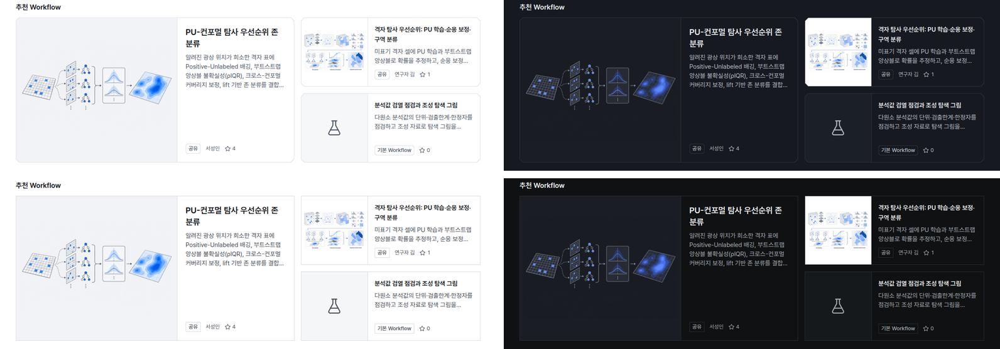
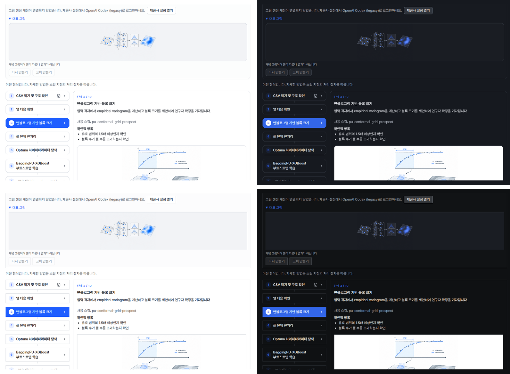

# 개념 그림을 밝은 화면용과 어두운 화면용 두 장으로 만들기

## 0. 한눈에

| | |
|---|---|
| 요청 | 흰 바탕 개념 그림이 회색 화면과 다크 모드에서 어색하므로, 조사와 목업 논의를 거쳐 설계를 바꾼다. |
| 결론 | 고른 안(테마별 두 장)을 구현했습니다. 새 그림은 회색 바탕 한 장과 그 그림을 편집한 어두운 화면용 한 장으로 만들어지고, 화면은 테마에 맞는 쪽을 같은 색의 그림 칸에 보여 줍니다. |
| 믿을 수 있는 정도 | 실제 모델로 그림 2종을 만들어 다크판이 구도와 물체를 지키는지 확인했습니다(4회 생성). 앱 화면은 그 그림으로 두 스타일과 두 테마에서 확인했습니다. 앱 안에서 버튼으로 새 그림을 만드는 과정은 실제 모델로 돌리지 않았습니다. |
| 결정할 일 | 없음 |

## 1. 요청한 것

> "gaid-design-identity--fresh 세션에서 시스템의 UI/UX디자인 개선 작업 진행중이다. 그런데 워크플로우와 관련해서 개념 그림 생성하기 기능은 바탕화면이 흰색 배경으로 개념도가 생성되는데 이 부분이 현재 gaid-design-identity--fresh에서 디자인 개선하고 있는 회색 배경과 서로 맞지 않아서 개념도 이미지가 어색한 상태이다. 또한 다크 모드로 했을 때에도 흰색 배경으로 생성되어 어색해진다. 개념 이미지 생성 기능과 관련하여 어떻게 설계하면 좋을지 관련 자료를 먼저 조사하고 사용자와 목업으로 논의하면서 진행하는 별도 작업을 진행하자." — 2026-10-22 요청

완료 기준: 조사, 목업 비교, 사용자 선택, 고른 안만 구현. 사용자 결정(2026-10-22): "1은 나로 하고 2는 가로 하자." (나: 테마별 두 장, 가: 구현 전에 실제 생성으로 확인)

## 2. 수행한 것

1. 제품 사례, 이미지 모델 기능, 벡터 대안, 접근성, 비용을 조사했습니다(ChatGPT 웹 조사).
2. 세 안(종이 판 유지, 테마별 두 장, 투명 배경 한 장)과 참고안(벡터 단계도)을 계측·도폭 스타일, 밝은·어두운 테마 목업으로 비교했고, 사용자가 테마별 두 장을 골랐습니다.
3. 사용자 승인 후 실제 모델로 그림 2종을 밝은판으로 만들고, 각각을 편집해 어두운 화면용을 만들었습니다(4회).
4. 그림을 만들 때 두 장을 만들고, 등록·편집·표시 화면이 두 장을 함께 다루도록 고쳤습니다. 예전 흰 그림에는 "화면 테마에 맞추기"를 붙였습니다.
5. 새 디자인(가이드 v2)이 main에 들어와 그 토큰 위로 합쳤고, 실제 앱에서 두 스타일과 두 테마를 확인했습니다.

## 3. 결과

그림 1. 실제 모델로 만든 개념 그림 2종. 볼 것: 어두운 화면용이 물체 수, 위치, 화살표를 그대로 두고 색만 바꿨습니다. 아래 결과 지도는 "파란 강조 하나" 지시와 달리 무지개색으로 나왔습니다(5절).

그림 2. 실제 앱의 허브 홈. 볼 것: 큰 카드의 새 그림은 두 테마 모두 그림 칸과 바탕이 이어집니다. 오른쪽 위 작은 카드는 예전 흰 그림이라 흰 판 위에 그대로 보입니다.

그림 3. 초안 화면. 볼 것: 위쪽 대표 그림은 새 그림이라 테마를 따라가고, 아래쪽 단계 그림은 예전 흰 그림이라 흰 판에 놓입니다. 예전 그림 아래에는 "화면 테마에 맞추기" 버튼이 붙습니다(캡처 범위 밖, 자동 시험으로 확인).

| 완료 기준 | 결과 | 근거 |
|---|---|---|
| 자료 조사 | 충족 | 부록 A 웹 조사 |
| 목업 비교와 사용자 선택 | 충족 | 부록 A 비교 문서 |
| 실제 생성으로 확인 | 충족 | 그림 1 |
| 고른 안 구현 | 충족 | 그림 2–3, 4절 |

## 4. 검증

- 실제 생성: 그림 2종에서 다크판이 구도, 물체, 화살표를 지켰습니다. 바탕은 가장자리 24픽셀 띠의 95%가 중앙값에서 1 이내였습니다. 밝은판은 요청한 색보다 3단계 어두운 회색으로 나와서, 그림 칸 색을 실제로 나온 값에 맞췄습니다. 어두운 화면용은 요청한 색 그대로 나왔습니다.
- 소프트웨어: 그림 생성(두 장 생성, 실패 시 밝은판 보존, 사용량 한도, 예전 그림 맞추기), 테마별 그림 전달, 허브 등록과 편집에서 두 장 유지, 화면의 그림 칸과 버튼을 자동 시험으로 확인했습니다. 저장소 전체 검사(상류 시험, GAID 시험, 배포판 시작 점검)를 main과 합친 상태에서 통과했습니다. UI 검사는 오류 0건입니다.
- 확인하지 못한 것: 앱의 버튼으로 실제 모델을 불러 새 그림을 만드는 과정, "화면 테마에 맞추기"의 실제 모델 결과. 두 경우 모두 시험에서 쓴 것과 같은 요청 방식(생성 후 편집)입니다.

## 5. 한계

- 그림 하나에 생성 한도를 2회 씁니다. 화면에 이 사실을 적었습니다.
- 어두운 화면용 편집이 그림 내용을 바꾸지 않는다는 보장은 없습니다. 시험한 2종에서는 바꾸지 않았습니다.
- 결과 지도처럼 색이 많은 그림은 모델이 색 지시를 따르지 않을 수 있습니다. 예전부터 있던 문제이고 이번 범위 밖입니다.
- 예전 흰 그림은 "화면 테마에 맞추기"를 누르기 전까지 흰 판 위에 그대로 보입니다. 자동으로 다시 만들지 않습니다.

## 6. 결정할 일

없음

## 7. 대체되었거나 실패한 시도

펼치기 — 3건

- 종이 판 유지: 바꿀 것이 없지만 다크 화면에서 밝은 판이 튀어 사용자가 고르지 않았습니다.
- 투명 배경 한 장: 다크 화면에서 어두운 선과 글씨가 묻히고, GAID 경로에서 투명 생성이 되는지도 확인되지 않아 고르지 않았습니다.
- 벡터 단계도: 그림 성격이 단순한 도식으로 바뀌고 보안 검사가 필요해 이번 범위에서 뺐습니다.

## 용어

없음

## 부록 A. 근거 위치

펼치기 — 실행 방법, 원본, 해시, 커밋

| 항목 | 위치 |
|---|---|
| 웹 조사 | Obsidian `웹 조사/geoaidesk/2026-10-22-geoaidesk-gaid-ai-gaid-hub--dc8af4523f.md` |
| 목업 비교 문서 | `pc74:~/data/geoaidesk/work/gaid-concept-pictures/compare/index.md` (검토 사본 `연구 보고서/geoaidesk/2026-10-22-compare/`) |
| 실제 생성 그림 | `pc74:~/data/geoaidesk/work/gaid-concept-pictures/trial/` (`tools/trial.mts`, 바탕색 측정 `tools/bgstat.py`) |
| 앱 화면 원본 | `pc74:~/data/geoaidesk/work/gaid-concept-pictures/app-shots/` (허브 홈, 등록 항목, 초안 × 계측·도폭 × 밝은·어두운 × 1440×900·1280×800; `tools/appshot.sh`, `tools/draftshot.sh`; 데이터 `home/`, `tools/seed.py`) |
| 전체 검사 | `task sync` 통합 커밋 d87a86f2 (`scripts/check` 통과) |
| UI 가이드 규칙 | I6(그림 픽셀 유지, 개념 그림 항목 추가), S1 토큰만 사용, 2 스타일 × 2 테마 확인 |
| 화면 문구 | `hub.visuals.source.record` 고침(한: "만들기를 누를 때만 … 해당 구독의 그림 생성 한도를 사용하며, 다른 소스는 쓰지 않습니다. …" → "요청할 때만 … 그림마다 밝은 화면용과 어두운 화면용 2장이라 구독 한도를 2회씩 쓰며, 다른 소스는 없습니다. Sign in with ChatGPT는 지원하지 않습니다."; 영: 같은 뜻으로 고침), 새 `hub.visuals.adapt`("화면 테마에 맞추기" / "Fit to screen themes"), `hub.visuals.adaptHint` |
| 코드 | 브랜치 `task/gaid-concept-pictures` |

