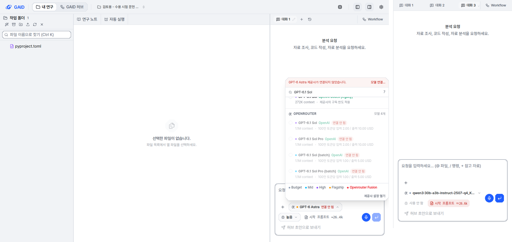
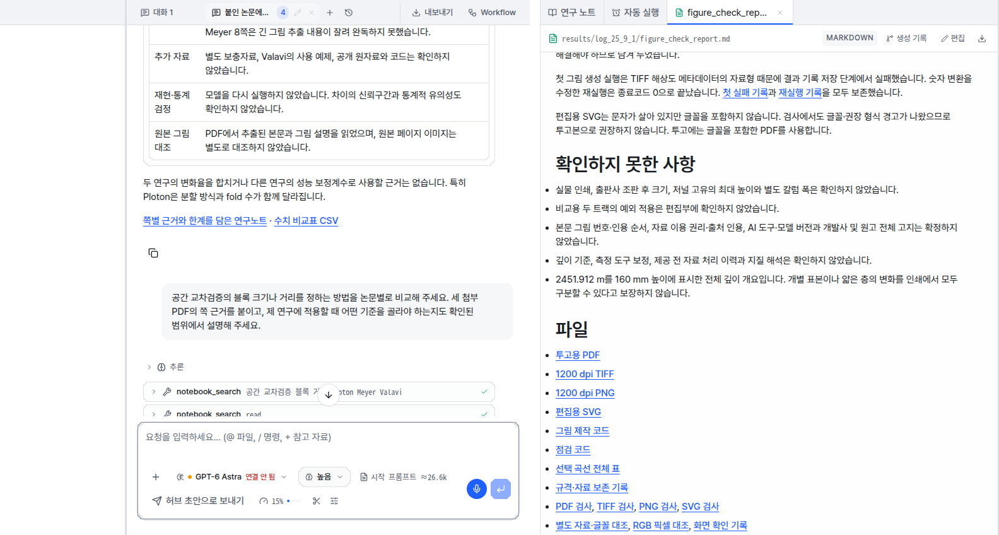
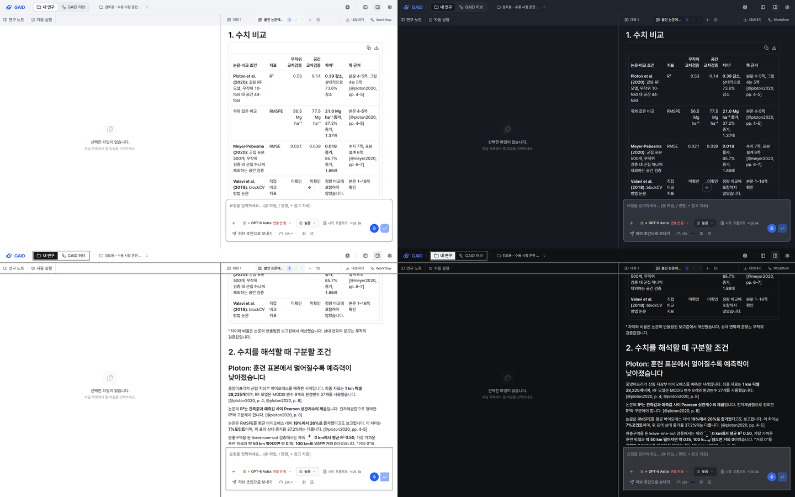
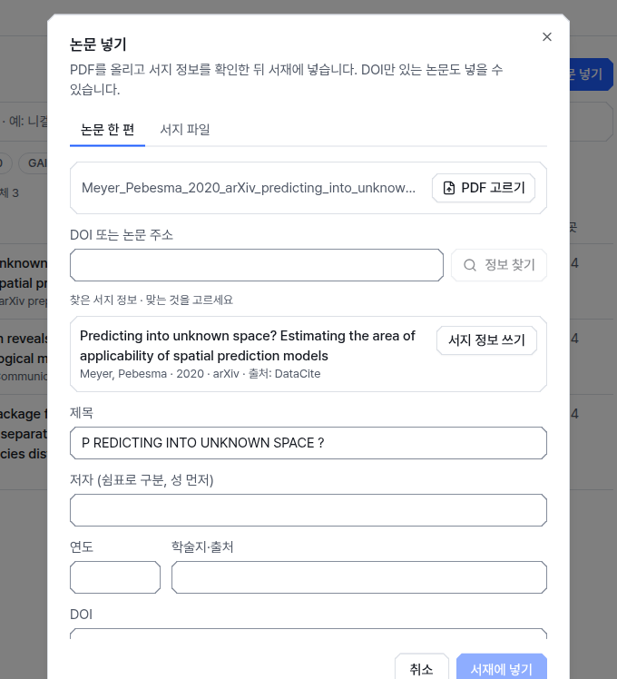
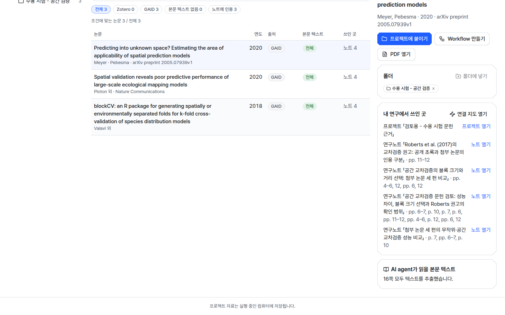
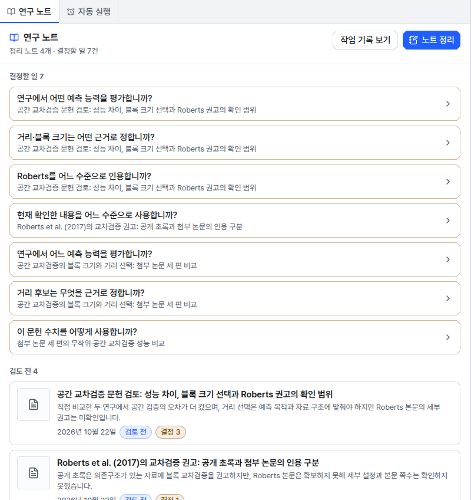
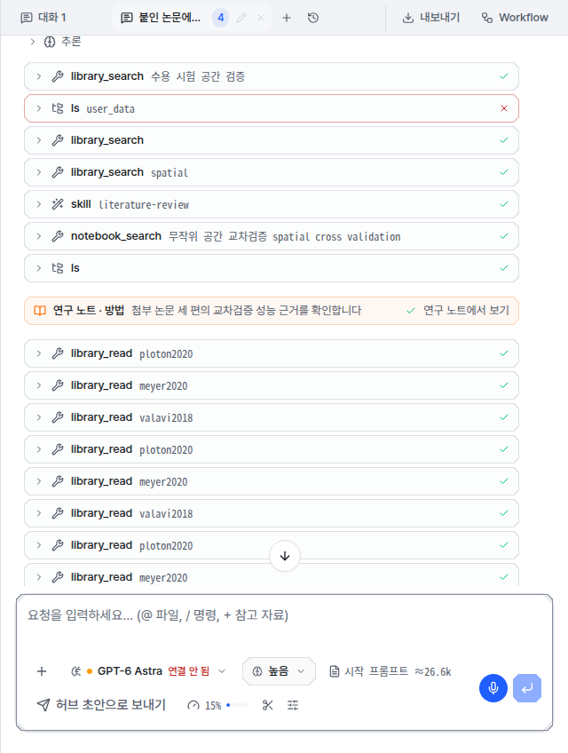

# 처음 쓰는 연구자가 막힌 화면 문제 8건 수정

## 0. 한눈에

| | |
|---|---|
| 요청 | 수용 시험 3.5절의 화면 문제 8건을 한 작업에서 고침 |
| 결론 | 8건 모두 원인을 찾아 고쳤습니다. 7건은 실제 앱 화면에서 고친 모습을 확인했습니다. 같은 이름 모델(2번)은 ChatGPT 로그인이 필요해 실제 화면 대신 시험 앱에서 받은 모델 목록으로 자동 시험만 했습니다. |
| 믿을 수 있는 정도 | 원인은 시험 기록과 앱 자료로 재현해 확인했습니다. 일본어 진행 카드(8번)는 모델이 가끔 하는 행동이라, 막는 장치를 시험으로 확인했을 뿐 실제 대화에서 다시 나오는지는 보지 않았습니다. |
| 결정할 일 | 없음 |

## 1. 요청한 것

> gaid-user-acceptance#1 가) 후속 작업 하나로 묶어 고침 — 2026-10-22 요청

완료 기준: 수용 시험 보고서 3.5절의 8건(새 대화 기본 모델 미연결, 같은 이름의 모델 두 개, "[blocked]" 링크, 채팅의 넓은 표, arXiv 서지 추천, "모두 읽음" 문구, "형식 확인 필요" 남발, 일본어 진행 카드)을 각각 재현하고, 원인을 찾아 고친 뒤 실제 앱에서 확인합니다. 화면이 바뀐 곳은 계측·도폭 두 스타일과 밝은·어두운 테마, 1440×900과 1280×800에서 찍습니다. 전체 검사가 통과해야 합니다.

## 2. 수행한 것

1. 시험 에이전트의 화면 기록과 메모, 검토용 앱에 남은 대화·노트·서재 자료를 읽기만 하면서 8건을 하나씩 재현했습니다.
2. 항목마다 원인을 코드에서 찾았습니다. 두 항목은 원인이 둘이었습니다. "[blocked]"는 채팅과 파일 미리보기에서 원인이 달랐습니다. 넓은 표는 앱의 표 모양과 AI agent가 만드는 열 수가 함께 문제였습니다.
3. 고쳤습니다. 고친 곳마다 자동 시험을 더했습니다.
4. 검토용 앱과 따로 띄운 확인용 앱에 수용 시험 프로젝트 두 개와 서재를 복사해 넣었습니다(로그인 정보와 키는 복사하지 않음). 그 앱에서 항목별 화면을 스타일·테마·크기 8가지 조합으로 찍었습니다(73장).

## 3. 결과

| 완료 기준 | 결과 | 근거 |
|---|---|---|
| 1. 새 대화 기본 모델 | 충족 | 3.1, 그림 2 |
| 2. 같은 이름의 모델 두 개 | 충족 (자동 시험으로만 확인) | 3.2 |
| 3. "[blocked]" 링크 | 충족 | 3.3, 그림 3 |
| 4. 채팅의 넓은 표 | 충족 (채팅을 넓혔을 때; 기본 폭에서는 표 안에서 가로로 넘김) | 3.4, 그림 1·8 |
| 5. arXiv 서지 추천 | 충족 | 3.5, 그림 4 |
| 6. "모두 읽음" 문구 | 충족 | 3.6, 그림 5 |
| 7. "형식 확인 필요" 남발 | 충족 | 3.7, 그림 6 |
| 8. 일본어 진행 카드 | 부분 (막는 장치는 시험함, 실제 대화 재현은 안 함) | 3.8, 그림 7 |
| 2 스타일 × 2 테마 × 2 크기 화면 | 충족 (2번 제외) | 부록 A |
| 전체 검사 | 충족 | 4절 |

### 3.1 새 대화의 기본 모델

- 전: 저장한 기본 모델이 없으면 새 대화는 앱에 들어 있는 기본값 "GPT-6 Astra"로 시작했습니다. 이 기본값은 OpenRouter를 거치는데 검토용 앱에는 OpenRouter 키가 없습니다. ChatGPT 로그인으로도 같은 GPT-6 Astra를 쓸 수 있었지만 앱이 그쪽으로 바꾸지 않았습니다. 시험 에이전트는 대화마다 모델을 직접 바꿨습니다.
- 고친 것: 아직 한 번도 보내지 않은 대화는, 고른 모델이 연결되어 있지 않으면 시작 모델을 바꿉니다. 먼저 연결된 곳에서 같은 모델을 찾고(구독 로그인을 먼저 봅니다), 없으면 연결된 대화용 모델 가운데 가장 상위 등급을 고릅니다. 순서는 구독, 개인 API 키, PC의 모델 서버입니다. 연결된 모델이 하나도 없으면 지금처럼 "모델 연결" 안내가 나옵니다. 연구자가 모델 표시를 직접 바꾼 대화와 이미 보낸 대화는 바꾸지 않습니다.
- 확인: 확인용 앱에는 PC의 Ollama만 연결되어 있습니다. 새 프로젝트의 첫 대화와 새로 연 대화 모두 "연결 안 됨" 없이 Ollama 모델로 시작했습니다(그림 2 오른쪽). 검토용 앱의 모델 목록(ChatGPT 로그인 + 이전 Codex 로그인 + MiniMax 키)을 넣은 자동 시험에서는 기본값이 ChatGPT 로그인의 GPT-6 Astra로 바뀌었습니다.

그림 2. 왼쪽은 수용 시험의 새 대화(기본 모델 "GPT-6 Astra 연결 안 됨"), 오른쪽은 고친 뒤 확인용 앱의 새 대화. 볼 것: 오른쪽 입력창의 모델 표시에 "연결 안 됨"이 없는지.

### 3.2 같은 이름의 모델 두 개

- 전: ChatGPT 로그인과 이전 "OpenAI Codex (legacy)" 로그인이 둘 다 연결되어 있으면, 이전 로그인의 모델 9개가 모두 새 로그인 목록에 같은 이름으로 한 번 더 나왔습니다.
- 고친 것: 새 ChatGPT 로그인이 같은 모델을 제공하면 모델 선택 창에서 이전 로그인 줄을 숨깁니다. 이전 로그인에만 있는 모델은 그대로 보입니다. 이미 이전 로그인 모델로 고른 대화는 그 줄을 계속 보여 줍니다. 설정의 제공사 목록과 이전 로그인 자체(개념 그림 생성에 씀)는 바꾸지 않았습니다.
- 확인: 검토용 앱에서 받은 모델 목록으로 자동 시험만 했습니다. 확인용 앱에는 ChatGPT 로그인 정보를 복사하지 않았습니다. 로그인 토큰을 두 앱이 함께 쓰면 갱신 과정에서 검토용 앱의 로그인이 풀릴 수 있기 때문입니다.

### 3.3 "[blocked]" 링크

원인이 둘이었습니다.

- 채팅: AI agent가 답을 쓰는 동안 링크가 아직 닫히지 않으면, 화면이 그 링크를 임시 주소로 바꿉니다. 이 임시 주소를 안전 검사가 지워 "[blocked]"와 "Blocked URL: undefined"가 나왔습니다. 답이 끝나면 링크가 정상으로 돌아옵니다. 시험 에이전트는 쓰는 도중의 모습을 보았습니다. 이제 주소가 없는 링크는 글자만 보입니다.
- 파일 미리보기: 보고서 파일 안의 링크(예: 보고서 폴더에서 두 단계 위의 그림 파일)를 프로젝트 폴더 기준으로 풀어서, 프로젝트 밖을 가리키는 것으로 보고 지웠습니다. 이제 링크를 그 파일이 있는 폴더 기준으로 풉니다. 프로젝트 폴더 밖으로 나가는 링크는 지금처럼 막습니다. 링크를 누르면 브라우저 새 탭 대신 파일 패널에서 열립니다.
- 함께 고친 결함: 채팅 화면의 처리기가 처음 만든 프로젝트 기준을 다시 쓰는 문제가 있었습니다. 한 화면에서 다른 프로젝트나 다른 폴더의 문서를 보면 링크가 처음 프로젝트를 가리킬 수 있었습니다. 시험 중에 발견했고, 프로젝트와 폴더가 바뀌면 처리기를 새로 만들게 고쳤습니다.
- 확인: 수용 시험 대화와 그림 보고서에서 "[blocked]"가 0건이었습니다(8가지 조합 모두). 보고서의 "투고용 PDF"를 누르니 파일 패널에 그 PDF가 열렸습니다.

그림 3. 왼쪽은 수용 시험 대화의 끝 문단, 오른쪽은 그림 점검 보고서의 파일 목록. 볼 것: 연구노트·결과 파일 링크가 "[blocked]" 없이 밑줄 링크로 보이는지.

### 3.4 채팅의 넓은 표

- 전: 표 머리글이 줄바꿈되지 않았고 칸 좌우 여백이 컸습니다. 6열 표가 채팅 폭을 넘어 오른쪽 "쪽 근거" 열이 가려졌습니다. 시험 에이전트가 채팅을 최대로 넓혀도 가로로 넘겨야 보였습니다.
- 고친 것: 머리글이 줄바꿈되고 여백을 줄였습니다. 단어는 쪼개지 않습니다. 그래도 넘치는 표는 UI 지침(X2)대로 표 영역 안에서 가로로 넘깁니다. AI agent의 답변 규칙에 "채팅 표는 다섯 열까지(채팅 칸이 좁음)"를 더했습니다.
- 확인: 수용 시험 대화의 표 6개는 채팅을 최대로 넓혔을 때(표 영역 538 px) 8가지 조합 모두 넘치지 않았습니다(그림 1, 그림 8). 채팅을 넓히지 않은 기본 폭(표 영역 348 px)에서는 6열 표가 여전히 가로로 넘어갑니다. 단어를 쪼개지 않고는 그 폭에 6열을 담을 수 없습니다.

그림 1. 왼쪽은 수용 시험 화면(채팅을 넓힌 상태), 오른쪽은 고친 뒤 같은 표(채팅을 넓힌 상태). 볼 것: 오른쪽 끝 "쪽 근거" 열이 가로로 넘기지 않아도 보이는지.

그림 8. 같은 표를 계측 밝게(왼쪽 위), 계측 어둡게(오른쪽 위), 도폭 밝게(왼쪽 아래), 도폭 어둡게(오른쪽 아래)로 찍은 것(1440×900). 볼 것: 네 화면 모두 "쪽 근거" 열이 보이는지.

### 3.5 arXiv 서지 추천

- 전: 앱은 arXiv PDF에서 arXiv 번호(2005.07939)를 찾았지만 서지 조회에 쓰지 않았습니다. 첫 쪽에서 잘못 읽은 제목("P REDICTING INTO UNKNOWN SPACE ?")으로 검색해 다른 논문 다섯 편을 추천했습니다.
- 고친 것: PDF에 DOI가 없고 arXiv 번호가 있으면 arXiv가 등록한 DOI로 조회합니다. arXiv DOI는 Crossref에 없고 DataCite에 있습니다. 그래서 서지 조회에 DataCite를 더하고 arXiv DOI는 DataCite에 먼저 묻습니다. OpenAlex는 이 DOI를 나중에 학술지에 실린 판(다른 DOI)으로 돌려주므로, 그 결과를 이 PDF의 서지로 추천하지 않습니다. 결과는 프리프린트로 기록합니다. Crossref·OpenAlex에 없는 다른 DOI(자료 저장소 등)도 마지막에 DataCite에 묻습니다.
- 확인: 확인용 앱에서 같은 Meyer·Pebesma PDF를 넣으니 추천이 하나였고 맞는 논문이었습니다(제목, 저자 두 명, 2020, arXiv, 출처 DataCite). 8가지 조합에서 같았습니다.

그림 4. 고친 뒤 논문 넣기 창에 arXiv PDF를 올린 화면. 볼 것: "찾은 서지 정보"가 Meyer·Pebesma 2020 한 편이고 출처가 DataCite인지. 아래 제목 칸에는 PDF 첫 쪽에서 읽은 제목이 그대로 있습니다. "서지 정보 쓰기"를 누르면 바뀝니다.

### 3.6 "모두 읽음" 문구

- 전: 서재 상세의 "본문 11쪽 모두 읽음"은 앱이 PDF에서 글자를 뽑았다는 뜻인데, 연구자가 읽었다는 뜻으로 읽혔습니다. 목록 열 이름("읽은 범위"), 걸러 보기("읽지 않음"), 단추("본문 읽기")도 같은 말을 썼습니다.
- 고친 것: 이 계열 문구를 "본문 텍스트 추출"로 바꿨습니다. 상세 제목은 "AI agent가 읽을 본문 텍스트"로 무엇에 쓰는지 밝힙니다.

| 문자열 id | 전 (한국어 / 영어) | 후 (한국어 / 영어) |
|---|---|---|
| `library.detail.readTitle` | 읽은 범위 / What was read | AI agent가 읽을 본문 텍스트 / Full text the AI agent reads |
| `library.detail.readFull` | 본문 {pages}쪽 모두 읽음 / All {pages} pages read | {pages}쪽 모두 텍스트를 추출했습니다. / Text extracted from all {pages} pages. |
| `library.detail.readPartial` | {total}쪽 가운데 {read}쪽 읽음 · 읽지 못한 쪽 {pages} / {read} of {total} pages read · not readable: {pages} | {total}쪽 가운데 {read}쪽 텍스트를 추출했습니다. 추출하지 못한 쪽: {pages} / Text extracted from {read} of {total} pages. Not extracted: {pages} |
| `library.detail.readNone` | 읽은 본문이 없습니다. / No text has been read. | 추출한 본문 텍스트가 없습니다. / No full text has been extracted. |
| `library.table.read` | 읽은 범위 / Read | 본문 텍스트 / Full text |
| `library.coverage.full` | 본문 / Full text | 전체 / All pages |
| `library.coverage.fullHint` | PDF의 모든 쪽을 읽었습니다. / Every page of the PDF was read. | PDF의 모든 쪽에서 텍스트를 추출했습니다. AI agent는 추출한 텍스트로 논문을 읽고 인용합니다. / Text was extracted from every page of the PDF. The AI agent reads and cites the paper from this text. |
| `library.coverage.partialHint` | 글자를 읽지 못한 쪽이 있습니다. … / Some pages had no readable text: … | 텍스트를 추출하지 못한 쪽이 있습니다. … / Text could not be extracted from some pages: … |
| `library.coverage.abstractHint` | 초록과 서지 정보만 읽었습니다. / Only the abstract and reference details were read. | 초록과 서지 정보만 있습니다. 본문 텍스트는 없습니다. / Only the abstract and reference details are available. There is no full text. |
| `library.coverage.noneHint` | 읽을 수 있는 PDF가 없습니다. PDF를 넣으면 본문을 읽습니다. / There is no readable PDF. … | 텍스트를 추출할 PDF가 없습니다. PDF를 넣으면 본문 텍스트를 추출합니다. / There is no PDF to extract text from. Add the PDF and GAID extracts its full text. |
| `library.filter.unread` | 읽지 않음 {n} / Not read {n} | 본문 텍스트 없음 {n} / No full text {n} |
| `library.side.unread`, `library.folder.issue.unread` | 본문을 읽지 못한 논문 {n}편 / {n} papers without read full text, Full text not read: {n} | 본문 텍스트가 없는 논문 {n}편 / {n} papers without full text, Without full text: {n} |
| `library.read.button`, `.done`, `.failed` | 본문 읽기 / 본문을 읽었습니다 / PDF를 읽지 못했습니다. | 본문 텍스트 추출 / 본문 텍스트를 추출했습니다 / PDF에서 텍스트를 추출하지 못했습니다. |
| `library.dialog.notes.pdf-no-text` | PDF에서 글자를 읽지 못했습니다. … / No text could be read from the PDF. … | PDF에서 텍스트를 추출하지 못했습니다. … / Could not extract text from the PDF. … |

그림 5. 고친 뒤 서재 상세(계측 밝게, 1440×900). 볼 것: 목록의 "본문 텍스트 · 전체" 열과 오른쪽 아래 "AI agent가 읽을 본문 텍스트 · 16쪽 모두 텍스트를 추출했습니다."

### 3.7 "형식 확인 필요"

- 전: AI agent가 쓴 노트 네 개가 모두 "형식 확인 필요"였습니다. 노트에는 빠진 항목이 없었습니다. AI agent는 대표 그림이 없다는 뜻으로 `cover: null`을 썼는데, 앱이 "null"을 그림 파일 이름으로 읽고 그 파일이 없다고 판정했습니다. 대체 노트 칸의 null도 "null"이라는 노트를 가리키는 것으로 읽었습니다.
- 고친 것: 노트 머리말의 빈 값(null, ~)을 값이 없는 것으로 읽습니다. 따옴표로 쓴 "null"은 글자 그대로 둡니다.
- 확인: 수용 시험 노트 4개와 그림 노트 1개에서 판정할 문제가 0건이었고, 연구 노트 목록에 "형식 확인 필요"가 없었습니다(8가지 조합).

그림 6. 고친 뒤 수용 시험 프로젝트의 연구 노트 목록. 볼 것: 노트 줄에 "검토 전"과 "결정 N"만 있고 "형식 확인 필요"가 없는지.

### 3.8 일본어 진행 카드

- 전: 진행 카드는 AI agent가 연구 기록(notebook)에 남긴 항목의 제목입니다. 한국어 요청인데 GPT-6.1 Sol이 가끔 일본어 제목을 썼습니다(예: "報告値から差と比率を計算します"). 지시문에는 이미 "기록도 요청한 언어로 쓴다"가 있었습니다. 카드의 종류 이름도 한국어 화면에서 "Method"처럼 영어였습니다.
- 고친 것: 최근 요청이 한국어이고 기록의 제목이나 본문이 한국어 없이 일본어 가나로만 되어 있으면, 앱이 그 기록을 저장하지 않고 "한국어로 다시 쓰라"는 이유를 AI agent에게 돌려줍니다. AI agent는 같은 기록을 한국어로 다시 씁니다. 한국어 문장 안에 일본어 이름을 인용한 경우, 영어 제목, 한국어가 아닌 요청은 그대로 둡니다. 카드 종류 이름은 "방법·관찰·가설·결정·메모"로 보입니다.
- 확인: 자동 시험으로 막는 경우와 통과하는 경우를 확인했습니다. 실제 대화에서 일본어 제목이 다시 나오는지는 확인하지 않았습니다. 확인용 앱에는 GPT-6.1 Sol이 연결되어 있지 않고, 원래 현상도 가끔만 나왔습니다. 수용 시험 대화를 다시 열면 지난 일본어 제목은 그대로 보입니다. 종류 이름은 "연구 노트 · 방법"으로 바뀌었습니다(그림 7).

그림 7. 고친 뒤 수용 시험 대화의 진행 카드. 볼 것: 카드 앞부분이 "연구 노트 · 방법"인지.

## 4. 검증

- 과학적 검증: 해당 없음(화면과 서지 조회 수정). arXiv 서지는 PDF 첫 쪽의 제목·저자·연도와 DataCite 결과를 대조했고 일치했습니다.
- 소프트웨어 검증
  - 자동 시험을 더했습니다. 쓰는 중인 링크, 파일 폴더 기준 링크와 프로젝트 밖 링크 거부, 노트 머리말의 null, arXiv 번호 → DataCite 조회와 OpenAlex의 다른 DOI 거부, 기록 언어 검사, 시작 모델 선택과 이전 로그인 줄 숨김을 다룹니다.
  - 전체 검사(scripts/check)가 통과했습니다. 서버 시험 2,209개, 웹 시험 1,212개, GAID 검사 58개, 문구 검사(오류 0), 화면 규칙 검사(오류 0), 분석 환경·실행 스크립트·제품 빌드 확인을 포함합니다. 첫 실행은 수정 기록 검사에서 이번 작업 이름이 허용 목록에 없어 실패했고, 이름을 더한 뒤 다시 돌려 통과했습니다.
  - 실제 앱: 검토용 앱과 따로 띄운 확인용 앱에서 7개 항목을 8가지 조합으로 찍고 화면 글자로 확인했습니다(표 넘침 0, "[blocked]" 0, "형식 확인 필요" 0, arXiv 추천 1건이 정답).
  - 문구 검사기 경고 수는 수정 전과 같습니다(64건, 모두 기존 다른 화면).
  - UI 지침: 넓은 표는 X2(영역 안에서 가로로 넘김)와 D1(모달을 만들지 않음)을 따랐습니다. 진행 카드의 영어 종류 이름을 없애 R1(한국어 화면의 영어 enum 값)을 지켰습니다. 진행 카드의 기존 주황색 고정 색은 이번에 손대지 않았습니다(V1 기존 부채).

## 5. 한계

- 같은 이름 모델(2번)은 실제 화면에서 보지 않았습니다. 검토용 앱에 반영된 뒤 모델 목록을 한 번 열어 보면 확인됩니다.
- 기본 모델(1번)은 실제 앱에서 PC 모델 서버만 연결된 경우를 확인했습니다. ChatGPT 로그인으로 바뀌는 경우는 자동 시험으로만 확인했습니다.
- 기록에서 다시 연 대화는 이번에 바꾸지 않았습니다. 이런 대화는 원래 쓴 모델을 다시 불러오지 않고 새 대화의 기본값을 보여 주므로, 검토용 앱에서는 여전히 "GPT-6 Astra 연결 안 됨"으로 보일 수 있습니다. 시험 에이전트가 지적한 문제는 아니지만 같은 종류의 불편입니다.
- 넓은 표는 채팅을 넓혔을 때 맞습니다. 기본 폭에서 6열 표는 여전히 표 안에서 가로로 넘깁니다. 답변 규칙으로 다섯 열 이하를 권하지만 AI agent가 지키는지는 확인하지 않았습니다.
- 일본어 기록 검사는 한국어 요청과 일본어 가나만 다룹니다. 다른 언어가 섞이는 경우는 다루지 않습니다.
- 수용 시험 대화에 이미 남은 일본어 제목은 바뀌지 않습니다.

## 6. 결정할 일

없음

사용자 확인(결정 아님): 검토용 앱이 이 수정으로 갱신된 뒤 모델 선택 창에서 GPT-6.1 Sol 같은 모델이 한 번씩만 보이는지 봐 주십시오(3.2절). 이 일은 남은 항목으로 기록합니다.

## 7. 대체되었거나 실패한 시도

펼치기 — 2건

- 넓은 표에서 긴 단어를 아무 데서나 쪼개게 하면 기본 폭에도 6열이 들어갔지만 "Pebes ma"처럼 이름이 잘려 읽기 어려워 쓰지 않았습니다. 넓은 표를 대화상자로 크게 보는 방법도 검토했지만, UI 지침(D1: 꼭 필요할 때만 모달, X2: 넓은 표는 영역 안에서 넘김)에 맞지 않아 만들지 않았습니다.
- 확인용 앱 자동화에서 파일 선택 창이 여러 개 쌓여 첫 arXiv 촬영이 멈췄습니다. 파일 입력란에 직접 넣는 방식으로 다시 찍었습니다. 앱과 관계없는 촬영 도구 문제입니다.

## 용어

없음

## 부록 A. 근거 위치

펼치기 — 실행 방법, 원본, 해시, 커밋

| 항목 | 위치 |
|---|---|
| 수정 전 근거 | `reports/2026-10-22-gaid-user-acceptance/index.md` §3.5; `pc74:~/data/geoaidesk/work/gaid-user-acceptance/tester/` (notes.md, screens/05·38·42·44) |
| 원인 (항목 1) | 수용 시험 세션 첫 줄의 `model_change` = `openrouter/openai/gpt-6-astra`; 검토용 앱 `config.env`의 `DEFAULT_MODEL_PROVIDER=openrouter`, `DEFAULT_MODEL_ID=openai/gpt-6-astra`, OpenRouter 미설정; `/model-providers/models`에 `openai/gpt-6-astra` 있음 |
| 원인 (항목 3) | Streamdown `streamdown:incomplete-link` → rehype-sanitize가 href 제거 → rehype-harden "[blocked]"; 파일 미리보기는 `sandboxMarkdownPath`가 `../../figures/…`를 거부; Streamdown 처리기 캐시 키는 플러그인 이름 + 옵션 |
| 원인 (항목 5) | `identifyPdf` → `arxivIds: ["2005.07939v1"]`, `doiCandidates: []`; OpenAlex `doi:10.48550/arxiv.2005.07939` → `10.1111/2041-210x.13650` |
| 원인 (항목 7) | `server/src/geo/notes/store.ts` `image-missing` (target "null") |
| 코드 | `web/src/lib/sandbox-markdown.ts`, `web/src/components/ai-elements/message.tsx`, `web/src/components/file-preview-panel.tsx`, `web/src/geo/models/start-model.ts`, `web/src/components/chat-tab.tsx`, `web/src/components/model-selector.tsx`, `web/src/components/tool-activity.tsx`, `server/src/geo/notes/parser.ts`, `server/src/geo/library/metadata/{client,mapping,identifiers}.ts`, `server/src/geo/routes/library.ts`, `server/src/geo/entry-language.ts`, `server/src/geo/session.ts`, `server/src/geo/instructions.ts`, 서재 문구 `web/src/geo/locales/library/{ko,en}.json`; seam 기록 `geo/integration-boundaries.json` |
| 시험 | `web/src/components/ai-elements/message-links.test.tsx`, `web/src/geo/models/start-model.test.ts`, `server/test/geo-notes.test.ts`, `server/test/geo-library-metadata.test.ts`, `server/test/geo-entry-language.test.ts` |
| 확인용 앱 | `start-gaid.sh`, `GAID_HOME=pc74:~/data/geoaidesk/work/gaid-first-use-fixes/home` (수용 시험 프로젝트 `proj-ca300f`, `proj-bc576f`와 서재를 복사, 인증·키 파일 제외), 포트 3310/18310, 로그 `…/logs/launcher.log` |
| 화면 73장 | `pc74:~/data/geoaidesk/work/gaid-first-use-fixes/shots/`: `item1-new-chat-*`, `item348-chat-{table,link,chip}-*`, `item3-report-links-*`, `item5-arxiv-*`, `item6-library{,-read}-*`, `item7-notes-*` × {instrument,mapsheet} × {light,dark} × {1440,1280}; 촬영 스크립트 `…/bin/` |
| 전체 검사 | `scripts/check`, 로그 `pc74:~/data/geoaidesk/work/gaid-first-use-fixes/logs/check2.log` (첫 실행 `check.log`: `geo/tests/distribution.test.mjs` seam 소유자 목록 1건 실패) |

작성 시점: 2026-10-22, commit d0f6e67f (task 브랜치 중간 저장).

