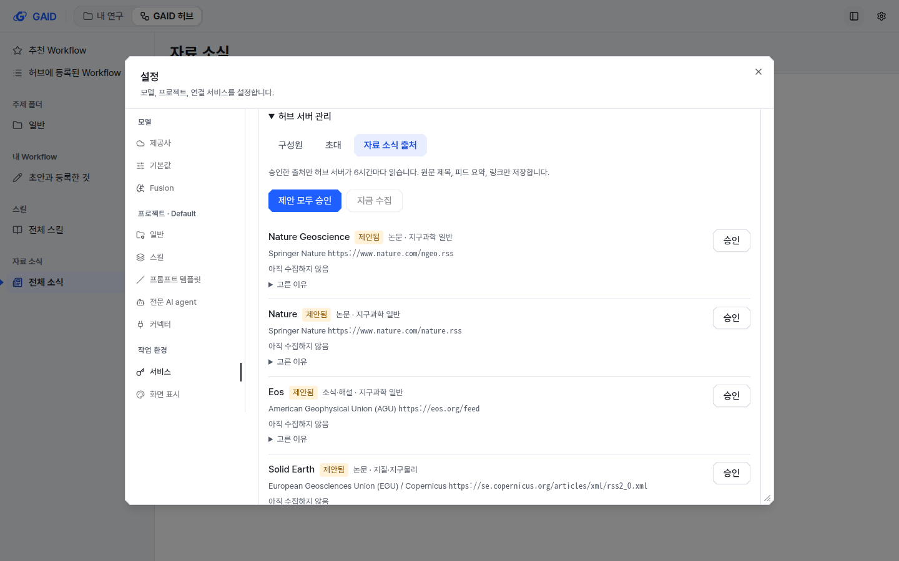
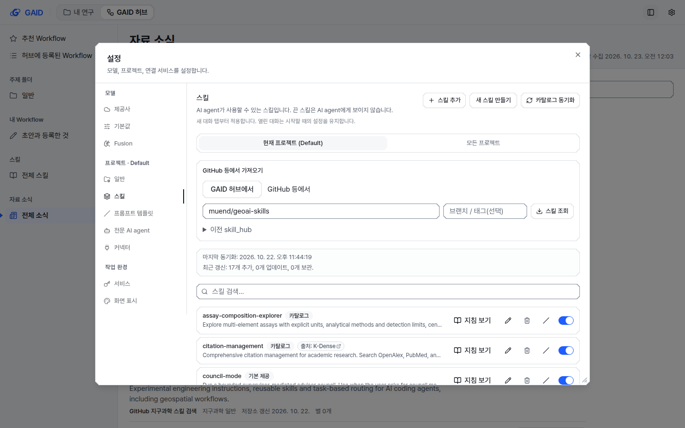
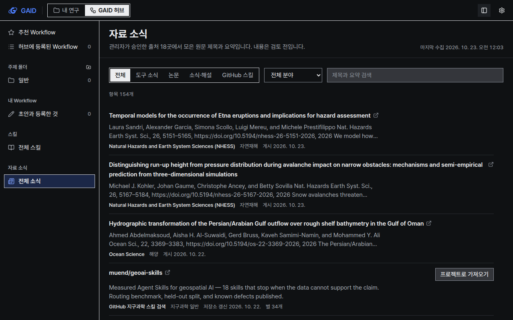
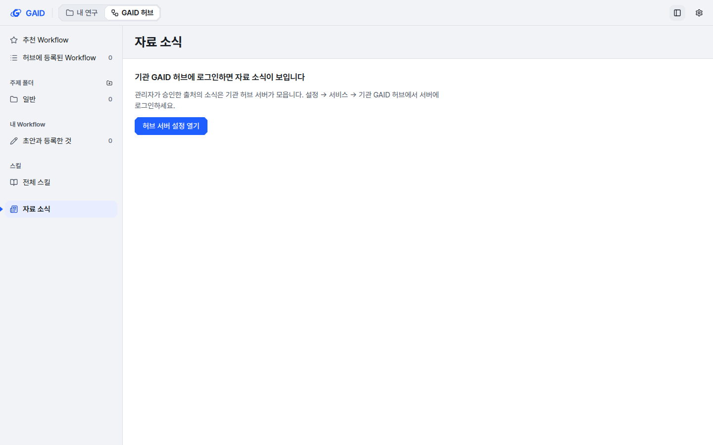

# GAID 허브 자료 소식: 관리자가 승인한 출처의 논문·도구·스킬 소식

## 0. 한눈에

| | |
|---|---|
| 요청 | GAID 허브에 GeekNews와 GitHub의 상위 도구 소식, 지구과학 관련 스킬, Nature 논문, 권위 있는 블로그 글을 모아 보여 주는 기능을 만듭니다. 출처는 관리자가 승인하고, 원문 제목과 피드 요약만 보이며, 첫 출처 목록은 지구과학 분야별로 10곳을 고릅니다. |
| 결론 | GAID 허브에 "자료 소식"이 생겼습니다. 기관 허브 서버는 관리자가 승인한 출처만 정해진 간격으로 읽습니다. 출처 18곳(지구과학 10곳, 도구 소식 7곳, GitHub 스킬 검색 1곳)을 PC74에서 모두 수집했습니다. |
| 믿을 수 있는 정도 | 자동 시험, GAID와 실제 허브 서버를 잇는 종단 시험, 외부 피드 18곳 실제 수집, 브라우저 화면 확인을 거쳤습니다. 시험 운영 중인 기관 허브 서버는 아직 갱신하지 않았습니다. |
| 결정할 일 | 1건 (6절) |

## 1. 요청한 것

> 사용자는 GAID 허브와 관련해서 이제 스킬 정보 제공 시스템을 추가해두고 싶다. Geeknews나 github에서 상위 도구들에 대한 정보를 제공하고, geoscience와 관련되어 유용한 스킬이나 nature지에 등재된 정보나 권위있는 blog 정보들을 제공해주는 기능을 만들고 싶다. 가능할까? — 2026-10-22 요청

> 1번 관리자 승인방식, 원문제목과 피드요약만, 첫목록도 권장하는 각 지구과학 분야로 10개를 스스로 선정하여라. 따로 먼저하자. opus 5.5 high fast writer로 진행하자. — 2026-10-22 결정

완료 기준: 관리자가 승인한 출처만 읽고, 연구자는 GAID 허브에서 원문 제목, 피드 요약, 원문 링크를 봅니다. 모델 호출과 본문 복사는 없습니다. 첫 출처 목록에는 지구과학 분야별 10곳과 GeekNews, GitHub 출처가 들어갑니다. 저장소 검사가 통과합니다.

## 2. 수행한 것

1. 출처 18곳을 골라 PC74에서 모두 열리는지 확인했습니다(아래 표).
2. 기관 허브 서버가 승인된 출처를 6시간마다 읽어 원문 제목, 피드 요약(최대 400자), 링크만 저장하게 했습니다. 승인 전 출처는 읽지 않습니다.
3. 관리자는 설정 → 기관 GAID 허브 → 허브 서버 관리 → "자료 소식 출처"에서 제안 출처를 승인하거나 멈추고, 새 출처를 더하고, 바로 수집할 수 있습니다. 서버 명령줄로도 같은 일을 할 수 있습니다.
4. GAID 허브 사이드바에 "자료 소식"을 더했습니다. 분류(도구 소식, 논문, 소식·해설, GitHub 스킬), 분야, 검색어로 거르고, 제목을 누르면 원문이 새 탭에서 열립니다. GitHub 스킬 항목은 고른 프로젝트의 설정 → 스킬에 저장소 이름을 채워 넘깁니다. 실제 설치는 기존 미리 보기와 동의 절차를 거칩니다.
5. 허브 서버에 로그인하지 않은 GAID는 항목을 보여 주지 않고, 허브 서버에 연결하는 방법을 안내합니다. 관리자 승인 방식에서는 승인한 사람이 있어야 하는데, 각 PC가 직접 읽으면 아무도 승인하지 않은 출처를 읽게 되기 때문입니다.

고른 출처:

| 분야 | 출처 | 종류 | 고른 이유 |
|---|---|---|---|
| 지구과학 일반 | Nature Geoscience | 논문 | 지구과학 전 분야를 다루는 Nature 계열 학술지 |
| 지구과학 일반 | Nature | 논문 | 요청에서 지정. 지구과학 관련 단어가 제목·요약에 있는 글만 남김 |
| 지구과학 일반 | Eos (AGU) | 소식·해설 | AGU의 지구·우주과학 소식지 |
| 지질·지구물리 | Solid Earth (EGU) | 논문 | 지질, 구조지질, 지구물리 공개 접근 학술지 |
| 수문 | HESS (EGU) | 논문 | 수문학 대표 공개 접근 학술지 |
| 자연재해 | NHESS (EGU) | 논문 | 자연재해 대표 공개 접근 학술지 |
| 해양 | Ocean Science (EGU) | 논문 | 물리·화학 해양학 학술지 |
| 기후·대기 | Carbon Brief | 소식·해설 | 기후과학 연구와 정책을 해설하는 전문 매체 |
| 원격탐사 | NASA Earth Observatory | 소식·해설 | 위성 영상으로 지표 변화와 재해를 설명하는 NASA 글 |
| 광물·에너지 자원 | Ore Geology Reviews | 논문 | 광상학·광물자원 탐사 학술지(피드에 초록 없음) |
| AI 도구 | GeekNews | 도구 소식 | 요청에서 지정. AI 에이전트·코딩 도구·스킬·지리공간 관련 글만 남김 |
| AI 도구 | Pi, pi-subagents, pi-web-access, skills CLI, Claude Code, Codex CLI | 도구 소식 | GAID가 쓰거나 Workflow를 내보내는 도구의 정식 릴리스 |
| 지구과학 일반 | GitHub 지구과학 스킬 검색 | GitHub 스킬 | agent-skills 저장소 가운데 지리공간·GIS·지질·지구과학으로 찾은 것 |

검토했지만 넣지 않은 출처: EGU Blogs(피드가 거의 비어 있음), Geoscientific Model Development, Communications Earth & Environment, USGS 주요 지진 목록(읽을거리보다 자료). 관리자가 나중에 더할 수 있습니다.

## 3. 결과

그림 1. 관리자가 18곳을 승인하고 수집한 뒤의 자료 소식 화면(계측 스타일, 밝은 테마, 1440×900). 볼 것: 머리말에 "내용은 검토 전입니다"가 있고, 항목마다 원문 제목(링크), 피드 요약, 출처, 분야, 게시일이 있습니다. GitHub 스킬 항목에는 "프로젝트로 가져오기"가 있습니다.

그림 2. 승인 전 관리자 화면. 볼 것: 제안 출처가 모두 "제안됨"이고, "제안 모두 승인"과 출처별 "승인"이 있습니다. 승인 전에는 아무 출처도 읽지 않습니다.

그림 3. GitHub 스킬 항목에서 "설정에서 가져오기"를 누른 뒤의 설정 → 스킬. 볼 것: GitHub 가져오기 칸에 저장소 이름이 채워져 있습니다. 설치는 연구자가 "스킬 조회"로 미리 보고 동의한 뒤에만 진행됩니다.

그림 4. 같은 화면의 도폭 스타일, 어두운 테마, 1280×800. 볼 것: 선택한 분류와 사이드바 항목이 잉크 테두리로 표시되고, 첫 화면에서 필터와 목록이 보입니다.

그림 5. 허브 서버에 로그인하지 않은 GAID의 자료 소식. 볼 것: 항목 대신 연결 방법과 "허브 서버 설정 열기" 버튼이 있습니다.

PC74에서 출처 18곳을 승인하고 한 번 수집한 결과입니다(2026-10-23 00:03 KST, 약 21초 걸림).

| 출처 | 가져온 항목 | 출처 | 가져온 항목 |
|---|---|---|---|
| Nature Geoscience | 8 | Ore Geology Reviews | 100 |
| Nature (지구과학 글만) | 6 | GeekNews (해당 글만) | 8 |
| Eos | 15 | Pi | 1 |
| Solid Earth | 20 | pi-subagents | 10 |
| HESS | 20 | pi-web-access | 10 |
| NHESS | 20 | skills CLI | 10 |
| Ocean Science | 20 | Claude Code | 10 |
| Carbon Brief | 12 | Codex CLI | 1 |
| NASA Earth Observatory | 10 | GitHub 지구과학 스킬 검색 | 36 |

필터 없는 첫 목록은 출처마다 최대 10건씩, 날짜순으로 154건을 보여 줍니다. 분류나 분야를 고르면 해당 항목을 모두 보여 줍니다(최대 300건).

| 완료 기준 | 결과 | 근거 |
|---|---|---|
| 관리자가 승인한 출처만 읽음 | 충족 | 그림 2, 4절 |
| 원문 제목, 피드 요약, 링크만 보임. 모델 호출과 본문 복사 없음 | 충족 | 그림 1, 4절 |
| 지구과학 분야별 10곳과 GeekNews, GitHub 출처를 고르고 PC74에서 수집 확인 | 충족 | 2절 표, 3절 표 |
| GitHub 스킬은 기존 설치 절차로만 들어감 | 충족 | 그림 3 |
| 허브 서버가 없을 때 보이는 것을 정함 | 충족 | 그림 5, 2절 5단계 |
| 저장소 검사 통과 | 충족 | 4절, 부록 A |

## 4. 검증

- 과학적 검증: 해당 없음. 이 기능은 출처의 글을 고르거나 평가하지 않고 원문 제목과 피드 요약을 그대로 보여 줍니다. 화면에 "검토 전"이라고 적었습니다.
- 소프트웨어 검증:
  - 허브 서버 자동 시험: 피드 형식 세 가지(RSS 2.0, RSS 1.0, Atom)를 실제 피드 모양으로 해석하고, 본문(`content:encoded`)은 쓰지 않습니다. 응답 크기·시간·이동 횟수 한도, 단어 거르기, 승인·멈춤·추가·삭제, 구성원의 관리 기능 거절, 이전 버전 허브 데이터의 갱신, 날짜 없는 글의 정렬을 확인했습니다.
  - GAID와 실제 허브 서버를 HTTP로 잇는 종단 시험: 로그인 전에는 빈 목록이 옵니다. 제안 상태 출처는 수집하지 않고, 승인 뒤에만 수집합니다. 구성원 계정은 목록만 읽고 관리 기능은 거절됩니다. 멈춘 출처는 목록에서 사라집니다. 본문 문자열은 응답에 들어가지 않습니다.
  - 화면 시험: 링크가 새 탭에서 열리고, 필터가 서버 조회로 이어집니다. GitHub 스킬은 설치하지 않고 설정으로만 넘깁니다. 로그인 전 안내와 오류 안내, 관리자 승인 화면도 시험했습니다.
  - 실제 외부 수집: PC74에서 18곳 모두 성공했습니다(3절 표).
  - 브라우저 확인: 한국어 화면을 계측·도폭 두 스타일, 밝은·어두운 두 테마, 1440×900·1280×800 두 크기로 찍어 UI 지침 12절 목록과 대조했습니다. 첫 화면에서 필터와 목록이 보이고, 파란색은 선택과 주 동작에만 쓰였습니다.
  - 저장소 검사(`scripts/check`): 통과했습니다. 백엔드 시험 2,233건과 웹 시험 1,218건이 통과했고, 문구 검사와 화면 규칙 검사에서 오류가 없었습니다(부록 A).

## 5. 한계

- PC74에서 시험 운영 중인 기관 허브 서버는 아직 이번 변경으로 갱신하지 않았습니다. 갱신한 뒤 관리자가 출처를 승인해야 연구자 화면에 소식이 보입니다(6절).
- 요약은 각 피드가 준 글 그대로입니다. Copernicus 학술지는 요약 앞에 저자와 서지 정보가 붙고, Ore Geology Reviews는 초록 없이 권호와 저자만 줍니다.
- Ore Geology Reviews 피드에는 게시일이 없습니다. 처음 수집한 날짜 없는 글은 날짜 있는 글 뒤에 두고, 그 뒤 새로 나타난 글은 가져온 시각으로 정렬합니다.
- Pi, Codex CLI처럼 릴리스 목록이 큰 저장소는 4 MiB 한도를 넘으면 최신 정식 릴리스 1건만 읽습니다. Codex는 알파 릴리스가 하루에도 여러 번 나와 정식 릴리스만 남깁니다.
- GitHub 검색은 인증 없이 시간당 요청 한도가 있습니다. 6시간 간격에서는 넉넉하고, 필요하면 서버 환경 변수로 토큰을 줄 수 있습니다.
- GitHub 스킬 검색 결과는 자동 검색이라 지구과학과 관계가 약한 저장소도 섞입니다. 가져오기 전 미리 보기에서 내용을 확인해야 합니다.

## 6. 결정할 일

1. 기관 허브 서버를 갱신한 뒤 제안 출처를 승인하는 범위
   - 가) 18곳 모두 승인 (권장: PC74에서 18곳 모두 수집을 확인했고, 필요 없는 출처는 나중에 멈출 수 있습니다)
   - 나) 일부만 승인

## 7. 대체되었거나 실패한 시도

펼치기 — 3건

- Codex CLI 릴리스 목록을 한 번에 10건 읽으면 응답이 4 MiB를 넘어 실패했습니다. 최신 정식 릴리스 1건을 읽는 경로로 바꿨습니다.
- 처음에는 날짜 없는 글을 가져온 시각으로 정렬했고, 그래서 Ore Geology Reviews 글이 첫 화면을 차지했습니다. 출처별 10건 제한과 첫 수집분을 뒤로 보내는 규칙으로 고쳤습니다.
- GitHub 스킬을 설정으로 넘길 때 설정 창을 처음 여는 경우 저장소 이름이 비어 있었습니다. 스킬 패널이 늦게 불러와지면서 요청을 놓쳤기 때문입니다. 패널이 화면에 붙은 뒤 요청을 읽도록 고쳤고, 기존 Workflow 준비 화면의 가져오기에도 같이 적용됩니다.

## 용어

없음

## 부록 A. 근거 위치

펼치기 — 실행 방법, 원본, 해시, 커밋

| 항목 | 위치 |
|---|---|
| 계약 | `web/src/geo/contracts/hub-feeds.ts`, 허브 서버 경로 `server/src/geo/hub-server/protocol.ts` "Information feeds" |
| 제안 출처 | `geo/feeds/sources.json` |
| 허브 서버 | `server/src/geo/hub-server/feeds/`, 마이그레이션 3 (`core.ts`), 운영 안내 `docs/geo/hub-server.md` |
| GAID 경로 | `server/src/geo/routes/hub-server.ts` (`GET /geo/hub/feeds`, `/geo/hub-server/admin/feeds/*`) |
| 화면 | `web/src/geo/hub-feeds/`, 문구 `web/src/geo/locales/hubFeeds/`, 사이드바·경로 `web/src/geo/hub/` |
| 시험 | `server/test/geo-hub-server-feeds.test.ts`, `server/test/geo-hub-feeds-e2e.test.ts`, `web/src/geo/hub-feeds/hub-feeds.test.tsx` |
| 하위 작업 실제 수집 | PC74:~/data/geoaidesk/runs/gaid-hub-feeds--server-20261022T144156.666055Z/out/live-smoke.json · sha256 a55fe324e947b238ff5a75a6df733a105332fb4236bcc66925979f21e47d0b5c |
| Codex 재확인 | PC74:~/data/geoaidesk/runs/gaid-hub-feeds--server-20261022T144607.843014Z/out/codex-recheck.json · sha256 32a7c13bd382be0e9efab63667ed26dbfa7b07fe653818d19fd4d29f05a11428 |
| 화면 원본 14장 | PC74:~/data/geoaidesk/work/gaid-hub-feeds/playwright/ (해시 `SHA256SUMS`) |
| 수집 재현 | `GAID_HUB_SERVER_HOME=<빈 폴더> node geo/hub-server.mjs feeds approve --all-proposed && node geo/hub-server.mjs feeds fetch` |
| 저장소 검사 | `scripts/check` (결과는 아래) |

저장소 검사 결과: `scripts/check` 종료 코드 0 (2026-10-23, 커밋 a45657f6 기준). 백엔드 시험 2,233건 통과(8건 건너뜀), 웹 시험 1,218건 통과, 문구 검사 오류 0건(경고 64건은 기존 문구), 화면 규칙 검사 오류 0건, GAID 배포판 시작·중지·재시작 점검 통과. 출처 로그: PC74:~/data/geoaidesk/work/gaid-hub-feeds/logs/check.log

작성 시점: 2026-10-23, 브랜치 task/gaid-hub-feeds.

