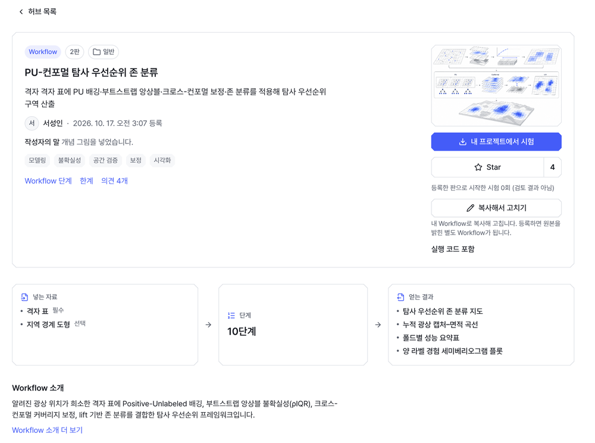
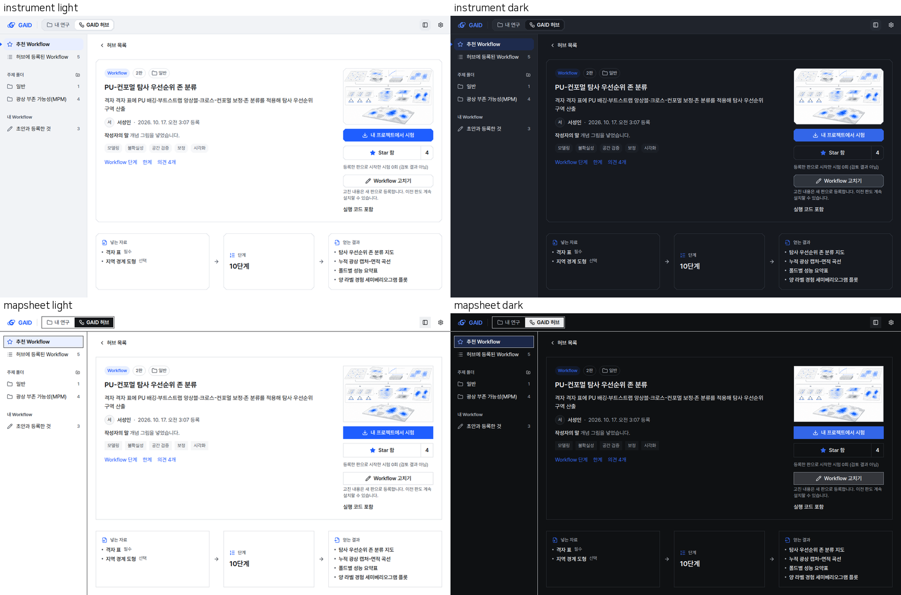
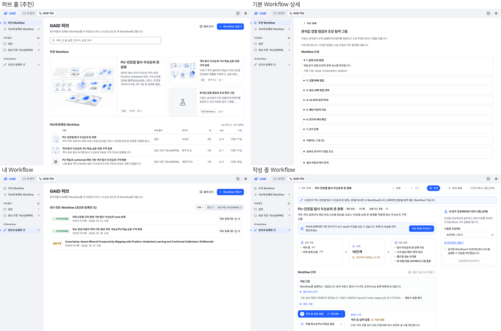
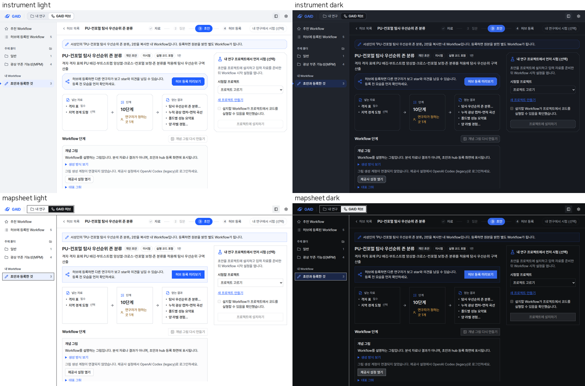
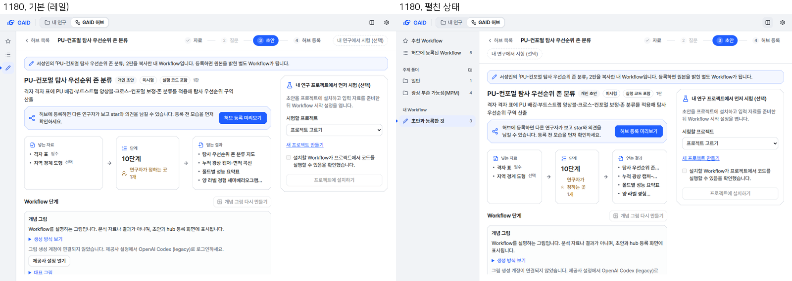

# GAID 허브 상세 화면에도 같은 사이드바 두기

## 0. 한눈에

| | |
|---|---|
| 요청 | 추천 Workflow에서 Workflow를 열면 왼쪽 사이드바가 사라지는 문제를 고치고, 허브의 다른 화면도 같은 틀로 맞추기 |
| 결론 | 허브 홈, 등록된 Workflow 상세, 기본 Workflow 상세, 내 Workflow, 작성 중인 Workflow가 모두 같은 앱 바와 사이드바를 씁니다. 상세 화면에서는 그 화면을 연 목록이 사이드바에 표시되고, '허브 목록' 뒤로 가기도 그대로 있습니다. |
| 믿을 수 있는 정도 | 전체 자동 검사를 통과했고, 실제 앱 화면 65장(두 스타일, 두 테마, 1440·1280·1180 px)을 찍어 확인했습니다. Firefox·Safari와 실제 연구자 사용은 확인하지 않았습니다. |
| 결정할 일 | 없음 |

## 1. 요청한 것

> 추가 피드백으로 첨부한 이미지처럼 GAID 허브에서 추천 워크플로우의 워크플로우를 클릭하면 왼쪽 사이드 패널이 사라지고 있다. 이것은 일관성이 없는 UIUX이다. — 2026-10-22 요청

그림 1. 사용자가 보낸 고치기 전 화면입니다. 볼 것: 상세 화면에는 '‹ 허브 목록' 링크만 있고 왼쪽 사이드바가 없습니다.

완료 기준: 추천·등록·내 Workflow에서 연 상세, 기본 Workflow 카드, 초안 작성 화면 등 허브의 모든 하위 화면이 허브 홈과 같은 왼쪽 사이드바와 앱 바를 유지합니다. 뒤로 가기 링크는 보조 수단으로 남겨도 됩니다. 두 스타일과 두 테마로 1440×900, 1280×800, 1024–1279 px 창을 확인합니다.

## 2. 수행한 것

1. 허브의 화면을 모두 확인했습니다. 사이드바는 허브 홈 화면 안에만 들어 있었습니다. 그래서 등록된 Workflow 상세, 기본 Workflow 상세, 작성 중인 Workflow(자료·질문·초안·허브 등록·시험 단계) 화면에는 사이드바가 없었습니다.
2. 사이드바를 허브 홈에서 꺼내 허브 전체 틀에 두었습니다. 이제 어느 허브 화면을 열어도 같은 자리에 같은 사이드바가 보입니다.
3. 상세 화면에서는 그 화면을 연 목록을 사이드바에 표시합니다.
   - 추천에서 연 Workflow에는 '추천 Workflow'가 표시됩니다.
   - 등록 목록이나 주제 폴더에서 연 Workflow에는 그 목록이 표시됩니다.
   - 작성 중인 Workflow에는 '초안과 등록한 것'이 표시됩니다.
   - 링크로 바로 연 등록 Workflow에는 '허브에 등록된 Workflow'가 표시됩니다.
   - 사이드바 항목을 누르면 해당 목록으로 돌아갑니다.
4. 기본 Workflow 상세는 지금까지 주소가 없어서 브라우저 뒤로 가기를 누르면 허브 밖으로 나갔습니다. 이제 상세마다 주소가 생겨 뒤로 가기가 허브 목록으로 돌아옵니다. 뒤로 가기 버튼도 다른 상세 화면과 같은 '‹ 허브 목록'으로 맞췄습니다(전에는 '허브 목록 보기', 화살표 없음).
5. 사이드바 숨기기를 넣었습니다(가이드 N2, N6, L1).
   - 앱 바 오른쪽 버튼과 ⌘\ / Ctrl \ 로 숨기거나 펼칩니다.
   - 숨기면 48 px 레일에 추천, 등록된 Workflow, 내 Workflow 아이콘이 남습니다.
   - 연구자가 고른 상태는 브라우저에 남습니다. 고른 적이 없으면 1280 px 미만 창에서는 레일로 시작합니다.

## 3. 결과

그림 2. 그림 1과 같은 Workflow를 추천에서 연 화면입니다(계측, 밝은 테마, 1440×900). 볼 것: 허브 홈과 같은 사이드바가 남아 있고, '추천 Workflow'에 선택 표시가 있습니다. '‹ 허브 목록' 링크도 그대로 있습니다.

그림 3. 같은 상세 화면을 네 조합(계측·도폭, 밝은·어두운 테마)으로 연 1280×800 화면입니다. 볼 것: 계측은 왼쪽 표시와 옅은 파랑으로, 도폭은 먹선 테두리로 들어온 목록을 표시합니다.

그림 4. 허브 홈, 기본 Workflow 상세, 내 Workflow 목록, 작성 중인 Workflow(초안 단계)입니다. 볼 것: 네 화면 모두 사이드바의 자리, 너비, 항목이 같습니다. 기본 Workflow 상세에는 '추천 Workflow'가, 작성 화면에는 '초안과 등록한 것'이 표시됩니다.

그림 5. 사이드바가 생긴 작성 화면의 1280×800 네 조합입니다. 볼 것: 단계 표시와 '내 연구에서 시험 (선택)'이 한 줄에 들어가고, 오른쪽 시험 패널도 잘리지 않습니다.

그림 6. 1180×800 창의 작성 화면입니다. 왼쪽은 기본 상태(레일), 오른쪽은 사이드바를 펼친 상태입니다. 볼 것: 펼치면 머리줄이 두 줄로 접히고 가운데 요약 카드의 글이 좁아집니다. 이 때문에 1280 px 미만 창에서는 레일로 시작하게 했습니다. 펼친 상태로 써도 기능은 같습니다.

| 화면 | 전 | 후 |
|---|---|---|
| 허브 홈(추천, 등록 목록, 주제 폴더, 내 Workflow) | 사이드바 있음 | 그대로 |
| 등록된 Workflow 상세 | 사이드바 없음 | 사이드바, 들어온 목록 표시 |
| 기본 Workflow 상세 | 사이드바 없음, 주소 없음 | 사이드바, '추천 Workflow' 표시, 주소 있음 |
| 작성 중인 Workflow(모든 단계) | 사이드바 없음 | 사이드바, '초안과 등록한 것' 표시 |

바뀐 문구:

| 문자열 id | 한국어 전 → 후 | 영어 전 → 후 |
|---|---|---|
| `hub.sidebar.hide` (새로 추가) | 없음 → 허브 목록 숨기기 | 없음 → Hide hub sections |
| `hub.sidebar.show` (새로 추가) | 없음 → 허브 목록 표시 | 없음 → Show hub sections |
| `workflowView.back.button` (삭제, `hub.shared.back` 사용) | 허브 목록 보기 → 허브 목록 | View hub list → Hub list |

따른 가이드 규칙: L1(1280 px 미만은 48 px 레일), L2(앱 바와 사이드바가 모든 허브 화면에서 같은 틀), L3(사이드바는 기능층 색), N2(현재 위치 표시, 버튼과 단축키로 숨기기), N6(⌘\), P6(익숙한 사이드바·내용 배치). 어긴 규칙은 없습니다. UI 검사 허용 목록에는 새로 넣은 항목이 없습니다.

## 4. 검증

- 허브 화면 시험 28개가 통과했습니다. 새 시험은 사이드바가 들어온 목록을 표시하는지, 레일에서도 목록으로 돌아가는지, 1280 px 미만에서 레일로 시작하고 연구자가 고른 상태를 유지하는지, 기본 Workflow 상세 주소를 읽는지 확인합니다.
- 타입 검사, UI 검사, 문구 검사를 통과했습니다. 문구 검사의 경고 61건은 이번에 바꾸지 않은 다른 화면 문구입니다.
- 전체 검사를 통과했습니다. 서버 시험 2,069개(8개 건너뜀), 화면 시험 1,156개, GAID 배포 검사 49개입니다.
- 사용자 검토 앱의 허브 자료를 복사한 별도 자료 폴더로 실제 앱(배포용 빌드)을 띄웠습니다. 그 앱에서 다섯 화면(홈, 추천에서 연 상세, 기본 Workflow 상세, 내 Workflow, 작성 화면)을 두 스타일, 두 테마, 1440×900·1280×800·1180×800으로 찍었습니다. 1180 px은 레일과 펼친 상태를 모두 찍었습니다. 모두 65장이고, 가이드 12절 점검표와 대조했습니다.
- 수치 결론은 없습니다(해당 없음).

## 5. 한계

- Chrome 계열(Playwright Chromium)에서만 화면을 확인했습니다. Firefox·Safari는 확인하지 않았습니다.
- 사이드바의 개수(등록 Workflow 수, 내 Workflow 수)는 허브에 들어올 때와 목록으로 돌아올 때 새로 읽고, 상세 화면에 머무는 동안에는 다시 읽지 않습니다.
- 레일에는 주제 폴더별 항목이 없습니다. 레일에서 '등록된 Workflow'를 누르면 전체 목록이 열립니다. 폴더는 사이드바를 펼쳐 고릅니다.
- 브라우저 뒤로 가기로 다른 목록에서 연 상세에 돌아가면, 사이드바는 마지막으로 고른 목록을 표시합니다.

## 6. 결정할 일

없음.

## 7. 대체되었거나 실패한 시도

처음에는 사이드바를 창 크기와 관계없이 펼친 채로 시작했습니다. 1180 px 작성 화면에서 머리줄이 두 줄로 접히고 요약 카드가 좁아져(그림 6 오른쪽), 1280 px 미만에서는 레일로 시작하도록 바꿨습니다.

## 용어

없음.

## 부록 A. 근거 위치

- 사이드바: `web/src/geo/hub/hub-sidebar.tsx` (`HubSidebar`, `HubSidebarToggle`, `useHubSidebarCollapsed`, 저장 키 `gaid:hub-sidebar` = `rail`|`open`).
- 허브 틀과 목록 자료: `web/src/geo/hub/hub-screen.tsx` (`GaidHub`, `useHubIndex`, `HubList`). 허브 홈: `web/src/geo/hub/hub-home.tsx` (사이드바 제거, `view`/`onView` 받음).
- 주소: `web/src/geo/hub/location.ts` (`#hub/c/<id>`), `web/src/app/page.tsx` (`catalogueId` 전달). 기본 Workflow 상세: `web/src/geo/hub/catalogue-workflow.tsx`.
- 문구: `web/src/geo/locales/hub/{ko,en}.json` (`sidebar.hide`, `sidebar.show`), `web/src/geo/locales/workflowView/{ko,en}.json` (`back` 삭제).
- 시험: `web/src/geo/hub/shared-browse.test.tsx`, `web/src/geo/hub/hub.test.tsx`.
- 화면 원본 65장: PC74 `~/data/geoaidesk/work/gaid-hub-layout/shots/` (촬영 스크립트 `shot.sh`, 그림 묶음 `montage.py` 같은 폴더). 자료 폴더: `~/data/geoaidesk/work/gaid-hub-layout/home` (`~/.geoaidesk/pi-agent/skill-hub` 복사본).
- 고치기 전 화면: PC74 `~/data/geoaidesk/work/hub/feedback/2026-10-22-hub-detail-no-sidebar.png`.
- 전체 검사 기록: PC74 `~/data/geoaidesk/work/gaid-hub-layout/logs/check.log`.
