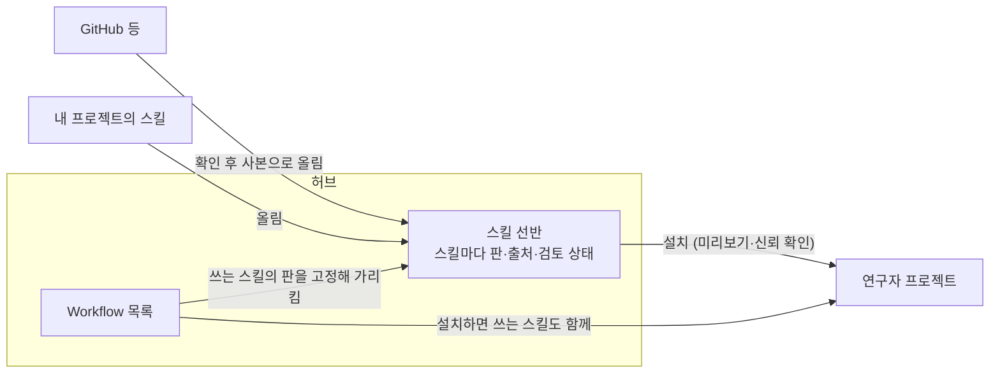

# GAID 허브에서 스킬을 관리하는 방안

## 0. 한눈에

| | |
|---|---|
| 요청 | GAID 허브에서 스킬도 관리하도록, 연구자에게 필요한 것과 Workflow 모델에 맞는 방식을 진단하고 제안하기 |
| 결론 | 지금 허브에서 스킬은 Workflow 하나에 하나씩 딸려서만 공유됩니다. 같은 스킬을 다른 Workflow가 다시 쓸 수 없고, GitHub에서 가져온 스킬은 연구자마다 각자 가져옵니다. 허브에 "스킬" 선반을 따로 두는 방안(가안)을 권장합니다. 스킬마다 판과 출처를 기록하고, Workflow는 쓰는 스킬의 판을 고정해 가리킵니다. |
| 믿을 수 있는 정도 | 코드와 저장 형식을 읽어 확인한 진단입니다. 앱을 실행해 시험하지 않았고, 다른 연구자에게 물어보지 않았습니다. 공유 저장소와 계정은 gaid-backend 작업이 아직 정하지 않아, 그 부분은 가정으로 적었습니다. |
| 결정할 일 | 3건 (6절) |

## 1. 요청한 것

> GAID 허브에서 스킬도 추후에 관리해야한다. — 2026-10-20, gaid-workflow-model 결정에 대한 답 가운데

> 우선 첫표 두항목은 권장안대로 하자. — 2026-10-22, "허브에서 스킬 관리를 별도 작업으로 설계" 항목에 대한 답

완료 기준: 1단계에서는 제품 코드를 고치지 않고, 연구자가 허브의 스킬에서 무엇을 해야 하는지(찾기, 나누기, 판 관리, 검토, Workflow에서 다시 쓰기, GitHub 스킬을 허브로 들이기)와 Workflow 모델에 맞는 방식, 공유 저장소에 필요한 가정을 정리합니다. 선택지와 권장안을 놓고 논의한 뒤, 정한 범위만 구현합니다.

## 2. 수행한 것

1. 지금 GAID가 스킬을 받아들이는 길 네 가지(기본 제공, GitHub 등, Workflow에 딸린 것, 직접 만든 것)를 코드에서 따라가며, 무엇을 기록하고 어떻게 판을 확인하는지 정리했습니다.
2. 허브 공유 저장소, 허브 작성 기능, Workflow 준비 확인, 채팅에 스킬을 보이는 규칙에서 스킬이 어떻게 다뤄지는지 확인했습니다.
3. 외부의 스킬 목록·꾸러미 저장소들이 판 고정, 검토, 신뢰 표시, 외부 자료의 사본 관리를 어떻게 하는지 웹에서 조사했습니다.
4. gaid-backend 작업의 진단 기록을 읽고, 허브 스킬이 공유 저장소와 계정에 기대는 부분을 나눴습니다.
5. 선택지 세 가지를 비교하고 권장안의 구성과 단계 나누기를 정리했습니다.

## 3. 결과

### 3.1 지금 스킬이 프로젝트에 들어오는 길

| 출처 | 들어오는 방법 | 기록하는 것 | 판 확인 |
|---|---|---|---|
| 기본 제공 스킬 (카탈로그 13개) | GAID 설치 때 고정된 묶음에서 프로젝트로 복사 | 묶음의 판, 스킬별 내용 지문 | GAID를 새 판으로 올릴 때만 바뀜 |
| GitHub 등에서 가져온 스킬 | 설정 → 스킬 → 스킬 추가: 미리보기 → 출처 신뢰 확인 → 설치 | 가져온 곳, 브랜치·태그 같은 참조, 내용 지문 | 연구자가 "업데이트 확인"을 누를 때만, 그 참조를 다시 받아 비교 |
| Workflow에 딸린 스킬 | 허브에서 Workflow를 설치할 때 함께 설치 | 어느 허브 항목의 몇 판인지, 꾸러미 지문 | 새 판을 찾는 길이 없음. 같은 Workflow를 새 판으로 다시 설치해야 함 |
| 직접 만든 스킬 | 설정 → 스킬에서 양식으로 만들거나 고침 | 출처 없음 | 없음 |

연구자 PC마다 프로젝트 범위와 사용자 범위 두 곳에 스킬을 둘 수 있습니다. 이름이 같으면 프로젝트 쪽이 이깁니다. 연구자가 고친 스킬은 어떤 갱신도 덮어쓰지 않습니다. 이 규칙들은 허브 스킬에서도 그대로 씁니다.

### 3.2 허브에서 스킬이 빠져 있는 곳

1. 허브의 단위는 Workflow 하나뿐입니다. 허브 항목 하나는 Workflow 하나와, 그 Workflow 전용 스킬 하나로 이루어집니다. Workflow 없는 초안은 등록을 거절합니다. 스킬만 따로 찾거나 나눌 자리가 없습니다.
2. 같은 스킬을 다른 Workflow가 다시 쓸 수 없습니다. 허브 작성 기능은 매번 새 전용 스킬을 씁니다. 다른 스킬은 기본 제공 스킬만 보조로 가리킬 수 있습니다. 비슷한 자료 점검 절차가 Workflow마다 따로 복사됩니다.
3. GitHub 스킬은 연구자마다 각자 가져옵니다. Workflow는 GitHub 스킬의 이름과 참조 글만 적습니다. 설치된 스킬이 그 참조와 같은 내용인지는 확인하지 않습니다. 같은 Workflow를 쓰는 두 연구자가 서로 다른 내용의 스킬을 쓸 수 있습니다. 연구자 PC마다 GitHub에 접속해야 하고, 기관 망은 GitHub의 일부 주소를 막습니다.
4. 설치된 스킬에는 판 번호가 없습니다. 내용 지문만 있습니다. 허브에서 온 스킬은 어느 Workflow의 몇 판에 딸렸는지만 보이고, 새 판이 나왔는지 알 길이 없습니다.
5. 검토 기록이 없습니다. 허브가 기록하는 상태는 "초안"까지입니다. 누가 내용을 확인했는지, 실행 코드가 무엇을 하는지(네트워크 접속, 파일 쓰기)를 남기는 자리가 없습니다. 작성자는 연구자가 입력한 표시 이름일 뿐이고 계정으로 확인하지 않습니다.
6. 연구자가 고친 스킬을 나눌 길이 없습니다. 프로젝트에서 스킬을 고치거나 새로 만들어도, 동료에게 건네려면 폴더를 직접 복사해야 합니다.

### 3.3 연구자가 허브 스킬에서 해야 하는 일

| 하려는 일 | 필요한 것 | 지금 |
|---|---|---|
| 찾기 | 하는 일·다루는 자료 형식·분야로 스킬 찾기. 어느 Workflow가 쓰는지 보기 | 없음 |
| 읽고 판단하기 | 지침 전문, 포함 파일, 실행 코드가 하는 일, 출처, 라이선스, 검토 상태를 설치 전에 보기 | Workflow에 딸린 스킬은 허브의 Workflow 상세에서 지침을 읽을 수 있음. GitHub 스킬은 설치 미리보기에서만 보임. 라이선스와 검토 상태는 보이지 않음 |
| 나누기 | 내 프로젝트의 스킬, Workflow에 딸린 스킬, GitHub 스킬을 허브에 올리기 | Workflow 단위로만 가능 |
| 판 관리 | 고친 내용을 새 판으로 올리고, 무엇이 바뀌었는지 적기. 설치한 쪽에 새 판 알림 | 없음 |
| Workflow에서 다시 쓰기 | 허브 작성 때 기존 허브 스킬을 골라 단계에 연결. Workflow는 그 스킬의 판을 고정 | 기본 제공 스킬만 가능 |
| GitHub 스킬을 허브로 | 한 사람이 확인해 올린 사본을 동료가 GitHub 없이 설치. 원래 출처와 시점 기록 | 없음 |
| 검토 | 동료나 관리자가 확인했다는 표시, 문제 신고, 더 쓰지 말라는 표시 | 없음 |

연구자 대부분은 코드를 다루지 않습니다(2026-10-15 요청). 스킬을 올릴 때 입력을 많이 요구하지 않고, 이름·설명·출처는 스킬 파일과 가져온 곳에서 채웁니다.

### 3.4 외부 사례에서 가져올 것

2026-10-22에 공개 스킬 목록, 꾸러미 저장소, 과학 Workflow 도구를 조사했습니다(조사 노트는 부록 A).

| 배울 점 | 근거 |
|---|---|
| 스킬 파일 형식에는 판 번호와 작성자 이름 공간이 없습니다. 판, 내용 지문, 검토 상태는 허브가 따로 기록해야 하며, 스킬 파일 자체를 고칠 필요는 없습니다 | Agent Skills 공식 형식은 `name`, `description`만 필수입니다 |
| GitHub 주소와 브랜치만으로는 같은 내용을 받는다는 보장이 없습니다. 지금 GAID가 쓰는 가져오기 도구의 잠금 파일도 받은 파일을 지문으로 다시 확인하지 않습니다 | vercel-labs `skills`의 잠금 처리 코드와 미해결 문제 #806 (2026-03-31) |
| 내부 저장소는 바깥 꾸러미를 한 번 검토한 뒤, 바뀌지 않는 사본으로 기관 안에 나눕니다. 지운 판 대신 "더 쓰지 않음"을 표시해야 그 판을 쓰던 쪽이 깨지지 않습니다 | npm 잠금과 지원 중단 규칙, pip 지문 확인 방식, Verdaccio |
| 공유 부품은 앞으로 나아가도 그것을 쓰는 절차는 고정한 판을 계속 씁니다. 새 판은 비교를 보여 주고 작성자가 골라 바꿉니다 | GitHub Actions의 커밋 고정, nf-core 모듈의 커밋 기록과 갱신 비교, Snakemake 판 고정 |
| 위험한 스킬의 다수는 실행 코드 없이 지침 글만으로 위험합니다. 빈 줄, HTML 주석, 보이지 않는 문자로 지시를 숨긴 사례도 있습니다. 백신 검사만으로는 부족하고, 사람이 지침이 시키는 일을 읽어야 합니다 | VirusTotal, 2026-10-21: 제출된 스킬 35,878개 가운데 6,637개를 악성으로 분류했고, 그중 62%는 악성 코드가 없었습니다. 제출 자료 기준이며 전체 생태계 비율은 아닙니다 |
| 자동 검사는 사람이 볼 곳을 짚어 주는 도구입니다. 깨끗한 결과가 안전 보증은 아닙니다 | ClawHub의 게시 전 검사, Cisco AI Defense Skill Scanner(Apache-2.0) 설명서 |
| GitHub에 공개됐다고 기관 안에서 나눠도 되는 것은 아닙니다. 스킬마다 라이선스를 확인해야 합니다 | Anthropic 문서 스킬(`pptx` 등)은 복사·재배포를 막는 라이선스입니다. GAID는 이미 이 네 스킬을 넣지 않습니다 |
| 검토했다는 표시는 검토한 사람이 누구인지 확인될 때만 믿을 수 있습니다 | 조사 결과의 권고. 지금 허브는 표시 이름만 씁니다 |

조사 결과도 같은 결론을 냈습니다. 바깥 주소 목록만 두는 방식은 찾기용으로만 맞고, 판마다 바뀌지 않는 사본을 두는 작은 내부 목록이 이 규모에 맞습니다. 별도 꾸러미 서버를 따로 운영하는 방식은 10–50명 규모에 비해 부담이 크다고 봤습니다.

### 3.5 선택지

| | 가안: 허브에 스킬 선반 (권장) | 나안: 추천 출처 목록만 | 다안: Workflow 안에서만 나누기 |
|---|---|---|---|
| 허브에서 보이는 것 | Workflow 목록 옆에 "스킬" 목록. 스킬 상세에서 지침·파일·출처·판·검토 상태·쓰는 Workflow | GitHub 주소와 추천 글 목록 | 지금처럼 Workflow만. Workflow 상세의 "사용 스킬"에서 다른 Workflow의 스킬을 가리킴 |
| 스킬 내용을 어디에 두나 | 허브에 판마다 사본 (내용 지문으로 고정) | GitHub에만. 허브는 주소만 | Workflow 꾸러미 안에만 |
| GitHub 스킬 | 한 사람이 확인해 허브에 사본으로 올림. 원래 저장소·커밋·라이선스 기록. 동료는 허브에서 설치 | 연구자마다 GitHub에서 각자 받음 | 지금처럼 각자 받음 |
| Workflow와의 관계 | Workflow가 허브 스킬의 판을 가리킴. 같은 스킬을 여러 Workflow가 씀 | Workflow는 GitHub 참조를 가리킴 (지금과 같음) | 다른 Workflow의 딸린 스킬을 가리킬 수 있게 함 |
| 판 | 스킬마다 1판, 2판… 설치한 쪽에 새 판 알림. 자동 갱신 없음 | GitHub 커밋을 따름 | Workflow 판을 따름 |
| 기관 망 | GitHub가 막혀도 허브에서 설치 | GitHub 접속에 기댐 | 해당 없음 |
| 공유 저장소 부담 | 스킬 판마다 사본 (Workflow 꾸러미와 같은 한도, 압축 20 MiB 이하) | 거의 없음 | 거의 없음 |
| 남는 빈 곳 | 검토 역할은 계정이 생긴 뒤에야 제대로 구분됨 | 사본이 없어 원본이 사라지거나 바뀌면 재현 불가. 기관 내부 스킬은 GitHub에 올려야 함 | 스킬만 찾기·나누기 불가. GitHub 스킬 검토 사본 없음 |

권장 이유:

- 사용자가 정한 Workflow 중심 구조를 그대로 둡니다. 허브의 앞면은 Workflow이고, 스킬 선반은 Workflow를 만들 때 고르는 부품 목록입니다.
- 한 번 확인한 사본을 기관 안에서 나누므로, 같은 Workflow를 쓰는 연구자들이 같은 스킬 내용을 씁니다. GitHub 접속이 막혀도 설치됩니다.
- 지금 Workflow 꾸러미가 쓰는 방식(판마다 바뀌지 않는 꾸러미, 내용 지문 확인, 설치 전 미리보기와 신뢰 확인)을 스킬에 그대로 씁니다. 새로 만드는 부분은 스킬 항목과 Workflow가 그것을 가리키는 칸입니다.

### 3.6 권장안의 구성

#### 스킬 항목 하나에 담는 것

- 이름, 한 줄 설명, 하는 일, 다루는 자료 형식, 주제 폴더
- 판마다: 스킬 폴더 사본(지침과 파일), 내용 지문, 바뀐 점 한 줄, 올린 사람과 날짜
- 출처: 직접 만듦 / Workflow에서 꺼냄(원래 Workflow와 판) / GitHub 등에서 들임(저장소, 받은 시점의 커밋, 경로, 라이선스, 들인 날짜). 허브에 사본을 둬도 출처는 바깥으로 남깁니다
- 라이선스: 기관 안 공유를 허락하지 않거나 알 수 없으면, 올린 사람만 보고 다른 연구자에게는 보이지 않습니다
- 검사 기록: 형식 검사, 실행 코드가 쓰는 명령·네트워크 접속·파일 쓰기, 지침 안의 숨은 글(HTML 주석, 보이지 않는 문자, 긴 빈 줄). 위험하다고 판정하지 않고 사람이 볼 곳을 짚어 줍니다
- 검토 상태는 판마다 따로 둡니다. 검토 전 / 확인함(누가, 어느 판, 무엇을 봤는지) / 더 쓰지 않음(이유와 대신 쓸 스킬. 이미 고정한 Workflow는 계속 씀) / 사용 중지(새 설치를 막고, 쓰는 Workflow에 경고)
- 쓰는 Workflow 목록, 별, 의견 (Workflow와 같은 방식)

#### Workflow가 허브 스킬을 쓰는 방식

- Workflow의 사용 스킬 목록에 출처 "허브"를 더합니다. 허브 스킬 항목과 판, 내용 지문을 적습니다.
- Workflow를 설치하면 그 판의 스킬도 함께 설치합니다. 허브에서 받은 사본의 내용 지문을 확인한 뒤 설치하고, 이미 같은 내용이 있으면 다시 설치하지 않습니다. GitHub에는 접속하지 않습니다.
- 스킬에 새 판이 나와도 Workflow는 고정한 판을 계속 씁니다. Workflow 작성자가 새 판으로 바꾸고 Workflow를 다시 등록해야 바뀝니다. 기존 결과를 재현할 수 있게 하기 위해서입니다.
- 허브 작성 기능이 스킬을 새로 쓰기 전에, 선반에서 맞는 스킬을 먼저 찾아 제안합니다. 연구자가 고르면 전용 스킬 대신 그 스킬을 단계에 연결합니다.
- 준비 확인은 설치된 스킬이 고정한 판과 같은 내용인지도 봅니다. 다르면 "다른 판이 설치되어 있음"을 보이고 바꿀지 묻습니다.

#### 화면 위치

구현할 때 UI 지침 v2에 따라 시안을 만듭니다.

- 허브 왼쪽 목록에 "스킬" 묶음을 둡니다. Workflow 묶음 아래에 둬서 Workflow가 앞면이라는 순서를 지킵니다.
- 스킬 상세는 Workflow 상세와 같은 틀을 씁니다. 지침 전문, 파일 목록, 출처, 판 기록, 검토 상태, 쓰는 Workflow가 보입니다.
- Workflow 상세의 "사용 스킬"에서 허브 스킬을 누르면 스킬 상세로 갑니다.
- 설정 → 스킬 → 스킬 추가에는 GitHub 등에서 가져오기 옆에 "GAID 허브에서"를 둡니다. 설치한 허브 스킬 줄에는 이름과 판, 새 판 알림이 보입니다.

### 3.7 단계 나누기

| 단계 | 범위 | 기대는 것 |
|---|---|---|
| 1단계 | 스킬 항목과 판, 세 가지 올리는 길(내 프로젝트, Workflow에서 꺼내기, GitHub에서 들이기), 스킬 상세, 프로젝트에 설치, Workflow가 허브 스킬을 가리키기, 허브 작성에서 기존 스킬 고르기, 새 판 알림 | 지금의 허브 공유 저장소(기관 GAID 한 대, 표시 이름) |
| 2단계 | 검토 상태를 누가 바꿀 수 있는지 구분(작성자가 아닌 확인자, 관리자의 사용 중지), 문제 신고, GitHub 원본이 바뀌었을 때 새 판 후보와 비교 보기, 공개 검사 도구(예: Skill Scanner)를 연구자 PC에서 돌려 검사 기록에 더하기 | gaid-backend의 계정과 공유 저장소 |

1단계도 검토 상태 칸은 만듭니다. 계정이 없는 동안에는 "확인함"을 표시 이름으로 기록하고 "이름 확인 안 됨"을 함께 보입니다. 기관 차원의 승인으로 보이지 않게 하기 위해서입니다.

### 3.8 공유 저장소와 계정에 대한 가정 (gaid-backend와 맞출 것)

- 스킬 판의 사본은 내용 지문으로 이름 붙인, 바뀌지 않는 파일입니다. Workflow 꾸러미와 같은 방식이라 어느 저장소(파일, 개체 저장소)로도 옮길 수 있습니다.
- 스킬 항목의 기록(이름, 판 목록, 출처, 검토 상태, 별, 의견)은 Workflow 항목과 같은 모양의 작은 기록 파일입니다. gaid-backend가 Workflow 항목을 옮기는 곳으로 함께 옮깁니다.
- 작성자 확인과 검토 역할은 gaid-backend의 계정에 맡깁니다. 1단계는 지금처럼 표시 이름을 쓰고, 계정이 생기면 이름을 계정에 연결합니다.
- 설치는 지금처럼 연구자 PC의 GAID가 받아 확인한 뒤 프로젝트에 씁니다. 공유 저장소는 연구자 프로젝트에 직접 쓰지 않습니다.

## 4. 검증

- 과학적 검증: 해당 없음. 설계 제안입니다.
- 소프트웨어 검증: 코드와 저장 형식을 읽어 확인했습니다. 앱 실행, 화면 확인, 시험은 하지 않았습니다. 확인한 위치는 부록 A에 있습니다.
- 연구자 필요(3.3)는 지금까지의 사용자 요청과 코드의 빈 곳에서 정리했습니다. 다른 연구자에게 직접 확인하지 않았습니다.

## 5. 한계

- 공유 저장소와 계정은 gaid-backend가 정합니다. 그 결정에 따라 2단계 범위와 1단계의 저장 위치가 바뀔 수 있습니다.
- 실행 코드 표시(3.6 검사 기록)는 명령과 접속을 찾아 보여 주는 것입니다. 안전하다는 판정이 아니며, 사람의 검토를 대신하지 않습니다.
- 스킬 하나를 여러 Workflow가 쓰면, 스킬을 고친 사람과 Workflow 작성자가 다를 수 있습니다. 판 고정으로 기존 Workflow는 보호되지만, 새 판을 따라갈지는 Workflow 작성자가 정해야 합니다.
- 연구자가 프로젝트에서 고친 허브 스킬은 지금 규칙대로 덮어쓰지 않습니다. 그 결과 고친 스킬이 고정한 판과 달라질 수 있고, 준비 확인이 이를 알려 줄 뿐입니다.

## 6. 결정할 일

1. 허브에서 스킬을 어떻게 다룰지
   - 가) 허브에 스킬 선반을 두고, 스킬마다 판과 출처를 기록하며, Workflow가 판을 고정해 가리킴 (권장: 기관 안에서 같은 사본을 나누고 GitHub 접속이 막혀도 설치됩니다. Workflow 중심 구조를 유지합니다)
   - 나) 허브에는 추천 GitHub 주소 목록만 둠
   - 다) 스킬은 지금처럼 Workflow 안에서만 나누고, 다른 Workflow의 스킬을 가리킬 수 있게만 함
2. GitHub 등에서 들인 스킬을 다른 연구자에게 언제 보일지
   - 가) 올리면 바로 보이되 "검토 전"으로 표시하고, 확인한 사람이 "확인함"으로 바꿈 (권장: 계정이 없는 1단계에서 승인 절차를 만들면 아무도 쓰지 못하는 상태가 됩니다. 설치 전 미리보기와 신뢰 확인은 그대로 거칩니다)
   - 나) 관리자가 확인하기 전에는 올린 사람에게만 보임
3. 1단계 범위
   - 가) 3.7의 1단계 전체를 이번 작업에서 구현하고, 2단계는 gaid-backend의 계정이 생긴 뒤 별도 작업으로 함 (권장: 지금 저장소로 할 수 있는 부분을 먼저 써 보고, 검토 역할은 계정과 함께 정합니다)
   - 나) 스킬 선반(올리기, 상세, 설치)만 먼저 하고, Workflow 연결과 허브 작성 연결은 다음 작업으로 미룸

## 7. 대체되었거나 실패한 시도

펼치기 — 0건

- 없음

## 용어

| 용어 | 새 정의 / 정의 변경 | 정의 |
|---|---|---|
| [허브 스킬](../../docs/glossary.md) | 새 정의 (가안 채택 때 용어집에 추가) | GAID 허브의 스킬 선반에 판마다 사본으로 올린 스킬입니다. 출처와 검토 상태를 함께 기록하고, 여러 Workflow가 판을 고정해 씁니다. |

## 부록 A. 근거 위치

펼치기 — 확인한 코드 위치

| 항목 | 위치 |
|---|---|
| 스킬 범위와 이름 충돌 | `server/src/agent/skills.ts:52-79`, `server/src/api/skills.ts:144-163` |
| 설치 기록(출처, 참조, 지문) | `server/src/agent/skills-sync.ts:28-70`, `:358-383` |
| 기본 제공 묶음 확인과 갱신 | `server/src/geo/catalogue.ts:131`, `:166-184`; `server/src/geo/provision.ts:46-61`; `skills-sync.ts:586-650` |
| GitHub 가져오기와 업데이트 확인 | `server/src/agent/skills-install.ts:169-215`, `:255-312`, `:493-551` |
| 허브 꾸러미 설치 기록 | `server/src/geo/skill-hub.ts:164-256`; `server/src/geo/methods/package-origin.ts:14-83` |
| Workflow의 사용 스킬 형식 | `server/src/geo/methods/method-file.ts:90-99`, `:131-153` |
| 준비 확인과 가져오기 단추 | `server/src/geo/methods/local-methods.ts:90-113`; `server/src/geo/workspace/workflows.ts:45-50`; `web/src/geo/workspace/readiness.tsx:103-106` |
| 채팅에 보이는 스킬 | `local-methods.ts:195-219`; `server/src/geo/context.ts:67-83` |
| 허브 저장소, 등록, Workflow 없는 초안 거절 | `server/src/geo/hub-shared/store.ts:14-57`, `:113-213`; `routes.ts:163-305` (거절 `:189`) |
| 수정과 사본, 작성자 확인 | `server/src/geo/hub-shared/edit.ts:17-49`; `routes.ts:42-56`, `:178` |
| 허브 작성의 스킬 출처 제한 | `server/src/geo/authoring/package.ts:68-72`, `:453`, `:467-468`; `authoring/agent.ts:873-894`; `authoring/prompts.ts:134-136` |
| 설정 → 스킬의 Workflow 표시 | `server/src/geo/skill-details.ts:9-32`; `web/src/geo/skills/` |
| gaid-backend 진단 기록 | PC74 `~/data/geoaidesk/work/gaid-backend/diagnosis.md` |
| 웹 조사 | Obsidian vault `웹 조사/geoaidesk/2026-10-22-research-question-answer-in-english-2--6b8718a6fe.md` (질문: `~/data/geoaidesk/work/gaid-hub-skills/research-prompt.md`). 원 출처: agentskills.io/specification; github.com/vercel-labs/skills (`src/local-lock.ts`, `src/install.ts`, issue #806); code.claude.com/docs/en/plugin-marketplaces; docs.openclaw.ai/clawhub; cli.github.com/manual/gh_skill; nf-co.re/docs/nf-core-tools/cli/modules/install; docs.github.com/en/actions/reference/security/secure-use; pip.pypa.io/en/stable/topics/secure-installs; cisco-ai-defense.github.io/docs/skill-scanner; blog.virustotal.com/2026/10/how-some-malicious-ai-skills-hide.html |

작성 시점: 2026-10-22, commit `b06478cf` 기준.

