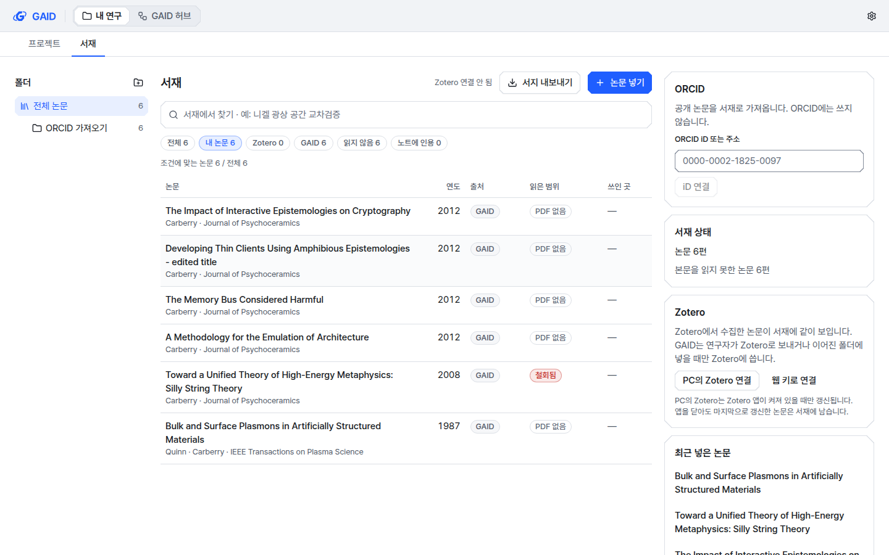
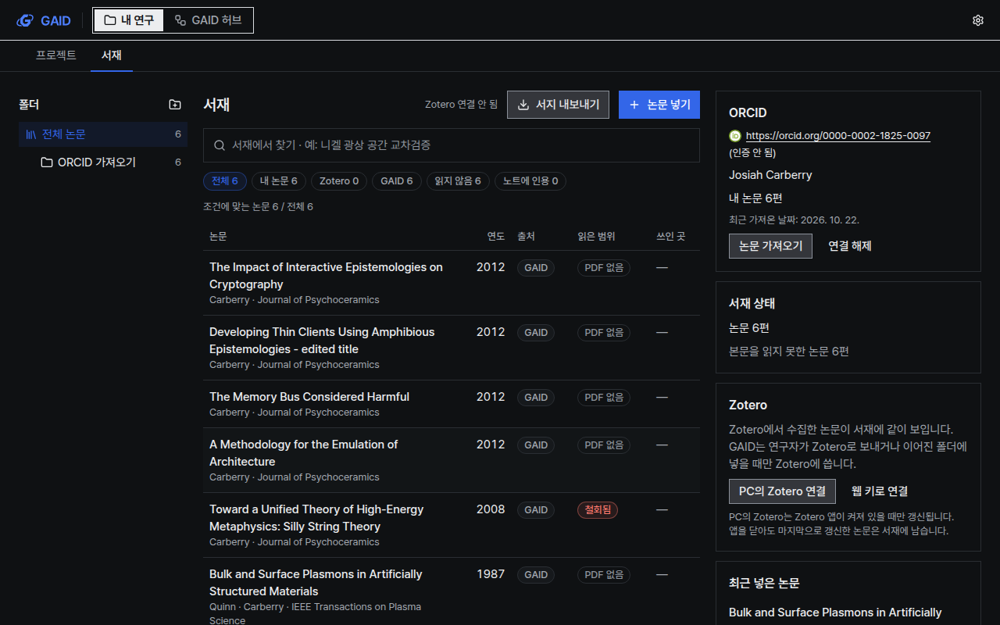
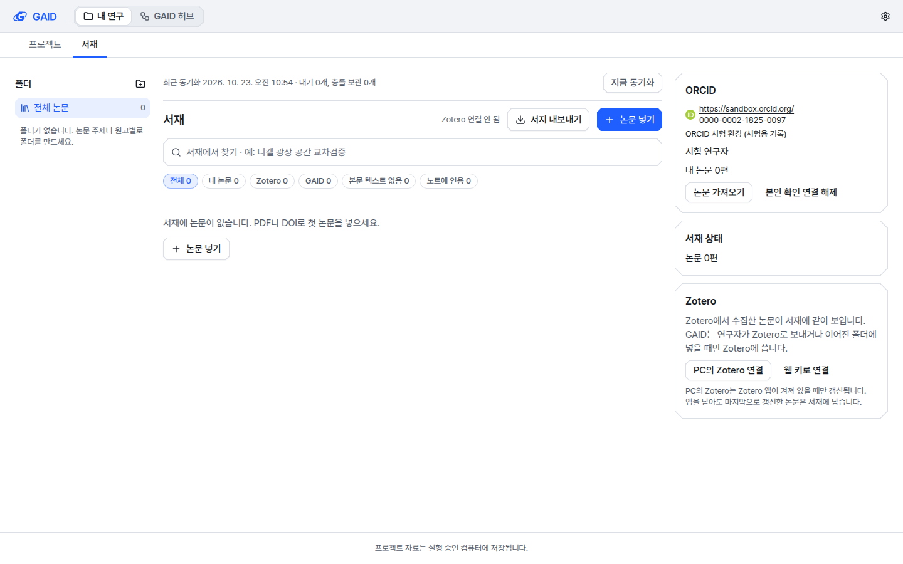
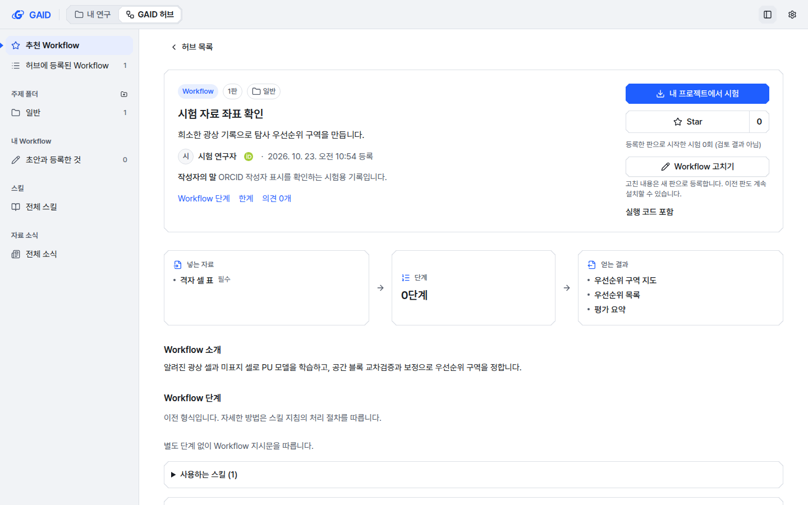

# ORCID 연결, 내 논문 가져오기, 본인 확인

## 0. 한눈에

| | |
|---|---|
| 요청 | 이용자의 ORCID를 GAID에 연동합니다. 가능 여부를 먼저 조사하고, 확인받은 범위만 구현합니다. |
| 결론 | 두 단계를 모두 구현했습니다. 1단계: 연구자가 서재에서 ORCID iD를 입력하고, ORCID에 공개된 자기 논문을 미리 본 뒤 고른 것만 서재에 넣어 "내 논문"으로 표시합니다. 2단계: 기관 GAID 허브에 로그인한 연구자가 ORCID에 로그인해 본인 확인을 마치면, 인증된 iD가 허브 계정과 그 연구자가 등록한 허브 Workflow의 작성자 옆에 표시됩니다. |
| 믿을 수 있는 정도 | 1단계는 ORCID 시험용 공개 기록과 Crossref로 끝까지 확인했습니다. 2단계는 사용자가 등록한 ORCID 앱으로 시험 환경과 실제 환경 모두 실제 로그인까지 확인했습니다. 실제 KIGAM 연구자의 ORCID 기록, 국내 학술지 논문, 연구자 사용성은 시험하지 않았습니다. 기관 허브 서버에는 아직 배포하지 않았습니다. |
| 결정할 일 | 없음. 사용자가 기관 허브 서버 배포를 보류하고, 검토용 앱에만 반영하기로 정했습니다(6절). |

## 1. 요청한 것

> "별도 작업으로 이용자들의 ORICD를 연동하는 기능도 구현 가능하면 진행하고 싶다." — 2026-10-22 요청 ("ORICD"는 ORCID)

완료 기준: 실현 가능성을 조사하고, 짧은 계획을 이 작업 탭에서 확인받은 뒤 확인된 범위를 구현합니다. 자동 검사가 통과해야 합니다.

사용자가 확인한 범위(2026-10-22): "1단계 먼저, 2단계는 등록 후". ORCID 앱은 "제 개인 ORCID 계정"으로 등록합니다. 사용자는 2026-10-23에 ORCID 시험 환경 앱과 실제 환경 앱을 등록했고, 비밀값을 직접 시험용 허브 서버에 넣었습니다.

## 2. 수행한 것

1. ORCID 공식 문서와 약관을 조사했습니다. 이 PC에서 ORCID 서버에 실제로 접속해 공개 기록을 읽어 보았습니다.
2. 무엇을 만들고 무엇을 만들지 않을지 정해 확인받았습니다. 1단계는 iD 입력과 공개 논문 가져오기입니다. 2단계는 본인 인증 연결과 허브 계정 표시입니다.
3. 1단계: GAID가 ORCID 공개 기록을 읽고, 서재의 기존 논문과 대조해 넣거나 표시하는 부분과 서재 화면(ORCID 카드, 가져오기 창, "내 논문" 보기)을 만들었습니다. 화면은 하위 작업이 만들었습니다.
4. 2단계: 허브 서버가 ORCID 앱 정보를 보관하고 ORCID 로그인 결과를 검증해 계정에 iD를 기록하도록 만들었습니다. 연구자 PC의 GAID는 ORCID에서 돌아온 결과를 허브로 넘기고, 화면에 본인 확인 단추와 인증된 iD를 보여 줍니다. 화면은 다른 하위 작업이 만들었습니다.
5. 사용자가 등록한 ORCID 앱으로 시험 환경과 실제 환경에서 실제 로그인을 해 보고, 두 화면 스타일과 두 테마에서 화면을 찍었습니다.

### 2.1 조사로 확인한 사실

- 무료로 쓸 수 있는 ORCID Public API로 요청하신 기능을 모두 만들 수 있습니다. KIGAM이 ORCID 회원이 아니어도 됩니다.
- 회원 전용 API는 GAID에서 ORCID로 논문을 써 넣는 기능과 비공개 정보 읽기에만 필요합니다. 이번 범위에는 필요하지 않습니다.
- 공개 논문 목록은 로그인 없이 읽을 수 있습니다. 익명 사용 한도는 IP당 하루 25,000건이고, 초당 12건까지 허용됩니다.
- 기록을 주기적으로 계속 조회하는 것은 약관이 금지합니다. GAID는 연구자가 버튼을 누를 때만 읽습니다.
- ORCID 표시 규칙상, 연구자가 직접 입력해 인증하지 않은 iD는 전용 아이콘과 "(인증 안 됨)"을 붙여 표시해야 합니다.
- 본인 인증 연결에는 ORCID에 등록한 앱이 필요합니다. 앱은 개인 계정 하나에 한 세트만 발급되고, 비밀값은 서버에만 두어야 합니다.
- 실제 환경의 되돌아올 주소는 HTTPS여야 한다고 문서에 적혀 있습니다. 그러나 2026-10-23에 실제로 등록하고 로그인해 보니, 실제 ORCID도 연구자 PC 안의 주소를 받아 주었습니다.
- 한국에서는 KISTI가 ORCID 회원입니다. 한국 컨소시엄과 KIGAM의 회원 여부는 확인하지 못했습니다.

### 2.2 만들지 않은 것

- GAID에서 ORCID로 논문을 써 넣는 기능. 회원 전용 API가 필요합니다.
- 주기적 자동 동기화. 약관이 금지합니다.
- ORCID 로그인으로 허브 계정 로그인을 대신하는 기능. 허브 계정은 지금처럼 초대와 비밀번호로 유지합니다.
- ORCID 앱 비밀값을 입력하는 화면. 운영자가 허브 PC에서 명령으로 한 번 넣습니다.
- 기관 전체 연구자의 ORCID를 자동으로 찾는 기능.

## 3. 결과

그림 1. iD를 연결하기 전 서재 오른쪽의 ORCID 카드(계측 스타일, 밝은 테마, 1440×900). 볼 것: 연결하면 공개 논문을 서재로 가져오고 ORCID에는 아무것도 쓰지 않는다는 안내, iD나 주소를 붙여 넣는 칸.

그림 2. ORCID 논문 가져오기 창(계측 스타일, 밝은 테마, 1440×900). ORCID 시험용 공개 기록의 논문 6편이 보입니다. 볼 것: 각 논문의 상태(새 논문), 선택한 수, 새 논문을 넣을 폴더, 실행 단추에 적힌 편수, iD 옆의 "(인증 안 됨)".

그림 3. 가져온 뒤의 서재(도폭 스타일, 어두운 테마, 1280×800). 볼 것: "내 논문 6" 보기, 카드의 "내 논문 6편"과 최근 가져온 날짜. Crossref 기록에 철회 정보가 있는 시험 논문 한 편에는 "철회됨"이 붙었습니다.

연구자는 서재에서 다음 순서로 논문을 넣습니다.

1. 서재 오른쪽 ORCID 카드에 iD나 ORCID 주소를 붙여 넣고 "iD 연결"을 누릅니다. GAID가 공개 기록이 있는지 확인하고 이름을 보여 줍니다.
2. "논문 가져오기"를 누르면 ORCID에 공개된 논문이 상태와 함께 나옵니다.
   - 새 논문: 처음부터 선택돼 있습니다. 넣으면 서재에 새 항목이 생깁니다.
   - 서재에 있음: DOI가 같은 논문이 이미 서재에 있습니다. 넣으면 새 항목 없이 그 논문에 "내 논문" 표시만 붙습니다.
   - 비슷한 항목 있음: 제목과 연도가 비슷한 논문이 있지만 같은 논문인지 확실하지 않습니다. 처음에는 선택돼 있지 않고, 비슷한 서재 논문의 제목을 보여 줍니다. 합치지 않으며, 연구자가 고르면 별도 항목으로 넣습니다.
   - 이미 내 논문으로 표시됨: 전에 넣은 논문입니다. 다시 고를 수 없습니다.
3. 고른 논문을 넣을 때 GAID가 DOI로 Crossref, 그다음 OpenAlex에서 서지 정보를 채웁니다. DOI가 없거나 조회에 실패하면 ORCID 기록의 제목·연도·저자 정보로 채우고, 몇 편이 그랬는지 알려 줍니다.
4. 서재의 "내 논문" 보기에서 표시한 논문을 모아 봅니다. 이 표시는 Zotero에서 서재를 다시 읽어 와도 남고, ORCID 연결을 해제해도 남습니다. 계정 동기화는 서재 항목을 통째로 옮기므로 표시도 다른 PC로 함께 갑니다. 이 경로는 시험하지 않았습니다.

| 완료 기준 | 결과 | 근거 |
|---|---|---|
| 실현 가능성 조사 (API, 회원 여부, 인증, 주소 규칙, 시험 환경, 약관, 접속) | 충족. KIGAM 회원 여부는 미확인 | 2.1절, 부록 A |
| 계획을 확인받은 뒤 구현 | 충족 | 1절 |
| iD 연결과 표시 규칙 | 충족 | 그림 1·3 |
| 공개 논문을 미리 보고 고른 것만 넣기, 기존 논문과 대조 | 충족 | 그림 2, 4절 |
| "내 논문"의 바탕 | 충족. 원고·투고 관리는 이번 범위 밖 | 그림 3 |
| 허브 계정과 허브 Workflow에 iD 표시 | 충족(2단계). 기관 허브 서버에는 배포 전 | 3.1절, 4.1절 |
| 본인 확인 연결 (비밀값은 서버에만) | 충족(2단계). 시험·실제 환경 실제 로그인 확인 | 3.1절, 4.1절 |
| 자동 검사 통과 | 충족 | 4절 |

### 3.1 본인 확인 연결 (2단계, 2026-10-23)

그림 4. 본인 확인을 마친 뒤 서재의 ORCID 카드(계측 스타일, 밝은 테마, 1440×900, 시험 환경 iD). 볼 것: 녹색 공식 인증 아이콘, "(인증 안 됨)"이 없는 iD, 시험 환경 표시, "본인 확인 연결 해제".

그림 5. 허브 Workflow 상세의 작성자 줄. 볼 것: 작성자 이름 뒤의 ORCID 아이콘. 누르면 그 연구자의 ORCID 기록이 새 탭으로 열립니다.

연구자는 다음 순서로 본인 확인을 합니다.

1. 기관 GAID 허브에 로그인한 상태에서 서재의 ORCID 카드에 있는 "ORCID로 본인 확인"을 누릅니다. 새 탭에서 ORCID 로그인 화면이 열립니다. 탭이 차단되면 카드에 로그인 링크가 나옵니다.
2. ORCID에 로그인하고 GAID의 접근 요청을 허용합니다. ORCID에는 아무것도 쓰지 않습니다. GAID는 iD와 이름만 받습니다.
3. ORCID가 그 연구자 PC의 GAID로 돌려보내면, GAID가 결과를 허브 서버로 넘깁니다. 허브 서버는 ORCID가 서명한 확인서(ID 토큰)를 검증한 뒤 iD를 계정에 기록합니다. 결과 탭에 "ORCID 본인 확인을 마쳤습니다"가 나옵니다.
4. GAID로 돌아오면 카드가 인증된 iD로 바뀝니다. 그 연구자가 등록한 허브 Workflow의 작성자 옆과 허브 계정 화면에도 같은 iD가 나옵니다. 연결 전에 등록한 Workflow에도 나옵니다.
5. "본인 확인 연결 해제"를 누르면 확인 창이 열립니다. 해제하면 허브 계정에서 iD가 빠지고, 서재의 iD는 "(인증 안 됨)" 상태로 남습니다. 가져온 논문과 "내 논문" 표시는 그대로입니다.

허브에 로그인하지 않았거나, 허브에 ORCID 앱이 설정되지 않았거나, 허브에 연결할 수 없으면 카드가 그 상태와 다음 동작을 알려 줍니다. 한 ORCID iD는 허브 계정 하나에만 연결됩니다.

허브 운영자는 허브 PC에서 ORCID 앱 정보를 한 번 넣습니다. 비밀값은 입력할 때 화면에 보이지 않습니다. 소유자만 읽을 수 있는 파일에 저장되며 허브 백업에 들어가지 않습니다.

## 4. 검증

- 과학적 검증: 해당 없음. 이 기능은 서지 정보를 옮기며 연구 결과를 계산하지 않습니다. 가져온 서지 정보가 맞는지는 Crossref·OpenAlex·ORCID 기록에 기대며, GAID가 따로 검증하지 않습니다.
- 실제 서비스 확인 (2026-10-22, 이 PC):
  - ORCID가 시험용으로 공개한 기록(Josiah Carberry)을 연결했습니다.
  - 논문 6편을 미리 보고 모두 넣었습니다. 결과는 추가 6편, 표시만 붙임 0편, 실패 0편이고, 6편 모두 Crossref 서지로 채워졌습니다.
  - 같은 목록을 다시 열자 6편 모두 "이미 내 논문으로 표시됨"으로 바뀌어 고를 수 없었습니다.
  - 연결을 해제한 뒤에도 6편의 표시가 남았습니다.
- 자동 시험:
  - iD 확인 문자 계산, ORCID 기록 해석, 미리보기 상태(새 논문·서재에 있음·비슷한 항목), 고른 것만 넣기, 같은 DOI는 표시만 하기를 시험합니다.
  - 다시 넣어도 항목이 늘지 않는지, DOI 조회 실패 시 ORCID 기록으로 채우는지, ORCID 장애 시 연결 정보가 바뀌지 않는지도 시험합니다.
  - "Zotero를 다시 읽어도 내 논문 표시가 남는다" 시험은 표시를 지키는 코드를 빼면 실패하는 것까지 확인했습니다.
- 전체 검사(1단계 시점): 백엔드 시험 2191건이 통과했고 8건은 건너뛰었습니다. 프런트엔드 시험 1207건, 문구 검사, 화면 규칙 검사, 배포 검사가 통과했습니다.
- 화면 확인: 연결 전·연결 후·가져오기 창을 두 스타일(계측, 도폭), 두 테마, 두 크기(1440×900, 1280×800)에서 한국어로 찍은 24장을 UI 가이드 12절 기준으로 확인했습니다.
  - 확인한 항목: 실행 단추가 보이는지, 창 안에서만 스크롤되는지, 글자가 잘리지 않는지, ORCID 아이콘 색이 원래대로인지, 키보드 초점이 돌아오는지.
  - UI 가이드에서 벗어난 점이 하나 있습니다(규칙 G1). 논문 고르기 목록의 한 줄은 일반 목록보다 높습니다. 제목 전체, 연도·학술지, 상태를 한눈에 구별하도록 그렇게 했습니다.

### 4.1 본인 확인 검증 (2026-10-23)

- 실제 ORCID 로그인: 사용자가 등록한 ORCID 앱으로 이 PC의 시험용 허브 서버와 시험용 GAID에서 두 번 확인했습니다.
  - 시험 환경(10:46 KST): 시험 계정 iD가 허브 계정에 인증된 iD로 기록되고, 서재 카드가 인증 상태로 바뀌었습니다. 첫 시도에서는 ORCID가 "redirect_uri ... does not match"로 거부했습니다. 앱에 등록한 되돌아올 주소가 달랐기 때문이며, 사용자가 주소를 고친 뒤 성공했습니다.
  - 실제 환경(10:57 KST): 사용자 본인의 ORCID 계정으로 같은 결과를 얻었습니다. 확인 뒤 시험 계정의 연결과 시험용 허브의 실제 앱 설정 파일을 지웠습니다.
  - 허브 데이터베이스와 감사 기록에 비밀값이 없고, 1회용 확인 값은 사용 뒤 지워진 것을 확인했습니다. 연구자 GAID의 요청 기록에 ORCID 확인 코드가 남는 것을 발견해, 기록에서 가리도록 고쳤습니다.
- 자동 시험: 가짜 ORCID 서버가 실제 서명 방식(RS256)으로 만든 확인서로 다음을 시험합니다.
  - 정상 연결, 1회용 값 재사용 거부, 다른 계정의 요청 거부, 10분 만료
  - 서명 키, 발급자, 대상, 일회용 값, 유효 시간이 틀린 확인서 거부
  - 같은 iD를 두 계정에 연결하는 것 거부
  - 허브 Workflow 작성자 iD는 클라이언트가 보낸 값을 버리고 계정 기록에서만 붙이는지
  - 앱 설정 파일을 소유자만 읽을 수 있는지와 백업에서 빠지는지
- 최종 전체 검사(2026-10-23, 2단계까지 합친 상태): 백엔드 시험 2249건이 통과했고 8건은 건너뛰었습니다. 프런트엔드 시험 1231건, 문구·화면 규칙·배포 검사, 실제 기동·재기동 검사가 통과했습니다.
- 화면 작업 도중 전체 검사에서 백엔드 시험 2246건과 프런트엔드 시험 1231건이 통과했습니다. 백엔드 시험 8건은 건너뛰었습니다. 문구·화면 규칙·배포 검사와 실제 기동·재기동 검사도 통과했습니다.
- 화면 시험용 앱과 시험 허브에서 미로그인, ORCID 미설정, 본인 확인 준비, 시험용 인증 연결 상태를 확인했습니다. 설정으로 이동해 시험 계정의 초대를 수락하는 흐름도 확인했습니다.
- 화면 사진의 인증 상태는 시험 허브의 데이터에 시험용 iD를 넣어 만들었습니다. 실제 로그인은 위의 두 번입니다.
- 인증 연결 해제의 취소와 실행을 확인했습니다. 해제 뒤에도 같은 iD가 남고 "(인증 안 됨)"으로 바뀌었습니다. 허브 목록에서 ORCID 링크를 누르면 연구자 기록만 새 탭으로 열리고 Workflow는 열리지 않았습니다.
- 실제 앱에서 찾은 iD 해제 중 대기 문제(허브에 로그인한 상태에서 iD 연결·해제가 끝나지 않음)는 상위 작업에서 고치고 회귀 시험을 더했습니다. 수정본을 가져온 뒤 별도 앱에서 본인 확인 연결 해제와 직접 입력 연결 해제가 모두 응답하는 것을 확인했습니다. 수정 뒤 ORCID 회귀 시험 15건도 통과했습니다.
- 자동 시험에서 로그인 탭을 먼저 열고 응답 뒤 이동하는 동작, 탭 차단 시 링크 제공, 실패 시 빈 탭 닫기, 돌아온 뒤 연결 상태 갱신, 인증 연결 해제와 기존 직접 입력 흐름을 확인했습니다.
- 서재의 미로그인·본인 확인 준비·인증 연결 상태와 허브 목록·작성자·계정 화면을 한국어로 찍은 48장을 확인했습니다. 계측·도폭, 밝은·어두운 테마, 두 화면 크기를 포함합니다. 공식 아이콘의 색을 바꾸지 않았으며, 긴 시험 환경 주소는 iD 전체가 같은 줄에 남도록 줄을 나눕니다.

## 5. 한계

- 실제 KIGAM 연구자의 ORCID 기록, 논문이 많은 기록(수백 편), 국내 학술지(KCI) 논문은 시험하지 않았습니다. DOI가 없는 국내 논문은 ORCID 기록에 적힌 만큼만 서지가 채워집니다.
- 한 번에 최대 200편까지 넣을 수 있습니다. 미리보기는 500편까지 보여 주고, 그보다 많으면 몇 편이 빠졌는지 알려 줍니다.
- 넣을 때 DOI마다 Crossref를 조회하므로 수십 편이면 수십 초 걸립니다. 창을 닫아도 작업은 계속됩니다.
- 입력한 iD가 그 연구자 본인의 것인지 확인하지 않습니다. 화면에 "(인증 안 됨)"으로 표시하는 이유입니다.
- ORCID 연결 정보는 그 PC에만 있어서 PC마다 다시 입력해야 합니다. "내 논문" 표시가 계정 동기화로 다른 PC에 가는지는 시험하지 않았습니다.
- 본인 확인은 연구자 PC의 GAID가 기본 주소 설정으로 돌 때만 됩니다. ORCID 앱에 그 주소 하나만 등록했기 때문입니다. 브라우저도 같은 PC에서 열어야 합니다.
- 본인 확인을 하려면 기관 GAID 허브 계정이 있어야 합니다. 허브 없이 쓰는 연구자는 1단계(인증 안 된 iD)만 씁니다.
- 연구자 GAID와 허브 사이의 연결은 지금 기관망 안의 HTTP입니다(시범 운영에서 받아들인 설정). ORCID 확인 코드도 이 경로로 넘어갑니다. 1회용이고 앱 비밀값 없이는 쓸 수 없습니다.
- ORCID 앱은 사용자 개인 계정에 등록돼 있습니다. ORCID 약관상 담당자가 바뀌면 새 담당자가 다시 등록해야 합니다. 기관 정식 서비스로 넓히면 기관 회원(Member API)을 검토할 이유가 생깁니다.
- 기관 허브 서버(PC74)에는 배포하지 않았습니다(사용자 결정). 그래서 검토용 앱에서는 ORCID 본인 확인을 해 볼 수 없습니다. 배포하면 허브 데이터베이스가 새 형식으로 한 번 바뀝니다. 기존 계정과 기록은 유지되며, 이 변환은 자동 시험으로 확인했습니다. ORCID 기능이 없는 이전 허브 서버에 연결된 GAID는 "허브에 ORCID 연결이 설정되지 않았습니다"로 안내합니다.

## 6. 결정할 일

없음. 기관 허브 서버 배포는 사용자가 정했습니다: "아직은 기관 허브서브에 배포하지 않는다. 검토용 앱에 통합은 할 것이다." (2026-10-23)

검토용 앱은 새 버전으로 바꿉니다. 검토용 앱이 연결한 기관 허브 서버에는 2단계가 없으므로, 검토용 앱의 ORCID 카드는 "허브에 ORCID 연결이 설정되지 않았습니다"로 안내합니다. 1단계(iD 입력과 논문 가져오기)는 검토용 앱에서 그대로 쓸 수 있습니다. 기관 허브 배포는 사용자가 다시 정할 때까지 대기 항목으로 남깁니다.

## 7. 대체되었거나 실패한 시도

펼치기 — 3건

- 처음 대조 방식은 DOI가 없는 논문을 다시 넣을 때 "비슷한 항목"으로 보고 한 번 더 넣었습니다. 시험에서 발견해, 전에 그 ORCID 논문에서 넣은 항목은 같은 논문으로 보도록 고쳤습니다.
- 2단계 첫 구현에서는 허브에 로그인한 상태로 iD를 직접 연결하거나 해제하면 처리가 끝나지 않았습니다. 저장이 끝나기 전에 상태를 다시 읽으려 해서 서로를 기다렸습니다. 화면 하위 작업이 실제 앱에서 발견했고, 저장을 먼저 마친 뒤 상태를 읽도록 고쳤습니다.
- 비밀값 없이 브라우저에서 확인서를 직접 받는 방식(ORCID의 implicit 방식)도 검토했습니다. 확인서가 브라우저를 거치고 별도 화면이 더 필요해서 쓰지 않았습니다.

## 용어

| 용어 | 새 정의 / 정의 변경 | 정의 |
|---|---|---|
| [내 논문 (서재)](../../docs/glossary.md) | 새 정의 | 연구자가 ORCID 기록에서 자기 논문으로 확인해 표시한 서재 논문입니다. 서재의 "내 논문" 보기에서 모아 봅니다. 연결된 ORCID iD와 그 기록 안의 논문 번호가 함께 남습니다. |

## 부록 A. 근거 위치

펼치기 — 실행 방법, 원본, 커밋

| 항목 | 위치 |
|---|---|
| 코드 | 브랜치 `task/gaid-orcid` (1단계는 PR #78로 main에 합침). 서버 `server/src/geo/orcid/`, `server/src/geo/routes/orcid.ts`, 허브 `server/src/geo/hub-server/orcid.ts`(경로 `/hub/v1/orcid*`, 데이터베이스 변경 4단계). 계약 `web/src/geo/contracts/{orcid,hub-server,hub-shared}.ts`. 화면 `web/src/geo/orcid/`, `web/src/geo/hub/shared-{method,browse,entry}.tsx`, `web/src/geo/hub-server/account.tsx`. 결정 기록 `docs/adr/2026-10-23-orcid-authenticated-link.md`. 운영자 안내 `docs/geo/hub-server.md` "ORCID sign-in" |
| 시험 | `server/test/geo-orcid.test.ts`, `server/test/geo-hub-orcid.test.ts`, `server/test/geo-library-zotero-service.test.ts`, `web/src/geo/orcid/*.test.tsx`; 전체 `scripts/check` (1단계 트리 9d9a8a4aaa46 통과, 2단계 결과는 4.1절) |
| 실제 ORCID 로그인 | 시험 환경 앱 APP-NMSX0X5YG2CKUCUQ, 실제 환경 앱 APP-V8F0MWRKJYRFP1N8 (사용자 소유). 시험용 허브 `~/data/geoaidesk/work/gaid-orcid/e2e/hub`(포트 8711), 시험용 GAID 포트 8000; job 기록 `~/data/geoaidesk/runs/gaid-orcid-20261023T01*` (일부러 중지, 취소 처리) |
| 실제 서비스 확인 | PC74 `~/data/geoaidesk/work/gaid-orcid/smoke/live.mts` (서버), `~/data/geoaidesk/work/gaid-orcid-ui/` (화면 시험용 앱, 포트 4317/18117, 중지함) |
| 화면 사진 | `reports/2026-10-22-gaid-orcid/figures/orcid-{unlinked,linked,import}-{instrument,mapsheet}-{light,dark}-{1440,1280}.png` (24장) |
| 웹 조사 | Obsidian `웹 조사/geoaidesk/2026-10-22-i-am-building-an-orcid--e234c882d8.md` (Oracle Extra High, 2026-10-22) |
| ORCID 공식 근거 | Public API 약관 https://info.orcid.org/public-client-terms-of-service/ · 사용 한도 https://info.orcid.org/ufaqs/what-are-the-api-limits/ · 되돌아올 주소 규칙 https://info.orcid.org/ufaqs/how-do-redirect-uris-work/ · iD 표시 규칙 https://info.orcid.org/documentation/integration-guide/orcid-id-display-guidelines/ · 시험 환경 https://info.orcid.org/documentation/integration-guide/sandbox-testing-server/ · OpenID 설정 https://orcid.org/.well-known/openid-configuration · KISTI 사례 https://info.orcid.org/pids-hand-in-hand-the-korea-doi-centers-orcid-auto-update/ |
| 아이콘 출처 | ORCID 브랜드 자료실의 공식 아이콘, 수정하지 않음. `THIRD_PARTY_NOTICES.md` "ORCID iD icons" |
| 2단계 화면 코드·문구·UI 규칙 | `docs/tasks/gaid-orcid--authui.md`의 Phase-2 UI delivery details와 문자열 표 |
| 2단계 화면 사진 | `reports/2026-10-22-gaid-orcid/figures/orcid2-{no-account,ready,linked,author,browse,account}-{instrument,mapsheet}-{light,dark}-{1440,1280}.png` |
| 2단계 화면 시험 | `web/src/geo/orcid/orcid-card.test.tsx`, `web/src/geo/hub/{shared-method,shared-browse}.test.tsx`; 별도 앱과 근거 `~/data/geoaidesk/work/gaid-orcid-auth-ui/` |
| 하위 작업 기록 | `docs/tasks/gaid-orcid--ui.md` (바꾼 파일, 문구 id 한·영, UI 규칙 근거) |

작성 시점: 2026-10-23, commit 8105d988.

