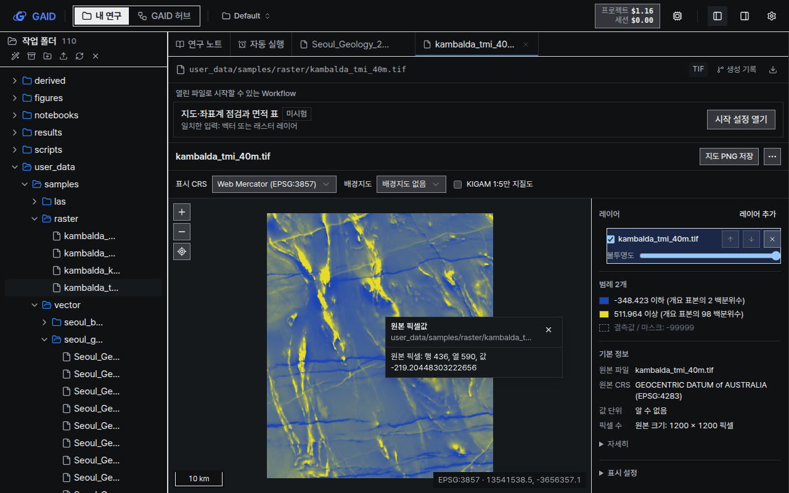
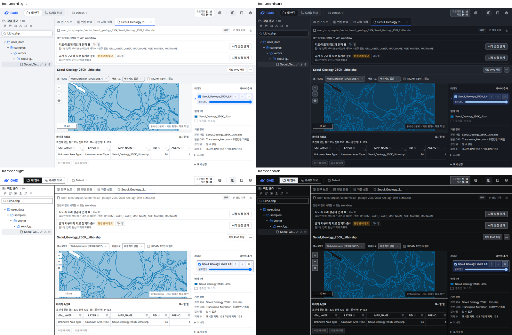
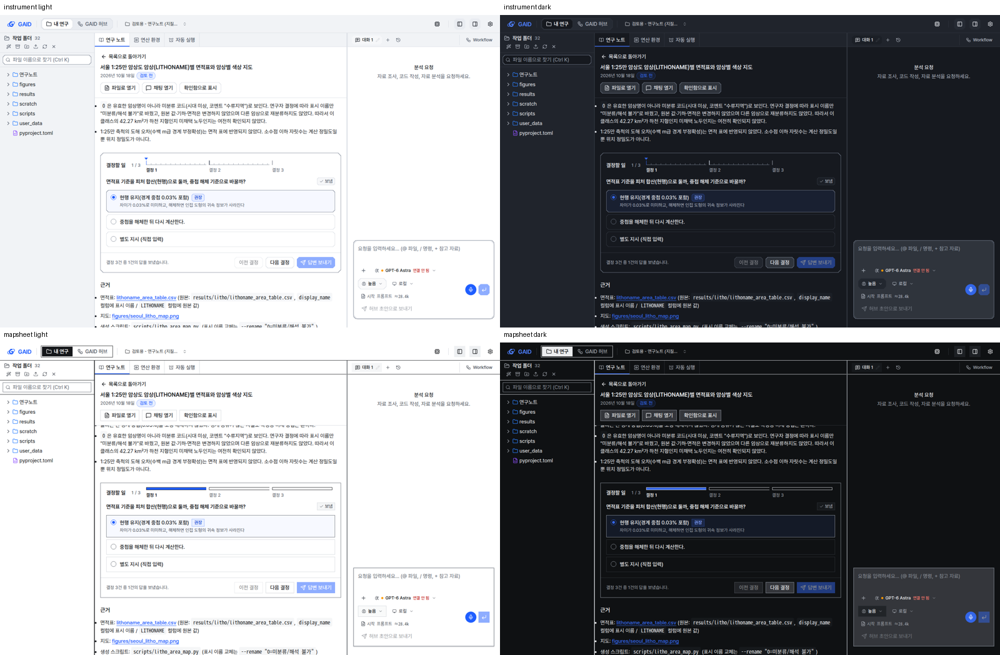
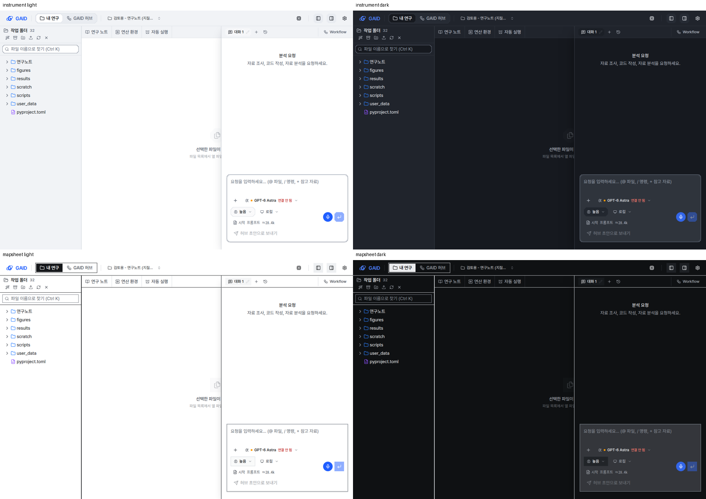
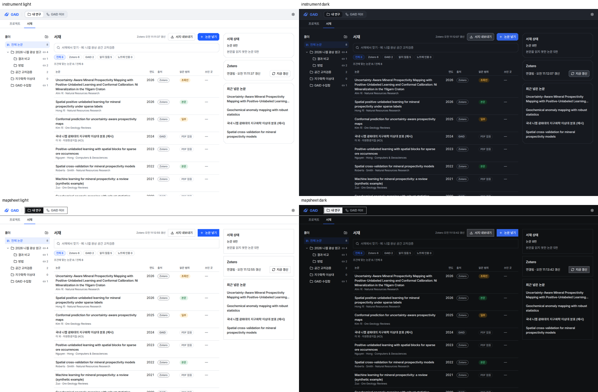

# UI 가이드 v2 부채 네 건 처리

## 0. 한눈에

| | |
|---|---|
| 요청 | 가이드 v2 도입 때 남긴 부채 네 건을 모두 처리 |
| 결론 | 네 건을 모두 구현했고 실제 앱에서 두 스타일(계측, 도폭)과 두 테마(밝은, 어두운)로 확인했습니다. 모서리 깎기의 Firefox 표시(--fresh#4)는 허브에서 따로 다루기로 해 이 작업에 넣지 않았습니다. |
| 믿을 수 있는 정도 | 자동 시험, UI·문구 검사, 실제 앱 스크린샷 84장으로 확인했습니다. 실제 연구자 사용과 Firefox·Safari 화면은 확인하지 않았습니다. |
| 결정할 일 | 1건 (6절): 지도 위 Workflow 제안 칸을 접을지 |

## 1. 요청한 것

> 부채 모두 처리하자. 확인 --fresh#4와 관련해서 chrome에서는 모서리 깎기가 적용되었는데 firefox에서는 적용되지 않았다. — 2026-10-22 요청

완료 기준: 허브가 이 작업으로 넘긴 네 건을 가이드 v2 규칙대로 구현합니다.

1. 서재 화면의 출처·읽은 범위 배지를 역할 색으로 바꾸고 UI 검사 허용 목록에서 지웁니다(gaid-design-identity#1).
2. 지도 화면을 MAP1–MAP6대로 다시 짭니다. 긴 문단은 짧게 줄이고, 체커보드 배경을 없애고, 범례와 기본 정보를 스크롤 없이 보이게 합니다(--fresh#1).
3. 1024–1279 px 창에서는 오른쪽 패널을 겹쳐 여는 시트로 바꿉니다(L1). 패널 경계는 키보드로 조절하고(L2), 사이드바 숨기기와 검색은 단축키로 엽니다(N2, N6)(--fresh#2).
4. 결정에 답을 보낸 뒤에도 고른 선택지를 '보냄' 상태로 카드에 남깁니다(RN3)(--fresh#3).

모서리 깎기(--fresh#4)와 연구 노트 목록 위치(--fresh#5)는 허브에 남아 있어 이 작업 범위가 아닙니다.

## 2. 수행한 것

1. 지도 화면은 하위 작업자(Codex)에게 맡겼습니다. 서재 배지, 결정 카드, 작업 공간 레이아웃은 제가 고쳤습니다.
2. 바꾼 화면마다 같은 시험 자료로 실제 앱을 띄웠습니다. 계측·도폭, 밝은·어두운 테마, 1440×900, 1280×800, 1180×800에서 한국어 화면을 찍어 가이드 12절 점검표와 대조했습니다.
3. 기존 시험을 바뀐 화면 구조에 맞게 고치고, 새 동작(보낸 답 유지, 파일 이름 찾기, 단축키 판정, 지도 속성 보기)에 시험을 더했습니다.

## 3. 결과

### 3.1 지도 화면 (MAP1–MAP6)

그림 1. 서울 1:25만 암상도를 연 지도 화면(계측, 밝은 테마, 1280×800, 하위 작업이 찍은 화면이며 속성표를 184 px로 줄인 상태)입니다. 볼 것: 지도 오른쪽 320 px 패널에 레이어, 범례, 기본 정보가 이 순서로 스크롤 없이 보입니다. 피처를 누르면 속성이 8개까지 팝업으로 뜨고 `모든 속성 보기`로 아래 속성표에 이어집니다.

그림 2. 자력 이상 래스터를 연 지도 화면(도폭, 어두운 테마, 1280×800)입니다. 볼 것: 지도 뒤 체커보드 무늬가 없어졌고, 원본 CRS가 이름과 코드(EPSG:4283)로 보입니다. 눌러 읽은 값은 원본 픽셀에서 읽은 값입니다.

| 규칙 | 바뀐 점 |
|---|---|
| MAP1 | 지도와 320 px 패널을 1024 px부터 나란히 둡니다. 범례가 길면 `범례 5개`처럼 개수와 `모두 보기`를 보여 줍니다. 1280×800에서 범례 아래 끝은 621 px, 기본 정보 아래 끝은 796 px로 화면 안에 들어갑니다. |
| MAP2 | 기본 정보는 원본 파일, 원본 CRS, 값 단위, 피처·픽셀 수 네 줄입니다. 투영법 이름만 있는 CRS는 `투영법만 기록됨`으로 표시합니다. 범위, 표본 추출 방식, 표시용 안내, 문제 목록은 `자세히` 안에 있고 문장은 그대로입니다. |
| MAP3 | 팝업은 레이어와 피처 번호, 속성 8개까지 보여 줍니다. `모든 속성 보기`를 누르면 표의 필터를 풀고 해당 행을 보여 주며 표로 초점을 옮깁니다. |
| MAP4 | 표시 CRS와 배경지도를 한 묶음으로 두고, 머리줄에는 `지도 PNG 저장`과 `더 보기`만 둡니다. 온라인 배경지도 안내는 그것을 고를 때만 나옵니다. |
| MAP5 | 속성표는 지도 아래에 두고 경계를 끌거나 위·아래 화살표로 높이를 바꿉니다. 열 머리글에서 정렬·필터를 하고, 기본 8열에 `표시할 열`로 나머지를 고릅니다. 결측값은 `결측값`으로 표시합니다. |
| MAP6 | 축척 막대, 표시 CRS의 커서 좌표, 확대·축소, 레이어 전체 보기를 지도 위에 둡니다. CRS를 모르는 자료에는 축척을 지어내 보이지 않습니다. |

그림 3. 같은 지질도를 네 조합(계측·도폭, 밝은·어두운 테마)으로 연 1280×800 화면입니다. 볼 것: 선택한 레이어는 계측에서 왼쪽 표시와 옅은 파랑, 도폭에서 먹선 테두리로 구분됩니다. 지도 위에 '열린 파일로 시작할 수 있는 Workflow' 칸이 있어도 패널의 범례와 기본 정보는 화면 안에 있습니다.

지도 결과를 합친 뒤 두 가지를 더 고쳤습니다. 레이어 행에 안쪽 여백을 넣어 '불투명도' 글자가 선택 표시 경계에 붙지 않게 했습니다. 연구자가 속성표 높이를 직접 바꾸기 전까지는 표가 지도 영역의 40%까지만 차지하게 했습니다(184–240 px). 1280×800에서 대화를 숨기면 지도는 237 px, 표는 184 px입니다. 이 조정 전에는 지도 181 px, 표 240 px로 표가 지도보다 컸습니다. 1440×900에서는 지도 313 px, 표 208 px입니다.

지도 색, 래스터 타일, 원본 픽셀 읽기, 면적 계산, 서버 경로는 바꾸지 않았습니다.

### 3.2 결정 카드의 '보냄' 상태 (RN3)

그림 4. 연구 노트의 결정 카드입니다(왼쪽 위부터 계측 밝은, 계측 어두운, 도폭 밝은, 도폭 어두운). 볼 것: 결정 1에서 보낸 선택지가 선택된 채로 남고, 질문 오른쪽에 `보냄` 표시가 있습니다. 카드 아래에는 `결정 3건 중 1건의 답을 보냈습니다.`가 나옵니다.

- 보낸 답은 이 브라우저에 노트별로 남습니다. 노트를 닫았다가 다시 열어도 보입니다.
- AI agent가 노트를 고쳐 질문 문장이 바뀌면 그 결정의 표시는 지워집니다.
- 답을 바꾸면 표시가 `바꾼 답, 보내기 전`으로 바뀝니다. 다시 보내면 새로 고르거나 바꾼 답만 갑니다.
- 채팅이 바로 보내지 못하고 입력창에만 넣은 경우는 `입력창에 넣음`으로 따로 표시합니다. 보내지 않은 답을 '보냄'으로 쓰지 않습니다(P9).

### 3.3 작업 공간 레이아웃과 키보드 (L1, L2, N2, N6)

그림 5. 창 너비 1180 px의 작업 공간입니다(네 조합). 볼 것: 대화 패널이 미리보기 위에 시트로 겹칩니다. 왼쪽 파일 목록 위에는 새 `파일 이름으로 찾기 (Ctrl K)` 칸이 있습니다.

| 규칙 | 바뀐 점 | 실제 앱 확인 |
|---|---|---|
| L1 | 1280 px보다 좁으면 대화 패널이 미리보기 위에 겹쳐 열립니다. 이전에는 대화가 아래 줄로 내려가 화면을 반으로 나눴습니다. 대화 숨기기 버튼으로 닫고, 진행 중인 대화는 그대로 이어집니다. | 1180×800 네 조합 |
| L2 | 패널 경계에 키보드 초점이 갑니다. 화살표로 16 px, Shift+화살표로 64 px, Home·End로 최소·최대 너비가 됩니다. 너비 범위를 가이드대로 파일 목록 220–360 px, 대화 360–640 px로 맞췄습니다. 저장된 너비가 범위 밖이면 범위 안으로 당깁니다. | 대화 경계 440 → 456 → 520, End 640, Home 360 |
| N2 | `Ctrl \`(macOS `⌘\`)로 파일 목록을 숨기고 다시 엽니다. 버튼 도움말에도 단축키를 적었습니다. | 숨김 확인 |
| N6 | `Ctrl K`(macOS `⌘K`)로 검색 칸에 초점을 옮깁니다. 작업 공간에서는 새 파일 이름 찾기 칸으로 갑니다. 파일 목록이 숨겨져 있으면 먼저 엽니다. 프로젝트 목록과 GAID 허브에서는 각 화면의 검색 칸으로 갑니다. Shift·Alt가 붙은 조합은 브라우저에 그대로 둡니다. | 초점 이동, `litho` 찾기, Esc로 지우기, 숨긴 뒤 다시 열기 |

파일 이름 찾기는 이름에 검색어가 들어간 파일과 폴더를 남기고, 그 파일로 가는 폴더를 펼칩니다. 맞는 것이 없으면 `이름이 맞는 파일이 없습니다.`와 `찾기 지우기`를 보여 줍니다.

### 3.4 서재 배지 (gaid-design-identity#1)

그림 6. 서재 논문 목록입니다(네 조합). 볼 것: 출처 배지(`Zotero`, `GAID`)는 무채색입니다. 읽은 범위 배지는 `본문`이 성공 색, `일부`·`초록만`이 주의 색, `PDF 없음`이 무채색입니다.

- 출처는 상태를 나타내지 않으므로 색을 빼고 글자로만 구분했습니다(I2, S3). 이전에는 Zotero가 빨간색, GAID가 파란색이었습니다. 가이드에서 빨강은 위험을, 파랑은 선택과 주요 동작을 뜻합니다.
- 한 행에 색 있는 상태 표시는 읽은 범위 하나만 남깁니다(S2).
- 최근 넣은 논문 목록의 왼쪽 파란 세로줄(V7)을 지우고, 마우스를 올렸을 때 배경을 칠하는 보통 행으로 바꿨습니다.
- 논문 추가 창과 Zotero 카드의 주의 문구도 역할 색으로 바꿨습니다. UI 검사 허용 목록에서 서재 항목 23개가 빠졌습니다.

| 완료 기준 | 결과 | 근거 |
|---|---|---|
| 서재 배지를 역할 색으로 바꾸고 허용 항목 삭제 | 충족 | 그림 6, 4절 |
| 지도 화면 MAP1–MAP6 | 충족 | 그림 1–3, 3.1 표 |
| L1·L2·N2·N6 | 충족 | 그림 5, 3.3 표 |
| 보낸 답을 '보냄' 상태로 유지(RN3) | 충족 | 그림 4, 3.2 |

## 4. 검증

- 과학적 검증: 해당 없음. 화면만 바꿨고 분석 결과, 지도 색, 면적 계산은 그대로입니다. 지도 화면에서 래스터 원본 픽셀 값(행 436, 열 590, -219.204…)을 읽어 바뀌지 않았음을 확인했습니다.
- 소프트웨어 검증: 지도 결과를 합친 뒤 프로젝트 전체 검사를 돌려 모두 통과했습니다. 백엔드 시험 2067건(8건은 원래 건너뜀), 웹 시험 1151건, 배포 구성 검사, 화면 문구 검사(오류 0건), UI 가이드 검사(오류 0건)를 통과했고, 깨끗한 자료 홈에서 GAID를 시작·중지·재시작하는 확인도 통과했습니다. 시험 통과는 화면이 연구자에게 쓰기 좋다는 뜻이 아니므로 화면은 아래처럼 따로 확인했습니다.
- 화면 검증: 실제 앱에서 한국어 스크린샷 84장을 찍어 가이드 12절과 대조했습니다(하위 작업의 지도 16장, 통합 뒤 지도 8장, 서재·결정 카드·작업 공간 60장). 지도 결과를 합친 직후에는 개발 서버가 새 지도 스타일을 읽지 않아 패널이 아래로 내려가 보였습니다. 서버를 다시 띄운 뒤 정상 배치를 확인했습니다. GAID 실행기는 화면 코드가 바뀌면 다시 빌드합니다. 같은 결정 카드를 1280 px에서 보니 새 상태 문장이 길어 버튼이 두 줄로 밀렸습니다. 문장을 줄여 한 줄로 맞췄습니다.

## 5. 한계

- 모서리 깎기는 이번에도 Chrome 계열에서만 화면을 봤습니다. Firefox·Safari 화면은 확인하지 않았습니다(허브의 --fresh#4).
- 보낸 답 표시는 브라우저에 저장됩니다. 다른 브라우저나 다른 PC에서 같은 노트를 열면 보이지 않습니다.
- 지도 위 '열린 파일로 시작할 수 있는 Workflow' 칸이 약 155 px를 차지합니다. 그래서 1280×800에서 지도는 237 px 높이에 그치고, 속성표는 데이터 행이 한두 줄만 보입니다(경계를 끌거나 화살표로 넓힐 수 있음). 이 칸은 모든 파일에 공통인 Workflow 시작 입구라 이번에 바꾸지 않고 6절에 결정으로 올렸습니다.
- 대화 패널(오른쪽 패널) 숨기기에는 단축키를 넣지 않았습니다. 이번 요청은 사이드바와 검색 단축키(N2, N6)였습니다. 가이드 D6는 오른쪽 패널에도 단축키를 권합니다.
- 1024 px보다 좁은 창은 지원 범위가 아니어서 따로 확인하지 않았습니다.

## 6. 결정할 일

1. 지도·표처럼 높이가 필요한 파일을 열었을 때 위의 'Workflow 제안' 칸을 접을지
   - 가) 제안을 한 줄 요약(`이 파일로 시작할 수 있는 Workflow 2개`와 펼치기)으로 접고, 펼치면 지금처럼 보이게 함 (권장: 1280×800에서 지도가 약 120 px 커지고, Workflow 시작은 한 번 더 누르면 됨)
   - 나) 지금처럼 모든 파일에서 펼쳐 둠 (Workflow를 바로 보지만 지도와 표가 좁음)

## 7. 대체되었거나 실패한 시도

펼치기 — 2건

- 결정 카드의 첫 상태 문장(`… 답을 바꾸면 다시 보낼 수 있습니다.`)은 1280 px에서 버튼을 두 줄로 밀어 줄였습니다. 다시 보내는 방법은 `바꾼 답, 보내기 전` 표시로 알립니다.
- 지도 속성표의 기본 높이 240 px는 1280×800에서 지도보다 커서 지도 영역의 40% 이하로 바꿨습니다.

## 용어

없음

## 부록 A. 근거 위치

펼치기 — 실행 방법, 원본, 커밋

| 항목 | 위치 |
|---|---|
| 코드 | 브랜치 `task/gaid-ui-v2-debts` (지도: 하위 브랜치 `task/gaid-ui-v2-debts--map` 통합) |
| 지도 화면 | `web/src/geo/viewers/map/**`, `web/src/geo/locales/map/*`, `web/src/app/globals.css` 끝의 지도 블록 |
| 결정 카드 | `web/src/geo/notes/decision-answers.ts`, `research-notes-panel.tsx`, `locales/notes/*` (`notes.decision.deliveredStatus`, `notes.decision.delivered.*`) |
| 레이아웃·단축키 | `web/src/app/page.tsx`, `web/src/components/sandbox-panel.tsx`, `web/src/geo/shell/shortcuts.ts`, `web/src/geo/workspace/file-filter.ts`, 검색 대상 표시 `data-gaid-search` (`project-view.tsx`, `geo/hub/hub-home.tsx`, `geo/hub/shared-browse.tsx`) |
| 서재 | `web/src/geo/library/{library-screen,add-paper-dialog,zotero-card}.tsx`, `geo/ui/ui-baseline.json` |
| 경계 기록 | `geo/integration-boundaries.json` (owner `gaid-ui-v2-debts`) |
| 스크린샷 | PC74 `~/data/geoaidesk/work/gaid-ui-v2-debts/shots/` (60장 + 통합 뒤 지도 `map-final-*` 8장), `map-shots/` (하위 작업 16장, `manifest.json`에 sha256), 모음 `sheets/`, 촬영 스크립트 `shot.sh`, `mapshot.sh` |
| 실행 | 개발 앱 `start.sh`, `KADY_PORT=18370 KADY_FRONTEND_PORT=3370 NEXT_PUBLIC_ADK_API_URL=http://localhost:18370`, 자료 홈 `~/data/geoaidesk/work/gaid-ui-v2-debts/home` |
| 검사 | `cd web && npx tsc --noEmit && npx vitest run`, `node geo/ui/check-ui.mjs`, `node geo/copy/validate-copy.mjs web/src/geo/locales`, `scripts/check` |

새 문구 (한국어 / 영어, 모두 새 id):

| Id | 한국어 | English |
|---|---|---|
| `notes.decision.deliveredStatus` | 결정 {count}건 중 {delivered}건의 답을 보냈습니다. | Answers sent for {delivered} of {count} decisions. |
| `notes.decision.delivered.sent` | 보냄 | Sent |
| `notes.decision.delivered.filled` | 입력창에 넣음 | In chat box |
| `notes.decision.delivered.changed` | 바꾼 답, 보내기 전 | Changed, not sent |
| `notes.decision.delivered.sentAt` | 보낸 시각 {time} | Sent {time} |
| `notes.decision.delivered.filledAt` | 채팅 입력창에 넣은 시각 {time} | Put in the chat box {time} |
| `app: header.chat_overlays_in_narrow_windows` | 창 너비가 1280 px보다 좁으면 대화가 미리보기 위에 겹쳐 열립니다. | In windows narrower than 1280 px, the chat opens over the preview. |
| `app: header.resize_file_browser` | 파일 목록 너비 조절 | Resize file list |
| `app: header.resize_chat` | 대화 너비 조절 | Resize chat |
| `app: files.filter.label` | 파일 이름으로 찾기 | Find by file name |
| `app: files.filter.placeholder` | 파일 이름으로 찾기 ({shortcut}) | Find by file name ({shortcut}) |
| `app: files.filter.count` | 이름이 맞는 항목 #개 | # matching item(s) |
| `app: files.filter.empty` | 이름이 맞는 파일이 없습니다. | No file names match. |
| `app: files.filter.clear` | 찾기 지우기 | Clear search |

지도 화면 문구 21개(`map.legendCount` … `map.tableResize`)는 하위 작업 문서 `docs/tasks/gaid-ui-v2-debts--map.md`의 표에 있습니다. 기존 지도 문구는 문장을 바꾸지 않고 `자세히`나 도움말 뒤로 옮겼습니다.

가이드 규칙: 따름 P3 P9 I2 I6 I9 L1 L2 L7 S1 S2 S3 S6 B2 B4 N2 N5 N6 D4 D6(버튼만) RN3 MAP1–MAP6 X1–X5 A1 A3 A4 W5 W6 V1 V6 V7. 어김: 없음.

작성 시점: 2026-10-22. 전체 검사 기록: PC74 `~/data/geoaidesk/work/gaid-ui-v2-debts/logs/check.log` (`All geoaidesk checks passed.`).

