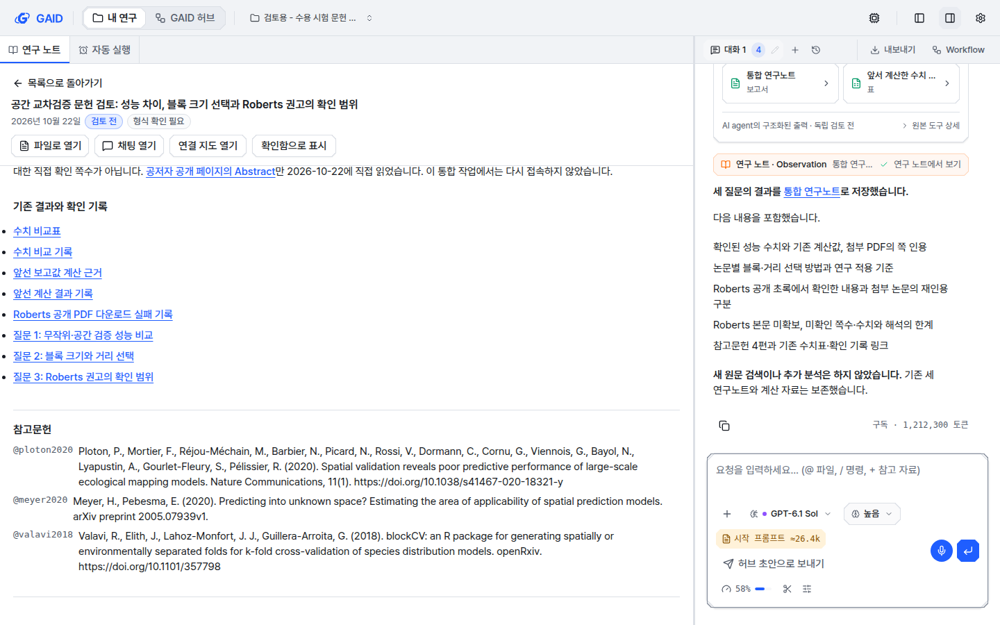
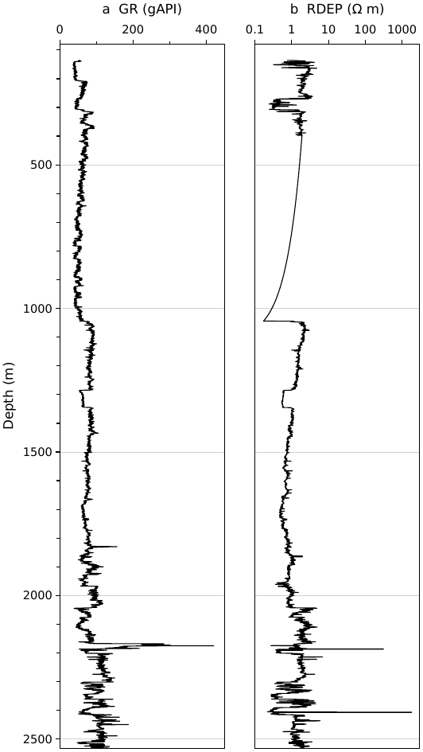
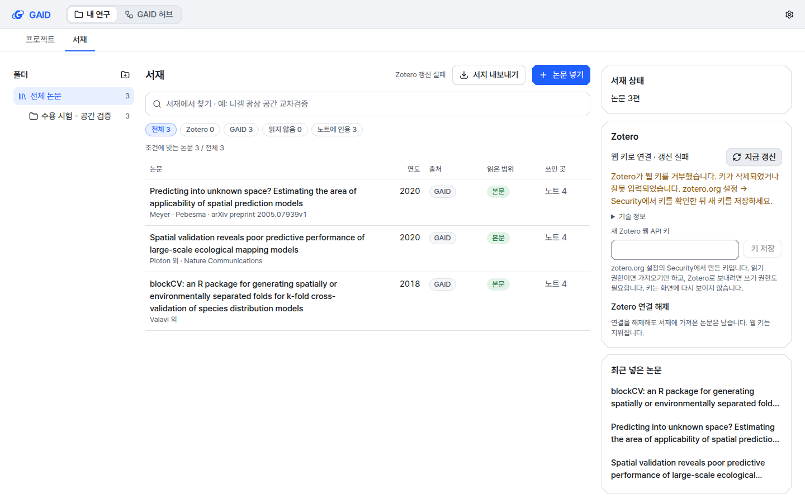
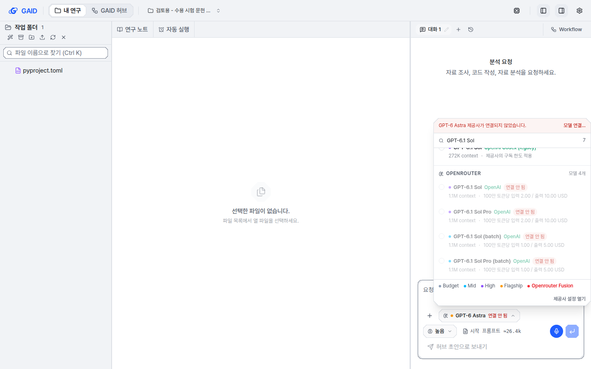

# GAID를 처음 쓰는 연구자 역할의 수용 시험

## 0. 한눈에

| | |
|---|---|
| 요청 | 사용자가 확인해야 할 남은 항목을 검토용 앱에서 GAID를 모르는 시험 에이전트가 직접 시험 |
| 결론 | 네 시험 가운데 세 개가 통과했습니다. 서재 논문 쪽 인용 46건에서 틀린 쪽은 없었고, 그림은 저널 1단 폭과 글자 크기로 만들어 점검까지 했으며, 두 유료 모델 경로가 과제를 끝냈습니다. Zotero 웹 서재 시험은 저장된 웹 키를 Zotero가 거부해 막혔습니다. |
| 믿을 수 있는 정도 | 인용은 PDF 원문의 해당 쪽과 하나씩 대조했고, 그림 점검은 같은 점검을 다시 돌려 확인했습니다. 시험은 공개 논문 3편과 시추공 하나로 한 번씩 했습니다. |
| 결정할 일 | 1건 (6절). 사용자 행동 1건: Zotero 웹 키 다시 저장 |

## 1. 요청한 것

> 남은 항목 중 정해야 하는 항목은 권장 방식으로 진행하자. 사용자가 직접 확인해야하는 부분과 관련해서는 유료 구독 모델 시험의 경우 3000번 시험용 앱을 사용하여라. 그리고 PU빠른 시험은 제외해도 된다. gaid-release proof#2를 제외하고는 직접 테스트 에이전트(GPT 6.1 sol high 워커)를 GAID 허브와 시스템을 모르는 이용자라고 간주한 뒤 테스트를 진행하게 하면 된다. gaid-zotero-web-fix는 인증서 문제를 이미 해결한 것으로 이해하고 있다. 웹 서재에도 논문을 추가해두었다. — 2026-10-22 요청

완료 기준: 남은 확인 항목 네 개(서재 쪽 인용, 저널 그림, Zotero 웹 서재, 유료·구독 모델 경로)를 검토용 앱에서 시험하고, 각각 통과·실패·막힘으로 근거와 함께 보고합니다. 기관 브랜드 공개 승인과 PU 빠른 시험은 제외합니다.

## 2. 수행한 것

1. 검토용 앱의 연결 상태를 확인했습니다. ChatGPT 로그인과 MiniMax 개인 API 키는 연결되어 있었습니다. Claude 로그인은 연결되어 있지 않았습니다. Zotero 웹 연결은 키 거부 상태였고, 서재는 비어 있었습니다.
2. 시험 에이전트(GPT-6.1 Sol, 추론 high)에게 GAID를 처음 쓰는 지구과학 연구자 역할을 주었습니다. 앱 화면만 쓰고 소스·문서·데이터 폴더는 보지 않게 했습니다. 자료로는 공간 교차검증을 다룬 공개 논문 PDF 3편(Ploton 2020, Meyer·Pebesma 2020 arXiv판, Valavi 2018 bioRxiv판)과 시추공 25/9-1 검층 자료를 주었습니다.
3. 시험 에이전트는 새 프로젝트 셋("검토용 - 수용 시험 …")과 서재 폴더 하나를 만들었습니다. 그 안에서 서재 질문 세 개, 저널 그림, Zotero 갱신, 두 모델로 작은 과제를 했습니다. 채팅 모델은 ChatGPT 로그인 경로의 GPT-6.1 Sol입니다.
4. 같은 시간에 출시 검증 도구로 두 유료 경로(ChatGPT 로그인, 개인 API 키)의 연결 확인과 시추공 검층 QC 과제를 한 번씩 돌렸습니다.
5. 시험 에이전트의 주장을 확인했습니다. 별도 검증 에이전트가 답의 인용 46건을 PDF 원문 쪽과 대조했고, 저는 그 가운데 주요 쪽을 직접 다시 확인했습니다. 그림 점검은 제가 다시 돌렸고, Zotero 상태는 앱이 기록한 상태로 확인했습니다.

## 3. 결과

| 완료 기준 | 결과 | 근거 |
|---|---|---|
| 서재 논문으로 쪽 인용 답변 (gaid-library-next#1) | 충족 | 3.1, 그림 1·2 |
| 그림 스킬로 저널 최종 크기 그림과 점검 (gaid-research-visuals#1) | 충족 | 3.2, 그림 3 |
| Zotero 웹 서재 갱신과 폴더 보내기 (gaid-zotero-web-fix#1) | 미충족 (막힘) | 3.3, 그림 4 |
| 유료·구독 모델 경로 (gaid-release-proof#1) | 충족 (Claude 로그인은 선택이라 제외) | 3.4 |

### 3.1 서재 논문의 쪽 인용

시험 에이전트는 PDF 세 편을 서재의 새 폴더에 넣었습니다. 그 폴더를 프로젝트에 붙인 뒤 질문 세 개를 보냈습니다. 수치 질문, 비교 질문, 그리고 서재에 없는 Roberts et al. (2017)에 대한 질문입니다.

| 확인한 것 | 결과 |
|---|---|
| 수치마다 쪽 인용이 붙는가 | 붙었습니다. 표의 칸마다 `[@ploton2020, pp. 4–5]` 형식입니다(그림 1). |
| 인용한 쪽에 그 내용이 있는가 | 인용 46건을 확인 단위 212개로 나눠 대조했습니다. 해당 쪽에 없는 것은 1개, 원문과 어긋나는 것은 0개였습니다. 쪽이 틀린 인용은 없었습니다. |
| 계산한 값 | 차이와 비율 6건(R² 0.53→0.14는 73.6% 감소, RMSPE 56.5→77.5 Mg ha⁻¹는 1.37배, RMSE 0.021→0.039는 1.86배 등)을 다시 계산했고 모두 맞았습니다. |
| 서재에 없는 논문 | Roberts 2017은 서재에 없다고 먼저 밝혔습니다. 공저자 공개 페이지의 초록만 읽었고 본문은 구하지 못했다고 적었습니다. Roberts의 쪽 인용은 만들지 않았습니다. 첨부 논문들이 Roberts를 인용한 쪽(Ploton 4·10쪽 등)은 맞았습니다. |
| 지나친 결론 | 크게 지나친 문장은 없었습니다. Ploton의 150 km와 44개 묶음을 Roberts의 권고로 옮기지 않았고, 서로 다른 실험의 수치(Meyer 7쪽의 0.08과 0.039)를 섞지 않았습니다. 권고성 문장 10건은 인용 쪽이 뒷받침하는 범위 안에 있었습니다. |
| 연구노트 참고문헌 | 노트 아래 참고문헌이 서재 항목 세 개로 바뀌었고, Roberts는 서재 밖이라고 따로 적혔습니다(그림 2). |

부분 근거 1건: RMSPE가 "평균 바이오매스 대비 19%에서 26%"라는 문장입니다. 4–5쪽에는 19%와 26%만 있고 분모가 적혀 있지 않습니다. 8쪽 표의 평균 296 Mg ha⁻¹로 나누면 같은 값이 나오므로 내용은 맞습니다. 다만 인용에 8쪽이 빠졌고, 분모가 평균이라는 것은 추론입니다.

그림 1. 첫 질문의 답에 들어 있는 성능 비교 표. 볼 것: 칸마다 수치와 근거 쪽이 함께 있는지, 오른쪽 "쪽 근거" 열을 보려면 채팅을 넓히고 가로로 스크롤해야 하는지.

그림 2. AI agent가 쓴 통합 연구노트의 참고문헌. 볼 것: 인용 키 세 개가 서재 항목의 서지 줄로 바뀌었는지.

### 3.2 저널 그림

시험 에이전트는 시추공 자료를 올렸습니다. 그리고 Computers & Geosciences 1단 그림을 최종 폭과 글자 크기로 만들고, 저널 요건으로 점검한 뒤 달라고 했습니다.

- AI agent는 그림 스킬의 지침, 저널 목록, 점검 안내를 먼저 읽었습니다. 이어서 Elsevier 공식 그림 지침 세 페이지를 받아 저장했습니다.
- 감마선(GR)과 심부 비저항(RDEP)을 깊이에 따라 그렸습니다(그림 3). 크기는 폭 90 mm, 높이 160 mm입니다. 눈금 글자는 7 pt, 축 이름은 8 pt입니다. TIFF는 1200 dpi로 저장했습니다.
- 점검은 PDF·PNG·TIFF·SVG 각각에 돌렸습니다. AI agent의 보고는 "실패 항목은 없었고, AI 고지와 편집부 판정, 실물 인쇄는 미확인"이었습니다. 7 pt는 Elsevier 일반 권장이지 이 저널만의 하한이 아니라는 점도 밝혔습니다.
- 제가 다시 확인한 것은 세 가지입니다.
  - PDF 쪽 크기를 재니 90 × 160 mm였고, 글꼴은 PDF에 들어 있었습니다.
  - 같은 점검을 스킬에 든 Elsevier 기준과 AI agent가 만든 기준으로 다시 돌렸습니다. 두 기준 모두 실패 항목은 없었습니다. 경고는 AI 사용 고지, 색각 이상 미리보기, 그리고 스킬 기준에서 PNG 형식입니다.
  - RDEP의 400–1040 m 구간이 매끈한 곡선으로 보입니다. 원자료에 원래 직선으로 채워진 구간입니다(깊이 간격마다 같은 크기로 변하고, 로그 축에서 곡선으로 보입니다). 그림은 원자료를 그대로 그렸습니다. 그 구간이 채워진 값이라는 표시는 그림에 없고, 답에만 "원자료에 매끈한 구간이 있다"고 적혀 있습니다.
- AI agent는 저널 기준을 따로 만들면서 PNG를 허용 형식에 넣었는데, 자기가 받아 둔 공식 형식 페이지에는 PNG가 없습니다. 투고 파일은 PDF와 TIFF라고 답했으므로 결과에는 영향이 없습니다.

그림 3. AI agent가 만든 그림의 PDF를 150 dpi로 그린 것(실제 크기 90 × 160 mm). 볼 것: 두 트랙의 축 이름과 단위, RDEP 400–1040 m 구간이 원자료의 채워진 값을 그대로 보여 주는 점.

### 3.3 Zotero 웹 서재

시험 에이전트가 서재에서 Zotero "지금 갱신"을 눌렀습니다. 화면에는 "Zotero가 웹 키를 거부했습니다. 키가 삭제되었거나 잘못 입력되었습니다. zotero.org 설정 → Security에서 키를 확인한 뒤 새 키를 저장하세요."가 나왔습니다(그림 4). 앱은 zotero.org가 이 키를 "invalid key"로 거부했다고 기록했습니다. 시험을 시작하기 전(17:55)과 끝난 뒤(18:55)에 확인했을 때 모두 같았습니다.

인증서 문제는 다시 나타나지 않았습니다. zotero.org가 응답했고, 키를 거부했습니다. 갱신이 되지 않아 웹 서재의 논문은 들어오지 않았습니다. 폴더 보내기 단추는 꺼져 있었고 "Zotero를 연결하면 폴더를 Zotero로 보낼 수 있습니다."라고 나왔습니다. 시험 에이전트는 키를 바꾸지 않았고, 폴더도 보내지 않았습니다.

그림 4. 서재의 Zotero 연결에서 갱신을 누른 뒤 나온 화면. 볼 것: 키 거부 안내문과 웹 서재 논문 수 0.

필요한 사용자 행동: zotero.org → Settings → Security에서 "Allow library access"와 "Allow write access"를 켠 새 키를 만들고, 검토용 앱의 서재 → Zotero 연결 → "Zotero 웹 API 키" 칸에 저장합니다. 그 뒤 갱신과 폴더 보내기를 한 번 다시 시험하면 됩니다.

### 3.4 유료·구독 모델 경로

출시 검증 도구로 검토용 앱에서 경로마다 새 프로젝트를 만들었습니다. 각 경로에서 연결 확인(정해진 한 단어로 답하게 함)과 시추공 검층 QC 과제를 한 번씩 돌렸습니다.

| 경로 | 연결 확인 | 과제 | 사용량과 비용 |
|---|---|---|---|
| ChatGPT 로그인 (GPT-6.1 Sol) | 통과, 5.6초 | 통과, 6분 30초, 결과 파일 모두 있음 | 입력 6.1만, 출력 0.8만 토큰. 구독으로 분류되어 $0 (API 정가로는 $0.31) |
| 개인 API 키 (MiniMax-M3) | 통과, 10.3초 | 통과, 16분 39초, 결과 파일 모두 있음 | 입력 9.2만, 출력 2.5만 토큰, 캐시 읽기 361만 토큰. 사용량 과금 $0.27 (프로젝트 한도 $1) |

시험 에이전트도 화면에서 두 모델로 "2 km × 3 km 직사각형 넓이를 m²로 계산해 파일에 쓰기"를 했습니다. 두 모델 모두 6,000,000 m²를 답하고 파일을 만들었습니다. MiniMax 대화에는 비용 $0.015가 표시됐습니다. Claude 로그인은 연결되어 있지 않아 시험하지 않았습니다. 요청에서도 선택 항목이었습니다.

### 3.5 처음 쓰는 사용자가 막히거나 헷갈린 점

시험 에이전트가 화면에서 겪은 문제이며, 고칠지는 6절에서 정합니다.

| 화면 | 겪은 일 | 영향 |
|---|---|---|
| 새 대화 | 기본 모델이 "GPT-6 Astra · 연결 안 됨"이었습니다. ChatGPT 로그인이 되어 있는데도 대화마다 모델을 직접 바꿔야 했습니다(그림 5). | 처음 쓰는 사람은 보내기 전에 막힘 |
| 모델 목록 | "GPT-6.1 Sol"이 "ChatGPT subscription"과 "OpenAI Codex (legacy)" 아래에 같은 이름으로 두 번 나옵니다. | 어느 것을 골라야 할지 모름 |
| 대화의 링크 | 진행 중 답의 연구노트 링크가 "[blocked]"로 나왔고, 마우스를 올리면 "Blocked URL: undefined"가 보였습니다. 그림 보고서 안의 파일 링크 6개도 "[blocked]"였습니다. | 결과 파일을 링크로 열 수 없음 |
| 넓은 표 | 인용 열이 채팅 폭 밖에 있어 채팅을 넓히고 가로로 스크롤해야 보였습니다. 이전 시험(gaid-library-next)에서도 본 문제입니다. | 근거 쪽을 놓치기 쉬움 |
| 서재 넣기 | arXiv판 Meyer 논문의 서지 추천 다섯 개가 모두 다른 논문이었습니다. | 연구자가 서지를 직접 입력 |
| 서재 목록 | 넣자마자 "본문 11쪽 모두 읽음"이 나옵니다. 앱이 글자를 읽어 들였다는 뜻인데, 연구자가 읽었다는 뜻으로 읽힙니다. | 문구 오해 |
| 연구노트 | AI agent가 쓴 노트 네 개가 모두 "형식 확인 필요"였습니다. | 표시가 흔하면 경고로 읽히지 않음 |
| 진행 카드 | 한국어 질문인데 진행 카드가 가끔 일본어였습니다(예: "報告値から差と比率を計算します"). | 혼란 |

그림 5. 새 대화의 모델 선택 창. 볼 것: 아래쪽 기본 모델 "GPT-6 Astra 연결 안 됨"과 위쪽 "제공사가 연결되지 않았습니다" 안내.

## 4. 검증

- 과학적 검증
  - 쪽 인용: 별도 검증 에이전트가 46건을 PDF 쪽 순서 기준으로 대조했습니다. 본문 추출과 그림이 있는 쪽의 화면 렌더로 확인했습니다. 저는 Ploton 2·5·8·10쪽, Meyer 6·7·12쪽, Valavi 12쪽에서 120 km, 26%, 평균 296, Roberts 참고문헌, 150 km, 0.039, 0.95 분위수, 중앙값·등방 가정이 있는 것을 직접 다시 찾았습니다. 인쇄된 쪽 번호와 PDF 쪽 순서는 인용한 쪽에서 같았습니다.
  - 그림: 크기와 글꼴은 PDF에서 직접 쟀습니다. 점검은 두 기준으로 다시 돌렸습니다. RDEP의 매끈한 구간은 원자료에서 값의 변화를 계산해 확인했습니다. 그림이 지질학적으로 알맞은지(곡선 선택, 깊이 기준)는 미검증입니다.
  - 모델 경로: 과제 결과 파일이 있는지만 확인했고, QC 결과의 과학적 품질은 확인하지 않았습니다.
- 다섯 가지 확인 (인용 대조 결과에 대해)
  1. 기준과 단위: 기준은 PDF 원문 해당 쪽입니다. 단위는 확인 단위(수치 하나, 설정 하나, 저자 주장 하나) 212개입니다.
  2. 반복 수와 흩어짐: 한 번 시험했습니다. 같은 질문을 다시 해서 답이 얼마나 달라지는지는 보지 않았습니다.
  3. 다른 설명: 공개 논문이라 모델이 원래 알던 내용일 수 있습니다. 다만 AI agent는 서재 도구로 쪽을 읽었고, Roberts처럼 원문을 구하지 못한 논문에는 쪽을 붙이지 않았습니다.
  4. 결론에 필요한 크기: "쪽 인용이 믿을 만하다"는 결론에는 틀린 쪽 0건이 필요합니다. 이번 시험은 46건에서 0건입니다.
  5. 확인하지 않은 것: 다른 모델(기관 Qwen 등), 연구자 본인의 논문, 한국어 논문.
- 소프트웨어 검증: 출시 검증 도구의 기록은 두 경로 모두 연결과 과제가 통과였고, 비용 기록도 맞았습니다. 도구에는 프로젝트 이름 옵션 하나만 더했고, 그 도구의 자체 시험 7개가 통과했습니다.

## 5. 한계

- 논문 3편과 질문 3개, 그림 1장, 경로마다 과제 1개로 한 번씩 시험했습니다. 반복해서 생기는 차이는 모릅니다.
- 쪽 인용 시험은 공개 영어 논문으로 했습니다. 사용자 본인의 논문이나 한국어 논문에서도 같은 결과가 나오는지는 확인하지 않았습니다.
- 서재 질문 한 번에 구독 토큰이 0.9백만–2.0백만 개 들었습니다(앱이 표시한 값입니다. 대부분은 매번 다시 보내는 대화 문맥으로 추정합니다). 구독 한도에 주는 영향은 확인하지 않았습니다.
- 시험 에이전트는 GAID 내부를 모르게 했지만 사람 연구자는 아닙니다. 화면을 읽는 방식이 사람과 다를 수 있습니다.
- AI agent가 Roberts 원문을 찾으면서 이 망에서 막혀 있는 GitHub 원본 주소에도 접속을 시도했습니다. 망의 제약이며 GAID 결함은 아닙니다.

## 6. 결정할 일

1. 3.5절의 화면 문제(기본 모델 미연결, 같은 이름의 모델 두 개, "[blocked]" 링크, 넓은 표, arXiv 서지 추천, "모두 읽음" 문구, "형식 확인 필요" 남발, 일본어 진행 카드)를 고칠지 정해 주십시오.
   - 가) 후속 작업 하나로 묶어 고침 (권장: 처음 쓰는 연구자가 대화를 시작하거나 결과를 여는 첫 단계에서 막히는 문제가 포함되어 있음)
   - 나) 기본 모델과 "[blocked]" 링크만 먼저 고치고 나머지는 보류
   - 다) 지금은 고치지 않음

사용자 행동(결정 아님): Zotero 웹 키를 다시 저장하시면 Zotero 시험(3.3절)을 한 번 더 합니다. 이 일은 남은 항목으로 기록합니다.

## 7. 대체되었거나 실패한 시도

펼치기 — 1건

- Zotero 시험: 시험 전과 후에 저장된 웹 키를 zotero.org가 거부해 갱신과 폴더 보내기를 하지 못했습니다(3.3절). 다시 시도하려면 새 키가 필요합니다.

## 용어

없음

## 부록 A. 근거 위치

펼치기 — 실행 방법, 원본, 해시, 커밋

| 항목 | 위치 |
|---|---|
| 검토용 앱 | PC74 `gaid-review` (http://localhost:3000, 백엔드 :18000), 배포 checkout `~/deploy/geoaidesk` @ 52d8ca9d, 데이터 `~/.geoaidesk` |
| 시험 프로젝트 | `proj-ca300f` 문헌 근거, `proj-bc576f` 그림, `proj-a3e5fb` 모델 경로, `chatgpt-0488e0` ChatGPT 로그인 경로, `api-80e71c` 개인 API 키 경로; 서재 폴더 `lc-bdc922024384` |
| 시험 에이전트 | Paseo reader 401323b8 (codex gpt-6.1-sol high); 지시문 `pc74:~/data/geoaidesk/work/gaid-user-acceptance/tester-prompt.md` |
| 시험 기록 | `pc74:~/data/geoaidesk/work/gaid-user-acceptance/tester/` — notes.md (sha256 e93da296…778d), citation-table.md (14a20146…635f), screens/01–44 |
| 인용 대조 | 검증 reader f66405e9; `pc74:~/data/geoaidesk/work/gaid-user-acceptance/verify/citation-verification.md` (4961707e…b390) |
| 논문 PDF | `pc74:~/data/geoaidesk/work/gaid-user-acceptance/materials/papers/` — Ploton 897445ab…8b72, Meyer d8432b7b…2219, Valavi 15ca8222…adee (서재 저장본과 같은 해시) |
| 그림 재점검 | `pc74:~/data/geoaidesk/work/gaid-user-acceptance/verify/figure/` (bundled_*.json, agent_*.json, render150.png); 그림 PDF `proj-bc576f/sandbox/figures/Figure_1_25_9_1_logs.pdf` sha256 11df7662…35be; 실행 `python -I .pi/skills/gaid-figures/scripts/check_figure.py <file> --journals <json> --journal elsevier|computers-geosciences --width single --kind data-figure --artwork lineArt` |
| 모델 경로 기록 | ChatGPT: `pc74:~/data/geoaidesk/runs/gaid-user-acceptance-20261022T085938.208885Z/out/record.json` (442686a4…d9cf); API 키: `…-20261022T085952.464306Z/out/record.json` (72a5d5e2…b67a); 실행 `node geo/release-proof/route-trial.mjs --route chatgpt-signin|api-key --allow-paid --api http://127.0.0.1:18000 --data-home ~/.geoaidesk --model openai/gpt-6.1-sol|minimax/MiniMax-M3 --workflow well-log-qc --project-name …` (task job, 입력 geo-catalogue/0.3.0, force2020-welllogs/c8d01ee9) |
| Zotero 상태 | 앱 상태 `key-invalid`, "web · invalid-key · HTTP 403", failedAt 2026-10-22T08:55:42Z와 09:55:00Z |
| 코드 | `geo/release-proof/route-trial.mjs`에 `--project-name` 추가 (task/gaid-user-acceptance) |

작성 시점: 2026-10-22, commit 7bcc905a.

