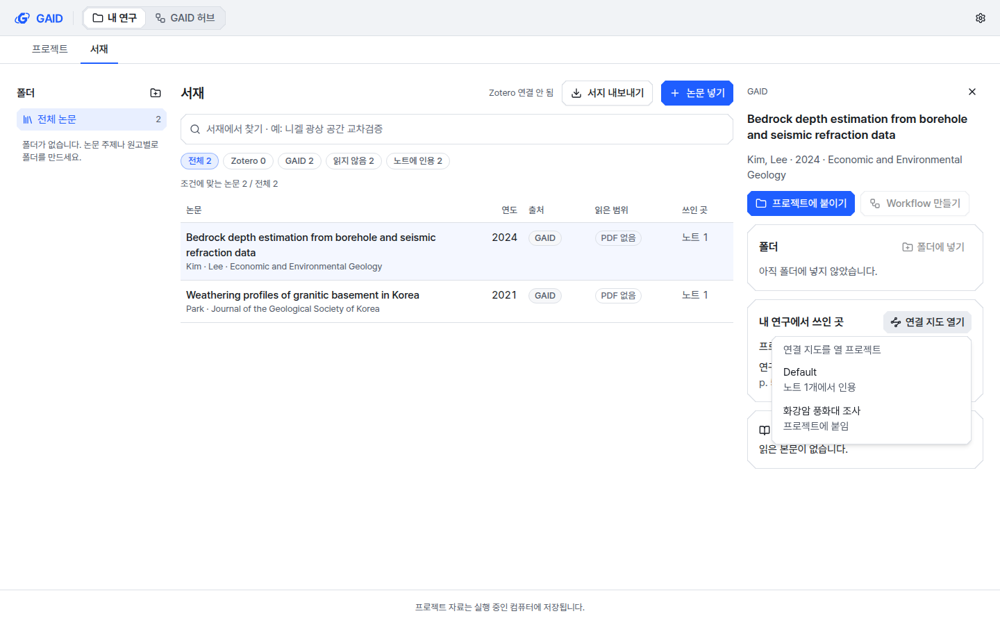

# 서재 논문에서 여는 연결 지도, AGU·자원환경지질 그림 요건

## 0. 한눈에

| | |
|---|---|
| 요청 | 그림·연결 지도 작업에서 남은 두 확인 항목을 권장안대로 진행 |
| 결론 | 서재의 논문 상세에서 "연결 지도 열기"를 누르면 그 논문을 인용하거나 붙인 프로젝트를 골라 논문 중심의 지도를 엽니다. AGU와 자원환경지질의 공식 투고 안내를 실제 브라우저로 읽고, 쓰여 있는 요건만 그림 스킬의 저널 자료에 넣었습니다. |
| 믿을 수 있는 정도 | 화면은 합성 자료로 두 스타일, 두 테마, 두 화면 크기에서 확인했습니다. 저널 값은 공식 페이지 9곳에서 읽은 문장에 근거합니다. 두 저널 모두 그림 폭과 글자 크기는 숫자로 정해 두지 않아 "확인 안 됨"으로 남았습니다. |
| 결정할 일 | 없음 |

## 1. 요청한 것

> 남은 항목 중 정해야 하는 항목은 권장 방식으로 진행하자. — 2026-10-22 요청

이 작업이 맡은 항목은 두 가지입니다.

- 그림 요건 확인(이전 작업의 확인 2번): AGU와 자원환경지질의 그림 요건(폭, 글자, 해상도, AI 그림 정책)을 실제 브라우저로 공식 페이지에서 읽어 채웁니다.
- 서재 쪽 입구(이전 작업의 확인 3번): 서재 논문에서, 그 논문이 쓰인 프로젝트를 골라 연결 지도를 엽니다.

완료 기준: 서재 논문에서 프로젝트를 골라 논문 중심의 연결 지도가 열립니다. 두 저널의 값은 공식 페이지에서 읽은 것만 넣고, 나머지는 "확인 안 됨"으로 둡니다. 전체 검사를 통과합니다.

## 2. 수행한 것

1. 서재 논문 상세의 "내 연구에서 쓰인 곳" 옆에 "연결 지도 열기"를 넣었습니다. 논문을 인용한 노트가 있는 프로젝트를 먼저 보이고, 논문을 붙이기만 한 프로젝트를 그 뒤에 둡니다.
2. 프로젝트가 하나이면 바로 지도를 열고, 둘 이상이면 프로젝트를 먼저 고르게 했습니다. 아무 프로젝트에서도 쓰지 않은 논문에는 이 버튼을 보이지 않습니다.
3. 서재에서 연 지도에는 어느 프로젝트의 연결인지 머리에 적습니다. 서재 화면에서는 노트, 그림, 채팅을 바로 열 수 없으므로 "프로젝트 열기"로 그 프로젝트를 엽니다. 지도 안의 다른 논문은 서재에서 그 논문을 엽니다.
4. 하위 작업에서 AGU와 자원환경지질의 공식 페이지 9곳을 열었습니다. 기본 설정의 헤드리스 브라우저는 두 사이트에서 막혔고, 보통 크롬 브라우저 식별자로 바꾸자 열렸습니다. 읽은 문장에 근거한 값만 넣었습니다.

## 3. 결과

그림 1. 서재의 논문 상세에서 "연결 지도 열기"를 누른 화면입니다. 볼 것: 노트에서 인용한 프로젝트("노트 1개에서 인용")가 붙이기만 한 프로젝트("프로젝트에 붙임")보다 위에 있는지.

그림 2. 그림 1에서 Default 프로젝트를 고른 뒤 2단계로 본 연결 지도입니다. 볼 것: 머리에 프로젝트 이름이 있는지, 고른 논문이 중심이고 그 논문을 인용한 노트, 노트의 그림, 함께 인용한 논문이 이어지는지, 노트를 고르면 "프로젝트 열기"가 나오는지.

### 3.1 저널 그림 요건

| 항목 | AGU | 자원환경지질 |
|---|---|---|
| 그림 폭, 최소 글자 크기, 최대 높이 | 확인 안 됨 (숫자 규정 없음) | 확인 안 됨 (1단·1.5단·2단 구분만 있고 mm 값 없음) |
| 해상도 | 확인 안 됨 | 사진 300 dpi, 사진+선화 500 dpi, 선화 1000 dpi 이상 |
| 파일 형식 | EPS, PDF, JPEG, TIFF | EPS, TIFF, JPEG (PDF는 영문 안내와 국문 규정이 다름) |
| 여러 패널 | 한 파일에 담아야 함 | 확인 안 됨 |
| 색 | 색각 이상자도 구별할 수 있는 색과 무늬·기호를 권장 (의무 아님) | 확인 안 됨 |
| AI 그림 | 자료 그림, 코드 도식, AI 그림 모두 방법 절에 도구와 쓴 방식을 밝혀야 함. 그래픽 초록과 이미지 편집은 확인 안 됨 | 모두 확인 안 됨 (연구윤리 규정에 AI 그림 규정 없음) |

자원환경지질의 영문 투고 안내는 벡터 그림에 "EPS (or PDF)"를 허용하지만, 국문 투고 규정(2026)은 "그림 파일 작성 시 PDF 파일 이외의 파일이어야 한다"고 합니다. 어느 쪽이 우선인지 쓰여 있지 않아, 두 문서에 공통인 형식만 넣고 이 차이는 저널 자료의 메모에 남겼습니다.

| 완료 기준 | 결과 | 근거 |
|---|---|---|
| 서재 논문에서 프로젝트를 골라 논문 중심 지도를 엶 | 충족 | 그림 1, 2 |
| 두 저널 값은 공식 페이지에서 읽은 것만 넣음 | 충족 | 3.1, 부록 A |
| 전체 검사 통과 | 4절 참고 | 4절 |

## 4. 검증

- 과학적 검증: 해당 없음. 저널 값은 공식 페이지의 문장과 하나씩 대조했습니다(부록 A). 다른 저널 다섯 곳의 값은 바뀌지 않았음을 비교로 확인했습니다.
- 소프트웨어 검증: 새 입구의 시험(프로젝트 순서, 쓰지 않은 논문, 프로젝트 하나일 때 바로 열기, 여럿일 때 고르기, 프로젝트를 열면 지도 닫기)과 기존 연결 지도·노트 시험, 타입 검사, 화면 규칙 검사, 문구 검사를 통과했습니다. 그림 스킬 점검 스크립트 시험 8개와 서버 그림 시험 10개도 통과했습니다. 실제 앱은 이 작업 전용 데이터 폴더로 띄웠고, 합성 논문 두 편과 프로젝트 두 개로 계측·도폭 스타일, 밝은·어두운 테마, 1440×900과 1280×800에서 화면 16장을 확인했습니다. 브라우저 콘솔 오류는 없었습니다. 전체 검사 결과는 완료 처리 기록에 남깁니다.

## 5. 한계

- 서재에서 연 지도에서는 노트, 그림, 채팅을 바로 열지 않고 그 프로젝트를 엽니다. 프로젝트를 연 뒤 해당 노트까지 바로 가는 길은 만들지 않았습니다.
- AGU 그림 크기 규정은 이번에 연 AGU 페이지에 숫자로 없었습니다. 출판사(Wiley)의 일반 크기는 AGU 규정으로 확인되지 않아 넣지 않았습니다.
- 자원환경지질의 AI 그림 정책은 공식 문서에 없어 모두 "확인 안 됨"입니다. "확인 안 됨"은 허용이라는 뜻이 아닙니다.
- 저널 값은 2026-10-22에 읽은 것입니다. 투고할 때는 그 저널의 최신 안내가 우선합니다.

## 6. 결정할 일

없음

## 7. 대체되었거나 실패한 시도

펼치기 — 3건

- 처음 만든 입구는 "프로젝트 열기"를 눌러 프로젝트가 열린 뒤에도 연결 지도가 그 위에 남았습니다. 실제 앱에서 발견해, 프로젝트를 열 때 지도를 닫게 고쳤습니다.
- 기본 헤드리스 브라우저로 연 AGU와 자원환경지질 사이트는 접근 거부 화면을 돌려주었습니다. 보통 크롬 브라우저 식별자로 바꿔 열었습니다.
- 로그인이 필요한 사이트용 브라우저 도구(PC71)는 연결되지 않았습니다. 두 사이트 모두 로그인 없이 열려서 쓰지 않았습니다.

## 용어

없음

## 부록 A. 근거 위치

펼치기 — 실행 방법, 원본, 커밋

| 항목 | 위치 |
|---|---|
| 서재 입구 코드 | web/src/geo/library/paper-map-entry.tsx (+ .test.tsx), web/src/geo/library/library-screen.tsx |
| 연결 지도 변경 | web/src/geo/connections/connection-map-button.tsx (ConnectionMapDialog), connection-map-pane.tsx (projectName, onOpenProject) |
| 문구 | library.map.{button,pickTitle,notes,attached}, connections.hintProject, connections.open.project.button |
| 저널 자료 | geo/skills/gaid-figures/assets/journals.json (agu, eeg); 근거 표: docs/tasks/gaid-visuals-next--journals.md |
| 공식 페이지 (2026-10-22) | agu.org text-graphics-requirements, submission-checklists, Resources-FAQs; kseeg.org guide_for_authors, publication_ethics; kseeg.or.kr editor_rule.php, rule01_2026.pdf, rule03.pdf, rule04.pdf |
| 브라우저 기록 | pc74:~/data/geoaidesk/work/gaid-visuals-next--journals/playwright/ |
| 실제 앱 | 사용자 서비스 gaid-visuals-next-app, GAID_HOME pc74:~/data/geoaidesk/work/gaid-visuals-next/home, 포트 3320/18320 |
| 화면 사진 | pc74:~/data/geoaidesk/work/gaid-visuals-next/playwright/matrix/ (16장 + 프로젝트 연 뒤 1장) |

그림 스킬은 GAID와 함께 배포하는 스킬이라, 고치지 않은 프로젝트 사본은 다음 실행 때 새 내용을 따라갑니다. 카탈로그 새 판은 필요하지 않습니다.

작성 시점: 2026-10-22, 브랜치 task/gaid-visuals-next.

