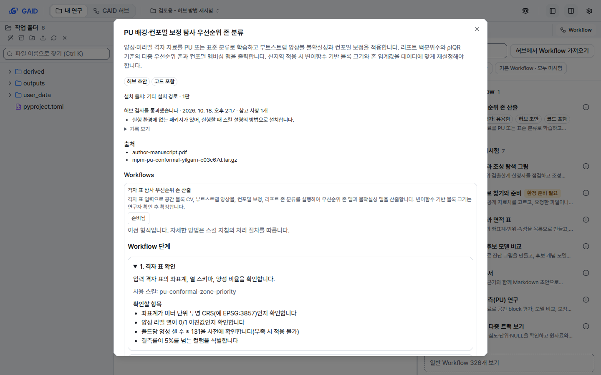
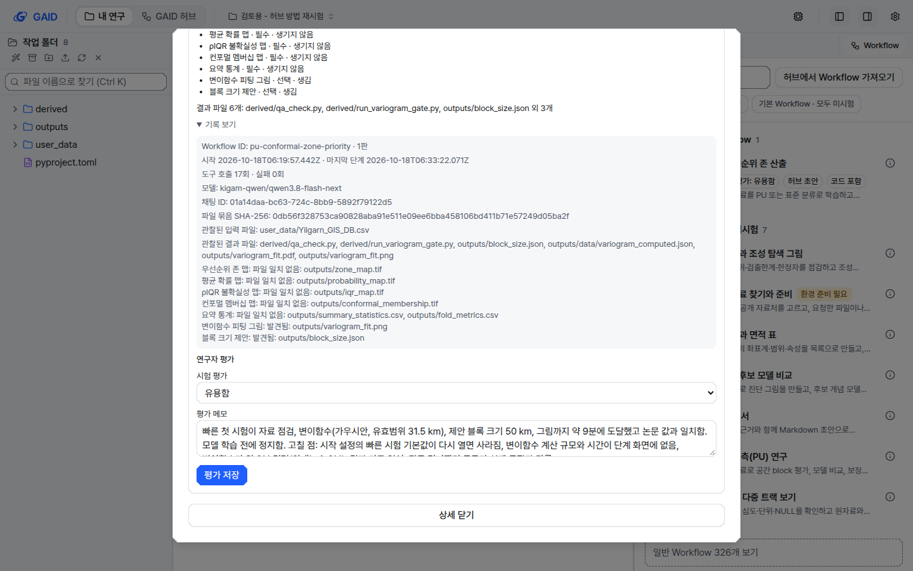
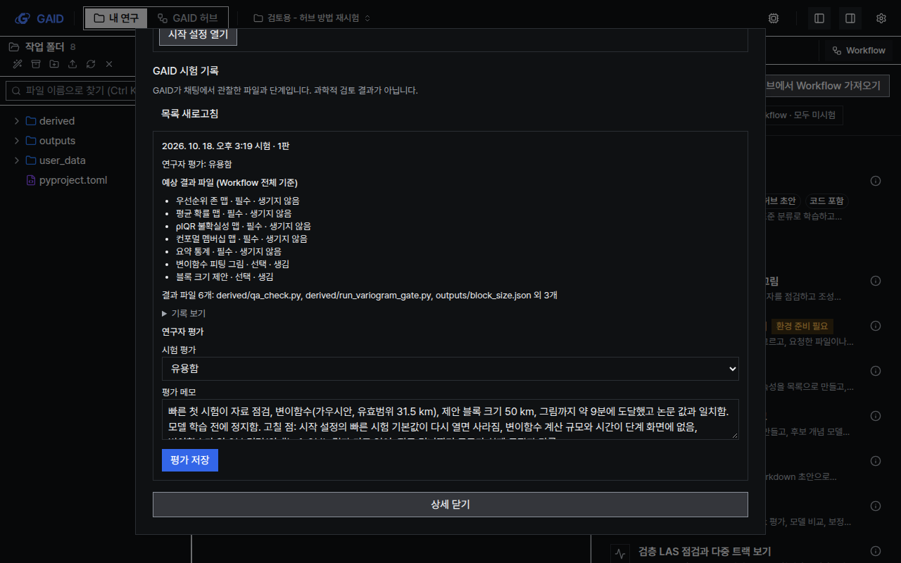

# Workflow 상세의 시험 기록과 허브 검사를 연구자용 요약으로 정리

## 0. 한눈에

| | |
|---|---|
| 요청 | 방법 상세 창의 시험 기록과 허브 검사 기록을 연구자용 요약과 `기록 보기`로 나누기 (gaid-system-ui#1의 가안) |
| 결론 | 상세 창을 처음 열었을 때 도구 호출 횟수, 모델 이름, 채팅 ID, 검사 항목 ID, 영어 메시지가 보이지 않습니다. 이 값들은 모두 `기록 보기`나 `기술 정보`를 열면 그대로 볼 수 있습니다. |
| 믿을 수 있는 정도 | 단위 시험, 화면 규칙 검사, 전체 검사(4절)와 실제 시험 기록 1건이 있는 프로젝트 복사본의 화면 16장으로 확인했습니다. |
| 결정할 일 | 없음 |

## 1. 요청한 것

> User decision (verbatim, 2026-10-22): "우선 첫표 두항목은 권장안대로 하자." — answers gaid-system-ui#1 with option 가).

가안의 내용은 다음과 같습니다. 시험 기록과 허브 검사 기록을 연구자용 요약으로 바꾸고, 원래 기록은 `기록 보기` 안에 둡니다. 같은 정보를 보여 주는 허브 화면과 방식을 맞춥니다.

## 2. 수행한 것

허브에서 설치한 Workflow의 상세 창(Workflow 목록 행의 상세 보기 단추로 엽니다)에서 다음 세 부분을 바꿨습니다.

- 허브 검사: 첫 화면에는 "허브 검사를 통과했습니다 · 날짜 · 참고 사항 N개" 한 줄을 둡니다. 그 아래에 참고 사항을 종류마다 한 문장씩 적습니다. 문장은 허브의 고칠 점 창이 쓰는 문장과 같습니다. 검사 도구 이름, 검사 항목 ID와 통과 여부, 경고 원문은 `기록 보기` 안으로 옮겼습니다.
- GAID 시험 기록: 시험 하나마다 다음을 보여 줍니다.
  - 언제 몇 판을 시험했는지
  - 연구자 평가(평가하지 않았으면 "연구자 평가 전")
  - 시험 뒤에 Workflow 파일이 바뀌었는지
  - 예상 결과마다 필수인지 선택인지와 결과 상태(생김, 다른 폴더에 생김, 생기지 않음, 대조하지 않음)
  - 결과 파일 개수와 앞의 세 파일 이름

  Workflow ID, 시작과 마지막 단계 시각, 도구 호출과 실패 횟수, 모델, 파일 연결이 불완전한 단계, 채팅 ID, 파일 묶음 SHA-256, 입력·결과 파일 전체, 파일 이름 대조 결과는 `기록 보기` 안에 있습니다. 연구자 평가 입력란은 그대로입니다.
- 오류: 파일 묶음을 읽지 못한 경우, 목록·시험 기록을 읽지 못한 경우, 평가를 저장하지 못한 경우에는 무엇이 안 됐고 다음에 무엇을 하면 되는지 한 문장으로 알립니다. 원래 오류 메시지는 허브와 같은 접힌 `기술 정보`(복사 단추 포함)에 넣었습니다.

## 3. 결과

나머지 12장(두 스타일 × 두 테마 × 두 크기 × 윗부분·시험 기록)은 부록 A의 위치에 있습니다.

## 4. 검증

- 단위 시험: 상세 창과 시험 카드에서 요약은 바로 보이고 도구 호출·모델·채팅 ID·검사 ID·원래 메시지는 닫힌 접힘 안에만 있는지 확인했습니다. 결과 상태 네 가지와 결과 파일 접기도 시험합니다.
- 화면 규칙 검사: 오류 0건입니다. 이 화면 때문에 받아 두었던 예외 10건(모델 이름, 채팅 ID, 원래 오류 메시지가 문장에 들어간 경우)을 예외 목록에서 지웠습니다.
- 문구 검사: 이번에 바꾼 문구에 경고가 없습니다.
- 전체 검사: 업스트림 검사와 GAID 검사를 모두 통과했습니다.
- 화면 확인: 실제 시험 기록 1건과 참고 사항 1개가 있는 검토용 프로젝트를 복사해 따로 띄운 앱에서, 두 스타일 × 두 테마 × 1440×900·1280×800으로 16장을 찍어 12절 기준으로 봤습니다. 글자 겹침, 잘림, 대비 문제는 찾지 못했습니다.
- 확인하지 않은 것: 영어 화면은 단위 시험과 문구 검사로만 확인했습니다. 시험 기록이 여러 건이거나 Workflow가 여럿인 방법은 단위 시험으로만 확인했습니다.

따른 화면 규칙: R1, R2, R3, R4, P3, P9, F5, F6, W4, W6. 어긴 규칙은 없습니다.

## 5. 한계

- 참고 사항 문장은 허브 검사기의 문장을 화면 문구 카탈로그에 한국어·영어로 옮겨 둔 것입니다. 허브 검사기가 새 경고 종류를 만들면 카탈로그에 문장을 더할 때까지 "다른 참고 사항이 있습니다" 문장이 나옵니다.
- 채팅 ID는 `기록 보기` 안에만 있습니다. 시험한 채팅으로 바로 가는 "채팅 열기" 단추는 Workflow 목록부터 채팅 창까지 연결을 새로 이어야 해서 이번에 넣지 않았습니다.
- 허브의 초안 시험 단계 화면은 아직 "실패한 도구 호출 N회"를 보여 줍니다. 이번 범위는 프로젝트의 Workflow 상세 창입니다.

## 6. 결정할 일

없음. 위 한계 중 "채팅 열기"와 허브 시험 단계 문구는 필요할 때 따로 요청할 수 있는 선택 작업입니다.

## 7. 대체되었거나 실패한 시도

없음.

## 용어

없음.

## 부록 A. 근거 위치

- 코드: `web/src/geo/methods/methods.tsx` (`HubCheckSummary`, `RecordDetails`, `TrialCard`, `MethodTrials`, `MethodDetail`), 시험 `web/src/geo/methods/methods.test.tsx`, 문구 `web/src/geo/locales/methods/{ko,en}.json`, 해결한 예외 `geo/ui/ui-baseline.json`. 원래 오류 표시는 `web/src/geo/hub/technical.tsx`의 `TechnicalDetail`을 다시 씁니다.
- 참고 사항 문장의 원본: `server/src/geo/authoring/package.ts`의 `PLAIN`.
- 화면 16장과 기록 보기 1장: PC74 `~/data/geoaidesk/work/gaid-workflow-detail/shots/final/` (해시 `SHA256SUMS`). 실행 스크립트 `bin/run.sh`, `bin/shots.sh`. 복사한 프로젝트 `proj-035916`(원본 `~/.geoaidesk`는 바꾸지 않음).
- 검사 기록: `~/data/geoaidesk/work/gaid-workflow-detail/check.log` (`scripts/check`, 끝 줄 "All geoaidesk checks passed.", 종료 코드 0).

### 문자열 변경 (id, 한국어, 영어)

삭제: `methods.checks`, `methods.checkSummary`, `methods.issues`, `methods.trials.{started,workflow,calls,models,degraded,session,outputs,found,missing,elsewhere,moreOutputs,notDeclared}`. 기록 내용 문자열은 `methods.trials.record.*`로 옮겼습니다(문구 같음).

| id | 이전 (ko / en) | 이후 (ko / en) |
|---|---|---|
| `methods.error` | 설치된 Workflow를 읽지 못했습니다: {detail} / Could not read installed Workflows: {detail} | 설치된 Workflow를 읽지 못했습니다. 목록을 새로고침해 다시 읽으세요. / Could not read installed Workflows. Reload the list to read them again. |
| `methods.trials.error` | 시험 기록을 읽지 못했습니다: {detail} / Could not read trial records: {detail} | 시험 기록을 읽지 못했습니다. 목록을 새로고침해 다시 읽으세요. / Could not read trial records. Reload the list to read them again. |
| `methods.assessment.error` | 평가를 저장하지 못했습니다: {detail} / Could not save assessment: {detail} | 평가를 저장하지 못했습니다. 입력한 내용은 그대로 있으니 다시 저장하세요. / Could not save the assessment. Your entry is kept; save it again. |
| `methods.trials.limit` | 관찰값은 채팅에 기록된 도구 실행 단계에서 가져옵니다. 과학적 검토 결과가 아닙니다. / Observations come from tool steps recorded in the chat. They are not a scientific review. | GAID가 채팅에서 관찰한 파일과 단계입니다. 과학적 검토 결과가 아닙니다. / Files and steps GAID observed in the chat. Not a scientific review. |
| `methods.record.show` | (새 문자열) | 기록 보기 / View record |
| `methods.checks.passed`, `.notes` | (새 문자열) | 허브 검사를 통과했습니다 · {at} [· 참고 사항 {count}개] / Passed the hub check · {at} [· {count} notes] |
| `methods.checks.plain.<code>` | (새 문자열, 10개) | 허브 검사기 `PLAIN` 문장과 같은 뜻의 한국어·영어 문장. 모르는 종류는 `.other` |
| `methods.checks.record.*` | (`checkSummary`에서 나눔) | 검사 도구: {checker} · {at} / Checker: …; {id}: {status}; [{code}] {path}: {message} |
| `methods.issues.summary` | 파일 묶음 문제 (제목) / Workflow file issues | Workflow 파일에서 읽지 못한 부분이 {count}곳 있습니다. 읽지 못한 Workflow와 시작 설정은 목록에 나오지 않습니다. / {count} part(s) of the Workflow file could not be read. … |
| `methods.trials.heading` | 시험 시작: {at} / Trial started: {at} | {at} 시험 · {revision}판 / Trial {at} · revision {revision} |
| `methods.trials.assessed`, `.unassessed` | (새 문자열) | 연구자 평가: {outcome} · 연구자 평가 전 / Researcher assessment: {outcome} · Not yet assessed by the researcher |
| `methods.trials.expect.*` | 발견됨 / 파일 일치 없음 / 다른 폴더에 저장됨 (파일 이름 포함) | {label} · {필수/선택} · 생김 / 다른 폴더에 생김 / 생기지 않음 / 파일 이름이 정해지지 않아 대조하지 않음 (영어: produced / produced in another folder / not produced / not matched: no file name declared) |
| `methods.trials.outputs.summary`, `.none` | 관찰된 결과 파일 (제목 + 목록) / Observed output files | 결과 파일 {count}개: {files}[ 외 #개] · 결과 파일이 생기지 않았습니다. / {count} output files: {files}[ and # more] · No output files were produced. |
