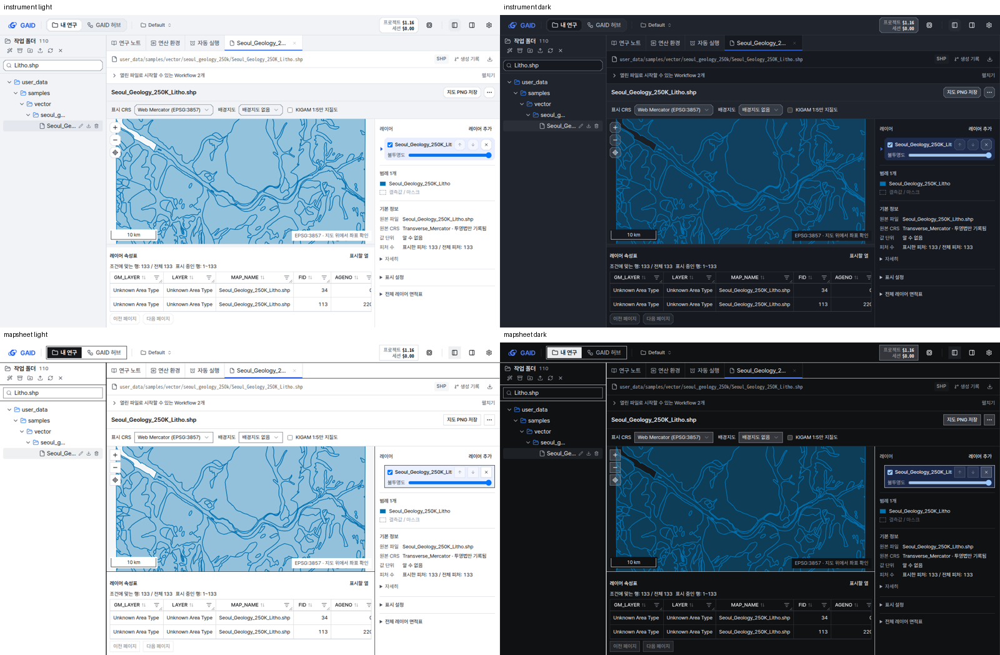

# 지도·표 위 Workflow 제안 칸을 한 줄로 접기

## 0. 한눈에

| | |
|---|---|
| 요청 | 지도·표처럼 높이가 필요한 파일에서 'Workflow 제안' 칸을 한 줄 요약과 펼치기로 접기 (gaid-ui-v2-debts 결정 1의 가) |
| 결론 | 지도·물리검층·표 파일을 열면 제안 칸이 한 줄(41 px)로 접혀, 1280×800에서 지도와 속성표 영역이 407 px에서 534 px로 커졌습니다. 펼치면 지금처럼 제안 목록이 보이고, 마지막으로 고른 상태를 브라우저가 기억합니다. |
| 믿을 수 있는 정도 | 자동 시험, UI·문구 검사, 실제 앱 스크린샷 22장과 키보드 조작으로 확인했습니다. 물리검층 화면과 XLSX 표의 스크린샷, Firefox·Safari 화면은 확인하지 않았습니다. |
| 결정할 일 | 없음 |

## 1. 요청한 것

> gaid-ui-v2-debts의 경우 권장 방식으로 결정하겠다. — 2026-10-22 요청

권장 방식(가): 지도·표처럼 높이가 필요한 파일을 열었을 때 위의 'Workflow 제안' 칸(약 155 px)을 한 줄 요약과 펼치기로 접고, 펼치면 지금처럼 보이게 합니다.

완료 기준: UI 가이드 v2대로 구현합니다(역할 색만, 키보드로 조작, 기억하는 상태는 브라우저마다). 두 스타일 × 두 테마 × 1440×900·1280×800으로 확인하고, UI 검사와 전체 검사를 통과합니다.

## 2. 수행한 것

1. 파일 종류로 '높이가 필요한 파일'을 정했습니다. 지도(벡터, 래스터, 지도 결과), 물리검층과 심도 결과, 표(CSV, TSV 같은 표, XLSX, 배열·열 형식 자료)입니다. 다른 파일(문서, 노트, 그림 등)에서는 칸이 지금처럼 펼쳐져 있고 접는 단추도 없습니다.
2. 접힌 칸은 한 줄짜리 단추입니다. `열린 파일로 시작할 수 있는 Workflow 2개`와 오른쪽의 `펼치기`가 보이고, 누르면 같은 자리에서 `접기`로 바뀌며 제안 목록이 열립니다.
3. 연구자가 펼치거나 접은 선택을 브라우저에 저장했습니다. 다음에 지도나 표를 열 때 그 선택을 따릅니다. 처음에는 접힌 상태로 시작합니다.
4. 실제 앱에서 서울 1:25만 암상도와 분석값 표를 열어 계측·도폭, 밝은·어두운 테마, 1440×900·1280×800으로 찍고 가이드 12절 점검표와 대조했습니다.

## 3. 결과

그림 1. 같은 암상도를 연 1280×800 화면입니다. 왼쪽은 처음 상태(접힘), 오른쪽은 펼친 상태입니다. 볼 것: 접힌 칸은 한 줄이고, 그만큼 지도와 속성표가 위로 올라옵니다. 펼친 칸은 이전과 같은 제안 두 줄과 `시작 설정 열기`를 보입니다.

그림 2. 접힌 칸을 네 조합(계측·도폭, 밝은·어두운 테마)으로 본 1280×800 화면입니다. 볼 것: 모든 조합에서 칸이 한 줄이고, 지도 오른쪽 패널의 범례와 기본 정보가 스크롤 없이 보입니다.

그림 3. 분석값 표에서 Tab으로 단추에 가서 Enter로 펼친 화면(도폭, 밝은 테마)입니다. 볼 것: 초점 테두리가 단추에 남아 있어 Space나 Enter로 바로 다시 접을 수 있습니다.

| 화면 | 접힘 | 펼침 | 차이 |
|---|---|---|---|
| 제안 칸 높이 | 41 px | 168 px | 127 px |
| 지도 + 속성표 영역, 1280×800 | 534 px | 407 px | +127 px |
| 지도만, 1280×800 | 320 px | 223 px | +97 px |
| 지도 + 속성표 영역, 1440×900 | 634 px | 507 px | +127 px |
| 지도만, 1440×900 | 394 px | 304 px | +90 px |

늘어난 높이는 지도와 속성표가 나눠 가집니다. 속성표는 지도 영역의 40%를 넘지 않게 정해져 있어 지도만 보면 90–97 px 커집니다.

| 완료 기준 | 결과 | 근거 |
|---|---|---|
| 높이가 필요한 파일에서 한 줄 요약과 펼치기로 접기 | 충족 | 그림 1, 2 |
| 펼치면 지금처럼 보임 | 충족 (제목 줄이 단추가 되어 13 px 높아짐, 5절) | 그림 1 오른쪽 |
| 역할 색만 사용 | 충족 | UI 검사 오류 0 |
| 키보드로 조작 | 충족 | 그림 3, 4절 |
| 상태를 브라우저마다 기억 | 충족 | 4절 |
| 두 스타일 × 두 테마 × 두 크기 확인 | 충족 (지도). 표는 1280×800 네 조합 | 그림 2, 부록 A |
| UI 검사와 전체 검사 통과 | 충족 | 4절 |

적용한 가이드 규칙: P3(먼저 적게 보여 줌), L9(펼침 상태를 기억), G1(40 px 한 줄 행), A1(펼침 상태를 화면 낭독기에 알림, 장식 아이콘 숨김), A2(초점 유지, 보이는 초점 테두리), A3(대상 높이 32 px), B3(펼치기·접기 동작을 씀), W1(단추 글 길이), S·V(역할 색만, 그라데이션·장식 없음). 어긴 규칙은 없습니다.

## 4. 검증

- 과학적 검증: 해당 없음(화면 배치만 바꿨습니다).
- 소프트웨어 검증:
  - 새 시험 두 건을 더했습니다. 표에서 처음에 접혀 있고, 키보드 Enter로 펼치면 제안 행이 보이고, 선택이 저장되어 지도 파일에서도 펼친 채 열리는지 확인합니다. 노트 같은 파일에서는 접는 단추 없이 펼쳐져 있는지 확인합니다. 기존 시험은 펼친 상태에서 행을 읽도록 맞췄습니다. 작업 공간 시험 33건이 통과했고 타입 검사는 오류가 없습니다.
  - 실제 앱에서 Tab과 Enter, Space로 칸을 펼치고 접었고, 초점이 단추에 남는 것과 저장된 값이 바뀌는 것을 확인했습니다.
  - UI 검사: 오류 0, 허용 목록 변화 없음. 문구 검사: 오류 0(경고는 이번에 바꾸지 않은 문구의 기존 경고입니다).
  - 전체 검사 통과: 백엔드 시험 2,069건(8건 건너뜀), 화면 시험 1,158건, GAID 시험 49건(1건 건너뜀), 환경 가져오기 시험, 배포판 실행 확인(빈 자료 홈에서 시작, 중지, 다시 시작)이 모두 통과했습니다.

## 5. 한계

- 펼친 칸은 이전보다 13 px 높습니다. 제목 줄이 32 px 단추가 되었기 때문입니다. 내용과 배치는 같습니다.
- 펼침 선택은 높이가 필요한 모든 파일에 하나로 적용됩니다. 지도는 펼치고 표는 접는 식으로 따로 기억하지 않습니다.
- 물리검층(LAS)과 XLSX 표는 접히도록 넣었지만 스크린샷으로는 확인하지 않았습니다. 같은 칸을 쓰므로 표 화면과 같게 보일 것으로 추정합니다.
- Firefox와 Safari에서는 보지 않았습니다.

## 6. 결정할 일

없음

## 7. 대체되었거나 실패한 시도

펼치기 — 0건

- 없음

## 용어

없음

## 부록 A. 근거 위치

펼치기 — 실행 방법, 원본, 커밋

| 항목 | 위치 |
|---|---|
| 코드 | 브랜치 `task/gaid-workflow-strip`: `web/src/geo/workspace/file-actions.tsx` (`fileNeedsHeight`, `WORKFLOW_STRIP_KEY` = `gaid:workflow-strip`, 값 `open`/`line`) |
| 문구 | `workspace.files.summary` (새) ko `열린 파일로 시작할 수 있는 Workflow {count}개` / en `{count, plural, one {# Workflow you can start with the open file} other {# Workflows you can start with the open file}}`; `workspace.files.expand` (새) ko `펼치기` / en `Show`; `workspace.files.collapse` (새) ko `접기` / en `Hide`. 기존 문구는 바꾸지 않았습니다. |
| 시험 | `web/src/geo/workspace/file-actions.test.tsx` (새 시험 2건), `workspace.test.tsx` (펼친 상태에서 시작) |
| 스크린샷 | PC74 `~/data/geoaidesk/work/gaid-workflow-strip/shots/` (22장, `manifest.sha256`), 모음 `sheets/`, 촬영 스크립트 `shot.sh`, 모음 스크립트 `montage.py` |
| 실행 | 개발 앱 `start.sh`, `KADY_PORT=18380 KADY_FRONTEND_PORT=3380 NEXT_PUBLIC_ADK_API_URL=http://localhost:18380`, 자료 홈 `~/data/geoaidesk/work/gaid-workflow-strip/home` (gaid-ui-v2-debts 자료 홈의 Default 프로젝트 사본, 자격 증명 없음) |
| 전체 검사 기록 | `~/data/geoaidesk/work/gaid-workflow-strip/logs/check.log` |

작성 시점: 2026-10-22.

