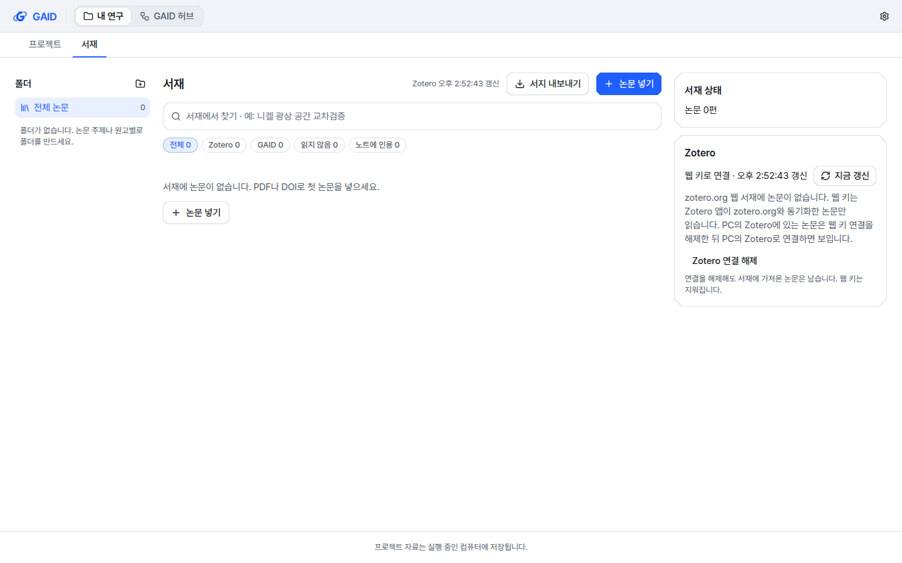

# Zotero 웹 키 갱신 실패 원인과 상태 표시 수정

## 0. 한눈에

| | |
|---|---|
| 요청 | 웹 키로 연결은 되지만 "Zotero에 닿지 못했습니다"로 끝나는 원인을 찾아 고치고, 상태 표시를 맞추기 |
| 결론 | 웹 키 갱신은 키나 네트워크와 상관없이 매번 실패했습니다. 원인을 고친 뒤 사용자 키로 갱신이 성공했습니다. 머리글과 카드가 같은 상태를 보이고, 실패하면 원인과 다음 행동을 보여 줍니다. |
| 믿을 수 있는 정도 | 실제 Zotero 웹 서버에서 수정 전 실패와 수정 후 성공을 재현했습니다. 사용자 키 갱신도 성공했지만, 사용자 웹 서재가 비어 있어 논문을 실제로 받아오는 것은 공개 그룹 서재로만 확인했습니다. |
| 결정할 일 | 없음 |

## 1. 요청한 것

> "gaid-library-folders#2 와 관련해서 PC Zotero는 앱이 켜져있을 때 연결되는 것을 확인했고, 웹키로는 연결은 되었는데 닿지 못했다고 한다." — 2026-10-22 요청

완료 기준: 유효한 웹 키로 갱신이 되고, 머리글과 카드의 상태가 같으며, 실패 원인(키 권한, 잘못된 서재 등)을 연구자 문구로 보여 주고, PC 연결은 Zotero 앱이 켜져 있을 때만 된다고 안내합니다.

## 2. 수행한 것

1. 리뷰 앱 기록을 보고, 키를 쓰지 않고 공개 Zotero 그룹 서재에 같은 요청을 보내 실패를 재현했습니다.
2. 갱신 과정이 Zotero 웹 서버의 "변경 없음" 응답에 기대지 않도록 고쳤습니다.
3. 실패 원인을 종류별로 나눠 서재에 기록하고, 카드에서 원인과 다음 행동을 보여 주게 했습니다.
4. 머리글과 카드가 한 가지 상태 판단을 함께 쓰게 했습니다. 연결 해제도 추가해 PC 연결과 웹 키 연결을 바꿀 수 있게 했습니다.
5. 사용자가 테스트 앱에서 자기 키로 연결과 갱신을 확인했습니다.

## 3. 결과

**원인.** Zotero 웹 서버는 "변경 없음" 응답에 서재 버전을 붙이지 않습니다. GAID 갱신은 마지막 확인 단계에서 이 버전을 요구했습니다. 그래서 웹 키 갱신은 세 번 다시 시도한 뒤 "서재가 계속 바뀜"으로 끝났고, 화면에는 "닿지 못했습니다"로 나왔습니다. PC의 Zotero는 같은 응답에 버전을 붙이기 때문에 영향을 받지 않았습니다. 시험용 가짜 Zotero 서버도 버전을 붙였기 때문에 그동안 시험에서 드러나지 않았습니다.

그림 1. 웹 키 갱신이 실패한 서재 화면입니다(계측 스타일, 밝은 테마, 1440×900). 볼 것: 머리글의 "Zotero 갱신 실패"와 카드의 "웹 키로 연결 · 갱신 실패"가 같은 상태를 말합니다. 그 아래에 원인, 다음 행동, 접힌 기술 정보, 새 키 입력칸이 있습니다.

**사용자 키 확인.** 연결과 갱신은 성공했지만 논문은 0편이었습니다. 사용자의 zotero.org 웹 서재가 실제로 비어 있습니다. KIGAM 네트워크가 HTTPS 연결을 중간에서 다시 암호화하는데, Ubuntu의 Zotero 앱은 이 기관 인증서를 신뢰하지 않습니다. 그래서 앱이 zotero.org와 동기화하지 못합니다(Zotero 오류 "SEC_ERROR_UNKNOWN_ISSUER"). PC 연결과 웹 키 연결이 충돌한 것은 아닙니다. 이제 이 경우 카드가 이유를 안내하고, 연결을 해제해 PC 연결로 바꿀 수 있습니다.

그림 2. 웹 키로 갱신했지만 웹 서재가 빈 경우입니다. 볼 것: 웹 키는 Zotero 앱이 동기화한 논문만 읽는다는 안내와 "Zotero 연결 해제" 버튼.

| 완료 기준 | 결과 | 근거 |
|---|---|---|
| 유효한 웹 키로 갱신 | 충족: 사용자 키로 갱신 성공(웹 서재 비어 있음). 논문 24편·169편 공개 그룹 서재에서 전체 갱신과 증분 갱신 성공 | 4절 |
| 머리글과 카드의 상태 일치 | 충족 | 그림 1, 2 |
| 실패 원인과 다음 행동 표시 | 충족: 키 무효, 개인 서재 읽기 권한 없음, 서재 없음, 요청 제한, Zotero 서버 오류, 서재 변경 중, 기관 인증서 불신, 네트워크 연결 실패, 그 밖의 오류 | 그림 1, 부록 A |
| PC 연결 조건 안내 | 충족: "PC의 Zotero는 Zotero 앱이 켜져 있을 때만 갱신됩니다" | 부록 A 스크린숏 |
| 오류 대응 시험 추가 | 충족 | 4절 |
| UI 안내서 v2(두 스타일 × 두 테마) | 충족: 8장 확인 | 부록 A |

함께 줄인 것: 첫 갱신에서 논문마다 첨부파일 목록을 따로 요청하던 것을 없앴습니다. 논문 169편 서재 기준으로 요청이 약 180번에서 9번으로 줄었고, 7초 걸렸습니다.

## 4. 검증

- 과학적 검증: 해당 없음(연결 기능 수정).
- 소프트웨어 검증:
  - 실제 Zotero 웹 서버의 공개 그룹 서재 세 곳에서 수정 전 코드는 요청 12번 만에 리뷰 앱과 같은 오류로 실패했습니다. 수정 후에는 전체 갱신과 증분 갱신이 모두 성공했습니다.
  - 시험용 가짜 서버가 실제 웹 서버처럼 "변경 없음" 응답에 버전을 붙이지 않게 바꿨습니다. 새 웹 갱신 시험은 수정 전 코드에서 실패하고 수정 후 통과합니다.
  - 오류 원인별 대응, 실패 기록과 복구, 권한 없는 키 거절, 연결 해제 시험을 추가했습니다.
  - 서버·웹 타입 검사, 서재 관련 서버 시험 92건, 웹 시험, 문구 검사, UI 검사를 통과했습니다. 전체 검사 결과는 부록 A에 적습니다.

## 5. 한계

- 사용자의 웹 서재가 비어 있어서 사용자 키로 논문을 실제로 받아오는 것은 확인하지 못했습니다. 논문 받아오기는 공개 그룹 서재로 확인했습니다.
- Zotero 앱이 zotero.org와 동기화하려면 Zotero 앱에 KIGAM 인증서를 등록해야 합니다. 이 설정은 GAID 밖의 일입니다.
- 다른 연구자 PC에서 GAID 서버가 기관 인증서를 신뢰하지 않으면 웹 키 연결은 "기관 보안 인증서를 신뢰하지 않음"으로 실패합니다. 원인은 화면에 나오지만, 인증서 설정은 해당 PC에서 해야 합니다.
- PC 연결과 웹 키 연결을 함께 쓰면 같은 논문이 두 번 보일 수 있습니다. 카드는 한 번에 하나의 연결을 쓰도록 안내합니다.

## 6. 결정할 일

없음

## 7. 대체되었거나 실패한 시도

펼치기 — 0건

- 없음

## 용어

없음

## 부록 A. 근거 위치

펼치기 — 실행 방법, 원본, 해시, 커밋

| 항목 | 위치 |
|---|---|
| 코드 | branch `task/gaid-zotero-web-fix` (`server/src/geo/library/zotero/{client,sync,types}.ts`, `zotero-service.ts`, `routes/library.ts`, `web/src/geo/library/{zotero-card,zotero-status,library-screen}.tsx/ts`, locale `library`) |
| 시험 | `server/test/geo-library-zotero.test.ts`, `server/test/geo-library-zotero-service.test.ts`, `web/src/geo/library/zotero-status.test.ts`; fixture `server/test/fixtures/geo-zotero-server.ts` |
| 실제 웹 서버 재현 | 공개 그룹 1, 100, 1000; API key 헤더를 뺀 동기화 스크립트(작업 중 `/tmp/zrepro.mts`, 커밋하지 않음) |
| 리뷰 앱 기록 | PC74 `~/data/geoaidesk/work/review-app/launcher.log`: `POST /geo/library/zotero/web` 200, 4030 ms |
| 스크린숏 8장 + 2장 | PC74 `~/data/geoaidesk/work/gaid-zotero-web-fix/shots/` (sha256: instrument-light-1440 6894788…, instrument-light-1280 c53cc79…, instrument-dark-1440 0b6c292…, instrument-dark-1280 5f48bbd…, mapsheet-light-1440 3ea1d47…, mapsheet-light-1280 e4f767a…, mapsheet-dark-1440 81b21ba…, mapsheet-dark-1280 844d7fe…, none 3d6f869…, web-empty 65aef28…) |
| 문자열 변경 | `library.screen.zoteroNotSynced`, `.zoteroFailed`(새로 추가); `library.zotero.ok/notSynced/failed/failedSince`(연결 방식 포함); `.localNote`, `.newKey`, `.emptyWeb`, `.disconnect.*`(새로 추가); `.states.*`(원인별 9개 추가, `zotero-closed`·`key-rejected`·`unreachable` 문구 변경) |
| UI 규칙 | F5(원인과 다음 행동), R2(기술 정보 접기), 토큰 색상만 사용 |
| 테스트 앱 | systemd user unit `gaid-zotero-web-fix-app`, UI :3360, backend :18360, `GAID_HOME=~/data/geoaidesk/work/gaid-zotero-web-fix/home` |

작성 시점: 2026-10-22.

