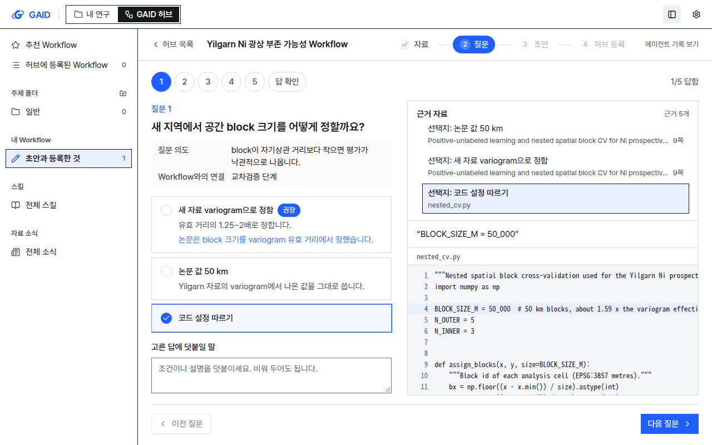
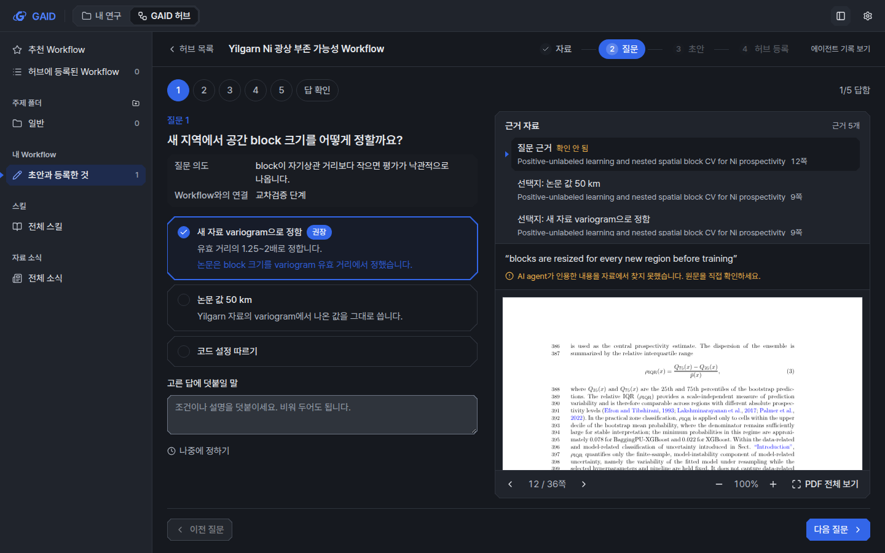
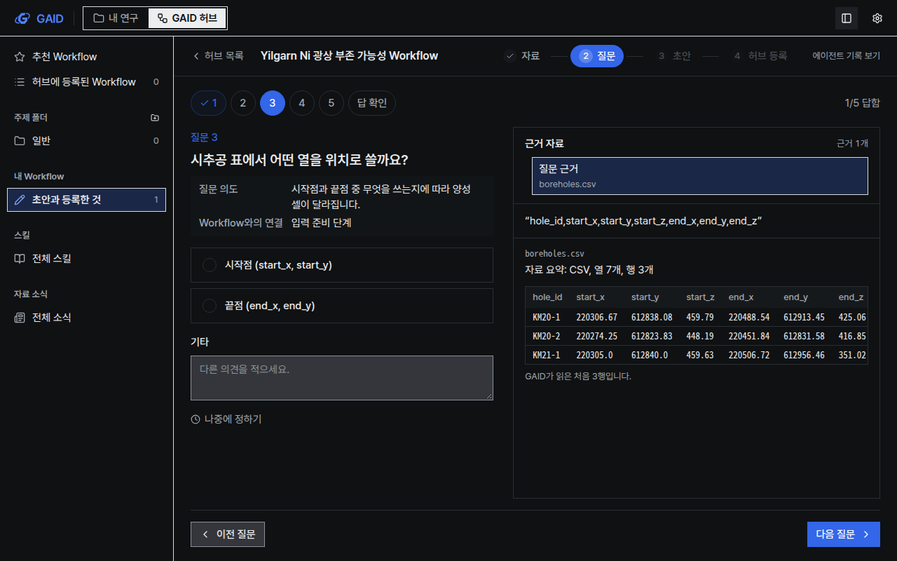

# Workflow 만들기 질문 옆에 논문 해당 부분과 근거 자료 보기

## 0. 한눈에

| | |
|---|---|
| 요청 | Workflow를 만들 때 질문과 관련된 논문 부분과 자료를 질문 옆 뷰어에서 보여 줍니다. |
| 결론 | 질문 옆 근거 자료 뷰어가 PDF 쪽(원본 픽셀, 인용 문장 표시), 웹 자료의 쪽 글, 코드·노트 파일의 줄, 자료 파일 요약을 보여 줍니다. 선택지를 고르거나 근거 목록을 누르면 해당 부분으로 이동하고, 자료에서 찾지 못한 인용과 삭제한 자료는 그렇다고 표시합니다. |
| 믿을 수 있는 정도 | 서버·화면 시험을 통과했고, 36쪽 실제 논문 PDF, 코드 파일, 시추공 CSV로 화면을 확인했습니다. AI agent가 선택지별 근거를 실제로 얼마나 잘 다는지는 실제 모델로 확인하지 않았습니다(대본 응답으로 시험). |
| 결정할 일 | 없음 |

## 1. 요청한 것

> 그리고 워크플로우를 생성하는 기능에서 질문을 할 때 해당 질문과 관련된 논문의 해당부분이나 관련 자료들이 질문의 사이드쪽 뷰어에서 보여야 워크플로우 생성을 위한 질문이 어떤 것을 의미하고 사용자들이 어떻게 지시하고 선택할지 정하기 수월하다. — 2026-10-23 요청(전체 요청 중 이 단위가 맡은 부분)

완료 기준(허브가 정한 단위 F): 질문마다 옆 뷰어에 질문의 근거(PDF 쪽과 인용 문장, 코드 줄, 자료 파일 요약, 웹·서재 노트 발췌)가 보입니다. 선택지나 근거 항목을 누르면 뷰어가 그 부분으로 이동합니다. PDF는 pdf.js로 원본 픽셀 그대로 그립니다. 없거나 확인되지 않은 근거는 그렇다고 표시하고 만들어 내지 않습니다. 단위 D의 질문 카드 수정(선택지 + 덧붙일 말)과 단위 C의 여러 자료 받기는 유지합니다.

## 2. 수행한 것

1. 질문 화면을 두 칸으로 나눴습니다. 왼쪽은 기존 질문 카드(선택지, 권장, 기타, 나중에 정하기)이고, 오른쪽은 근거 자료 뷰어입니다. 기존의 작은 "근거 보기" 팝오버는 뷰어로 바뀌었습니다.
2. 뷰어 위쪽에 근거 목록을 두었습니다. 행마다 "질문 근거" 또는 "선택지: …"와 자료 이름, 쪽이나 파일을 적습니다. 아래쪽에는 인용 문장과 원문이 나옵니다.
3. 원문은 자료 종류에 따라 다르게 보여 줍니다. PDF는 해당 쪽을 pdf.js로 그리고 인용 문장 위치에 반투명 상자를 겹칩니다. 상자 위치는 PDF 글자 좌표로 계산하며 쪽 그림 자체는 바꾸지 않습니다. 웹 자료는 해당 쪽의 글을, 코드와 연구 노트는 줄 번호와 함께 해당 줄을, 자료 파일은 GAID 자료 검사 요약(표는 처음 몇 행)을 보여 줍니다. PDF는 쪽 넘기기, 확대·축소, 기존 큰 PDF 창으로 열기를 제공합니다.
4. AI agent가 선택지마다 근거를 1–2개 달 수 있게 했습니다. 서버는 질문과 선택지의 인용을 자료에서 다시 찾아 확인합니다. 지금까지는 찾지 못한 인용을 조용히 버렸지만, 이제는 "확인 안 됨"으로 남겨 연구자가 원문을 직접 확인하게 합니다.
5. 선택지를 고르면 그 선택지의 근거로 뷰어가 이동합니다. 고른 답에 말을 덧붙이는 중에는 이동하지 않습니다.
6. 근거가 없을 때도 표시합니다. 자료를 초안에서 삭제한 경우, 인용한 쪽이나 파일이 자료에 없는 경우, 원문에서 위치를 표시하지 못한 경우, 인용 일부만 찾은 경우를 각각 다른 문장으로 알립니다. GAID가 모든 Workflow에 묻는 두 질문(원본 코드 포함, 빠른 첫 시험 설정)에는 자료 근거가 없다고 적습니다.

## 3. 결과

그림 1. 첫 질문 "새 지역에서 공간 block 크기를 어떻게 정할까요?" 옆에 논문 9쪽이 열린 모습입니다. 볼 것: 인용 문장 "The study area is partitioned into 702 spatial blocks of 50 km × 50 km"에만 상자가 겹치고, 같은 줄의 뒤 문장은 표시하지 않습니다. 목록에는 근거 5개(질문 근거 2, 선택지 근거 3)가 있습니다.

그림 2. 선택지 "코드 설정 따르기"를 고르자 뷰어가 그 선택지의 근거인 코드 파일 4행으로 이동했습니다. 볼 것: 목록에서 해당 행이 선택되고, 코드의 인용 줄에 배경이 칠해집니다.

그림 3. AI agent가 12쪽에서 인용했다고 했지만 서버가 그 문장을 찾지 못한 근거입니다. 볼 것: 목록 행에 "확인 안 됨"이 붙고, 인용 아래에 "AI agent가 인용한 내용을 자료에서 찾지 못했습니다. 원문을 직접 확인하세요."가 나옵니다. 쪽은 보여 주되 상자는 그리지 않습니다. 어두운 테마에서도 PDF 쪽은 원래의 흰 종이로 보입니다.

그림 4. 시추공 CSV를 근거로 한 질문입니다. 볼 것: 자료 파일은 원본 대신 GAID가 읽은 요약(형식, 열과 행 수)과 처음 3행을 표로 보여 줍니다. AI agent가 본 것도 같은 요약입니다.

| 완료 기준 | 결과 | 근거 |
|---|---|---|
| 질문마다 옆 뷰어에 근거 표시(PDF 쪽과 인용, 코드 줄, 자료 파일 요약, 웹·노트 발췌) | 충족. 웹 자료와 연구 노트는 화면 시험으로 확인했고, 실제 화면 확인은 PDF·코드·CSV로 했습니다. | 그림 1–4, 화면 시험 |
| 선택지나 근거 항목을 누르면 해당 부분으로 이동 | 충족 | 그림 2, 화면 시험 |
| PDF를 pdf.js로 원본 픽셀 그대로 그림 | 충족(필터·색 변환 없음, 표시는 겹친 상자) | 그림 1, 3 |
| 없거나 확인되지 않은 근거를 그렇다고 표시 | 충족 | 그림 3, 서버·화면 시험 |
| 단위 D의 질문 카드 수정과 단위 C의 여러 자료 받기 유지 | 충족(기존 질문 화면 시험 그대로 통과) | 4절 |
| UI 지침과 문구 규칙 | 충족(아래 규칙 번호) | 4절 |

## 4. 검증

- 과학적 검증: 해당 없음. 이 단위는 화면과 근거 확인 방식을 바꿨고, 연구 결과를 만들지 않습니다. 인용 위치 표시는 실제 논문(36쪽, 줄 번호가 있는 원고)에서 한 줄짜리 인용, 두 줄에 걸친 인용(줄 끝 하이픈 포함), 찾지 못한 인용으로 확인했습니다.
- 소프트웨어 검증: 서버 시험에 "질문·선택지 근거 보존과 확인 안 됨 표시"를 추가했습니다(확인한 인용, 찾지 못한 인용, 자료에 없는 쪽, 모르는 자료, 짧은 인용). 화면 시험은 인용 위치 찾기(띄어쓰기·대소문자·합자·줄 끝 하이픈, 원고 줄 번호 건너뛰기, 일부만 찾기), 근거 목록 구성, 같은 줄 상자 합치기, 질문 화면 동작(옵션 선택 시 이동, 확인 안 됨 표시, GAID 기본 질문, 삭제한 자료)을 다룹니다. 전체 검사(scripts/check) 결과는 부록 A에 적습니다.
- 화면 확인: 별도 앱 인스턴스에서 한국어로 계측·도폭 두 스타일, 밝은·어두운 두 테마, 1440×900·1280×800 두 크기, 장면 6개씩 모두 48장을 찍어 12절 목록으로 확인했습니다. 따른 규칙: P1 P3 P4 P5 P9, I6(PDF 픽셀 유지) I9 I14(선택 행 표시), L3(목록과 쪽 넘기기 막대는 기능 층) L5 L7, T4, S2 S3(확인 안 됨은 아이콘과 글로도 표시) S7, Q1–Q4, D4(팝오버를 뷰어로 바꿈), F4 F5 F6, A1 A3, R1, V1 V6. 어긴 규칙 없음.
- 문구: 문구 검사와 UI 검사에서 새 경고와 오류가 없습니다. 바꾼 문자열은 부록 A에 적습니다.

## 5. 한계

- 선택지마다 근거를 달라는 내용은 이번에 AI agent 지시문에 넣었습니다. 실제 모델이 얼마나 자주, 얼마나 알맞은 근거를 다는지는 시험하지 않았습니다. 기존 초안의 질문에는 선택지 근거가 없어 질문 근거만 보입니다.
- PDF의 인용 표시는 글자 좌표로 계산하므로, 글자 정보가 없는 스캔 PDF에서는 위치를 표시하지 못하고 "원문에서 인용 위치를 표시하지 못했습니다"라고 알립니다. 한 줄 안에서 인용이 시작하고 끝나는 위치는 글자 수 비율로 정해 몇 글자 어긋날 수 있습니다.
- 서버는 인용 문장이 자료에 있는지만 확인합니다. 그 문장이 질문의 근거로 알맞은지는 연구자가 원문을 읽고 판단합니다.
- 질문을 옮길 때마다 PDF를 다시 불러옵니다. 36쪽 원고에서는 문제가 보이지 않았지만, 큰 PDF에서는 쪽이 늦게 뜰 수 있습니다.
- 서재의 PDF를 옆 패널에서 보는 일은 단위 G가 맡습니다.

## 6. 결정할 일

없음

## 7. 대체되었거나 실패한 시도

펼치기 — 1건

- PDF 텍스트 층의 글자 칸에 직접 색을 칠하는 방식: GAID의 텍스트 층 스타일에는 pdf.js의 글자 폭 보정이 없어 상자가 글자보다 넓게 그려졌습니다. 글자 좌표로 상자를 계산해 겹치는 방식으로 바꿨습니다.

## 용어

없음

## 부록 A. 근거 위치

펼치기 — 파일, 문자열, 실행 방법, 원본

| 항목 | 위치 |
|---|---|
| 뷰어 | `web/src/geo/hub/evidence/` (`evidence-items.ts`, `quote-match.ts`, `evidence-panel.tsx`, `evidence-pdf.tsx`, 시험 `evidence.test.ts`, `evidence-panel.test.tsx`) |
| 질문 화면 | `web/src/geo/hub/question-step.tsx`, 연결 `web/src/geo/hub/hub-screen.tsx`, API `web/src/geo/hub/api.ts` (`pageText`, `fileText`) |
| 계약 | `web/src/geo/contracts/authoring.ts`: `QuestionOption.evidence`, `Anchor.verified: false`의 뜻 |
| 서버 | `server/src/geo/authoring/agent.ts` (`citeAnchor`), 지시문 `server/src/geo/authoring/prompts.ts`, 시험 `server/test/geo-authoring.test.ts` |
| 업스트림 파일 | `web/src/components/pdf-viewer/pdf-viewer.tsx`: `loadPdfjs`를 export만 함(`geo/integration-boundaries.json` 기록) |
| 화면 확인 자료 | PC74 `~/data/geoaidesk/work/gaid-authoring-evidence-view/` (`seed.mts`, `shot.sh`, `shots/` 49장, `shots-all.tar` sha256 94b5a3826e0afbf593f8f3d6157af964c55519eb2f27c16db8bcab2c82d94bea) |
| 입력 | `authoring_preview_paper` (author-manuscript.pdf), `pocheon_pgi_example` (boreholes.csv), `configs/inputs.toml` |
| 검사 | `scripts/check` 로그 PC74 `~/data/geoaidesk/work/gaid-authoring-evidence-view/logs/check.log` |

바꾼 문자열(namespace `hub`, 한/영):

- 삭제: `questions.evidence` "근거 보기" / "Show evidence" (뷰어로 대체)
- 추가 `evidence.*`: `title` 근거 자료 / Evidence, `count` 근거 {count}개 / {count} passages, `list` 근거 목록 / Evidence list,
  `standard` GAID가 모든 Workflow에 묻는 질문이라 자료 근거가 없습니다. / GAID asks this question for every Workflow, so it cites no source passage.,
  `none` 질문에 연결된 근거가 없습니다. 질문 의도를 읽고 답하세요. / No source passage is linked to this question. Answer from its purpose.,
  `forQuestion` 질문 근거 / Question, `forOption` 선택지: {label} / Option: {label}, `unconfirmedTag` 확인 안 됨 / Not confirmed,
  `removedName` 삭제한 자료 / Removed source, `removed` 초안에서 삭제한 자료라 원문을 볼 수 없습니다. / This source was removed from the draft, so its original cannot be shown.,
  `unconfirmed` AI agent가 인용한 내용을 자료에서 찾지 못했습니다. 원문을 직접 확인하세요. / The passage the AI agent cited was not found in the source. Check the original yourself.,
  `unconfirmedNoPlace` AI agent가 인용한 내용과 위치를 자료에서 찾지 못했습니다. 원문을 직접 확인하세요. / The passage and the place the AI agent cited were not found in the source. Check the original yourself.,
  `noPlace` 인용한 쪽이나 파일이 자료에 없습니다. / The cited page or file is not in the source.,
  `partial` 인용 일부만 찾아 표시했습니다. / Only part of the quote was found and marked.,
  `notLocated` 원문에서 인용 위치를 표시하지 못했습니다. 보이는 원문을 읽어 확인하세요. / The quote could not be located in the original. Read the text shown to check it.,
  `loading` 원문을 읽는 중입니다. / Reading the original., `loadFailed` 원문을 불러오지 못했습니다. 다시 시도하세요. / Could not load the original. Try again.,
  `retry.button` 다시 읽기 / Read again, `window` {first}~{last}행, 전체 {total}행 / lines {first} to {last} of {total},
  `band` 밴드 {index} / Band {index}, `dataSummary` 자료 요약: {summary} / Summary: {summary}, `moreFields` 항목 {count}개 더 / {count} more fields,
  `previewCaption` 자료 처음 행 / First rows of the data, `previewNote` GAID가 읽은 처음 {count}행입니다. / The first {count} rows GAID read.,
  `prevPage` 이전 쪽 / Previous page, `nextPage` 다음 쪽 / Next page, `pageOf` {page} / {pages}쪽 / p. {page} of {pages},
  `backToCited` {page}쪽으로 돌아가기 / Back to p. {page}, `zoomOut` 축소 / Zoom out, `zoomIn` 확대 / Zoom in,
  `openFull.button` PDF 전체 보기 / Open whole PDF

배포: 이 단위는 검토용 앱과 기관 허브 서버를 갱신하지 않습니다. 허브 서버 프로토콜은 바뀌지 않았습니다.

작성 시점: 2026-10-23, 기준 commit be36c914 위의 작업 브랜치 `task/gaid-authoring-evidence-view`.

