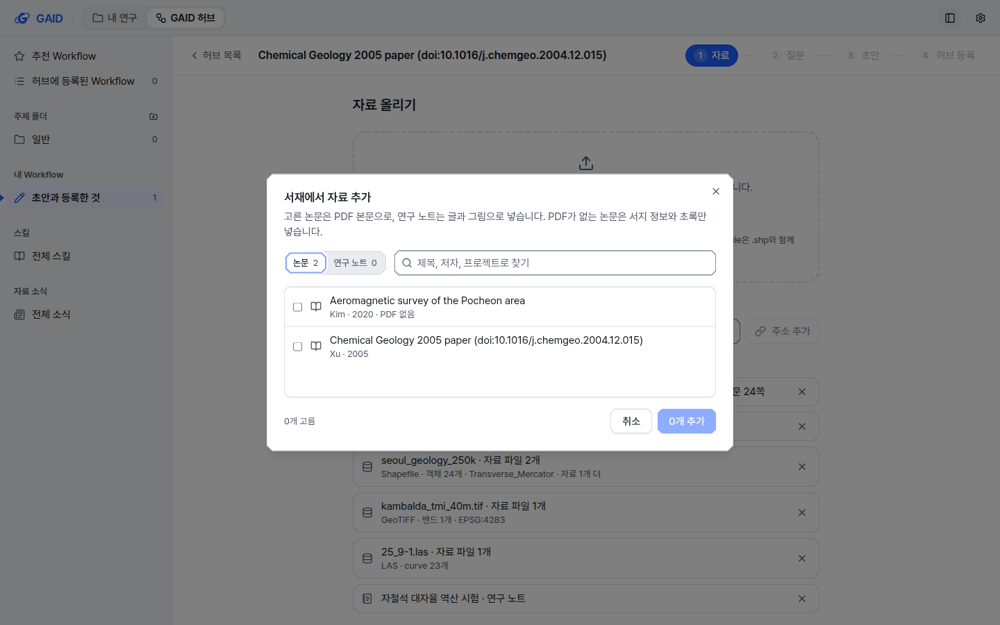
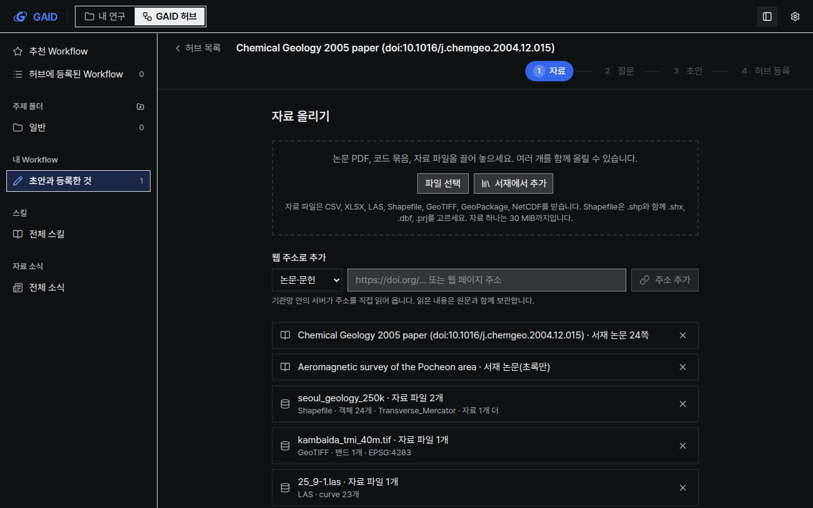

# Workflow 만들기에 여러 자료와 자료 파일, 서재 논문, 연구 노트 넣기

## 0. 한눈에

| | |
|---|---|
| 요청 | Workflow 만들기 도구가 문헌과 논문 말고도 여러 자료를 함께 받게 합니다. |
| 결론 | 자료 파일(CSV, XLSX, LAS, Shapefile 묶음, GeoTIFF 등), 서재의 논문과 연구 노트를 여러 개 함께 넣을 수 있습니다. 대화에서 허브 초안으로 보내는 경로도 같은 방식으로 연구 노트와 논문을 함께 넣습니다. |
| 믿을 수 있는 정도 | 서버와 화면 시험을 통과했고, 실제 자료 파일 4종을 넣어 화면을 확인했습니다. 연구 노트를 서재에 넣는 기능은 단위 A가 만드는 중이라, 서재의 연구 노트 탭은 A가 합쳐진 뒤에 채워집니다. 실제 모델로 Workflow를 만든 시험은 단위 D가 맡습니다. |
| 결정할 일 | 없음 |

## 1. 요청한 것

> 이것은 GAID 시스템에서 대화로그를 바탕으로 워크플로우를 만드는 기능과도 연계되어 있다고 생각하며, 기존 워크플로우 생성 도구에서도 문헌, 논문 뿐만 아니라 다수의 자료를 추가할 수 있게 해야한다. — 2026-10-23 요청(전체 요청 중 이 단위가 맡은 부분)

완료 기준(허브가 정한 단위 C): 허브의 Workflow 만들기가 자료 여러 개를 한 번에 받고, 새 종류로 자료 파일(크기 제한과 sha256 기록), 서재에서 고른 논문과 연구 노트를 받습니다. 기존 PDF, 코드, 글, 웹 주소, 분석 묶음도 그대로 받습니다. 대화 기록에서 Workflow로 넘기는 경로도 같은 방식을 씁니다. AI agent는 이 자료를 보고 쓰며, 자료 파일은 원본 바이트 대신 GAID의 자료 검사 요약으로 읽습니다.

## 2. 수행한 것

1. 자료 파일을 새 자료 종류로 받게 했습니다. 파일 하나, 함께 고른 파일 묶음(Shapefile의 .shp와 .shx, .dbf, .prj, GeoTIFF와 world file), 자료만 든 압축 파일을 모두 한 자료로 받고 파일마다 sha256을 기록합니다.
2. 자료 파일마다 GAID가 이미 지도와 검층 화면에 쓰는 자료 검사로 형식, CRS, 범위, 층과 필드, 밴드, curve, 첫 행을 읽어 요약합니다. 코드 묶음과 대화 분석 묶음 안의 자료 파일도 같은 요약을 만듭니다.
3. AI agent에게는 자료 파일의 요약만 보여 줍니다. 근거 인용도 그 요약을 기준으로 확인합니다. 지침에 "자료 파일과 논문 방법이 요구하는 입력을 비교하고, 빠진 입력을 밝힌다"와 "연구 노트의 결과는 연구자의 것으로 논문과 구분한다"를 넣었습니다.
4. 서재에서 논문과 연구 노트를 여러 개 골라 넣는 선택 창을 만들었습니다. PDF가 있는 논문은 본문으로, PDF가 없는 논문은 서지 정보와 초록으로, 연구 노트는 본문과 노트 폴더 안의 그림으로 들어갑니다. 다른 PC 프로젝트의 노트는 서재에 저장된 본문 사본으로 들어갑니다.
5. 대화에서 허브 초안으로 보내는 창에 "함께 넣을 연구 노트와 논문"을 넣었습니다. 해당 채팅이 쓴 연구 노트와 프로젝트에 연결한 서재 논문이 미리 골라져 있습니다.
6. 한 초안이 받는 양을 제한했습니다. 자료 하나 30 MiB, 초안 하나에 자료 30개, 모두 합해 300 MiB, 자료 하나에서 자세히 검사하는 파일 40개입니다. 잘못 넣은 자료는 목록에서 뺄 수 있습니다.

## 3. 결과


그림 1. 자료 단계에 서재 논문 2편(본문 있는 논문, 초록만 있는 논문), 서울 지질도 Shapefile 묶음, Kambalda 자력 GeoTIFF, 검층 LAS, 연구 노트를 넣은 모습입니다. 볼 것: 자료 파일 행의 둘째 줄에 형식, 객체·밴드·curve 수, CRS가 나옵니다.



그림 2. 서재 선택 창입니다. 볼 것: 논문과 연구 노트를 나눠 보고, 여러 항목을 골라 한 번에 넣습니다. PDF가 없는 논문에는 "PDF 없음"이 붙습니다.



그림 3. 같은 화면을 도폭 스타일, 어두운 테마, 1280×800에서 본 모습입니다.

| 완료 기준 | 결과 | 근거 |
|---|---|---|
| 자료 여러 개를 한 번에 받음 | 충족 | 그림 1, 서버 시험 |
| 자료 파일(CSV, Shapefile 묶음, GeoTIFF, LAS 등)과 파일별 sha256 | 충족 | 그림 1, 서버 시험 |
| 서재 논문과 연구 노트 | 부분: 논문은 충족, 서재의 연구 노트는 단위 A가 합쳐진 뒤 선택 창에 나타남(서버는 A의 항목 형식을 이미 처리) | 그림 2, 서버 시험 |
| 대화 기록에서 Workflow로 넘기는 경로가 같은 방식 사용 | 충족 | 화면 시험, 서버 시험 |
| AI agent가 자료 파일을 검사 요약으로 읽음 | 충족 | 서버 시험, 부록 A의 요약 예 |
| UI 지침과 문구 규칙 | 충족(아래 규칙 번호), 기존 배치 한계 1건 | 4절, 5절 |

화면 규칙: P2(한 화면에 채운 버튼 하나: 선택 창의 "추가"), P3(형식 목록은 올리기 영역 아래 한 줄 안내), B1과 B5(선택 창 단추 순서: 취소, 추가), D2(선택 창은 짧은 한 가지 일, 640 px), G1(자료 행은 두 줄, 둘째 줄은 연구 사실만), N3(논문/연구 노트는 목록 필터용 분절 단추), R1(검사기 이름, 경로, 해시는 화면에 없음), W1~W4(문구 길이 검사 통과), I1~I15(계측과 도폭, 밝은 테마와 어두운 테마 모두 확인).

## 4. 검증

- 과학적 검증: 해당 없음. 이 단위는 자료를 받아 AI agent에게 전달하는 기능이며 분석 결과를 만들지 않습니다. 실제 자료 4종(서울 지질도 Shapefile 2개 층, Kambalda 자력 GeoTIFF, Norway 25/9-1 LAS, 서재 논문 PDF)을 넣어 요약 내용이 원본과 맞는지 눈으로 대조했습니다(층 종류와 객체 수, 래스터 크기와 nodata, curve 목록과 깊이 범위).
- 소프트웨어 검증: 새 서버 시험 8건(자료 파일 요약과 AI agent 문맥, Shapefile 묶음, 자료 압축 파일과 코드 압축 파일 구분, 개수 제한과 빼기, 프로젝트 연구 노트, 서재 논문과 연구 노트 4가지 경우, 서재 경로, handoff에 노트와 논문 추가)과 화면 시험 3건을 추가했습니다. 프로젝트 전체 검사를 통과했습니다: 백엔드 시험 2,263개(8개 건너뜀), 프런트엔드 시험 1,239개, 문구 검사(오류 0), UI 지침 검사(오류 0), 배포 점검과 운영 시작·중지 시험. 첫 실행에서 연구 노트 그림 경로를 계산하는 한 줄이 Windows 경로 규칙 시험에 걸려 고친 뒤 다시 돌렸습니다.
- 수치 근거 5점: 해당 없음(성능이나 정확도 수치를 결론에 쓰지 않습니다).

## 5. 한계

- 서재의 연구 노트는 단위 A가 만듭니다. 이 단위는 A가 알려 준 항목 형식(연구 노트 종류 표시와 프로젝트·노트 위치, 본문 사본)을 그대로 읽도록 만들었고, 그 형식의 가짜 항목으로 시험했습니다. A가 합쳐지기 전에는 선택 창의 연구 노트 탭이 비어 있습니다.
- 자료 하나는 30 MiB까지입니다. 이보다 큰 격자나 검층 자료는 잘라 넣거나 압축해야 합니다. 큰 예제 자료를 공개 주소로 연결하는 일은 단위 B가 맡습니다.
- 자료 검사는 GAID의 기존 검사 범위를 따릅니다. CRS에 EPSG 코드가 없으면 투영 이름과 WKT 앞부분만 AI agent에게 전합니다. 검사가 실패한 파일은 실패 사실만 전합니다.
- 자료 단계에서 자료가 많으면 "자료 읽고 질문 받기" 단추가 900 px 화면에서도 첫 화면 아래로 내려갑니다. 모델, 목표, 만들 종류 입력이 단추 위에 있는 기존 배치 때문입니다. 이번에 올리기 영역을 줄이고 자료 목록 높이를 제한했지만 단추를 첫 화면 안으로 올리지는 못했습니다. 배치를 바꾸는 일은 선택 사항으로 남깁니다.
- 대화에서 허브로 보내는 창의 새 목록은 화면 시험으로만 확인했고 스크린샷은 찍지 않았습니다. 기존 파일 목록과 같은 모양의 목록입니다.
- 이 단위에서는 실제 모델로 자료 파일이 든 Workflow를 만들어 보지 않았습니다. 단위 D(포천 실전 시험)가 합쳐진 앱으로 확인합니다.

## 6. 결정할 일

없음

## 7. 대체되었거나 실패한 시도

<details><summary>펼치기 — 1건</summary>

- 연구 노트를 프로젝트 파일에서만 읽게 하면 다른 PC에서 동기화된 노트를 넣을 수 없었습니다. 단위 A와 맞춘 대로, 프로젝트가 이 PC에 없으면 서재에 저장된 본문 사본을 넣고 "서재 사본"으로 표시합니다.

</details>

## 용어

없음

## 부록 A. 근거 위치

<details><summary>펼치기 — 실행 방법, 원본, 해시, 커밋</summary>

| 항목 | 위치 |
|---|---|
| 서버 | `server/src/geo/authoring/data-files.ts`(자료 파일 판별과 검사 요약), `library-sources.ts`(서재 논문과 연구 노트), `sources.ts`(`storeSource`, `removeSource`, 제한), `routes.ts`(자료 빼기, 연구 노트, handoff `notes`/`libraryItemIds`), `server/src/geo/routes/library.ts`(`POST /geo/library/authoring`), `prompts.ts`(지침 판 2026-10-23.1), `agent.ts`(`sourceContext`의 자료 요약) |
| 계약 | `web/src/geo/contracts/authoring.ts`(`SourceKind` data/note, `DataFileSummary`, `AddSourceBody.files`, `AUTHORING_SOURCE_LIMITS`) |
| 화면 | `web/src/geo/hub/{source-step,library-picker,source-files,hub-screen,api}.tsx/ts`, `web/src/geo/hub-handoff/{dialog.tsx,client.ts}`, 문구 `locales/hub`, `locales/hubHandoff` |
| 시험 | `server/test/geo-authoring-sources.test.ts`, `server/test/geo-hub-handoff.test.ts`, `web/src/geo/hub/source-files.test.ts`, `web/src/geo/hub-handoff/hub-handoff.test.tsx` |
| 전체 검사 | `scripts/check`: 통과 기록 PC74:`~/data/geoaidesk/work/gaid-authoring-sources/logs/check2.log`, 첫 실행(1건 실패) `check.log` |
| 화면 확인 앱 | 이 작업 트리를 포트 3123/18123으로 띄움(검토용 앱과 별도), 시험 자료 넣기 PC74:`~/data/geoaidesk/work/gaid-authoring-sources/seed.mjs` |
| 스크린샷 16장 | PC74:`~/data/geoaidesk/work/gaid-authoring-sources/playwright/`(source-, picker- × 계측/도폭 × 밝음/어두움 × 1440/1280). 선택 창 사진은 "0개 추가"를 "추가"로 바꾸기 전 화면입니다. sha256 목록은 아래 |

AI agent가 받는 자료 요약 예(서울 지질도 단층 층):

```
Data file Seoul_Geology_250K_Fault.shp (shapefile, vector, 2820 bytes; read by gaid-map 1.0.0)
Companion files: Seoul_Geology_250K_Fault.cpg, Seoul_Geology_250K_Fault.dbf, Seoul_Geology_250K_Fault.prj, Seoul_Geology_250K_Fault.shx
CRS: Transverse_Mercator (WKT: …)
Layer Seoul_Geology_250K_Fault: LineString, 24 features; fields GM_LAYER:object, LAYER:object, …
```

스크린샷 sha256:

```
0806b3fbf27a985e4021313a83f7340384d43e27d04e0e84cf30d552d2f6d4a1  source-instrument-dark-1280.png
53c4494089b4687036860b34c15d2db6fb03adc2fe4e9d571e1cd7c2d15a6ef5  source-instrument-dark-1440.png
70dee66c879bba617c3e4b9730f82c82af010cfa0db06299933c895c698762af  source-instrument-light-1280.png
2bae50bf51ce2b743d9564ae866104e8846d28e58e5d3783daba939728ae9296  source-instrument-light-1440.png
ec9d87bd0205614c43c16d1ae2d502987a0e4b691e6e8ea6213b7e64f8e362f8  source-mapsheet-dark-1280.png
5523cc2af1f8eafd0d37bbe53de161d7ca93cdcbab5811f0f950a5daa0355f85  source-mapsheet-dark-1440.png
31f06d6723e5329d6d49da7c123ea2a57628ebdc5868ccfe9e6c04b5b814b17a  source-mapsheet-light-1280.png
6a639edb4cd247f3ac2b91d4a8d513a4400a701953fa5a4d459db3c5b09862f4  source-mapsheet-light-1440.png
54a30aeedbcb2462129673d70e97bf28c4a9bc7ccffc35e16c686103ddbc93a2  picker-instrument-dark-1280.png
6dcc9a5a5a31a083970d8260854feb59b0f5427bf101e57066545c0747919648  picker-instrument-dark-1440.png
062f0c82f692a73ee6e31093e00177ee169c480c63e137ad35d9e5df9f855e48  picker-instrument-light-1280.png
1dc1510f653c4e37cc4728e6c00725bbf7f2458f7f37d50d4673db7da6633766  picker-instrument-light-1440.png
18c5652bd281ec6877151842160d3a43f57822817fef990d3bf2bad726ecc30a  picker-mapsheet-dark-1280.png
25fd930f92a1e0afb161bd1fe05f2ecc25abef3db784dc81e4e76e09ad82d02c  picker-mapsheet-dark-1440.png
7850197d7c9be16138c4763ecc80a0a1987fb195f25f9fc989d20598d3980207  picker-mapsheet-light-1280.png
d7666eaae1b00307c42a63a4d13176cabfa8688dc72633f0831357dc1bbc8f54  picker-mapsheet-light-1440.png
```

작성 시점: 2026-10-23.

</details>
