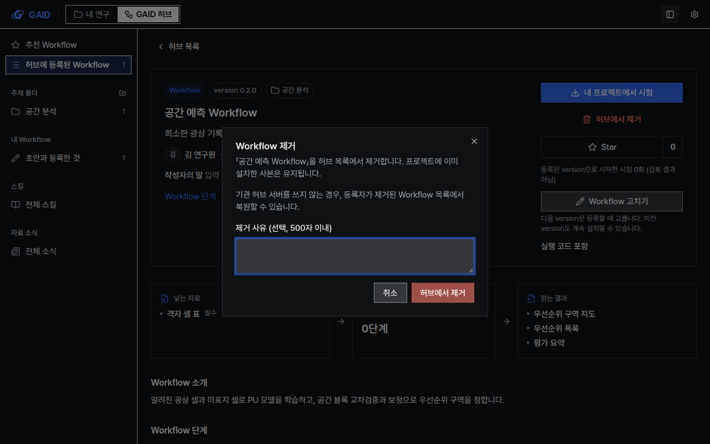
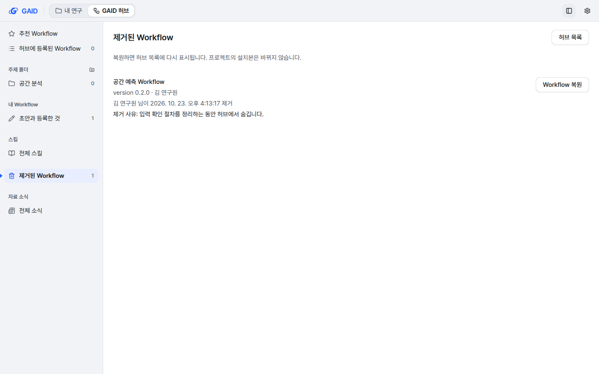

# GAID 허브 Workflow 제거·복원과 version 관리

## 0. 한눈에

| | |
|---|---|
| 요청 | 허브에 등록한 Workflow를 제거하는 기능, "판" 대신 version을 쓰는 버전 관리(0.1.0부터, 0.1.1과 0.2.0 중 선택, 1.0.0 정식 배포) |
| 결론 | 등록한 연구자나 관리자가 Workflow를 허브에서 제거할 수 있고, 관리자가 다시 복원할 수 있습니다. 처음 등록하면 0.1.0이고, 다시 등록할 때 등록한 연구자가 patch, minor, major 가운데 고릅니다. 연구자가 보는 화면에는 "판" 대신 version이 나옵니다. |
| 믿을 수 있는 정도 | 자동 시험과 격리된 로컬 앱에서 직접 제거·복원해 확인했습니다. 원내 허브 서버에는 아직 배포하지 않았습니다. 그 서버에서 제거 기능을 쓰려면 새 코드로 재시작해야 합니다. |
| 결정할 일 | 없음 |

## 1. 요청한 것

> 추가 작업 요청이다. 허브에 등록된 workflow를 제거하는 기능이 없다. 제거하는 기능을 추가해야한다. … 그리고 판이라는 용어보다는 version이라는 용어를 사용하고 정식 출판하기 전에는 0.1.0에서 시작하고 사용자가 버전을 0.1.1로 할지 0.2.0으로 할지 정할 수 있게 하고 메인 배포를 1.0.0으로 할지도 추후 관리할 수 있게 하여야 한다. 현재는 수정할 때마다 버전만 올라가고 있는 형태이다. 버전 관리 기능이 부재한 상태이다. — 2026-10-23 요청

같은 요청에 들어 있던 질문 옆 근거 보기와 서재 PDF 보기는 별도 작업으로 나눴습니다. hub가 이 두 작업을 맡습니다.

> 3번,5번은 나로 하고 나머지는 권장으로 진행하자. opus 5.5 high fast로 진행하자. — 2026-10-23 결정

완료 기준은 두 가지입니다.

1. 제거와 복원이 결정대로 동작해야 합니다. 등록한 연구자와 관리자가 제거하고, 관리자가 복원합니다. 프로젝트에 이미 설치한 사본은 그대로 둡니다. 허브 기록 저장소 세 곳에 모두 적용하고 감사 기록을 남깁니다.
2. 연구자가 보는 모든 곳에서 "판" 대신 version을 씁니다. 처음 등록은 0.1.0이고, 다시 등록할 때 등록한 연구자가 다음 version을 고릅니다. 기존 등록은 순서대로 0.1.0, 0.1.1, 0.1.2…로 읽고, 초안은 "초안"으로 표시합니다.

## 2. 수행한 것

1. version 규칙을 정했습니다. 처음 등록은 0.1.0입니다. 다시 등록할 때 patch(0.2.0 → 0.2.1), minor(0.2.0 → 0.3.0), major(0.2.0 → 1.0.0) 가운데 하나를 고릅니다. 이 규칙은 연구자의 GAID와 원내 허브 서버가 함께 검사합니다.
2. 기존 등록 기록은 바꾸지 않았습니다. 화면에 보여 줄 때만 1, 2, 3번 등록을 0.1.0, 0.1.1, 0.1.2로 읽습니다. 프로젝트에 설치할 때는 설치한 version을 함께 기록합니다. version은 Workflow 지침, 채팅 첫 메시지 카드, CLI 내보내기, 복사 원본 표시에도 들어갑니다.
3. 제거를 허브 기록 저장소 세 곳에 넣었습니다. 허브 서버 없이 쓰는 로컬 허브, 원내 허브 서버에 연결한 GAID, 허브 서버 자체입니다. 제거한 Workflow는 목록과 상세 화면에서 사라집니다. 기록, 파일, 댓글, 별표, 설치 기록은 남습니다.
4. 화면을 만들었습니다. Workflow 화면의 제거 버튼과 확인 창, 허브 왼쪽 목록의 "제거된 Workflow"와 복원 버튼, 등록 창의 version 선택입니다. 화면 문구 78개를 고쳐 "판"을 version으로 바꿨습니다.
5. 격리된 로컬 앱에서 실제로 제거하고 복원했습니다. 계측·도폭 두 스타일, 밝은·어두운 두 테마, 1440×900과 1280×800 두 크기에서 화면을 확인했습니다.

## 3. 결과

그림 1. 이미 0.2.0으로 등록한 Workflow를 다시 등록하는 창(도폭 스타일, 어두운 테마, 1280×800). 볼 것: 작은 수정(patch) 0.2.1, 기능 추가(minor) 0.3.0, 주요 배포(major) 1.0.0 가운데 하나를 고르고, 기본값은 작은 수정입니다.

그림 2. 등록한 연구자가 Workflow를 허브에서 제거하기 전에 보는 확인 창. 볼 것: 제거해도 프로젝트에 설치한 사본은 남는다는 안내와 선택 입력인 제거 사유(500자 이내)가 있습니다.

그림 3. 제거된 Workflow 목록(밝은 테마). 볼 것: 제목, version, 등록자, 누가 언제 제거했는지, 제거 사유가 나오고, "Workflow 복원" 버튼으로 허브 목록에 다시 올립니다. 왼쪽 "허브에 등록된 Workflow" 수는 0입니다.

| 완료 기준 | 결과 | 근거 |
|---|---|---|
| 등록한 연구자·관리자가 제거하고 관리자가 복원함 | 충족 | 그림 2, 그림 3, 4절 |
| 설치한 사본은 그대로 둠 | 충족 | 4절(설치한 뒤 제거해도 프로젝트 파일이 남는지 확인) |
| 저장소 세 곳에 적용하고 감사 기록을 남김 | 충족 | 4절 |
| 연구자 화면에서 "판" 대신 version을 씀 | 충족 | 그림 1–3, 문구 78개 변경 |
| 처음 0.1.0, 다시 등록할 때 patch·minor·major 선택 | 충족 | 그림 1 |
| 기존 1, 2, 3번 등록을 0.1.0, 0.1.1, 0.1.2로 읽음 | 충족 | 4절 |
| 초안은 "초안"으로 표시 | 충족 | 문구 변경 목록 |

## 4. 검증

- 과학적 검증: 해당 없음. 화면에 쓴 Workflow는 화면 확인용 예시이고 분석 결과가 아닙니다.
- 소프트웨어 검증:
  - 자동 시험으로 확인한 내용
    - 다른 연구자는 남의 Workflow를 제거할 수 없습니다(403).
    - 제거한 Workflow는 목록, 상세, 설치, 패키지 내려받기, 댓글에서 찾을 수 없습니다(404).
    - 같은 Workflow를 다시 제거하면 거절됩니다(409).
    - 제거한 Workflow에는 새 version을 등록할 수 없습니다.
    - 복원하면 version 기록이 그대로 돌아옵니다.
  - 원내 허브 서버 시험으로 확인한 내용
    - 관리자만 복원합니다.
    - 관리자는 다른 연구자의 Workflow도 제거할 수 있습니다.
    - 제거와 복원이 감사 기록에 순서대로 남습니다.
    - 기존 데이터는 새 데이터 구조로 자동으로 옮겨집니다.
    - 로컬 허브에서 제거한 Workflow를 허브 서버로 가져와도 제거 상태가 유지됩니다.
  - version 규칙 시험으로 확인한 내용
    - 다음 단계가 아닌 version(0.1.0 → 0.1.2, 0.3.0, 2.0.0 등)은 거절됩니다.
    - version을 보내지 않는 이전 GAID가 등록하면 patch 단계로 매깁니다.
    - version 없이 저장된 기록은 0.1.0, 0.1.1, 0.1.2로 읽고, 저장 기록 자체는 바꾸지 않습니다.
  - 두 계정이 실제 HTTP 허브 서버를 함께 쓰는 시험에서 관리자가 제거하고 복원했습니다. 다른 연구자의 설치 기록은 남았습니다.
  - 격리된 로컬 앱(리뷰 앱과 다른 포트)에서 직접 제거하고 복원했습니다. 제거하면 등록 수가 0, 제거 수가 1이 되고, 복원하면 등록 수가 다시 1이 됩니다.
  - 전체 검사(`scripts/check`) 결과는 부록 A에 적습니다.

## 5. 한계

- 원내 허브 서버(PC74)에는 아직 배포하지 않았습니다. 그 서버를 새 코드로 재시작해야 제거와 복원을 쓸 수 있습니다. 재시작 전에는 연구자 GAID에서 제거를 누르면 "찾지 못했습니다" 오류가 납니다. 배포는 hub가 통합한 뒤 맡습니다.
- 허브 서버 없이 쓰는 로컬 허브에는 관리자 계정이 없습니다. 그래서 로컬 허브에서는 등록한 연구자가 자기 Workflow를 복원합니다. 로컬 허브의 이름 입력은 계정 인증이 아니므로, 같은 이름을 입력한 사람도 같은 권한을 갖습니다.
- 허브 스킬의 version은 지금처럼 1, 2, 3 정수입니다. 용어만 "판"에서 version으로 바꿨습니다. 허브 스킬에 0.1.0 같은 version을 쓰는 일은 이번 범위가 아닙니다.
- 패키지 파일 안의 내부 버전 번호는 그대로 두고 화면에 보이지 않게 했습니다. 연구자는 허브에 등록한 version만 봅니다.
- 시험 기록 제목에서는 번호를 뺐습니다. 시험 기록에 등록 version이 저장되지 않아서, 패키지 번호를 version처럼 보여 주지 않으려는 것입니다.

## 6. 결정할 일

없음

## 7. 대체되었거나 실패한 시도

펼치기 — 2건

- 두 GAID를 한 시험 프로세스에서 같이 띄우는 e2e 시험에서 처음에는 A 연구자의 제거 요청이 B 연구자 계정으로 나갔습니다. 원격 허브 연결이 프로세스에 하나뿐인 시험 환경의 한계였습니다. 그래서 A의 두 번째 PC에서 제거·복원하는 방식으로 시험을 바꿨습니다. 제품에서는 GAID 하나가 프로세스 하나에서 돌므로 생기지 않는 문제입니다.
- 허브 서버에 연결한 상태에서 제거된 Workflow 목록을 처음 만들었을 때, 별표와 댓글 수를 읽으려다 404가 났습니다. 제거된 항목에서는 이 수를 0으로 두도록 고쳤습니다.

## 용어

| 용어 | 새 정의 / 정의 변경 | 정의 |
|---|---|---|
| [version](../../docs/glossary.md) | 새 정의 | 허브에 Workflow를 등록할 때마다 붙는 번호입니다. 처음 등록하면 0.1.0이고, 다시 등록할 때 등록한 연구자가 patch, minor, major 가운데 고릅니다. 초안에는 version이 없습니다. 한국어 화면에서도 영어 단어 version을 씁니다. 이전 용어 "판"을 대체합니다. |
| [허브 스킬](../../docs/glossary.md) | 정의 변경 | "판"을 version으로 바꿨습니다. 스킬 version은 정수입니다. |

## 부록 A. 근거 위치

펼치기 — 실행 방법, 원본, 해시, 커밋

| 항목 | 위치 |
|---|---|
| 코드 | 브랜치 `task/gaid-hub-versions`(하위 `task/gaid-hub-versions--ui` 통합), merge PR은 finish 때 생성 |
| version 규칙 | `web/src/geo/contracts/hub-version.ts` |
| 제거·복원 | `server/src/geo/hub-shared/{store,routes,records}.ts`, `server/src/geo/hub-client/remote-store.ts`, `server/src/geo/hub-server/{records,index,core,import}.ts`(migration 5 `hub_entry_removals`) |
| 화면 | `web/src/geo/hub/`(제거 확인 창, `#hub/removed`, 등록 창 version 선택) |
| 시험 | `server/test/geo-hub-shared.test.ts`, `geo-hub-server.test.ts`, `geo-hub-e2e.test.ts`, `geo-cli-export.test.ts`, `geo-methods.test.ts`, 웹 시험 |
| 전체 검사 | `scripts/check` (결과: 작성 시점에 기록) |
| 화면 캡처 32장과 캡처 스크립트 | `PC74:~/data/geoaidesk/work/gaid-hub-versions/screenshots/` (`{entry,remove,removed,register}-{instrument,mapsheet}-{light,dark}-{1440x900,1280x800}.png`) |
| 문구 변경 목록(한·영 변경 전후 78개) | `docs/tasks/gaid-hub-versions--ui.md`(하위 작업 문서, 통합 뒤 저장소 기록) |
| 운영 안내 | `docs/geo/hub-server.md` "Workflow versions and removal" |
| 배포 | 없음. 원내 허브 서버(PC74 :8700)는 migration 5 때문에 재시작이 필요합니다(hub rollout). |

작성 시점: 2026-10-23.

