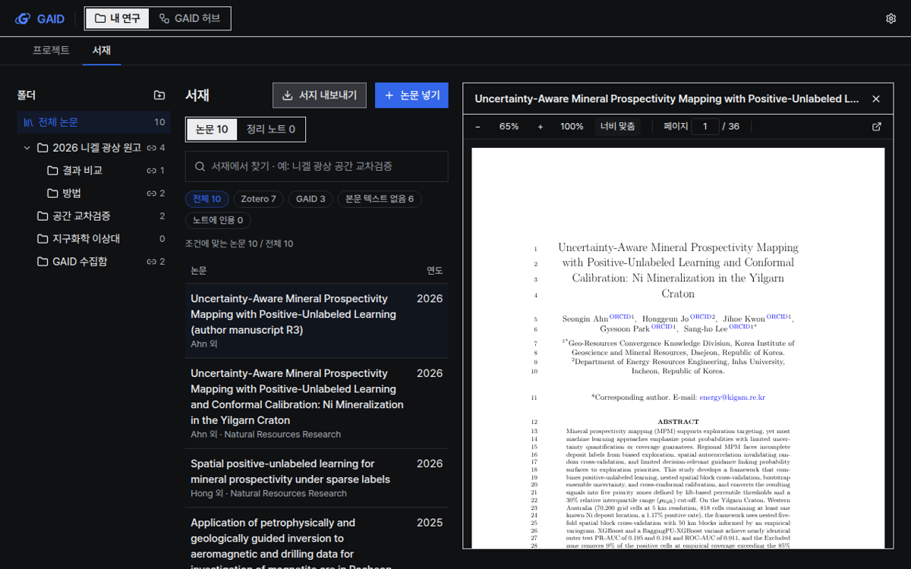
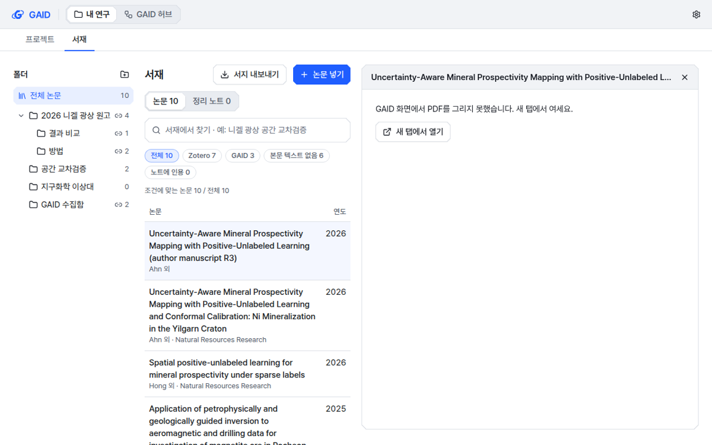

# 서재 PDF를 목록 옆 패널에서 보기

## 0. 한눈에

| | |
|---|---|
| 요청 | 서재에서 PDF를 볼 때 새 크롬 탭 대신 화면 옆 패널에 PDF 뷰어를 띄웁니다. |
| 결론 | GAID에 저장된 논문 PDF는 목록 옆 패널에서 원래 픽셀 그대로 열리고, 쪽 이동과 배율 조절이 됩니다. 패널을 닫으면 같은 논문의 상세로 돌아오며, 패널에서 그리지 못한 PDF는 새 탭에서 열 수 있습니다. |
| 믿을 수 있는 정도 | 격리한 GAID 실행본에서 36쪽 원고 PDF로 열기, 다른 논문으로 바꾸기, 닫기, 오류 화면을 확인했습니다. 두 화면 스타일과 두 테마, 두 창 크기에서 화면을 찍어 보았습니다. 연구자 검토는 아직 받지 않았습니다. |
| 결정할 일 | 없음 |

## 1. 요청한 것

> 또한, 서재에서도 pdf 보기를 하면 크롬 브라우저 새로운 탭이 열리는데 이런 방식보다는 사이트 패널에 pdf뷰어가 보이는 것이 더 적절하다. — 2026-10-23 요청

완료 기준: 서재의 "PDF 열기"가 GAID 안의 옆 패널에서 PDF를 보여 줍니다. PDF는 원래 픽셀대로 그리고(색 필터 없음), 쪽 이동과 확대·축소가 되며, 닫으면 목록과 상세로 돌아옵니다. 정리 노트 항목은 지금처럼 노트로 열립니다. 패널에서 그리지 못하는 PDF는 새 탭에서 열 수 있습니다.

## 2. 수행한 것

1. 파일 미리보기에 쓰던 PDF 뷰어를 보기 전용으로 가져와, 제목과 닫기 버튼이 있는 PDF 패널을 만들었습니다. Workflow 만들기의 근거 보기 같은 다른 화면도 이 패널을 쓸 수 있게 서재와 따로 두었습니다.
2. 서재에서 "PDF 열기"를 누르면 오른쪽 상세 자리에 PDF 패널이 넓게 열리고, 논문 목록은 왼쪽에 제목과 연도만 남깁니다. 목록과 PDF는 38 대 62로 나눕니다.
3. PDF 패널이 열린 채 다른 논문을 고르면, GAID에 PDF가 저장된 논문은 그 PDF로 바뀌고 Zotero에만 PDF가 있는 논문은 상세로 돌아갑니다. 이 구분을 위해 서재 목록이 "GAID에 저장된 PDF가 있는지"를 함께 알려 주게 했습니다.
4. 패널은 창 높이에 맞추고, 목록을 내려도 화면에 남게 했습니다. 닫기 버튼이나 Esc로 닫으면 상세의 "PDF 열기" 버튼으로 초점이 돌아갑니다.
5. 패널에서 PDF를 그리지 못하면 이유를 한 줄로 알리고 "새 탭에서 열기"를 보여 줍니다.

## 3. 결과

그림 1. 서재에서 원고 PDF를 연 화면입니다(계측 스타일, 밝은 테마, 1440×900). 볼 것: 왼쪽 목록은 제목과 연도만 남고, 오른쪽 패널 위쪽에 논문 제목과 닫기, 그 아래 뷰어 도구 막대(배율, 너비 맞춤, 쪽 번호, 새 탭 열기)가 있습니다.

그림 2. 같은 화면을 도폭 스타일, 어두운 테마, 1280×800에서 연 모습입니다. 볼 것: 어두운 테마에서도 PDF 쪽은 원래 흰 바탕 그대로이고 색을 바꾸지 않았습니다. 패널 테두리는 도폭의 잉크 선으로 그립니다.

그림 3. 패널이 PDF를 그리지 못한 경우입니다(시험용으로 깨진 파일을 돌려준 상태). 볼 것: 무엇이 안 되었는지와 "새 탭에서 열기"만 보입니다.

| 완료 기준 | 결과 | 근거 |
|---|---|---|
| "PDF 열기"가 GAID 안의 옆 패널에서 열림 | 충족 | 그림 1, 2 |
| 원래 픽셀, 색 필터 없음 | 충족 | 그림 2 |
| 쪽 이동과 확대·축소 | 충족 (기존 뷰어 도구 막대: 쪽 번호 입력, 배율 −/+, 100%, 너비 맞춤) | 그림 1 |
| 닫으면 목록과 상세로 돌아옴 | 충족 (닫기 버튼, Esc. 초점은 "PDF 열기"로 돌아옴) | 4절 |
| 정리 노트는 노트로 열림 | 충족 (정리 노트 목록과 상세는 바꾸지 않음) | 4절 |
| 그리지 못하면 새 탭에서 열기 | 충족 | 그림 3 |

## 4. 검증

- 과학적 검증: 해당 없음. 화면 동작만 바꿨습니다.
- 소프트웨어 검증:
  - 격리한 GAID 실행본에서 서재에 36쪽 원고 PDF를 넣고 실제 브라우저로 확인했습니다. 패널을 열면 초점이 닫기 버튼으로 옮겨 갑니다. PDF가 저장된 다른 논문을 고르면 패널의 PDF가 그 논문으로 바뀝니다. Zotero에만 PDF가 있는 논문을 고르면 패널이 닫히고 상세가 보입니다. Esc로 닫으면 초점이 "PDF 열기"로 돌아옵니다. 페이지를 내려도 패널은 창 위쪽에 남습니다(1280×800에서 높이 656px).
  - PDF 패널 단위 시험 2건(열기, 닫기, Esc, 오류 시 새 탭 링크)과 서재 서버 시험(저장된 PDF 표시)이 통과했습니다.
  - 전체 검사 결과는 부록 A에 적습니다.
- 화면 규칙: 계측·도폭, 밝은·어두운 테마, 1440×900·1280×800의 8장을 UI 안내서 12절 점검표와 대조했습니다. 연구자에게 보이면 안 되는 내부 정보(안내서 10절)는 화면에 없습니다.

## 5. 한계

- GAID에 저장된 PDF만 패널에서 엽니다. Zotero에만 있는 PDF는 상세의 "본문 텍스트 추출"로 GAID에 가져온 뒤에 열 수 있습니다.
- 패널은 보기 전용입니다. 서재 PDF에 강조나 메모를 남기는 기능은 넣지 않았습니다.
- 목록과 패널의 비율은 고정(38 대 62)이며 끌어서 바꿀 수 없습니다.
- 찾기, 인쇄, 내려받기는 뷰어 도구 막대의 새 탭 열기 버튼에서 브라우저 기능으로 합니다.

## 6. 결정할 일

없음

## 7. 대체되었거나 실패한 시도

펼치기 — 1건

- 처음에는 목록에 이미 있던 "PDF 있음" 표시로 패널을 유지할지 정했습니다. 이 표시는 Zotero에만 있는 PDF도 포함해서, 그런 논문을 고르면 패널이 빈 PDF를 열려다 실패했습니다. 그래서 "GAID에 저장된 PDF" 표시를 따로 추가했습니다.

## 용어

없음

## 부록 A. 근거 위치

펼치기 — 실행 방법, 원본, 해시, 커밋

| 항목 | 위치 |
|---|---|
| 코드 | 브랜치 `task/gaid-library-pdf-panel`. 패널 `web/src/geo/pdf/pdf-pane.tsx`(+ `.test.tsx`), 서재 `web/src/geo/library/library-screen.tsx`, 뷰어 연결점 `web/src/components/pdf-viewer/pdf-viewer.tsx`(`renderError`), 목록 요약 `storedPdf`(`web/src/geo/contracts/library.ts`, `server/src/geo/library/store.ts`, `server/test/geo-library.test.ts`) |
| 확인용 앱 | `start-gaid.sh`, `GAID_HOME=pc74:~/data/geoaidesk/work/gaid-library-pdf-panel/home`(gaid-ui-v2-debts 서재 사본, 키 파일 제외), 포트 3720/18720, 로그 `…/logs/launcher.log` |
| 시험 PDF | 자산 `authoring_preview_paper` (`~/assets/gaid-authoring-preview/20261015/author-manuscript.pdf`) · sha256 de611db0be9cda7caa5851b5f7e1593593c389c51a3ce02cd3cf249637ba5ff0 |
| 화면 원본 | `pc74:~/data/geoaidesk/work/gaid-library-pdf-panel/playwright/`: `pdf-pane-instrument-light-1440x900.png` 462449215fa0ddbe79e8a84beba03b367c0d96826417766ed76bb6f38cee1d67, `pdf-pane-instrument-light-1280x800.png` cbf6096a8ba97dd3f87a0652095566a4dc43b905f32be56fe19b3d995ede282a, `pdf-pane-instrument-dark-1440x900.png` 02dae14e6746a6692ecafa3fcd40363e3e9d2f3ea0f375ff2c1226663a5b1b9a, `pdf-pane-instrument-dark-1280x800.png` 64ff13c8df2f0379356b246a0bb0972e2daa67a3cbdee8db5b1aa76386f383b0, `pdf-pane-mapsheet-light-1440x900.png` ba30e440bbc18ae74f3354bf55e5dd27f0aef52420f6cfec7b05db46e54003ab, `pdf-pane-mapsheet-light-1280x800.png` 1bb95a31894e08379f49c63adc89d7e723f5c4fd4efd87c23d3364612c9ebad2, `pdf-pane-mapsheet-dark-1440x900.png` 5e0dd7875f4f14208a8453ce97ae5207f49fbc40d2149dc16f85bca699ed1c08, `pdf-pane-mapsheet-dark-1280x800.png` efbd0ac736a58c6b2eaf6cb5d84dcbd0fe84cf42fe0c22e9fae6d23fb523729f, `error-1280.png` d0cdb5ea2240d66816709e343fe9e39201bb4c5c264f6ebec600399aca4ca51c, `scrolled-1280.png` cd6d10cdf38c5e4c997479d5090a2a3081811a2bfd0877f6f503840b543365ac |
| 검사 | `scripts/check` (결과는 task 문서 Current state) |
| 화면 규칙 | 따름: P2 P4 L3 L6 L7 L9 I6 I12 B2 B4 N4 D6 F5 A1 A2 S7 W1. 어긋남: 없음. 선택된 목록 행의 표시(기존 서재 표 스타일)는 바꾸지 않았습니다. |

문구 변경 (모두 새 문자열, 이전 값 없음):

| id | 한국어 | 영어 |
|---|---|---|
| `viewers.pdfPane.label` | PDF: {title} | PDF: {title} |
| `viewers.pdfPane.close.button` | PDF 닫기 | Close PDF |
| `viewers.pdfPane.closeHint` | 논문 상세로 돌아갑니다 (Esc) | Return to the paper details (Esc) |
| `viewers.pdfPane.error` | GAID 화면에서 PDF를 그리지 못했습니다. 새 탭에서 여세요. | Could not display this PDF here. Open it in a new tab. |
| `viewers.pdfPane.newTab.button` | 새 탭에서 열기 | Open in new tab |

`library.detail.pdf.button`(PDF 열기 / Open PDF)은 그대로이며, 이제 새 탭 대신 패널을 엽니다.

작성 시점: 2026-10-23, 브랜치 task/gaid-library-pdf-panel.

