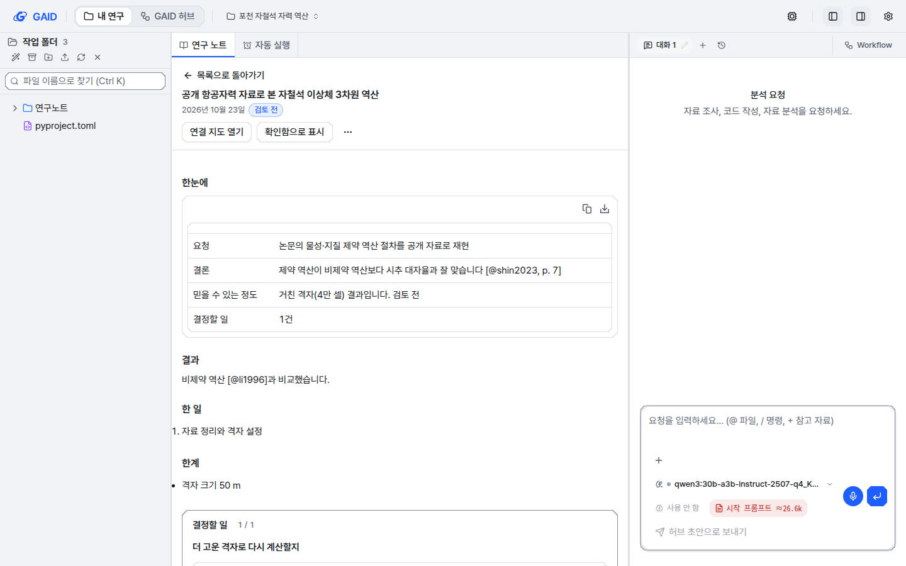
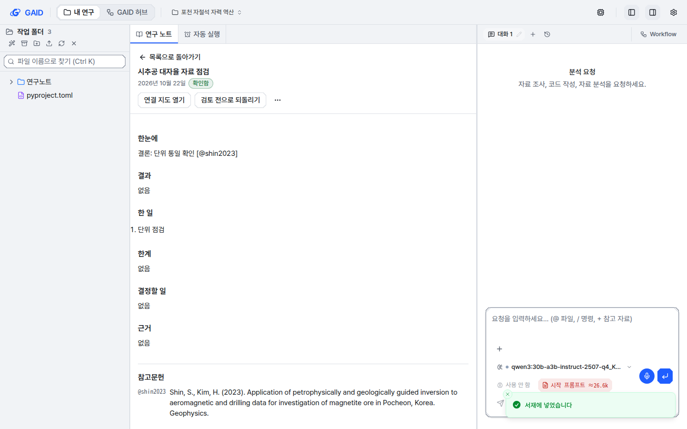

# 정리 노트를 서재에 넣고 다시 프로젝트에서 열기

## 0. 한눈에

| | |
|---|---|
| 요청 | 연구 노트를 서재로 가져오되, 논문과 카테고리를 나눠 관리 |
| 결론 | 서재에서 정리 노트를 논문과 나눠 넣고, 걸러 보고, 폴더에 넣고, 프로젝트에서 다시 열 수 있습니다. 노트 파일이 원본이며, 기관 허브 서재 동기화에 실리고 Zotero에는 쓰지 않습니다. |
| 믿을 수 있는 정도 | 자동 시험과 시험용 앱에서 노트를 넣고 다시 여는 흐름을 확인했습니다. 실제 기관 허브 서버를 거친 두 PC 사이 동기화는 시험용 가짜 서버로만 확인했습니다. |
| 결정할 일 | 없음 |

## 1. 요청한 것

요청 원문 가운데 이 작업에 해당하는 부분입니다.

> 그리고 현재 연구 노트를 서재로 다시 가져오는 기능은 구현되지 않은 것으로 알고 있기 때문에 이를 구현하여야 한다. 논문과는 별도의 연구 노트이므로 카테고리를 구분하여 관리할 수 있게 해야한다. — 2026-10-23 요청

사용자가 받아들인 권장안: "Research notes in 서재: GAID library only, included in the institute hub server library sync; no Zotero writes."

완료 기준: 정리 노트를 서재에 논문과 다른 종류로 넣을 수 있습니다. 서재에서 목록으로 보고, 걸러 보고, 폴더에 넣을 수 있습니다. 프로젝트에서 다시 열 수 있고, 노트 파일을 원본으로 삼아 따라 갱신됩니다. 기관 허브 서재 동기화에 실리고 Zotero에는 쓰지 않습니다. 인용한 논문과의 연결도 유지합니다.

## 2. 수행한 것

1. 서재 항목에 "정리 노트" 종류를 더했습니다. 정리 노트 항목에는 제목, 날짜, 상태, 한 줄 결과, 인용한 논문, 본문 앞부분(64 KiB까지, 그림 제외), 노트가 있는 프로젝트를 담습니다.
2. 서재를 열 때와 허브 동기화 직전에 노트 파일이 바뀌었는지 보고, 바뀐 노트만 다시 읽습니다. 파일이 없어지면 "노트 파일 없음"으로 표시하고 마지막 내용을 남깁니다. 파일이 돌아오면 표시도 사라집니다.
3. 정리 노트는 참고문헌이 아니므로 서지 내보내기, 폴더 점검, 프로젝트 인용 범위, AI agent의 서재 검색, ORCID 대조, Zotero로 보내기에서 모두 뺐습니다.
4. 서재 화면에 논문 / 정리 노트 전환, 정리 노트 표, 노트 상세, "정리 노트 가져오기"를 만들었습니다. 프로젝트의 노트 화면에는 "더 보기 → 서재에 넣기"를 더했습니다.
5. "프로젝트에서 열기"를 누르면 해당 프로젝트로 옮겨 가서 연구 노트 탭에 그 노트를 엽니다. 논문 상세의 "내 연구에서 쓰인 곳"에 있는 노트 열기도 이제 노트까지 엽니다.
6. 허브 서재 동기화가 노트 본문 때문에 한 번에 보내는 양이 커질 수 있습니다. 그래서 한 번에 보내는 변경을 나눠 서버의 요청 크기 제한(4 MiB)을 넘지 않게 했습니다.

## 3. 결과

그림 1. 서재에서 정리 노트를 고른 화면(계측 스타일, 밝은 테마, 1440×900). 볼 것: 위쪽의 논문 2 / 정리 노트 2 전환, 날짜·프로젝트·상태·인용 논문 수가 있는 표, 오른쪽 상세의 "프로젝트에서 열기"와 인용한 논문 목록.

그림 2. 서재에서 "프로젝트에서 열기"를 누른 뒤의 화면. 볼 것: 해당 프로젝트로 옮겨 가서 연구 노트 탭에 같은 노트가 열립니다.

그림 3. 프로젝트의 노트 화면에서 "더 보기 → 서재에 넣기"를 누른 뒤의 화면. 볼 것: 아래쪽 "서재에 넣었습니다" 알림. 머리 부분의 동작은 세 개(연결 지도, 상태 표시, 더 보기)로 줄였고, 파일로 열기는 더 보기 안으로 옮겼습니다.

| 완료 기준 | 결과 | 근거 |
|---|---|---|
| 논문과 다른 종류로 서재에 넣기 | 충족 | 그림 1, 그림 3, 자동 시험 |
| 목록, 걸러 보기(검토 전 / 확인함), 찾기, 폴더 | 충족 | 그림 1, 자동 시험 |
| 프로젝트에서 다시 열기 | 충족 | 그림 2 |
| 노트 파일이 원본이고 서재가 따라 갱신 | 충족 | 자동 시험(제목·상태 수정, 파일 삭제와 복구) |
| 기관 허브 서재 동기화에 포함 | 충족 (가짜 서버로 확인) | 자동 시험 |
| Zotero에 쓰지 않음 | 충족 | 자동 시험(보내기 거절, Zotero와 이어진 폴더에 넣어도 Zotero에 쓰지 않음) |
| 인용한 논문 연결 유지 | 충족 | 그림 1의 인용한 논문, 논문 상세의 노트 연결 |

## 4. 검증

- 과학적 검증: 해당 없음. 연구 결과를 만드는 기능이 아닙니다.
- 소프트웨어 검증: 새 서버 시험 6개를 추가했습니다. 노트 넣기와 다시 넣기, 목록 종류, 인용 연결, 내보내기 제외, 파일 수정·삭제·복구, Zotero 거절, 다른 PC 노트, 본문 앞부분 자르기, 동기화 나눠 보내기와 노트 동기화를 다룹니다. 화면 시험 3개도 추가했습니다(표 표시, 서재용 본문 정리, 프로젝트로 여는 요청). 서재·노트·ORCID·허브 관련 기존 서버 시험 143개와 화면 시험 109개가 통과했습니다. 전체 점검 결과는 부록 A에 적었습니다.
- 시험용 앱: 별도 데이터 위치로 앱을 띄웠습니다. 논문 2편과 정리 노트 2개로 노트 넣기, 서재 목록, 상세, 노트 내용, 프로젝트에서 열기, 노트 화면에서 서재에 넣기, 정리 노트 가져오기 대화상자를 브라우저로 확인했습니다. 브라우저 콘솔 오류는 0건이었습니다.
- UI 지침 대조: 계측·도폭 스타일, 밝은·어두운 테마, 1440×900·1280×800 화면에서 8장을 찍어 12절 점검표와 대조했습니다(부록 A).

## 5. 한계

- 노트를 서재에서 갱신하는 일은 노트가 있는 PC의 GAID만 합니다. 다른 PC에서는 허브 동기화로 받은 마지막 내용만 보이고, 그 PC에서는 프로젝트에서 열 수 없습니다.
- 서재에 남는 본문은 앞부분 64 KiB까지이고 그림은 빠집니다. 전체와 그림은 프로젝트에서 봅니다.
- 다른 노트가 이 노트를 대체하면 "대체됨" 상태가 생깁니다. 이 상태는 이 노트 파일이 바뀔 때만 서재에 반영됩니다.
- 실제 기관 허브 서버를 거쳐 두 PC 사이에서 동기화하는 흐름은 이번에 확인하지 않았습니다. 같은 동기화 경로를 쓰는 기존 논문 동기화 시험과, 노트 항목을 가짜 서버로 보내는 시험으로만 확인했습니다.
- 1280×800 화면에서는 표의 프로젝트 이름이 잘립니다. 마우스를 올리면 전체 이름이 보입니다.

## 6. 결정할 일

없음

선택 사항 (고르기 전에는 완료 기준이 아닙니다):
- AI agent가 서재의 정리 노트도 검색해 지난 분석을 참고하게 하기. 지금은 논문만 검색합니다.

## 7. 대체되었거나 실패한 시도

펼치기 — 1건

- 처음 화면에서는 정리 노트를 보고 있어도 왼쪽 폴더 목록 맨 위가 "전체 논문"이었습니다. 오른쪽에는 노트와 관계없는 ORCID·Zotero 카드가 남아 있었고, 인용한 논문도 인용 키로만 보였습니다. 시험용 앱에서 보고 고쳤습니다. 지금은 "전체 정리 노트"로 표시하고, 두 카드는 숨기며, 인용한 논문은 제목과 함께 보여 줍니다.

## 용어

| 용어 | 새 정의 / 정의 변경 | 정의 |
|---|---|---|
| [정리 노트 (서재)](../../docs/glossary.md) | 새 정의 | 서재에 넣은 정리 노트입니다. 논문과 다른 종류로 나뉘어 따로 보고, 폴더에 넣고, 프로젝트에서 다시 엽니다. 노트 파일이 원본이며 서재는 제목, 상태, 인용한 논문과 본문 앞부분을 파일에서 읽어 갱신합니다. Zotero에는 쓰지 않습니다. |

## 부록 A. 근거 위치

펼치기 — 실행 방법, 원본, 해시, 커밋

| 항목 | 위치 |
|---|---|
| 코드 | 브랜치 task/gaid-note-library (병합 커밋은 마무리 때 기록) |
| 계약 | web/src/geo/contracts/library.ts (`LibraryItem.kind`, `LibraryNoteRef`, `LibraryNoteSummary`, `AddLibraryNoteBody`, `LibraryNoteCandidate`) |
| 서버 | server/src/geo/library/notes.ts, server/src/geo/routes/library.ts (`POST /geo/library/notes`, `GET /geo/library/notes/candidates`, `GET /geo/library?kind=note`), server/src/geo/library/uses.ts, server/src/geo/library/sync/index.ts (`pushBatches`) |
| 화면 | web/src/geo/library/note-items.tsx, item-folders.tsx, library-screen.tsx, web/src/geo/notes/open-note.ts, research-notes-panel.tsx; seam web/src/app/page.tsx, web/src/components/file-preview-panel.tsx |
| 시험 | server/test/geo-library-notes.test.ts, web/src/geo/library/note-items.test.tsx |
| 시험용 앱 | pc74, 웹 13610 / API 18610, GAID_HOME ~/data/geoaidesk/work/gaid-note-library/home, 시드 스크립트 ~/data/geoaidesk/work/gaid-note-library/seed.sh |
| 전체 점검 | scripts/check, 로그 ~/data/geoaidesk/work/gaid-note-library/check-*.log |

UI 지침 화면 8장 (pc74:~/data/geoaidesk/work/gaid-note-library/playwright/shots/):

| 파일 | sha256 |
|---|---|
| library-notes-instrument-light-1440x900.png | fe21f4b1b2ae0ee60a41543efe48258f80d6b12e955ed4bccbe93a5a76cbe3f0 |
| library-notes-instrument-light-1280x800.png | 56e5a093e2820bf126392366760a9c9138153d60c29515a0a1859875381c0b22 |
| library-notes-instrument-dark-1440x900.png | 41e762ba5cfe799ba74a23c417854f1dc34e740e78079e78593e64b82dab04a6 |
| library-notes-instrument-dark-1280x800.png | fc5db4cdde9f4450c13f06e2e12c77720b28aef3e957183f7327cf5e005042a0 |
| library-notes-mapsheet-light-1440x900.png | 69760824a4fad8dc73eb243abc2ec83a2ca9361c146c3159945c2038193bb293 |
| library-notes-mapsheet-light-1280x800.png | 65861dbab42557f5537c14329ad081f4ef720da6e35a5baacb136fefdbab7925 |
| library-notes-mapsheet-dark-1440x900.png | 0260a1a3f7a41d554326af54a4fc19cde567fed6d8fa1fe42268a83d70f02fe6 |
| library-notes-mapsheet-dark-1280x800.png | 31d728c86e8b7c4fd0866404ba39ae2b2c96d59b79aa2b46af92b259bea6e2c2 |

UI 지침 규칙: P2·B1(한 화면의 주 동작 하나. 서재 머리의 "정리 노트 가져오기"와 상세 칸의 "프로젝트에서 열기"는 서로 다른 칸이며, 논문 상세의 기존 배치와 같습니다), B4(노트 화면 머리 동작 3개 + 더 보기로 맞춤), N3(논문 / 정리 노트는 표를 거르는 전환으로 `.gaid-seg` 사용), RN1(상태 표시는 노트 패널과 같은 검토 전 / 확인함 / 대체됨), X3·X4(행을 고르면 옆 칸에 상세, 표 위에 상태 줄 한 줄), F4(빈 상태 한 줄 + 동작 하나), P3(노트 본문은 접힌 "노트 내용" 안), R1(내부 경로·식별자 없음; 인용 키는 연구자가 노트에 쓴 값). 지키지 못한 규칙: X1(정리 노트 표 열 머리로 정렬·거르기 없음, 논문 표와 같은 기존 수준). 새 accepted debt는 없습니다.

새 문자열 id (변경 전: 없음):
- library: `category.{label,paper,note}`, `detail.useNoteRemote`, `notes.*` (category, add.button, search, empty, noMatch, state, stateFolder, filter.{pending,confirmed}, side, date, table.*, otherPc, otherPcLong, missingShort, missing, project, open.button, remove.button, removeConfirm, removeYes.button, removed, removeFailed, citedTitle, citedNone, citedMissing, openPaper.action, content.{title,read,readTruncated}, dialog.*, allFolder, recentTitle). 예: `notes.open.button` 프로젝트에서 열기 / Open in project, `category.note` 정리 노트 {n} / Research notes {n}.
- notes: `detail.more` 더 보기 / More, `detail.toLibrary.button` 서재에 넣기 / Put in library, `detail.toLibraryTip`, `detail.libraryAdded`, `detail.libraryUpdated`, `detail.libraryFailed`.
- 바뀐 문자열: 없음. `notes.detail.openFile.button`(파일로 열기)은 글은 그대로이고 자리만 더 보기 메뉴로 옮겼습니다.

작성 시점: 2026-10-23, 브랜치 task/gaid-note-library.

