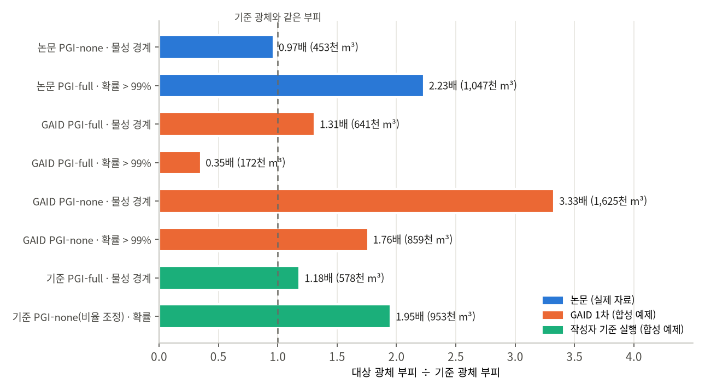
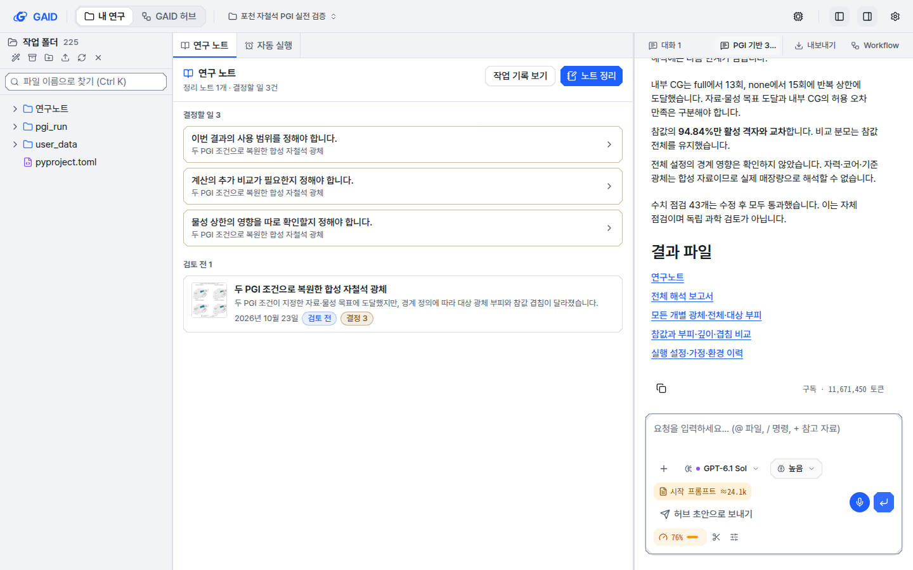
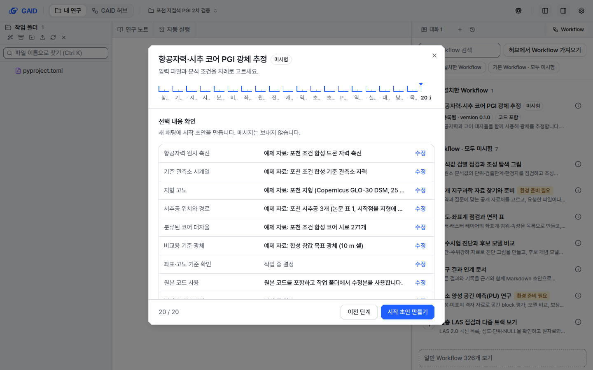

# 포천 자철석 PGI 논문으로 해 본 GAID 연구 흐름 실전 검증

## 0. 한눈에

| | |
|---|---|
| 요청 | 다른 논문(포천 자철석 PGI)으로 서재 → Workflow → 분석 → 연구 노트 → 서재 흐름을 실전 검증하고, 부족한 점을 고칩니다. |
| 결론 | <!--FINAL-CONCLUSION--> |
| 믿을 수 있는 정도 | 검토 앱에서 연구자 역할로 직접 눌러 확인했습니다. 분석은 합성 예제 자료로 했으므로 실제 포천 광체의 추정이 아니며, 참값을 아는 예제에서의 복원 성능입니다. 같은 자료로 돌린 작성자의 참고 실행과 대조했습니다. |
| 결정할 일 | 1건 (6절): 허브에 올린 Workflow에 들어 있는 논문 보충 코드의 공유 범위 |

## 1. 요청한 것

> 사용자는 논문 서재에서 시작해서 워크플로우를 만들고 분석을 수행하여 연구 노트를 생성한 후 해당 연구 노트를 다시 서재로 가져오는 흐름을 다른 논문으로 실전 검증하고 싶다. 실전 검증을 통해 부족한 부분이 발견되면 개선까지 진행하고 싶다. (…) 특히 다른 논문으로 워크플로우를 생성해보는 실전 검증의 경우에는 GAID 시스템의 워크플로우를 생성할 때 에이전트 모델은 GPT 6.1 sol high로 지정하고 writer가 직접 이용자 역할로 생성해보아야 한다. 그리고 생성 과정에서 논문의 분석과정과 다른 방식으로 유도되거나 너무 지엽적인 결과만 계산되게 하는 것은 아닌지도 검토하면서 개선점들을 정리하고 개선하여야 한다. 또한, 테스트이므로 너무 과도한 연산이 되지 않게 하여야 한다. — 2026-10-23 요청(발췌)

> 논문에 준하는 수준으로 분석은 이루어져야한다. 해상도는 거칠게 해도 되지만 분석 품질을 낮춰라는 얘기는 아니다. — 2026-10-23 답변

완료 기준: 작성자가 연구자 역할로 검토 앱에서 Workflow를 GPT-6.1 Sol(추론량 높음)로 만들고 기관 허브에 등록한 뒤, GAID 프로젝트에서 논문 수준의 분석(여러 자료, 지구물리 지식 포함)을 10분 안팎의 계산으로 실행하고, 연구 노트를 서재로 가져옵니다. 논문 방법에서 벗어나게 하거나 결과를 좁히는 곳을 찾아 고치고, 다른 단위의 몫은 넘깁니다.

## 2. 수행한 것

1. 논문(Heo et al. 2025, Geosciences Journal)과 그 보충 코드(SimPEG PGI 스크립트)를 읽어 방법을 정리했습니다. 일주변화 보정, 25 m 재표본화와 Z-score 제외, IGRF 제거, 목표 주변 절단, 코어 대자율로 만든 3성분 GMM, PGI-full과 PGI-none, 물성·확률 두 경계, 저감도 구역 제외, 시추 해석 광체와 부피 비교입니다.
2. 논문 자료는 공개되지 않아, 공개 자료를 조사한 뒤 합성 예제 자료를 만들었습니다. 실제 지형(Copernicus 30 m 지형 모델), 논문의 시추공 표와 물성 통계, SimPEG로 계산한 드론 자력 측선, 기준 관측소 기록, 코어 시료 271개, 참값 광체입니다. 같은 자료로 작성자의 참고 PGI 실행을 만들어 기준으로 삼았습니다.
3. 검토 앱에서 연구자 역할로 1차 흐름을 끝까지 진행하며 문제를 찾고, 작성자 몫은 고쳐 main에 넣었습니다(그동안 A·B·C 단위가 노트→서재, 예제 자료, 여러 자료 넣기를 완성했습니다).
4. 고친 앱에서 2차 흐름을 다시 진행했습니다. PGI 방법 논문(Astic et al. 2020)을 서재에 더해 Workflow의 근거로 쓰고, 입력마다 예제 자료를 붙여 허브에 등록했습니다. 결과가 부족해 연구자 수정 요청으로 Workflow를 고치고 다음 version으로 다시 등록해 실행했습니다.
5. 연구 노트를 서재로 가져왔습니다. <!--NOTE-LIBRARY-->

## 3. 결과

<!--FIG1-->

그림 2. 대상 광체 부피를 기준 광체 부피로 나눈 값. 파랑은 논문(실제 자료, 기준은 시추 해석 광체 468,853 m³), 주황은 GAID 1차 실행, 초록은 작성자 참고 실행(둘 다 합성 예제, 기준은 참값 488,000 m³)입니다. 볼 것: 같은 설정끼리(주황과 초록) 비교하면 GAID 결과가 참고 실행과 같거나 더 가깝고, 논문과는 자릿수가 같습니다. 논문 막대는 자료가 달라 직접 비교 대상이 아닙니다.

그림 3. 1차 분석 뒤의 GAID 작업 화면(검토 앱, 계측 스타일, 1440×900). 볼 것: 연구 노트가 "결정할 일 3"과 함께 만들어졌고, 오른쪽 채팅에 결과 파일 목록이 있습니다.

그림 4. 2차 흐름에서 허브의 Workflow를 빈 프로젝트에 설치한 직후의 시작 설정 요약. 볼 것: 연구자가 파일을 고르지 않았는데 입력 6개가 모두 "예제 자료"로 채워졌습니다. 단계 표시줄의 20단계 이름은 잘려 읽을 수 없습니다(H 단위가 시안을 사용자에게 묻는 중).

| 완료 기준 | 결과 | 근거 |
|---|---|---|
| 서재에서 Workflow 만들기 | 충족. Zotero 논문에서 바로 시작했고, PGI 방법 논문을 서재에서 함께 넣었습니다. | 2절 4 |
| GPT-6.1 Sol·추론량 높음으로 저작 | 충족. 1차는 화면에 추론량 선택이 없어 우회했고(F1), 고친 뒤 2차는 화면에서 골랐습니다. | 표 1 |
| 기관 허브 등록·공유 | 충족. 1차 1개, 2차 2개 version(0.1.0, 0.2.0)을 "지구물리 역산" 폴더에 등록했습니다. | 부록 A |
| 논문 수준 분석 | <!--QUALITY--> | 그림 1, 2 |
| 1회 계산 10분 안팎 | 충족. 두 PGI 역산 합계 1차 479초, 2차 431초, 최종 <!--TIME-->. 대화 전체(코드 작성 포함)는 40분 안팎입니다. | 4절 |
| 연구 노트 → 서재 | <!--NOTE-RESULT--> | 2절 5 |
| 논문과 다르게 유도하거나 좁히는 곳 정리·개선 | 충족. 22건을 찾아 17건을 고쳤고, 다른 단위 몫 4건을 넘겼습니다. | 표 1 |

표 1. 찾은 문제와 처리

| 번호 | 어디서 | 무엇이 | 처리 |
|---|---|---|---|
| F1 | 저작 화면 | 에이전트 모델은 고를 수 있지만 추론량은 고를 수 없어 늘 "보통"으로 실행됨 | 고침: 추론량 선택 |
| F2 | 첫 초안 | 초안 작성 때 논문 본문을 보지 않고 발견 사항 요약만 봐 방법의 세부가 빠짐 | 고침: 첫 초안도 본문을 읽음 |
| F3, F12, F13 | 빠른 시험 설정 | "빠른 시험은 흐름 확인용"이라 하고, 관측점 300개·셀 2,000개·반복 5회처럼 광체를 볼 수 없게 줄임 | 고침: 빠른 시험도 방법 단계를 모두 유지하고, 목표가 여러 셀에 걸치게 하며, 결과를 해상도 범위 안에서 해석 |
| F8 | 서재에서 만든 저작 | 고른 모델·추론량이 저장되지 않아 화면을 다시 열면 기본 모델로 실행됨 | 고침 |
| F9 | LAN 검토 앱 | 보안 연결이 아닌 주소에서 저작 단계가 모두 "crypto.randomUUID is not a function"으로 멈춤 | 고침(긴급 통합) |
| F10 | 질문 권장안 | "보정된 자료부터" 권장으로 논문의 일주변화·Z-score·IGRF 처리를 빼도록 유도함(올린 코드가 그 부분을 다루지 않는다는 이유) | 고침: 권장안은 방법 전체를 유지 |
| F11 | 질문 카드 | 선택지를 고르고 조건을 덧붙일 수 없음 | 고침 |
| F16 | 초안 | 실행 파일과 결과를 설치된 스킬 폴더 안에 쓰게 하고 없는 파일을 가리켜 설치가 막힘 | 고침: 작업 폴더에만 씀 |
| F18 | 분석 실행 | 시작 설정을 다 정했는데도 세부 규칙 3개를 물으며 멈췄고, 10분 뒤 질문이 만료된 뒤에도 실행을 끝냄 | 고침: 조건을 모두 정하면 가정으로 기록하고 끝까지 진행 |
| F19 | 해석 깊이 | PGI-none의 광석 평균이 내려가는(붕괴) 원인을 GMM 성분 비율과 잇지 못함 | 고침(Workflow): PGI 방법 논문을 근거로 넣고 점검 단계를 더함 |
| F22 | 2차 초안 | 논문의 "목표 주변 자료만 잘라 쓰기"가 빠져 측량 전체를 37.5 m 셀로 계산, 목표가 셀 3개 폭 | 고침(Workflow): 절단 단계와 25 m 유지 |
| F7 | 서재 | PDF 본문을 추출하기 전에는 "Workflow 만들기"가 이유 없이 비활성 | A가 고침 |
| F17 | 시작 설정 | 선택 입력이 기본으로 "사용하지 않음"이라 논문 자료 대부분을 빼고 시작할 수 있음 | 예제 자료가 있는 Workflow는 B로 해소, 나머지는 H가 진행 예정 |
| F21 | 허브 등록 | "공유하지 않음: 연구 자료"라고 적지만 예제 자료는 함께 공유됨 | 미결 항목 |
| F4, F5, F6, F14, F15, F20 | 기타 | 저작 모델이 실행 스크립트를 쓰지 못함, 예제·자료 파일 자료 미지원(B·C로 해소), 조건이 많음, 주석 줄을 머리글로 읽음 등 | 기록 또는 해소 |

## 4. 검증

- 과학적 검증: 같은 합성 예제로 작성자가 논문 보충 코드 그대로의 설정으로 PGI를 돌려 대조했습니다(25 m 셀, 활성 셀 82,807개, 두 변형 218초). 같은 설정에서 GAID 1차 결과는 참고 실행과 같거나 참값에 더 가까웠습니다. 논문 수치와는 자료가 달라 자릿수만 비교했습니다. 참값을 알기 때문에 부피 외에 겹침(IoU)도 보았습니다. 반복 실행에 따른 편차는 재지 않았습니다(각 설정 1회). 성분 비율을 바꾼 참고 실행(0.985/0.01/0.005)은 결과를 본 뒤 바꾼 진단용이며 비교 기준으로 쓰지 않았습니다.
- 소프트웨어 검증: 고친 코드는 저작·허브·Workflow 관련 서버 시험과 웹 시험, 타입 검사, 문구·화면 규칙 검사를 통과했고, 통합 때마다 프로젝트 전체 검사를 거쳤습니다. 실제 검토 앱에서 연구자 화면으로 각 수정이 작동하는 것을 다시 확인했습니다(추론량 선택, LAN 저작, 모델 저장, 선택지에 덧붙이기, 질문 없이 끝까지 실행).

## 5. 한계

- 분석 자료는 합성입니다. 지형만 실제이고, 자력·코어·광체는 논문 통계를 흉내 낸 계산값입니다. 합성 이상대(최대 약 1,200 nT)는 논문의 3,000 nT보다 약합니다. 결과는 포천 광체의 자원량이 아닙니다.
- 실제 공개 자료(미국 지질조사소 Pea Ridge 등)는 비행 측선 간격이 400 m여서 논문 규모와 맞지 않아 쓰지 않았습니다.
- PGI-none의 평균 학습은 성분 비율에 민감합니다. 논문 코드의 비율을 그대로 쓰면 이 예제에서는 평균이 무너집니다. 최종 Workflow는 이를 점검하지만, 기대 부피 비율은 연구자가 근거를 들어 정해야 합니다.
- GAID 분석 대화 한 번은 코드 작성·점검·그림·노트를 포함해 40분 안팎 걸립니다. 10분 기준은 계산(역산)에 대해 지켰습니다.
- 허브 등록 대화상자는 예제 자료가 공유된다는 것을 알리지 않습니다(F21, 미결).
- 검토 앱은 사용자 지시로 지금 PC74 안에서만 열립니다. 2차 흐름은 그 상태에서 확인했습니다.

## 6. 결정할 일

1. 허브에 올린 포천 Workflow에는 논문 보충 코드(출판사 보충 자료, 공개 이용 조건 미표시)가 그대로 들어 있습니다. 기관 허브 안에서 공유하는 것은 그대로 둘지 정해 주세요.
   - 가) 기관 허브 안 공유는 유지하고, 기관 밖 공유 전에는 저자에게 이용 허락을 받습니다 (권장: 같은 기관 저자의 공개 보충 자료이고 허브는 기관 안에서만 쓰입니다)
   - 나) 보충 코드를 빼고, 방법 설명과 GAID가 쓴 코드만 남깁니다

## 7. 대체되었거나 실패한 시도

펼치기 — 4건

- 1차 흐름의 Workflow(허브 "PGI 기반 3차원 자철석 광체 추정" 1판): 예제 자료를 붙일 수 없던 때라 연구자가 파일을 직접 올려 실행했습니다. 2차 Workflow로 대체했습니다.
- 2차 Workflow version 0.1.0: 측량 전체를 37.5 m 셀로 계산해 PGI-full이 시추공과 연결된 광체를 찾지 못했고, PGI-none의 평균이 무너져 17.5 Mm³(참값의 36배)를 얻었습니다. version 0.2.0으로 대체했습니다.
- 작성자 참고 실행의 앞선 판: 시각 단위 오류(1970년 IGRF)와 GMM 설정 오류를 고치며 네 번 다시 돌렸습니다. 최종 판만 썼습니다.
- 공개 실측 자료(Pea Ridge, Iron Mountain–Menominee 등): 규모가 맞지 않아 쓰지 않았습니다.

## 용어

| 용어 | 새 정의 / 정의 변경 | 정의 |
|---|---|---|
| 없음 | | |

## 부록 A. 근거 위치

펼치기 — 실행 방법, 원본, 해시, 커밋

<!--APPENDIX-->

